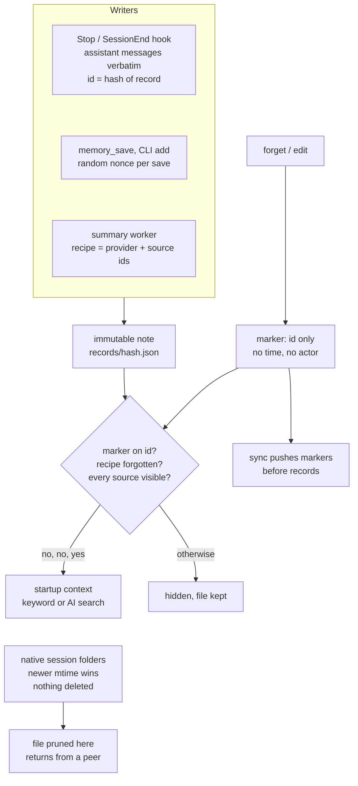

## 1. Executive Summary

mem-mastero is a plugin for Claude Code, Codex, Copilot CLI and Pi that copies
each agent's native session folders, Claude's `memory/` included, through a
private GitHub repository or a Drive folder. Beside that sync sits a
project-knowledge store of immutable JSON notes, whose ids hash their content
and whose forget markers sync ahead of them. The store is notable for how hard
it is to resurrect: capture replays, stale peers, re-imports and reworded AI
summaries are all refused. The native sync has no such guard, and its own
comment says a memory pruned on one machine comes back from another.

The knowledge store needs no service and no API key. Capture copies assistant
messages verbatim, and a SessionStart hook prints a bounded slice back into
the next session. Optional semantic search and summaries run through whichever
coding CLI the user is already signed in to, with its tools disabled. No
capability mark is earned. The forget marker is keyed on the note's whole
record, so the same fact from another session is a new note. Every test of
exclusion checks for absence without a control in the same result.

## 2. Mental Model

A memory is a **note**: kind, title, text, tags, a `source` naming agent,
session, event and optionally an archive node or source notes, a provenance,
and `createdAt`. Its id is `memory:` plus the SHA-256 of that body
(`memory-store.js:113-117`). Nothing about a note ever changes. A captured note
is deterministic, so capturing the same transcript event twice yields the same
id. A manual note carries a random nonce, so saving the same text twice yields
two notes (`memory-store.js:105-109`).

A note is visible when four conditions hold (`active`, `memory-store.js:216-247`):

- no forget marker carries its id;
- for a generated summary, its recipe is not forgotten, and it has the lowest
  id among summaries of that recipe;
- every note it cites in `memoryIds` is itself visible, resolved breadth-first,
  so a forgotten source hides every summary built on it;
- a cycle or a missing source leaves it hidden.

That is the whole state machine. A note is created, visible, then invisible
once a marker lands. It does not expire, decay, get superseded or change
status. An edit is a new note plus a forget of the old one, with no link
between them (`memory-command.js:79-86`).

Nothing is treated as verified. `provenance` says where a note came from
(`manual`, `captured`, `imported`, `generated`), and no read filters on it. A
captured note is a sentence the assistant said. A summary's text opens with
*"AI-generated summary; verify against the cited source memories"*
(`memory-summary.js:76`). The startup context calls every note untrusted
historical data (`memory-runtime.js:46`).

The native layer has no memory model of its own. It copies files and keeps the
newer one.

## 3. Architecture

Everything is one Node.js program, `sync.js`, with no npm dependencies; agents
reach it through lifecycle hooks and the MCP server through `memory-mcp.js`.
State lives in `~/.mem-mastero/` (`sync.js:366`) and in the user's chosen store.

**Native sync.** Each agent adapter names a local folder and a remote one
(`AGENTS`, `sync.js:181`). For Claude it is the whole
`~/.claude/projects/<encoded cwd>/` folder, transcripts and `memory/` together.
`syncFile` copies a file when the source is newer and throws on equal mtimes
with different bytes (`sync.js:87-105`); `syncDir` never deletes
(`sync.js:123-124`). With GitHub the store is a git clone: commit, then
`pull --rebase -X theirs`, which keeps this machine's side of a conflicting hunk
(`sync.js:440`, `:457`), then push. Files over GitHub's limit are split into
parts with a manifest.

**Knowledge store.** One directory per project and store under
`~/.mem-mastero/knowledge/<digest(store, project)>/`, with `records/` and
`tombstones/` of one JSON file each, plus local settings, an AI cache and job
state (`memory-store.js:18-35`). The remote copy is
`knowledge/v1/<sha256(project)>/` in the same store (`sync.js:548`).

**Archives.** Inactive Claude sessions can be uploaded to a
`mem-mastero-archives-v1` branch through the GitHub API, verified by re-download
against a manifest, then removed locally; a metadata graph and a temporary,
verified `recall` read them back. This is session storage, not memory, and a
note may cite an archive node.

**AI.** `memory-ai-provider.js` spawns the signed-in `claude`, `codex` or
`copilot` CLI with its tools, MCP servers, hooks and history off, strips API-key
and endpoint variables from the child's environment, and reads structured JSON
back (`memory-ai-provider.js:53-61`, `:108-132`).

### Deployment and ergonomics

Nothing has to run. The prerequisites are Node 18.17 or later, git, and for
GitHub a signed-in `gh`. Setup is `npx github:Shaf2665/mem-mastero setup`, which
creates or checks a private repository, installs the plugin into each agent it
finds, and optionally sets git's global `core.hooksPath` to a shim directory so
`git push`, `pull` and `checkout` sync too (`sync.js:604-643`; it refuses when
`core.hooksPath` is already set). It works offline for local notes. No API key
is used anywhere. The store is plain JSON, one file per note, but hand-editing a
note breaks its hash and makes `readCollection` refuse the whole collection
(`memory-store.js:118-124`, `:169`).

## 4. Essential Implementation Paths

- **Capture.** `run` in `sync.js:502-526` resolves the project, then
  `captureHook` (`memory-runtime.js:76-88`) calls `captureTranscript`
  (`memory-capture.js:149-232`) on push hooks only. It checks the transcript's
  recorded cwd against the project (`:103-147`), reads from a cursor at most
  2 MiB and 20 assistant messages, skips turns whose user prompt opened
  `<private>`, redacts secrets, and skips text echoing its own context
  (`:204`). Each message becomes an `observation` whose `eventId` is
  `digest([eventId, text])` (`:207-211`), saved in one batch (`:222`).
- **Manual write.** `memory_save` (`memory-mcp.js:91-96`) and `memory add`
  (`memory-command.js:78`) call `addMemory` with `provenance: 'manual'`.
- **Summaries.** `scheduleAI` spawns `sync.js memory-worker` detached after a
  push or start hook (`memory-ai-jobs.js:74-84`). `runAIJob` runs up to three
  batches 60 seconds apart (`:85-119`). `summarizePending`
  (`memory-summary.js:82-124`) takes up to 20 notes no recipe has covered,
  builds `eventId = summary-v1:<provider fingerprint>:<hash(source ids)>`
  (`:98`), validates the model's JSON and citations (`:45-74`), and publishes
  through `addGeneratedMemory` under the lock (`memory-store.js:306-323`).
- **Startup context.** On SessionStart, `buildContext`
  (`memory-runtime.js:41-61`) prints notes before the cloud sync starts, so a
  slow network cannot eat the hook's budget (`sync.js:511-516`). If `MEMORY.md`
  arrived from another device, its whole text is printed as well
  (`sync.js:582-585`).
- **Search.** `searchMemories` (`memory-store.js:335-355`);
  `searchMemoriesAI` (`memory-semantic.js:77-144`).
- **Forget and edit.** `forgetMemory` (`memory-store.js:280-292`); `edit`
  (`memory-command.js:79-86`).
- **Sync.** `syncMemories` pushes or pulls markers, then records
  (`memory-store.js:394-409`), called from `runSessions` before and after the
  git round trip (`sync.js:547-565`).
- **Import.** `importMemories` for the store's own export, which must match
  project and store (`memory-store.js:373-392`); `importClaudeMem` for a
  claude-mem export filtered to a named source project (`memory-import.js`).

## 5. Memory Data Model

A stored note has exactly `version`, `id`, `projectId`, `storeId`, `kind`,
`title`, `text`, `tags`, `source`, `provenance`, `createdAt` and, for manual
notes, `nonce` (`memory-store.js:85-111`). `kind` is one of eight: decision,
bugfix, discovery, preference, constraint, progress, summary, observation.
Text is capped at 16 KiB and the collection at 10,000 notes and 64 MiB
(`:12-16`). A generated note must be a `summary` from agent `mem-mastero-ai`
whose `eventId` hashes its own `memoryIds` (`:100-102`).

A forget marker holds `version`, `id`, `projectId`, `storeId` and, for a
summary, a receipt of its `eventId` and `memoryIds` (`memory-store.js:125-135`).
It carries no time, actor or reason.

The one temporal field is `createdAt`: the transcript message's timestamp for a
captured note, the epoch for an import with no date, and wall-clock time for a
manual note (`:103`). The forgotten note's file stays in `records/`; export omits
it (`:367-372`), and so does every read through `active`.

**Scope** is the pair of store and project. `projectId` is the normalised git
origin URL (`sync.js:127-139`). The store is the first configured one whose
patterns match it, so work repositories can route to a work account
(`resolveMemoryContext`, `sync.js:480-500`). The partition is a directory, and
every note also carries `projectId` and `storeId`. `canonicalRecord`
recomputes the hash with the current scope and throws on a mismatch, so a
foreign note planted in the directory fails the read rather than leaking into
it (`memory-store.js:118-124`).

## 6. Retrieval Mechanics

**Startup context** is ranked by kind (constraint 8 down to observation 1),
then manual before other provenance, then recency, and packed as JSON lines
into 4,000 characters by default, 512 to 12,000 by setting
(`memory-runtime.js:41-61`). A captured note contributes 180 characters, any
other 500. Claude Code and Codex hooks print it; the README says Copilot and Pi
receive none automatically.

**Keyword search** tokenises on Unicode letters, digits, `_` and `-`, and
scores each term by title hit (5), tag hit (4) and body count capped at 4, plus
10 when every term matched (`memory-store.js:334-355`). Kind, agent and date
filters apply first. Every call reads and re-hashes every file in the
collection, so a search over 10,000 notes validates 10,000 SHA-256 hashes.

**AI search** leads its candidate list with up to 100 lexical hits, then the
rest by recency. It packs as many of 80 as fit in 24 KiB, each cut to
512 bytes, and asks the configured CLI to return ids with scores of 0.5 or more
(`memory-semantic.js:94-105`, `:13`). Returned ids must belong to the candidate
set, and are re-read after the model returns, so a note forgotten
mid-inference drops out (`:72-75`). Hybrid mode fuses the two lists with
reciprocal rank at k = 60 (`:138-142`). There is no embedding index.

Any failure falls back to keyword results with a `fallback` code. The response
reports `coverage`, the number considered and the offset of the next page, so a
caller can see how much of the store the model saw.

**MCP** exposes search, timeline, get, save, forget and summarise; search
returns 240-character excerpts and get returns up to ten full notes
(`memory-mcp.js:23-42`).

## 7. Write Mechanics

Capture is extractive and model-free. It takes each assistant message whole,
up to 4,096 bytes, as one observation, with its first line as the title
(`memory-capture.js:203-211`). Nothing decides whether the message held a
durable fact. User prompts and tool payloads are excluded, and so is any turn
whose prompt contained `<private`. A paused capture records `captureSince`, so
resuming skips the paused interval (`memory-runtime.js:33-35`).

Deduplication is the id. A replayed capture produces the same note, and a
replay of a forgotten one is reported `forgotten: true` and not written
(`memory-store.js:259-262`). Manual saves are never deduplicated. There is no
consolidation or conflict detection between notes; two contradictory notes are
both visible.

Summaries are the only model writes. A summary covers up to 20 notes, each cut
to 900 bytes, and must cite every supplied id and no other
(`memory-summary.js:34-74`). Once any recipe has consumed a note, it is never
summarised again (`:30-33`).

### Operational cost

Capture runs synchronously in the Stop hook. It costs one bounded file read,
the privacy regexes and one collection scan, with no model call. A captured
note is searchable as soon as the hook returns. It reaches another machine on
that machine's next start or push hook. Summaries run in a detached process
that never blocks the agent, with at most three batches per run and 60 seconds
between batch starts. No pass rewrites the store. Startup injection is bounded
by the character budget and printed by the SessionStart hook, ahead of the
first user turn.

## 8. Agent Integration

Claude Code and Codex register SessionStart, Stop and SessionEnd hooks that run
`sync.js <agent> start|push` (`hooks/hooks.json`, `hooks/codex-hooks.json`).
Copilot runs a push on `userPromptSubmitted`, so it captures on every prompt
(`hooks/copilot-hooks.json`). Pi's extension runs start on `session_start` and
push on `agent_end` and `session_shutdown` (`pi/index.js:21-27`). Claude Code
and Copilot manifests register the MCP server; Codex gets the hooks and CLI
only.

The agent has every verb. `memory_save` writes a manual note with any source
fields it chooses, `memory_forget` writes a marker, and `memory_summarize`
spends the user's model allowance. **Every call names its project through a
`cwd` argument the model supplies** (`memory-mcp.js:15`, `:77`). The server
resolves whatever git origin that directory has, so an agent working in one
repository can search, save into or forget from another repository's store by
passing that repository's path. The integration test for this proves that a
second project is resolved separately, not that it is refused
(`test-memory-mcp.js:48`).

Codex requires the user to trust the hooks under `/hooks`.

## 9. Reliability, Safety, and Trust

### The native sync resurrects what the knowledge store would not

The knowledge store's tombstones exist because a copy-newer sync resurrects
deletions, and the native layer is that sync. `syncDir` copies every file that
is missing or newer and deletes nothing, and the comment above it says so: *"a
memory pruned on one machine comes back from another"* (`sync.js:123`). A
Claude auto-memory file deleted on laptop A is still in the store and is copied
back on A's next start. If A edited `MEMORY.md` and B edited it too, the git
rebase keeps this machine's hunks (`sync.js:440`). The file copy then keeps
whichever side has the newer mtime. The README states both rules for
sessions (`README.md:354`, `:487`). It does not say they cover the
`memory/` files it advertises syncing.

### Forgetting is suppression, everywhere

A forget leaves the note's file on disk and in the synced store, where git
history keeps it permanently. The README says this plainly
(*"Forget is not secure erasure"*). The marker has no timestamp or actor, so
the store cannot say when or by whom a note was forgotten. Edit adds the
replacement and then forgets the original under two separate locks. A failure
between the two leaves both notes visible (`memory-command.js:83-84`).

### What capture lets in

Capture stores the assistant's own sentences. A message that repeats a web
page, a tool result or an injected instruction becomes an observation, and its
first 180 characters return in every later session's startup context. Two
defences exist: the context header calling notes untrusted, and a filter that
drops captured text echoing mem-mastero's own context blocks
(`memory-capture.js:204`). Nothing evaluates a captured message before it is
stored.

### Supply chain

`setup` and the README's update command fetch `main` with no pin
(`npx github:Shaf2665/mem-mastero`); `update` clones `main` at depth 1 and runs
its `sync.js` (`sync.js:715-724`). A compromised push to `main` reaches every
installation on its next update, and each lifecycle hook then runs it.

### The AI child process

The provider runs its child with tools, MCP servers, hooks, slash commands and
session persistence off; Codex also gets a read-only sandbox. It strips
`ANTHROPIC_API_KEY`, `OPENAI_API_KEY` and provider-endpoint variables so the
call bills the signed-in subscription (`memory-ai-provider.js:53-61`,
`:108-132`). Note text goes over stdin, never argv. Each summary or search
call uses the user's plan allowance.

### Marks

None is carried.

- **`tombstone`** — the marker is keyed on the note's id, and the id hashes the
  whole record: source session, event, `createdAt`, and for manual notes a
  random nonce. It refuses the same captured event, a stale peer and a
  re-import, which are deletion-durability properties of one record. The same
  fact captured from another message, or saved again by hand, is a new note
  that no marker names. The summary receipt comes closer. It is keyed on the
  provider and the sorted source ids, so a forgotten summary cannot return in
  other words. It blocks one derivation, not the conclusion; a summary of
  other notes stating the same thing passes.
- **`trust_state`** — `provenance` is a source label and no read filters on
  it; summaries are labelled unverified in their text only.
- **`bitemporal`** — `createdAt` is the only time.
- **`scope_enforced`** — the partition is a directory per project and store.
  The per-note project check rejects a mismatched note instead of filtering
  it, and the model chooses the partition on every MCP call.
- **`audit_log`** — notes and markers are append-only, but a marker records no
  time or actor, and git history of the store is not credited.
- **`human_review`** — `memory view` writes a read-only HTML snapshot with no
  mutation API (`memory-view.js:1`). Correction is a CLI or MCP verb the agent
  holds equally.
- **`negative_eval`** — no committed case asserts that a forgotten note stays
  out of a result the same case shows to be populated; see section 10.

## 10. Tests, Evals, and Benchmarks

`run-tests.js` runs 25 `node:assert` scripts and the announcer's self-test in
sequence, each in an isolated home with git config and agent variables
stripped. CI runs them on Ubuntu, Windows and macOS with Node 22
(`.github/workflows/test.yml`). I did not run them.

The resurrection paths are covered thoroughly in
`test-memory-store.js`. Capture replay is refused (`:44-48`, `:134`), and a
stale peer and a fresh machine honour a marker (`:139-142`). A stale export
cannot revive a note (`:143-144`). A forgotten source hides its summary on
this device and a peer (`:182-190`). A forgotten recipe suppresses a
differently worded summary arriving from another device (`:216`). Races are
tested too: a source forgotten while a summary or a semantic search is in
flight is excluded (`test-memory-summary.js:89-94`,
`test-memory-semantic.js:103-107`). The viewer is executed against an XSS
payload with text-only DOM sinks (`test-memory-runtime.js:128-131`).

`negative_eval` is withheld on vacuity. Each exclusion asserts only absence:

- `test-memory-integration.js:73` checks that `search 'blue widgets'` returns
  nothing after the forget;
- `test-memory-ai-integration.js:69` and `:71` check
  `!matches.some(r => r.id === …)`;
- `test-memory-runtime.js:126` checks that the context lacks the id.

None asserts in the same call that another note is present, so each passes
against a search that returns nothing. The fixture at
`test-memory-integration.js:68` writes `fromB` and asserts it with a separate
`get`; asserting it in the same search would close this. The MCP case at
`test-memory-mcp.js:46-47` is populated, but what it excludes is private-tag
text redacted at write time, which was never stored.

There is no retrieval-quality evaluation and no benchmark.
`docs/claude-mem-comparison.md` is a capability comparison with
[claude-mem](../claude-mem/) and says the tests *"establish behavior and safety
properties, not superiority to another plugin"* (`:72`). No paper is
associated with the project.

## 11. For Your Own Build

### Steal

- **Make the id the hash of the record and the marker the id.** Re-capture,
  re-import and stale replicas then cannot resurrect a deletion, with no
  coordination beyond copying files. Push markers before records, so a sync
  interrupted halfway still errs towards hidden.
- **Key a derived note's deletion on its inputs.** A receipt on the sorted
  source ids and the generator's identity stops regeneration in any wording,
  which a text hash cannot.
- **Hide a derivation when any source is hidden**, resolved breadth-first so a
  cycle or a missing source stays hidden.
- **Report how much of the store the reranker saw.** `coverage` and
  `nextOffset` turn a bounded model rerank into something a caller can page
  through, rather than a silent truncation.
- **Re-read every model-selected id after the call returns.** It closes the
  window in which a note forgotten during inference is returned.

### Avoid

- **Two sync rules in one tool.** A user who learns that forget sticks has no
  reason to expect that deleting a native memory file does not. Either give
  both layers the same rule or say which files obey which.
- **Taking the partition from a tool argument.** Resolve it from the session
  that launched the server; a model that can name the directory can name
  another project.
- **A marker with no time and no actor.** It makes the forget durable and
  leaves nothing to audit or undo by.

### Fit

This suits someone who works across several machines with agents that keep
history in their home folder, and who wants a small, dependency-free, offline
note store riding on storage they already own. The engineering is careful where
it matters for that job: locking, atomic publication, path safety,
re-hashing on every read and fail-closed AI calls. Walk away if you need
memory others can rely on as true. Capture keeps whatever the assistant said,
nothing reconciles contradictions, and the native layer will put back what you
deleted. It is a single author's two-week-old project that updates itself from
`main`.

## 12. Open Questions

- How often captured assistant messages are useful notes rather than chatter,
  and how quickly the 10,000-note cap is reached in practice.
- Whether any user relies on native `memory/` files being restored after
  deletion, or whether a tombstone for that layer is planned.
- How the 64 MiB collection performs when every read re-hashes every note.
- How Copilot's per-prompt capture behaves against the hook's 60-second
  timeout on a large transcript.

## Appendix: File Index

- Knowledge store: `memory-store.js`, `memory-privacy.js`
- Capture and context: `memory-capture.js`, `memory-runtime.js`
- Retrieval: `memory-semantic.js`, `memory-store.js` (`searchMemories`)
- Summaries and worker: `memory-summary.js`, `memory-ai-jobs.js`,
  `memory-ai-provider.js`, `memory-copilot-provider.js`
- CLI, MCP, import, viewer: `memory-command.js`, `memory-mcp.js`,
  `memory-import.js`, `memory-view.js`
- Native sync, hooks, setup, update: `sync.js`, `hooks/*.json`, `pi/index.js`,
  `.claude-plugin/plugin.json`
- Archives: `archive*.js`, `claude-files.js`
- Tests: `run-tests.js`, `test-memory-*.js`, `test-archive-*.js`, `test.js`

### Recorded searches

Run from the repository root at the pinned commit with `/usr/bin/git grep`.

- **No validity time.**
  `git grep -n -i -E 'valid_?(from|to|until)|validfrom|event_time|occurred_at|expires?_?at' -- '*.js' ':!test*'`
  returns nothing; the same pattern with `createdat` added matches
  `memory-store.js` seven times.
- **No status on a note.**
  `git grep -n -i -E 'status|verified|candidate|rejected|confidence' -- memory-store.js`
  returns `addGeneratedMemory`'s return codes and the search's `candidates`
  variable only.
- **Edit records no predecessor.**
  `git grep -n -i -E 'supersed|replaces|previous|predecessor' -- memory-store.js memory-command.js`
  returns local variables in `edit`, the recipe-winner map and the AI settings
  patch.
- **The marker has no time or actor.**
  `git grep -n -E 'actor|deletedAt|forgottenAt|at:' -- memory-store.js`
  returns nothing.
- **The MCP server takes no session-bound project.**
  `git grep -n -E 'CLAUDE_PROJECT_DIR|process\.cwd|sessionId|transcript' -- memory-mcp.js`
  returns the `memory_save` source fields only.
- **No embedding index.**
  `git grep -n -i -E 'embedding|vector|cosine' -- '*.js' ':!test*'` returns a
  Copilot SDK option disabling embedding retrieval and the comment saying
  semantic search is not one.
- **No paper.**
  `git grep -n -i -E 'arxiv|bibtex|@article|@misc|doi\.org' -- .` returns
  nothing.

## History

**2026-11-03** — [`f0221b2757cea4dafad3dd928ddcc2d13de2f170`](https://github.com/Shaf2665/mem-mastero/commit/f0221b2757cea4dafad3dd928ddcc2d13de2f170). First reading, from a full clone. Screened first: four auto-run surfaces, all the plugin's own (the `.claude-plugin/` marketplace and plugin manifests, the `hooks/` directory, and `hooks/hooks.json` registering SessionStart, Stop and SessionEnd commands that run `sync.js`); the manifest also starts `memory-mcp.js`. `package.json` was inside the seven-day cooldown and names no dependencies. MIT, no rider. Nothing installed, built or run. No marks: the forget marker is keyed on the record rather than the value ([section 9](#9-reliability-safety-and-trust)).
