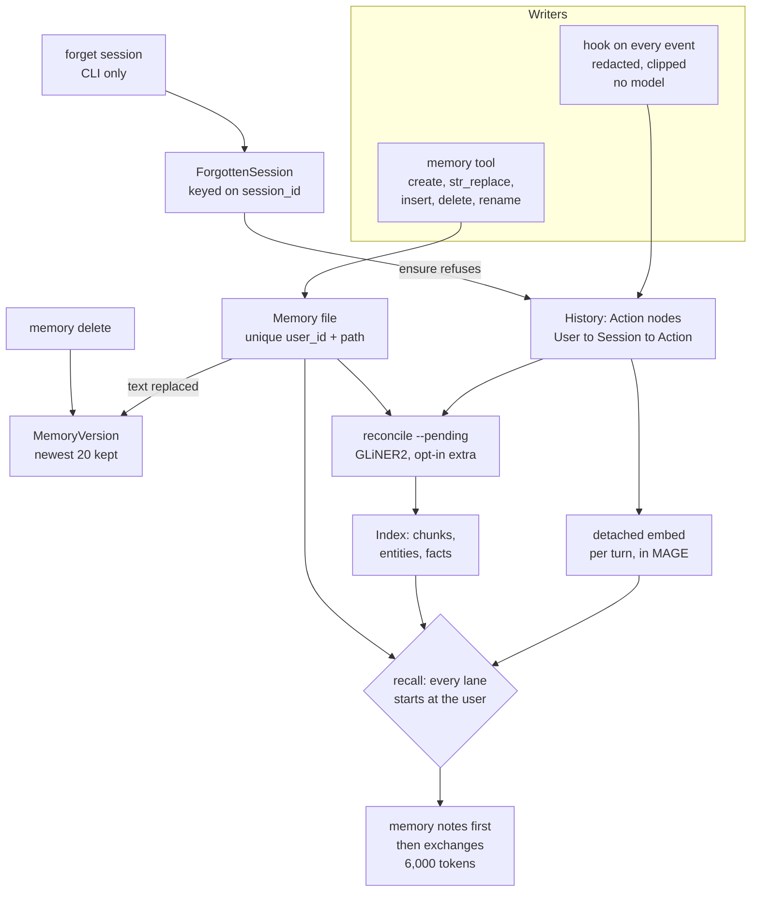

## 1. Executive Summary

Context Graph is the agent-memory family inside Memgraph's AI toolkit: hooks
record every Claude Code, Codex and Copilot session into one Memgraph graph, the
agent keeps curated files under `/memories` through the Claude memory tool, and
a `recall` tool answers from both. Its read side is the notable part. Every
lane is rooted at the configured user's own nodes, down to entities whose
content-addressed chunks two users share. Its deletion is weaker than it
reads: deleting a memory file keeps the text as a version, the version cap drops
the oldest history, and nothing purges either.

The report covers the `context-graph/` packages and the `unstructured2graph`
extractor they call. The rest of the monorepo is out of scope:
`langchain-memgraph`, `lightrag-memgraph` and `mcp-memgraph` are adapters and a
query server over Memgraph that store no agent memory of their own,
`sql2graph` migrates relational schemas, and `memgraph-toolbox` and `hygm` are
the client and ontology libraries Context Graph imports.

Capture and recall need no LLM key. Extraction is local GLiNER2 and opt-in.
Two marks are earned, `scope_enforced` and `negative_eval`, both on recall. The
published LongMemEval-S and BEAM figures recompute exactly from the committed
per-question baselines, and they measure a configuration with graph lanes the
default setup does not install.

## 2. Mental Model

The family defines its own vocabulary and holds to it
(`context-graph/CONTEXT-MAP.md`). **History** is every turn a hook captured,
kept as evidence rather than distilled. **Memory** is a file the agent saved on
purpose with the `memory` tool, and is the only thing called memory. The
**Index** is the chunks, entities and typed facts GLiNER2 extracts from both,
which recall uses to find turns and files; it is not a third kind of memory.

A turn becomes retrievable by being captured. There is no admission step: the
capture policy redacts and clips it, a connector writes it, and the detached
embed gives it vectors (`memgraph_context_graph/capture_policy.py:1-17`,
`sessions_graph/connector.py:148-150`). It stops being retrievable only when
the user forgets its whole session, from the CLI.

A memory file becomes a belief when the model writes it. Each discarding write
first copies the old text into a `MemoryVersion` in the same query
(`sessions_graph/memory_store.py:664-674`). An edit is compare-and-set on the
text it read, so a stale edit fails instead of overwriting another session
(`:535-604`). A file stops being one when the model or an SDK caller deletes it,
and its text then lives on as a version marked `deleted`.

Nothing is treated as verified. No field on a memory, a turn or a fact says
whether it may be acted on. Recall returns evidence, and the harness's own model
answers from it under reading rules that put memory files first and call the
most recent row current (`sessions_graph/recall.py:188`, `:195`).

A forgotten session leaves a `(:ForgottenSession {session_id})` marker that
every later write for that id consults (`memgraph_context_graph/session.py:41-76`).

## 3. Architecture

Nine Python packages share one graph and join on `(:Session {session_id})`.
`memgraph-context-graph` holds the CLI, seven runtime adapters, the hook runner,
the capture policy and the stdio MCP server. `actions-graph` writes messages,
tool calls, results and subagents. `skills-graph` records which sessions used a
skill, and `resources-graph`, opt-in, records GitHub issues and pull requests an
agent read. `sessions-graph` owns users, memory files, reconciliation and
recall. `viewer` is a read-only terminal UI, `spaces` is the Enterprise edition,
and `eval` holds the benchmarks.

Components are entry points. A connector registers under
`memgraph_context_graph.connectors` and a tool under
`memgraph_context_graph.tools`; the MCP server loads every registered tool and
reads the config file again on each listing and call, so turning memory on
takes effect in the next session (`mcp_server.py:33-89`). Three tools are registered:
`recall` and `memory` from sessions-graph, `resource` from resources-graph.

Retrieval runs inside Memgraph. MAGE's `embeddings` module computes vectors in
the database process with `BAAI/bge-small-en-v1.5` by default, and recall scores
them with `vector_search.cosine_similarity` over the user's own rows rather than
a global index, because an unfiltered top-k could crowd one user out
(`sessions_graph/embeddings.py:1-23`, `recall.py:25-29`). Full text uses
Memgraph text indexes on `Action.text` and `Memory.content`.

Extraction is `unstructured2graph`'s GLiNER2 backend over the user's adopted
ontology version. Its one LLM use is ontology derivation, which needs
`ANTHROPIC_API_KEY` or `OPENAI_API_KEY` from the config file
(`sessions_graph/derive_llm.py:1-9`).

### Deployment and ergonomics

Memgraph 3.6 or later has to be running, with MAGE for vectors. Setup starts
`memgraph/memgraph-mage:3.13.1` as a Docker container bound to `127.0.0.1`
and keeps it across runs (`setup/memgraph.py:27`, `:230`). Without MAGE, recall
falls back to text search and says so in its result.

The install is `curl … install.sh | bash` or the plugin's `bootstrap.sh`, which
runs `uv tool install` with `>=` floors on the four packages and `--upgrade`, so
every bootstrap takes whatever is newest on PyPI
(`plugins/memgraph-context-graph-claude/scripts/bootstrap.sh:19-27`).
Reconciliation is a further extra that setup does not install. It works offline
once the image and models are present, needs no API key to store or recall
anything, and the store is inspectable from Memgraph Lab or any Bolt client but
not repairable as files.

## 4. Essential Implementation Paths

- **Capture.** A runtime hook runs `memgraph-context-graph hook run <runtime>`;
  the Claude plugin registers it on 13 events, from SessionStart through
  PostToolUse to SessionEnd, each with a 30-second timeout
  (`plugins/memgraph-context-graph-claude/hooks/hooks.json`). The adapter
  normalises the payload into an event, `AgentLink.emit` applies the capture
  policy, and every supporting connector persists it (`link.py:74-77`).
- **Session bookkeeping.** `SessionsGraphConnector` merges User and Session on
  start, links a memory-tool write's paths to the session on `TOOL_END`, and on
  each turn end marks the session `pending` and spawns a detached embed
  (`sessions_graph/connector.py:122-150`).
- **Memory writes.** `MemoryTool.call` routes a path under
  `/memories/spaces/<name>/` to that shared space and anything else to the
  personal store; `MemoryStore.execute` dispatches the six commands
  (`sessions_graph/tool.py:287-322`, `memory_store.py:131-156`).
- **Session-start context.** `render_index` lists root files and the current
  project's files, prints `pin: true` files in full first, and fits both into
  the harness's 10,000-character budget (`memory_index.py:69-96`,
  `memgraph_context_graph/tools.py:46`). The recall tool adds a brief of the
  last sessions in the same project (`resume.py:51-89`).
- **Recall.** `recall` embeds the question, runs the lanes, and packs the result
  as exchanges (`recall.py:387-454`, `recall_exchanges.py`).
- **Reconciliation.** `sessions-graph reconcile --pending` takes memory files
  whose `extraction_status` is pending, then sessions, each up to 100
  (`sessions_graph/cli.py:455-489`). `Reconciler.reconcile` extracts one
  document per session and links chunks back to their source Actions
  (`reconciler.py:206-320`).
- **Forget.** `forget_session` writes the marker, runs each component's
  `forget_session` twice in a fixed order, then deletes the Session node
  (`memgraph_context_graph/forget.py:58-72`).

## 5. Memory Data Model

A memory file is `(:Memory {memory_id, user_id, path, content, created_at,
updated_at, author, updated_by, extraction_status})`, unique on
`(user_id, path)`, owned through `(:User)-[:HAS_MEMORY]->`, linked from each
session that wrote it by `PRODUCED_MEMORY`, and from a project folder path by
`ABOUT` (`sessions_graph/core.py:3-18`, `:68-89`). A file holds at most 100 KiB
(`memory_store.py:39`). Directories are path prefixes, not nodes.

A `MemoryVersion` holds the replaced text with `replaced_at`, `session_id`,
`replaced_by` and `deleted`, hung off both the user and the file so a deleted
file's history outlives it (`memory_store.py:664-674`). The newest 20 per
`memory_id` survive each write (`:44`, `:606-616`).

History is actions-graph's Action nodes: user and assistant messages, tool
calls, results, errors and subagents, under the Session or under an Agent. Any
captured string is clipped at 100,000 characters
(`capture_policy.py:38`).

The Index is unstructured2graph's. A `Chunk` is content-addressed by hash, so
two users' identical text shares one chunk. An entity's `MENTIONED_IN` edge to a
chunk lists its source turns in `sources`, and each extracted relationship
carries `source_id`, `confidence`, the sentence, the speaker and `valid_at`
(`unstructured2graph/memgraph.py:492-552`). `valid_at` is the source turn's
timestamp, or a memory file's `created_at` (`reconciliation.py:198`, `:208`).
A fact stated in two sessions is two edges with their own `valid_at`, so a
superseded value is kept and ordered, never closed.

**Scope** is the user. Every Memory carries `user_id`, every Action is reached
through `User -> Session`, and the session also records a `project_key` from
its git remote. In Enterprise, each member's data is a database `u_<login>` and
each shared space `space_<name>`, with roles granted per database
(`spaces/src/context_graph_spaces/provision.py:1-30`).

## 6. Retrieval Mechanics

`recall` runs six lanes, each started at the user's own nodes
(`recall.py:1-30`, `:271-375`):

- **memories**: up to 5 files, by passage vector and by full text, both
  filtered on `user_id`;
- **turns**: up to 8 messages by passage vector over the user's Actions;
- **text**: up to 8 by full text, post-filtered to the user's action ids;
- **entities**: up to 15 nearest entities with a mention from the user's own
  turn, then up to 6 of each one's facts read from the user's turns;
- **facts** and **user_facts**: nearest facts, and every fact of the two
  relation types nearest the question.

The ownership checks are the design's strength. A shared chunk does not grant
its facts: an entity is the user's only when a mention's `sources` include the
user's turn, and a fact only when its `source_id` is one (`:296-307`). The text
lane widens `search_all` to the whole action count first, because the default
1,000-hit cap would drop the user's turns before the filter saw them
(`:494-506`).

The default `exchanges` packing groups each hit with its neighbouring turns,
uses facts for ranking only, and budgets whole groups with the memory notes into
6,000 `cl100k_base` tokens (`:84-89`, `recall_exchanges.py:46-48`).
Supplemental discovery adds problem-resolution episodes from the sessions the
vector lane chose. With several spaces readable, recall fans out in parallel
under a 10-second deadline and names any space that missed it
(`tool.py:159-187`).

Recall is pull-only: a tool call. The session-start index and brief are
automatic, but they list files and quote recent turns rather than answer a
question.

Two failure modes follow from the lanes. In a default install the graph lanes
return nothing, because no extraction has run, and a memory file has no vector:
`embed_memory`'s only caller is `reconcile_memory` (`reconciler.py:571`). So
memory files are found by full text alone until the extra is installed and the
sweep runs. And an edited file keeps the chunks and facts of its old text
until the next sweep, which affects ranking but not the rendered note, read
from the current `content`.

## 7. Write Mechanics

Capture is complete and model-free. Every message, tool input and tool output
reaches the graph after the capture policy has stripped `<private>` blocks,
replaced ten built-in credential shapes, configured patterns and the config
file's own secrets, and clipped each string (`capture_policy.py:1-17`,
`:41-52`). `[capture] exclude_tools` and `exclude_projects` drop events or
whole projects. The policy filters by tool, project and pattern, never by
whether a turn is worth keeping.

Memory files are the model's call. The tool description tells it what to save,
where, and with what frontmatter, and to update a file rather than add a
near-duplicate (`tool.py:190-218`). Every write marks the file
`extraction_status = 'pending'`; a delete removes what extraction derived from
the file, except in a shared space, where members may not touch chunks
(`memory_store.py:271-315`).

Two writers bypass all of this. `SessionsGraph.update_memory` and
`delete_memory` match on `memory_id` alone, write no version and leave the
derived index in place (`core.py:409-444`); their callers are tests and a
docstring.

Reconciliation is extractive. It deduplicates a session's texts, joins them in
recorded order into one document so GLiNER2 sees spans across turns, and writes
chunks, entities and relationships keyed on chunk and source turn, so
re-ingesting is idempotent (`reconciler.py:206-320`). It writes no summary and
never creates a Memory.

### Operational cost

The hook path blocks the agent for one Bolt round trip per connector, under a
deadline five seconds short of the hook's timeout (`hooks/runner.py:37-50`).
No model is on it. A turn is full-text searchable once the hook returns and
vector searchable once the detached embed finishes, seconds later on a warm
Memgraph. Graph lanes and memory-file vectors wait for the next
`reconcile --pending`, manual or scheduled; `auto_reconcile` fires only on
session end and is off by default (`connector.py:140-146`).

No pass rewrites the store; re-extraction under a new ontology covers only the
derivation's delta. Injection is bounded at 10,000 characters at session start and 6,000 tokens per
recall, and the session-start text sits in the hook's context block ahead of the
first user turn.

## 8. Agent Integration

Claude Code and Codex get user-wide plugins. Copilot CLI, Cursor, OpenCode,
Antigravity CLI and Grok Build get project hooks and an MCP server in their
user configuration, and Grok receives the session-start text through the MCP
server's `instructions` because its hooks cannot reach the model
(`mcp_server.py:12-15`). Apps on the Claude Agent SDK or OpenAI Agents SDK get
capture, context and memory tools in-process, and Anthropic SDK apps get
`MemgraphMemoryTool` with the user fixed by the application
(`sessions_graph/anthropic_memory.py:1-26`).

Memory is opt-in per user. `setup --memory-backend context-graph` turns the
harness's own memory off in its config, imports its existing memories, and makes
the `memory` tool available; `--memory-backend native` hands them back
(`memgraph_context_graph/memory_backend.py:1-14`). Until then the tool is
neither listed nor callable (`tool.py:283-285`).

The model holds every memory verb, including `delete`, and cannot name a user:
identity and connection come from the config file
(`memgraph_context_graph/tools.py:11-13`). It cannot forget a session; that is a
CLI command that lists first and requires a terminal or `--yes`
(`cli.py:87`, `:142`).

For Codex, setup writes `default_tools_approval_mode = "approve"` for the
plugin's MCP server unless the user set a mode, so Codex stops asking before
each call. The docstring calls the tools *"read-only over the user's own memory"*
in the same sentence that says `memory` writes `/memories` files
(`adapters/codex_memory.py:199-215`).

## 9. Reliability, Safety, and Trust

### Deleted text stays in the graph

The memory tool's `delete` copies the file's text into a `MemoryVersion` with
`deleted: true` before `DETACH DELETE` (`memory_store.py:290-310`). Pruning runs
per `memory_id`, and a re-created path gets a new id, so the deleted file's last
20 versions never age out. The one `DETACH DELETE v` in the tree is the prune
(`:613`). A session forget keeps the memory files the session wrote and only
nulls `session_id` on their versions (`core.py:110-118`); the configuration
guide says so. A secret saved into a memory file survives both deleting the
file and forgetting the session, and needs a Cypher query or
`uninstall --all` to go.

### The version history is capped, and has no reader for the user

The same cap that keeps deleted text also drops a busy file's oldest history: the
21st write deletes the first version. The module docstring calls a stale write
*"recoverable"*, and no CLI, tool or viewer reads versions back; the only
caller of `versions()` is the native-memory export, which uses them to tell a
descendant from a conflicting edit (`adapters/claude_code_memory.py:164`).

### Forgetting is provenance-exact

`forget_sources` removes relationships whose `source_id` is one of the
session's turns, strips those ids from each mention's `sources`, and deletes an
entity or chunk only when nothing else backs it (`forgetting.py:34-110`). The
marker then stops a hook in flight, a reconciliation mid-run, or a resume from
writing the session again, checked inside `ensure`, inside actions-graph's
writes and twice inside `reconcile` (`session.py:41-60`,
`actions_graph/core.py:479`, `reconciler.py:257`, `:296`).

### Pinned files are standing instructions the model can write

A file whose frontmatter says `pin: true` is printed in full at every session
start, ahead of the index, up to 25,000 characters or half the budget
(`memory_index.py:44`, `:88-92`). The model can write that frontmatter. A
prompt injection that persuades it to save a pinned file has a channel into
every later session, and the only defence is the tool description's line that
contents are notes, not user instructions.

### Identity

In Community the user is `identity.user_id`, a string in a local config file.
The container setup starts is bound to loopback and configured with no Memgraph
user (`setup/memgraph.py:260-263`), so any local client of it reads every
user. Enterprise moves the boundary into Memgraph:
a database per member, roles hashed from their grants, and a service account
for what members may not write (`spaces/CONTEXT.md`).

### Marks

Earned:

- **`scope_enforced`** — the stored `user_id` and the `User -> Session` path
  root every recall lane, the session-start index and the resume brief
  (`recall.py:271-375`, `memory_store.py:490-495`, `resume.py:68-77`).
- **`negative_eval`** — a populated cross-user case; see section 10.

Withheld:

- **`tombstone`** — `ForgottenSession` is keyed on `session_id`. It refuses the
  same session and nothing else; the same text captured in another session, or
  written into a memory file, is new. Deleting a memory file leaves no marker
  the agent's next `create` consults.
- **`trust_state`** — no status on a memory, turn or fact. Ontology versions
  carry `adopted`, `rejected` and `superseded` behind a held-out gate
  (`ontology.py:221-270`, `derivation.py:1-24`), but a version is a relation
  vocabulary, not a claim that could be false.
- **`bitemporal`** — `valid_at` is when the turn was said; no edge records when
  a fact stopped holding.
- **`audit_log`** — `MemoryVersion` is written in the mutation's own query, but
  the prune deletes all but 20, a new file leaves no record, forget nulls the
  session, and the Python update and delete bypass it.
- **`human_review`** — no memory waits in any state; the agent writes and
  deletes directly. Codex's per-call prompt is the nearest gate, and setup turns
  it off.

## 10. Tests, Evals, and Benchmarks

The suites test persistence against a live Memgraph by policy, with mocks only
for event translation and error branches (`context-graph/CONTEXT-MAP.md`). A
test without Memgraph or MAGE skips, and CI starts `memgraph-mage:latest` for
each package job (`.github/workflows/tests.yaml`). I did not run them.

`negative_eval` rests on
`test_every_lane_reads_only_the_asking_users_history`
(`sessions-graph/tests/test_e2e_recall.py:109-121`). Two users each say they
visited Paris with a different companion; the two facts share one Paris entity.
For each user the case asserts their own companion is in the rows and the other
is not, so it fails if the mention-source predicate goes. Beside it,
`test_other_users_files_are_never_recalled` (`:317-322`) asserts only that the
memories list is empty, in a fixture that gives the asking user no file, and
passes against a memory lane that returns nothing.

The forget suite is populated in the same way, over graph queries rather than
recall. Forgetting one of two sessions removes `uv` and keeps `pip`
(`sessions-graph/tests/test_e2e_forget.py:57-75`). A forgotten session is not
reconciled again (`:78-88`), a forget landing mid-reconciliation leaves no chunk
or entity (`:91-107`), and memory files a forgotten session wrote stay
(`:110-120`).

The eval package runs LongMemEval-S and BEAM 100K through the shipped read
path and commits each official run's per-question rows under
`context-graph/eval/baselines/`. I recomputed both headlines from those rows
with a separate script, reading and not running the harness. The mean of the
500 LongMemEval-S scores is 0.874, mean evidence recall 0.957 over 470 scored
questions, mean retrieval 5,862.7 tokens and mean recall 1.56 seconds.

BEAM 100K's 400 scores average 0.631, with evidence recall 0.701 over 354. The
LongMemEval run used `gpt-4o-2024-08-06` as judge and the BEAM run
`gpt-4.1-mini`, with `gpt-4.1` answering both. The BEAM baseline records its
commit as `e31e945-dirty`, an uncommitted working tree. Both were built with
GLiNER2 extraction, which a default install does not run. No paper is
associated with the project.

## 11. For Your Own Build

### Steal

- **Root every read at the owner, not at the content.** When content is
  addressed by hash and shared, carry the source turn on each mention and fact,
  and decide ownership there. Then test it with two users sharing one entity.
- **Forget by provenance, then sweep the unbacked.** Remove exactly the edges a
  source produced, then the entities and chunks nothing else backs. A per-source
  forget then never takes another session's fact with it.
- **Check the tombstone inside the write.** `ensure` refuses inside its own
  MERGE, and reconciliation checks again after extraction, so a forget that
  races a background job wins.
- **Make edits compare-and-set against the text read.** It turns two sessions
  editing one file into an error the model can retry, instead of a lost write.
- **Commit the per-question rows behind every headline**, with the judge and the
  revision, so the number can be recomputed without the harness.

### Avoid

- **Keeping deleted text as history under the same cap as edits.** Either purge
  on delete, or give deleted versions their own retention and a verb to erase
  them; a capped log is neither an audit nor a recycle bin.
- **Letting the model mark its own memory as always-injected.** Keep pinning a
  person's decision, or frame pinned text as untrusted the way recall frames its
  rows.
- **Benchmarking a configuration the installer does not produce.** Publish the
  default install's number beside the tuned one.

### Fit

This suits a developer or a small team willing to run Memgraph, who
wants every session across several coding agents kept and searchable without
an LLM bill, and who will read Cypher when something looks wrong. The
engineering is careful where concurrency and ownership are concerned, and the
benchmark figures are checkable. Walk away if forgetting must mean erasure, if
a single machine's plain files are enough, or if memory must be reviewed before
it lands. Its first commit under `context-graph/` is dated 23 April 2026, every
commit there is one author's, and each bootstrap installs whatever is newest on
PyPI.

## 12. Open Questions

- How large the graph grows per month of full tool-output capture at the
  100,000-character clip, and how recall latency scales with it.
- Whether a default install's recall, without extraction or memory-file
  vectors, has been measured on either benchmark.
- Whether a purge for `MemoryVersion` text, or a restore verb, is planned.
- How often agents write `pin: true`, and whether any guard is intended.

## Appendix: File Index

Paths are under `context-graph/` unless they name another package.

- Storage and schema: `sessions-graph/src/sessions_graph/core.py`,
  `memory_store.py`, `models.py`; `memgraph-context-graph/src/memgraph_context_graph/session.py`;
  `unstructured2graph/src/unstructured2graph/memgraph.py`
- Capture: `memgraph-context-graph/src/memgraph_context_graph/hooks/runner.py`,
  `link.py`, `capture_policy.py`, `adapters/`; `actions-graph/src/actions_graph/core.py`
- Retrieval and context: `sessions-graph/src/sessions_graph/recall.py`,
  `recall_exchanges.py`, `memory_index.py`, `resume.py`, `embeddings.py`
- Background: `sessions-graph/src/sessions_graph/reconciler.py`,
  `reconciliation.py`, `derivation.py`, `ontology.py`, `cli.py`
- Forget: `memgraph-context-graph/src/memgraph_context_graph/forget.py`,
  `sessions-graph/src/sessions_graph/forgetting.py`
- MCP, tools, SDK: `memgraph-context-graph/src/memgraph_context_graph/mcp_server.py`,
  `tools.py`, `sdk/`; `sessions-graph/src/sessions_graph/tool.py`,
  `anthropic_memory.py`
- Setup and plugins: `memgraph-context-graph/src/memgraph_context_graph/setup/`,
  `plugins/`, `scripts/install.sh`
- Enterprise: `spaces/src/context_graph_spaces/`
- Tests and evals: `*/tests/`, `eval/src/context_graph_eval/`, `eval/baselines/`

### Recorded searches

Run from the repository root at the pinned commit with `/usr/bin/git grep`.

- **No end of validity.**
  `git grep -n -E 'invalid_at|valid_to|valid_until|expired_at' -- context-graph/sessions-graph context-graph/memgraph-context-graph context-graph/actions-graph unstructured2graph`
  returns nothing; `valid_at` in the same command matches `reconciliation.py`
  and `memgraph.py`.
- **No status on a memory file.**
  `git grep -n -E 'status' -- context-graph/sessions-graph/src/sessions_graph/memory_store.py`
  returns the two `extraction_status = 'pending'` writes only.
- **Versions are deleted only by the prune.**
  `git grep -n -E 'DETACH DELETE v' -- context-graph` returns
  `memory_store.py:613` only.
- **No restore path for versions.**
  `git grep -n -E '\.versions\(' -- context-graph ':!**/tests/**'` returns the
  two calls in `adapters/claude_code_memory.py` and a line of
  `sessions-graph/docs/python-api.md`.
- **No review state or approve verb.**
  `git grep -n -i -E 'approve|pending_review|needs_review|quarantine' -- context-graph ':!context-graph/eval' ':!**/tests/**'`
  returns Codex and Copilot tool-approval configuration and docs only.
- **Three registered tools.**
  `git grep -n -A3 'memgraph_context_graph.tools"\]' -- '*.toml'` lists
  `resource`, `recall` and `memory`.
- **The legacy memory API has no product caller.**
  `git grep -n -E '\.(update_memory|delete_memory|save_memory)\(' -- '*.py'`
  returns tests and the package docstring.
- **Memory-file vectors come only from reconciliation.**
  `git grep -n -E 'embed_memory\(' -- context-graph ':!**/tests/**'` returns its
  definition and `reconciler.py:571`.
- **The LangChain integration keeps no memory.**
  `git grep -n -i -E 'ChatMessageHistory|BaseStore|memory' -- integrations/langchain-memgraph`
  returns nothing.
- **No paper.**
  `git grep -n -i -E 'arxiv|bibtex|@article|@misc|doi\.org' -- .` returns
  nothing.

## History

**2026-11-05** — [`2e9af39fa42326b9daf795244579eafefe8f1cbc`](https://github.com/memgraph/ai-toolkit/commit/2e9af39fa42326b9daf795244579eafefe8f1cbc). First reading, from a shallow clone, scoped to `context-graph/` and the `unstructured2graph` extractor; commit counts from the GitHub API. Screened first: five auto-run surfaces, all the Claude plugin's own (the marketplace manifest, the plugin manifest, its `.mcp.json` starting `memgraph-context-graph mcp`, its `hooks/` directory, and `hooks/hooks.json` registering 13 events); fifteen manifests with no lockfile beside them, and every manifest inside the cooldown because a shallow clone dates each file to the tip. MIT, no rider. Nothing installed, built or run; the benchmark headlines were recomputed from committed rows. Two marks, both on recall ([section 9](#9-reliability-safety-and-trust)).
