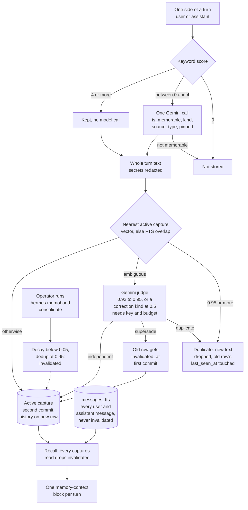

## 1. Executive Summary

MemoHood is a memory provider for [Hermes Agent](../hermes-agent/): it
captures memorable turns of a conversation into a local SQLite file, recalls
the relevant ones into a `<memory-context>` block before every reply, and lets
a newer statement supersede an older one. What is notable is the capture gate.
A free keyword score keeps or drops most turns, and only the uncertain middle
band costs one Gemini call. What is weak is that supersession reaches only one
of the two corpora recall reads. The capture is retired, and the original
message stays in the history index that feeds the same block.

The stored memory is the turn, not a fact extracted from it. The borderline
model classifies a turn and returns no text, and the pipeline stores the whole
user or assistant message with secrets redacted (`capture.py:600-609`).

A correction works by similarity. A new capture's nearest active neighbours
are found by vector or FTS overlap, and a Gemini judge decides duplicate,
supersede or independent in the ambiguous band. The supersede classifier is
modelled, by its own docstring, on [GBrain](../gbrain/)'s `facts/classify.ts`
(`capture.py:20-37`).

Three declared pieces do nothing at this commit. Graph
rerank is on by default and reads `session_links`, which no code writes. The
README describes nightly consolidation through `hermes cron`, and nothing
registers the job. The `signals` and `session_tags` tables have no writer.

**Licence.** MIT, in `LICENSE`, and the README says the same. `plugin.yaml`
carries no licence field, which matters only to a packager reading the
manifest. `DESIGN_v1.md` was written against two private planning documents it
names as not part of the repository; the code does not depend on them.

One mark, `trust_state`, on the `invalidated_at` column that every read of
captures excludes. Section 9 gives the reasons for the six withheld.

## 2. Mental Model

A memory is a **capture**: one side of one turn, judged worth keeping. It is
believed from the moment it is written. There is no candidate state, and the
`EXTRACTED` or `INFERRED` label the borderline model assigns filters nothing.

A turn side becomes a capture in three bands (`capture.py:577-598`):

- **Score 0.** No keyword signal matched. Dropped, no model call.
- **Score 4 or more.** A correction, decision, "remember this" or pinned
  trigger, summed by `compute_signals` (`capture.py:142-173`). Kept with the
  kind of the heaviest signal, no model call.
- **In between.** One Gemini call returns `is_memorable`, `kind`,
  `notability`, `source_type` and `pinned` (`extract_llm.py:331-383`).

A capture stops being believed in one way: `invalidated_at` is stamped and the
row leaves both search indexes. Four writers do it:

- **Supersede**, when the judge says so or a Hermes built-in memory `replace`
  names the row's exact content (`capture.py:449-497`).
- **Removal**, when a built-in memory `remove` names it
  (`capture.py:705-720`).
- **Decay**, when confidence computed from `last_seen_at` falls below 0.05
  and the row is not pinned (`consolidate.py:121-160`).
- **Dedup**, when two active rows sit at cosine 0.95 or more
  (`consolidate.py:212-239`).

The row is never deleted. A tag records why for decay, dedup and removal, and
no code reads the tag. A superseded row carries no tag; its successor names it
in `supersedes` and holds its text, dated, in `history`.

Recall then reads two corpora. Captures are filtered on `invalidated_at`. The
history index, `messages_fts`, holds every user and assistant message from
Hermes's own `state.db` and has no state at all. A statement retired as a
capture is still a message.

## 3. Architecture

A Hermes plugin of `kind: exclusive`, installed into
`$HERMES_HOME/plugins/memohood/` and selected with `memory.provider: memohood`
(`plugin.yaml`). The host loads `MemoHoodMemoryProvider` and calls its
lifecycle methods; nothing runs outside the Hermes process.

Storage is one SQLite file, `<hermes_home>/memory.db`, in WAL mode beside
Hermes's `state.db` (`db.py:109-124`, `:255-266`). It holds `captures`,
`captures_fts`, the vec0 table `captures_vec`, `messages_fts`, `spend` and
`_meta`. `state.db` is opened read-only through a `mode=ro` URI and never
written (`db.py:769-783`).

Three external services sit behind the keys, each optional:

- **Cloudflare Workers AI** embeds with `@cf/baai/bge-m3` at 1,024 dimensions.
  An offline `fastembed` provider with `intfloat/multilingual-e5-large` is the
  alternative (`_engine/embed.py:214-260`).
- **Cohere** reranks with `rerank-v3.5` (`_engine/rerank.py:39`).
- **Gemini** `gemini-flash-lite-latest` classifies, judges and summarises
  through the OpenAI-compatible endpoint (`extract_llm.py:81-82`).

Every call is logged to `spend`, and a provider whose trailing 30-day estimate
passes its ceiling, $5 each by default, is skipped (`db.py:685-711`).

The provider keeps no long-lived connection. Each method opens its own, because
Hermes 0.22 calls providers from several threads (`provider.py:9-19`).

### Deployment and ergonomics

`install.sh` or `install.ps1` finds Hermes's virtual environment, installs the
dependencies, copies the plugin and sets the provider in `config.yaml`. With no
keys, memory works on FTS5 alone, and only the definite-keep band is captured,
since the borderline call and the judge need `GEMINI_API_KEY`.

The store is a SQLite file a person can open. Nothing in the tree exports or
edits it. `AGENTS.md` is installation instructions addressed to an agent that
installs the plugin from a chat.

## 4. Essential Implementation Paths

- **Schema.** `db.py`: `captures` `:143-162`, `captures_fts` `:167-172`,
  `messages_fts` `:177-185`, `signals`, `session_tags`, `session_links`
  `:188-217`, `spend` `:219-227`, migrations `:388-398`.
- **Capture.** `provider.py:343-378` (`sync_turn`) →
  `capture.process_turn` `:615-641` → `extract_and_store` `:547-612` →
  `_store_capture` `:417-539`.
- **Supersede decision.** `_nearest_captures` `capture.py:295-362`,
  `_fts_dup_candidates` `:365-397`, `_should_judge` `:271-274`,
  `extract_llm.judge` `extract_llm.py:404-478`.
- **Invalidation and index cleanup.** `db.drop_capture_from_indexes`
  `db.py:650-671`, called from every invalidating writer.
- **Recall.** `provider._compute_prefetch_text` `provider.py:229-293` →
  `gate.should_recall` → `retrieve.hybrid_search` `_engine/retrieve.py:395-510`
  → `graph_rerank.graph_rerank` → `post_recall.attach_vectors` and
  `diversify` → `retrieve.fts_search_messages` `:174-201`.
- **History index.** `db.catch_up_from_state` `db.py:809-932`, run from
  `initialize` (`provider.py:152-162`) and `hermes memohood seed`.
- **Mirrors of the built-in memory.** `provider.on_memory_write`
  `provider.py:449-491`, `capture.find_active_by_content` and
  `forget_by_content` `capture.py:690-720`.
- **Consolidation.** `consolidate.run_nightly` `consolidate.py:441-462`, called
  only from `cli.py:167-172`.
- **Tools.** `tools.py:51-256`, dispatched at `:280-291`.

## 5. Memory Data Model

The `captures` row (`db.py:143-162`):

- `id` is a random hex UUID minted per insert (`capture.py:501`), so a
  superseding capture gets a new id. The schema docstring says the id is
  *"stable across a SUPERSEDE rewrite"* (`db.py:19-23`); the code inserts a
  new row.
- `content` is the redacted turn. `kind` is one of seven values plus
  `summary` for rollups. `notability` is high, medium or low.
- `source` is `EXTRACTED` or `INFERRED`. `confidence` starts at 1.0 and is
  rewritten by decay.
- `pinned` exempts the row from decay and from being the victim of a dedup
  (`consolidate.py:204-209`).
- `supersedes` and `history` are on the successor only.
- `session_id`, `tags`, `last_seen_at`, `created_at`, `updated_at`,
  `valid_from`, `invalidated_at`, `embed_signature`.

`valid_from` is written as the insert time by both writers
(`capture.py:514-516`, `consolidate.py:316-318`) and read by nothing. The
schema comment calls it bi-temporal after Graphiti (`DESIGN_v1.md`); in the
code it is record time.

`message_id` is always `NULL`, so a capture cannot be traced to the Hermes
message it came from, only to its session.

`messages_fts` stores message id, session, role, text, a stemmed copy and the
timestamp in the FTS row itself. It has no status column.

Three tables have a schema, indexes and no writer: `signals`, `session_tags`
and `session_links`. `DESIGN_v1.md` says `sync_turn` should write
*"signals/tags/links"*; `sync_turn` calls `process_turn` and nothing else.

Scope is the file. One `memory.db` per Hermes home, and every capture from
every session in it is one corpus.

## 6. Retrieval Mechanics

Recall runs inline in `prefetch` for the current message. `queue_prefetch` is
a deliberate no-op, because a result precomputed after turn N was being served
on turn N+1 for the wrong message (`provider.py:329-334`).

The gate comes first. Its default backend `pass` always recalls. The opt-in
`model2vec` backend skips recall only when small-talk seeds clearly beat
memory-question seeds, and every error path returns recall
(`gate.py:403-443`).

The query is reduced to meaningful terms by `query_norm.meaningful_terms`, and
`hybrid_search` runs two arms over three times `k` candidates:

- **FTS5.** Alphabetic tokens are stemmed with the Russian Snowball stemmer
  and matched against `content_stem`; tokens holding a digit, hyphen or dot
  are matched raw against `content`; all are ORed, at most 32
  (`_engine/retrieve.py:108-142`).
- **Vector.** The query is embedded and matched by vec0 KNN. The arm is
  skipped during an embedding migration, past the spend ceiling, or when the
  deadline leaves under half a second (`_engine/retrieve.py:250-301`).

The two lists fuse by reciprocal rank with k=60 and a bonus for ranks 1 to 3.
Hydration drops any row with `invalidated_at` set
(`_engine/retrieve.py:348-366`). The top 20 go to Cohere, blended with the RRF
score at 75/25, 60/40 or 40/60 by original rank so a top lexical hit survives
the reranker (`:444-473`).

Three post-passes follow:

- **Graph rerank** returns its input unchanged when `session_links` is empty
  (`graph_rerank.py:350-354`), and it always is.
- **Near-duplicate collapse and MMR** need a vector on every candidate. One
  missing vector makes both a passthrough (`post_recall.py:174-199`). Rollup
  summaries are inserted with no vector (`consolidate.py:316-323`), so a
  summary among the results switches diversity off for that turn.
- **History.** `fts_search_messages` returns BM25 hits from `messages_fts`
  with no filter but the match (`_engine/retrieve.py:174-201`).

The block lists captures, pinned ones tagged, then history messages: four and
two by default (`config.py:70`), where the README's settings table says 8
and 4. Each item is flattened to one line and cut at 300 characters by `inline_data`
(`_engine/security.py:451-460`), under a note that the lines are data and not
instructions. A capture is a whole turn, so a fact stated past its 300th
character is not in the block.

Every capture shown has its `last_seen_at` touched (`provider.py:217-227`).
With the gate passing every turn, recall is also the reinforcement signal for
decay.

## 7. Write Mechanics

`sync_turn` hands both sides to `process_turn`. On Hermes 0.22 and later it
runs on the host's single background worker, which serialises turns; on older
hosts it spawns a daemon thread per turn (`provider.py:53-57`, `:375-378`).
The assistant side is captured by default. The config comment states the
risk: *"The agent's own replies can carry its mistakes, which would then come
back as 'facts'"* (`config.py:49-51`).

Assistant text has one signal pattern, weight 3.0, for lines like `итог:`,
`вывод:` or `root cause`, so an assistant capture always passes through the
borderline model (`capture.py:137-139`).

Before scoring, a turn that repeats an active rollup summary is skipped, so a
recalled summary echoed back is not captured again (`capture.py:222-253`).

**The supersede check.** `_store_capture` embeds the new text and takes the
five nearest vectors, keeping only active rows. When the vector top is under
0.92 it also tries FTS candidates scored by word Jaccard, so a twin written
while the embedder was down is still found (`capture.py:438-444`). Then:

- **0.95 or more:** duplicate. The new text is dropped and the old row's
  `last_seen_at` touched; a pinned trigger on the new text pins the old row
  (`:467-476`).
- **0.92 to 0.95, or a correction, preference or decision at 0.5 or more with
  a Gemini key:** the judge sees up to three candidates and answers with an
  index, which the code resolves to an id and range-checks
  (`extract_llm.py:454-474`).
- **Otherwise:** independent insert.

On supersede, the old row is stamped and dropped from both indexes in one
transaction, and the new row with its `history` line is inserted in a second
(`capture.py:489-524`). A failed insert after the first commit leaves the old
row invalidated and no successor.

`manual_capture` skips the gate and runs the same check. It serves the
`memohood_capture` tool, the built-in memory mirror and delegation summaries
(`capture.py:644-687`). A built-in memory `replace` passes the previous
content, which resolves by exact match to an active mirror and supersedes it
with no judge.

### Operational cost

Recall blocks the reply. Its two network steps get three seconds each with no
retries, under a six-second deadline after which they are skipped
(`provider.py:62-66`). Capture does not block the reply. A capture is
retrievable once its commit lands, normally before the next turn. A message
reaches `messages_fts` at the next `initialize`, so the current session's
history is not searchable until a later session starts.

Consolidation runs only when an operator starts it, and then it touches the
whole store. Decay reads every active unpinned row, and dedup runs one
self-KNN per active row. The rollup makes one Gemini call per session-day
bucket of five or more captures, and the last stage rewrites `captures_fts`
whole (`consolidate.py:121-160`, `:212-239`, `:339-386`, `:425-433`).

The injection is the current turn's memory block and four to six one-line
items by default. The system prompt block is a fixed text
(`provider.py:82-92`), so recall does not disturb a cached prefix.

## 8. Agent Integration

The model sees five tools (`tools.py:263-277`): `memohood_search` for raw
hits with ids and scores, `memohood_fetch` for one capture with its
supersede history, `memohood_recall` for the same block on demand,
`memohood_stats`, and `memohood_capture`, which takes `kind` and `pinned`
from the model.

No tool forgets, corrects or lists history across rows. The README says so,
and says a wrong record is fixed by stating the correct version.

Hermes hooks carry the rest:

- `on_pre_compress` stores up to five of the newest definite-keep messages
  about to be compressed (`provider.py:380-423`).
- `on_memory_write` mirrors writes to Hermes's built-in memory as captures,
  `persona` for the `user` target and `instruction` otherwise: `add` inserts,
  `replace` supersedes, `remove` invalidates (`provider.py:449-491`).
- `on_delegation` records the task and result, 300 characters each, as an
  `event` (`provider.py:493-515`).
- `on_session_switch` with `rewound` clears the prefetch cache and nothing
  else (`provider.py:428-447`). Captures made from the dropped turns stay.

A child context is a hard no-op: `parent_session_id`, or an `agent_context` of
`subagent`, `cron` or `flush`, turns off recall, capture and the tool list
(`provider.py:128-133`).

## 9. Reliability, Safety, and Trust

### The history leg serves what supersession retired

`hybrid_search` and every other read of captures drop an invalidated row. The
same recall block then appends `fts_search_messages` hits from
`messages_fts`, which indexes every user and assistant message and is never
updated when a capture is superseded or removed. The only `DELETE` on it is
the version 2 migration that removed tool output (`db.py:392`).

A user who said *"I'm allergic to penicillin"* in one session and corrected it
in another has the correction as the active capture and the original sentence
in the history index. A query that matches the original's words gets it back,
under *"Похожие места в истории диалога"*, with nothing marking it as
replaced. The README's account of the same scenario says the old record
*"no longer surfaces in normal search"*. That is true of `memohood_search`,
which reads captures only, and not of the automatic block or
`memohood_recall`.

### Supersede in two commits

The old row's invalidation commits before the new row's insert
(`capture.py:489-524`). An insert that fails raises `DbError`, and
`extract_and_store` returns `None` (`:605-612`). The fact is then gone from
recall: the old row is invalidated, and the history line that would have
preserved it lived on the row that was never written. `DESIGN_v1.md` asks
that an error *"don't write partial"*.

### The duplicate band reinforces instead of correcting

At cosine 0.95 or more the new text is dropped as a duplicate without a model
call, and the old row's `last_seen_at` is touched. A correction phrased as the
old sentence with a negation lands here if it embeds that close. Whether it
does under BGE-M3 was not measured. The FTS fallback uses word Jaccard against
the same 0.95, and a negation adds one word.

### What a removed fact can do next

`forget_by_content` invalidates the row and tags it `memory_removed`. The
duplicate check reads active rows only (`capture.py:277-284`), so the same
statement captured again is a new independent row. Nothing keyed on the value
remembers the removal.

### Prompt injection and secrets

Text sent to Gemini is fenced as untrusted data (`extract_llm.py:351`,
`:432-436`). Text going into the store passes `scan_secrets` and has each
finding replaced with `[REDACTED]` (`capture.py:197-214`). Recalled text is
flattened, stripped of list and heading markers and capped. The borderline
model and the `memohood_capture` tool can both set `pinned`, which exempts a
row from decay for good.

### Concurrency

`sync_turn` is serialised by the host on Hermes 0.22. `on_memory_write` and
`on_delegation` always spawn their own threads (`provider.py:491`, `:515`), so
either can run the supersede check concurrently with a turn's capture. SQLite's
five-second busy timeout prevents lock errors; it does not prevent two writers
reading the same active candidate. The history catch-up re-reads its watermark
under `BEGIN IMMEDIATE` for the same reason (`db.py:877-884`).

### Marks

- **`trust_state` — earned.** `invalidated_at` has four producers on
  reachable paths and is excluded by every read of captures, including the
  automatic recall. There is no candidate state, and the history leg of the
  same block has no state.
- **`tombstone` — withheld.** Removal and supersession are keyed on a row.
  The duplicate check cannot see an invalidated row, so a removed statement
  can be captured again.
- **`bitemporal` — withheld.** `valid_from` is the insert time at both
  writers and nothing reads it.
- **`scope_enforced` — withheld.** The boundary is one file per Hermes home.
  `session_id` is on every capture; the one query that filters on it is the
  graph expansion, which never runs.
- **`audit_log` — withheld.** `spend` is an append-only ledger of external
  calls, not of mutations. A superseded row's text survives in its
  successor's `history`; decay, dedup and removal leave a tag and no event.
- **`human_review` — withheld.** A capture is served the moment it is
  written. The CLI reports and maintains; it approves nothing.
- **`negative_eval` — withheld.** Section 10 gives the reason.

## 10. Tests, Evals, and Benchmarks

I ran none of the tests. The counts are from reading.

There are 286 test functions in 27 files. The README badge reads 247 passed
and 1 skipped. `tests/conftest.py` loads a fresh copy of the package per test
under a synthetic namespace, strips the four credential variables, and reads
the real `~/.hermes/.env` only for tests marked `integration`. It imports
Hermes's `agent.memory_provider`, so the suite needs a Hermes installation.

What the suite covers well:

- the three capture bands and the judge's cosine floors, with judge and
  nearest-neighbour monkeypatched (`tests/test_capture.py`,
  `tests/test_supersede_band.py`);
- index cleanup on supersede, decay and dedup (`tests/test_index_hygiene.py`);
- pinned rows surviving dedup and supersede (`tests/test_pinned_integrity.py`);
- decay idempotence across consecutive runs
  (`tests/test_consolidate.py:64-78`);
- the recall network budget (`tests/test_prefetch_budget.py`);
- concurrent initialisation (`tests/test_db_concurrency.py`).

**`negative_eval` is withheld.** No test runs `hybrid_search`, `prefetch`,
`memohood_search` or `memohood_recall` over a populated store holding an
invalidated capture and asserts it absent. The supersede and removal tests
assert on `captures_fts` contents and on counts of rows where
`invalidated_at IS NULL` (`tests/test_index_hygiene.py:45-63`,
`tests/test_small_fixes.py:90-100`). That is the index and the column, not a
read. The pipeline test that asserts `cap-a-hidden` absent from the final
block is testing near-duplicate collapse of a valid capture
(`tests/test_v1_1_pipeline.py:283-291`), and it inserts `session_links` rows
by hand, which no product path does.

No test covers the history leg after a supersede, a failed insert after an
invalidation, or a negated restatement in the duplicate band.

There is no retrieval evaluation, no benchmark, no committed result and no
paper reference in the tree.

## 11. For Your Own Build

### Steal

- **Two bands around one model call.** Score the turn for free; keep the clear
  positives and drop the clear negatives without a model, and spend one call
  only on the middle. The score also decides which kinds get a judge below
  the near-duplicate band (`capture.py:267-274`).
- **Leave every index in the transaction that retires the row.**
  `drop_capture_from_indexes` runs inside the invalidating transaction, so a
  retired row cannot occupy a top-k slot before hydration drops it.
- **Decay from a fixed base.** Each run recomputes from 1.0 and the age since
  `last_seen_at`; the comment records that reusing last night's value
  compounded the decay (`consolidate.py:132-135`).
- **A deadline on the read path.** Each network step on recall gets a timeout
  bounded by the time left and no retries, and a step with too little time is
  skipped to FTS-only.
- **Mirror the host's own memory edits.** A `replace` carrying the previous
  content becomes an exact-match supersede with no model in it.

### Avoid

- **A correction that reaches one of two corpora.** If recall reads raw
  history beside curated memory, retiring a fact has to mark or exclude the
  messages it came from, or the block serves both.
- **Retire and insert in separate commits.** The correction and its
  replacement are one change.
- **Storing the turn as the fact.** A paragraph with a fact in it is matched
  by everything else in the paragraph and truncated before the fact.
- **A near-duplicate band that never asks.** Above the threshold, a sentence
  and its negation look alike; the cheap path should not be the one that
  reinforces the old value.
- **Default-on stages over tables nothing writes.** They pass every test that
  inserts the rows by hand and do nothing in a real install.

### Fit

This suits one Russian-speaking Hermes user who wants recall without
commands and will pay a few cents a month for embeddings and a small model. It
installs in one step, degrades to FTS5 without keys, and keeps its cost
visible. The Russian stemmer is the only stemmer, so English text gets no
inflection matching on the lexical arm.

Walk away if a correction must stay corrected. The history index brings back
what supersession retired, a removed fact can be captured again, and nothing
is ever deleted from `memory.db`. Walk away too for more than one person per
Hermes home: the file is the only boundary.

## 12. Open Questions

- How close does BGE-M3 put a sentence and its negation? That decides how
  often a correction is dropped as a duplicate.
- Is `session_links` meant to be written by the host or by a later version?
  The plugin declares it, reads it and never fills it.
- Does Hermes's `on_memory_write` deliver `previous_content` on every
  `replace` and `remove`? Without it, only `add` is mirrored
  (`provider.py:458-466`).
- Was the badge count of 247 taken before the later fix commits added tests?

## Appendix: File Index

| Path | Role |
| --- | --- |
| `provider.py` | The Hermes `MemoryProvider`: recall, capture, hooks, child-context no-op |
| `capture.py` | Keyword scoring, borderline call, supersede check, insert, mirrors |
| `extract_llm.py` | Gemini classify, judge and summarise |
| `db.py` | Schema, migrations, index cleanup, spend, history catch-up |
| `_engine/retrieve.py` | FTS5 and vec0 arms, RRF, rerank blend, invalidated filter, history search |
| `consolidate.py` | Decay, dedup, rollup, FTS rebuild |
| `graph_rerank.py` | Session-link boost and expansion over an empty table |
| `post_recall.py` | Near-duplicate collapse and MMR |
| `gate.py` | Pass-through or model2vec recall gate |
| `tools.py` | The five agent tools |
| `cli.py` | `hermes memohood status`, `reindex`, `seed`, `consolidate`, `setup` |
| `_engine/security.py` | Untrusted fences, secret scan, recall flattening |
| `config.py` | Defaults and config merge |
| `tests/` | The suite; `conftest.py` executes on collection |

### Recorded searches

Run from the repository root at the pinned commit with `/usr/bin/git grep`.

- **Nothing writes `session_links`.**
  `git grep -n -E 'INSERT( OR [A-Z]+)? INTO session_links'` returns
  `tests/test_graph_rerank.py:66` and `tests/test_v1_1_pipeline.py:82`;
  `git grep -n 'FROM session_links'` matches `graph_rerank.py:168` and `:207`.
- **Nothing writes `signals` or `session_tags`.**
  `git grep -n -E 'INTO (signals|session_tags)'` returns nothing;
  `git grep -n -E 'INTO spend' -- '*.py' ':!tests'` matches `db.py:694`.
- **Supersession never touches the history index.**
  `git grep -n -E 'DELETE FROM messages_fts|UPDATE messages_fts'` returns the
  migration at `db.py:392` only.
- **No row is deleted from captures.**
  `git grep -n -E 'DELETE FROM captures([^_]|$)'` returns nothing;
  `git grep -n 'DELETE FROM captures_fts' -- '*.py' ':!tests'` matches
  `consolidate.py:428` and `db.py:664`.
- **`valid_from` is never read.** `git grep -n 'valid_from' -- '*.py' ':!tests'`
  returns the column, two docstrings and the two `INSERT` column lists.
- **The one session predicate is the graph expansion.**
  `git grep -n -E 'session_id *= *\?' -- '*.py' ':!tests'` returns
  `graph_rerank.py:268`.
- **No reader of the removal and decay tags.**
  `git grep -n -E 'memory_removed|archived_decay|dedup_merged' -- '*.py' ':!tests'`
  returns the writers at `capture.py:716`, `consolidate.py:138` and `:197` and
  docstrings; `git grep -n 'rolled_up' -- '*.py' ':!tests'` matches three
  readers in `consolidate.py`.
- **Nothing registers a cron job.** `git grep -n -i 'cron' -- '*.py' '*.sh' '*.ps1'`
  returns docstrings, the child-context set at `provider.py:80` and a test.
- **No review or approval surface.**
  `git grep -n -i -E 'approv|human|review' -- '*.py' ':!tests'` returns
  pricing comments, log-message docstrings and setup-wizard labels.
- **No mutation audit.** `git grep -n -i 'audit' -- '*.py' ':!tests'` returns
  one docstring, `consolidate.py:25`.
- **No paper reference.** `git grep -n -i -E 'arxiv|bibtex|doi\.org|citation'`
  returns one comment, `_engine/stem.py:34`; `git grep -n -i 'gbrain'`
  matches.
- **No CI.** `git ls-files .github` returns nothing.

## History

**2026-11-24** — [`b1e0a038bbb7d2270fdabd2d0ca7b7f67d04ee0b`](https://github.com/maximskorohod/memohood/commit/b1e0a038bbb7d2270fdabd2d0ca7b7f67d04ee0b). First reading at `b1e0a03`, read only from a full clone at the head of `main`. Screened first: no auto-run surface, nothing inside the seven-day cooldown, one build-time execution point (`tests/conftest.py` executes on pytest collection), and an `AGENTS.md` addressed to installing agents, read as data; no submodules. Nothing was installed, built or run, and the test count was not run. One mark, `trust_state` ([section 9](#9-reliability-safety-and-trust)). The history index returns superseded statements, supersede commits twice, and graph rerank reads a table nothing writes.
