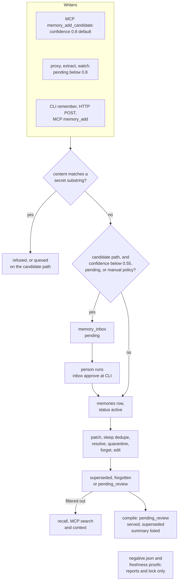

## 1. Executive Summary

memory.cpp is a Rust workspace, not C++: a CLI that keeps typed
repository memories in a local SQLite vault and compiles them into a
context pack for a coding agent, with an MCP server, an HTTP API, an
OpenAI-compatible proxy and a C API over the same engine. What holds up is
the plain memory layer: a status field that recall filters, a scope
predicate with a populated test, insert-only version snapshots, and a
task-independent stable prefix whose blake3 hash a test pins across tasks.
What is weak is the compiler the README leads with. Its freshness proofs,
negative memory and write firewall run in report commands and the
lockfile, and none of them decides what enters the pack.

The README calls the packs *"freshness-proven, security-filtered,
cache-stable"*. The freshness proof is never handed a span hash, so its
content check is always skipped, and a memory with no source anchor proves
fresh. No pack-building path calls it
(`crates/memory-cli/src/compiler_commands.rs:333-370`). The security filter
is two substring lists, one at write and one at compile, and the write
firewall the README describes has one caller, a CLI command that screens
text typed into it. The pack that `memory compile` prints carries the task
on its third line, above every memory, so its first bytes change with
every task.

The CAMC-Bench table in the README is a transcription; no result file is
committed. Its reduction column recomputes from its token column, and its
stale, contradiction and secret counts recompute from the fixture corpus.
The arm labelled *negative memory* drops fixtures by their own `is_secret`
and `is_distractor` flags rather than through the negative-memory store
(`crates/memory-core/src/bench.rs:348-356`).

**Licence.** MIT, in `LICENSE` (*"Copyright (c) 2026 memory.cpp
contributors"*) and the workspace `Cargo.toml`, which agree; the three
crates inherit the workspace licence. No file in the tree carries other
terms, and nothing restricts use.

## 2. Mental Model

A memory is a row with one of eleven kinds, a scope, the stored content, a
heuristic summary, an importance and a confidence. Status, tags, the source
anchor, `human_confirmed` and a contradiction count live inside
`metadata_json` under a `memory_cpp` key (`crates/memory-core/src/types.rs:730-757`).
A memory written through `remember` is `active` at once and is served as
true; nothing verifies it first.

Status has seven values and one consumer that matters. `is_recallable`
admits `active`, `archived` and `ephemeral`, and every recall skips the
rest (`crates/memory-core/src/types.rs:95-97`,
`crates/memory-core/src/storage.rs:454-456`). A memory stops being served
in four ways: `patch` marks it `superseded` and links its replacement,
`forget` marks it `forgotten`, `sleep` supersedes exact duplicates, and
`contradictions resolve` supersedes the loser of a detected pair
(`crates/memory-core/src/engine.rs:476-518`, `:553-555`, `:347-351`,
`crates/memory-cli/src/compiler_commands.rs:1653-1667`).

`gc --apply` and `memory edit --status` write `pending_review`;
`quarantine approve` returns such a memory to `active` and `quarantine
reject` marks it `forgotten`
(`crates/memory-cli/src/compiler_commands.rs:1582-1599`,
`crates/memory-cli/src/main.rs:13307-13352`). An inbox candidate is not a
memory at all. It is a row in `memory_inbox` that becomes one only when
`approve_inbox_item` calls `remember` (`crates/memory-cli/src/main.rs:5671-5726`).

The freshness verdict is derived, not stored. `prove` computes `fresh`,
`stale` or `unverifiable` on each call from the source file, the line
count, commit reachability, expiry, the contradiction count and a
reliability threshold, and nothing writes the result back to the row
(`crates/memory-core/src/freshness.rs:122-323`). A memory dies only through
the C API's `memory_engine_delete` or `memory privacy purge`, which removes
the whole directory.

## 3. Architecture

Three crates. `memory-core` holds the engine, the SQLite store, the
embedders and the compiler modules; `memory-cli` is one binary whose
`main.rs` carries the command surface, the MCP server, the HTTP API and the
proxy; `memory-capi` exports a C ABI declared in `include/memory_cpp.h`.
The only C in the tree is that header and `examples/c/basic.c`.

Storage is one bundled SQLite file in WAL mode behind a single
`Mutex<Connection>`, with ten tables created on open
(`crates/memory-core/src/storage.rs:51-191`). Beside it sit
`negative.json`, `context.lock`, `ledger.jsonl`, `audit/mcp-access.jsonl`
and generated packs (`crates/memory-cli/src/compiler_commands.rs:154-161`,
`:1182-1196`, `crates/memory-cli/src/main.rs:20274-20284`).

The default embedder is not a model. `HashEmbedder` hashes unigrams and
bigrams with blake3 into 384 dimensions and normalises the vector
(`crates/memory-core/src/embedding/hash.rs:39-55`). Ollama and
OpenAI-compatible embedders are optional over `ureq`.

### Deployment and ergonomics

Nothing has to run. `cargo build -p memory-cli` produces the binary; no API
key is needed to store or recall, and the default path makes no network
call. `memory serve` binds 127.0.0.1:7331, `memory mcp` speaks stdio, and
`memory proxy` forwards chat completions to an upstream, by default Ollama
on localhost (`crates/memory-cli/src/main.rs:552-572`). The store opens in
any SQLite client, though status and tags are inside a JSON column rather
than columns of their own.

## 4. Essential Implementation Paths

- **Write.** `remember` refuses on `detect_sensitive_data`, applies a
  `Reject` or `NeverStore` policy, builds the row, persists it with its
  embedding and entities, and appends a `create` version and a `remember`
  event (`crates/memory-core/src/engine.rs:63-95`).
- **Candidate write.** `remember_candidate` queues to `memory_inbox` when
  the content is sensitive, the confidence is below a 0.55 floor, the
  status is `pending_review` or the policy is `ManualReview`, and otherwise
  calls `remember` (`crates/memory-core/src/engine.rs:97-164`).
- **Recall.** `recall` embeds the query, scans the scope in
  `SqliteStore::search`, ranks, truncates, bumps access counts and appends
  a `recall` event carrying the retrieved rows
  (`crates/memory-core/src/engine.rs:170-248`).
- **Compile.** `build_ai_context_report` runs a 48-result search with
  `include_inactive(true)` plus a `mistake`-tagged search, filters, and
  renders the pack; `durable_stable_prefix` runs a separate fixed-query
  search for the prefix (`crates/memory-cli/src/main.rs:10259-10502`,
  `:10526-10597`).
- **Correct.** `patch`, `update_status`, `forget`, `edit_memory`,
  `restore_memory` (`crates/memory-core/src/engine.rs:476-648`).
- **Lock.** `build_lock_and_ledger` lowers `retrieve_candidates` into IR,
  computes a proof per included memory and counts the results, and hashes
  `negative.json` into a version string
  (`crates/memory-cli/src/compiler_commands.rs:1199-1303`).
- **MCP.** `call_mcp_tool` and `read_mcp_resource`
  (`crates/memory-cli/src/main.rs:19080-19308`).

## 5. Memory Data Model

`memories` holds the row with `scope`, `kind`, `importance`, three
timestamps, an access count and the embedding blob
(`crates/memory-core/src/storage.rs:57-71`). `memory_versions` holds a
full JSON snapshot per mutation with an `action`; `memory_events` holds a
typed event per write and per recall; `memory_relations` holds
`changed_to` edges from `patch` (`:95-130`). `memory_conflicts` records
pairs `sleep` flags, with `status` `open` and no writer that closes them
(`crates/memory-core/src/engine.rs:358-374`).

Provenance is a `MemorySource` with file, line, commit, conversation and
message ids, `created_by` and a reliability float, all optional and all
caller-supplied (`crates/memory-core/src/types.rs:153-165`). Temporal
fields are `created_at`, `updated_at`, `last_accessed_at`,
`last_verified_at` and `expires_at`. `created_at` can be set by the caller,
which backdates the record rather than recording a validity interval.

Scope is one string per row. Workspaces are rows in `workspaces`, and a
workspace whose category is `global` is merged into every scoped recall by
default (`crates/memory-core/src/storage.rs:407-420`, `:1212-1221`).

## 6. Retrieval Mechanics

`SqliteStore::search` filters by scope and kind in SQL, then walks every
remaining row in Rust. It skips unrecallable status, expired rows, missing
tags and a dimension mismatch, deserialises each embedding, and keeps the
best `pool_size` by replacement (`crates/memory-core/src/storage.rs:396-510`).
Cost grows with the scope, not with the result.

The ranker weighs similarity 0.35, keyword overlap 0.20, entity overlap
0.15, importance 0.15, recency 0.10 and confidence 0.05, less a redundancy
and a sensitivity penalty (`crates/memory-core/src/ranker.rs:17-30`).
`min_score` defaults to 0.0, so any scored row in scope can fill the limit
(`crates/memory-core/src/types.rs:379`).

The compiler is a second reader over the same search. It sorts
`mistake`-tagged rows first, then skips secret-like and injection-like
text, rows `is_memory_stale_or_blocked` matches, duplicates and anything
past the budget unless it is a hard rule
(`crates/memory-cli/src/main.rs:10288-10382`). `is_memory_stale_or_blocked`
names `superseded`, `contradicted` and `forgotten`, and the search above it
asked for inactive rows, so `pending_review` and `archived` rows reach the
pack (`:10195-10204`, `:10278`).

A blocked row does not vanish. Its summary and id go into
`stale_summary`, and `render_compiled_prompt` prints up to eight of them
under *Stale/contradicted context summary* (`:10344-10351`, `:10656`).

## 7. Write Mechanics

Writes are synchronous and make no model call. A memory is retrievable as
soon as `remember` returns. Extraction from repository files, git history,
traces and proxied responses is keyword matching with fixed confidences:
a proxied sentence containing *decision* scores 0.7, *prefer* 0.68, others
0.62 (`crates/memory-cli/src/main.rs:20050-20120`).

`detect_sensitive_data` lower-cases the content and refuses on `api_key`,
`-----begin`, `password`, `secret`, `ssn` or `aadhaar`, and on `sk-` or
`ghp_` in the original text (`crates/memory-core/src/engine.rs:1155-1177`).
The `sk-` check matches inside *task-* and *risk-*, so a memory saying a
prefix is *task-independent* is refused as an authentication token.

The compile path uses a different list, `detect_sensitive_reason`, which
matches `secret=` and `password=` rather than the bare words
(`crates/memory-cli/src/main.rs:20388-20405`). `restore_snapshot` and
`import_persona` call `persist_memory` directly and pass neither check
(`crates/memory-core/src/engine.rs:751-767`, `:865-879`).

### Operational cost

Nothing runs in the background. `sleep` reads every memory in a scope,
supersedes exact duplicates, records adjacent-pair conflicts, multiplies
the importance of any memory untouched for 30 days and never accessed by
0.85 and rewrites it, then writes a compaction summary
(`crates/memory-core/src/engine.rs:331-402`). Its cost is linear in the
scope and it is run by hand.

The pack's budget defaults to 1,500 estimated tokens at four characters a
token, and MCP `memory_context` to 1,200. The compiled prompt opens with a
header line and then the `Task:` line (`crates/memory-cli/src/main.rs:10642-10643`),
and `memory pack` adds a `Generated at:` timestamp above that
(`:10725`). A provider prefix cache keyed on the pack therefore misses on
every new task and on every pack run.

## 8. Agent Integration

The MCP server's default surface is `memory_search`, `memory_context`,
`memory_timeline`, `memory_explain`, `memory_graph`, `memory_map` and
`memory_add_candidate`. `memory_add`, `memory_update`, `memory_forget` and
`memory_compact` appear only with `--allow-writes`
(`crates/memory-cli/src/main.rs:19310-19452`). MCP `memory_context` is the
engine's plain recall context; it does not run the compiler, so it applies
no injection or duplicate filter, and only the MCP output redaction stands
between a secret-like row and the client.

The compiled pack reaches an agent three ways. `memory compile` prints it,
`memory pack --for codex` or `--for gemini` upserts it between markers in
`AGENTS.md` or `GEMINI.md`, and the MCP resource `memory://pack/latest`
returns it for a fixed task, `repo context`
(`crates/memory-cli/src/main.rs:10699-10745`, `:19265-19268`).

The proxy injects recalled context into each upstream chat request and,
with learning on, turns sentences in the response into candidates. Every
proxied candidate scores below 0.8, so each one is `pending_review` and
goes to the inbox (`:20111-20115`).

## 9. Reliability, Safety, and Trust

### What the freshness claim covers

- **The span hash is never checked.** `prove_memory`, the only caller of
  `prove`, passes `stored_span_hash: None`, and no writer stores a span
  hash, so `source_hash_matches` is always `skipped`
  (`crates/memory-cli/src/compiler_commands.rs:361`).
- **An unanchored memory proves fresh.** With no source file, the
  applicable checks are expiry, which passes when none is set, the
  contradiction count and a 0.4 reliability floor against a 0.6 default
  (`crates/memory-core/src/freshness.rs:225-241`, `:287-307`).
- **No pack path consults a proof.** `prove_memory` is called by `prove`,
  `audit-stale`, `invariants verify` and the lockfile. The lock counts
  `proofs_failed` and keeps the memory in `memory_ids`
  (`crates/memory-cli/src/compiler_commands.rs:1233-1248`).

### What the security filter covers

`negative.json` is read by `negative explain`, `explain-exclusions` and the
lockfile, which hashes it (`crates/memory-cli/src/compiler_commands.rs:463`,
`:1250-1251`). Neither `build_ai_context_report` nor the IR reads it, so a
file or memory id added with `memory negative add` still enters the pack.
`screen_write`, the write firewall, is called by `memory write-firewall`
and by its own tests and benchmark (`crates/memory-cli/src/compiler_commands.rs:971-1005`).

Injection markers are dropped at compile and by `gc` quarantine, and they
are not checked at write. MCP `memory_search` and `memory_context` return
them. MCP output passes through `redact_json_value`, which replaces any
string matching `detect_sensitive_reason`
(`crates/memory-cli/src/main.rs:19230-19235`).

### What the scope covers

- **MCP timeline and graph.** With no `workspace` argument both pass
  `None` and read every scope, even when the server is pinned to one
  (`crates/memory-cli/src/main.rs:19160-19208`). Each `recall` event stores
  the retrieved rows, content included, so the timeline returns other
  workspaces' memories (`crates/memory-core/src/engine.rs:234-245`).
- **MCP resources.** `memory://status`, `memory://rules`,
  `memory://mistakes` and `memory://profile` build `RecallQuery::new` with
  no scope (`crates/memory-cli/src/main.rs:19252-19305`).
- **MCP writes by id.** `memory_forget` and `memory_update` take an id and
  check no workspace (`:19141-19159`).
- **HTTP.** `handle_api_request` reads no header, takes the scope from the
  request, and every response carries `Access-Control-Allow-Origin: *`,
  OPTIONS included (`:18767-18773`, `:18887-18892`, `:19970-19982`). While
  `memory serve` runs, any page the user opens can write and read the
  vault.

### What a forget removes

`forget` keeps the row with its content. Every earlier snapshot stays in
`memory_versions`, and every `recall` event that returned the memory keeps
it in `data_json`. The C API's delete removes the row and leaves both
(`crates/memory-core/src/storage.rs:264-268`).

### Marks

- **`trust_state`** — awarded on `status`. Recall and both MCP read tools
  drop `superseded`, `contradicted`, `forgotten` and `pending_review`, and
  patch, dedupe, resolve, forget, quarantine reject and `gc --apply`
  produce them. The compile path
  serves `pending_review`.
- **`scope_enforced`** — awarded on the `scope IN` predicate in
  `SqliteStore::search`, which MCP search and context fill from the pinned
  workspace. The gaps are the four above.
- **`audit_log`** — awarded on `memory_versions` and `memory_events`, which
  no statement updates or deletes. Snapshot restore, persona import, decay
  and C API deletes write no version.
- **`negative_eval`** — awarded; see section 10.
- **`human_review`** — withheld. The inbox is drained only at the CLI,
  and no MCP tool approves. But `memory_add_candidate`, the one write the
  read-only server grants, leaves confidence at the 0.8 default unless the
  agent sets one. That clears the 0.55 floor, so the call writes an `active`
  memory (`crates/memory-cli/src/main.rs:19590-19611`,
  `crates/memory-core/src/engine.rs:118-163`). `docs/mcp.md:35` says the
  tool *"does not directly mutate durable memory"*.
- **`tombstone`** — withheld. `negative.json` is keyed on a path or a
  memory id and read by no writer; rejected inbox rows are read by nothing
  on the candidate path.
- **`bitemporal`** — withheld. `created_at` can be backdated and
  `expires_at` is a TTL; no field records when a fact was true.

## 10. Tests, Evals, and Benchmarks

The tree has 135 `#[test]` functions. CI runs `cargo test --workspace` on
Linux, macOS and Windows, then the smoke scripts and `memory test --file
memory.tests.yaml` (`.github/workflows/ci.yml:24-36`). I ran none of it.

`negative_eval` rests on `scope_filter_keeps_projects_separate`, which
stores one memory in each of two scopes, queries one, and asserts exactly
one hit from that scope (`crates/memory-core/tests/engine.rs:32-49`). With
`min_score` at 0.0 the other memory is returned unless the predicate
removes it. `includes_global_workspace_memories_by_default` asserts the
global memory present, then absent with `include_global(false)` (`:175-203`).

Three suites cannot fail on what they name. `memory.tests.yaml` declares
four tests with no `must_include` or `must_not_include` line, so each
passes on any pack. The fallback smoke passes when `compiled_tokens <=
raw_tokens.max(compiled_tokens)`, which is always true
(`crates/memory-cli/src/main.rs:13638-13644`). The bench tests assert that
full CAMC leaks no secret, which the label-based drop guarantees
(`crates/memory-core/src/bench.rs:534-555`).

`inference_report_excludes_stale_and_reduces_tokens` asserts that a
superseded memory's summary is in `stale_summary`, which is printed into
the pack (`crates/memory-cli/src/main.rs:21565-21568`). No test asserts a
`pending_review` memory out of the pack, a negative-memory target out of
the pack, or a scope boundary on the MCP timeline.

### CAMC-Bench

No result file is committed. The table appears in `README.md`,
`BENCHMARKS.md`, `docs/paper/camc.tex` and `assets/camc-bench.svg`;
`examples/bench-sample.json` is labelled *illustrative*. From the table
itself, each reduction recomputes from its token column against the 638
raw: 266 gives 58.3% and 233 gives 63.5%. From the fixtures, three
superseded rows and one secret across three tasks give the 9, 9 and 3 of
the raw row (`crates/memory-core/src/bench.rs:47-80`). I did not recompute
the token counts, which need the tokenizer run.

What the arms measure is narrower than their names. *No freshness proofs*
re-admits rows the IR excluded by fixture status, and `prove` is not
called. *Negative memory* removes every fixture flagged `is_distractor` or
`is_secret` (`crates/memory-core/src/bench.rs:313-325`, `:348-356`).
*No canonical prefix* selects the same 266 tokens and only reports zero
cacheable.

The compile path's own detector would not have caught the bench's secret,
`AWS_SECRET_ACCESS_KEY=AKIA…`: `detect_sensitive_reason` looks for
`secret=`, `api_key` and seven others, none of which it contains.

### Dogfood figures

`BENCHMARKS.md` reports 854 compiled tokens against 5,307 raw for the
first of three tasks. Raw is a quarter of the summed lengths of content,
summary, metadata and embedding (`crates/memory-core/src/storage.rs:1073`),
and each embedding is 1,536 bytes at the default 384 dimensions. With the
twelve facts `scripts/benchmark.py` seeds, the vectors alone would account
for up to 4,608 tokens; the raw figure is 5,307. One of those facts
contains *secrets*, which `remember` refuses (`scripts/benchmark.py:72`).

### Paper

`docs/paper/camc.tex` is an in-tree LaTeX draft, *"Draft --- 2026"*,
authored as memory.cpp and added on 25 June 2026; I found no arXiv
identifier. It says a memory *"must prove validity"* including that *"its
span hash matches"* before it enters a pack, and that the benchmark runs
the production negative-memory path. The code does neither.

## 11. For Your Own Build

### Steal

- **Build the cacheable prefix from a task-free query.** The stable prefix
  comes from a fixed retrieval over durable kinds, sorted and deduplicated,
  and a test asserts two tasks produce the same hash and that neither
  task's text appears in it.
- **Snapshot on every mutation, in its own table.** A full JSON snapshot
  per action, keyed on the memory id with no foreign key, survives the
  row's deletion and makes restore a read.
- **Name what was dropped.** The compiler keeps counts and ids for every
  exclusion reason, which makes the filter auditable even where it is
  wrong.

### Avoid

- **A safety stage that only reports.** Proofs, negative memory and a
  write firewall that feed `explain` commands and a lockfile, beside a
  pack built without them, read as protection and give none. Put the check
  in the function that builds the output, and test the output.
- **A review gate decided by the caller's own number.** A candidate tool
  whose queueing depends on a confidence the agent supplies, with a
  default above the floor, is a direct write.
- **An ablation arm that reads the oracle.** Removing items by their
  ground-truth labels measures the labels.
- **A wildcard CORS header on a local write API.** Loopback binding stops
  other hosts, not the browser on the same one.

### Fit

This suits one developer who wants a local, single-binary vault of
repository facts and is willing to drive it from the CLI, and who would
use the recall layer and read the compiler's output as a draft. It does
not suit anyone who needs the pack to be safe by construction: the
guarantees in the README are not where the pack is built. A 22,000-line
`main.rs` written mostly in one day of June 2026 is a maintenance cost to
price before adopting it.

## 12. Open Questions

- Whether `memory_add_candidate` is meant to write directly above the
  floor, given `docs/mcp.md` says it does not mutate durable memory and ADR 0002 prefers it to direct mutation.
- Whether the compiled pack is meant to be assembled from
  `stable_prefix` and `fresh_suffix`, which the JSON output carries
  separately, rather than from `render_compiled_prompt`.
- Whether negative memory was meant to feed `build_ai_context_report` or
  the IR, since the lockfile already records its version.
- What the token counts of the CAMC-Bench table are on a run of the pinned
  binary.

## Appendix: File Index

- Storage and schema: `crates/memory-core/src/storage.rs`,
  `crates/memory-core/src/types.rs`, `crates/memory-core/src/vector.rs`
- Write and correction: `crates/memory-core/src/engine.rs`
- Retrieval: `crates/memory-core/src/storage.rs`,
  `crates/memory-core/src/ranker.rs`, `crates/memory-core/src/embedding/hash.rs`
- Compiler: `crates/memory-cli/src/main.rs` (`build_ai_context_report`,
  `durable_stable_prefix`, `render_compiled_prompt`),
  `crates/memory-cli/src/compiler_commands.rs`, `crates/memory-core/src/ir.rs`,
  `crates/memory-core/src/freshness.rs`, `crates/memory-core/src/negative.rs`,
  `crates/memory-core/src/poison.rs`
- MCP, HTTP, proxy: `crates/memory-cli/src/main.rs` (`call_mcp_tool`,
  `read_mcp_resource`, `mcp_tools`, `mcp_workspace`, `handle_api_request`,
  `proxy_candidates`)
- C API: `crates/memory-capi/src/lib.rs`, `include/memory_cpp.h`
- Tests and benchmark: `crates/memory-core/tests/engine.rs`,
  `crates/memory-core/src/bench.rs`, `memory.tests.yaml`,
  `.github/workflows/ci.yml`, `scripts/benchmark.py`, `BENCHMARKS.md`,
  `docs/paper/camc.tex`

### Recorded searches

Run from the repository root at the pinned commit with `/usr/bin/git grep`.

- **The write firewall has one product caller.**
  `git grep -n 'screen_write(' -- crates` matches
  `crates/memory-cli/src/compiler_commands.rs:984` and four lines of
  `crates/memory-core/src/poison.rs`, its definition, benchmark and tests.
- **Negative memory is read by reports and the lock.**
  `git grep -n 'load_negative_store(' -- crates` matches the definition at
  `compiler_commands.rs:163` and lines 199, 212, 222, 269, 300, 463 and
  1250; none is in `main.rs` or `ir.rs`.
- **No span hash is stored.** `git grep -n 'stored_span_hash' -- crates`
  matches the field and its reader in `freshness.rs`, the test fixture at
  `freshness.rs:336`, and `compiler_commands.rs:361`, which passes `None`.
- **Proofs feed no pack.** `git grep -n 'prove_memory(' -- crates` matches
  the definition at line 333 and callers at 382, 429, 1240 and 1798 of
  `compiler_commands.rs`.
- **The version and event tables are never updated or deleted.**
  `git grep -n -i -E 'DELETE FROM|UPDATE memory_events|UPDATE memory_versions' -- crates`
  matches `storage.rs:266` and `:315`, on `memories` and
  `memory_entities`; the first is the positive control.
- **Hard delete is C-API only.**
  `git grep -n -E 'engine\.delete\(|\.delete\(&' -- crates` matches
  `crates/memory-capi/src/lib.rs:183`.
- **No MCP approve verb.**
  `git grep -n -E '"memory_(approve|review|inbox|quarantine)' -- crates`
  returns nothing; the control
  `git grep -n -E '"memory_(add_candidate|forget)" =>' -- crates` matches
  `main.rs:19091` and `:19153`.
- **The candidate path reads no rejected inbox row.**
  `git grep -n -E 'list_inbox\(|\.inbox\(' -- crates/memory-core/src/engine.rs`
  matches only the wrapper at line 902.
- **No validity-time field.**
  `git grep -n -i -E 'valid_from|valid_to|valid_at|valid_until|event_time|occurred_at' -- crates`
  returns nothing; the control `git grep -c 'last_verified_at' -- crates/memory-core/src/types.rs`
  counts 7.
- **The HTTP API reads no header.** `git grep -n -E '\.headers\(\)' -- crates`
  returns nothing; the control `git grep -n -E 'request\.url\(\)' -- crates/memory-cli/src/main.rs`
  matches three lines.
- **The committed suite asserts nothing.**
  `grep -c -E 'must_(not_)?include' memory.tests.yaml` counts 0; the
  control `git grep -n 'must_not_include' -- crates` matches `main.rs:13627`.
- **No committed benchmark result.** `git ls-files | grep -i -E 'bench|result'`
  lists `BENCHMARKS.md`, two copies of `camc-bench.svg`, the criterion
  bench, `bench.rs`, `examples/bench-sample.json` and three scripts.
- **No arXiv identifier.**
  `git grep -n -i -E 'arxiv|bibtex|@article|@misc|doi\.org'` returns
  nothing and `git ls-files | grep -i citation` lists nothing; the control
  `git grep -n 'begin{abstract}' -- docs/paper/camc.tex` matches line 19.

## History

**2026-11-21** — [`08785a5536113a1cd6b5ee424afb9a75d788fef5`](https://github.com/KirtiRamchandani/memory.cpp/commit/08785a5536113a1cd6b5ee424afb9a75d788fef5) — first reading, from a clone of `main`. Read the engine, store, types, freshness, negative-memory, IR, bench and firewall modules in full, and in the CLI the compiler, MCP, HTTP, proxy, inbox, quarantine and lock paths with their tests; the map, git, terminal and dev commands only where they write memories. Screened first: no auto-run surface, no build-time execution, no unpinned surface, nothing inside the cooldown; one lockfile, `Cargo.lock`, unchanged for 19 days. MIT, no rider. Nothing installed, built or run. Four marks: `trust_state`, `scope_enforced`, `audit_log`, `negative_eval`.
