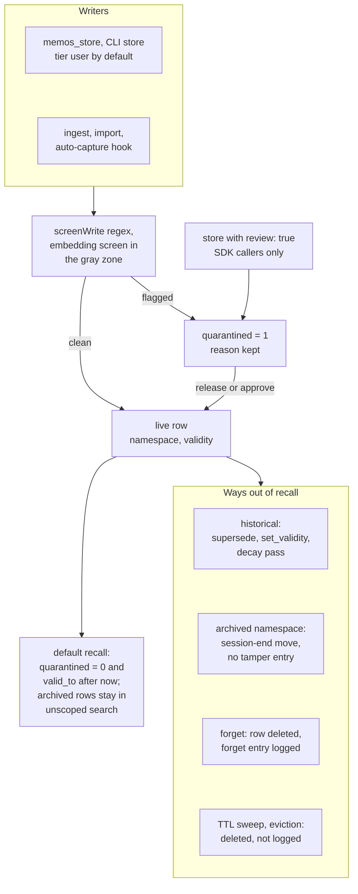

## 1. Executive Summary

MemOS (Markgatcha) is a local-first TypeScript memory layer that keeps an
agent's memory in one SQLite file and serves it to Claude Code, Cursor and
other MCP clients, a CLI, a Python HTTP server and an SDK. What is notable is
a write gate that quarantines instruction-shaped content and keeps it out of
every recall leg, a hash-chained log of node mutations with an externally
anchored tip, and validity windows that an import fills from the source's own
timestamps. What is weak is that the guarantees stop at the edges of the
main search path. The tamper check reads live rows through the recall
filter and reports every quarantined or superseded memory as deleted without
a log. The scope key is a model-supplied string that a multi-namespace search
drops on its vector leg.

This is not [MemOS by MemTensor](../memos/), and none of its code comes from
there. That project is a Python package under `src/memos/` built around
`MOSCore` and `GeneralMemCube`. None of those identifiers, nor
`TextualMemoryItem`, `TreeTextMemory` or `mem_scheduler`, appears in `src/`
or `memos/` here. The engine is TypeScript published as `@mem-os/sdk`, and
the Python package `mem-os-python` is a FastAPI wrapper that drives it over a
Node subprocess (`memos/__init__.py`). The two share a name and, for Python,
the import name `memos`. The project's own website names MemTensor's MemOS
as unrelated (`website/app/blogs/ai-memory-landscape-2026/page.tsx:160-161`).
It is not a GitHub fork, and it is also unrelated to [usememos](../usememos/).

A write is stored at once. `storeInner` screens it, resolves a namespace and
a provenance tier, stamps entities and event metadata, saves the row, logs a
mutation entry, queues an embedding and links the node to similar ones by
token overlap (`src/memory.ts:1340-1700`). Retrieval fuses FTS5 BM25, cosine
over local model2vec vectors and an entity leg by reciprocal rank. It adds
session and graph neighbours by default and drops quarantined and historical rows on
every leg. Correction is add-only by default: supersede, `set_validity` and a
decay pass close a validity window, and `forget` deletes the row and logs a
forget entry.

The Claude Code plugin registers four hooks. SessionStart injects an
800-token handoff brief, UserPromptSubmit injects up to five memories and
stores explicit "remember this" phrasing, and SessionEnd runs a
consolidation pass. Each shells out to `npx -y @mem-os/sdk` with no version,
so each hook runs whatever npm serves that day, while the MCP manifest pins
1.6.27.

**Licence.** The root `LICENSE` is MIT, and `package.json`,
`pyproject.toml` and the four plugin manifests say MIT. The one restriction
sits in the benchmark data: `scripts/dataset/locomo/` vendors the LoCoMo
conversations and its generation code with their own `LICENSE.txt`,
*Attribution-NonCommercial 4.0 International*. Beside it,
`scripts/dataset/beam/data/beam_100k.json` (13.9 MB) and
`scripts/dataset/hotpotqa/hotpot_dev_distractor_500.json` (3.2 MB) are
committed with no licence file. None of that data is in the published npm
package, whose `files` list is `dist`, `README.md`, `LICENSE` and
`UPGRADING.md`.

Five marks are earned: `trust_state`, `scope_enforced`, `audit_log`,
`bitemporal` and `negative_eval`. Section 9 gives the reasons for the two
withheld.

## 2. Mental Model

A memory is **a node holding one statement**, written verbatim. The engine
does not rewrite it on the way in: it adds an extractive summary, entities,
a detected event and a fidelity cache in metadata, and leaves `content`
alone. There is no model in the write path unless the operator configures
an `enrichMemory` hook (`src/memory.ts:1520-1528`).

A node becomes something the agent is told in one step, unless the screen
flags it:

- **Live.** Stored, recallable at once once its embedding drains, ranked by
  relevance times a provenance multiplier and a trust score.
- **Quarantined.** `screenWrite` scored the text at or above the flag
  threshold, or the semantic screen escalated a gray-zone write, or the
  caller asked for review. The row is stored with `quarantined = 1` and a
  reason and is absent from recall until released or approved
  (`src/memory.ts:1424-1462`, `:1538-1550`).
- **Released.** `releaseFromQuarantine` clears the flag and stamps
  `releasedFromQuarantine` in metadata. The row is recallable again and MCP
  results carry `untrusted_source: true` for it (`src/memory.ts:4666-4685`,
  `src/provenance.ts:159-171`).
- **Historical.** `valid_to` is at or before now. Supersede, `set_validity`
  and the decay pass put it there, and default recall drops it while
  `searchTemporal` still returns it (`src/storage/sqlite.ts:1711-1723`).
- **Archived.** Consolidation moves a stale, low-importance row into the
  namespace `archived`. Nothing excludes that namespace, so an unscoped
  search still returns it (`src/memory.ts:6004-6030`).
- **Gone.** `forget` deletes the row and logs a forget entry. The TTL sweep
  and eviction delete without one.

Belief has two other dials that rank and never exclude. Provenance has five
tiers, from `user-verified` to `imported`, weighting fused scores by at most
14% (`src/provenance.ts:48-54`, `:73-88`). A confidence number moves under an
opt-in evidence machine. Contradiction pairs are recorded at write time with
status `unresolved`, and read-time resolution demotes the older member
(`src/storage/sqlite.ts:577-584`).

Memory is agent-controlled with background help. The agent writes through
`memos_store` and the prompt hook writes for the user; consolidation runs at
session end. The store treats a live row as ground truth to be ranked and a
quarantined one as withheld.

## 3. Architecture

Everything runs in one process around one `MemOS` instance
(`src/memory.ts`), which holds an in-memory `GraphEngine` mirror of every
node and edge, an embedding queue, and a `SQLiteStorage` adapter
(`src/storage/sqlite.ts`). The surfaces are thin over it:

- **MCP server** (`src/mcp.ts`), stdio by default, Streamable HTTP on
  127.0.0.1:8788 with `--http`. It registers 12 tools unless
  `MEMOS_MCP_TOOLS` is `all`, which registers 40 (`src/mcp.ts:323-366`).
  The HTTP transport has no authentication, and the CLI says so when bound
  beyond loopback (`src/cli.ts:1172-1176`).
- **CLI** (`src/cli.ts`), which also writes harness MCP configs with
  `memos connect <harness> --write`.
- **Python server** (`memos/server/main.py`, `routes.py`), FastAPI on
  127.0.0.1:7400, which writes a bridge script and starts Node with the
  database path (`memos/server/main.py:231-248`).
- **Plugin** (`plugin/`): an MCP entry pinned to `@mem-os/sdk@1.6.27`, four
  hooks, slash commands and two skills.

Retrieval needs no external service. The default embedder is model2vec's
`potion-base-8M`, a static table in an npm package (`src/embeddings.ts:215-245`,
`:594-601`); Ollama, OpenAI-compatible, Voyage, Cohere, fastembed and
transformers providers are configurable. Vectors are float32 BLOBs scanned
in process, with an optional sqlite-vec index.

### Deployment and ergonomics

- **What has to run:** nothing beyond Node and the SQLite file. The Python
  server additionally needs Node at run time.
- **Offline:** fully. The default embedder ships in the package.
- **API key:** none to store anything.
- **First run:** `npx -y @mem-os/sdk init --yes`, or
  `memos connect claude-code --write`, or the plugin marketplace entry in
  `.claude-plugin/marketplace.json`.
- **Repair by hand:** the store is ordinary SQLite. A direct edit is what the
  tamper check exists to detect; a direct edit of `quarantined`,
  `trust_score`, `pool` or `harness` is not detected, because `nodeHash`
  covers neither (`src/tamper-log.ts:72-104`).

Three configuration paths do not do what the manifests say.
`server.json` documents `MEMOS_NAMESPACE` as the *"Namespace for reads and
writes"*, and `llms-install.md:212` repeats it. Nothing in `src/` reads it
except the `trio` command, which passes it to a sibling process
(`src/cli.ts:4525-4532`). `connect --db <path>` writes the path into the
harness config as `MEMOS_DB_PATH` (`src/cli.ts:570-590`), which `memos mcp`
does not read; it opens `--db`, then `~/.memos/config.json`, then
`~/.memos/memos.db` (`src/cli.ts:266-269`, `src/storage/sqlite.ts:55-58`).
`MEMOS_API_KEY` in `server.json` is described as the bearer token for the
Streamable HTTP transport, and only the Python server reads it
(`memos/server/main.py:286-291`).

The Python server's routes are open when `MEMOS_API_KEY` is unset, and its
CORS middleware allows every origin, method and header
(`memos/server/main.py:307-313`). On the default loopback bind, a web page
open in the user's browser can therefore call `/api/mem/search`, `/store`
and `/forget` on 127.0.0.1:7400 and read the responses.

## 4. Essential Implementation Paths

**Capture.** `store()` and `remember()` call `storeInner`
(`src/memory.ts:1237`, `:1253`, `:1340`), which runs these steps in order:

1. A strictly monotonic timestamp, and the namespace from `scope` or
   `namespace`, else `default` (`:1357-1359`).
2. Optional salience triage, then deterministic event updates ("the meeting
   got moved") resolved before the write (`:1400-1409`).
3. The provenance tier from the explicit option or the source
   (`:1419-1422`), then the quarantine screen (`:1440`).
4. Entity, triple, event and context stamping, the review hold
   (`:1538-1550`) and the opt-in evidence machine (`:1566-1580`).
5. The node (`:1583`), `saveNode` and `logMutation("store")`
   (`:1626-1627`), and a queued embedding.
6. Auto-link edges at token similarity 0.3 to any node in the graph
   (`:1661-1678`, `src/graph.ts:374-404`), and eviction when `maxMemories`
   is set (`:1683`).

**Document and export ingestion.** `ingest()` chunks Markdown, text, HTML and
PDF at 1,200 characters, skips files whose hash is unchanged, replaces a
changed file's chunks and stores each through `store()` with no source, so
every chunk takes the `user` tier (`src/ingest.ts:307-322`).
`importExternal` parses ChatGPT, Claude and Slack exports and stores each
item as `external_data`, tier `imported`, with `validFrom` set to the item's
own time (`src/memory.ts:4118-4134`).

**Retrieval.** `search()` drains the embedding queue, resolves scope into
`namespace`, `namespaces` or `namespacePrefix` (`src/memory.ts:2429-2460`,
`:3184-3228`) and calls `hybridSearch` (`:8973`). Three legs run in
parallel: `semanticSearch` over `querySimilarEmbeddings` at a cosine floor
of 0.05, `queryNodes` over FTS5, and `fetchEntityLeg` (`:9025-9046`). After
fusion come graph expansion, PPR expansion, session-neighbour expansion,
rerank, dedupe, ranking modulators, an optional relevance gate, MMR and
multi-hop (`:9122-9178`).

**Context assembly.** `contextPack` runs the same hybrid search, strips
filler, ranks by relevance times trust and cuts at the token budget, then
serializes to JSON, TOON or TOON-compact (`src/memory.ts:5511-5743`,
`src/context-pack.ts`). `handoff` composes a profile, a context pack,
procedural lessons, reminders and harness counts (`src/memory.ts:2843`).

**Correction.** `update()` (`:5370`), `supersede()` (`:6803`),
`setValidity()` (`:6737`), `revert()` (`:7024`), `forget()` (`:3617`) and
`forgetSource()` (`:3653`). `reviewApprove` and `reviewReject` act on
`review:pending` rows; `releaseFromQuarantine` on any quarantined row
(`:4634-4685`).

**Background.** `startSweep` deletes expired rows every 60 seconds by
default (`src/memory.ts:10241-10272`, `:1053`). `consolidate` runs dedupe,
archive, optional cluster summaries and decay on one namespace
(`:6307-6361`). The SessionEnd hook calls it with `--no-summarize`.

**Integration.** MCP tools in `src/mcp.ts` (`registerTools` from `:384`),
the CLI dispatcher in `src/cli.ts`, the Python routes in
`memos/server/routes.py`, the hooks under `plugin/hooks/`.

## 5. Memory Data Model

`nodes` began with ten columns (`src/storage/sqlite.ts:505-516`) and
migrations add `expires_at`, `tags`, `namespace`, `valid_from`, `valid_to`,
`source`, `trust_score`, `pool`, `provenance`, `quarantined`,
`quarantined_at`, `quarantine_reason` and `harness` (`:672-715`). `confidence`
and `evidenceCount` are folded into the metadata JSON. `edges` carries a
`UNIQUE(source_id, target_id, relation)`, a `created_at` the schema comment
names the transaction-time axis, and `valid_from`/`valid_to` added later
(`:518-530`, `:719-720`). Beside them: `embeddings` keyed by node with model,
dimensions and the document prefix that produced the vector (`:539-551`,
`:726`), `image_embeddings`, `contradictions`, `procedural_lessons`,
`recall_batches` and `recall_feedback`, `node_tags`, and `tamper_log`
(`:638-648`).

**Scope** is one string. `composeScope` joins whichever of user, agent and
run are present as `u:<v>/a:<v>/r:<v>` (`src/scope.ts:29-44`). A raw
`namespace` such as `project:alpha` is equally valid.

**Provenance** is two fields. `source` is one of five channels and
`provenance` one of five tiers, derived from the source unless the caller
names one; an explicit tier always wins (`src/provenance.ts:135-143`). The
module header says `user-verified` is *"never assigned automatically — only
via an explicit `provenance` opt"*. `memos_store` accepts it as an argument
(`src/mcp.ts:439-446`), so the model can stamp the top tier on its own write.
An agent's write with no tier, through MCP or the CLI, takes `source:
user_input` and the tier `user`, the same as a user's statement.

**Temporal fields.** Record time is `created_at` and `updated_at`;
validity is `valid_from` and `valid_to`, unix ms, `NULL` meaning open;
`expires_at` is a TTL in unix seconds. History lives in two places: a
SHA-256 of each state in `tamper_log`, and up to 2,000 full node snapshots
in process memory for `replayAt`, lost on restart (`src/memory.ts:349`,
`:983-1001`, `:6211-6214`).

**Pools** separate raw events, consolidated notes and procedures for
retrieval. Procedural lessons live in their own table with success and
failure counts (`src/storage/sqlite.ts:592-608`).

## 6. Retrieval Mechanics

Fusion is reciprocal rank at k 60 over the keyword and semantic legs, then
the provenance multiplier and trust weighting (`ARCHITECTURE.md`,
`src/retrieval.ts`). The keyword leg tokenizes the query into quoted terms,
tries AND and falls back to OR (`src/storage/sqlite.ts:1750-1765`). The
semantic leg scans stored vectors for the configured model and prefix.

Every leg applies the quarantine rule. The SQL legs append
`quarantined = 0` (`src/storage/sqlite.ts:1704-1708`, `:1861-1865`,
`:2499-2506`), the entity leg calls `quarantineVisible`
(`src/memory.ts:8963`), and graph and PPR expansion pass each injected
neighbour through `pprInjectedNodePassesFilter`, which checks quarantine,
type, pool, tags, metadata, importance, trust and validity
(`src/memory.ts:9792-9870`, `:9655`). This is the part of the design that
holds: a quarantined row does not ride into results along an edge.

The namespace rule is applied unevenly across the same legs.

- **The semantic leg ignores `namespaces`.** `querySimilarEmbeddings`
  handles `namespace` and `namespacePrefix` and has no branch for the list
  form (`src/storage/sqlite.ts:2448-2460`), and `hybridSearch` applies no
  namespace filter after fusion. A search with `namespaces:
  ["project:alpha"]`, an argument `memos_search` exposes
  (`src/mcp.ts:618-624`), takes vector hits from every namespace above a
  cosine of 0.05.
- **A scope prefix has no separator.** `{ user: "bob" }` becomes
  `LIKE 'u:bob%'`, which matches `u:bobby/...` (`src/storage/sqlite.ts:3469-3472`,
  `src/scope.ts:77-79`). The entity leg uses `startsWith` with the same
  effect (`src/memory.ts:385-390`).
- **Session expansion forgets the prefix and the list.** It is on by
  default and fetches siblings sharing a seed's `sessionId` with
  `namespace: filter.namespace` and nothing else
  (`src/memory.ts:10014-10017`, `:10053-10060`). Under a `scope` or
  `namespaces` search that field is unset, so a sibling from any namespace
  with the same session id is injected.
- **`default` joins every scoped read.** A scoped search ORs in the
  `default` namespace unless the caller passes `includeSharedScope: false`
  (`src/storage/sqlite.ts:3476-3477`), and `memos_search` exposes no way to
  pass it.

An unscoped search, which is what both prompt hooks run, spans every
namespace, `archived` included (`src/memory.ts:2443-2446`).

Injection is bounded. The prompt hook takes five results, drops scores
below 0.15 and stops at 1,500 characters, and prefixes them with *"Use only
if genuinely relevant"* (`plugin/hooks/user-prompt-submit.mjs:20-26`,
`:86-112`). The SessionStart brief asks for 800 tokens. The SessionStart output is fixed for the session and the
prompt hook's context is attached to its own turn, so neither rewrites a
prefix a provider has cached.

Some reads bypass every filter. `retrieve(id)` returns any row
(`src/memory.ts:1827-1830`). `memos_graph` returns the in-memory graph
(`:5398-5404`). `memos_context` walks graph neighbours from an id with no
namespace, quarantine or validity check, and auto-link edges cross
namespaces (`:5321-5361`). `summarize()` concatenates the summary of every
node in the graph (`:3859-3866`), and the SessionStart hook falls back to it
when `handoff` fails or returns nothing (`plugin/hooks/session-start.mjs:26-65`).

## 7. Write Mechanics

Writes are synchronous, hot-path and model-free. The screen is regex
scoring with a semantic tier that embeds only gray-zone and low-trust
writes (`src/quarantine.ts:1055-1101`, `src/memory.ts:4519-4538`). Tier-aware
rules for dormant instructions and trigger phrases run only on
`tool-output` and `imported` writes. Ingested documents and agent writes
take the `user` tier, so neither gets them unless the caller passes a tier.

`extractFacts` is the one inferential writer in the tree. It runs a
rule-based extractor over conversation messages and, with `autoStore`,
stores each fact above a confidence of 0.6 directly, with no `review: true`
(`src/memory.ts:7188-7251`). The review queue the types describe for
inferred memories has no producer on any shipped surface; only an SDK
caller can fill it.

Deduplication is a background pass, not a write-time merge, unless the
operator enables `evidenceLearning`, which reinforces a confirmed memory or
supersedes a contradicted one at write time (`src/memory.ts:1565-1580`,
`:8359-8486`). Contradiction candidates are recorded when the embedding is
persisted, so the scan costs a bounded neighbour search per write
(`:8623-8668`).

Delete is real. `forget` removes the row, its vectors, its FTS entry by
trigger and its recall attributions, then logs a forget entry
(`src/memory.ts:3617-3643`, `src/storage/sqlite.ts:1463-1476`).
`proveForget` turns that entry into a certificate of id, time, state hash
and chain position (`src/proof-of-forgetting.ts`). The certificate's
`contentHash` field holds the full-state `nodeHash`. Neither
`secure_delete` nor `VACUUM` appears in `src/`, so deleted text stays in
free pages and the WAL until SQLite overwrites them.

### Operational cost

- **Blocking:** the agent waits for the screen, the row write, the log
  append and auto-linking. Auto-link compares the new node's token set with
  every node in the graph, linear in the store.
- **Lag:** embedding is queued. `search()` drains the queue first, so a
  memory is retrievable by vector on the next search.
- **Whole-store passes:** `consolidate` on one namespace at each SessionEnd.
  `forgetByDecay` reads up to a million rows of the namespace
  (`src/memory.ts:6389-6393`). The cluster-summary step is off in the hook.
- **Per prompt:** one `npx` start, one hybrid search, at most 1,500
  characters injected.

## 8. Agent Integration

The plugin manifest (`plugin/.claude-plugin/plugin.json`) points at
`plugin/hooks/hooks.json`, which registers, when installed:

- **SessionStart** runs `npx -y @mem-os/sdk handoff "session start in
  <cwd basename>" --token-budget 800 --json` and prints the markdown, or the
  output of `summarize --json` on failure.
- **UserPromptSubmit**, two hooks. `user-prompt-submit.mjs` reads the prompt,
  skips slash and `!` prompts and anything under 12 characters, runs
  `search` with the first 500 characters and emits up to five hits as
  `additionalContext`. `auto-capture.mjs` matches five "remember this"
  phrasings, drops anything that looks like a credential assignment, and
  runs `store` with a project and session context header.
- **SessionEnd** runs `consolidate --no-summarize --json` unless
  `MEMOS_SKIP_SESSION_CONSOLIDATE` is set.

Every hook calls `execFile("npx", args, { shell: process.platform ===
"win32" })` (`plugin/hooks/user-prompt-submit.mjs:76-84`,
`plugin/hooks/auto-capture.mjs:67-72`). With `shell: true`, Node joins the
arguments into one command line for `cmd.exe` without quoting, and two of
the hooks put the user's prompt text in those arguments. On Windows, a
prompt containing `&` or `|` followed by a command, typed or pasted, would
run it. The hooks name no version, so they fetch `@mem-os/sdk` from npm at
whatever version is current, while `plugin/.mcp.json` pins 1.6.27.

The hooks run in the session's working directory. `store` there applies a
project scope from the nearest `.memos.json` (`src/cli.ts:1502-1507`);
`search` and `handoff` apply none, so the hook writes into the project and
reads across every project.

The other auto-run surfaces are inert until a person acts. `.githooks/pre-commit`
formats staged files with `bun fmt` and `oxlint --fix` once `core.hooksPath`
points at it. `.devcontainer/devcontainer.json` runs `apt-get upgrade`,
`npm install -g pnpm@latest`, `pnpm install` and `uv sync` on container
creation. `mcp.json`, `server.json`, `plugin/mcp.json`,
`.cursor-plugin/mcp.json` and `gemini-extension.json` start the pinned npm
package; the root `plugin.json` is metadata only.

The two skills under `plugin/skills/` tell the model when to store and when
to run maintenance, and to preview consolidation with `dryRun: true` first.

## 9. Reliability, Safety, and Trust

### The tamper log and what it cannot see

The log is the most carefully built mechanism in the tree. One transaction
takes the write lock, reads the tip, inserts the row, computes an entry
hash over seq, time, operation, node id, state hash and previous hash, and
commits (`src/storage/sqlite.ts:1482-1529`). The state hash covers content,
summary, type, sorted tags, importance, namespace, canonical metadata,
source, provenance, validity, TTL and both timestamps
(`src/tamper-log.ts:72-104`). The module header states the threat model in
its own words: tamper-*evident*, not tamper-*proof*, and a full rewrite is
caught only against a tip kept outside the database and checked with
`memos log verify --expect` (`src/tamper-log.ts:1-24`).

Three things weaken it.

- **The deep check reads through the recall filter.** `verifyTamperLog`
  builds its list of live nodes with `storage.queryNodes({ limit: 100_000 })`
  (`src/tamper-log.ts:346`). That call excludes quarantined rows and rows
  whose `valid_to` has passed, by the defaults in
  `src/storage/sqlite.ts:1861-1880`. So every quarantined, superseded or
  decayed memory that has a log entry is reported as `deleted_without_log`
  (`src/tamper-log.ts:363-370`). On a store past 100,000 rows the check
  reports the rest the same way. No case in `__tests__/tamper-log.test.ts`
  quarantines or supersedes a node.
- **Writers outside the log.** The TTL sweep and eviction delete with SQL
  directly (`src/storage/sqlite.ts:1360-1372`, `:3035-3042`), the archive
  move updates `namespace` with `setNodeNamespace` (`:2304-2308`,
  `src/memory.ts:6024`), `mergeHarnessDb` saves imported rows with
  `saveNode` alone (`src/memory.ts:4824`), and `clear()` deletes every node
  (`src/storage/sqlite.ts:3127-3146`). The sweep runs every 60 seconds by
  default and the archive move at each SessionEnd, so a store in normal use
  produces mismatches the check reports as tampering.
- **Fields outside the hash.** `quarantined`, `trust_score`, `pool` and
  `harness` are not in `nodeHash`. An edit that releases a row from
  quarantine directly in the database passes verification.

The append is fail-open by design: a logging error is swallowed and the
mutation stands (`src/tamper-log.ts:170-188`).

### Quarantine

The screen has a producer on every write path, the state has a reader on
every recall leg, and release preserves the original reason. Its limits sit
on the tool surface. `memos_store` lets the model choose the tier that
decides how strict the screen is. Release and approve are registered tools
under the full profile, and `memos_search` takes `includeQuarantined: true`
from the model.

### Scope

The boundary the store enforces is a string the caller chooses. No server
path resolves a namespace from an identity, and the MCP and CLI surfaces
default to every namespace. The four leaks in section 6 apply when a caller
does scope. Writes check nothing: `memos_forget` deletes any id, and
`memos_store` writes into any namespace.

### Marks

- **`trust_state` — earned.** `quarantined` is a discrete field with a
  producer on every write, the regex screen, and an opt-in second producer,
  the review hold. Every recall leg excludes it by default. Release keeps an
  untrusted flag on MCP results. Read by id, the graph dump, `memos_context`
  and `summarize` still return it.
- **`scope_enforced` — earned.** `namespace` is stored on every row and
  applied in SQL on the FTS, structured and semantic legs and in code on the
  entity leg and the expansions. The value comes from the caller, and the
  semantic leg drops the list form.
- **`audit_log` — earned.** `tamper_log` is an append-only, hash-chained
  record of store, import, update and forget, written in its own
  transaction beside each mutation. It records a state hash and no actor or
  value, and four writers bypass it.
- **`bitemporal` — earned.** Validity is held in its own columns beside
  record time. The import path writes a validity start that differs from
  record time, and `memos_set_validity` takes both bounds from the caller.
  Default recall and `searchTemporal` read it. Supersession and decay write
  the time of the pass into `valid_to`, and the as-of graph read ignores
  `created_at`, so a node created later with an open window appears in a
  view of an earlier date (`src/storage/sqlite.ts:2998-3010`).
- **`negative_eval` — earned.** See section 10.
- **`tombstone` — withheld.** The forget entry is keyed on the node id and
  a hash of its full state, timestamps included, and no write path reads
  forget entries. Re-ingesting a file or re-importing an export stores the
  same text again as a new row.
- **`human_review` — withheld.** A quarantined row waits, and a person can
  release it with `memos quarantine release`. But `memos_quarantine_release`
  and `memos_review` with `action: "approve"` are registered on the same MCP
  surface as `memos_store` once `MEMOS_MCP_TOOLS=all` is set
  (`src/mcp.ts:961-1031`, `:1087-1110`), and neither checks who calls. The
  MCP Apps explorer routes its release button through that tool. The review
  queue proper has no shipped producer.

## 10. Tests, Evals, and Benchmarks

The suite is large and mostly unit-level: 1,345 jest cases in 95 files,
against an in-memory SQLite and, in most files, a stub embedder. CI runs it
and a retrieval eval with `--check` (`.github/workflows/ci.yml:167`, `:229`).
None was run for this reading.

**Negative cases.** Three earn the mark, each with something present beside
the absence.

- `__tests__/scoped-spaces.test.ts:63-89` seeds five rows sharing the word
  budget across `default`, two projects and two users. A search of
  `project:alpha` requires `default` and `project:alpha` present and
  `project:beta` absent; a scope search for alice requires `u:alice`
  present and every `u:bob` row absent.
- `__tests__/temporal-trust.test.ts:151-176` stores a past, a current and a
  future job, and a temporal search at the past time requires *Old job*
  present and *Future job* absent.
- `__tests__/provenance-trust.test.ts:445-466` requires a quarantined
  injection absent from default search and present in the same search with
  `includeQuarantined`. The default result may be empty, and the paired
  call is the control.

The scope cases cannot catch the semantic-leg leak in section 6. Their
`StubEmbedder` returns `[0, 0, 0, 0]` for every text
(`__tests__/scoped-spaces.test.ts:21-28`), `cosineSimilarity` returns 0 when
a norm is zero (`src/embeddings.ts:173`), and the fusion floor is 0.05, so
the semantic leg returns nothing and only the keyword leg is tested. The
historical-exclusion case at `__tests__/temporal-trust.test.ts:113-125`
asserts the superseded row absent without requiring its replacement
present.

**Benchmarks.** The README's headline is LongMemEval-S over all 500
questions at 99.4% Hit@20, 98.3% evidence recall and 96.4% all-evidence
recall, retrieval-only and scored on evidence ids. It recomputes exactly
from `docs/artifacts/longmemeval-s-full-500-retrieval.json`: 497 per-question rows
out of 500 have a gold id in their top 20, and the fractional and
all-evidence means come to 0.9830 and 0.964. The artifact records the
embedder as Ollama's `nomic-embed-text` at 768 dimensions and the tree as
dirty at `53a681f`, not the model2vec default a user gets.
`benchmarks/README.md` reports a separate 100-question stratified run on
model2vec at 100.0% Hit@20. The end-to-end 78% on 50 questions is
self-judged, as the README says. LoCoMo at 65.0% Hit@10 and ConvoMem at
91.0% Hit@10 come from `website/data/benchmarks.json` and the ConvoMem
artifact; neither was recomputed here.

**Paper.** None. `docs/provenance-trust.md` cites external attack papers,
AgentLAB ([arXiv:2602.16901](https://arxiv.org/abs/2602.16901)) among them, as motivation for the quarantine
layer; no paper describes this system.

## 11. For Your Own Build

### Steal

- **Apply the withholding state on every leg, expansions included.** The
  one function `pprInjectedNodePassesFilter` mirrors the SQL filters for
  anything graph traversal injects, and its comment names the leak it
  prevents (`src/memory.ts:9792-9870`).
- **Hash the full node state, not the content.** `nodeHash` covers metadata,
  provenance, validity and TTL in canonical order, so a metadata-only edit
  fails verification (`src/tamper-log.ts:72-104`).
- **Stamp validity from the source on import.** A ChatGPT or Slack export
  carries when each message was written; `importExternal` keeps it apart
  from when the row was created (`src/memory.ts:4118-4134`).
- **Record which prefix produced each vector.** `embeddings.prefix` stops a
  model switch from mixing vector spaces silently (`src/storage/sqlite.ts:722-726`).

### Avoid

- **Verifying through the read path's defaults.** A verifier that reads
  rows through `queryNodes` inherits every filter recall applies. Read the
  table directly.
- **Writers that skip the log.** Route the TTL sweep, eviction and every
  namespace move through the same logged update, or the log reports the
  system's own maintenance as tampering.
- **A scope prefix without a separator, and a list form one leg ignores.**
  Match `u:bob` or `u:bob/%`, and put the namespace predicate in one helper
  every leg calls.
- **Taking the trust tier from the writer.** If the top tier is meant for
  user confirmation, no tool argument should reach it.
- **`shell: true` with user text in the arguments.** Spawn `npx.cmd`
  directly on Windows instead.

### Fit

This suits one person who wants an offline memory for one or two coding
agents and will read what the store holds. Its defences are aimed at
poisoned content, not at other people. Walk away if two tenants or two
projects that must not see each other share a database file: the key is
chosen by the model and unscoped reads see everything. Walk away too if the
tamper log is meant to be evidence for someone else, until the verifier
stops flagging quarantine, supersession and the TTL sweep. The 10,353-line
`memory.ts` and a 40-tool surface are a large reading load for a store
whose core is a table and two indexes.

## 12. Open Questions

- Is the semantic leg's handling of `namespaces` intended to be covered by a
  post-fusion filter that was removed? Nothing in `hybridSearch` applies one
  at this commit.
- Does `memos log verify` in practice report quarantined rows, or does the
  CLI pass a filter that the library call does not? The CLI path at
  `src/cli.ts:4264` was not traced end to end.
- Should `summarize()` and `memos_context` honour quarantine, given that the
  SessionStart fallback injects the first?
- What is the haystack size per question in the LongMemEval-S artifact's
  scoring units? The per-question rows list ids at session and turn
  granularity, which decides how hard Hit@20 is.

## Appendix: File Index

| Path | Role |
| --- | --- |
| `src/memory.ts` | The `MemOS` class: store, search, hybrid pipeline, correction, consolidation, quarantine and review |
| `src/storage/sqlite.ts` | Schema, migrations, queries, namespace and quarantine predicates, tamper log append, sweep |
| `src/tamper-log.ts` | `nodeHash`, entry hashes, `appendTamperEntry`, `verifyTamperLog` |
| `src/proof-of-forgetting.ts` | Deletion certificates from forget entries |
| `src/provenance.ts` | Tiers, trust multipliers, `resolveProvenance`, `quarantineVisible` |
| `src/quarantine.ts` | The regex write screen |
| `src/semantic-screen.ts` | The embedding-based second screen |
| `src/scope.ts` | Scope composition and LIKE escaping |
| `src/mcp.ts` | MCP tools, tool profiles, Streamable HTTP transport |
| `src/cli.ts` | CLI, `connect`, the `mcp` entry, db path resolution |
| `src/ingest.ts` | File and folder ingestion |
| `src/embeddings.ts` | Embedding providers, model2vec default, cosine |
| `memos/server/main.py`, `memos/server/routes.py` | Python FastAPI server, auth, CORS, routes |
| `plugin/hooks/` | SessionStart, UserPromptSubmit (two) and SessionEnd hooks |
| `__tests__/scoped-spaces.test.ts` | Scope union and exclusion cases |
| `__tests__/temporal-trust.test.ts` | Validity, supersession and trust cases |
| `__tests__/provenance-trust.test.ts` | Tier, screen and quarantine cases |
| `__tests__/tamper-log.test.ts` | Chain and deep-check cases |
| `docs/artifacts/longmemeval-s-full-500-retrieval.json` | The per-question LongMemEval-S rows behind the headline |

### Recorded searches

Run from the repository root at the pinned commit with `git grep`.

- **No MemTensor identifiers in the engine.**
  `git grep -n -i -E 'MemCube|MOSCore|TextualMemoryItem|mem_scheduler|GeneralMemCube|TreeTextMemory' -- src memos`
  returns nothing; the same pattern over the whole tree matches the
  website blog at `website/app/blogs/ai-memory-landscape-2026/page.tsx:160-161`.
- **`MEMOS_NAMESPACE` has one reader, the trio launcher.**
  `git grep -n MEMOS_NAMESPACE -- src memos plugin` returns
  `src/cli.ts:4525`, `:4531` and `:4532`.
- **`MEMOS_DB_PATH` is written and never read by the TypeScript side.**
  `git grep -n MEMOS_DB_PATH -- src` returns `src/cli-help.ts:122`,
  `src/cli.ts:572`, `src/errors.ts:119` and `:253`;
  `git grep -n MEMOS_DB_PATH -- memos` matches `memos/server/main.py:42`.
- **No authentication on the MCP HTTP transport.**
  `git grep -n -i -E 'authorization|bearer' -- src/mcp.ts` returns
  nothing; the same pattern over `src/embeddings.ts` matches `:431`.
- **The review hold has one producer branch and no shipped caller.**
  `git grep -n -w review -- src memos plugin lme-v2` returns
  `src/memory.ts:1071`, `:1538`, `:1539`, `:1548`, `:4639`, `:4661`,
  the `memos_review` tool text in `src/mcp.ts`, types and comments; no
  surface passes `review: true`.
- **Nothing on a write path reads forget entries.**
  `git grep -n 'readTamperLog(' -- src` returns `src/cli.ts:4264`,
  `src/memory.ts:6143`, `:6146`, `:6161`, `:6183`,
  `src/storage/sqlite.ts:1532` and `src/tamper-log.ts:245`, all reporting
  and verification.
- **Mutations that bypass the log.**
  `git grep -n -E 'storage\.(updateNode|deleteNode|saveNode)\(' -- src`
  returns `src/memory.ts:1012`, `:1323`, `:1626`, `:2332`, `:3625` and
  `:4824`; of these, `:2332` and `:4824` are not followed by a log call.
  `git grep -n -E 'DELETE FROM nodes|UPDATE nodes SET' -- src` adds
  `src/storage/sqlite.ts:1370`, `:2306`, `:3039` and `:3142`.
- **No read excludes the archived namespace.**
  `git grep -n -E "\"archived\"|'archived'" -- src` returns
  `src/memory.ts:6024` and `:6025`, the move itself.
- **The semantic leg has no branch for `namespaces`.**
  `git grep -n -w namespaces -- src/storage/sqlite.ts` returns `:1677`,
  `:3248`, `:3446` and `:3464-3466`, the comment and the shared builder the
  semantic leg does not call.
- **No secure delete or vacuum.**
  `git grep -n -i -E 'secure_delete|VACUUM' -- src` returns nothing;
  `git grep -n -i pragma -- src/storage/sqlite.ts` matches `:447`.
- **The tamper check passes no visibility flag.**
  `git grep -n -E 'includeQuarantined|includeHistorical' -- src/tamper-log.ts`
  returns nothing; the same pattern over `src/memory.ts` matches.
- **No tamper case quarantines or supersedes.**
  `git grep -n -E 'quarantin|supersede|setValidity|historical' -- __tests__/tamper-log.test.ts`
  returns nothing; `git grep -n -E 'forget' -- __tests__/tamper-log.test.ts`
  matches.
- **No paper of its own.**
  `git grep -n -i -E 'arxiv|bibtex|@article|@misc|CITATION|doi\.org' -- README.md ARCHITECTURE.md docs`
  returns citation-token prose and `docs/provenance-trust.md:173`, an
  external paper.

## History

**2026-11-26** — [`78a796bb951732b84be80975b5b7ae94a8627f17`](https://github.com/Markgatcha/memos/commit/78a796bb951732b84be80975b5b7ae94a8627f17). First reading, read only, from a full clone at the head of `main`, the commit triage selected. Screened first: nine auto-run surfaces (`.claude-plugin/`, `.devcontainer/devcontainer.json`, `.githooks/`, `mcp.json`, `plugin/.claude-plugin/plugin.json`, `plugin/.mcp.json`, `plugin/hooks/`, `plugin/hooks/hooks.json`, `server.json`); `package.json`, `pnpm-lock.yaml` and `docs/requirements.txt` inside the seven-day cooldown; build-time execution in the `package.json` scripts; `docs/requirements.txt` unpinned. Hooks, skills and docs were read as data. Nothing was installed, built or run, and the 1,345 jest cases and 18 Python test functions were not run. Five marks: `trust_state`, `scope_enforced`, `audit_log`, `bitemporal` and `negative_eval` ([section 9](#9-reliability-safety-and-trust)).
