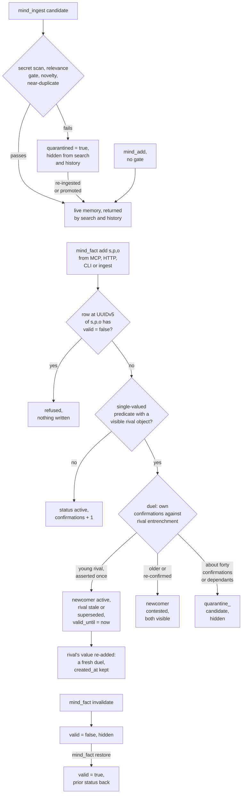

## 1. Executive Summary

MGI-Mind is a single Rust binary that gives an assistant long-term memory over
MCP, backed by a local Qdrant it downloads and runs on loopback. It stores three
things: text memories with hybrid dense and sparse retrieval and a
cross-encoder rerank; fact triples governed by a *duel rule* that resolves a
contradiction on a single-valued predicate; and error-to-fix procedures and
skills. A relevance gate sends low-signal ingest candidates to a quarantine
instead of dropping them.

What is notable is the discipline around the fact state. One function decides
which statuses are hidden, and every fact reader's Qdrant filter is derived from
it: the query, the duel's rival set and the session briefing. A fact's id is its
value, and an explicit invalidate is final: every fact write path reads the
invalidated row and refuses the triple until a restore. Facts take an optional
world-time `valid_from` beside the record clock, and an as-of query reads either
axis.

What is weak is the duel and the end of the world-time interval. On the default
path a fact asserted once flips to any contradiction while younger than about
four months, and re-adding the loser flips it back. Retirement stamps record
time, so a backdated successor overlaps its predecessor on the world axis. On
MCP the library is a caller's option; only a library-scoped HTTP token is held
to it.

Five marks: `tombstone`, `trust_state`, `bitemporal`, `audit_log` and
`negative_eval`. Section 9 names the two withheld.

## 2. Mental Model

There are two belief stores with different admission rules, and they do not
share a state machine.

**A memory becomes a belief when it is written, and stays one until deleted or
archived.** `mind_add` writes directly. `mind_ingest` runs a secret scan, a
cheap relevance gate on length, blacklists and decision markers, and a token
novelty check against three neighbours (`src/ingest.rs:293-386`). A candidate
that fails is stored with `quarantined = true` and a reason, and ordinary search
and history exclude it (`src/storage.rs:385-405`). The same content arriving
again promotes it, so repetition is the admission test. Nothing judges whether a
memory is true.

**A fact becomes current by winning a duel.** A triple is keyed on its own
value, a UUIDv5 of subject, predicate and object (`src/knowledge.rs:285-288`).
For a predicate registered `Single` or `TemporalSingle`, a new object that
differs from a visible valid one triggers `resolve_against_existing`. The duel
compares the newcomer's weight with the entrenchment of the strongest rival and
returns flip, contested or quarantine (`src/duel.rs:277-285`). A flip writes
the newcomer `active` and retires the loser: `stale` for `Single`, `superseded`
for `TemporalSingle`, each with `valid_until = now` (`src/duel.rs:397-450`).

**On the default path the duel leans on recency.** A newcomer weighs
`0.1 · log2(1 + c)` in the default `ChatOnly` mode, where `c` is its own
confirmation count, 1 on a first write (`src/knowledge.rs:492`, `:537-543`;
`src/duel.rs:210-231`; `src/install_mode.rs:57-61`). Every write of a triple
raises its `confirmations_count` by one, whoever sends it. Entrenchment sums log
terms for dependants, confirmations and age and divides by 50
(`src/duel.rs:121-129`); `dependants_count` is written only by `mgimind
migrate-v14 dependants --apply` (`src/migrate_v14.rs:404`).

A flip needs entrenchment below the newcomer's weight divided by 1.5. A rival
asserted once loses to a first-time contradiction while younger than about four
months. Each re-assertion of the rival shortens that window, and from about ten
it never flips to a first mention; it lands `contested`, where both values stay
visible. `quarantine_candidate` needs entrenchment at least twice the newcomer's
weight, which without dependants takes some forty assertions of a two-year-old
rival. These thresholds were computed from the code, not run.

**How a fact stops being one.** A duel loser is hidden, not deleted. Re-adding
it rewrites the payload with its original `created_at` and its own count plus
one, and duels the current winner afresh (`src/knowledge.rs:481-500`); against
a young winner the re-proposed value's higher weight flips it back. An
invalidate is different. It sets `valid = false` and `valid_until`
(`src/knowledge.rs:1122-1201`), and `add_fact_core` reads that field on the row
the triple's id addresses before any duel, refusing with verdict `invalidated`
and writing nothing but an audit row (`:455-478`). `restore` is the only way
back (`:1212-1279`).

## 3. Architecture

`mgimind` is a CLI whose `mcp` subcommand is the MCP server over stdio and whose
`serve-http` subcommand is a loopback HTTP surface over the same dispatcher
(`src/mcp.rs:37`; `src/http_api.rs:1-18`). Embedding runs in process through
ONNX Runtime: `multilingual-e5-base` by default, with a `bge-reranker-base`
cross-encoder on by default (`src/config.rs:109-126`). The models stay warm for
the life of the MCP process.

Qdrant holds four collections: `memories`, with named dense and sparse vectors
and payload indexes on library, author, source, type and `created_at`;
`_kg_facts`, vectorless; `_kg_predicates`, the cardinality registry; and
`_mod_procstats`, derived procedure statistics (`src/storage.rs:26-35`).
Procedures and skills live in `memories` as typed points in the `_procedures`
and `_skills` libraries (`src/storage.rs:2612`, `:3435-3436`).

Files under `$MGIMIND_HOME` hold the rest: `audit.log`, per-agent session logs,
pinned blocks rendered at the top of every briefing, the access journal used by
decay, and the AES-GCM vault, which is terminal-only.

Inside the MCP process a background loop re-tests entrenched facts hourly by
default, yields while a tool call is in flight, and caps each tick at 50 facts
(`src/doubt.rs:62-71`; `src/mcp.rs:70-79`). An optional local extractor, a
Qwen GGUF behind `llama-server`, exists only with `--features extractor`, which
the default build leaves off (`Cargo.toml`).

### Deployment and ergonomics

One binary plus what `doctor --fix` downloads: Qdrant, ONNX Runtime, and two
quantized models the README puts at about 270 and 280 MB, checked against
pinned SHA-256 where pinned. A Docker image bundles everything. An npm package
under `packaging/npm/` downloads the release binary for the platform in a
`postinstall` script, checks it against the `.sha256` file published beside it
in the same release, and unpacks it; `server.json` registers that package as an
MCP server. No API key is needed and nothing leaves the machine. Qdrant's store
is not readable by hand; `export --format md` and `backup` are the repair route,
and the audit log is grep-able NDJSON.

## 4. Essential Implementation Paths

**Memory write.** `mind_add` → `storage::add_memory_authored`
(`src/storage.rs:1407-1523`): refuse an unregistered library, refuse a secret,
chunk at 500 characters with overlap, embed, keep the original `created_at` for
an existing id, upsert, and append an `Add` audit row.

**Ingest.** `mind_ingest` → `ingest::run_ingest_authored`
(`src/ingest.rs:232-522`). For a memory candidate: secret scan, `check_cheap`,
then `top_k_neighbor_content` and `novelty_ratio` against `min_novelty`. A
quarantine verdict first tries `promote_from_quarantine` on the same id, then
checks for a live duplicate, then calls `add_quarantined`. A pass with
`nearest_score ≥ 0.95` is skipped as a near-duplicate and parked in quarantine
with reason `near_dup_drop` (`:383-436`). Fact and procedure candidates go to
their own stores, unless a library-scoped HTTP token set `_confine_extraction`.

**Memory search.** `mind_search` → `storage::search_filtered`
(`src/storage.rs:2232-2364`): embed the query, record it in the activity buffer
for the doubt window, build the filter with `memory_query_filter_ex`, run dense
and sparse prefetches fused by RRF, rerank, truncate to the tier, and record
access counts in process.

**Fact write.** `mind_fact add` → `knowledge::add_fact_core`
(`src/knowledge.rs:403-697`): take the per-axis mutex and a cross-process file
lock, read this triple's own `created_at`, `valid`, `confirmations_count` and
`valid_from`, refuse it if invalidated, look up the cardinality, fetch visible
rivals, run the duel, upsert, `retire_loser`, and append a `FactAdd` row with
the verdict and any retired loser. Both MCP and HTTP return the verdict
(`recorded`, `won`, `contested`, `quarantined`, `invalidated`).

**Fact read.** `mind_fact query` → `query_facts`, `query_fact_history` or
`query_fact_as_of` (`src/mcp.rs:1132-1149`). `query_facts` filters `valid =
true`, excludes the hidden statuses, matches the term as full text on any of
the three fields, and runs the doubt-window drift check
(`src/knowledge.rs:739-803`). `query_fact_as_of` takes `world_time` to choose
the start bound (`:1027-1109`).

**Unified recall.** `mind_recall_all` fuses facts, a `search` with no library,
and procedures (`src/mcp.rs:393-441`).

**Session start.** `mind_context` → `cli::build_context`
(`src/cli.rs:3070-3260`): an operating rule, pinned blocks, the skill catalogue,
the last session, the 20 newest visible facts, the library list and a
quarantine digest.

**Forget.** `mind_delete` → `delete_memory`, with the content snapshotted into
the audit row (`src/storage.rs:3366-3402`). `consolidate --apply` merges
near-duplicates, then archives or prunes cold memories, logging a `Delete` row
per removed memory and one `Consolidate` summary (`src/consolidate.rs:276-315`).
`mind_fact invalidate` hides a fact; nothing deletes one.

## 5. Memory Data Model

| Store | Key | Fields that matter |
| --- | --- | --- |
| memory point | UUIDv5 of `library` and trimmed content | `content`, `hash`, `library`, `type`, `source`, `author`, `created_at`, `updated_at`, `quarantined`, `quarantine_reason`, `archived`, `embed_model`, chunk position |
| fact point | UUIDv5 of subject, predicate, object | `valid` as a string, `status`, `created_at`, `updated_at`, `valid_from`, `valid_until`, `confirmations_count`, `author`, `origin_context_id`, later `dependants_count`, `confidence_score`, doubt count |
| predicate | UUIDv5 of the predicate | cardinality: `Single`, `TemporalSingle` or `Multi`, default `Multi` |
| procedure | UUIDv5 of normalised error and fix | trigger error, context, fix, provenance; counts in `_mod_procstats` |

**Scope is a library on memories and nothing on facts.** A memory carries
`library`, and a query may filter on one or several. Facts, procedures, skills,
sessions and pinned blocks are global (`src/http_api.rs:690-702`).

**Time.** A fact carries two start bounds and one end. `created_at` is the
record time of its first write and survives re-adds (`src/knowledge.rs:481`).
`valid_from`, when a caller supplies one, is when it became true in the world,
and a later re-add without one keeps it (`:493-496`, `:604-606`). `valid_until`
is the system clock at retirement or invalidation. The record-time slice tests
`[created_at, valid_until)`; the world-time slice tests `[valid_from or
created_at, valid_until)` (`:930-954`). The code comment beside the second says
a world-time end would need its own field, and none exists.

**Content addressing has consequences.** Editing a memory writes a new point
and deletes the old one (`src/storage.rs:1295-1319`). Re-adding identical text
upserts the same point and clears any `quarantined` or `archived` flag, because
the payload is rebuilt. For a fact the same identity is what makes the
invalidation durable.

## 6. Retrieval Mechanics

Memory retrieval is hybrid by default: a dense arm over e5 vectors and a sparse
arm over a hashed term-frequency vector, each limited to `rerank_top_k` (20)
and fused with RRF inside one Qdrant Query API call. The cross-encoder then
re-scores and sorts, and the score is mapped through a sigmoid
(`src/storage.rs:2273-2340`). Tiers truncate the text to about 100 or 500
characters, or return it whole.

**One base filter excludes procedures, skills, quarantined points and archived
points** (`src/storage.rs:385-405`), and every memory listing builds on it:
search, browse, history and by-author (`:2283`, `:4111`, `:4284`, `:4347`).
Archived points can be asked for explicitly through the filter's archived scope.

Fact retrieval is a full-text payload match, not semantic. The doubt window
measures, per surfaced fact, how far the current query centroid has drifted
from the context the fact was written in, using corpus-mean-centred cosine. In
`enforce` mode with a calibrated threshold it sorts doubted facts last. The
default mode is `shadow`, which only records (`src/config.rs:15-17`;
`src/doubt.rs:211-265`). Nothing is hidden by doubt in either mode.

Retrieval is tool-mediated. `mind_should_search` classifies a query and returns
advice; it cannot force a search.

## 7. Write Mechanics

Every write is an explicit tool or CLI call; the default build calls no model.
Memory writes block on embedding, one batched pass per add, and are searchable
as soon as the upsert returns, since writes use `wait(true)`.

**Deduplication is by identity and by neighbourhood.** Identical text in the
same library lands on the same id. Ingest also skips a candidate whose nearest
neighbour scores at least 0.95, and parks it in quarantine so a later
re-assertion can restore it. `mind_add` and HTTP `/memory/add` skip the
relevance gate entirely, which is why HTTP adds a per-author write quota
(`src/http_api.rs:509-550`).

**Agent-generated content is treated like the user's.** The relevance gate
checks form, not truth. `mind_web` fetches a page and can save it to a library.
The secret scanner refuses a key-like string and points at the vault, on every
write path including quarantine (`src/storage.rs:1421-1432`, `:1547-1553`).

**A re-assertion is a confirmation, whoever makes it.** `confirmations_count`
rises by one on every write of the same triple, from any agent or the same one
(`src/knowledge.rs:492`, `:597-600`). It feeds the triple's own weight as a
challenger and its entrenchment as a rival, so repeating a value is how it
resists the next contradiction.

**The inheritance discount is narrow.** `build_context` marks every fact it
briefs as inherited in a process-local set (`src/cli.rs:3129-3139`;
`src/doubt.rs:906-929`), and `add_fact_core` halves a challenger's weight when
that challenger's own triple is in the set (`src/knowledge.rs:528-543`). A
briefed fact was visible, so on a single-valued predicate the discount reaches
one side of a contested pair, or a value that lost after the briefing.
Re-asserting the briefed winner raises no duel. The set lives in one process,
so `mgimind context` from a terminal marks nothing in the MCP server.

### Operational cost

- Write: synchronous embed and upsert; facts are vectorless and pay two locks
  and a few payload reads. No LLM on the default path.
- Background: one re-test pass per hour by default, at most 50 facts per tick,
  each a payload read and a `confidence_score` write. No whole-store rewrite
  runs unattended; `consolidate` is an operator command.
- Read: one embed, one fused query, and a cross-encoder pass over 20 candidates,
  which the README puts at one to two seconds on CPU. Injection is whatever the
  agent asks for, at the tier it picks; `mind_context` is bounded by its fixed
  sections.

## 8. Agent Integration

The README counts 29 live MCP tools plus 15 deprecated aliases. `tools/list`
hides the aliases unless `MGIMIND_LIST_DEPRECATED=1`, and the dispatcher
serves them (`src/mcp.rs:1278-1299`). Each listed tool carries read-only,
destructive and idempotent hints (`:1914`). The model holds every verb: add,
ingest, search, fact add, invalidate and restore, predicate registration,
quarantine list, promote and expire, restore, delete, export and import,
sessions and pinned blocks. Vault tools return terminal instructions, never a
secret.

No host hook is installed. `AI_INSTRUCTIONS.md` asks the assistant to call
`mind_session(action="last")`, `mind_session(action="start")` and `mind_context`
at the start of every session, search before answering, and close the session
with a summary. Continuity therefore depends on the model following the
instruction file. A separate CLI command ingests a finished Claude Code
transcript through the same gate (`src/session_ingest.rs:1-15`).

The HTTP surface is the multi-agent door. A token can be anonymous, named, or
named and confined to libraries. A named token's identity overrides any
`X-Agent` header for authorship (`src/http_api.rs:490-508`).

## 9. Reliability, Safety, and Trust

**The status filter has one source of truth, and every fact reader uses it.**
`hidden_wire_strings` derives the hidden set from `is_default_visible`, and
`hidden_status_must_not` turns it into the Qdrant `must_not` used by
`query_facts`, the duel's rival set, `list_all_facts` and the session briefing
(`src/knowledge.rs:165-210`, `:758`, `:1650`; `src/cli.rs:3093-3105`). The
comments record the drift that leaked `stale` and then `quarantine_candidate`
before the derivation existed, the second through the briefing.

**Locking around the duel is careful.** A per-(subject, predicate) async mutex
serialises agents in one process, and `lock_facts_cross_process` extends it to
separate `mgimind` processes; invalidate and restore take the same file lock
(`src/knowledge.rs:323-379`, `:1131`, `:1219`).

**The invalidation is consulted, and it is exact.** The refusal sits at the top
of the one function every fact writer reaches: MCP `mind_fact` and its legacy
alias, HTTP `/fact/add`, `mgimind fact add`, `mind_ingest` and the feature-gated
extractor (`src/mcp.rs:753`, `:1116`; `src/http_api.rs:1044`;
`src/cli.rs:3438`; `src/ingest.rs:487`). Nothing deletes a fact point; the one
collection drop, a vectorless migration, re-inserts every payload
(`src/storage.rs:906-934`). The key is the raw string, so `Berlin` and `berlin`
are different triples. `mind_ingest` counts a refused fact in `stored_facts`
(`src/ingest.rs:487-489`).

**Library scope holds for a scoped token and is optional elsewhere.** The route
gate admits a library-scoped HTTP token only to memory routes that apply its
allowlist (`src/http_api.rs:703-744`). Its JSON `/memory/recall` returns no
facts and no procedures, and the text form is refused
(`src/http_api.rs:432-487`, `:833-847`). On MCP, and for unscoped or anonymous
HTTP tokens, the library is a caller's filter, and `mind_recall_all`,
`mind_history` and `mind_context` take none.

**Audit coverage and its edges.** Every declared `AuditOp` has a producer.
Promote and expire record the calling agent, and `relevance-gate` remains only
on the automatic ingest path (`src/storage.rs:1660-1680`; `src/ingest.rs:339`).
Three writes leave no row: `mind_skill(action="remove")`, and pinned-block set
and remove (`src/storage.rs:3685-3705`, `:651-677`). Nothing rotates or prunes
`audit.log`. `mgimind restore` unpacks a backup's files under `$MGIMIND_HOME`,
its `audit.log` included, over the live ones, and appends no event
(`src/storage.rs:4971-5035`).

**Privacy.** Delete removes the point and keeps the truncated content in
`audit.log`. Backups can be encrypted with a passphrase.

Capability marks:

- `tombstone` — awarded on the fact store. The rejected value is the key of its
  row, and the writer reads that row and refuses the value until a restore. A
  duel loser is not covered, and memories have no equivalent: a quarantined
  memory is promoted by re-assertion, the opposite of a tombstone.
- `trust_state` — awarded. The fact `status` enum carries states that withhold a
  value, and every fact reader filters on them.
- `bitemporal` — awarded on the fact store. `valid_from` is a world time a
  caller supplies, kept apart from `created_at`, and the world-time as-of reads
  it. Only the start is separate: the end is the record time of retirement, so a
  successor dated into the past overlaps its predecessor until the moment it was
  recorded.
- `audit_log` — awarded; the edges are above.
- `negative_eval` — awarded; section 10.
- `scope_enforced` — withheld. The boundary is real for a library-scoped HTTP
  token on every route it reaches. On MCP and for unscoped tokens the library is
  an optional caller filter, and three read tools take none.
- `human_review` — withheld. The agent holds `mind_quarantine_promote`,
  `mind_quarantine(action="promote"|"expire")` and
  `mind_fact(action="invalidate"|"restore")`, and no state waits on a person.

## 10. Tests, Evals, and Benchmarks

Nothing was built or run for this report. Everything below is from reading the
tests and the committed result files at the pin, apart from the recall figures,
which I recomputed with a standalone script over the committed JSON.

**The negative cases.** `duel_rule_dampens_loser_on_single_cardinality`
registers a `Single` predicate, adds `old_winner` and then
`new_value_should_flip` over MCP, and asserts the query contains the new value
and not the old (`tests/cli_integration.rs:895-960`).
`temporal_single_supersedes_prior_value` asserts `Munich` present and `Berlin`
absent in the default query, and the reverse in the history query
(`:962-1035`). Three visibility tests plant a hidden record beside a live one
and assert the stale fact absent from the briefing, and an archived memory and a
skill absent from history and by-author (`:2695-2948`).

**The scope canary runs in CI.** `http_v2_acl_flood_verdict_contract` plants a
canary memory in a library a scoped token cannot see, and a fact and a procedure
in the global stores. An unscoped token finds all three; the scoped token gets
none of them from search, by-agent, browse or JSON recall, where `facts` is
`[]` and `procedures_text` is empty (`tests/http_integration.rs:581-1010`). CI
runs `cli_integration` and `http_integration` with Qdrant, the models and ONNX
Runtime configured, on Linux and Windows (`.github/workflows/ci.yml:85-102`,
`:143-150`).

**The fact rules have their own cases.**
`explicit_invalidate_is_final_until_restored` asserts the refused re-add, the
absence after it and the return after `restore` (`:3396-3459`).
`world_time_as_of_differs_from_record_time_as_of` asserts that at 2020-06-01 the
record-time slice is empty and the world-time slice holds the 2020 value and not
the 2023 one (`:3642-3708`). The audit tests read the log back after each write
(`:2950-3303`).

**Computed and frozen.** `calibration.rs` runs a fixed corpus of conflict
scenarios through the duel formulas with a match-rate floor and a frozen set of
divergences. It exercises the formulas with synthetic entrenchment inputs, not
the counts a live write produces.

**Benchmarks recompute.** R@1, R@5 and R@10, recomputed from three committed
per-question files, each match their log: 85.2, 98.2 and 99.4% for MiniLM
without rerank
(`benchmark/results/2026-06-02-cpu-overnight/run01_minilm_rerank_off/raw.json`),
then 91.6, 98.2 and 99.8% with rerank and 85.6, 97.6 and 99.4% without, on the
v0.12.1 regression pods. The metric is session-level retrieval recall on
LongMemEval-S, and `BENCHMARKS.md` says it is not QA accuracy. The headline row
names `all-MiniLM-L6-v2` as the zero-config default, while
`MindConfig::default` selects `multilingual-e5-base`. The committed e5 runs are
FP16 on a GPU.

**Not covered.** No test plants a `quarantine_candidate` fact. No test queries
the world axis at an instant between a backdated successor's `valid_from` and
its record time, where both values return. No test removes a skill and reads
the audit log. No paper belongs to the project; the arXiv identifiers in
`docs/design/`, `src/bench_stale.rs` and `src/cli.rs` cite other work.

## 11. For Your Own Build

### Steal

- **Derive the read filter from the visibility rule.** One function says which
  statuses are hidden, and the database predicate is generated from it, so a new
  status cannot be written and left visible by a filter nobody updated.
- **Make the value the key, then read the key before writing.** A
  content-addressed fact id turns "has this value been rejected" into one
  payload read on the row the write would land on, with no separate table.
- **Lock the contradiction check across processes, not just tasks.** A
  per-axis mutex plus a file lock around read, decide, write and retire is the
  smallest thing that makes "one current value" true.
- **Quarantine instead of drop, and log why.** A rejected candidate kept with a
  reason is recoverable and countable; a briefing that summarises the pile by
  reason makes the gate auditable.
- **Write the negative test with its positive control in the same response.**
  Every visibility and scope case here asserts the live record present and the
  hidden one absent from one result, so an empty result fails.

### Avoid

- **A contradiction rule whose strongest term has no live producer.** When
  entrenchment can earn only age and repetition, the duel rewards whoever
  repeated a value last, and the old value wins the rematch.
- **A world-time start with a record-time end.** Closing the predecessor at the
  moment of recording, not at the successor's `valid_from`, makes the world-time
  slice return both values for exactly the facts the axis exists for.
- **A route gate and a composite route decided separately.** Refusing
  `/fact/query` to a scoped token means nothing if `/memory/recall` serves facts;
  the confinement has to sit in the composite route as well
  (`src/http_api.rs:439-441`).

### Fit

This suits one person running one or a few assistants on one machine who wants
good local retrieval, explicit facts that stay retracted, and a store that keeps
its own audit trail, and who can tolerate a Qdrant process and about 550 MB of
models. It is a poor fit where facts must survive contradiction by a newer but
wrong assertion, because the default duel favours recent repetition. As a
multi-tenant boundary it holds only behind library-scoped HTTP tokens, not over
MCP.

## 12. Open Questions

- Does any deployment run `migrate-v14 dependants --apply` routinely, and how
  does the duel behave once dependants counts exist?
- Will retirement of a `TemporalSingle` loser close its world-time interval at
  the successor's `valid_from`?
- Should `valid_from` be parsed and normalised before it is stored, given that
  the comparison is lexicographic?
- What does `enforce` mode do to fact ranking on a real store once
  `calibrate` proposes a threshold?

## Appendix: File Index

- **Storage/schema:** `src/storage.rs` (collections, filters, memory and
  quarantine writes, history, procedures, skills, backup), `src/knowledge.rs`
  (facts, `EntryStatus`, cardinality, invalidate and restore, history and
  as-of), `src/config.rs`.
- **Write path:** `src/ingest.rs`, `src/relevance.rs`, `src/secrets.rs`,
  `src/duel.rs`, `src/install_mode.rs`, `src/provenance.rs`, `src/procedure.rs`,
  `src/skill.rs`.
- **Retrieval path:** `src/storage.rs:2232-2364`, `src/reranker.rs`,
  `src/embedder.rs`, `src/doubt.rs`, `src/activity.rs`.
- **Context assembly:** `src/cli.rs:3070-3260`, `src/session.rs`.
- **Background workers:** `src/doubt.rs:785-900`, `src/confidence.rs`,
  `src/access.rs`, `src/consolidate.rs`, `src/migrate_v14.rs`.
- **MCP/API/SDK:** `src/mcp.rs`, `src/http_api.rs`, `src/viewer.rs`,
  `clients/python/mgimind/_client.py`, `packaging/npm/`, `server.json`.
- **Audit:** `src/audit.rs`.
- **Tests/evals:** `tests/cli_integration.rs`, `tests/http_integration.rs`,
  `src/calibration.rs`, `.github/workflows/ci.yml`, `BENCHMARKS.md`,
  `benchmark/results/`.

### Recorded searches

Checked against the checkout at the pinned revision.

- `grep -rn 'AuditOp::' src | grep -v '^src/audit.rs'` — producers for every declared op, including `FactAdd` (`knowledge.rs`), `ProcedureAdd` and `ProcedureOutcome` (`procedure.rs`, `skill.rs`) and `Consolidate` (`consolidate.rs`).
- `awk 'NR>=3685 && NR<=3705' src/storage.rs | grep -c 'audit::record'` and `awk 'NR>=645 && NR<=677' src/storage.rs | grep -c 'audit::record'` — 0 and 0: `remove_skill` and the pinned-block writers append no audit row.
- `grep -n -i -E 'rotate|retention|prune|truncate|remove_file' src/audit.rs` — doc comments and `truncate(false)` on the lock file only; the log file is opened with `append(true)` alone.
- `grep -n 'unpack_in' src/storage.rs` — `restore_archive` extracts every non-snapshot entry under `mind_home`, which includes `audit.log`.
- `grep -rn -E 'DeletePointsBuilder::new\(' src` — memories and procstats only; no point deletion targets `FACTS_COLLECTION`.
- `git grep -n -E 'add_fact(_authored|_authored_verdict)?\(' -- src` — callers in `mcp.rs`, `http_api.rs`, `cli.rs`, `ingest.rs` and `extractor.rs`, all through `add_fact_core`.
- `grep -rn '"valid"' src | grep false` — `"false"` is written only by `invalidate_fact_authored` (`knowledge.rs:1163`); the other hit is a test comment.
- `git grep -n -E 'valid_from' -- src ':!src/knowledge.rs'` — hits only in `mcp.rs`, `http_api.rs` and `cli.rs` argument handling; none in `ingest.rs` or `extractor.rs`.
- `grep -n -E 'parse|DateTime' src/knowledge.rs | grep -i valid_from` — no match; `valid_from` is stored as given.
- `grep -rn -E 'mark_inherited|from_live_session: false' src tests` — one production caller, `cli.rs:3138`; `from_live_session: false` only in a `duel.rs` test.
- `grep -rn -E '"(confirmations_count|dependants_count)"' src | grep -v '^src/duel.rs'` — `dependants_count` is written only by `migrate_v14.rs:404`; `confirmations_count` by `add_fact_core` (`knowledge.rs:599`) and the procedure migration.
- `grep -n 'memory_query_filter' src/storage.rs` — applied by `search_filtered`, `top_k_neighbor_content`, `list_filtered`, `list_memories`, `history` and `by_author`.
- `grep -n 'scoped_route_allowed' -A14 src/http_api.rs` and `sed -n 432,487p src/http_api.rs` — `/memory/recall` allowed; its JSON body skips `query_facts` and `procedure::recall` for a scoped token.
- `grep -n -E 'cargo test --all|cargo test --test (cli|http)_integration' .github/workflows/ci.yml` — both integration targets run on Linux and Windows.
- `git grep -n -E 'quarantine_candidate|QuarantineCandidate' -- tests` — one comment; no case plants the state.
- `git grep -n -E 'world_time' -- tests` — one case, querying 2020-06-01.
- `grep -rliE 'arxiv|bibtex|@article|@misc|doi\.org' . --exclude-dir=.git` — design notes, `bench_stale.rs` and `cli.rs` citing other papers; no `CITATION.cff`.
- `grep -rn -E 'SessionStart|UserPromptSubmit|PreCompact|PostToolUse|"hooks"' . --exclude-dir=.git` — no match; no host hook is installed.

## History

**2026-11-05** — [`9fae7803ff7514d02504cd01a8f14f7e146fa8ba`](https://github.com/madgodinc/mgi-mind/commit/9fae7803ff7514d02504cd01a8f14f7e146fa8ba) — v2.8.2, 20 commits past the previous pin. `tombstone` and `bitemporal` earned: an invalidated triple is refused on every fact write path until `restore`, and a caller-supplied `valid_from` is read by a world-time as-of whose end bound is record time ([section 9](#9-reliability-safety-and-trust)). The scoped-token recall leak, the briefing's `quarantine_candidate` leak, the unfiltered history and by-author listings and the four producer-less audit ops are fixed; confirmations feed entrenchment, shrinking the default flip window to about four months for a once-asserted fact. The 2.8.1 and 2.8.2 releases changed only MCP tool descriptions, listing and annotations. Screened: `server.json` registers an MCP server and `packaging/npm` adds a `postinstall` that downloads the release binary. Nothing was run; recall was recomputed from committed files.

**2026-10-03** — [`190d1db71331da42bf3ecee3400b67732c9e1de8`](https://github.com/madgodinc/mgi-mind/commit/190d1db71331da42bf3ecee3400b67732c9e1de8) — first reading, at the head of `main`, a commit dated 13 September 2026. Three marks: `trust_state`, `audit_log`, `negative_eval`. Screened before reading: 0 auto-run surfaces, 0 build-time execution points, 0 dependency files inside the cooldown, 1 unpinned surface (`clients/python/pyproject.toml` with no lockfile), and `AGENTS.md` recorded as data; the clone was depth 1, so file dates are the tip's. Nothing was installed, built or run. Benchmark recall was recomputed from the committed per-question files with a standalone script.
