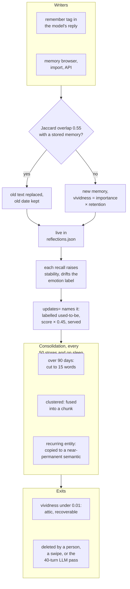

## 1. Executive Summary

Mimir's Memory Hub is a local companion and character-chat app, a FastAPI
server with a browser UI. Its memory engine is a Python package, `vividmimir`,
that keeps one store of episodic memories per character as JSON. The chat model
decides what to remember by writing `<remember>` tags in its reply. The engine
scores each memory's *vividness* on an exponential forgetting curve that recall
reinforces, and it runs Norse-named consolidation passes that merge, prune,
summarise and invent "insights".

What is notable is how literally the forgetting is modelled, and that it is all
arithmetic a reader can follow. A memory's vividness is importance times
retention, with floors for flashbulb, anchored, cherished, semantic and
high-importance memories. A model-marked update keeps the old memory as "used to
be true" rather than overwriting it. A swiped-away reply forgets the memories it
created.

What is weak is everything that changes stored text. A tag whose content words
reach a Jaccard overlap of 0.55 with an existing memory replaces its text. Consolidation truncates memories older
than 90 days to 15 words and fuses clusters into chunks, and none of it reads the
supersession field. A user delete leaves the memory's semantic copy and its
conversation snapshot on disk. Every 40 turns a model-driven curation pass
deletes memories with no record. The README's 93.9% LongMemEval figure is
measured on the oracle split and sits below the script's own TF-IDF baseline.

**Licence.** PolyForm Noncommercial 1.0.0 grants use only *"for any permitted
purpose"*, and the permitted purposes are noncommercial ones, so a company may
not run the hub or embed the engine in a product. The same text is in
`LICENSE`, `pyproject.toml` and the header of `vividmimir/__init__.py`. The
neurochemistry engine, the emotional audit log and the embedding layer the
README describes are imported from two other packages, `vividnessmem` and
`vividembed`, that are not in this tree, not in `requirements.txt`, and whose
terms the tree does not state (`vividmimir/constants.py:22-50`).

## 2. Mental Model

A memory is a sentence the chat model chose to keep, with an emotion label and
an importance from 1 to 10. It is not a fact with a truth value. The engine has
no notion of a memory being wrong, only of it being faded, outdated, protected
or archived.

Strength is the central quantity. `vividness` is `importance × exp(-age /
stability)`, raised to a floor for flashbulb (high arousal and importance),
anchored, cherished, semantic and importance-8-plus memories
(`vividmimir/models.py:197-247`). Every recall touches the memory: a
well-spaced touch multiplies stability, a factual query adds importance, and the
emotion vector moves 5% toward the current mood before the label is recomputed
(`vividmimir/models.py:142-188`).
Reading a memory changes it.

A memory stops being current in one of six ways:

- **Superseded.** The model's tag names an old memory with `updates="..."`. The
  old memory gets the new text in `_superseded_by`, its stability drops by 40%,
  and recall multiplies its score by 0.45. It is still served, labelled
  *"used to be true — now: …"* (`vividmimir/write_mixin.py:437-456`,
  `vividmimir/core.py:468-478`).
- **Overwritten.** A new memory at Jaccard overlap 0.55 or more replaces an
  existing one's text and keeps its date (`vividmimir/write_mixin.py:121-166`).
- **Faded.** Below vividness 0.01 a memory moves to the attic, from which a
  person can rediscover it (`vividmimir/neuroscience_mixin.py:594-619`).
- **Absorbed.** Consolidation merges near-duplicates, truncates old memories to
  a gist, and fuses clusters into one chunk memory, removing the originals.
- **Deleted.** By a person in the memory browser, by a swipe, or by the
  periodic LLM curation pass.
- **Never.** Flashbulb, anchored and cherished memories are exempt from pruning,
  gisting and the curation pass.

## 3. Architecture

The app is one Python process. `python -m playground` starts uvicorn on
`127.0.0.1:19009` (`playground/__main__.py:19-22`), serving a static UI and a
WebSocket chat loop in `playground/server.py`. `playground/memory_manager.py`
wraps the engine with tag-driven writes, preset-aware context and periodic
consolidation. The engine is `vividmimir/`, a class composed from seven mixins
(`vividmimir/core.py:37-63`).

**Which package is live.** The tree holds the engine twice. `vividmimir/` and
`mimir_modular/` contain the same eleven modules byte for byte; only
`__init__.py` differs, and the `mimir_modular` one exports four fewer model
classes. `memory_manager.py` imports `vividmimir` first and falls back to
`mimir_modular` only when that fails (`playground/memory_manager.py:20-44`).
Both launchers put the repository root on `PYTHONPATH`, and the portable build
copies `vividmimir/` to the app root so it shadows the PyPI copy that
`requirements.txt` also installs (`run.sh:61`, `build_portable.ps1:88-93`).
So the in-tree `vividmimir/` runs. `mimir_modular` is imported by the two
benchmark scripts and nothing else (`benchmarks/bench_mimir_full.py:51`,
`benchmarks/bench_preset_ab.py:42`). At this pin the copy is harmless; any
future fix applied to one directory and not the other changes what the
benchmarks measure.

**What the default install runs.** `requirements.txt` installs `vividmimir`
without extras, and `pyproject.toml` declares no required dependencies. The
engine imports `NeuroChemistry` and `EmotionalAuditLog` from `vividnessmem` and
`VividEmbed` from `vividembed`, each inside a `try` that leaves `None`
(`vividmimir/constants.py:22-50`). None of the launchers or installers names
either package. On the documented install, chemistry is the `_NullChemistry`
stub, the audit log is `_NullAuditLog`, and retrieval has no vector arm
(`vividmimir/core.py:146-171`, `vividmimir/models.py:657-707`).

### Deployment and ergonomics

Nothing runs beside the process. Storage is a directory of JSON files per
character, written atomically through a temp file and rename
(`vividmimir/persistence_mixin.py:415-428`). The store is human-readable and
repairable by hand. An unreadable file is copied aside before the next save can
overwrite it (`:430-457`). No API key is needed to store anything; a chat model
is needed to produce the tags. The engine supports Fernet encryption at rest,
but `MemoryManager` never passes a key, so the app's store is plaintext
(`playground/memory_manager.py:315-325`). The Open WebUI example is the one
caller that does (`examples/openwebui_pipeline.py:82-89`).

## 4. Essential Implementation Paths

- **Write from a tag.** The model's reply is parsed by `_parse_remember_tags`,
  which reads `emotion`, `importance`, `why`, `entity`, `updates`, `cherish`,
  `anchor` and `identity` attributes (`playground/server.py:226-257`). If a
  thinking model wrote no tag, phrases like "I should remember" inside its think
  block become memories (`:3372-3389`). The server sends `done`, then schedules
  `_bg_memory_ops` as a task that calls `MemoryManager.remember` for each tag
  (`:3434-3500`, `:3856`).
- **Resolve an update.** `_find_update_target` recalls five candidates for the
  `updates` text without touching them and picks the best word overlap above
  0.15; `_apply_update` supersedes it, or records the old text on the merged
  memory when the new tag overwrote it (`playground/memory_manager.py:951-985`).
- **Store.** `Mimir.remember` applies chemistry modulation, a novelty factor
  from the last memories, the 0.55-overlap dedup merge, flashbulb detection,
  pattern separation, date extraction into reminders, and embedding if present
  (`vividmimir/write_mixin.py:61-265`).
- **Assemble context.** `get_context_for_preset` calls `get_context_block` with
  the user's message as the cue (`playground/memory_manager.py:707-801`); the
  block goes into the system prompt under `## Your Memories`
  (`playground/server.py:3195-3218`).
- **Consolidate.** `muninn`, `_compress_to_gist`, `chunk_memories`, `huginn`
  (which runs `_crystallize_semantic_memories`) and `volva_dream`
  (`vividmimir/neuroscience_mixin.py:227-1052`), called from `remember` every 50
  stores, from `sleep_reset`, and on turn counters in `process_turn`
  (`vividmimir/write_mixin.py:250-263`, `vividmimir/core.py:217-233`,
  `playground/memory_manager.py:657-685`).
- **Delete.** `Mimir.forget` pops the row and shifts every position-keyed
  structure — word and date indexes, graph edges, inferred edges, task links —
  then rebuilds the social index (`vividmimir/write_mixin.py:491-533`).

## 5. Memory Data Model

`Memory` uses `__slots__` with about 40 fields (`vividmimir/models.py:45-79`).
Content, emotion, importance, `timestamp`, `source` and `entity` are public; the
rest carry the mechanisms: `_stability`, `_access_count`, `_last_access`,
`original_emotion` (the label at encoding, never drifted), `_emotion_pad`,
`_encoding_mood`, `_is_flashbulb`, `_anchor`, `_cherished`, `_category` (`"self"`
for identity memories), `_snapshot_id`, visual hash and description,
`_superseded_by`, `_supersedes` and `_affect_intensity`.

Memories are addressed by list position. Every index, graph edge and task link
is keyed on the integer position in `_reflections`, which is why deletion has to
shift them all and why any removal that skips `forget` leaves them stale.

`entity` names who a memory is about and drives entity-anchored recall and the
per-entity impressions section. It is not a scope. Scope is the character
directory: `get_memory_dir` returns `profile/characters/<char_id>`, and
`_ensure_memory_raw` builds one `MemoryManager` per character id
(`playground/character_manager.py:76-79`, `playground/server.py:676-695`).
Nothing on a record names its character, and no read carries a predicate.

Time is `timestamp` plus `_decay_from`. An import sets `timestamp` to the event's
date and `_decay_from` to now minus up to `IMPORT_PREAGE_DAYS`, so the decay
clock is synthetic rather than a record time
(`playground/memory_manager.py:1741-1762`). Supersession stores no time.

Each model-authored memory also writes the whole conversation so far to
`snapshots/<uuid>.json`, for Deep Recall (`vividmimir/persistence_mixin.py:465-470`).
No code deletes a snapshot.

## 6. Retrieval Mechanics

The context block, not `recall`, is what the model sees each turn
(`vividmimir/core.py:480-741`). It opens with the date and time to the minute
(`:488`), then sections in a fixed order. WHO I AM holds identity memories by
vividness. THINGS ON MY MIND and BACKGROUND KNOWLEDGE come from
`get_active_self`, which ranks *every* memory by mood-adjusted vividness times
word overlap with the cue (`vividmimir/recall_mixin.py:76-132`). Then come
impressions of the user, lessons, reminders, dated items, images, drift, and
SOMETHING THIS REMINDS ME OF, which calls `recall` through `resonate`
(`vividmimir/core.py:675`). Recent insights and the top semantic memories are
appended unconditionally (`:705-741`).

`recall` is a two-stage hybrid (`vividmimir/recall_mixin.py:152-450`):

- **Candidates.** An IDF sum over a word index with a five-character prefix
  fallback (`vividmimir/core.py:1399-1425`), which is BM25 in name only, with no
  term frequency or length normalisation. Date-index hits, every memory whose
  `entity` appears in the query, VividEmbed hits if installed, and up to a
  constant number of neighbours from spreading activation over the Yggdrasil
  graph are added.
- **Mood gate.** With a non-neutral mood, candidates whose encoding mood is far
  from the current mood are dropped unless flashbulb, anchored, cherished or
  needed to reach a minimum count (`:305-330`).
- **Re-rank.** A weighted sum of keyword, semantic, vividness, mood and recency,
  with weights switched by counting factual or emotional words in the query.
  Cherished is ×1.1, superseded ×0.45, and flat boosts go to entity matches,
  distinctive tokens, priming, dates, salience, images and activation
  (`:334-421`).

`resonate` then lowers the stability of every non-returned memory whose words
overlap the returned ones by 70% or more, and with probability 0.05 appends a
random memory (`:578-603`). So a read is three writes: reinforcement of what was
returned, interference on its neighbours, and emotion drift.

The block is bounded by its section caps, not by a token budget, and it changes
every turn and every minute. The prompt-prefix cache covers only what precedes
`## Your Memories` in the system prompt.

## 7. Write Mechanics

The model authors memories; nothing extracts them from the transcript. A tag's
attributes are taken as written, with importance coerced from words like
"high" or "8/10" (`playground/memory_manager.py:56-81`). There is no filter on
what the model may tag, so a user who asks the character to remember a false
statement gets it stored with whatever importance the model assigns.

Dedup is an overwrite. When a new memory's content words reach a Jaccard
overlap of 0.55 with an existing one's, `remember` builds a merged memory with the *new* content
and the *old* timestamp, stability and flags, and replaces the old object in the
list (`vividmimir/write_mixin.py:121-166`). The old text survives only if the tag
also carried `updates`, in which case `_apply_update` writes it into
`_supersedes` (`playground/memory_manager.py:980-985`).

Consolidation rewrites the whole store in process:

- **Merge** keeps the longer of any pair at Jaccard 0.40 and drops the other
  (`vividmimir/neuroscience_mixin.py:557-592`).
- **Gist** replaces the content of every unprotected memory older than 90 days
  with `"[gist — <emotion>] "` and its first 15 words (`:775-800`). The original
  text is gone.
- **Chunk** fuses clusters of three or more memories at 0.30 to 0.55 overlap into
  one memory of up to 120 deduplicated words, and removes the originals
  (`:806-937`).
- **Crystallize** copies the most representative memory about any entity with
  three mentions into a `semantic` memory with stability 150 and a vividness
  floor, and turns repeated n-grams into `"recurring fact"` memories
  (`:368-508`). Semantic memories are exempt from pruning and gisting.

None of these four reads `_superseded_by`; the field appears nowhere in
`neuroscience_mixin.py`. A chunk built from an outdated memory and its
replacement carries both texts and neither label, and crystallization can pick
an outdated memory as an entity's permanent semantic fact.

### Operational cost

Writes do not block the reply. The server sends `done` before parsing tags and
runs memory operations in a task, so a memory is retrievable on the next turn
(`playground/server.py:3300-3310`, `:3856`). The task calls the engine
synchronously on the event loop, so a store that triggers auto-consolidation,
whose merge and chunk steps loop over every pair in the list, holds the server
for that time. Two model calls run in the background on turn
counters: a reflection every 20 turns stored as a `huginn` memory, and a
curation pass every 40 (`playground/server.py:3817-3831`). The counter lives in
the `MemoryManager` instance and restarts with the process.

## 8. Agent Integration

Integration is the hub's own chat loop. The preset's system prompt teaches the
tag vocabulary: `<remember>`, `<remind>`, `<social>`, `<treasure>`,
`<recall>` for a conversation snapshot, `<dream/>`, `<self_reflect/>`, and in agent presets `<task>`
and `<solution>` (`playground/server.py:3338-3346`). The model has full write
agency and no delete verb; `<dream/>` runs a whole consolidation cycle,
rate-limited to once per 30 minutes (`vividmimir/core.py:235-251`).

The engine is usable on its own: `examples/custom_agent_example.py` and an Open
WebUI filter pipeline construct `vividmimir.Mimir` directly
(`examples/openwebui_pipeline.py:80-93`). `playground/mcp_client.py` is an MCP
client for agent tools; memory is not exposed over MCP.

## 9. Reliability, Safety, and Trust

### What a delete reaches

`forget` removes the row, its graph edges and its embedding, and the next save
rewrites the social files (`vividmimir/write_mixin.py:491-533`,
`vividmimir/persistence_mixin.py:155-176`). It does not reach the memory's
conversation snapshot, any semantic or chunk memory built from it, or a dream
insight that quoted it. The next `<remember>` of the same thing is stored as
new; nothing records that a person removed it.

### The curation pass deletes without the index fix

Every 40 turns, `MemoryManager.edit_memories` asks the chat model to "forget
trivial ones" among the last 20 memories and applies its JSON
(`playground/memory_manager.py:1366-1455`). `FORGET` removes rows with a bare
`_reflections.pop` (`:1446-1449`). That is the path `forget`'s docstring says
left recall returning *"whatever slid into the deleted slot"*: the word and date
indexes and graph edges are not shifted, and nothing rebuilds them until a later
merge or consolidation. The BM25 scorer guards against an out-of-range index,
not a stale one (`vividmimir/core.py:1418-1423`). Protected memories are
skipped, and nothing is logged.

### What a swipe undoes

Regenerating a reply forgets the memories that reply created, matched on content
and timestamp (`playground/server.py:2835-2854`). A tag that merged into an
existing memory is excluded by `_is_new_memory`, so its overwrite of the old
text is kept, and a supersession it applied stays on the old memory
(`:2881-2888`).

### Marks

- **`trust_state`** — withheld. `_superseded_by` is the only status-like field,
  and every read of it ranks or labels: ×0.45 in `recall` and `get_active_self`,
  a sort key in impressions, and a "used to be true" suffix
  (`vividmimir/recall_mixin.py:92`, `:108`, `:375`, `vividmimir/core.py:569-579`).
  No read excludes a row.
- **`scope_enforced`** — withheld. Characters are separated by directory, a
  physical partition with no key on a record and no predicate on a read.
- **`audit_log`** — withheld. `EmotionalAuditLog` lives in `vividnessmem`, which
  the tree does not contain and the default install does not install. The calls
  into it record supersession, chemistry and consolidation counts; `forget`,
  dedup overwrites and the curation pass write nothing.
- **`human_review`** — withheld. The memory browser edits importance and
  emotion, cherishes and deletes after the write. `proactive_agent.py` has a
  `PROPOSED` to `APPROVED` task state, which gates agent work, not memory.
- **`tombstone`** — withheld; see *What a delete reaches*.
- **`bitemporal`** — withheld. An import's event date sits in `timestamp` and
  `_decay_from` is a synthetic decay start, not a record time; supersession is
  untimed.
- **`negative_eval`** — withheld; see section 10.

## 10. Tests, Evals, and Benchmarks

The tree has 180 test functions in 20 files and no CI configuration. I ran none
of them. Two styles coexist. Seven suite files (`test_memory_lifecycle.py`,
`test_tags.py`, `test_conversation_quality.py` and four others) call
`h.metrics.record(name, passed, msg)` and return the collector; under pytest they
cannot fail. `tests/long_term/run_all.py` totals them into a pass rate and exits
1 on any failure. The other files are ordinary pytest functions with `assert`.

The committed run artifacts disagree with the README. `results.json` is
timestamped 8 April 2026 and reports 402/413 records passing, 97.3%, with
recall accuracy 92.8%. The README reports 94.4% and 84.9%, attributed to a later
fix that made the harness clock reach the engine. Neither README figure appears
in any committed file.

No committed case earns `negative_eval`. The candidates:

- `test_five_characters_full_year_no_cross_contamination` asserts that another
  character's secret is absent from a store
  (`tests/long_term/test_audit_multichar_and_import.py:33-135`). Each character is
  a separate harness in a separate temporary directory, so the test proves two
  objects do not share a list. It reads `_reflections`, not a retrieval. It also
  computes `leaked` and never uses it (`:79`).
- `test_identity_memories_distinct_from_about_user_and_surfaced_in_context`
  asserts that a memory about the user is not returned by `get_self_identity`,
  with a positive control in the same test
  (`tests/long_term/test_audit_visual_and_identity.py:110-157`). It is populated
  and on a read path, and it asserts section routing: the excluded memory still
  reaches the same prompt under THINGS ON MY MIND.
- `test_deleted_social_impression_stays_deleted_after_restart` asserts the
  deleted text is absent and the user's impressions list is empty, with no
  assertion that the surviving memory reloaded
  (`tests/long_term/test_sweep_regressions.py:93-102`). A loader that loaded
  nothing passes.
- `test_outdated_memory_is_labelled_in_context` asserts the "used to be true"
  label only inside `if "Manchester" in block:`, so a block that omits the old
  memory passes (`tests/long_term/test_organic_memory_v2.py:61-68`).

The benchmarks are one run on 22 March 2026, against `mimir_modular` with
`chemistry=False` and VividEmbed installed (`benchmarks/results_20260322.json`).
The README's headline, 93.9% Recall@5 on LongMemEval, recomputes from the
record as 450/479 questions. The script downloads `longmemeval_oracle`, the
split whose haystack holds only evidence sessions, and counts a hit when any
top-k memory covers 40% of the answer's words or 25% of an evidence turn's
(`benchmarks/bench_mimir_full.py:771`, `:844-849`). The same record's TF-IDF
baseline scores 96.0% at k=5, and on LoCoMo the baseline also leads at every
k; `BENCHMARKS.md` prints both rows. The Mem2ActBench row, 0.44 tool accuracy
against 0.10 without memory, is an LLM run on Gemma 3 12B over 100 items. No
paper is associated with the project.

## 11. For Your Own Build

### Steal

- **Make forgetting a computed property, not a job.** Derive strength from age,
  stability and importance at read time, with explicit floors for the classes you
  promise never to lose. Nothing has to run for a memory to fade, and a test can
  move the clock.
- **Keep the outdated version as history, attached to its successor.** A
  superseded memory that renders as "used to be true — now: X" answers "where did
  I used to live" without a second store.
- **Undo a regenerated reply's side effects.** Record what each reply created,
  and forget it when the user picks another reply.
- **Rate-limit model-triggered maintenance.** A model-callable consolidation
  verb with a cooldown keeps a chatty model from rescanning the store every turn.

### Avoid

- **Dedup by overwrite.** Merging a near-duplicate by replacing the stored text
  loses what was said before, and a reply that is later swiped away has already
  done it.
- **Consolidation blind to correction state.** Every pass that fuses, truncates
  or copies text has to read the supersession field, or it reintroduces the
  outdated value as a chunk or a permanent fact.
- **A delete that stops at the row.** Derived copies, snapshots and summaries
  built from a memory have to be found and removed with it, and something has
  to stop the next write from re-adding it; see the deliberate tombstone in
  [Mimir](../mimir/).
- **Position-keyed indexes.** If an index stores list offsets, every removal path
  must shift them; one path that does not is enough.
- **Reads that write.** When recall changes stability, importance and the
  emotion label, two identical questions get different stores behind them, and
  a debugging session changes what the character remembers.

### Fit

This suits a person who wants a companion character that seems to remember them,
on their own machine, for non-commercial use, and who values the texture of
fading and resurfacing over exact recall. It is not a memory layer for an agent
that must act on what it stored. Text changes under consolidation, nothing
records a deletion, and the store cannot say a memory is wrong. Walk away if
you need the stored wording to survive 90 days, or a deletion that survives
the next background pass. Walk away too if your use is commercial, which the
licence does not grant.

## 12. Open Questions

- What `vividnessmem.EmotionalAuditLog` records and where, and whether the
  published `vividnessmem` and `vividembed` packages match what the benchmarks
  ran.
- Whether the README's 94.4% and 84.9% test figures come from a run whose output
  was not committed.
- How long the stale word index after a curation pass persists in practice,
  which depends on when the next merge or consolidation runs.
- Whether group chats share any memory across characters; the code reviewed
  builds one store per character id.

## Appendix: File Index

- Engine: `vividmimir/core.py`, `vividmimir/models.py`,
  `vividmimir/constants.py`
- Write and delete: `vividmimir/write_mixin.py`
- Retrieval: `vividmimir/recall_mixin.py`, `vividmimir/yggdrasil_mixin.py`
- Consolidation: `vividmimir/neuroscience_mixin.py`, `vividmimir/llm_mixin.py`
- Persistence: `vividmimir/persistence_mixin.py`
- App: `playground/memory_manager.py`, `playground/server.py`,
  `playground/character_manager.py`, `playground/__main__.py`
- Packaging: `requirements.txt`, `pyproject.toml`, `run.sh`, `install.bat`,
  `build_portable.ps1`
- Tests: `tests/long_term/harness.py`, `tests/long_term/_time_patch.py`,
  `tests/long_term/run_all.py`, `tests/long_term/test_sweep_regressions.py`,
  `tests/long_term/test_organic_memory_v2.py`,
  `tests/long_term/test_audit_multichar_and_import.py`,
  `tests/long_term/test_audit_visual_and_identity.py`
- Benchmarks: `benchmarks/bench_mimir_full.py`,
  `benchmarks/results_20260322.json`, `benchmarks/BENCHMARKS.md`

### Recorded searches

Run from the repository root at the pinned commit with `/usr/bin/git grep`.

- **Consolidation does not read supersession.**
  `git grep -n -E '_superseded_by|supersed' -- vividmimir/neuroscience_mixin.py vividmimir/yggdrasil_mixin.py`
  returns nothing; `git grep -c '_superseded_by' -- vividmimir/recall_mixin.py`
  counts 3.
- **No value-keyed rejection.**
  `git grep -n -i -E 'tombstone|blocklist|denylist|do_not_remember|never_remember' -- vividmimir playground`
  matches only comments about the code-execution sandbox in
  `playground/tool_runner.py`.
- **No snapshot is deleted.**
  `git grep -n -E 'unlink|rmtree|os\.remove' -- vividmimir` matches only the
  social-file cleanup at `vividmimir/persistence_mixin.py:174` and the image
  file in `forget_visual` at `vividmimir/write_mixin.py:361`.
- **forget writes no audit entry.**
  `git grep -n '_audit.log' -- vividmimir/write_mixin.py` matches lines 314,
  388, 454 and 589 (visual memory, mood shift, supersede, reframe), none inside
  `forget`.
- **The optional engines are not installed.**
  `git grep -n -i -E 'vividnessmem|vividembed' -- requirements.txt install.bat run.sh start.command build_portable.ps1`
  returns nothing; `git grep -n -i 'vividmimir' -- requirements.txt` matches
  line 13.
- **No scope key in the engine.**
  `git grep -n -E 'char_id|character_id|scope' -- vividmimir` returns nothing;
  `git grep -n 'entity' -- vividmimir/recall_mixin.py` matches the entity-anchored
  recall at line 200.
- **No MCP server.**
  `git grep -n -i -E 'FastMCP|mcp\.server|@mcp\.tool|stdio_server'` matches only
  `_mcp.servers` in `playground/server.py:4475-4476`, the client's registry.
- **No CI.** `git ls-files .github` lists nothing.
- **No paper.**
  `git grep -n -i -E 'arxiv|bibtex|@article|@misc|CITATION' -- README.md benchmarks/BENCHMARKS.md docs/index.html`
  returns nothing, and no tracked file is named like `CITATION`.

## History

**2026-11-20** — [`aaf3befa063a65077ff1d3ee0a8b9a658270da5e`](https://github.com/Kronic90/Mimirs-Memory-Hub/commit/aaf3befa063a65077ff1d3ee0a8b9a658270da5e) — first reading, from a full clone of `main` at app v1.0.5, scoped to the `vividmimir` engine, the memory paths of `playground/`, the long-term test suite and the benchmark script and records; the UI, TTS, STT and model management were not read. Screened first: no auto-run surface; `pyproject.toml` and `requirements.txt` changed inside the seven-day cooldown, and both declare unpinned dependencies with no lockfile. PolyForm Noncommercial 1.0.0. Nothing installed, built or run. No marks.
