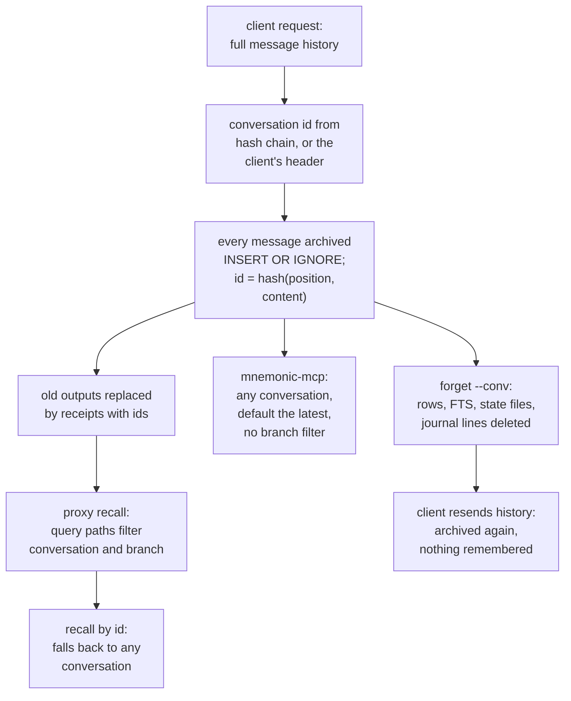

## 1. Executive Summary

Mnemonic Proxy, the Python package `ctxproxy`, sits between a coding agent and a
local model server. On every request it archives every message verbatim into
SQLite, replaces old tool outputs in the prompt with one-line receipts carrying
an id, and answers a `recall` tool itself so the model can read any hidden text
back. When the masked window still fills, the model writes handoff notes and a
new segment starts.

What is notable is that nothing is summarised on the way into the archive. A
receipt is computed from the archived bytes with no model, and it tells the
model that the archive is the past: *"For the CURRENT state re-read the file or
re-run the command."* Deletion is the strongest part. `mnemonic-proxy forget`
finds every table with a `conv` column from the schema, rebuilds the FTS index,
vacuums, deletes the engine state and filters the journal. One test drives two
conversations through the HTTP proxy and checks that no table or file still
holds the forgotten one.

What is weak is what makes it memory at all. The proxy's own recall reads only
the conversation in progress. Later sessions reach the archive through
`mnemonic-mcp`, which reads whichever conversation the caller names, defaults
to the latest, and skips the branch filter the proxy applies. `forget` keeps
nothing, so the client's next request archives the same history again.

**Licence.** MIT, in `LICENSE`, and `pyproject.toml` declares the same with
`license-files = ["LICENSE"]`; there is no rider. The one file that is not the
author's is `tests/fixtures/pack_chat_template.jinja`, a model's chat template
copied byte for byte from a Strata pack so a test can render against it. Its
test file records the source path and a sha256 and nothing about the template's
terms. The recall benchmark's archives are private sessions and are not in the
repository. The AgentLongBench records sit in a Hugging Face dataset outside the
tree, which carries its own copy of the AgentLongBench licence.

## 2. Mental Model

Most of this system is conversation-window management: deciding what stays in
the prompt of one conversation and making the rest retrievable by id. That half
is on the far side of the line drawn in
[Not in scope: conversation-window management](../../families/#not-in-scope-conversation-window-management),
and it is the same shape as the CCR table described under
[cache-preserving injection](../../patterns/cache-preserving-injection/#the-same-constraint-one-layer-down).
Two things put the repository in scope. The archive outlives the proxy process
and is re-attached when a client resumes the conversation, along with the
handoff notes a previous run wrote. And `mnemonic-mcp` lets any later session
list every archived conversation and search it. What it holds can turn out false
in the ordinary way a record can: a tool output describes a file that has since
changed, and handoff notes are a model's account of its own work.

The unit is a message. Each message, each assistant reasoning block and each set
of tool-call arguments is a row with role, position, verbatim text and token
count (`ctxproxy/core.py:851-853`). Its id is a hash of its position and
canonical content, `rid_for` (`ctxproxy/core.py:458-459`), so the same message
at the same position always gets the same id.

A row moves through four conditions and holds no belief about itself:

- **Archived and in the prompt.** Every message of every request is written,
  whether or not it is masked.
- **Masked.** The prompt carries a receipt instead of the text; the row is
  unchanged.
- **Abandoned.** A regenerated or edited turn leaves the old branch's rows in the
  archive. The proxy's recall excludes them through the chain filter
  (`ctxproxy/core.py:478-489`); the MCP reader does not.
- **Forgotten.** `forget` deletes every row of the conversation. Nothing records
  that it existed.

Two derived things are claims rather than records. Handoff notes are the model's
answer to a request to summarise its state, stored per segment and reinjected at
the start of the next one (`ctxproxy/core.py:2485-2492`, `:1353-1358`). Pins are
lines a person starts with `!!` or 📌 in a human user message, carried into
every segment (`ctxproxy/core.py:2054-2072`, `:623-628`).

## 3. Architecture

The proxy is one Python process with no third-party dependencies
(`pyproject.toml:14`). It listens on `127.0.0.1`, speaks Chat Completions,
Anthropic Messages and Responses to the client, and forwards to a local server:
Strata, llama-server, ds4-server, Ollama, LM Studio or any OpenAI-compatible
endpoint. The store is one SQLite file in WAL mode, `archive.sqlite`, with an
external-content FTS5 index kept current by an insert trigger
(`ctxproxy/core.py:873-878`). `journal.jsonl` beside it logs events.

Engine state is a second store. On engines that can save a slot, the proxy
writes the KV state of each segment to disk so a resumed conversation restores
in about a second instead of being re-read, and old state files go into a
content-addressed zstd archive verified by sha256 before restore
(`ctxproxy/kvarchive.py`). That store is per conversation and `forget` removes
it too.

`mnemonic-mcp` is a second entry point (`pyproject.toml:47`). It opens the same
file read-only through a `mode=ro` URI and builds its passage index in TEMP
tables, so it writes nothing (`ctxproxy/mcp_server.py:99-118`).

### Deployment and ergonomics

It needs a running model server with tool calling and a window of at least 16K
tokens; the proxy runs no model itself. No API key is involved and nothing
leaves the machine except the upstream calls. Installation is
`pip install mnemonic-proxy`; `mnemonic-proxy check` reports readiness line by
line, and `demo` runs against a scripted fake engine. The archive is plaintext
SQLite and the journal is JSONL, so both can be read and repaired by hand, and
`docs/manual-forget.md` gives the deletion as a manual checklist. The proxy has
no authentication, and its HTTP API serves any archived row by id at
`GET /v1/strata/archive/<id>` (`ctxproxy/server.py:1407-1411`).

## 4. Essential Implementation Paths

- **Identify.** `Manager.prepare` hashes the message chain, looks up the last
  known hash in `chains`, and takes the conversation it belongs to. A
  `X-Strata-Conversation` header or a Responses `prompt_cache_key` replaces that
  with `c-` plus a hash of the hint (`ctxproxy/core.py:1544-1556`,
  `ctxproxy/server.py:1487`).
- **Archive.** The same function writes a row for every message, reasoning block
  and argument set in the request through `archive_many`, an
  `INSERT OR IGNORE` (`ctxproxy/core.py:1567-1576`, `:936-938`).
- **Mark.** `_scan_marks` re-reads every human user message on every request and
  records pins and disposable exchanges, idempotently (`ctxproxy/core.py:2054-2072`).
- **Mask.** `_mask_batch` replaces old outputs in blocks with receipts built by
  `receipt` from the archived text (`ctxproxy/core.py:2074`, `:693`).
- **Seal.** When the masked window is still too full, the proxy asks the model
  for handoff notes, wraps them with the verbatim first request and an archive
  index, and stores them as the next segment (`ctxproxy/core.py:2400-2437`,
  `:2485-2492`).
- **Recall.** `Manager.recall` and `Recall2.recall` answer the injected tool
  inside the proxy; the client never sees the call (`ctxproxy/core.py:2660`,
  `ctxproxy/recall2.py:448`).
- **Read across sessions.** `Archive.recall` and `Archive.conversations` in
  `ctxproxy/mcp_server.py:148-180`.
- **Forget.** `mnemonic-proxy forget` dispatches to `ctxproxy/forget.py`
  (`ctxproxy/server.py:1705-1707`); `plan` inventories, `apply` deletes
  (`ctxproxy/forget.py:124-183`, `:220-266`).

## 5. Memory Data Model

The schema is eleven tables plus the FTS index (`ctxproxy/core.py:851-878`).
`archive` holds the text. `chains` maps every prefix hash to a conversation and
position, which is how a later request finds its conversation. `masks` records
what was hidden and when, `segments` the cut points and handoff notes, `anchors`
and `autosaves` the engine state files, `pins` and `drops` the person's marks,
`fileops` an index of reads and writes by path, and `kv` per-conversation
settings such as the prompt language.

Every table but `kv` carries `conv`, and that column is the only scope. There is
no user, project or agent key; the archive belongs to whoever runs the proxy.

The archive's primary key is the row id alone, and the id has no conversation
in it (`ctxproxy/core.py:458-459`). Two conversations with an identical message
at the same position, such as an unchanged system prompt at position 0, store
it once, under whichever conversation sent it first; the second conversation's
query paths, which filter on `conv`, do not see it as its own. Forgetting the
first conversation deletes the shared row.

Time is `created` on each row, the clock at archive time. There is no validity
time and no version: a row is never updated, and the only mutation is the
delete in `forget`. A pin has an `active` flag a person can clear from the
dashboard (`ctxproxy/server.py:1223-1227`).

## 6. Retrieval Mechanics

Recall is lexical. The query paths use SQLite `instr` for exact substrings and
FTS5 with `bm25` for words, both with `conv = ?` and the chain filter in the
`WHERE` clause (`ctxproxy/core.py:960-1003`). The structured path splits rows
into passages, indexes them twice in FTS5 (raw and normalised for camelCase and
accents), and filters the same way (`ctxproxy/recall2.py:182-189`). `path`
returns the timeline of reads and writes on a file from `fileops`, and
`mode=tree` a map of the session. The README says so directly: search is by
words, and a paraphrase with no word in common can miss.

The chain filter is `idx < max_idx OR rid IN cur_chain`, where `cur_chain` holds
the ids of the prefix sent in the current request
(`ctxproxy/core.py:478-489`, `:940-944`). It keeps the question being asked out
of its own answer, admits what the current agentic turn just masked, and keeps
an abandoned sibling branch out.

The id paths do not filter. `Recall2._row`, the leaf selector and the legacy id
path all read `store.get(rid, conv) or store.get(rid)`, so an id from another
conversation resolves (`ctxproxy/recall2.py:300-302`,
`ctxproxy/core.py:2725`, `:2800`). The project's own note lists this as an open
defect (`docs/dev-notes/RECALL-CURRENT-TURN-RESULT.md:102-104`). Ids are content
hashes the model only sees in its own receipts, so reaching another
conversation this way needs the id, or the shared-row case in section 5.

The MCP server is the cross-session reader. Its `recall` takes `conversation` as
an argument, falls back to the conversation of the given id, and otherwise uses
the conversation with the most recent row (`ctxproxy/mcp_server.py:142-160`).
It calls `Recall2.recall` with no `max_idx`, which becomes `10 ** 9`, against a
`cur_chain` that stays empty (`ctxproxy/recall2.py:454`,
`ctxproxy/mcp_server.py:43-45`). Every branch of every conversation is
readable there. `conversations` lists all of them with the first 200 characters
of each first user message (`ctxproxy/mcp_server.py:162-180`).

Automatic recall, which would insert relevant hidden pieces before the model
asks, is off by default (`ctxproxy/core.py:280`).

## 7. Write Mechanics

Writes are synchronous and model-free. `prepare` archives the whole request
before anything is forwarded, so a message is retrievable on the request that
carries it. Because `INSERT OR IGNORE` skips rows already present, the cost per
request is hashing the whole history and probing each id, which grows with the
conversation. Nothing deduplicates beyond the id, consolidates or rewrites.

The one model call on the write side is the handoff note. At a segment switch
the proxy sends the current prompt plus an instruction and waits for the notes
before continuing; `docs/benchmarks.md` measures about two minutes per switch in
its three-hour session. When the model answers with a tool call and no text, its
reasoning and the call become the notes, marked as rebuilt in the journal's
`handoff_status` (`ctxproxy/core.py:2400-2437`).

Text the proxy re-presents is defused first. The verbatim first request, the
handoff notes and the pins block are all `role: user` messages, and
`quote_control_frames` relabels any client control frame inside them, such as
Hermes's out-of-band user message, as a quotation, so a copy cannot be read as a
fresh delivery (`ctxproxy/core.py:608-614`, `:2484-2485`).

Pins are taken only from human user messages: `is_human_user` refuses a `user`
message wrapped as a `<tool_response>` (`ctxproxy/core.py:582-586`). A model's
own output cannot pin. Any line starting `!!` in text a person sends can.

Injection per turn is bounded by the window configuration. Masking runs in
blocks between a trigger and a target, so the prefix stays byte-identical
between blocks and the engine's KV cache keeps working; the pins block has its
own token cap, `pins_max_tokens` (`ctxproxy/core.py:292`).

## 8. Agent Integration

The model gets one tool, `recall`, renamed if the client already has a tool of
that name, and answered inside the proxy even while streaming. Tool definitions
beyond a core set are paged and loaded by name. The client sees neither. Setup
is the base URL plus switching off the client's own compaction, documented for
Claude Code, Codex, opencode, pi, Hermes and DeepSeek Harness.

The cross-session path is the MCP server, registered in a client with
`claude mcp add mnemonic -- mnemonic-mcp --db ...` (`docs/agents.md:261-269`).
It exposes `recall`, `conversations` and `journal`, all read-only. A person can
also pin, unpin and mark exchanges disposable from the optional dashboard, which
posts to the proxy's `/v1/strata/marks` route (`ctxproxy/server.py:1206-1241`).

## 9. Reliability, Safety, and Trust

### What forget removes

`plan` reads the schema of a private copy of the database and its WAL, counts
the conversation's rows in every table with a `conv` column, finds `kv` keys
ending in `:<id>` or whose JSON names the conversation, and lists its segment,
anchor and autosave files, cold-archive manifests, blocks no other manifest
references, full-prompt sidecars, journal lines and live dump. Every
`journal.jsonl` line is parsed first, and a malformed one refuses the whole
forget before anything changes (`ctxproxy/forget.py:112-183`). `apply` deletes
under `secure_delete`, drops the derived passage index, rebuilds FTS, vacuums,
truncates the WAL and fails if a reader keeps it busy, then unlinks files and
rewrites the journal atomically. Any failure leaves a non-zero exit and a
retryable state (`ctxproxy/forget.py:220-266`). It runs only while no proxy
holds the data-directory lock (`ctxproxy/forget.py:304`).

### What forget does not stop

The client holds the conversation and resends all of it on its next request.
`prepare` archives every message it receives, and with the chains gone the
conversation comes back under a new id, or under the same id when the client
sends a hint header (`ctxproxy/core.py:1550-1556`, `:1576`). Nothing records
what was forgotten, so nothing can refuse it. `docs/security.md` lists backups,
snapshots and engine memory as outside the command's reach; the client's own
transcript is the copy that matters, and it is not named.

### What the reads leave out

- **Id lookups** fall back to any conversation (section 6).
- **The MCP reader** takes any conversation, defaults to the latest, and applies
  no branch filter.
- **The proxy's HTTP route** serves any row by id with no conversation check.

### Marks

- **`negative_eval`**, awarded on the forget tests; see section 10.
- **`tombstone`**, withheld. `forget` is a hard delete that keeps no record of
  the value or the conversation, and the next request re-archives it.
- **`trust_state`**, withheld. Archive rows carry no status. The pin `active`
  flag is a person's toggle on what is carried forward, and `handoff_status` is a
  journal label; neither withholds a row as untrue.
- **`bitemporal`**, withheld. Rows carry `created` only.
- **`scope_enforced`**, withheld. `conv = ?` is on every query path, but the id
  paths on the same tool fall back to an unscoped lookup, and the one reader
  that crosses sessions takes the conversation as an argument. The conversation
  is also the memory unit itself, not a boundary between principals.
- **`audit_log`**, withheld. `journal.jsonl` is append-only during operation and
  records requests, masks, recalls, pins and seals. It is a log of what the
  context manager did with the window, and `forget` rewrites it and writes no
  event of its own.
- **`human_review`**, withheld. Nothing waits for a decision. Pins are written
  by a person, which is authorship, not review.

### Privacy

The archive holds everything the agent saw, secrets included, in plaintext, and
the README says so. The MCP server binds to `127.0.0.1` and opens the file
read-only; a long-running MCP process can still hold content `forget` has
deleted, which `docs/security.md` says.

## 10. Tests, Evals, and Benchmarks

The suite is 1,218 `unittest` methods in 80 files, run in CI on Linux and
Windows under Python 3.10 and 3.14 against `ctxproxy.fake_engine`, an in-process
scripted model server (`.github/workflows/ci.yml:38`, `:261`). `test_live` and
`test_ds4` start that fake engine in-process and `test_lang` drives the manager
directly; none needs a network or a GPU, and none of the three has a skip path. A real-model job with llama-server and
Qwen3-0.6B runs only when triggered by hand. I ran none of it.

`negative_eval` rests on the forget tests:

- `tests/test_forget.py:114-138` seeds two conversations, forgets `c1`, and
  asserts an `archive_fts MATCH 'secretwordc1'` returns 0 rows while
  `'secretwordc10'` returns 1, that no table holds a `c1` row, and that the word
  is not in the file's bytes.
- `tests/test_forget.py:286-413` drives two conversations through the HTTP
  proxy with masks, segments and autosaves, forgets one, and asserts its word is
  out of FTS, its id is in no table and no file under the data root, and the
  survivor's recall by id and by query returns what it did before.

Both assert against the FTS index the recall query paths read, with a populated
survivor. Neither calls `recall` or the MCP server for the forgotten
conversation, and neither covers a resend after forget.

The sibling-branch tests assert that an abandoned branch's row, present in the
store, is refused by recall by id and absent from query hits, while the live
branch at the same position answers (`tests/test_recall_current_turn.py:187-207`).
They are populated and sound, and they guard the window of the conversation in
progress, which is the window-management side of the line in section 2. The
MCP reader has no equivalent filter and no test.

Two cases headed as cross-conversation are vacuous. `tests/test_postprova.py:137-138`
and `tests/test_recall_current_turn.py:181-183` assert that an id "of another
conversation" is not found, and use `r0000000000` and `r000000000000`, which
exist in no conversation, so both pass against the unscoped fallback. The MCP
test asserts the opposite on purpose: with an id from `convB`, recall answers
from `convB` (`tests/test_engines.py:337-338`).

Benchmarks are in `docs/benchmarks.md`, with the recall benchmark scripts in
`bench/`. The AgentLongBench comparison links a Hugging Face dataset with
per-question records. I recomputed both runs from it:
`results/confirm-run.jsonl` gives the clarified run as full window 69, proxy 86,
summary 47, truncation 49 out of 100, and `results/main-run.jsonl` gives the
original wording as 51, 52, 56 and 44, both as published. The repeat run the
README cites (75, 85, 57, 62, dated 31 October 2026) is in neither file, and the
dataset was last modified on 26 October 2026. The benchmark measures recall
inside one conversation, not across sessions. The recall benchmark's 71
questions run against private archives that are not in the repository, and the
documentation calls it a regression suite. No paper is associated with the
project; `docs/credits.md` carries a `@software` citation for the repository.

## 11. For Your Own Build

### Steal

- **Compute the receipt from the bytes, not with a model.** Exit code, line and
  byte counts, error type and the first error line are read off the archived
  output, so the same output always gets the same receipt and the prefix stays
  cacheable.
- **Find what to delete from the schema.** `forget` deletes from every table
  that has the scope column, including tables added after it was written, and
  the test proves it with a table named `"future table"`.
- **Assert deletion against a survivor.** Check the forgotten word is gone and
  the surviving conversation's recall is byte-identical, in the same test.
- **Label re-presented text as quoted.** A control frame copied into notes or a
  pins block becomes `[quoted …]`, so a copy is never a second delivery.

### Avoid

- **A forget with no memory of itself.** When the source of the data will send
  it again, a hard delete is undone by the next write; keep a record keyed on
  what was forgotten and consult it on capture.
- **A scope filter on queries and not on ids.** An `or store.get(rid)` fallback
  on the id path makes the filter a property of how the caller asked.
- **A second reader without the first reader's filters.** The MCP path skips the
  branch filter the proxy enforces; a read-only side door inherits none of the
  main path's predicates unless it calls the same function with the same state.

### Fit

This suits one person running a local model with a small window who wants long
coding sessions without compaction, and who can treat the archive as a private
transcript store. It is not a memory system for facts or preferences: nothing is
extracted, nothing is believed, and recall across sessions is a read-only
search over transcripts through MCP. Walk away if more than one person shares
the machine or the proxy port, since nothing is authenticated and every
conversation is readable by id. Walk away too if "forget" has to hold while the
client still has the conversation.
[lossless-context-mcp](../../systems/lossless-context-mcp/) is the nearest
design for keeping what an agent saw, and [Headroom](../../systems/headroom/) is
the nearest proxy with a memory store of its own.

## 12. Open Questions

- Whether `forget` is meant to be paired with deleting the client's session, or
  whether a refusal of a resent forgotten conversation is planned.
- Whether the id fallback is kept deliberately so a row shared with another
  conversation stays recallable, which the shared-id design in section 5 would
  require.
- Whether the MCP reader is meant to see abandoned branches.
- Where the 31 October repeat run's per-question records are.

## Appendix: File Index

- Storage and schema: `ctxproxy/core.py` (`SCHEMA`, `FTS_SCHEMA`, `Store`),
  `ctxproxy/datalock.py`
- Write path: `ctxproxy/core.py` (`Manager.prepare`, `_scan_marks`,
  `_mask_batch`, `receipt`, the segment switch)
- Retrieval: `ctxproxy/core.py` (`Manager.recall`, `recall_legacy`,
  `_leaf_recall`, `chain_ok`), `ctxproxy/recall2.py`, `ctxproxy/leafsel.py`
- Context assembly: `ctxproxy/core.py` (`build`, `pins_block`,
  `quote_control_frames`), `ctxproxy/window.py`, `ctxproxy/paging.py`
- Engine state: `ctxproxy/autosave.py`, `ctxproxy/kvarchive.py`,
  `ctxproxy/savedstate.py`
- Deletion: `ctxproxy/forget.py`, `docs/manual-forget.md`, `docs/security.md`
- MCP and HTTP: `ctxproxy/mcp_server.py`, `ctxproxy/server.py`
- Tests: `tests/test_forget.py`, `tests/test_recall_current_turn.py`,
  `tests/test_postprova.py`, `tests/test_engines.py`, `tests/test_live.py`

### Recorded searches

Run from the repository root at the pinned commit with `/usr/bin/git grep`.

- **No value-level rejection record.**
  `git grep -n -i -E 'tombstone|blocklist|denylist|forgotten_' -- ctxproxy`
  returns nothing; `git grep -n -i 'rejected' -- ctxproxy` matches only
  calibration samples and the fake engine, and
  `git grep -c 'DELETE FROM' -- ctxproxy/forget.py` counts 2.
- **Forget writes no journal event.**
  `git grep -n -E 'journal\.log\(|Journal\(' -- ctxproxy/forget.py` returns
  nothing; `git grep -c 'journal.log(' -- ctxproxy/core.py` counts 40.
- **No validity-time field.**
  `git grep -n -i -E 'valid_from|valid_to|valid_at|valid_until|event_time|occurred_at' -- ctxproxy`
  returns nothing; `git grep -n 'created REAL' -- ctxproxy/core.py` matches
  lines 853, 856 and 858.
- **The MCP reader never fills the chain table.**
  `git grep -n 'cur_chain' -- ctxproxy/mcp_server.py` matches only the `CREATE`
  at line 45; `git grep -n 'INSERT OR IGNORE INTO cur_chain' -- ctxproxy/core.py`
  matches line 944.
- **Unscoped id lookups.**
  `git grep -n -E 'store\.get\([a-z_]+\)' -- ctxproxy` matches
  `ctxproxy/core.py:2725`, `:2800` and `ctxproxy/mcp_server.py:153`.
- **No forget test calls recall on the forgotten conversation.**
  `git grep -n -E 'recall\(' -- tests/test_forget.py` matches lines 342, 402,
  405 and 417, all on the survivor or before the forget.
- **No review state.**
  `git grep -n -i -E 'approve|approval|pending_review|needs_review' -- ctxproxy dashboard`
  returns nothing; `git grep -n 'update_pin' -- ctxproxy/server.py` matches the
  dashboard route.
- **The named live tests have no skip path.**
  `git grep -n -E 'skip|SkipTest|environ' -- tests/test_live.py tests/test_ds4.py tests/test_lang.py`
  returns nothing; `git grep -n 'SkipTest' -- tests/test_kvarchive.py` matches
  line 17.
- **No paper.**
  `git grep -n -i -E 'arxiv|doi\.org|@article|@misc|@inproceedings' -- .`
  returns nothing; `git grep -n '@software' -- docs` matches
  `docs/credits.md:13`.

## History

**2026-11-20** — [`3ac2d91f52b1aa804c01d2fdbdba28e26415ee35`](https://github.com/lastreload/mnemonic-proxy/commit/3ac2d91f52b1aa804c01d2fdbdba28e26415ee35) — first reading, from a full clone of `main` at release v0.3.32, scoped to the archive, recall, segment, pin, forget and MCP paths and their tests; window fitting, tool paging and engine adapters were read only where they touch the archive. Screened first: no auto-run surface; `pyproject.toml` changed inside the seven-day cooldown and declares dependencies with no lockfile. MIT, no rider. Nothing installed, built or run. The AgentLongBench records were read from the linked Hugging Face dataset and recomputed. One mark: `negative_eval`.
