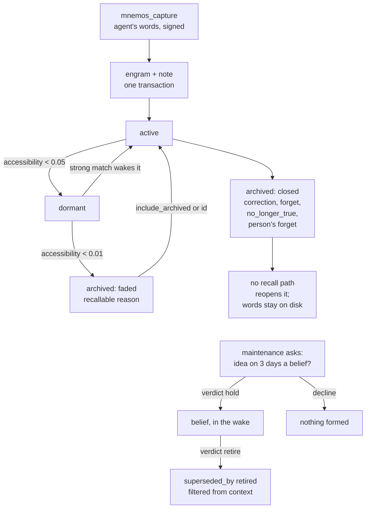

## 1. Executive Summary

Mnemos is a local MCP server that gives one agent a memory it writes itself:
captures in its own words, signed with its model id, kept in one SQLite file
and read back into every session before the first turn. No model writes the
memory. Judgement work is queued as questions the agent answers with a typed
verdict, and the verdict alone moves state while the words are kept as
written. A correction or a forget closes the old memory for good, while decay
only fades it. The weakness is the other side of that design: the agent holds
every verb, nothing waits for the person, and forgotten words never leave disk.

The default surface is twelve tools (`mnemos/simple_mcp.py:241-783`); an
advanced mode adds twenty-three more on the same store. Upkeep runs on a
schedule, every four hours and nightly, and decays memories on a clock of the
days the agent lived. When `claude` is installed and setup's question is
answered yes, its default, "quiet hours" run unattended Claude Code sessions as
the agent. Retrieval is FTS5 fused with an exact scan over local MiniLM
vectors, plus link spreading. The README compares recall against Claude Code's
built-in memory; no result file behind those figures is committed.

Three marks: `trust_state`, `scope_enforced` and `negative_eval`. This is a
different project from [mnemos (arhuman)](../mnemos/) and
[Ori Mnemos](../ori-mnemos/).

## 2. Mental Model

A memory is a **capture pair**: an engram and a continuity note written in one
transaction, the note pointing at the engram, so either id reaches both
(`save_capture_pair`, `mnemos/store/sqlite_store.py:4231-4272`). The engram
holds the words, a frozen copy of the words at encoding, and an optional
`impact`. That is what the memory changed in how the agent works, which only
the agent may write (`mnemos/simple_mcp.py:507-513`). Every engram records
`author_kind` (agent, tool, system, import, person) and the model that signed
it.

An engram is in one of three states, and its archive row says why it left:

- `active` — recalled, linked and decayed.
- `dormant` — accessibility under 0.05 (`mnemos/consolidation/decay.py:184`);
  found only by a strong match, which wakes it.
- `archived`, for one of two kinds of reason. Decay below 0.01 writes
  `decay_below_threshold` (`:185`, `:261`). Those reasons, with one repair
  reason, form `RECALLABLE_ARCHIVE_REASONS`, and such a memory returns through
  `include_archived` or its id (`sqlite_store.py:210-215`).
- A correction, the agent's forget, the `no_longer_true` verdict and a
  person's forget archive with other reasons. Those are *closed*: no recall
  path reopens them (`_still_held`, `mnemos/simple_runtime.py:5852-5861`).

Judgement is a **question**, never an inference. Maintenance enqueues one of
five kinds into `reflection_queue`: what a capture changed, what a fading
memory taught, whether an idea returning across three days is a belief,
whether a held belief still holds, whether a fading fact is still true
(`sqlite_store.py:417`, `:432-463`). The agent answers with
`mnemos_reflect` and a verdict from a closed list per kind
(`simple_runtime.py:932-936`). An answered lesson question becomes a `lesson`
engram at strength and stability 0.8, which fades far more slowly
(`mnemos/consolidation/softening.py:601-602`).

A **belief** exists only after the agent says `hold`. Retiring it sets
`superseded_by = 'retired'` and confidence 0, and every context read filters on
it (`simple_runtime.py:3982-4022`). Handoffs, the journal and notes to the
person are kept verbatim and are never memories: no pass decays, links or
rewrites them.

## 3. Architecture

A Python package with one console script, `mnemos` (`pyproject.toml`). `mnemos
serve` starts the stdio MCP server in simple mode unless `--mode advanced`,
`MNEMOS_MODE` or config says otherwise (`mnemos/cli.py:61-72`,
`:2179-2201`). Advanced mode registers the simple tools and adds
twenty-three (`mnemos/mcp_server.py:94`). Both delegate to `MnemosRuntime` in
`mnemos/simple_runtime.py`, over `EngramStore` in
`mnemos/store/sqlite_store.py`.

**Store.** One SQLite file per agent, `~/.mnemos/<agent>.db`, unless a path is
configured (`mnemos/simple_scope.py:79-89`). It holds `engrams` with an FTS5
table, typed `connections`, `versions`, `archive`, `beliefs`,
`hypomnema_entries` (the notes and handoffs), `reflection_queue`,
`memory_trace`, `journal_entries`, `notes`, `lived_days` and `passage_vectors`
(`sqlite_store.py:471-848`). Shared memories live in a second file,
`~/.mnemos/shared-memory.db`, that every agent on the machine reads.

**Embeddings.** Optional. With the `embeddings` extra, `all-MiniLM-L6-v2` runs
locally and passages of up to 160 words are embedded into `passage_vectors`
(`mnemos/store/embedding_index.py:123`, `:359`). Gemini embeddings are a
choice, never inferred from a key. Without either, recall matches words.

**Scheduled work.** `mnemos connect` and `setup` install launchd, systemd or
cron jobs: `consolidate` every four hours and `consolidate --deep` at 03:00
(`mnemos/setup/scheduler.py:82-95`). The quiet hours run the `claude` CLI as
the agent at 08:00, 19:00 and 03:30, scheduled on a yes to setup's one
question, which defaults to yes (`scheduler.py:97-126`, `mnemos/cli.py:1354`).

**The page.** `mnemos log`, or the `mnemos_page` tool, serves a local site on
127.0.0.1 behind a random path token, checking Host and Origin on every POST
(`mnemos/companion/server.py:191-213`, `:477-490`). The person reads memory,
replies to the agent's notes, corrects and lets go there.

### Deployment and ergonomics

Nothing has to run but the MCP server the client spawns. `pip install
"mnemos-continuity[mcp,embeddings]"`, `mnemos embeddings download` (about 90
MB, with PyTorch in the extra) and `mnemos connect <agent> --write`. No API key
is needed to store anything. Everything works offline. Windows gets the tools
without the scheduled parts. The store is SQLite and readable by hand, but its
invariants live in code: a capture is two rows, a correction four kinds of
rows, and many repair commands exist for stores older code wrote. Uninstall
removes hooks, server entries and jobs and leaves `~/.mnemos` in place.

## 4. Essential Implementation Paths

- **Capture.** `mnemos_capture` (`simple_mcp.py:487-530`) calls `capture`
  (`simple_runtime.py:5301-5495`). It classifies kind and domain by substring
  (`:745-770`), signs with `author_model(signed_as)`, and prepares the engram
  with links and surprise detection. It writes the pair in one transaction
  (`:5433`), embeds after commit, and calls `maintain(auto=True)` (`:5469`).
- **Recall.** `mnemos_recall` (`simple_mcp.py:540-589`) to `_recall_own`
  (`simple_runtime.py:5513-5640`), then `ReactiveRetriever.retrieve`
  (`mnemos/retrieval/reactive.py:285`). An id as the query returns one item
  whole through `_recall_by_id` (`simple_runtime.py:4948`), which refuses a
  closed memory and names its successor. Returned memories are reinforced once
  per session (`_reinforce_returned`, `:7448`).
- **Wake.** The SessionStart hook prints `build_context_packet`
  (`mnemos/interface/context_packet.py:198`): handoffs, replies from the
  person, standing rules, beliefs, at most one question and what upkeep
  changed, under 8,000 characters plus one whole handoff (`:100`).
  `mnemos_context` returns the same packet where no hook exists.
- **Cue.** A prompt hook asks a warm answerer over a unix socket for up to
  three memories, one line of 200 characters each (`mnemos/cue.py:125-136`).
- **Correct and forget.** `correct` (`simple_runtime.py:6418`) resolves the
  target pair by id or by a query that must hold half its meaningful words.
  A forget runs `_retire` (`:5863-5901`), which archives every live note and
  memory of the pair. A correction also writes a replacement pair, a
  `supersedes` link, lineage both ways and a signed version
  (`record_correction`, `sqlite_store.py:4395`).
- **Reflect.** `reflect` (`simple_runtime.py:3590`) finds the pending question
  in scope, checks the verdict against the kind and applies it:
  `_apply_still_true` (`:3847-3888`) and the belief reaffirmation
  (`:3982-4022`).
- **Upkeep.** `maintain` (`:6822`) spawns a detached child for automatic
  runs (`:6858-6859`, `_spawn_upkeep` at `:448`). The child runs
  `ConsolidationDaemon.run_cycle` (`mnemos/consolidation/daemon.py:84`):
  decay, identity, linking, softening and question passes.
- **Person.** `mnemos remember`, `correct`, `forget`, `notes reply` and the
  page go through `mnemos/interface/person.py`; a forget archives as
  `forgotten_by_person` (`sqlite_store.py:222`).

## 5. Memory Data Model

`engrams` carries `content`, `content_at_encoding`, `impact`, `impact_source`,
`author_kind`, `author_model`, `author_session`, `kind`, `tags`, `strength`,
`stability`, `accessibility`, `resolution`, `lineage`, `owner_agent_id`,
`person_id`, `project_scope`, `visibility`, `state`, access counters, and a
signed `standing` mark (`sqlite_store.py:471-509`). `versions` keeps the words
before each change, signed by the corrector when a correction made it. `archive` holds one row per
archived engram with its reason, written by `INSERT OR REPLACE`
(`:2826-2855`).

**Scope** is the triple of agent, person and project, on engrams, notes,
questions, journal entries, notes to the person and trace rows. It defaults to
`mnemos-agent`, `user` and `global`. A comment states the rule: the project is
never inferred from the working directory, because a client's launch location
would partition one agent's memory (`simple_scope.py:22-29`). Beliefs carry
`agent_id` alone (`sqlite_store.py:553-568`).

**Time.** `created_at`, `last_accessed` and `lived_days`. Decay reads hours of
lived days, so a month without a session costs nothing
(`mnemos/consolidation/lived.py:1-14`). There is no validity interval.

**Provenance.** Each write resolves a signer in a fixed order: `signed_as`,
`MNEMOS_AGENT_MODEL`, this session's `mnemos_introduce`, the harness
transcript, or unsigned (`mnemos/authorship.py:1-38`). The person's words are
`author_kind = 'person'`, unsigned.

**Trace.** `memory_trace` records each tool call's tool, session, signer and
the ids it read and wrote, ids only. Rows older than 90 days are deleted on
every insert (`sqlite_store.py:119`, `:5510-5530`).

## 6. Retrieval Mechanics

`retrieve` builds three ranked seed lists and fuses them by reciprocal rank
(k 60, words weighted 0.3, meaning 0.5; `reactive.py:104-106`):

- **Words.** FTS5 bm25 over active then dormant engrams in scope
  (`:366-371`). Words that most live memories share are dropped, but only for
  candidates meaning can find whole. Lessons are ranked by their own words, and
  handoffs and journal entries by bm25 over the passed notes.
- **Meaning.** The cue's vector against every passage vector of the live ids
  in scope, an exact scan with no ANN index (`:384-388`).
- **Shared.** The shared store by every word, kept to rows marked `shared` or
  `public`.

Then **resonance**: from each newly reached memory, activation spreads over
its strongest links both ways, at most two hops, with a floor. Archived and
out-of-scope memories neither receive nor relay; dormant ones receive and do
not relay. A memory reached through links can tie the best seed and never
outrank it. Results are filtered and then cut to `max_results`, so the list
backfills rather than coming back short.

Recall formats memories with their words whole up to 2,000 characters, and
other items at 300, each labelled with how it was found. When vectors exist
but meaning search failed this session, the result says only words were
searched (`_searched_by_words_only`, `simple_runtime.py:5642`). Recall
reinforces what it returned, once per session per memory.

The failure modes follow from the shape. Link spreading pulls in a memory the
query never named. Reinforcement favours what is recalled, and the benchmark
README measures that drift on a synthetic graph. Contradictory memories can
all be live, and the tool description tells the agent the newer usually holds
(`simple_mcp.py:562`).

## 7. Write Mechanics

Every content write is a tool call by the agent or a command by the person.
The encoder links the new engram to related ones and weighs it against held
beliefs for surprise, which raises its encoding strength. With a provider
configured, a model may retype links in deep cycles, and a link goes only on
an explicit `NONE` for its exact id. Since 0.4.0 no model rewrites a memory's
words or writes a lesson (`mnemos/consolidation/softening.py:1-20`). The same
release retired a transcript indexer whose model-harvested facts outnumbered
the agent's own captures; a comment in the scheduler counts 7,058 against 13
on one install (`mnemos/setup/scheduler.py:128-152`).

There is no deduplication at capture: `save_capture_pair` inserts with no
lookup of existing words, so saving the same sentence twice yields two pairs.
A capture is never compared with a closed memory either; the agent can
capture again exactly what it forgot.

A correction archives the old pair and writes a replacement in one
transaction. The replacement keeps the old impact unless the agent gives a new
one, and keeps a standing mark. A correction naming nothing is captured as
fresh continuity (`simple_mcp.py:612-613`).

**Classification is substring matching.** `_classify_domain` tests markers
with `in` on the lowered text, so "research" matches `arc` and is `long-arc`,
and "know" matches `now` and is `situational` (`simple_runtime.py:756-770`).
Domain sets confidence and salience defaults (`:7589-7611`) and whether a note
is `foundational`.

### Operational cost

The capture call is synchronous and model-free: classification, link
discovery, surprise against beliefs, one transaction, then the engram's
vector. A capture is searchable by words when the call returns. Upkeep forks
into a detached process instead of holding the call; its docstring records the
cycle at 12 to 60 seconds on a real store (`simple_runtime.py:6827`).
Scheduled upkeep reads every dormant memory in pages, and up to 10,000 active
ones per pass. The wake costs up to 8,000 characters plus one handoff of up to
16,384. It is printed at SessionStart, ahead of the first user turn, and the
cue adds up to three lines per prompt.

## 8. Agent Integration

Simple mode's twelve tools are `mnemos_context`, `handoff`, `journal`, `note`,
`page`, `capture`, `recall`, `correct`, `maintain`, `reflect`, `introduce` and
`health`. The server instructions tell the model to call context before the
first substantive answer, capture without being asked, correct rather than
re-capture, and sign every write (`simple_mcp.py:62-78`). They are kept
under 2,048 characters because Claude Code shows a model no more.

`mnemos connect` writes the MCP entry and, where the harness has the events,
a wake hook and a prompt hook. `mnemos/setup/harnesses.py` declares wake events
for Claude Code, Codex, Gemini CLI and OpenClaw. Hermes gets a memory provider
(`mnemos/integrations/hermes/`). Cursor, Claude Desktop and others get the
server only. Codex skips hooks until the user approves them under `/hooks`.

The agent's agency is total. It captures, recalls, corrects, forgets, marks a
rule standing, answers every question with the verdict of its choice, runs
maintenance and writes the handoff it wakes with. Advanced mode adds
`mnemos_hypomnema_*`, `mnemos_review_queue`, `mnemos_inspect`,
`mnemos_forget` and `mnemos_consolidate`, several taking `agent_id`,
`person_id` and `project_scope` arguments.

The quiet hours are a second integration. `life.py` launches `claude
--model claude-opus-5-5 --restricted` with this store's MCP server and a
SessionStart hook that wakes the agent (`mnemos/life.py:713-738`). "Mine" gets
Read, Write, Edit, Glob, Grep, a sandboxed Bash, WebSearch and WebFetch, with
pushes, `curl`, `ssh` and publishing denied (`:65-75`, `:106-110`). The other
two kinds get the file tools or none.

## 9. Reliability, Safety, and Trust

### The agent answers its own questions

The reflection queue is the design's centre and it has one respondent.
Maintenance proposes, the agent decides, and the verdict is checked only
against the question's list. A `signed_as` check stops one model retiring a
belief another model wrote, but `signed_as` is a string the caller types
(`simple_runtime.py:3655-3678`). Nothing in the queue waits for the person,
and no surface lets the person answer a question. The README states this as
the intent: the agent's beliefs change only by its own verdict.

### Forget is archival

Every forget path ends in `archive_engram`, which marks the engram archived,
copies its words into `archive`, drops its FTS row and deletes unanswered
questions about it (`sqlite_store.py:2826-2855`). The words stay in
`engrams.content`, `content_at_encoding`, `archive.content` and any version
row. `delete_engram` exists and has no caller in `mnemos/`. The privacy doc
says no command or tool hard-deletes a memory
(`docs/privacy-security.md:229-232`). `tests/test_forget_is_complete.py`
exists because a forgotten capture once reached the wake through two frozen
copies; its header records both.

### Who counts as the person

`run_by_agent` decides whether a CLI write is the person's by `--signed-as`
and two environment variables, `CLAUDECODE` and `AI_AGENT`
(`authorship.py:167-180`). A command in the agent's shell that unsets them is
recorded as the person: an unsigned correction, or a forget archived as
`forgotten_by_person`, which the next wake reports as the person letting a
memory go.

### Scope gaps

Beliefs are keyed on the agent, so a belief formed from one person's memories
appears in another person's wake in the same store (`context_packet.py:281`).
Advanced `mnemos_inspect` and `mnemos_forget` load any engram in the store by
id with no scope check, and the forget archives as `user_requested`
(`mcp_server.py:1266`, `:1462-1466`). Its docstring says resharpen can restore
it, but that reason is not in `RECALLABLE_ARCHIVE_REASONS`.

### The unattended hour

The "mine" hour is a Claude Code session nobody watches, with web fetch and
the memory tools in one context. Text it reads on a page can become a capture
signed as the agent, with `author_kind = 'agent'`, and reach every later wake.
The deny lists cover exfiltration verbs and credential paths. They do not
separate what the hour read from what it keeps.

### Limits at scale

Decay reads at most 10,000 active memories a pass, most accessible first
(`decay.py:51`, `:118-122`). Past that, the memories nearest to dormant are the
ones never decayed. Meaning search scans every live passage vector per recall.

### Marks

Three are carried.

- **`tombstone`** — withheld. A closed memory is keyed on its id; a new
  capture of the same words is a new pair that nothing checks. Belief
  questions are suppressed by the member engram ids already asked about, not
  by the idea.
- **`trust_state`** — earned on the archive reason. A faded memory and a
  closed one are both `archived`; the reason decides which recall may reopen,
  and the closed reasons come from the correction, forget and
  `no_longer_true` paths an agent reaches. Belief retirement is a second axis,
  filtered on every context read. No candidate state exists: a capture is in
  force at once.
- **`bitemporal`** — withheld; `created_at` and lived days are the only times.
- **`scope_enforced`** — earned on the three-key predicate, with the belief
  and advanced-mode gaps above.
- **`audit_log`** — withheld. `versions` records word changes only and
  `mnemos repair-versions` deletes duplicate rows (`sqlite_store.py:2762-2771`).
  The trace sees every write but holds ids and is pruned at 90 days.
- **`human_review`** — withheld. Nothing waits for a person; the person's
  correct and forget act after the write, and the agent answers every question.
- **`negative_eval`** — earned on the cases in section 10.

## 10. Tests, Evals, and Benchmarks

`release-hardening.yml` runs pytest on Python 3.10 to 3.13, a coverage run, a
job with the embeddings extra, ruff, and wheel smoke installs, one of them
unlocked. I did not run any of it. `tests/conftest.py` points `HOME` at a
temporary directory, strips the environment, fakes the OS schedulers and
guards `subprocess.run`.

The suite is named for behaviours and most files open with the defect they
pin. `tests/test_scope_isolation_packet.py:70-114` stores APOLLO for alice and
ZEPHYR for bob under one agent. It asserts each packet lacks the other's
codename and, in a third case on the same fixture, contains its own.
`tests/test_the_person_corrects_and_forgets.py:312-357` first asserts the cue
returns a memory, then forgets it as the person. It checks that recall by
words, meaning, archive search, id and note id, the cue, two maintenance
cycles, the wake and the person's search all omit it.

Weaker cases sit beside these. `tests/test_forget_is_complete.py:63-80`
asserts `SECRET not in rt.recall("bank PIN")` on a store whose only memory was
forgotten. `tests/test_agent_scoping.py` proves consolidation leaves another
agent's rows unchanged, a write-path property.

**Benchmarks.** `benchmarks/retrieval_benchmark.py` seeds 224 synthetic engrams
in three disjoint topics; its README tabulates a parameter grid and a
100-session drift run dated 10 June 2026. No raw output is committed, so I
recomputed nothing. The README's comparison with Claude Code's own memory (35%
against 65% on 30 tasks, and two tests over two years) has no committed
questions, answers or judgements. Those figures stay claims. The project
publishes no paper.

Missing: a populated negative case for a correction, asserting the replaced
words are absent where the replacement is returned.

## 11. For Your Own Build

### Steal

- **A verdict vocabulary per question, and words never parsed.** The answer
  text is kept; a closed list of verdicts decides. Its own tests record the
  failures keyword parsing produced.
- **Two kinds of archive.** Recording why a memory left lets decay stay
  reversible while a correction stays final, in one column.
- **Decay on lived time.** Counting only the days the agent ran keeps an
  absent user from costing the agent its memory.
- **Exempt what is obeyed from decay.** A standing rule is not recalled because
  it is followed, so usage-based fading would remove it for working.
- **Test forget against every delivery path**, frozen copies included.

### Avoid

- **A respondent who is also the proposer's beneficiary.** If one agent writes,
  is asked and answers, the queue records decisions but reviews nothing.
- **An environment variable as the line between the agent and the person.**
- **Keying one kind of state on fewer scope keys than the rest.**
- **A capped sweep ordered by the wrong end.**

### Fit

Suits someone who wants one long-lived agent to keep its own notes about them
and their work, read back without effort, and who accepts that the agent
decides what it believes. The maintenance budget is mostly the agent's: it
answers questions, writes handoffs and corrects itself, and the store wants
the scheduled jobs running. Walk away if a person must approve what is kept,
if a forget must remove the text, or if several people share one agent.
Walk away also if an unattended session with web access writing into memory
is unacceptable.

## 12. Open Questions

- How often agents answer the queue in practice, and whether `decline` and
  `not_now` dominate; the health card counts unanswered questions.
- Whether beliefs keyed on the agent alone are intended to follow it across
  people and projects.
- How the quiet hours' captures compare in provenance with session captures,
  since both are `author_kind = 'agent'`.
- What the README's three comparison runs used as questions and judges.

## Appendix: File Index

- Storage and schema: `mnemos/store/sqlite_store.py`, `mnemos/store/fts.py`,
  `mnemos/store/embedding_index.py`, `mnemos/store/archive.py`
- Write path: `mnemos/simple_runtime.py` (`capture`, `correct`, `_retire`,
  `reflect`), `mnemos/encoding/encoder.py`, `mnemos/authorship.py`
- Retrieval: `mnemos/retrieval/reactive.py`,
  `mnemos/retrieval/reconsolidation.py`, `mnemos/cue.py`
- Context: `mnemos/interface/context_packet.py`
- Background: `mnemos/consolidation/` (`daemon.py`, `decay.py`, `lived.py`,
  `softening.py`, `connection_discovery.py`), `mnemos/setup/scheduler.py`,
  `mnemos/life.py`
- MCP, CLI, person: `mnemos/simple_mcp.py`, `mnemos/mcp_server.py`,
  `mnemos/cli.py`, `mnemos/simple_scope.py`, `mnemos/interface/person.py`,
  `mnemos/companion/server.py`, `mnemos/shared_memory.py`
- Tests and evals: `tests/`, `benchmarks/`, `.github/workflows/`

### Recorded searches

Run from the repository root at the pinned commit with `/usr/bin/git grep`.

- **No validity time.**
  `git grep -n -i -E 'valid_(from|to|until|at)|valid_time|as_of|bitemporal' -- mnemos`
  returns nothing; `git grep -c -E 'created_at|last_accessed' -- mnemos/store/sqlite_store.py`
  returns 66.
- **No product caller hard-deletes an engram.**
  `git grep -n -E 'delete_engram\(' -- mnemos` returns only the definition at
  `mnemos/store/sqlite_store.py:2378`.
- **No tombstone.** `git grep -n -i -E 'tombstone' -- mnemos tests` returns
  nothing.
- **The encoder never consults the archive.**
  `git grep -n -E 'archive_reason|RECALLABLE|archived' -- mnemos/encoding`
  returns nothing; `git grep -c -E 'state' -- mnemos/encoding/encoder.py`
  returns 11.
- **Version and trace rows are deleted in three places.**
  `git grep -n -E 'DELETE FROM (versions|memory_trace)' -- mnemos` returns
  `sqlite_store.py:2387` (in the uncalled `delete_engram`), `:2767` and `:5528`.
- **Beliefs carry no person or project.**
  `git grep -n -E 'person_id|project_scope' -- mnemos/core/belief.py` returns
  nothing; `git grep -c -E 'agent_id' -- mnemos/core/belief.py` returns 3.
- **Advanced inspect and forget load by id alone.**
  `git grep -n -E '_store\.get_engram\(' -- mnemos/mcp_server.py` returns
  `:1266` and `:1462`.
- **No approval state.**
  `git grep -n -i -E 'pending_review|awaiting_(review|approval)|approv' -- mnemos`
  returns two harness setup strings in `mnemos/setup/harnesses.py`.
- **No committed benchmark results.**
  `git ls-files | /usr/bin/grep -E '\.(json|jsonl|csv)$'` returns nothing.
- **No paper.**
  `git grep -n -i -E 'arxiv|bibtex|@article|@misc|doi\.org' -- .` returns
  nothing.

## History

**2026-11-06** — [`3108e08a50ec605213d00e90505dd6a0163166ad`](https://github.com/Riley-Coyote/mnemos-mcp/commit/3108e08a50ec605213d00e90505dd6a0163166ad). First reading, from a full clone at the head of `main`. Screened first: no auto-run surface, `pyproject.toml` and `uv.lock` changed inside the seven-day cooldown (both last on 4 November 2026), `tests/conftest.py` executes on collection, and a `CLAUDE.md` read as data. Apache-2.0 with a NOTICE carrying the earlier MIT notice and no rider. Nothing installed, built or run. Three marks. `human_review` is withheld because the agent answers every question and nothing waits for the person; `audit_log` because versions cover word changes only and the trace is pruned ([section 9](#marks)).
