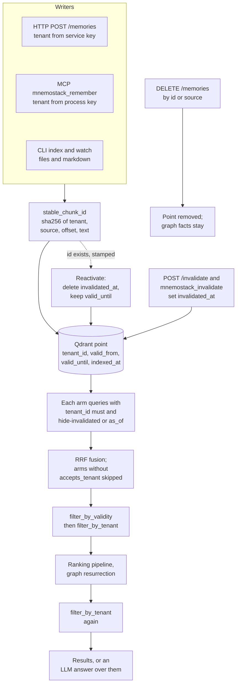

## 1. Executive Summary

mnemostack is a self-hosted memory and retrieval layer in Python: Qdrant holds
chunked text and vectors, an optional Memgraph holds dated triples, and the same
recall chain is served through an SDK, a CLI, a FastAPI server, an MCP server
and an OpenClaw plugin. What is notable is the tenant boundary. The tenant comes
from the service key, every arm's query carries it, arms that cannot carry it
are dropped, and two backstops filter the fused and the re-ranked results; an
unauthenticated server refuses to start over a collection holding two tenants.
What is weak is correction. Invalidation hides a point and records when, and
storing the same content again deletes that record, so nothing keeps a retracted
value from coming back. Graph facts an agent writes have no retraction path on
the surfaces it uses.

The package calls itself a backend and leaves capture policy to integrations.
Nothing extracts, summarises or consolidates memory on a serving path: what is
stored is what a caller sent, chunked and embedded synchronously. Correction is
explicit, by id or by source, and comes in two strengths: a non-destructive
invalidation that keeps the point reachable through `as_of` and
`include_invalidated`, and a hard delete.

Retrieval is the larger half of the code. Up to four arms are fused by weighted
reciprocal rank fusion and passed through a ranking pipeline of up to eleven
stages, three of them stateful and learning from explicit feedback, then an
optional LLM reranker. The project's own committed comparison, on a synthetic
corpus built to be adversarial, has recall-only order ahead of every pipeline
configuration on overall MRR.

**Licence.** Apache-2.0 is in `LICENSE` and `pyproject.toml`, and nothing in it
restricts use. The OpenClaw companion's `openclaw-plugin/package.json` declares
`"license": "MIT"` while the only licence text in the tree is the Apache one, so
the JavaScript plugin names a grant the repository does not contain.

Three marks are earned: `scope_enforced` and `negative_eval` on the tenant
boundary, and `bitemporal` on the validity window kept beside the retraction
stamp. Section 9 gives the reasons for the four withheld.

## 2. Mental Model

A memory is **a chunk of text a caller chose to store**, with its source and
offset, and it is believed, in the sense of being served, from the moment the
upsert returns. There is no candidate state and no judgement on the way in. The
id is a UUID derived from SHA-256 over tenant, source, offset and text
(`src/mnemostack/ingest.py:111-129`), so the same words from the same place are
the same memory.

A memory stops being served in one of three ways:

- **Invalidated.** `invalidated_at` is set on the payload, by default to the
  clock, optionally with a world-time `valid_until`
  (`src/mnemostack/vector/qdrant.py:1356-1421`). Default recall hides it.
  `include_invalidated` shows it again, and `as_of` ignores the stamp and asks
  whether the instant falls inside `valid_from`/`valid_until`
  (`src/mnemostack/recall/validity.py:1-14`, `:318-330`).
- **Deleted.** `DELETE /memories` removes the point outright, by id or by
  source (`src/mnemostack/server.py:2536`). Triples in the graph are separate
  records and stay.
- **Pruned.** Re-indexing a file removes the chunks that no longer appear in it,
  guarded by `index_root` so one indexing root cannot prune another's.

And one way back: storing the same content again. The remote ingest path finds
the existing id carrying `invalidated_at` and patches the key away, keeping
`valid_until`, at zero embedding cost (`src/mnemostack/ingest.py:1331-1397`).
A test pins it as intended behaviour
(`tests/test_remote_ingest.py:1184-1204`). The retraction is not recorded
anywhere else, so after reactivation the store cannot say the memory was ever
withdrawn.

The model never decides what is true. An agent can store, retract by id and
give usefulness feedback; the feedback moves ranking state, not belief.
`synthesize` builds an entity profile on request and stores nothing, and a
citation's verdict against its current source file is computed on request and
never written back (`src/mnemostack/provenance.py:1-30`).

## 3. Architecture

One Python package, `src/mnemostack/`, with optional extras for the server
(`fastapi`, `uvicorn`), MCP (`fastmcp`), HuggingFace embeddings and a file
watcher (`pyproject.toml`). The runtime dependencies are `qdrant-client` 1.20 or
later and the Neo4j driver; Qdrant 1.20 is required since 3.0.0.

- **Storage.** Qdrant collections hold dense vectors and payloads, optionally a
  named sparse vector and a BM25-scored full-text index
  (`src/mnemostack/vector/qdrant.py`). Memgraph or Neo4j holds triples
  (`src/mnemostack/graph/store.py`). The learning state of the stateful ranking
  stages lives in a `StateStore`, by default a JSON file under `flock`
  (`src/mnemostack/recall/pipeline/state.py:140`). Service keys, quotas and the
  opt-in audit trail are local files, with an optional OpenBao key store.
- **Serving.** `mnemostack serve` (FastAPI) and `mnemostack mcp-serve` (FastMCP,
  stdio or HTTP) share `recall_flow()` (`src/mnemostack/recall/flow.py`), and
  both default to binding 127.0.0.1 (`src/mnemostack/cli.py:4839`, `:4962`).
  `mnemostack inspect` is a separate operator console.
- **Providers.** Embeddings from Gemini, Ollama or HuggingFace, each with a
  declared embedding profile; LLMs from Gemini, Ollama or an OpenAI-compatible
  endpoint for answers, query expansion, HyDE and the LLM reranker.
- **Background.** None over the store. The markdown watcher re-indexes changed
  files; nothing schedules consolidation, decay or summarisation.

### Deployment and ergonomics

Something must run Qdrant. The quickstart uses Docker for Qdrant and Ollama for
embeddings, so a fully local and offline setup works with no API key. Memgraph
is optional and only the graph arm, the triple routes and graph resurrection
need it. Install is `pip install mnemostack` plus extras. The store is not
readable by hand, but the inspector browses records, invalidated facts and
tenants, and `tenant-export` writes a tenant's points and payloads to a file.
A multi-host deployment has to replace the file state store, which
`docs/memory-model.md` says in as many words.

## 4. Essential Implementation Paths

**Capture.** `POST /memories` validates each item and its metadata, checks the
tenant's storage quota and calls `ingest_remote_items` inside a per-tenant
in-process lock (`src/mnemostack/server.py:2097-2245`,
`src/mnemostack/ingest.py:1036`, `:1210`). `mnemostack_remember` calls the same
function (`src/mnemostack/mcp/server.py:1043`). The CLI's `index`,
`index-markdown` and `watch` chunk files through `src/mnemostack/chunking/` and
the markdown indexer, and the SDK `Ingestor` batches and flushes, stamping
`indexed_at` (`src/mnemostack/ingest.py:2178`).

**Extraction.** None on a serving path. `TripleExtractor` asks an LLM for
subject, predicate, object and `valid_from` (`src/mnemostack/graph/extractor.py:25-28`)
and is exported with no caller outside its module. Triples enter the graph
through `POST /triples` and `mnemostack_graph_add_triple`
(`src/mnemostack/server.py:2247`, `src/mnemostack/mcp/server.py:1374`).

**Retrieval.** `Recaller.recall` runs the configured arms, applies the tenant
and validity conditions inside each, fuses, then runs `filter_by_validity` and
`filter_by_tenant` (`src/mnemostack/recall/recaller.py:916`, `:1017-1022`).
`recall_flow` resolves the default tenant before calling it, applies the
pipeline, then the caller's filters and the tenant backstop again, then the
reranker (`src/mnemostack/recall/flow.py:62-150`).

**Context assembly.** HTTP and MCP return ranked results with an optional
trace; `/answer` and `mnemostack_answer` synthesise an answer over them
(`src/mnemostack/recall/answer.py`). The OpenClaw plugin calls `/answer` from a
`before_prompt_build` hook and prepends the answer, its confidence and up to
eight sources inside an `<active_memory>` tag capped at 2,000 characters
(`openclaw-plugin/src/plugin.js:190`, `openclaw-plugin/src/injection.js:37-46`,
`openclaw-plugin/src/config.js:24`).

**Update and delete.** `POST /invalidate`, `mnemostack_invalidate` and the CLI
call `VectorStore.invalidate` (`src/mnemostack/server.py:2427-2534`,
`src/mnemostack/mcp/server.py:936`, `src/mnemostack/cli.py:2353`).
`DELETE /memories` calls `delete_points` (`src/mnemostack/server.py:2536`,
`src/mnemostack/vector/qdrant.py:1303`). `tenant-rm` revokes the tenant's keys
first, then deletes its points and graph nodes
(`src/mnemostack/vector/qdrant.py:1331`, `src/mnemostack/graph/store.py:593`).
`GraphStore.invalidate` closes an edge by setting `valid_until`
(`src/mnemostack/graph/store.py:396-431`); outside its definition it appears
only in a docstring.

**Tests.** Section 10.

## 5. Memory Data Model

A point's payload carries the text under the configured `text_key`, `source`,
`offset`, `timestamp`, `tags`, `indexed_at`, caller metadata, `tenant_id`,
`index_root`, the snapshot hash of its source document, and the
`_embedding_space` fingerprint. Caller metadata cannot set `tenant_id`,
underscore keys, `tags`, `timestamp` or `invalidated_at`, and may set
`valid_from` and `valid_until` if they parse as ISO-8601 and are ordered
(`src/mnemostack/ingest.py:475-491`, `:595-610`).

Scope is one key, `tenant_id`, indexed as a keyword payload field
(`src/mnemostack/vector/qdrant.py:382-385`). `index_root` is an ownership guard
for lifecycle calls, not a read filter. The ranking state is namespaced per
tenant by `tenant_state_key` (`src/mnemostack/recall/pipeline/state.py:16-24`).

Time has four fields. `timestamp` is the content's own time and feeds freshness
and the temporal arm. `indexed_at` is when it was stored. `valid_from` and
`valid_until` are the world-time window a writer states. `invalidated_at` is
the system-time retraction. A graph triple has only the world-time pair, with
`"current"` as the open end (`src/mnemostack/graph/store.py:20-35`), and a tenant
property folded into its node and edge MERGE keys (`:116-195`).

There is no type distinction between episodic, semantic or profile memory. The
unit is a chunk, and a deployment that wants classes sets them as metadata and
filters on them.

## 6. Retrieval Mechanics

The arms are a dense `VectorRetriever`, a lexical arm chosen by
`recall.text_search` (Qdrant-native BM25, a sparse tf-idf vector, or an
in-process BM25 over files), a `TemporalRetriever` that parses dates out of the
query into a timestamp range, and an optional `MemgraphRetriever`
(`src/mnemostack/recall/retrievers.py:253`, `:567`, `:632`, `:764`, `:1308`,
`:2351`, `src/mnemostack/cli.py:2735-2800`). Fusion is weighted RRF with k 60,
on rank only (`src/mnemostack/recall/fusion.py:15-40`).

`build_full_pipeline` then applies up to eleven stages
(`src/mnemostack/recall/pipeline/presets.py:30-138`): query classification,
relevance calibration, exact-token rescue for identifiers, hub dampening (SDK
only), a Q-learning reranker over source and query type, a curiosity boost, a
freshness blend with a bounded access bonus, gravity dampening of hits missing
query terms, inhibition of return, exact-token protection, and graph
resurrection, which injects graph records. An LLM reranker can follow, and
`token_budget` cuts the returned text.

The project's own measurement of this pipeline is committed in
`benchmarks/pr232/evidence/`. On 3,000 synthetic memories and 240 queries with
`bge-m3`, recall-only order scores MRR 0.5575 and recall@25 1.000. The serving
composition, `recall_flow`, scores 0.3168 at the base commit and 0.3535 after
the stage reorder, with recall@25 0.8042 in both
(`benchmarks/pr232/evidence/base-metrics.md`). The MRR columns recompute from
`per_query.csv`. The README beside them says the corpus is adversarial by design
and that only the difference between the two trees is the result; the absolute
numbers still say that on this corpus the pipeline moves gold down.

The code documents two failure modes of its own. An in-process BM25 corpus built
from files carries no validity keys and so returns invalidated content, and one
built from Qdrant reflects an invalidation only when rebuilt
(`src/mnemostack/vector/qdrant.py:1376-1384`). Under a tenant, an unstamped file
corpus is skipped with a warning rather than searched
(`src/mnemostack/recall/recaller.py:1549-1560`).

## 7. Write Mechanics

Writes are explicit and synchronous: chunk if asked, embed server-side, upsert.
A duplicate id costs no embedding call. The secret policy, off by default, can
refuse recognisable key and token shapes before any side effect. There is no
LLM in the write path and no deduplication beyond the id, so two phrasings of
one fact are two memories, and `docs/memory-model.md` makes reconciling them the
application's job.

Conflict handling is the caller's. Storing "the service moved to team B" does
not touch "the service belongs to team A"; the caller invalidates the old point
and may state a `valid_until`. Source-scoped invalidation is
first-retraction-wins, so a later call does not restamp an earlier retraction
(`src/mnemostack/server.py:2427-2460`). `GET /memories?source=` lists ids and
content hashes per source without text, so a client can reconcile its own copy
against the service.

### Operational cost

The agent blocks on one embedding call per new chunk, and a memory is
retrievable by the dense and native-BM25 arms as soon as the upsert returns.
No background pass reads or rewrites the store. On the read path the cost is
the arms, the pipeline and, when configured, an LLM reranker and an LLM answer.
The OpenClaw companion pays one `/answer` call per prompt and prepends at most
2,000 characters at the front of the prompt, where the block changes on every
turn.

## 8. Agent Integration

The MCP server registers nine tools: `mnemostack_health`, `_search`, `_answer`,
`_resolve`, `_invalidate`, `_remember`, `_feedback`, and, when a graph is
configured, `_graph_query` and `_graph_add_triple`
(`src/mnemostack/mcp/server.py:613-1374`). Source-scoped retraction and hard
delete are HTTP-only, by a stated choice that an agent tool able to retract a
whole document has too large a blast radius (`src/mnemostack/server.py:2431-2437`).

Under `--auth` the MCP server verifies the stdio process's key, or the HTTP
caller's bearer token, on every call and takes the tenant from it; with auth
off, every tool runs under the configured default tenant
(`src/mnemostack/mcp/server.py:309-333`). No tool takes a tenant argument.

`integrations/` holds skills for Claude Code, Cursor and OpenClaw that tell an
agent when to call the tools; the OpenClaw plugin is the one automatic
injection. Nothing captures a conversation by itself, as the README states.

## 9. Reliability, Safety, and Trust

### The tenant boundary

The key decides the tenant, in one function per server
(`src/mnemostack/server.py:1673-1680`, `src/mnemostack/mcp/server.py:328-333`).
On write, `_stamp_tenant` sets `tenant_id` from that value, and strips a
caller-supplied one when there is no tenant, so markdown frontmatter cannot plant
a point in a tenant's scope (`src/mnemostack/vector/qdrant.py:71-86`). An upsert
onto an id another tenant owns raises `TenantConflictError` (`:224`). On read,
`_assemble_filter` appends the tenant condition to the dense, sparse and native
BM25 queries (`:1464-1475`). The recaller admits only arms that declare
`accepts_tenant`. `filter_by_tenant` drops any result whose payload names
another tenant or none, once after fusion and once after the pipeline, because
graph resurrection injects records that never passed a tenant-scoped arm
(`src/mnemostack/recall/recaller.py:1017-1022`, `src/mnemostack/recall/flow.py:140-150`).
Graph reads confine both endpoints and the edge
(`src/mnemostack/graph/store.py:464-470`).

The startup gate covers the case where none of that applies. With auth off, no
default tenant and no `--allow-cross-tenant`, `build_app` probes the collection
and the graph for two distinct tenants and refuses to start
(`src/mnemostack/server.py:1410-1438`). Lifecycle calls apply the same tenant:
invalidating or deleting a foreign id is skipped and counted the same as a
missing one, so the count is not an existence oracle
(`src/mnemostack/vector/qdrant.py:1411-1412`).

The edge of the boundary is the operator console. Without `--auth`,
`mnemostack inspect` serves `/api/records` with the tenant as a query parameter,
and an empty one browses every point (`src/mnemostack/inspector.py:726-736`).
With `--auth`, any admin key reads every tenant, which `docs/deployment.md`
states and answers with "do not issue `admin` keys to tenants". The console
binds 127.0.0.1 by default.

### Correction does not hold

Invalidation is careful about its own semantics and loses them on the next
write of the same content. `ingest_remote_items` deletes `invalidated_at` from
an existing point when the same tenant, source, offset and text arrive again
(`src/mnemostack/ingest.py:1331-1397`). `mnemostack_remember` is one of its
callers, so an agent restating a fact an operator retracted makes it current.
Restated from another source or offset, it is a new point that never carried
the stamp. Either way no record of the rejected value survives, and the store
cannot answer when the memory was withdrawn.

`invalidated_at` is also a request field on `POST /invalidate` and
`mnemostack_invalidate`, so the system-time stamp is whatever the caller sends.
And `as_of` ignores it, so the store can answer what was true at an instant but
not what it held as current then.

Graph facts are the other gap. `POST /triples` and `mnemostack_graph_add_triple`
write them, and nothing on HTTP or MCP closes or deletes one.
`GraphStore.invalidate` exists in the SDK, `DELETE /memories` leaves the graph
alone by design, and only `tenant-rm` removes a tenant's graph wholesale.

### The audit trail is control plane only

`MNEMOSTACK_AUDIT_FILE` turns on an append-only JSONL file with careful
handling: an exclusive lock, a symlink-refusing path walk, permission checks and
redaction of key-shaped strings (`src/mnemostack/audit.py:1-40`). Its
vocabulary is key issue and revoke, quota set and remove, tenant export,
migrate and removal, admin-console denials and three collection index
commands, written from the CLI and the inspector
(`src/mnemostack/cli.py:1422-1434`, `src/mnemostack/inspector.py:500-520`).
The module's own contract puts the data plane out of scope. No ingest,
invalidation, reactivation or delete of a memory is recorded.

### Marks

- **`scope_enforced` — earned.** `tenant_id` is stamped from the key and
  applied as a Qdrant `must` condition on every arm that queries the
  collection, with arm admission and two result backstops, and graph reads are
  confined the same way.
- **`negative_eval` — earned.** Store-level, recaller-level and arm-level tests
  require foreign-tenant points and invalidated points to be absent from
  results that hold other material, with exact-set assertions or a non-empty
  check first.
- **`bitemporal` — earned.** The world-time window is caller-stated and
  separate from `indexed_at` and `invalidated_at`, and `as_of` reads it on HTTP
  and MCP. The record clock is caller-settable and erasable, and the graph keeps
  only the world-time pair.
- **`tombstone` — withheld.** Invalidation is keyed on the point, and storing
  the same text clears it. No list of rejected values exists.
- **`trust_state` — withheld.** The only state that withholds a memory is the
  presence of `invalidated_at`, which is the system-time half of the validity
  model, binary, cleared by a repeat write and ignored by `as_of`. There is no
  candidate or verified state. Citation verdicts are computed on request and
  not stored.
- **`audit_log` — withheld.** The audit file records keys, quotas and tenant
  lifecycle, not memory mutations, and is off by default.
- **`human_review` — withheld.** Nothing waits for anyone. The inspector
  browses; the admin console manages keys and quotas.

## 10. Tests, Evals, and Benchmarks

The suite is large and mostly runs without services: 2,746 test functions in
142 files, most against `QdrantClient(":memory:")`. CI runs them on five Python
versions, again with the minimum declared `qdrant-client`, and runs a smoke file
against a real Qdrant 1.20 container (`.github/workflows/ci.yml`). The dev
extra installs `fastapi` and `fastmcp`, so the server and MCP tests that
`importorskip` them run in CI.

The tenant tests are the strongest part. `test_read_is_isolated_by_tenant`
puts three points from two tenants on one vector so only the filter can
separate them and asserts exact sets (`tests/test_multi_tenant.py:46-55`).
`test_write_to_a_recall_as_b_is_empty_across_arms` gives the recaller an arm
that ignores its tenant and requires the output to be exactly the one own hit
(`tests/test_tenant_fail_closed.py:136-146`). The HTTP-level test of recall
asserts the tenant the fake recaller received, not an exclusion
(`tests/test_server.py:840-845`), and the HTTP write test asserts per-tenant
counts (`tests/test_remote_ingest.py:383-394`).

Validity tests cover the default hide, `include_invalidated`, `as_of`
ignoring the stamp, over-fetch past a stale top window and the vector floor not
re-injecting stale points (`tests/test_validity.py:60-80`, `:198-216`,
`:273-318`). Reactivation is pinned as intended
(`tests/test_remote_ingest.py:1184-1204`, `:1249-1268`); no test asserts that a
retracted value stays retracted.

The README reports LoCoMo strict accuracy of 82.9% on 1,986 questions with a
`gemini-3-flash-preview` judge, and reports beside it the score without the
auto-passed empty-answer category. The harness is committed
(`benchmarks/run_locomo.sh`, `benchmarks/locomo_single.py`); no result file is,
and `benchmarks/.gitignore` excludes `results/`. The real-corpus needle numbers
come from a private corpus. The one committed result set is
`benchmarks/pr232/evidence/`, discussed in section 6. No paper is cited.

Missing before trusting correction: a test that an invalidated value restated by
the agent does not return to default recall, which would fail by design at this commit,
and a test that an invalidated point is absent from a file-backed BM25 arm.

## 11. For Your Own Build

### Steal

- **Take the scope from the credential and apply it three times.** In the
  store query, at arm admission, and on the final result list after anything
  that can inject records. The last filter makes a forgotten predicate in a new
  arm a non-event.
- **Refuse to start rather than serve everyone.** A probe for two distinct
  tenants at startup turns a misconfiguration into an error message.
- **Make lifecycle counts uninformative.** Skipping foreign ids with the same
  count as missing ones keeps delete and invalidate from enumerating another
  tenant's ids.
- **Separate retraction from erasure, and say what each covers.** The
  invalidate and delete handlers state which arms and stores they reach.

### Avoid

- **Letting an idempotent write clear a retraction.** If identical content
  re-asserts a withdrawn memory, the retraction has to live somewhere the write
  path consults, keyed on the content.
- **A record clock the caller can set.** A system-time field taken from the
  request can be backdated and cannot support "what did we hold then".
- **Two stores with one lifecycle API.** Facts in a second store need their own
  retract and delete on the surfaces that write them.

### Fit

mnemostack suits a team that wants a retrieval service for several consumers on
one Qdrant, decides capture and reconciliation in its own application, and
values a tested tenant boundary over memory that manages itself. It is a poor
fit for an agent expected to maintain beliefs on its own: nothing extracts,
merges or judges, and the one correction primitive an agent holds is undone
when it repeats itself. The ranking stack is large and its own evidence does
not yet show it helping, so start with recall-only order and add stages against
a corpus of your own.

## 12. Open Questions

- Whether any deployment pairs a file-backed BM25 corpus with invalidation in
  practice, and so serves retracted text through the lexical arm.
- What the LoCoMo result files contained; they are regenerated locally and not
  committed.
- Whether the full pipeline helps on the private production corpus the README
  describes, where the committed synthetic corpus shows it hurting.
- Whether graph retraction over HTTP and MCP is planned; the deployment guide
  refers to "the graph invalidation API", which is an SDK method.

## Appendix: File Index

| Path | Role |
| --- | --- |
| `src/mnemostack/vector/qdrant.py` | Store, tenant stamp and condition, invalidate, delete, search filters |
| `src/mnemostack/ingest.py` | Deterministic ids, remote ingest, metadata validation, reactivation |
| `src/mnemostack/recall/recaller.py` | Arms, fusion, tenant arm admission, validity and tenant backstop |
| `src/mnemostack/recall/flow.py` | The serving chain and the post-pipeline tenant backstop |
| `src/mnemostack/recall/validity.py` | `valid_at`, `filter_by_validity`, `filter_by_tenant` |
| `src/mnemostack/recall/retrievers.py` | Dense, sparse, native BM25, file BM25, HyDE, Memgraph and temporal arms |
| `src/mnemostack/recall/pipeline/` | Ranking stages, presets, learning-state stores |
| `src/mnemostack/server.py` | HTTP routes, auth, tenant resolution, startup gate |
| `src/mnemostack/mcp/server.py` | MCP tools, per-call key check |
| `src/mnemostack/graph/store.py` | Triples, tenant MERGE keys, graph `as_of`, tenant delete |
| `src/mnemostack/audit.py` | Control-plane audit file |
| `src/mnemostack/inspector.py` | Read-only browser and admin console |
| `src/mnemostack/provenance.py` | Citation resolution against current sources |
| `openclaw-plugin/src/` | `before_prompt_build` hook and injection |
| `tests/test_multi_tenant.py`, `tests/test_tenant_fail_closed.py` | Tenant isolation |
| `tests/test_validity.py`, `tests/test_remote_ingest.py` | Validity, invalidation, reactivation |
| `benchmarks/pr232/` | Committed ranking comparison and ablation |

### Recorded searches

Run from the repository root at the pinned commit with `git grep`.

- **No memory mutation reaches the audit vocabulary.**
  `git grep -n -E '"(memory|memories|point|points|invalidate|ingest|prune|delete)\.[a-z_]+"' -- src/mnemostack/cli.py src/mnemostack/inspector.py src/mnemostack/server.py src/mnemostack/mcp/server.py`
  returns nothing. The control
  `git grep -c -E '"(tenant|keys|quota)\.[a-z_]+"' -- src/mnemostack/cli.py src/mnemostack/inspector.py`
  returns 24 and 11.
- **Only the CLI and the inspector write the audit file.**
  `git grep -n -E 'audit_log_from_env' -- src` returns the definition at
  `audit.py:415`, `cli.py:1432` and `:1434`, and `inspector.py:501`, `:512`,
  `:1022` and `:1024`.
- **No serving path invalidates or deletes a graph fact.**
  `git grep -n -E '\.invalidate\(' -- src` returns `cli.py:2353`,
  `mcp/server.py:1021` and `server.py:2486`, all on the vector store, and the
  docstring at `graph/__init__.py:11`.
  `git grep -n -E 'delete_triple|DETACH DELETE|DELETE r' -- src` returns the
  markdown link sync at `graph/store.py:299` and the tenant delete at `:598`,
  `:624` and `:627`.
- **The triple extractor has no caller.** `git grep -n 'TripleExtractor' -- src`
  returns its definition, the package export and a comment at
  `recall/validity.py:221`.
- **The consolidation runtime has no caller outside its package.**
  `git grep -n -E 'consolidation' -- src ':!src/mnemostack/consolidation'`
  returns nothing; `git grep -c consolidation -- src/mnemostack/consolidation`
  matches inside the package.
- **No value-keyed rejection.**
  `git grep -n -i -E 'tombstone|rejected_|blocklist|denylist' -- src` returns one
  comment at `markdown/parse.py:83` about wikilink parsing.
- **No discrete trust status.**
  `git grep -n -E '"(verified|candidate|pending|approved|rejected|disputed|quarantined|current)"' -- src`
  returns only the `"current"` validity marker in `graph/store.py`.
- **No review queue.** `git grep -n -i -E 'approve|pending_review|needs_review' -- src`
  returns three comments about approved corpus roots in `provenance.py` and a
  guard comment at `cli.py:3223`.
- **No LoCoMo result is committed.**
  `git ls-files benchmarks | grep -i -E 'result|\.json'` returns nothing, and
  `benchmarks/.gitignore` lists `results/`.

## History

**2026-11-26** — [`5fd7c7aad5e659b06377cc400b0c32f02658b614`](https://github.com/udjin-labs/mnemostack/commit/5fd7c7aad5e659b06377cc400b0c32f02658b614). First reading at `5fd7c7a`, read only from a full clone at the head of `main`, dated 25 November 2026 and one documentation commit past `f808edb`, the commit the triage selected, with no change under `src/`. Screened first: no auto-run surface, nothing inside the seven-day cooldown, no build-time execution, one unpinned surface (`pyproject.toml` with no lockfile). Docs were read as data. Nothing was installed, built or run, and the 2,746 Python test functions and 34 JavaScript cases were not run. The MRR columns in `benchmarks/pr232/evidence/` were recomputed from `per_query.csv`. Three marks: `bitemporal`, `scope_enforced`, `negative_eval` ([section 9](#marks)).
