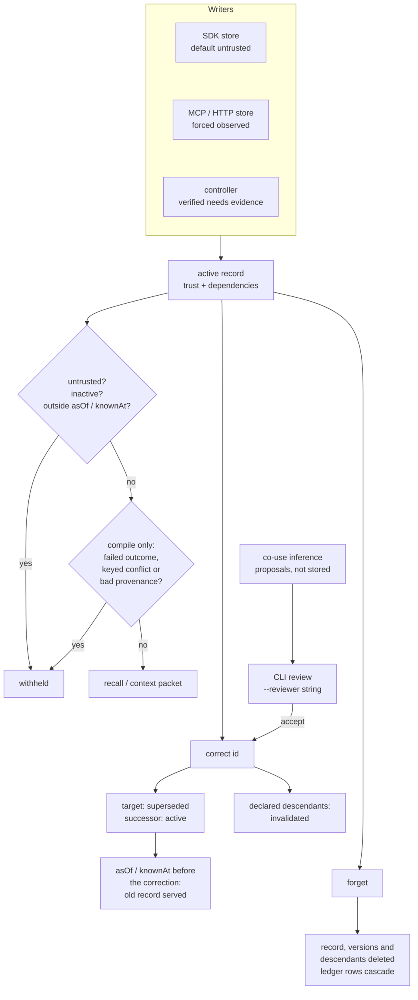

## 1. Executive Summary

Mnemosyne (28naem-del) is a local memory engine for agents, published on npm as
`mnemosy-ai`: one SQLite file served over a TypeScript SDK, an MCP server, a CLI
and authenticated HTTP. Its distinguishing move is that a correction is
structural. A record declares the records it depends on, and `correct()`
supersedes the target and marks every declared descendant `invalidated`, while
`asOf` and `knownAt` keep answering what was believed before. The weak half is
the dependencies nobody declared: the inference that proposes them writes
nothing until a CLI caller accepts, and the guard that would hold a stale
procedure meanwhile has no in-tree caller outside the evaluation harness.

This is not the atlas's [Mnemosyne](../mnemosyne/) from `mnemosyne-oss`, a
Python SQLite engine, nor [Mnemosyne (Nabzx)](../mnemosyne-nabzx/), a Rust
commit graph. The three share a name and no history: none is a fork, the
pinned commits of the other two are absent from this repository, and its root
commit `7d12c23` is dated 23 February 2026. The README names `mnemosyne-oss` as
a separate project (`README.md:35-37`); nothing in the tree mentions Nabzx.

Two engines ship in the tree. The SQLite engine under `src/local` arrived on
12 September 2026 and is what this report reads. The original vector engine,
over Qdrant with Redis and FalkorDB options, moved to `packages/legacy` on
28 October 2026 as `mnemosy-ai-legacy` and is not traced here.

Around the engine sits more machinery than the core needs: a provenance
ledger, a bisect that re-executes recall to find the record that pushed a known
answer out, outcome-gated consolidation, ancestry-disjoint trust promotion, and
skill trials. It needs no model and no API key to store or recall; the bundled
embedder and reranker are optional, digest-pinned downloads.

## 2. Mental Model

A memory is a **record**: text, a `kind` (`fact`, `preference`, `decision`,
`procedure`, `observation`, `checkpoint`), a `source`, a trust tier, a
lifecycle status, a visibility, a list of `dependencies`, an optional fact
`key` and an optional validity interval (`src/local/types.ts`,
`src/local/validation.ts:114-148`). Records are immutable apart from their
status. Everything else the runtime keeps — jobs, skills, project models,
traces, tombstones, branch state — is a record too, marked
`metadata.advisory: false` so that no read serves it as advice.

Two axes decide whether a record is a belief. **Trust** is `untrusted`,
`observed` or `verified` (`src/local/index.ts:131`). The SDK default is
`untrusted`, and every default read drops it. MCP and HTTP writes are forced to
`observed` (`src/mcp/server.ts:132`, `src/http/index.ts:150`). `verified`
requires an `evidence` string and is reachable only from the SDK or the CLI.
A record may not depend on a record of lower trust (`:605-612`).

**Status** is `active`, `superseded` or `invalidated`. `correct(id)` writes a
successor with `supersedes: id`, moves the target to `superseded` and moves
every record reachable over `dependencies` to `invalidated`, stamping the
correction that caused it (`:2797-2834`, `#descendants` at `:2756-2789`). An
invalidated record stays invalidated: `correct()` accepts only an active
target, so a dependent is replaced by a new record rather than revised.

On top of both, the context compiler applies **evidence eligibility** before
ranking. A candidate is withheld when it or anything it transitively depends
on is untrusted, inactive, has a failed outcome, or holds a fact `key` whose
active texts disagree (`#hasFailedEvidence`, `#conflictingPeers`,
`:1151-1190`). Keyed conflicts are surfaced together with no winner picked.

Time is two clocks. `asOf` is when a fact applied, `knownAt` what had been
recorded; `#at` projects any record onto both and hides a later status change
from a historical read (`:1044-1063`). A record dies in one way, `forget`, a
hard delete of the record, its versions and its descendants.

## 3. Architecture

The engine is one class, `LocalMemory` in `src/local/index.ts`, over Node's
built-in `node:sqlite` (Node 22.16 or later). The constructor creates the file
`0600` in a `0700` directory, refuses a symlink, and sets `busy_timeout`,
`foreign_keys`, `secure_delete` and WAL (`:253-340`). Every mutation runs in
`BEGIN IMMEDIATE` or a savepoint, and `atomic()` refuses an async callback so
no await can split a transaction (`:450-484`).

**Storage.** `memories` holds the scope columns and the full record as JSON;
`dependencies`, `outcomes`, `idempotency` and `audit` reference it with
`ON DELETE CASCADE` (`:369-414`). The schema also creates an FTS5 table that no
read queries; lexical recall uses the engine's own `local_terms` and
`local_search` postings (`:515-551`). `local_embeddings` stores packed float32
vectors per record and model, stamped with the source text's hash, so a vector
whose text changed is recomputed. The ledger is `local_ledger` with
result and candidate side tables (`src/local/ledger.ts:49-80`).

**Retrieval stack.** Hybrid is the default when the bundled model is present:
`Xenova/bge-small-en-v1.5` int8 ONNX, pinned to one revision and verified by
sha256 (`src/local/embedding/model-assets.ts:18-33`). The reranker is
`Xenova/ms-marco-MiniLM-L-6-v2`. Without them recall degrades to lexical and
says so through `retrieval.degraded`. Dense search is an exact scan unless
`indexMode` selects sqlite-vec or an HNSW sidecar file.

**Processes.** None by default. `MemoryRuntime` keeps a durable job queue that
a host drains with its own model callback (`src/runtime/index.ts:278-412`),
and `MemoryAgent` joins before-turn context, after-turn capture and an
optional background drain (`src/agent/index.ts`). Nothing is scheduled.

### Deployment and ergonomics

- **What has to run:** nothing. A file, Node 22.16+, and `npx`.
- **Offline:** fully, once the two models are fetched by `setup:embedder` and
  `setup:reranker`; the only network access is that opt-in fetch.
- **API key:** none to store or recall. A provider config is needed only for
  host-run observation jobs, model refresh and an external embedder.
- **First run:** `claude mcp add mnemosyne -- npx -y -p mnemosy-ai@next mnemosy
  mcp --db … --workspace … --agent …`, or the plugin marketplace.
- **Repair by hand:** the SQLite file is inspectable, but each row's truth is
  its `data` JSON, and the derived postings, vectors and ledger references must
  agree with it. `mnemosy operations` backs up and restores whole databases,
  optionally passphrase-encrypted with the consolidation signing key.

## 4. Essential Implementation Paths

**Capture/write.** `store()` validates, applies an idempotency key bound to the
canonical payload, checks dependencies, and calls `#insert`, which writes the
row, the postings, the dependency edges, an `audit` row and a `store` ledger
entry with provenance and a text hash (`src/local/index.ts:820-839`,
`:619-641`). Transcript capture stores each message as an `observation` keyed
by `capture:` plus a hash of adapter, session and message id
(`src/runtime/index.ts:158-168`). Document ingest corrects the previous
revision of the same URI, so a changed document invalidates what was built
from it (`:233-259`).

**Extraction/consolidation.** `enqueue` stores a job record; `runJobs` leases
it, calls the host's proposer under byte and time budgets, rechecks the
sources at dispatch and at commit, and stores each proposal as an
`observation` depending on its sources, at their trust (`:278-412`). The
consolidation gate in `src/consolidation/gate.ts` proposes a signed diff and
replays recorded retrieval outcomes on scratch copies with and without it. It
keeps the pass only if coverage does not drop on the replay set or a
deterministic 20% hold-out and no invariant breaks (`:24-31`, `:364-456`).
`rollbackConsolidation` undoes a kept pass nothing has changed since
(`:491-531`).

**Retrieval.** `recall()` routes an optional time phrase, then runs
`#hybridRecall` or `#lexicalRecall` and records the retrieval in the ledger
with every stage's candidates (`src/local/index.ts:1217-1240`, `:670-711`).
`#bm25Recall` selects candidates through the term index under the scope,
lifecycle, validity, trust and advisory predicates, computes BM25 from scoped
corpus statistics, and multiplies by an outcome factor (`:2111-2187`). Hybrid
fuses lexical and dense ranks by RRF with `k = 10` and reranks the top 50.

**Context assembly.** `#compile` fills a packet under a token budget, UTF-8
bytes by default, rendering a JSON envelope that tells the reader retrieved
memory is data (`:3107-3219`). Conflicting keyed facts enter as a group or not
at all, and every exclusion is listed with its reason.

**Update/delete.** `correct()` is at `:2797-2834`. `forget()` at `:2987-3014`
deletes the record, its correction lineage and every descendant, redacts
promotion verdicts that named them, and appends an `erasure` entry with a
count; it then strikes HNSW vectors and truncates the WAL.
`rollbackUnchangedRecords` deletes an exact private record set only if no
fingerprint changed and nothing outside the set depends on it (`:3027-3085`).

**Trust changes.** `promote()` raises trust only with two active
corroborators of at least the target trust whose ancestry is disjoint from
the candidate's and from each other's. It supersedes the candidate with a copy
at the new tier; any failure is a `quarantined` ledger verdict (`:2881-2961`).

**Dependency inference.** `inferDependencies` reads co-use from successful
traces and retrieval outcomes and returns proposals with Wilson bounds, lift
and a digest; it writes nothing (`src/dependencies/index.ts:1-17`, `:448-486`).
`reviewDependency` appends a `dependency` receipt and, on accept, declares the
edge through `correct()` (`:566-648`). Its one product caller is
`mnemosy dependencies --review DIGEST --accept|--reject --reviewer NAME`
(`src/cli/index.ts:286-306`, `:788`).

**MCP.** `createMemoryServer` registers 11 read tools and 5 write tools, plus
`memory_forget` behind `--allow-destructive` (`src/mcp/server.ts:60-171`).

## 5. Memory Data Model

`memories` carries `workspace_id`, `agent_id`, `visibility`, `trust`,
`status`, `kind`, `text`, `fact_key`, `supersedes`, `created_at` and `data`
(`src/local/index.ts:369-374`). Validity, `updatedAt`, `evidence`,
`invalidation` (`sourceId`, `correctionId`, `recordedAt`) and metadata live in
`data`. `outcomes` is unique per memory and task and per memory and evidence
string, so the same verification cannot be counted twice.

**Scope** is a workspace plus an owning agent, with `private` or `workspace`
visibility. A shared record may not depend on a private one, and an export
carries only the caller's own records.

**Provenance** is `source` (`uri`, `author`, `observedAt`, `revision`) plus
the dependency graph, and the ledger's `store` entry adds the origin, a text
hash and byte length. A checkpoint is typed task state whose JSON text must
equal its metadata, and conflicting active checkpoints for one task make
`resume` throw rather than pick one (`:3221-3282`).

**Episodic and semantic** are not separate stores. Captured messages and
documents are `observation` records marked `runtimeType: 'source'`;
host-generated observations and project models depend on them; skills are
`procedure` records whose state lives in their JSON.

## 6. Retrieval Mechanics

Lexical recall is BM25 over the engine's own tokenizer, with document
statistics computed over the documents the caller may see under the same
trust, kind and time filters (`src/local/index.ts:2118-2150`). Hidden
workspaces therefore do not shift a visible score, and a test pins that
(`tests/local-memory.test.ts:275-284`). Outcomes adjust the score: up to three
successes add 5% each, and each failure divides it by 11 (`:2182`).

Dense recall scans stored vectors for the bundled model in the same scope.
Before each hybrid recall the engine embeds any pending or changed record
inline, 64 at a time, and remembers that it has drained until a local write or
another connection's commit says otherwise (`:1725-1780`). Hybrid results are
RRF-fused and reranked by the cross-encoder over the top 50.

Opt-in precision controls add score floors, a names gate, single-edit fuzzy
expansion and metadata filters, and an empty answer carries an abstention
reason (`src/local/precision.ts`, `src/local/fuzzy.ts`). Temporal routing,
off by default, turns an exclusionary phrase into a bound and a scoping phrase
into a ranking window only.

Recall and compile differ on one point that matters. `recall()` is documented
in its own comment as a diagnostic view and passes no eligibility predicate, so
a record with a failed outcome is demoted rather than dropped and a keyed
conflict comes back as separate hits (`:1653-1658`). `compile()` and the async
`recallHybrid()` withhold both before ranking, so rejected high scorers cannot
starve a valid candidate further down (`:2607`, `:3144-3165`). The MCP
`memory_recall` tool calls `recall()` unless the host configured a hybrid
provider.

## 7. Write Mechanics

Writes are explicit and synchronous. An MCP `memory_store` is one transaction:
row, postings, dependency edges, audit row and ledger entry. Similar text is
never merged, and near-duplicates are kept (`tests/local-memory.test.ts:298`).
Model involvement is opt-in and host-driven: an agent can only queue an
observation or model job (`memory_observe`), and only the host runs the model.

Correction is append plus status change. Forgetting is deletion: rows, derived
postings and vectors go through the foreign-key cascade, the FTS table is set
to `secure-delete`, and the WAL is truncated outside a nested transaction.
Forgetting a captured source first stores a tombstone record keyed on a hash of
its ingest key, so replaying the same capture identity throws
(`src/runtime/index.ts:261-277`).

Agent-generated facts carry no extra marking beyond `observed`, which the MCP
server's instructions define as recorded by an agent and not independently
verified. Text is not scanned for injection at write time; the defences are
the trust tiers, the evidence eligibility walk and the consolidation gate's
`no-untrusted-to-policy` invariant.

### Operational cost

- **Blocking:** a write blocks on SQLite only. No model runs on the write path.
- **Lag:** a record is lexically retrievable when its transaction commits. Its
  vector is computed on the next hybrid recall, which pays the embedding cost.
- **Whole-store passes:** none scheduled. The consolidation proposer and
  dependency inference scan bounded pages when called.
- **Read cost:** BM25 statistics scan the scoped document set per recall
  unless cached, and the README states that its one-million-record latency
  target is not met. Injection size is set by `maxTokens`, default
  4,096 on the MCP tool, and the packet is a separate tool result, so the
  prompt prefix is the host's concern.

## 8. Agent Integration

The MCP server exposes `memory_recall`, `memory_context`, `memory_inspect`,
`memory_resume`, `memory_source`, `memory_model`, `memory_skill`,
`memory_jobs`, `memory_entity`, `memory_traverse` and
`memory_branch_preview`, and the writes `memory_store`, `memory_capture`,
`memory_observe`, `memory_checkpoint` and `memory_correct`
(`src/mcp/server.ts:72-161`). The agent cannot assert a verified outcome,
import, promote, review a dependency, run a consolidation or merge a branch.
`memory_correct` refuses a verified record and runtime artifacts (`:150-161`).

Scope is fixed by the host: `mnemosy mcp` requires `--db`, `--workspace` and
`--agent`, and no tool argument names either (`src/cli/index.ts:538-542`).
The Claude Code plugin ships only `.mcp.json`, starting
`npx -y -p mnemosy-ai@next mnemosy mcp` with one database per project. It
registers no hooks, so recall and capture happen when the model calls them.

For hosts that want automatic memory, `MemoryAgent.beforeTurn` builds and
validates a context packet and `afterTurn` captures the turn, by default as
`untrusted` (`src/agent/index.ts:97`, `:105-160`). Under that default, captured
turns stay out of every default read until something raises their trust.
`prepareAction` binds an action to the dependency state it was planned on and
revalidates it before dispatch.

## 9. Reliability, Safety, and Trust

### Inferred dependencies wait on a typed name

The correction cascade reaches only declared edges, and the project's answer to
undeclared ones is inference plus review. A proposal is not stored; it is
recomputed from the ledger each time and identified by a digest. Accepting one
takes `--reviewer NAME`, a string recorded in the receipt and checked against
no identity (`src/cli/index.ts:300-306`). The premise guard, a blanket hold on
procedures co-used with a changed premise, is exported, and its one in-tree
caller is the evaluation runner (`src/evaluation/dependencies/runner.ts:152`).
Between a correction and a review, a procedure built on an undeclared premise
stays eligible.

### Erasure takes the history with it

`forget()` deletes the record's ledger entries and audit rows by cascade, and
redacts promotion verdicts that named it (`src/local/index.ts:2970-3014`). The
design is stated in `src/local/ledger.ts:23-46`, and it means the store cannot
say why it believed a forgotten record. The forget also reaches every
descendant in the workspace, including other agents' private records built on
the forgotten one, without revealing their ids to the caller.

### The consolidation chain

Receipts are ed25519-signed by a key file beside the database, and the gate
refuses a diff signed by any other key unless the caller passes
`trustedKeyIds: 'any'`, documented as unsafe (`src/consolidation/gate.ts:309-320`).
A database restored without its key cannot verify or roll back its chain, and
the CLI warns when it sees that state.

### Supply chain

The plugin and `server.json` run `mnemosy-ai@next` through `npx`, so an
installation runs whatever that dist-tag names on its next start. The two
model downloads are digest-pinned and fail closed.

### Marks

- **`tombstone`** — withheld. The runtime tombstone is keyed on a hash of the
  capture identity (adapter, session and message id) or of a document's URI
  and revision, so a forgotten capture cannot be replayed. The same text from
  another message, or written through `memory_store`, passes, and `forget()`
  keeps no value to key on.
- **`trust_state`** — earned. `untrusted` and `invalidated` both withhold a
  record from default reads, and product paths move rows between values.
- **`bitemporal`** — earned on `validFrom` and `validUntil` beside
  `createdAt`, with both clocks on every read and a late-correction test.
- **`scope_enforced`** — earned on the `SCOPE` predicate.
- **`audit_log`** — earned on the consolidation receipt chain, which nothing
  deletes or rewrites. The general ledger alone would not carry it, because
  erasure removes a record's entries.
- **`human_review`** — withheld. Nothing a person resolves is stored as
  waiting: dependency proposals are recomputed, the premise guard is derived
  per call, the reviewer is a caller-typed string, and a branch is staged and
  merged by the same owner through the same HTTP token.
- **`negative_eval`** — earned on the scope and trust cases in section 10.

## 10. Tests, Evals, and Benchmarks

`npm run check` runs typecheck and 110 Vitest files. CI adds the legacy
package's suite, the Python client tests, docs and public-metadata checks, a
packed-tarball smoke install and eleven example programs
(`.github/workflows/ci.yml`). I did not run them. Tests that need the native
HNSW addon or a downloaded model are wrapped by `tests/env-gates.ts`, which
tags their names so `scripts/check-env-gated-tests.mjs` can fail a run where a
gate contributed nothing, a guard against the suite that skips itself.

The exclusion cases are strong. `tests/local-memory.test.ts:100-120` asserts
bob's recall equals `[shared.id]` with alice's private record in the same
file; `tests/local-advanced.test.ts:157-170` does the same on the hybrid path
against four excluded records. `:77-90` answers one late correction at four
clock pairs, the present included.

**Recomputed.** I parsed `attempts` in the committed
`reports/matched-run-2026-09-14/locomo-k{5,10,20}.json.gz` and
`longmemeval-stride10-k20.json.gz`, averaging `retrieval.recall` over
annotated questions per condition. LoCoMo recall@10 comes out 73.57 for
hybrid with reranking and 63.72 for Mem0 OSS 3.1.8 with extraction off,
matching the README's badge; without the reranker it is 62.99. The
LongMemEval-S tie at 96.67 covers a 50-question subset, 46 of them
annotated. `reports/matched-run-2026-10-29-zep/locomo-k10.json.gz` reproduces
both figures and gives Zep 52.83. These measure retrieval coverage, not
answers.

**Not recomputed.** The README's LongMemEval-S answer-accuracy headline rests
on `reports/t1-targets/evidence/t17/full500-b16384.stats.txt`, a summary whose
first line names a per-question file under `<job-dir>` that is not committed.
Its category counts are internally consistent. The demo's PROOF lines and the
poisoning, dependency and consolidation suites run on synthetic corpora the
repository generates; their committed reports were not recomputed.

The project publishes no paper; `CITATION.cff` cites the software.

Missing: a case asserting that a forgotten record is absent from a populated
result, and an end-to-end case where an undeclared premise is corrected and a
procedure built on it is served before review.

## 11. For Your Own Build

### Steal

- **Make dependencies part of the record and walk them on correction.** A
  correction that marks every declared descendant `invalidated` turns "the
  premise changed" into a filter.
- **Inherit the corrected record's start time.** A correction with no stated
  validity is a retroactive repair at the new knowledge time, so the old
  belief stays answerable at the old clock.
- **Check eligibility before top-k.** Walking provenance for failed outcomes
  and keyed conflicts before ranking stops withheld high scorers from crowding
  out a valid answer.
- **Fix scope at launch, force trust at the tool boundary.** No MCP argument
  names the workspace, the agent or the trust tier.
- **Chain consolidation receipts with no foreign key.** A receipt of hashes
  survives the erasure of what it describes, and a retained head catches a
  deleted tail.

### Avoid

- **A review gate whose reviewer is an argument.** Recording the name a caller
  typed is a log, not an approval.
- **A safety guard only the benchmark calls.** If the hold matters, put it on
  the read path or the action ticket.
- **Cascading the audit trail with the record.** Erasure can redact text and
  keep the event.

### Fit

Suits a team that wants an embeddable, offline store where corrections must
propagate and history must stay queryable, and that will declare dependencies
or run the review step. The SDK surface is large and strict: `atomic()` with
synchronous callbacks, typed checkpoints, envelopes validated on every read.
Expect to read code, not configure. Walk away if you want memory that extracts
and organises itself from conversation, or a hosted multi-tenant service; the
HTTP layer authenticates principals and leaves TLS, identity and quotas to you.

## 12. Open Questions

- How often hosts declare dependencies in practice, given that the MCP agent
  can declare them on `memory_store` and the cascade depends on it.
- Whether the premise guard is meant to reach `compile` or `prepareAction`, and
  what the high false-hold rate the project reports for it would cost in use.
- How BM25 corpus statistics behave at scale for a scope with many trust and
  kind subsets, since each subset has its own cache key.
- How the stable 2.0.0 release differs in the paths a plain
  `npm install mnemosy-ai` reaches.

## Appendix: File Index

- Storage and schema: `src/local/index.ts` (`#migrate`, `#advancedSchema`),
  `src/local/ledger.ts`, `src/local/vector/`, `src/local/granularity.ts`
- Write path: `src/local/index.ts` (`store`, `#insert`, `correct`, `forget`,
  `checkpoint`, `import`), `src/local/validation.ts`, `src/runtime/index.ts`
- Retrieval: `src/local/index.ts` (`recall`, `#bm25Recall`, `recallHybrid`),
  `src/local/bm25-corpus-stats.ts`, `src/local/precision.ts`,
  `src/local/temporal-query.ts`, `src/local/embedding/`, `src/local/reranking/`
- Context: `src/local/index.ts` (`#compile`), `src/context/index.ts`,
  `src/agent/index.ts`
- Trust and correction: `src/local/index.ts` (`promote`, `#eligibleAt`, `#at`),
  `src/dependencies/index.ts`, `src/consolidation/`
- MCP, HTTP, CLI: `src/mcp/server.ts`, `src/http/index.ts`, `src/cli/index.ts`,
  `integrations/claude-code/`
- Tests and evals: `tests/`, `tests/env-gates.ts`, `src/evaluation/`,
  `benchmarks/`, `reports/`

### Recorded searches

Run from the repository root at the pinned commit with `/usr/bin/git grep`.

- **No validity time on the MCP, HTTP or CLI stores.**
  `git grep -n -E 'validFrom|validUntil' -- src/mcp src/http/index.ts src/cli`
  returns nothing; the same pattern on `src/relations/index.ts` matches
  `relate`.
- **No review, promote or approve verb on the MCP surface.**
  `git grep -n -i -E 'approve|review|promote|accept' -- src/mcp/server.ts`
  returns only `memory_branch_preview`, a read.
- **The premise guard's only in-tree caller is the evaluation runner.**
  `git grep -n -E 'createPremiseGuard' -- src ':!src/dependencies'` returns
  `src/evaluation/dependencies/runner.ts` and the export in `src/index.ts`.
- **`reviewDependency` has one product caller.**
  `git grep -n -E 'reviewDependency\(' -- src ':!src/dependencies' ':!src/evaluation'`
  returns `src/cli/index.ts:788`.
- **No interactive-terminal check on the review path.**
  `git grep -n -E 'isTTY|isatty' -- src` returns nothing.
- **`promote()` has no caller outside the evaluation harness.**
  `git grep -n -E '\.promote\(' -- src ':!src/local/index.ts'` returns
  `src/evaluation/breakthrough/moment-4.ts` and
  `src/evaluation/poisoning/runner.ts`.
- **The ledger is rewritten in two places.**
  `git grep -n -E '(DELETE FROM|UPDATE) (local_ledger|audit)' -- src packages`
  returns the verifier fill and the promotion redaction in
  `src/local/index.ts`.
- **The only tombstone writer is the runtime's forget.**
  `git grep -n -E "runtimeType: 'tombstone'" -- src` returns
  `src/runtime/index.ts:274` as the writer, and readers in `src/migration/`
  and the learning demo.
- **No read queries the FTS5 table.**
  `git grep -n 'memories_fts' -- src` returns the schema and its triggers in
  `src/local/index.ts:400-411` only.
- **The 500-question answer file is not committed.**
  `git ls-files | grep -E 'full500'` returns the stats text and a mock run.
- **No paper.**
  `git grep -n -i -E 'arxiv|bibtex|@article|@misc|doi\.org' -- README.md CITATION.cff`
  returns nothing.
- **No mention of the Nabzx project.** `git grep -n -i 'nabzx' -- .` returns
  nothing.

## History

**2026-11-05** — [`1bead7fa974faaaa4ff1a6fce6660388d99f3815`](https://github.com/28naem-del/mnemosyne/commit/1bead7fa974faaaa4ff1a6fce6660388d99f3815). First reading, from a full clone. Screened first: five auto-run surfaces (the `.claude-plugin/` marketplace, `.devcontainer/devcontainer.json`'s `postCreateCommand`, `integrations/claude-code/.claude-plugin/plugin.json`, `integrations/claude-code/.mcp.json` and `server.json`, the last two launching `npx` packages), seven manifests and lockfiles inside the cooldown, one build-time `prepublishOnly`, and four unpinned surfaces including two consumer-lock packages on a local `.tgz`. MIT. Nothing installed, built or run. Five marks. Tombstone is withheld because the runtime tombstone is keyed on a capture identity rather than a value; human_review because nothing a person resolves is stored as waiting and the dependency reviewer is a typed string ([section 9](#marks)).
