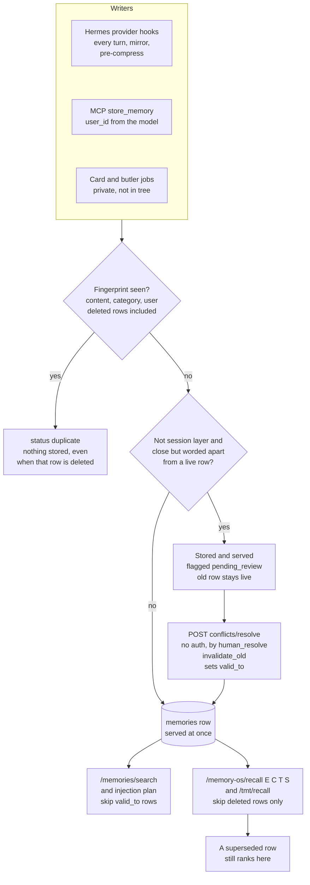

## 1. Executive Summary

Mnemosyne OS is a self-hosted memory server for one person's Hermes agent: a
FastAPI process over PostgreSQL and pgvector that stores turns, saved facts,
distilled summaries and formatted outcome cards, and recalls them through four
fused channels. What is notable is the correction path, where a write that
contradicts a near neighbour is flagged for a person instead of overwriting it.
What is weak is that the headline recall never reads the verdict.

The four-channel recall at `/api/v1/memory-os/recall` filters on `is_deleted`
and a duplicate mark, and not on `valid_to`. When a person resolves a conflict
with `invalidate_old`, the old row leaves `/memories/search` and the injection
plan and stays in the four-channel recall and the TMT recall.

A deleted memory keeps its fingerprint, and the fingerprint lookup ignores
deletion. Writing the same text, category and user again returns
`"status": "duplicate"` with the deleted row's id and stores nothing.

The catalog card the README leads with, a seven-line text carrying a `K·`
archive number, entities, evidence and a session pointer, has no producer in
this tree beyond a reference script that prints to stdout. The production
generator and the polish, dedupe and diary jobs are listed in
`deploy/prod-manifest.json` as `prod_only`, kept in a private repository.

No route authenticates a caller. Scope is a `user_id` the caller supplies.

**Licence.** The MIT grant in `LICENSE` covers a tree from which the
mechanisms the README sells are withheld: `deploy/prod-manifest.json:51-75`
lists `diary_daily.py`, `jobs/steward_dedupe.py`, `jobs/steward_polish.py` and
three further jobs as *"源头在 diary-book 私有仓，不上公开仓"* (sourced from
the private diary-book repository, not published). The README's *Make it
yours* table points readers at two of those files to change the card format
and the diary voice. No manifest carries a licence field. The grant itself is
plain MIT and restricts nothing.

Two marks are earned, `scope_enforced` and `negative_eval`, both on the
`user_id` predicate and its test. Section 9 gives the reason for each of the
five withheld.

## 2. Mental Model

A memory is **a row of text with a user, a category and two floats**. The
text is whatever the writer sent: a user message prefixed `用户提问:`, an
assistant reply, a fact the agent chose to save, a compression insight, a
card whose first line is `[结果卡] 档号：K·…`, a fact a model extracted from a
session, or a diary entry. A card is a text format, recognised by its prefix,
not a type (`api/memory_os.py:40`, `:273`).

A row is believed, in the sense of being served, from the moment it is
inserted. Nothing gates it. Three things can later change how it is treated:

- **Ranking floats.** `reliability` moves by 0.10 on explicit feedback, on a
  person's label and on a two-model LLM audit; `heat_score` rises on every
  search hit and decays on reflect. Both are ranking terms.
- **A conflict flag.** A non-session write that is semantically close to a
  live row and textually far from it is stored with
  `metadata.conflict_type = "pending_review"` and `conflicts_with` naming the
  old row. Both stay live. A person's `invalidate_old` sets the old row's
  `valid_to` and writes a `superseded` trace (`main.py:1274-1316`).
- **Removal.** Soft delete, the heat-threshold cleanup and the short-retention
  lifecycle set `is_deleted`; purify also replaces the text with its SHA-256.
  Compaction later hard-deletes into `memories_archive`, text included.

Which state hides a row depends on the read. `/memories/search` and
`api/injection.py` honour `valid_to`; `/memory-os/recall` and `/tmt/recall`
honour only `is_deleted`, and the four-channel recall also skips rows whose
`metadata.dup_verdict` is `same`, a mark no code in this tree writes.

## 3. Architecture

One FastAPI application, `main.py`, serves memory CRUD, search, conflicts,
beliefs and the palace taxonomy itself, and mounts six routers: the 9.0
memory-OS router (`api/memory_os.py`), TMT consolidation (`tmt/router.py`),
skills, an injection planner, agent identity cards and a security router. `uvicorn` runs it with four workers on `MNEMOSYNE_HOST`,
default `127.0.0.1`, port 8010 (`main.py:2341-2348`, `config.py`).

PostgreSQL 16 with pgvector holds everything. `docs/schema.sql` defines 24
tables; `memories` has a 1024-dimension HNSW index
(`docs/schema.sql:1280`), and `memory_keywords` holds jieba tokens written at
insert time. Every write calls an embedding API first: Volcano Engine ARK by
default, or any OpenAI-compatible endpoint under `MODEL_BACKEND=openai`
(`config.py`). The LLM jobs call the same providers.

Three clients ship in the tree. `integrations/hermes-provider` is a Hermes
`MemoryProvider` that writes through a local SQLite queue.
`integrations/hermes-mcp/mnemosyne_mcp.py` is a stdio MCP bridge defaulting
to `127.0.0.1:18010`, an SSH tunnel to the server. `integrations/sdk.py` is a
standard-library client.

Background work is cron calling the API: TMT consolidation daily, weekly and
monthly (`cron/tmt-consolidate.sh`), health checks, and a Hermes prompt that
archives its own memory file. `reflect`, `jobs/compaction.py` and
`palace/lifecycle` are run by hand or by schedules outside this tree.

### Deployment and ergonomics

An operator stands up PostgreSQL with pgvector as a superuser, imports
`docs/schema.sql`, fills `.env` with a model key and database credentials,
and runs `python3 main.py`. `scripts/bootstrap.sh` and `scripts/doctor.py`
script and check those steps. Nothing is stored without a working embedding
endpoint, because the vector is computed before the insert.

There is no authentication. The README's *Add auth / multi-tenant* row says
so in its own words: *"Not built (single-tenant, `user_id=default`)"*. The
private-site recipe puts a passkey wall in front of a reverse proxy
(`docs/DEPLOY-PRIVATE.md`); anything that reaches the port reaches every
route.

The store is SQL and repairable by hand. Cards are plain text in `content`,
so a person can read and fix them with `psql`.

## 4. Essential Implementation Paths

- **Write.** `POST /api/v1/memories`, `create_memory`
  (`main.py:867-996`): empty and NUL content refused, embedding computed,
  category normalised, five user names folded into `default` (`:885`), layer
  classified (`core/layers.py:105-139`), fingerprint lookup (`:902-908`),
  conflict detection for non-L0 layers (`:909-937`), insert with
  `ON CONFLICT (dedup_fingerprint)` (`:958-981`), entities and tokens in the
  same transaction.
- **Conflict detection.** `detect_conflict` (`main.py:221-241`): the five
  nearest live rows with `valid_to IS NULL`; cosine distance under 0.15 and
  `difflib` ratio over 0.85 merges, distance under 0.12 and ratio under 0.5
  flags.
- **Conflict listing and resolution.** `list_conflicts` (`main.py:424-462`),
  `resolve_pending_conflict` (`:1274-1316`).
- **Four-channel recall.** `api/memory_os.py`: `_exact` `:213-234`,
  `_multi_kw` `:256-293`, `_recent` `:296-316`, `_semantic` `:363-397`, fusion
  and confirmation in `recall` `:414-529`, the label route `:545-636`,
  `trace` `:678-703`, `diary` `:730-784`.
- **Search.** `search_memories` (`main.py:1008-1157`) with the weights in
  `core/ranking.py`.
- **Update, delete, restore, purify, cleanup.** `update_memory`
  (`main.py:1376-1475`), `delete_memory` (`:1356-1366`), `restore_memory`
  (`:2260-2267`), `soft_delete_memory` (`security/purifier.py:32-80`),
  `cleanup` (`main.py:1835-1839`).
- **Extraction and consolidation.** `tmt/router.py` consolidation routes
  `:417-491`; `tmt/factextract.py`; `palace.extract_facts_pipeline`
  (`palace.py:434-490`); `reflect` (`main.py:1626-1833`).
- **Compaction.** `jobs/compaction.py`: candidate gates `:71-108`, archive
  `:122-144`, hard delete `:232`, restore `:267-324`.
- **Agent hooks.** `integrations/hermes-provider/__init__.py`: `prefetch`
  `:694-714`, `queue_prefetch` `:716-795`, `sync_turn` `:797-883`,
  `on_memory_write` `:939-985`, `get_tool_schemas` `:987-1004`.
- **MCP bridge.** `integrations/hermes-mcp/mnemosyne_mcp.py:283-398`.

## 5. Memory Data Model

`memories` (`docs/schema.sql:242-285`) carries `user_id`, `content`, a
`category` limited by `CHECK` to ten values, `embedding vector(1024)`,
`importance`, `reliability`, `heat_score`, `tier`, `is_deleted`,
`forgotten_at`, `metadata jsonb`, `created_at`, `updated_at`, `valid_from`,
`valid_to`, `invalid_at`, `tmt_level`, `session_id`, `hall`,
`parent_memory_id`, `verification_status`, `archive_no`, `temp_drawer`,
`time_drawer`, `dedup_fingerprint`, storage and retrieval strengths and a
`rank_score`.

Most of the epistemic state lives in `metadata`, not in columns:
`conflicts_with`, `conflict_type`, `conflict_resolved_as`, `dup_verdict`,
`forget_candidate`, `fact_extracted`, `layer`, `pinned`, `source`.

Three declared fields have no producer in this tree:

- **`verification_status`**, with a `CHECK` over `pending`, `passed` and
  `failed`, appears only in the schema.
- **`metadata.dup_verdict`** is read by all four recall channels and written
  by no code here; the README attributes it to the weekly dedupe job, which is
  private.
- **The `K·` archive number** inside card text is parsed by `_exact`,
  `_multi_kw` and `trace` and produced only by
  `integrations/card-builder/build_cards.py`, which prints to stdout, and by
  `scripts/seed_demo.py --cards`, which loads the 40 demo cards. The palace's
  own `archive_no` column uses a different scheme (`palace.py:162`, `:462`).

`memory_traces` records four actions: `conflict_flagged`, `superseded`,
`update` with the old and new lengths only, and `feedback`
(`main.py:931`, `:1301`, `:1454`, `:1491`). Its foreign key is
`ON DELETE CASCADE`. `memory_labels` (`docs/schema.sql:316-327`) records a
person's choice among recall candidates. `beliefs` holds a separate claim
table with a confidence and a status.

Temporal fields: `valid_from` is set to `NOW()` on insert (`main.py:960`) and
no caller supplies it; `valid_to` and `invalid_at` are set to `NOW()` together
by the resolve route. Both are record times.

## 6. Retrieval Mechanics

**Four channels, one call.** `recall` runs the exact channel when the query
matches an archive number, task id, commit hash or path; a keyword channel
over a single PostgreSQL regex alternation with up to 5,000 candidates; a time
channel when the query holds a recency word or a `days` value; and a
semantic channel with a similarity floor of 0.40 by default
(`api/memory_os.py:414-453`).

Fusion is a fixed credit per channel, E 100, C 60, T 45, S 40, summed per
candidate key. The keyword credit is scaled by the IDF weight of the matched
terms against the top three weights, using a corpus document-frequency table
from `memory_keywords` cached for ten minutes (`:148-205`, `:462-485`). The
semantic credit is scaled by cosine similarity. Ties go to cards, then to
higher ids.

Each candidate gets an `answerability` score, the share of query terms found
in its head. When `confirm_margin` is set and the top two scores are close,
the response carries a question and three options for a person to choose
from. Both are signals; neither filters (`:514-528`).

**Search.** The `/memories/search` route is the one the agent integrations
use. It ranks live, valid, embedded rows by
`0.50·cosine + 0.15·token frequency + 0.15·recency + 0.10·reliability + 0.10·heat`
(`core/ranking.py`), first within the hot, normal and cool drawers, then
across the whole store if short. It then embeds the query and every returned
document again to rerank by cosine (`main.py:741-770`), and bumps heat and
access counts on the top five hits.

**TMT recall.** `/tmt/recall` takes nearest neighbours from `memories` at
`tmt_level = 1` and from the session, daily and weekly summary tables, then
asks a model to pick indices when more than ten survive
(`tmt/router.py:493-596`).

**Failure modes.** The read that names itself the memory OS is the one
without the validity filter. `grep -c valid_to` returns nothing for
`api/memory_os.py`, `tmt/router.py` and `palace.py`. Rows written by fact
extraction get no tokens, so the token arm of search does not see them, and an
edited row keeps the tokens of its old text, because only insert and session
archive call `_tokenize_on_write` (`main.py:987`, `:2305`).

## 7. Write Mechanics

**The fingerprint.** Every `POST /memories` computes
`sha256(content|category|user_id)`, with the session id and source added for
the session layer, or an hourly bucket when neither is given
(`main.py:838-865`). The lookup is
`SELECT id FROM memories WHERE dedup_fingerprint=$1` with no deletion test
(`:902-908`), and the partial unique index covers deleted rows too
(`docs/schema.sql:1175`).

Neither delete nor update touches the column. So:

- writing a deleted memory's exact text again returns `duplicate` with the
  deleted id, increments its `access_count`, and stores nothing;
- writing the old text of an edited memory returns `duplicate` with the id of
  the row that now holds the new text.

The provider's mirror of Hermes's own memory tool meets the first case. A
`replace` soft-deletes the old mirror and stores the new text
(`integrations/hermes-provider/__init__.py:939-985`); replacing B back with A
finds A's deleted row and leaves no live mirror. This follows from the code
and was not run.

**Conflicts.** For categories outside the session layer, the five nearest
live rows are compared. A near-identical text merges into the existing row
and returns its id. A close but differently worded text is stored with the
flag, and the response tells the caller how to resolve it (`main.py:989-995`).
The session archive route calls the same detector and handles only the merge
branch (`main.py:2276-2335`).

**The agent's writes.** `sync_turn` queues each turn that is not a short
acknowledgement: up to 2,000 characters of the user message and 3,000 of the
reply, category `session`, or `chat` for a short reply, which normalises to
`session`; the session layer skips conflict detection
(`integrations/hermes-provider/__init__.py:797-883`). `on_pre_compress`
stores a `[压缩洞察]` summary of the messages about to be dropped.

**Model writes.** Fact extraction reads unprocessed `default` sessions and
worklogs of 80 characters or more and inserts up to five facts each. The CLI
path checks a cosine duplicate at 0.92 against live knowledge rows
(`tmt/factextract.py:163`); the `/palace/extract` path inserts without that
check (`palace.py:434-490`). Neither sets a fingerprint.

### Operational cost

A REST write blocks on one embedding call, a nearest-neighbour query and the
transaction; the provider's writes are queued and sent in a background
thread, so the agent does not wait. A memory is retrievable when the
transaction commits.

`reflect` updates every live row of a user on each call: heat decay, tier
and drawer moves, strengths and rank. That is a whole-store pass without a
model. The TMT
jobs call a model once per session, day, week and month. Every search
writes: heat, access count, strengths and a repetition counter on the top
five hits.

Prefetch injects at most three memories of 160 characters each, skipping
heat below 0.3, ahead of the next turn
(`integrations/hermes-provider/__init__.py:763-781`).

## 8. Agent Integration

The MCP bridge exposes 15 tools, among them `store_memory`, `search_memories`,
`delete_memory`, `restore_memory`, `store_belief` and `search_beliefs`. Each
call takes `user_id` from the model's arguments with default `default`
(`integrations/hermes-mcp/mnemosyne_mcp.py:283-284`). None calls
`/memory-os/recall`, the label route or the resolve route.

The Hermes provider's eleven tool schemas are off unless
`HERMES_MNEMOSYNE_PROVIDER_TOOLS` is set (`:987-1004`). Its hooks are always
on: prefetch, a system-prompt block with store statistics, turn sync,
pre-compression capture, delegation capture, the mirror, and session-end
consolidation in a background thread.

The four-channel recall is called from `scripts/context_pack.py` and
`scripts/eval_recall.py`. `grep memory-os -- integrations` returns nothing.

Adapting this to another agent means calling the REST API; the SDK and MCP
bridge are thin.

## 9. Reliability, Safety, and Trust

### The verdict does not reach the recall that asks for it

The conflict design is careful at the write: the new row is flagged, the old
row is untouched, the listing tells the person what to call, and the resolve
route clears the flag, records how it was resolved and writes a `superseded`
trace in one transaction. `tests/test_v9_conflict_flag.py:78-142` holds that
behaviour against a real database.

The read side does not follow. `invalidate_old` sets `valid_to`, and the four
recall channels, the TMT recall and palace summon do not read it. The
four-channel recall is also the one that asks a person to choose between close
candidates. `tests/test_temporal_validity.py:50-65` counts thirteen validity
filters in `main.py` and two in `api/injection.py`, and reads no other file.

### Deletion keeps the text and blocks the same text

A soft delete keeps the content. Compaction moves it, with its traces,
entities, tokens and card, into `memories_archive` and records a CSV voucher
path in `gc_log`; restore brings the batch back. Only purify replaces the
text, and it leaves the fingerprint, so the purified value is still refused
as a duplicate. Restoring a purified row makes the hash string a live memory
(`main.py:2260-2267`).

`POST /api/v1/cleanup` soft-deletes every row of a user under a heat
threshold, with no pin check (`main.py:1835-1839`). It is unauthenticated.

### Scope

The `user_id` predicate is on every recall query. Who supplies it is the
weakness: the request body, the model's MCP argument or the provider's
environment variable, with no authentication on any route. `trace`, `diary`,
`stats`, `/memories/{id}/traces` and `/wiki/{page_id}` read across users.
`create_memory` folds `g-cat`, `noah`, `system`, `test` and `audit` into
`default`, and fact extraction and card refinement read only `default`.

### Documents that disagree with the code

- The README's *Two-hop trace* and the card format depend on `K·` cards that
  only the demo seeder writes into the store.
- The README's *Butler on the server* rows describe private jobs.
- The README's *Add a recall channel* row names `sandbox/mem9/recall.py`,
  which is not in the tree.

### Marks

- **`scope_enforced` — earned.** `user_id` is stored on every row and applied
  in SQL on every recall path; the caller supplies it.
- **`negative_eval` — earned.** `tests/test_recall_scope.py:81-86` requires
  each user's populated keyword result to omit the other user's card.
- **`audit_log` — withheld.** `memory_traces` is append-only and records four
  actions. Creation, deletion, purify, restore, cleanup, label and audit
  reliability changes, reflect and fact extraction write nothing to it, and an
  edit records two lengths. `memory_labels` records recall verdicts and
  `gc_log` compaction batches; neither records what a memory became.
- **`human_review` — withheld.** The pending flag withholds nothing: the new
  row and the old row are both served while the flag stands. The resolve route
  is off the MCP and provider tool surfaces and unauthenticated, and its effect
  is not read by the four-channel recall.
- **`trust_state` — withheld.** `reliability` is a float used in ranking.
  `beliefs.status` is set by the creator or bucketed from confidence
  (`main.py:1592-1624`), and only the monthly consolidation filters on it
  (`tmt/router.py:283-286`). `dup_verdict` filters and has no producer here;
  `verification_status` has neither reader nor writer.
- **`tombstone` — withheld, and the near-miss is an accident.** The
  fingerprint refuses an exact rewrite of a deleted value. It is an
  idempotency key: it refuses the person's deliberate re-add the same way, a
  paraphrase or a new category passes, the session layer adds the session id,
  and extracted facts carry no fingerprint at all.
- **`bitemporal` — withheld.** `valid_from` and `valid_to` are both set to
  `NOW()` by the code.

## 10. Tests, Evals, and Benchmarks

I ran none of the suites. The counts are from reading.

367 test functions in 44 files. Ten files open a database named by
`MNEMOSYNE_ITEST_DSN` or `MNEMOSYNE_V8TEST_DSN` and skip when it is
unreachable;
`.github/workflows/test.yml` provisions `pgvector/pgvector:pg16`, imports
`docs/schema.sql` into both and checks that a fixture table exists before
running pytest, so in CI those files run.

A large share of the suite is source-contract tests that parse `main.py` or
`api/memory_os.py` with `ast` and assert a string is or is not in a SQL
literal: `tests/test_channel_coverage.py:78-116`,
`tests/test_temporal_validity.py`, `tests/test_v9_conflict_flag.py:29-55`.
Their docstrings name the defect each one replaced, and
`tests/test_temporal_validity.py` records the removal of three always-true
assertions. They cannot see a read path in a file they do not open.

Database tests that bear on memory: cross-user isolation on the keyword and
exact channels (`tests/test_recall_scope.py`), non-card rows reaching the
keyword channel (`tests/test_channel_coverage.py:70-75`), conflict resolution
(`tests/test_v9_conflict_flag.py:78-142`), thirteen label cases including
forged archive numbers and other users' ids (`tests/test_labels.py`), the
fingerprint and partial index (`tests/test_v8_write_path.py:95-140`), and
compaction (`tests/test_v8_compaction.py`).

No test deletes a memory and writes its text again, recalls after an
`invalidate_old`, or asserts that a `dup_verdict` row is skipped.

**Evals.** `scripts/eval_recall.py` scores recall@k against
`evals/demo_cases.jsonl`: twelve positive questions over the 40 demo cards and
four negatives whose `forbid` words must not appear in the top k. Four raw
outputs are committed: 11 of 12 and 12 of 12 at k 10, 12 of 12 at k 5, and
13 of 16 with the negatives (`evals/eval_ect_20261107.txt`). The 15 of 16 rows
in `docs/VERIFICATION.md` and the 74% on the owner's corpus have no output
file in `evals/`; the README says the real-corpus cases are not published.

**Paper.** `tmt/router.py:1-3` names
[arXiv:2601.02845](https://arxiv.org/abs/2601.02845), *TiMem:
Temporal-Hierarchical Memory Consolidation for Long-Horizon Conversational
Agents*, submitted 6 January 2026, as the basis of the five-level time tree.
The paper is not this project's and reports no result for this code.
`docs/AUDIT-20261108.md` records an external audit with fixed findings, read
as the project's own document.

## 11. For Your Own Build

### Steal

- **Flag a contradiction at the write and leave both rows live.** Store the
  new value with a pointer to the old one, list the pending pairs, and let a
  person choose between keeping both and superseding, with a trace of which.
- **Make the idempotency key layer-aware.** An append-only log needs the
  session or an hourly bucket in its key, or a repeated "OK" in two sessions
  collapses to one.
- **Refuse a client-supplied identifier on the label path.** The label route
  takes the archive number from the stored row and rejects a mismatch, because
  that label later becomes an evaluation answer.
- **Return a question instead of a guess.** A margin test on the top two
  scores, returned as options rather than as a filter.

### Avoid

- **One validity filter written into each query by hand.** A filter carried
  query by query is missing from whichever query was written last; put it in
  a view or one function every read path calls.
- **An idempotency key that outlives deletion.** Release or rewrite it on
  delete and on edit, or decide it is a tombstone and say so; leaving it in
  place makes a forget refuse the person and pass the paraphrase.
- **A test that counts filters in one file.** It protects that file.
- **Publishing the reader of a mark and keeping its writer private.** The
  duplicate filter and the archive-number channel run against data the public
  code cannot produce.

### Fit

This suits one person running one Hermes agent who wants a PostgreSQL store
they can read with `psql`, with recall tuned to Chinese work logs. It assumes
an embedding API on every write and an operator who keeps the port private.

It does not suit a team, a multi-user deployment or anyone who needs a
correction to stick. Scope is advisory without authentication, and a
superseded fact stays in the recall the system is named for. A reader drawn by
the cards and the diary should know that the code producing them is not here.

## 12. Open Questions

- Does the private dedupe job write `dup_verdict` on both generations of a
  duplicate or only the older one?
- Do the private card jobs write through `POST /memories`, and with which
  category? The card-builder README says `session`, which skips conflict
  detection.
- Is `reflect` scheduled in production? No cron file in the tree calls it.
- What is `verification_status` for?

## Appendix: File Index

| Path | Role |
| --- | --- |
| `main.py` | App, memory CRUD, search, conflicts, beliefs, reflect, cleanup, session archive |
| `api/memory_os.py` | Four-channel recall, labels, exact, keywords, trace, stats, diary |
| `core/ranking.py` | Search weights and the recency expression |
| `core/layers.py` | Category-to-layer classification |
| `security/purifier.py`, `security/audit.py` | Purify by hash; two-model reliability audit |
| `tmt/router.py`, `tmt/factextract.py`, `tmt/distill.py` | Time-tree consolidation, fact extraction, distillation |
| `palace.py` | Taxonomy, archive numbers, tome cards, summon, lifecycle |
| `jobs/compaction.py` | Hard delete into `memories_archive` and restore |
| `integrations/hermes-provider/__init__.py` | Hermes hooks, prefetch, turn sync, mirror |
| `integrations/hermes-mcp/mnemosyne_mcp.py` | MCP stdio bridge |
| `integrations/card-builder/build_cards.py` | Reference card generator, stdout only |
| `deploy/prod-manifest.json` | Files deployed from the private repository |
| `docs/schema.sql` | Full schema |
| `tests/test_recall_scope.py`, `tests/test_v9_conflict_flag.py` | Scope and conflict tests |

### Recorded searches

Run from the repository root at the pinned commit with `/usr/bin/git grep`.

- **No validity filter in the four-channel recall, TMT or palace.**
  `git grep -n -c 'valid_to' -- api/memory_os.py tmt/router.py palace.py`
  returns nothing; the same command on `main.py api/injection.py` returns 17
  and 2.
- **No server-side authentication.**
  `git grep -n -i -E 'Header\(|x-api-key|request\.headers|APIKey|Security\(' -- main.py api tmt`
  returns nothing; `git grep -n -i 'x-api-key' -- integrations/hermes-provider/__init__.py`
  matches the client header at `:156`.
- **No writer of `dup_verdict`.**
  `git grep -n dup_verdict -- '*.py' ':!api/memory_os.py'` returns nothing;
  the same search in `api/memory_os.py` returns five lines.
- **No agent integration calls the four-channel recall.**
  `git grep -n memory-os -- integrations` returns nothing;
  `git grep -n 'memory-os/recall' -- scripts` matches `context_pack.py:53`.
- **Delete and update leave the fingerprint.**
  `git grep -n -E 'dedup_fingerprint *(=|IS NULL *,)|SET dedup_fingerprint' -- '*.py'`
  returns the two lookups at `main.py:903`, `:976` and two test lines.
- **Four trace actions.** `git grep -n 'INSERT INTO memory_traces' -- '*.py'`
  returns `main.py:931`, `:1301`, `:1454`, `:1491` and one test fixture.
- **The palace extraction skips the duplicate check.**
  `git grep -n dedup_check -- palace.py tmt/factextract.py` matches only
  `tmt/factextract.py:25` and `:163`.
- **Two callers of the tokenizer.** `git grep -n _tokenize_on_write -- '*.py'`
  returns the definition and `main.py:987`, `:2305`.
- **`verification_status` is schema only.**
  `git grep -n verification_status -- . ':!CHANGELOG.md'` returns three lines
  of `docs/schema.sql`.
- **The butler and diary jobs are absent.** `git ls-files` lists no
  `diary_daily.py`, `jobs/steward_polish.py`, `jobs/steward_dedupe.py` or
  `sandbox/`; `git grep -n steward_polish -- deploy` matches the
  `prod_only` entry.
- **One paper reference.**
  `git grep -n -i -E 'arxiv|bibtex|doi\.org|CITATION|@article|@misc' -- .`
  returns `tmt/router.py:3`.

## History

**2026-11-25** — [`57633b36b80044832c793e5f588eb0a9e0b2415e`](https://github.com/gymaira1990-jpg/Mnemosyne-OS/commit/57633b36b80044832c793e5f588eb0a9e0b2415e). First reading, from a full clone at the head of `main`. Screened first: no auto-run surface, nothing inside the seven-day cooldown, two build-time execution points (`Makefile`, `tests/conftest.py`), two unpinned dependency surfaces (`pyproject.toml`, `requirements.txt`), and an `AGENTS.md` addressed to reading agents, read as data. Nothing was installed, built or run, and the 367 test functions were not run. Two marks: `scope_enforced` and `negative_eval` ([section 9](#9-reliability-safety-and-trust)). The four-channel recall ignores a person's supersession, a deleted row's fingerprint refuses the same text, and the card and butler jobs are private.
