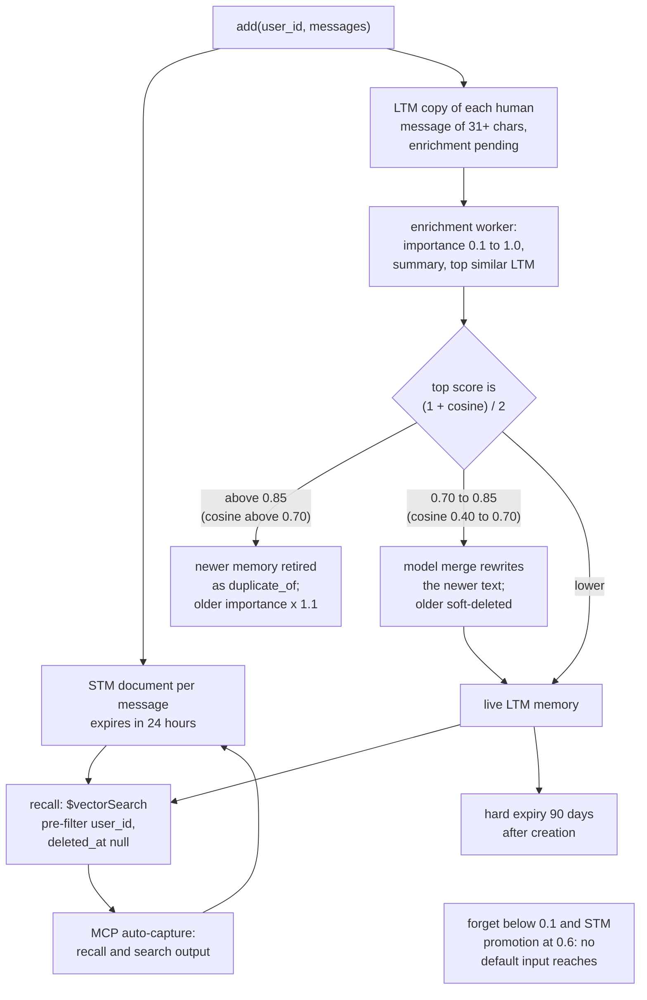

## 1. Executive Summary

agent-memory is a Python library, with optional MCP and REST shells, that
keeps four kinds of agent memory in one MongoDB Atlas cluster: short-term
messages, long-term memories scored and de-duplicated in the background, an
episodic log of agent turns, and a semantic response cache. Its notable part
is scope: every document carries `user_id`, and every search puts it inside
the Atlas `$vectorSearch` pre-filter and the Atlas Search filter, never after
the limit. Its weak part is the long-term lifecycle, whose thresholds mostly
do not do what their names say.

Writes are cheap for the caller. `add()` embeds the messages and inserts them
in one call, and every human message of 31 characters or more is stored twice:
as a short-term document that expires in 24 hours and as a long-term candidate
that an enrichment worker scores, summarises and compares with existing
memories about 30 seconds later.

That comparison reads `vectorSearchScore`, which Atlas normalises for cosine
as `(1 + cosine) / 2`, against thresholds of 0.85 and 0.70. A new memory within
raw cosine 0.70 of an older one is retired as its duplicate and the older one
is reinforced, so a correction phrased like the fact it corrects does not
survive. Between raw cosine 0.40 and 0.70, a model merges the two and the
older is soft-deleted.

Two consolidation steps cannot fire at the defaults. Forgetting deletes
memories with importance below 0.1, and both scorers clamp importance to at
least 0.1. Promotion of short-term memories needs importance 0.6, and
short-term documents are written at 0.5 and never rescored; only the demo
seed script writes a higher value. Long-term memories leave by a 90-day
expiry stamped at creation.

The MCP shell auto-captures the results of `recall_memory` and
`hybrid_search` into short-term memory by default, so a recall's output is
itself recalled for the next 24 hours.

**Licence.** The root `LICENSE` grants Apache-2.0 over the whole tree and
names no exception, while `examples/memory-ui/frontend/public/fonts/` ships
six `.woff2` files, among them `EuclidCircularA-*` and `MongoDBValueSerif-*`,
with no licence, notice or attribution for any of them. `fonts.css` calls
them *"Self-hosted brand fonts"* taken from what the retail app loaded from
`static.mongodb.com`. A reader reusing the demo UI cannot tell from the
tree under what terms those fonts may be redistributed. The library itself
carries nothing beyond the Apache terms.

One mark: `scope_enforced`. Section 9 gives the reason for each of the six
withheld.

## 2. Mental Model

A memory is **one message, stored as written**, in one of two tiers. The
short-term (STM) copy is every message of a conversation; the long-term (LTM)
copy is a human message long enough to be worth enriching
(`agent_memory/services/memory.py:135-240`). Assistant messages never become
long-term candidates, and the README gives the reason: promoting the agent's
own output would let its summaries become facts.

A message becomes a long-term belief in three steps, none of which asks
whether it is true.

- **Admission by length.** `ltm_candidate_min_chars` is 31
  (`agent_memory/core/config.py:124`). A shorter human message is stored as
  STM only and expires in a day.
- **Scoring.** The enrichment worker asks the model, or a bundled logistic
  model, for an importance between 0.1 and 1.0, and stores a summary when the
  reply looks like one (`agent_memory/services/enrichment.py:193-256`).
- **Evolution.** The worker searches the user's live LTM memories for the
  nearest five and acts on the top score: retire the new memory as a
  duplicate, queue a model merge, or keep it
  (`agent_memory/services/memory.py:527-688`).

A memory stops counting by soft delete (`deleted_at` set, reaped after 30
days), by retirement as a duplicate, by losing a merge, by hard expiry 90
days after creation, or by a user wipe. There is no state between live and
gone, and no record of what a deleted memory said that a later write
consults.

## 3. Architecture

The core is a library. `AsyncMemory.create` connects to Atlas, refuses to
start if a changed embedding width would strand existing vectors, ensures the
standard and search indexes, seeds governance profiles when governance is on,
and starts four asyncio workers in the same process: enrichment,
consolidation, audit flush and the episodic writer
(`agent_memory/memory.py:105-361`). `Memory` is a synchronous twin that runs
the async core on a daemon-thread event loop (`agent_memory/sync.py`).

- **`services/memory.py`** holds STM and LTM writes, recall, hybrid search,
  soft delete and evolution.
- **`services/enrichment.py`, `services/consolidation.py`** are the two
  background passes over `memories`.
- **`services/episodic.py`, `services/episodic_worker.py`** queue and batch
  agent turns into `episodes`.
- **`services/cache.py`, `services/decision.py`** are the response cache and
  the key-value decisions.
- **`services/audit.py`, `services/governance.py`, `services/admin.py`** hold
  the audit buffer, role profiles and erasure.
- **`shells/mcp`, `shells/rest`, `shells/runner.py`** wrap the facade for
  MCP, REST or both off one instance.

Providers are Bedrock (the default for embeddings and chat), Voyage, OpenAI
and Anthropic, behind one manager (`agent_memory/providers/manager.py`).

### Deployment and ergonomics

An adopter needs an Atlas cluster, or a MongoDB deployment that runs Atlas
Search and Atlas Vector Search, and an embedding provider; nothing is stored
without an embedding. The LLM is needed for importance unless
`IMPORTANCE_SCORER=local`, and for summaries and merges either way. There is
no local or offline mode.

The install is `pip install git+...`; the package is not on PyPI. Two scripts
bring up the server and a demo chat UI, locally or under Docker Compose, and
every published port binds `127.0.0.1`. The store is ordinary MongoDB
documents, readable and repairable in Compass or the shell, and the demo
ships four Compass aggregation pipelines.

The runner refuses to bind a non-loopback address with auth off unless
`ALLOW_UNAUTHENTICATED_NETWORK_ACCESS` is set, and logs a warning on each
start when it is (`agent_memory/shells/runner.py:112-145`). The Compose file
sets it for the container and publishes the port on loopback only.

## 4. Essential Implementation Paths

- **Store.** `AsyncMemory.add` copies the messages, defaults
  `message_type`, and runs `store_stm` through `_run`
  (`agent_memory/memory.py:728-756`). `store_stm` embeds the batch, refuses a
  short or mis-sized reply with `EmbeddingError` before writing, inserts the
  STM documents, then inserts the LTM candidates; a failure of the second
  insert is logged and swallowed (`agent_memory/services/memory.py:159-236`).
- **Enrichment.** `EnrichmentWorker._claim_one` takes one `pending` or
  `merge_pending` document with `find_one_and_update` and a lease
  (`agent_memory/services/enrichment.py:98-137`).
  `_process_standard_enrichment` scores, summarises, calls `evolve_memory`
  with the document's own id excluded, and writes `importance`, `summary` and
  `complete` (`:193-256`). `_process_merge` asks the model to merge the two
  texts, re-embeds, overwrites the newer document and soft-deletes the target
  (`:284-410`).
- **Consolidation.** `ConsolidationWorker.consolidate` runs `_compress_stm`,
  `_forget_low_importance` and `_promote_to_ltm` every 24 hours
  (`agent_memory/services/consolidation.py:48-180`).
- **Recall.** `MemoryService.recall` builds the pre-filter, runs
  `$vectorSearch` with `numCandidates` ten times and `limit` twice the
  request, collapses STM and LTM pairs, re-ranks, trims and increments
  `access_count` on what it returns
  (`agent_memory/services/memory.py:242-320`).
- **Search.** `MemoryService.hybrid_search` calls `rank_fusion_pipeline` with
  the same restriction in each branch's dialect
  (`agent_memory/services/memory.py:435-498`,
  `agent_memory/services/search_pipeline.py:31-140`).
- **Delete and wipe.** `MemoryService.delete` soft-deletes by id, tags or a
  creation range, with `confirm` required for anything but an id
  (`agent_memory/services/memory.py:392-433`). `wipe_user_data` raises an
  erasure barrier against the user's writes, drains the episodic queue,
  flushes the audit buffer, deletes across every user-scoped collection and
  checks for residue (`agent_memory/memory.py:1072-1207`,
  `agent_memory/services/admin.py:114-175`).
- **Access and audit.** `_run` is access check, service call, audit row; the
  memory, cache, decision and episodic read methods go through it, and
  `log_activity` and `wipe_user_data` audit on paths of their own
  (`agent_memory/memory.py:570-694`).
- **Identity.** `resolve_caller` turns a verified token into a `Caller`, and
  both shells use it (`agent_memory/auth/identity.py:80-133`,
  `agent_memory/shells/mcp/tools.py:41-91`).
- **Auto-capture.** `wrap_tools` wraps every registered MCP tool and spawns
  `AutoCaptureMiddleware.capture` after each call
  (`agent_memory/shells/mcp/auto_capture.py:296-326`, `:172-220`).

## 5. Memory Data Model

**The memory document.** `store_stm` writes `user_id`, `tier`, `content`,
`summary`, `embedding`, `memory_type`, `retention_tier`, `tags`,
`importance`, `access_count`, `last_accessed`, `conversation_id`,
`message_type`, `source_stm_id`, `enrichment_status`, `enrichment_retries`,
`created_at`, `updated_at`, `expires_at`, `deleted_at` and `is_deleted`
(`agent_memory/services/memory.py:170-192`). An LTM candidate is the same
shape with `tier: "ltm"`, `enrichment_status: "pending"` and `source_stm_id`
pointing at its STM twin (`:206-228`). Evolution adds `duplicate_of` or
`merge_target_id`.

**Fields that are always the same.** `memory_type` is written as `None` on
every path and nothing assigns it later, so the `memory_type` argument of
`recall` and `search` narrows to nothing. `retention_tier` is `ephemeral` or
`standard` on every write, so the `critical`, `reference` and `temporary`
retention days in the config have no document to apply to
(`agent_memory/core/config.py:85-89`). Every LTM memory therefore expires 90
days after it was written, through the TTL index on `expires_at`
(`agent_memory/core/collections.py:129`), and reinforcement does not move
that date.

**Scope.** `user_id` is the only scope key. `conversation_id` is stored and
indexed but is not a recall filter. Episodes carry `thread_id`, `agent_name`
and `correlation_id`, which are narrowing arguments a caller may pass, not
boundaries.

**Time.** `created_at`, `updated_at`, `last_accessed`, `expires_at` and
`deleted_at` are record times. An episode's `ts` may be supplied by the
caller (`agent_memory/services/episodic.py:128`), and the episodic TTL index
reads `ts`, so a back-dated turn older than the retention expires on the
monitor's next pass.

**Other tiers.** `decisions` holds one value per `(user_id, key)`,
overwritten by every `store_decision` and filtered on `expires_at` when read
(`agent_memory/services/decision.py:27-79`). `semantic_cache` holds query,
response and embedding per user with a one-hour TTL.

## 6. Retrieval Mechanics

**The scope is in the search, not after it.** `recall` sets
`{"user_id": user_id, "deleted_at": None}` as the `$vectorSearch` filter and
adds `tier`, `memory_type` and tags in operators the pre-filter supports
(`agent_memory/services/memory.py:263-271`). Every path is declared as a
`filter` field on `memories_vector_index`
(`agent_memory/core/collections.py:317-321`). `hybrid_search` puts the same
user, deletion, tier, type and tag restriction in the vector pre-filter and
in the Atlas Search `compound.filter`, so neither branch of `$rankFusion` can
contribute another user's document (`agent_memory/services/memory.py:462-479`).
Episodic search does the same with `user_id`, `thread_id` and `agent_name`,
and applies `since` after fusion and before the limit
(`agent_memory/services/episodic.py:224-251`).

**Ranking.** `recall` scores each hit as `0.2 × exp(-age/30 days) +
0.3 × importance × min(1 + ln(access+1), 3)/3 + 0.5 × vs_score`
(`agent_memory/services/memory.py:322-352`). The docstring calls `vs_score`
cosine similarity in [0, 1]; it is Atlas's `(1 + cosine) / 2`, so the
relevance term moves within roughly its upper half and the recency and
importance terms carry more of the order than the weights suggest. `search`
returns the fused `$rankFusion` score with weights 1.0 and 0.7; `rrf_k` is
declared in the config and read by nothing.

**What recall returns.** With no `tier` argument, the default on every
surface, recall searches both tiers. The STM and LTM copies of one message
are collapsed by `source_stm_id` (`agent_memory/services/memory.py:354-390`),
and everything else short-term is a candidate, including auto-captured tool
output. Each returned memory's `access_count` is incremented, which feeds the
importance term of later rankings.

**No injection in the library.** The facade returns documents. The demo
server recalls from every tier concurrently and renders a context block into
the system prompt (`examples/memory-ui/server/turn.py`,
`examples/memory-ui/server/prompt.py`).

## 7. Write Mechanics

**The caller does not wait for a model.** `add()` costs one embedding call
and two `insert_many` calls. An STM memory is retrievable once the Atlas
Search indexes replicate it; the integration suite polls for this rather
than assuming it. An LTM candidate is retrievable on the same schedule,
before enrichment, with importance 0.5 and no summary; enrichment runs every
30 seconds.

**Evolution compares the wrong scale.** `evolve_memory` searches the user's
live LTM memories, drops the self-match with a `$match` after the search,
and reads the top `vectorSearchScore`
(`agent_memory/services/memory.py:557-589`). Above `reinforce_threshold`
(0.85) the older memory's importance is multiplied by 1.1 and the new one is
soft-deleted with `duplicate_of` (`:591-619`). Above `merge_threshold`
(0.70) the new one is marked `merge_pending` (`:621-656`). The configuration
reference describes both values as similarity. MongoDB's Vector Search index
documentation gives the cosine score as `score = (1 + cosine(v1,v2)) / 2`, so
these are raw cosines of 0.70 and 0.40.

Two consequences follow. A correction such as *"I am no longer vegetarian"*
beside *"I'm vegetarian, and I hate cilantro"* only has to clear raw cosine
0.70 to be retired as the older fact's duplicate, and the older fact gains
importance. Below that, the merge prompt asks the model to *"Preserve all
important details"* of both texts, writes the result over the newer
document's `content`, and soft-deletes the older without a pointer to the
survivor (`agent_memory/services/enrichment.py:327-332`, `:366-410`). The
original wording of the newer message is gone from the live LTM tier; only
its STM twin keeps it, for 24 hours.

**Consolidation.** `_compress_stm` summarises STM documents older than
`stm_compression_age_hours`, 24, which is the age at which their
`expires_at` removes them (`agent_memory/services/consolidation.py:61-111`,
`agent_memory/core/config.py:85`, `:150`). `_forget_low_importance`
soft-deletes completed LTM memories with importance `< 0.1`
(`agent_memory/services/consolidation.py:113-131`); `parse_importance`
returns at least 0.1 and the local scorer clamps to `MIN_IMPORTANCE = 0.1`
(`agent_memory/providers/base.py:51`,
`agent_memory/services/importance.py:48`, `:302-311`). `_promote_to_ltm`
needs STM importance of at least 0.6 and two accesses
(`agent_memory/services/consolidation.py:133-180`); `store_stm` writes 0.5
and no library path rescores an STM document. The demo seed sets importance
and access count on STM documents directly so that promotion has something
to promote (`examples/memory-ui/demo/seed.py:282-292`).

**Auto-capture.** With `auto_capture_enabled` on by default, the MCP shell
stores the parameters and result of `recall_memory`, `hybrid_search`,
`store_decision` and `recall_decision` as a `system` STM message under
conversation `auto:<tool>`, clipped to 2,000 characters
(`agent_memory/core/config.py:266-271`,
`agent_memory/shells/mcp/auto_capture.py:132-220`). A refused call is not
captured, and the identity comes from the token as for the tool itself
(`:233-293`). The captured text contains the memories the recall returned,
so a memory deleted after a recall is still searchable inside that capture
until it expires.

**Deletion by the returned id.** `add()` returns STM ids, and the code
comment calls LTM candidates internal
(`agent_memory/services/memory.py:238-240`). `delete(memory_id=...)` filters
on that `_id` only (`:410-412`), so deleting the id a store returned leaves
the LTM copy live for its 90 days. `source_stm_id` is read only by the
recall dedup.

### Operational cost

One embedding call per `add()`, synchronous. Per LTM candidate in the
background: one importance call (or none with the local scorer), one summary
call for content of 120 characters or more, and one vector search; a merge
adds a completion and an embedding. Consolidation runs every 24 hours, and
each step is bounded by `enrichment_batch_size` (50) or is a single
`update_many`. Recall is one embedding call and one aggregation, bounded by
`limit` and by `max_response_bytes` on the facade.

## 8. Agent Integration

The MCP server registers 16 tools over streamable HTTP, each taking
`user_id` (`agent_memory/shells/mcp/tools.py:93-267`). The model can store,
recall, search, soft-delete, invalidate the cache, store and recall
decisions, log and search activity, change episodic retention and call
`wipe_user_data` with `confirm=True`. With auth off, the model chooses
`user_id` on every call.

`log_activity` is the episodic path: the facade builds the turn document and
enqueues it without awaiting Atlas, a single consumer batches inserts, and a
full queue drops the oldest turn and counts it
(`agent_memory/services/episodic_worker.py:94-130`). It audits one row per
flushed batch per user rather than one per call.

Nothing injects memory into an agent's context automatically. An adopter
writes the recall-and-render step, as the demo server does.

## 9. Reliability, Safety, and Trust

### Identity and scope

With `AUTH_ENABLED=true`, the user comes from the token's configured claim or
the API key's mapped user, a request naming another user is refused with 403
or an error dict, and the role claim reaches governance
(`agent_memory/auth/identity.py:80-133`). With auth off, the default, the
library argument or tool argument is the identity, which the documentation
calls the single-tenant posture. API keys are looked up by SHA-256
fingerprint. `set_activity_retention`, which retunes the TTL index for every
tenant, requires the `admin` role whenever auth is on, independent of
governance (`agent_memory/memory.py:996-1020`).

### Correction does not hold

A memory that contradicts an older one in similar words is retired as its
duplicate, and one that is less similar is merged into it by a model told to
keep both. A soft-deleted memory is invisible to evolution, which searches
`deleted_at: None` (`agent_memory/services/memory.py:567-571`), so a deleted
fact restated later is stored again as new.

### The audit log

`audit_log` gets one row per facade call: user, operation category, tool
name, status (`success`, `denied`, `throttled`, `error`), duration and a few
parameters (`agent_memory/services/audit.py:78-104`). Denials and throttles
are recorded, error text is redacted, and an erasure is recorded against the
reserved principal `_erased` with counts and no subject. The row for a store
carries the conversation and a count; the row for a delete carries only
`dry_run` (`agent_memory/memory.py:753-756`, `:819-820`). The enrichment and
consolidation workers write no audit row. Rows expire after 365 days
(`agent_memory/core/collections.py:231`) and a wipe deletes the user's rows.
Recall queries are kept in the rows' metadata for that period.

### Marks

One is earned.

- **`scope_enforced` — earned.** `user_id` is stored on every document and
  applied inside the `$vectorSearch` pre-filter and the Atlas Search filter
  of every read, and in the filter of every delete and lookup. Its value
  comes from the token when auth is on and from the caller when it is off.
- **`audit_log` — withheld.** The log records facade calls, not memory
  mutations: a delete's row does not say what was deleted, and the merges,
  retirements, reinforcements and soft deletes the workers make leave no
  row. Rows expire and are erased with the user.
- **`trust_state` — withheld.** `enrichment_status` is processing state and
  no read filters on it; importance is a score.
- **`tombstone` — withheld.** Deletion is a `deleted_at` stamp keyed on the
  document, and `duplicate_of` points at a record. Nothing keyed on a value
  refuses a later write.
- **`bitemporal` — withheld.** Every time field is a record time; an
  episode's caller-supplied `ts` is when a turn happened, not when a fact
  held.
- **`human_review` — withheld.** Every write is live at once, and every
  verb, including wipe, is on the agent's tool surface.
- **`negative_eval` — withheld.** The only populated case asserting another
  user's material is absent is an episodic integration test that needs a
  live cluster, is not run in CI, and does not require the other user's
  result to be non-empty (section 10). The unit tests assert on the built
  pipeline, not on what a search returns.

## 10. Tests, Evals, and Benchmarks

CI runs `uv run pytest tests/unit -q` on three Python versions, plus lint and
a packaging job (`.github/workflows/ci.yml:58`). I ran nothing from the
repository.

The unit suite is mocked, and much of it pins a defect the history fixed,
each file opening with the defect it guards.

- Undeclared or unsupported pre-filter operators that silently matched
  nothing (`tests/unit/test_search_filter_contract.py`).
- One live copy per memory after evolution, against a fake collection that
  holds documents (`tests/unit/test_one_live_copy_per_memory.py:126-290`).
- Promotion re-stamping `expires_at`
  (`tests/unit/test_promotion_retention.py`).
- Identity bound to the token on every route and tool
  (`tests/unit/test_identity_binding.py`).
- An erasure that leaves no row naming the user
  (`tests/unit/test_erasure_is_final.py`).

Test docstrings cite requirement ids such as `REQ-E-142`, and
`tests/README.md` maps the id ranges to areas.

What is not covered:

- No test feeds evolution a score on Atlas's scale or a contradicting pair.
- `test_forget_deletes_low_importance` asserts the filter is `$lt: 0.1`
  over a mocked `update_many`, not that any scored memory can meet it
  (`tests/unit/test_consolidation.py:177-191`).
- No test deletes a stored memory by its returned id and recalls it.
- The integration delete case asserts `deleted_count == 1` and does not
  recall afterwards (`tests/integration/test_functional.py:462-506`).
- The cross-user episodic case asserts `not any("Nopalito" ...)` over the
  other user's hits; its fixture polls until the owner's turn is searchable,
  not the other user's (`tests/integration/test_episodic_live.py:276-332`).
  Integration tests skip when no server or connection string is found
  (`tests/integration/conftest.py:62-88`).

The importance model is the one measured component. The README reports
held-out Spearman for an embedding head, a flat learning curve and an
eight-case gate in `scripts/train_importance.py` that refuses a model ranking
task chatter above standing preferences; the shipped artifact is
`agent_memory/data/importance/lexical.json`. No retrieval evaluation is
committed, and the tree cites no paper.

## 11. For Your Own Build

### Steal

- **Put the tenant in the engine's filter.** A pre-filter in each branch of
  a fused search, declared on the index, is applied before the limit; a
  post-filter on fused results is not. Test the built pipeline for it, as
  this suite does.
- **Bind identity to the token and refuse a mismatch.** Keep the `user_id`
  argument for single-tenant callers, believe it only when auth is off, and
  refuse rather than rewrite a request that names someone else.
- **Refuse to listen open.** A runner that will not bind a routable address
  without auth, unless a flag says so on every start, closes the most common
  deployment error.
- **Audit refusals.** Denied and throttled are the events an access log
  exists for; record them with distinct statuses.

### Avoid

- **A threshold in one unit compared with a score in another.** Read what
  the engine's similarity score is before naming a threshold "cosine"; a
  normalised score halves the distance a dedup threshold allows.
- **Dedup as correction.** Retiring the newer of two similar memories keeps
  the old belief whenever the new one disagrees in similar words. Decide
  contradiction separately from duplication.
- **A floor equal to the threshold.** Clamping scores to 0.1 and forgetting
  below 0.1 is a forgetting pass that cannot fire; test the threshold
  against the scorer's real output range.
- **Writing a tool's output back as memory.** Capturing recall results
  stores what was retrieved as a new memory, and the copy outlives the
  deletion of the original.
- **Handing out one id for a memory stored twice.** A delete by the id you
  return should reach every copy.

### Fit

This suits a team already on Atlas that wants a memory service behind its
own authenticated application, where the user is known and one key is
enough. The operational care is real: startup guards, honest errors, a
complete erasure. The memory semantics are thin: a stored message is a
belief until it expires, near-duplicates win over corrections, and no
retrieval quality has been measured. Walk away if memories must be
correctable, if you need agent or project scope, or if you cannot run Atlas
Search and Vector Search.

## 12. Open Questions

- Whether the evolution thresholds were tuned against Atlas scores on the
  demo cluster, or chosen as raw cosines.
- What is meant to set `memory_type` and the non-standard retention tiers.
- What is meant to raise an STM memory's importance to the promotion
  threshold outside the demo seed.
- Whether auto-capture of recall output is meant to be on for every MCP
  deployment.
- Under what terms the demo UI's font files are distributed.

## Appendix: File Index

- Facade and orchestration: `agent_memory/memory.py`, `agent_memory/sync.py`,
  `agent_memory/config.py`, `agent_memory/core/config.py`
- Storage and indexes: `agent_memory/core/collections.py`,
  `agent_memory/core/database.py`, `agent_memory/core/migrations.py`
- Write, recall, evolution: `agent_memory/services/memory.py`,
  `agent_memory/services/search_pipeline.py`,
  `agent_memory/core/embedding_check.py`
- Background: `agent_memory/services/enrichment.py`,
  `agent_memory/services/consolidation.py`,
  `agent_memory/services/importance.py`, `agent_memory/providers/base.py`
- Episodic, cache, decisions: `agent_memory/services/episodic.py`,
  `agent_memory/services/episodic_worker.py`,
  `agent_memory/services/cache.py`, `agent_memory/services/decision.py`
- Access, audit, erasure: `agent_memory/auth/identity.py`,
  `agent_memory/auth/api_keys.py`, `agent_memory/services/audit.py`,
  `agent_memory/services/governance.py`, `agent_memory/services/admin.py`
- Shells: `agent_memory/shells/mcp/tools.py`,
  `agent_memory/shells/mcp/auto_capture.py`,
  `agent_memory/shells/mcp/server.py`, `agent_memory/shells/rest/app.py`,
  `agent_memory/shells/runner.py`
- Demo: `examples/memory-ui/server/turn.py`,
  `examples/memory-ui/demo/seed.py`
- Tests: `tests/unit/`, `tests/integration/`, `.github/workflows/ci.yml`

### Recorded searches

Run from the repository root at the pinned commit with `/usr/bin/git grep`.

- **Nothing writes `memory_type` or a non-standard retention tier.**
  `git grep -n -E '"memory_type"|"retention_tier"|"expires_at"' -- agent_memory`
  returns the `None`, `ephemeral` and `standard` literals in
  `services/memory.py`, the promotion's `standard` at
  `services/consolidation.py:162`, filters, index definitions and decisions.
- **No library path raises an STM memory's importance.**
  `git grep -n -E '"importance"' -- agent_memory` returns the 0.5 literals at
  `services/memory.py:179` and `:215`, the reinforce and merge writes on LTM
  documents (`:598`, `:670`), the enrichment writes on claimed documents
  (`services/enrichment.py:228`, `:373`) and the two consolidation filters.
  `examples/memory-ui/demo/seed.py:290` sets the field on STM documents.
- **The workers write no audit row.**
  `git grep -n -E 'audit' -- agent_memory/services/enrichment.py agent_memory/services/consolidation.py agent_memory/services/memory.py`
  returns nothing; `git grep -c -E 'audit' -- agent_memory/memory.py`
  counts 55 lines.
- **Only the recall dedup reads the STM-LTM link.**
  `git grep -n 'source_stm_id' -- agent_memory` returns the writes in
  `store_stm`, the merge document's `None` and the dedup in
  `services/memory.py:354-390`.
- **No value-keyed refusal.**
  `git grep -n -i -E 'tombstone|blocklist|suppress' -- agent_memory` returns
  two comments, `core/projection.py:203` and `services/memory.py:358`.
- **No review or approval state.**
  `git grep -n -i -E 'approv|pending_review|quarantin' -- agent_memory`
  returns nothing.
- **No validity time.**
  `git grep -n -i -E 'valid_from|valid_to|valid_until|event_time|as_of' -- agent_memory`
  returns nothing.
- **No agent or project key.**
  `git grep -n -E 'agent_id|project_id|namespace' -- agent_memory` returns
  one comment, `services/episodic.py:142`.
- **The tree does not account for the score normalisation.**
  `git grep -n -i -E '\(1 ?\+ ?cos|normali[sz]ed.*score' -- . ':!uv.lock'`
  matches no score normalisation (only `core/config.py:332-339`, about the
  scorer name); `git grep -n 'vectorSearchScore' -- agent_memory` returns
  `services/cache.py:39` and `services/memory.py:284`, `:574`.
- **`rrf_k` is not read.** `git grep -n 'rrf_k' -- agent_memory` returns only
  `core/config.py:136`.
- **No negative retrieval assertion outside the live episodic test.**
  `git grep -n -E 'assert not any|assert .* not in (hits|results|found|ids|contents)' -- tests`
  returns `tests/integration/test_episodic_live.py:332`, an assertion over a
  pipeline's stages at `tests/unit/test_episodic_service.py:414`, and two
  field checks at `tests/unit/test_memory_service.py:454-455`.
- **No paper reference.**
  `git grep -n -i -E 'arxiv|bibtex|@article|@misc|doi\.org|zenodo' -- . ':!uv.lock' ':!*package-lock.json'`
  returns nothing.
- **No licence beside the fonts.**
  `git ls-files | grep -i -E 'font|woff|licen|notice'` returns `LICENSE`, six
  `.woff2` files under `examples/memory-ui/frontend/public/fonts/` and
  `examples/memory-ui/frontend/src/styles/fonts.css`.

## History

**2026-11-25** — [`1a137905806a2f4a2ffca8aaeffffb0d9a291d04`](https://github.com/mongodb-partners/agent-memory/commit/1a137905806a2f4a2ffca8aaeffffb0d9a291d04). First reading, from a full clone at the head of `main`, the commit triage selected; no submodules. Screened first: no auto-run surface, nothing inside the seven-day cooldown, one build-time execution point (`tests/integration/conftest.py`, run at pytest collection), and one manifest with floating ranges (the demo UI's `package.json`, lockfile present). Docs and prompts were read as data. Nothing was installed, built or run, and the 1,422 test functions were not run. One mark: `scope_enforced` ([section 9](#9-reliability-safety-and-trust)). The duplicate thresholds are compared with Atlas's normalised score, forgetting and STM promotion cannot fire at the defaults, and auto-capture stores recall output as memory.
