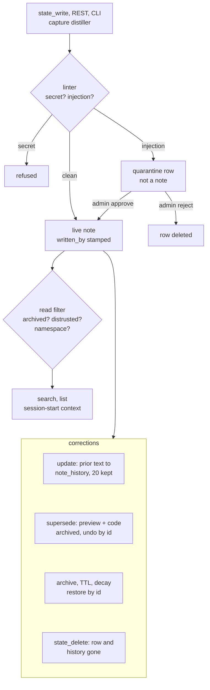

## 1. Executive Summary

Monomem is a self-hosted memory server for coding agents: one Node process over
one SQLite file, reached by MCP, REST and a CLI. Its notable work is on
provenance. The server stamps each note's writer from the authenticated token
and ignores the client's claim. An admin's distrust list
hides a writer's notes on every read path, through one gate a test keeps
honest. Replacing a note takes a preview and a one-time code, and is undone by
id. The weak side is the local default. `setup` wires every client to the stdio
transport, which runs as admin, so the agent holds the hard delete and, with all
tools enabled, the quarantine approval meant for a person.

Every write is synchronous and model-free. A pattern linter blocks secrets and
holds injection-shaped text in a quarantine table that no read sees. Optional
Claude Code hooks capture tool events, and a deterministic distiller turns them
into typed observations and one summary per session. The session-start context
is relevance-ranked inside a token budget and fails closed to empty when a
configured namespace cannot be resolved.

Two marks, `scope_enforced` and `negative_eval`. "Auditable" rests on three logs,
and none earns `audit_log`: the change log is purged after 90 days, `audit.log`
rotates its oldest file away, and the one log never pruned covers replacements
only. "One-command undo" reverses a replacement or an edit, not a delete.

## 2. Mental Model

A memory is a **note row**: title, body, tags, a namespace and a `kind`. The
kind is `note` for anything written through a tool, or `observation` and
`summary` for what capture distils. Every note carries `written_by` and
`created_by`, stamped by the server from the connection, a free-text `source`
the client claims, and an optional `confidence` claim from 0 to 1
(`src/store.ts:1846-1854`, `:2128-2130`, `:2206-2211`). Nothing marks a note
true. Search results and the session-start block carry the writer under an
untrusted-data banner (`src/recall.ts:58-72`).

A write the linter flags as injection never becomes a note. It waits as a row in
`quarantine` until someone with the admin scope approves it, which replays the
write, or rejects it, which deletes the row (`src/store.ts:6709-6777`). A live
note can then:

- **change in place**, with the prior title and body copied to `note_history`
  (bounded per note) and `rev` incremented (`src/store.ts:3526-3560`);
- **be superseded**, which archives it and sets `superseded_by`, so every read
  that drops archived rows drops it (`src/store.ts:3743-3797`); an undo clears
  both and logs the reversal (`:3799-3830`);
- **be archived** by hand, by its TTL when the sweep is called, or, for captured
  rows idle 30 days, at session end (`src/store.ts:3333-3352`, `:3414`);
- **be deleted**, which removes the row and its history for good
  (`src/store.ts:3290-3294`, `:4107-4122`).

Distrust is not a note state. It is a per-namespace list of writers, consulted
at read time on every path; lifting the rule restores the notes
(`src/trust.ts:1-20`).

## 3. Architecture

**One process, one file.** `node:sqlite`, built into Node 22.16 and later, opens
`~/.monomem/state.db` in WAL mode with `foreign_keys` and `secure_delete` on
(`src/store.ts:1365-1370`). An external-content FTS5 table indexes title, body
and tags through triggers, and FTS5 `secure-delete` is switched on so a deleted
note's words leave the index (`:1857-1869`, `:4017-4024`). Vectors are raw
Float32 BLOBs in `note_vectors`; semantic search loads the namespace's vectors and
scores them in JavaScript (`:4858-4881`). There is no vector index.

**Transports.** `monomem mcp` is the stdio server. It stamps every write
`stdio` and builds the tool server with the `admin` scope
(`src/mcp-stdio.ts:16-21`). `monomem start` serves REST and a dashboard on
`:8790` and MCP over HTTP on `:8791`, bound to `127.0.0.1` by default
(`src/config.ts:486`). HTTP tokens are `read`, `write` or `admin` and carry a
label, `requiredScope` maps each route to a scope (`src/api.ts:111-140`), and
`docs/token-namespaces.md` pins a token to one namespace.

**Optional services.** Embeddings go to `MONOMEM_EMBED_URL`, default
`http://localhost:11434/v1/embeddings`, with no loopback check
(`src/embeddings.ts:43`). The session-summary model must be loopback unless
`MONOMEM_LLM_ALLOW_REMOTE=1` (`src/llm.ts:31`, `:49`). The command runner, which
executes HMAC-signed allowlisted commands from task notes, is experimental and
excluded from the npm package (`docs/RUNNER.md`).

### Deployment and ergonomics

Nothing else has to run. `npx monomem setup` finds eight clients, shows the
exact config lines, backs each file up and writes a stdio entry pinned to the
installed version (`src/setup.ts:160-175`). `setup --undo` reverses it. No API
key is needed and everything works offline; semantic search degrades to keyword
search when the embedding endpoint is down. The store is one SQLite file,
inspectable with any SQLite client and backed up by `VACUUM INTO`. A Markdown
export with three-way re-import gives a human-editable copy. Body encryption
leaves titles, tags, timestamps, writers and vectors readable, and the key sits
beside the database (`SECURITY.md`).

## 4. Essential Implementation Paths

- **Write.** `state_write` (`src/mcp-server-core.ts`), `POST /notes` and the CLI
  all reach `Store.create` or `Store.update` (`src/store.ts:2418`, `:3045`).
  `lintFor` runs first (`:294-301`). `applyLintPolicy` throws on a blocked
  finding and returns `quarantine` for a held one, and `quarantineWrite` then
  stores the request (`:267-291`, `:2460-2474`, `:6586-6648`). The insert stamps
  `written_by` from `currentWriter()` (`src/actor.ts:95-103`) and appends an
  `audit.log` line (`src/store.ts:2583`).
- **Capture.** `monomem hook <event>` runs on UserPromptSubmit, PreToolUse
  (Read), PostToolUse, Stop and SessionEnd (`src/setup.ts:512-520`). Events are
  redacted (`<private>` blocks and secrets) before they reach `capture_events` or a
  spool file (`src/capture.ts:1-13`). `src/extract.ts` distils commits, test
  fixes, decision phrases, redacted secrets and injection-shaped tool output into
  observations, and rebuilds one summary per session. Both go through
  `Store.create`, so they are linted (`src/extract.ts:1-17`). The hook runs the
  distiller on `stop` and `session-end` (`src/hook.ts:124-129`).
- **Retrieval.** `runSearch` in `src/search-service.ts` dispatches keyword,
  semantic or hybrid to `searchRanked`, `semanticSearch` and `rrfMerge`
  (`src/store.ts:4333`, `:4858`; `src/search-service.ts:56`). `rangeFor` folds the
  distrust predicate into every query (`src/store.ts:6210-6214`).
- **Session start.** `runRecall` resolves the namespace fail-closed, then
  `injectContext` ranks the namespace's notes, observations and summaries by
  branch, changed files and recency inside the token budget, behind the
  untrusted banner (`src/recall.ts:120-200`, `:245-269`,
  `src/context-inject.ts:172-224`).
- **File context.** A PreToolUse hook on `Read` prints notes linked to the
  file, under the same namespace and distrust rules (`src/file-context.ts:42-56`).
- **Replace.** `supersedePreview` and `supersedeConfirm` (`src/supersede.ts:144`,
  `:260`) call `Store.supersedeCommit` and `supersedeUndo`
  (`src/store.ts:3743`, `:3799`).
- **Delete.** `state_delete`, admin scope, calls `Store.delete`, which removes
  the row and revives anything it had superseded (`src/store.ts:3290-3327`).
- **Quarantine review.** `memory_quarantine` (`src/mcp-server-core.ts:1606-1647`),
  `POST /quarantine/:id/approve|reject` (`src/api.ts:804-829`) and
  `monomem quarantine` (`src/cli.ts:1777-1784`), all into
  `approveQuarantine` and `rejectQuarantine`.
- **Change feed.** Triggers write `change_log` inside each writing transaction
  (`src/store.ts:2309-2343`); `memory_since` and `GET /changes` read it.

## 5. Memory Data Model

`notes` holds the record (`src/store.ts:1846`), and `store.ts` makes 23
`addColumn` calls on it across 16 schema versions: `rev` and `source` (v1),
access counters (v3), `body_enc`, `expires_at` and `archived_at` (v10),
`written_by`, `created_by` and `imported_written_by` (v13), attestation and
merge columns (v14), `confidence` and the three `superseded_*` columns (v15),
and `kind`, `session_id` and `obs_type` (v16).

**Scope** is `namespace`, a column on every note, quarantine row, change-log row
and session. When `spaces.json` or `MONOMEM_SPACES` maps directories to
namespaces, each process resolves one from its working directory at startup,
writes land there, and reads cover it plus any one-way `reads_from` grants
(`src/namespace.ts:1-14`). Unconfigured, the namespace is whatever the caller
passes and defaults to `default` on write.

**Time** is `created_at`, `updated_at`, `expires_at`, `archived_at` and
`superseded_at`, all record-side. `created_at` can be backdated only by import,
consolidation and the benchmark's dataset loader, never by a REST or MCP create.
No column says when a fact was true.

**History.** `note_history` keeps the title, body, tags, writer and confidence
an update replaced, up to `MONOMEM_HISTORY_VERSIONS` (default 20) and 2 MB per
note, and cascades away with the note (`src/store.ts:2212-2232`, `:152-155`).

**Trust tables.** `trust_distrust` (namespace, writer), `trust_attesters`
(public keys for signed exports) and `trust_log`, capped at 1,000 rows per
namespace (`src/store.ts:2168-2192`, `:6073`; `src/trust.ts:31`).
`imported_unverified` marks an import without a verified attestation.

## 6. Retrieval Mechanics

**Keyword** is FTS5 BM25, every word first, then notes matching some of the
words ranked below full matches. Before that fallback landed in OneMemory 2.0.0, a
natural-language question scored R@5 11.9 on LongMemEval-S
(`docs/BENCHMARK.md`). **Semantic** is cosine over every vector in the namespace.
**Hybrid** fuses the two with RRF at k = 60 (`src/search-service.ts:56-70`).
Any embedding failure degrades to keyword.

Ranking then multiplies an access boost, decayed by recency of use, and a
graded staleness penalty of 0.95 per 90 days of age. A stale note with an active
near-twin in the similarity graph is demoted further
(`src/search-service.ts:73-200`). `?explain=1` returns each factor per hit.
`state_relevant` drops stop words, takes any keyword, and fuses per-keyword BM25
rankings with RRF.

**Filters on every read.** `archived_at IS NULL` (superseded notes included,
unless `include_superseded`), `kind = 'note'` on the tool paths, the distrust
fragment, and the namespace (`src/store.ts:1176-1188`, `:6210-6214`). With
resolution active, an MCP read intersects the model's namespace hint with what
the server may read (`src/mcp-server-core.ts:327-331`). Without it, a search or
list that names no namespace reads all of them (`:621-622`;
`src/store.ts:4284-4291`), and so does the session-start context
(`src/recall.ts:186-187`).

**Session start** packs a deterministic project profile (300 tokens by default),
the latest summary, and ranked rows into `MONOMEM_RECALL_TOKENS` (1,500), each
row tagged with why it is there. A note tagged `never-show` is never injected
and remains searchable (`src/context-inject.ts:10-16`, `:70-80`).

## 7. Write Mechanics

Writes are explicit tool calls or capture. No model decides what is stored. A
captured observation is a deterministic reading of tool events, and the decision
observation is a phrase match on the user's prompt (`src/extract.ts:1-17`). An
update is in place with history, optionally guarded by `if_rev`. Two
contradictory notes both stand. The benchmark's B suite treats that as the
intended answer, with the loser kept visible and attributed.

**The linter** has three categories (`src/lint.ts:1-54`). Secrets, meaning known
key prefixes and private-key blocks, are blocked by default. Injection is 12
regular expressions over normalised text: instruction override, role
reassignment, chat-template markers, system-prompt exfiltration, "do not tell the
user", coercion naming a Monomem tool, Markdown-image exfiltration and raw
tool-call markup (`:96-165`). It is quarantined by default. A bare high-entropy
token only warns. The file calls itself *"best-effort hygiene, NOT a security
boundary"* (`:31`). Approval and the benchmark's dataset loader skip the
linter; consolidation runs it for secrets only (`src/store.ts:6728`, `:6756`;
`src/consolidate.ts:773`).

**Deduplication** is admin-driven. `memory_consolidation_candidates` finds
near-duplicates by term-frequency cosine within one namespace, scanning only the
2,000 most recent notes on a large store. `memory_consolidate` merges them and
hard-deletes the sources by default (`src/consolidate.ts:1-17`, `:707-794`).
Opt-in auto-consolidation merges only identical title-and-body pairs
(`src/start.ts:47-60`).

**Imports.** `import --claude` keys each `CLAUDE.md` section on its source
location and content hash, and counts archived imports as present, so archiving
an imported note keeps it from returning and deleting it does not
(`src/claude-import.ts:441-448`). File-sync imports keep a deleted note's origin
id in `sync_deleted` and skip it unless the file changed (`src/store.ts:2039-2049`).

### Operational cost

The agent blocks only on SQLite and the regexes. A note is searchable the moment
the call returns; an embedding is computed after the write and failure is
swallowed. Capture hooks run asynchronously on tool events and spool when the
database is busy. Distillation happens at Stop and SessionEnd, and the optional
local model makes one call per session. No pass rewrites the store. The
consolidation scan and edge rebuild are O(n²) and run on demand. Session-start
injection is bounded by the token budget and `RECALL_MAX_CHARS` of 8,000, and
sits in the SessionStart hook output, ahead of the first prompt.

## 8. Agent Integration

Ten tools are registered by default: `state_write`, `state_read`,
`state_search`, `state_relevant`, `state_list`, `state_delete`, `catch_up` and
the three `memory_supersede_*` tools (`src/mcp-server-core.ts:238-253`).
Twenty-two more, covering the change feed, tasks, trust policy, quarantine,
history and consolidation, need `MONOMEM_TOOLS`. Every MCP read returns behind
an untrusted-data banner; REST responses do not carry it.

`SKILL.md` teaches the agent when to save and search. Its quarantine section
tells the agent to approve a held write itself: *"If you have the admin scope
and the user confirms the content is legitimate, `memory_quarantine` `{ action:
"approve", id }`"* (`SKILL.md:155-161`). On stdio it has that scope.

Replacement is built for an agent in the middle. The preview returns a warning
listing what would stop appearing and a code bound to the caller, the note
revisions and the replacement text, valid 10 minutes and once
(`src/supersede.ts:1-15`, `src/store.ts:3759-3761`). The confirm needs the
code. A distrusted replacer or a lower confidence also needs an admin and
`acknowledge_risk: true` (`src/supersede.ts:283-328`). `SECURITY.md:84-86` states
the limit: an agent can confirm without the user, and only the CLI, which asks
at the keyboard, is a real gate.

Claude Code gets hooks; Codex, Gemini CLI and Muse are mapped onto the same
events (`src/hook.ts:1-2`). Adapting it to another agent means pointing an MCP
client at the stdio command or an HTTP token.

## 9. Reliability, Safety, and Trust

### Undo covers a replacement, not a delete

The README promises that every note *"is one undo away"* (`README.md:7`). That
holds for two paths. A supersede is reversed by `supersedeUndo`, which clears
`superseded_by` and `archived_at` and appends an `undo` row to `supersede_log`. An
edit is reversed by `restoreVersion`, which writes an old version as a new one.
`state_delete` is a `DELETE` on the row; `note_history` cascades with it, and
`secure_delete` zeroes the freed pages (`src/store.ts:4107-4122`, `:2214`,
`:1370`). `docs/replacing-memories.md:55` says so: *"Hard delete is unchanged"*.
Consolidation deletes its sources the same way. The erasure is real, and the
undo does not reach it.

### Three logs, none whole and kept

- **`change_log`** is written by triggers on every create, content update,
  archive and delete, with the actor and the note's writers, so no write path
  can skip it (`src/store.ts:2309-2343`). It holds no bodies, blanks titles on
  rename and delete, and is deleted after 90 days, hourly
  (`:500`, `:5589-5600`). `monomem changes --purge` empties it (`src/cli.ts:1132`).
- **`audit.log`** is a JSONL file appended by `audit()` for create, update,
  delete, supersede, undo, history purge and quarantine decisions. Past 5 MB it
  rotates, and the sixth file is removed (`src/security.ts:507-553`). A failed
  append is swallowed (`:567-575`). Archive, restore and both sweeps write no
  line.
- **`supersede_log`** is never deleted from, and covers replacements and their
  undos only (`src/store.ts:2238-2247`).

`trust_log` keeps the last 1,000 policy changes per namespace.

### The local default runs as admin

`setup` writes a stdio entry for each client (`src/setup.ts:160-175`), and stdio
builds the tool server as `admin` (`src/mcp-stdio.ts:21`). `SECURITY.md:48` puts
it in the threat model: stdio *"run[s] with full local trust"*. So the agent
holds `state_delete` by default. Under `MONOMEM_TOOLS=all` it also holds
`memory_quarantine`, `trust_policy`, `memory_history_purge` and
`include_distrusted`. `memory_quarantine` checks the scope and nothing else: no
comparison of the approver with the held row's writer
(`src/mcp-server-core.ts:1622-1645`). The HTTP deployment, with a write-scoped
token per client, keeps all of these out of the agent's reach.

### Who wrote this, on one machine

`written_by` is the token label on HTTP and a fixed marker otherwise
(`src/actor.ts:95-103`). Every stdio client therefore stamps `stdio`. Claude
Code, Cursor and Codex wired by `setup` share one writer identity, and the
distrust list cannot separate them. `docs/provenance.md` says to give each
client its own token, and the README's demo uses two HTTP tokens.

### What the linter lets through

The injection patterns need an instruction-shaped context, so a fact phrased as
data passes, and so does any novel phrasing. The defences behind them are the
read-side banner, a distiller that records injection-shaped tool output as a
`security_alert` label without its text, and the E suite's poisoning probes.

### Retention that needs a caller

A note's TTL archives it only when `POST /sweep-expired` runs. No timer in
`src/start.ts` calls it, and no read checks `expires_at`
(`src/store.ts:3333-3352`, `src/api.ts:787-792`). A note past its deadline stays
in search until something calls the route.

### Marks

- **`scope_enforced` — awarded.** The namespace is a stored key filtered on list,
  keyword, semantic, session-start and file-context reads. With resolution
  configured it comes from the server and fails closed. Without it, the model
  chooses, and an omitted namespace reads everything.
- **`negative_eval` — awarded** on scenarios A32, C06 and E04 and on
  `test/context-inject.test.ts:80-103`; see section 10.
- **`audit_log` — withheld.** The two logs covering every mutation are pruned:
  `change_log` after 90 days and `audit.log` by rotation. The one never pruned
  records supersessions only.
- **`human_review` — withheld.** Quarantine is a real waiting state that no read
  sees. Its approver check is the admin scope, which the default stdio agent
  holds. The approve action is one `MONOMEM_TOOLS` value away from that agent,
  and `SKILL.md` tells the agent to use it.
- **`trust_state` — withheld.** No note carries a status. A held write is a row
  in another table, rejection deletes it, and distrust is a policy evaluated per
  read. `confidence` and `imported_unverified` filter no read.
- **`tombstone` — withheld.** `sync_deleted` is keyed on a note's origin id, a
  delete-sync marker. An archived import blocks its own re-import by source
  location, keyed on a record. A deleted value written again is accepted.
- **`bitemporal` — withheld.** Every time column is record time.

## 10. Tests, Evals, and Benchmarks

`npm test` runs 114 `node:test` files from `dist/`. CI runs build, test and the
benchmark on Ubuntu, Windows and macOS with Node 22.16.0, 22 and 24, plus
`npm audit` (`.github/workflows/ci.yml`). I ran none of it.

The test I would copy first is `test/trust-gate-guard.test.ts`. It lists every
raw note read outside `store.ts` by file, each with a `// gate-ok:` reason, and
fails when a read appears that nobody classified. Its header names the four routes
the 1.4.0 review found bypassing the distrust gate.

**The provenance benchmark** (`monomem bench`) is 123 JSON scenarios in five
suites: stale memory (32), contradiction recovery (31), permission isolation
(27), provenance retention (19) and memory poisoning (14). It runs against a
throwaway store through the real REST API with scoped tokens, no model and
seeded unique words, and exits 1 on any failure. The engine's checks are
`top`, `has`, `lacks`, `no_text`, `hit_count`, `fresh_answer` and field checks
(`src/bench/engine.ts:425-530`). `bench/scenarios/known-gaps.json` lists six
gaps, all marked fixed.

**`negative_eval` rests on the scenarios that pair an exclusion with a control in
the same result.** A32 searches a query matching both superseded notes' titles and
asserts the replacement is first and neither old note appears. C06 lists as tenant
B and asserts B's own note is present and tenant A's canary absent. E04 asserts
the trusted note is first and the distrusted writer's note absent. The unit test
`test/context-inject.test.ts:80-103` asserts the session-start context contains
the proj-a summary and not the proj-b observation. Not every exclusion has that
shape. A02 and C05 assert a hit count of 0, with C05's control in a separate
search, so they would pass against a search that returns nothing.

**Retrieval quality.** `monomem bench --longmemeval` and `--locomo` load the
public datasets into throwaway stores and score whether the gold session or
turn comes back, with no model and no judge. `docs/BENCHMARK.md` reports one run
from 31 October 2026: LongMemEval-S (cleaned), 470 questions with the 30
abstentions left out, at R@5 95.1 for keyword, 95.3 for `state_relevant` and
96.8 for hybrid. LoCoMo session-level keyword search scores R@5 89.1.

The per-question result files are not committed. The `state_relevant` per-type
table recomputes its own aggregate: 470 questions, R@5 95.30 and R@10 97.44 from
the six rows, against 95.3 and 97.4 stated. The keyword and hybrid rows cannot
be checked. The document compares these with Table 9 of the LongMemEval paper
([arXiv:2410.10813](https://arxiv.org/abs/2410.10813)) and says the settings differ
(-M against -S, user turns only). It calls -S easy for retrieval.

`evals/cross-device-tasks.json` is 10 tasks over 10 notes. The README calls it a
regression gate, not evidence. No paper describes Monomem.

## 11. For Your Own Build

### Steal

- **Stamp the writer from the connection and ignore the body.** A `written_by`
  the client can set is a claim; one the server sets from a token is an identity
  a distrust rule can act on. Keep the client's `source` beside it, labelled as a
  claim.
- **Guard a cross-cutting filter with a test that lists its bypasses.**
  Enumerate every raw read outside the store by call site, each with a reason, so
  a new route fails the suite until someone classifies it.
- **Fail closed at session start.** When a namespace is configured and cannot be
  resolved, inject nothing. Unscoped context before the first prompt is the
  costliest place for a leak.
- **Bind a replacement code to caller, revisions and text.** Preview writes
  nothing, the code works once, and any edit between preview and confirm fails
  the confirm.
- **Turn on `secure_delete` and FTS5 `secure-delete`** if your delete is meant
  to erase, and say which copies it does not reach.

### Avoid

- **An admin default for the local transport.** If the transport every
  installer writes carries every scope, each scope check on the tool surface
  guards nothing on a default install. Give stdio a write scope and keep review,
  delete and policy on a separate door.
- **Pruning the log you call your audit.** A retention purge is right for a
  change feed and wrong for an audit trail. Keep two tables if you need both.
- **"One undo away" beside a hard delete.** Either keep a deleted note
  restorable for a window or say plainly which verb cannot be undone.

### Fit

This suits one developer who runs several coding agents on one or two machines
and wants a shared, dependency-light store with real provenance plumbing. The
engineering is careful and heavily tested, and the benchmark is a reusable
artefact in its own right. It is a single author's project, renamed on 2
November and changing daily, so pin a version; `setup` does. Walk away if
several people or untrusted agents share one store over stdio. The isolation,
review and audit stories all assume HTTP with a scoped token per client, and the
default install does not set that up.

## 12. Open Questions

- How often the injection patterns fire on ordinary coding notes; the README says
  there is no published false-positive rate.
- Whether any deployment runs `POST /sweep-expired` on a schedule, or whether TTLs
  are mostly decorative.
- Whether the stdio scope is meant to drop to `write` once HTTP tokens exist, and
  whether `SKILL.md`'s approve instruction is intended for agents.
- How the recall and file-context hooks behave on a store large enough that the
  O(n²) consolidation scan and the brute-force vector scan dominate.

## Appendix: File Index

- Storage and schema: `src/store.ts` (`migrate`, `create`, `update`, `delete`,
  `supersedeCommit`, `quarantineWrite`, `approveQuarantine`), `src/crypto.ts`
- Write gate: `src/lint.ts`, `src/security.ts` (`scanForSecrets`, `audit`),
  `src/redact.ts`
- Capture: `src/hook.ts`, `src/capture.ts`, `src/extract.ts`, `src/llm.ts`
- Retrieval: `src/search-service.ts`, `src/keywords.ts`, `src/staleness.ts`,
  `src/embeddings.ts`, `src/time-parse.ts`
- Context: `src/recall.ts`, `src/context-inject.ts`, `src/file-context.ts`
- Trust and scope: `src/trust.ts`, `src/attest.ts`, `src/actor.ts`,
  `src/namespace.ts`
- Replacement: `src/supersede.ts`, `src/supersede-cli.ts`
- Surfaces: `src/mcp-server-core.ts`, `src/mcp-stdio.ts`, `src/mcp-http.ts`,
  `src/api.ts`, `src/cli.ts`, `src/setup.ts`, `src/dashboard.ts`
- Background: `src/start.ts`, `src/consolidate.ts`
- Tests and benchmark: `test/*.test.ts`, `src/bench/`, `bench/scenarios/`,
  `docs/BENCHMARK.md`, `.github/workflows/ci.yml`

### Recorded searches

Run from the repository root at the pinned commit with `/usr/bin/git`.

- **No validity time.**
  `git grep -n -i -E 'valid_?(from|to|until)|validfrom|event_time|occurred_at|as_of|asof' -- src`
  returns nothing; adding `created_at` to the pattern gives 39 hits in
  `src/store.ts`.
- **No status column on notes.**
  `git grep -n -E 'addColumn\("notes", "(status|state|verified|trust|review)' -- src`
  returns nothing; `git grep -c -E 'addColumn\("notes", "' -- src/store.ts` gives 23.
- **No read filters on `imported_unverified` or `confidence`.**
  `git grep -n -E 'imported_unverified *(=|IS|<>|!=)' -- src` returns the banner
  text in `src/security.ts:85` and the benchmark adapter;
  `git grep -n -E 'confidence *(>|<|IS NOT NULL|ORDER BY)|ORDER BY[^"]*confidence' -- src`
  returns two range validations at `src/store.ts:3678` and `:4589`.
- **Nothing deletes from `supersede_log`.**
  `git grep -n -E 'DELETE FROM supersede_log|DROP TABLE (IF EXISTS )?supersede_log' -- src`
  returns nothing; the same form for `change_log` gives two hits in `src/store.ts`.
- **The quarantine tool checks scope and no writer.**
  `sed -n 1606,1647p src/mcp-server-core.ts | /usr/bin/grep -c -E 'written|writer|label'`
  gives 0; the same range has one `denyIfUnder`.
- **Archive, restore and the sweeps write no audit line.**
  `sed -n 3333,3440p src/store.ts | /usr/bin/grep -c 'audit('` and
  `sed -n 3871,3910p src/store.ts | /usr/bin/grep -c 'audit('` both give 0.
- **No trash or undelete.**
  `git grep -n -i -E 'deleted_notes|trash|recycle|undelete' -- src` returns nothing.
- **Nothing schedules the TTL sweep.**
  `git grep -n -E 'sweepExpired\(' -- src` returns the definition, its call from
  `POST /sweep-expired` (`src/api.ts:791`) and nothing in `src/start.ts`.
- **No per-client writer label on stdio.**
  `git grep -n -E 'MONOMEM_(WRITER|LABEL|CLIENT_LABEL)' -- src` returns nothing;
  `setProcessWriter("stdio")` is at `src/mcp-stdio.ts:16`.
- **No value-keyed rejection list.**
  `git grep -n -i -E 'tombstone|rejected_(value|hash|text)|blocklist|denylist' -- src`
  returns the dropped 1.1.0-rc `note_tombstones` table and FTS5 comments only.
- **No committed LongMemEval or LoCoMo results.**
  `git ls-files | /usr/bin/grep -i -E 'longmem|locomo'` returns nothing.
- **No paper.**
  `git grep -n -i -E 'bibtex|@article|@misc|citation\.cff|doi\.org' -- .` returns
  nothing; `git grep -n -i arxiv -- .` returns the LongMemEval citation in
  `docs/BENCHMARK.md:304`.

## History

**2026-11-03** — [`292a312cce18e46884520a63826c91c919fe76f8`](https://github.com/calasdan-sketch/monomem/commit/292a312cce18e46884520a63826c91c919fe76f8). First reading, from a full clone at the head of `main`. Screened first: no auto-run surface, `package.json` and `package-lock.json` inside the seven-day cooldown, one build-time script (`prepublishOnly`), four caret ranges behind the lockfile. MIT, no rider. Nothing installed, built or run. Two marks, `scope_enforced` and `negative_eval`; `audit_log` is withheld because both general mutation logs are pruned, and `human_review` because the default stdio agent holds the approver's scope ([section 9](#9-reliability-safety-and-trust)).
