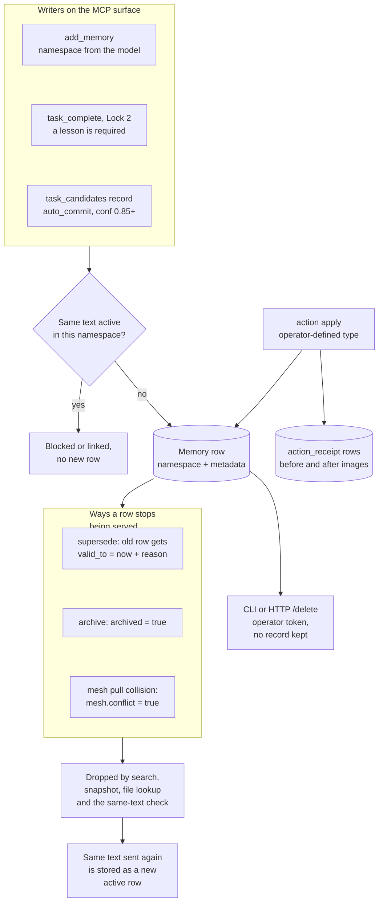

## 1. Executive Summary

NeuroStrata is one Rust binary, run as a loopback daemon and MCP server, that
gives coding agents a per-project store of rules, facts, procedures and failed
attempts beside a Tree-sitter code graph, an RDF and SPARQL layer, versioned
digital twins and a task system that will not close a task without a written
lesson. What is notable is one rule applied everywhere the agent reads:
archived, superseded and team-sync-conflicted rows are dropped on every search
arm, the session snapshot and the duplicate check, inside the namespace named
on the call, and populated tests hold it. What is weak is who names that
namespace, which is the model on each call, and a README that describes a
retrieval stack the default search does not run.

The memory unit is a `Memory` node in an embedded LadybugDB graph database,
keyed by `namespace`, with typed edges to other memories and to code symbols.
Agents write through `neurostrata_add_memory`, correct through
`neurostrata_supersede_memory`, which keeps the old text with a reason, and
retire through `neurostrata_archive_memory`. Plugins for six agent harnesses
prefetch the memories governing a file before an edit and inject the active
task's context into subagents.

The README says a query runs on one of three surfaces, an HNSW vector index,
Tantivy or an in-house BM25, and that *"their scores are never fused"*
(`README.md:32`). The MCP tool's default mode is `hybrid`, which fuses an
exact cosine scan with Tantivy ranks by reciprocal rank at k 60, and no vector
index is created anywhere in `src/` (section 6).

**Licence.** MIT in `LICENSE`, and the plugin manifests that declare a licence
agree; the root `Cargo.toml` declares none. The one component under unstated
terms is `artifacts/laya-bundle/model.onnx`, a 2.6 MB ONNX file whose
`registry.json` names a release of a third-party repository as its source and
whose licence appears nowhere in the tree. Its own manifest calls it a
*"Compact stub used for bundle structure validation"*. `crates/ontobug` is
MIT OR Apache-2.0 with both texts. Nothing restricts use.

Three marks are earned: `scope_enforced` on the namespace predicate,
`audit_log` on the action receipts, and `negative_eval` on the lexical and
Tantivy tests. Section 9 gives the reason for each of the four withheld.

## 2. Mental Model

A memory is **a typed statement filed under a project name**. The
`memory_type` vocabulary separates rules (constraints an agent must follow),
facts, procedures with a trigger and a firing budget, tasks, guard rules, and
structural rows the code ingester writes. A fact may carry
`metadata.attempt` with `outcome: "failed"`, which the tool schema describes
as evidence of one failed episode and not a rule (`src/server.rs:226`).

A memory is believed from the moment it is stored. Nothing gates it except a
secret scan and an exact-duplicate check, and the same text already active in
the namespace is refused or linked rather than stored twice
(`src/server.rs:5366`, `:4947-5036`). There is no candidate or verified state
on a memory row.

A row stops being served in four ways, each written by a different actor:

- **Superseded.** `neurostrata_supersede_memory` stores the new text as a new
  row and sets `valid_to = now`, `superseded_by` and `superseded_reason` on the
  old one (`src/server.rs:10948-10954`). Any row whose `valid_to` has passed is
  retired (`src/store/ladybug.rs:16497-16502`).
- **Archived.** `neurostrata_archive_memory` merges `archived: true` and
  `archived_at` into the metadata (`src/handlers/archive_memory.rs:147`,
  `:152`).
- **Conflicted.** A SynapticMesh pull whose incoming record collides with the
  local one sets `metadata.mesh.conflict = true` on the local row and keeps the
  incoming variant in a sidecar directory (`src/synaptic_mesh/import.rs:1484`,
  `src/synaptic_mesh/conflict.rs:26-36`). A later successful apply clears it
  (`src/synaptic_mesh/import.rs:2021`).
- **Deleted.** The CLI and the daemon's `/delete` route remove the node and
  its edges (`src/store/ladybug.rs:11856`). No MCP tool deletes.

The first three are read-time predicates. The exact-duplicate check uses the
same predicates, so a superseded or archived text sent again is not a
duplicate: it is stored as a new, active row (`src/store/ladybug.rs:11771-11779`).

Memory is agent-controlled with two forcing functions. A task cannot reach
`done` except through `neurostrata_task_complete`, which requires an extracted
lesson (Lock 2, `src/task/mod.rs:69`). The plugin core extracts deferrals
and candidate facts from tool output and posts them to an intake ledger as
the assistant's, which the server does not commit; a direct call that sets
`auto_commit` with a confidence of at least 0.85 and a `user` or `checker`
role writes the fact to memory (`src/server.rs:6013-6025`).

## 3. Architecture

One binary, `neurostrata-mcp`, serves everything. `neurostrata-mcp setup`
registers a daemon that listens on `127.0.0.1:34343` and exposes MCP at
`/mcp` beside thirty-five other HTTP routes for ingest, delete, edit, export,
SPARQL, GraphQL, chat and backup (`src/daemon.rs:1162-1202`). Every route but
`/health` requires a per-user bearer token from a 0600 file, and `/delete`,
`/shutdown` and `/backup` also require a second operator token
(`src/daemon.rs:284-288`, `:336-352`). Its own comment states the limit: any
process running as the same user can read both files.

The store is one embedded LadybugDB database for the machine, by default at
`~/.config/NeuroStrata/data/db/ladybug.db`, holding every namespace
(`src/config.rs:185-190`). LadybugDB is a C++ graph engine compiled through
the `lbug` crate, whose build downloads the engine archive pinned by
`LBUG_VERSION` in CI. A Tantivy index directory sits beside the database, and
an in-memory BM25 index is loaded per namespace on first use. Embeddings come
from `fastembed`, which runs ONNX locally with `NomicEmbedTextV15` at 768
dimensions by default (`src/embed.rs:35`, `:188`).

Around the memory store sit subsystems that share its tables: a Tree-sitter
ingester for six languages that writes `code_ast` rows by generation, an RDF
projection with SPARQL, RDFS closure and SHACL, digital twins, kinetic
actions with receipts, and a guard that matches proposed commands against
`guard_rule` memories and dry-runs them in a rootless `podman`. SynapticMesh
syncs shareable memory types through a git checkout.
A Lean 4 model and Kani harnesses in `proofs/` and `src/formal_kernel.rs`
cover the task state machine and other kernels; they were not read for this
report.

### Deployment and ergonomics

- **What has to run:** the daemon. No external database, vector service or
  API key. The embedding model downloads on first use and is checksummed.
- **Install:** `scripts/build.sh` from source, which needs CMake and a C++
  toolchain for the engine, or a release binary for four targets.
  `neurostrata-mcp setup` registers the daemon; the agent's
  `neurostrata_bootstrap` or `neurostrata_task_setup` installs the plugins,
  skills and git hooks.
- **Offline:** fully local once the model is cached.
- **Repairable by hand:** not directly. The store is a binary graph database.
  `neurostrata_export_canonical_rdf`, the Vault-LD Markdown sync and the
  Tauri viewer are the ways in; the viewer edits and deletes rows.

## 4. Essential Implementation Paths

- **Write.** `tools/call` dispatches `neurostrata_add_memory` to
  `handle_add_memory` (`src/server.rs:1644`, `:5279`). It refuses a path-like
  namespace and, for a project whose root has no `.NeuroStrata` directory,
  refuses unless `create_new_namespace` is set (`:5299-5330`). It runs the
  secret scan (`:5366`), the domain registry, optional GLiNER entity
  candidates, then `embed_dedup_and_upsert` (`:4893`): local embedding, the
  exact-content check through `find_active_exact_content`
  (`src/store/ladybug.rs:11719-11790`), then a raw-distance candidate set for
  the judgement provider when one is configured. `upsert` (`:10588`) writes the
  row and updates the lexical indexes through `lexical_apply_doc` (`:11341`,
  `:8789`).
- **Correct.** `handle_supersede_memory` (`src/server.rs:10628`) refuses the
  `global` namespace without `allow_global` (`:10704-10708`), writes the
  replacement, re-reads the old row as an optimistic guard, then retires it
  (`:10948-10954`). `archive_memory` makes the same refusal and merges the
  flag (`src/handlers/archive_memory.rs:94-153`). Both emit a pulse on the
  in-process bus.
- **Retrieve.** `handle_search_memory` (`src/server.rs:11570`) resolves the
  namespace (`:11595`), reads `include_archived` (`:11605-11610`) and a
  `principal` defaulting to `admin` (`:11641`), and in the default mode calls
  `search_hybrid_with_domain` (`src/store/ladybug.rs:8898`) and
  `search_inner` (`:48`). Results are cut to five (`src/server.rs:12221`).
- **Inject.** The plugin core calls `neurostrata_memories_for_file` on a file
  touch (`prefetchMemoriesForFile`, `plugins/core/index.ts:2325-2345`) and
  injects active task, golden rules, `subagent_prompt_injection` and
  conceptual bridges from `.NeuroStrata/active_session.json`
  (`plugins/core/index.ts:3100-3160`). `neurostrata_get_snapshot` assembles
  the session-start view (`src/server.rs:6219`).
- **Delete.** `Commands::Delete` in the CLI (`src/main.rs:10788`) and
  `handle_delete` on the daemon (`src/daemon.rs:1817`) call
  `VectorStore::delete` (`src/store/ladybug.rs:11833-11866`).
- **Log.** `neurostrata_action` `apply`, `revert` and `log`
  (`src/server.rs:1278-1290`, `:9141`; `src/rdf/action.rs`).
- **Tests.** Store tests inline in `src/store/ladybug.rs` from about line
  17000; the in-house lexical index in `tests/fts/lexical_test.rs`; MCP
  handler tests inline in `src/server.rs`.

## 5. Memory Data Model

`Memory` has ten columns: `id`, `namespace`, `content`, `user_id`,
`memory_type`, `agent_name`, `location`, `location_lines`, `metadata` as a JSON
string, and `embedding` as `FLOAT[N]` (`src/store/ladybug.rs:9605`). Five edge
tables share one shape: `source`, `valid_from`, `valid_to`, `generation`,
`extractor`, `confidence`, `evidence_id`, `origin` (`:9608-9614`). Everything
else lives in `metadata`: `valid_from`, `valid_to`, `archived`,
`superseded_by`, `supersedes`, `superseded_reason`, `source`, `domain`,
`refs`, `governs`, `access_count`, `feedback_score`, `visible_to`, `mesh`, and
for procedures `trigger`, `remaining_fires` and `performance_count`.

**Scope.** `namespace` is the only stored scope key that every read applies.
`global` is a namespace like any other, except that supersede and archive
refuse it without `allow_global`, and task claim collects active rules from
`global` and the target namespace together (`src/task/mod.rs:575-610`).
`user_id` and `visible_to` feed a role check in the in-house lexical engine
(`src/fts/mod.rs:665`) whose principal is the caller's own argument.

**Time.** `valid_from` is written as the current time by every writer that
sets it, supersede among them (`src/server.rs:10820`), and edges get the
write time on creation (`src/store/ladybug.rs:11245`, `:11321`). `valid_to`
is set by supersede to the current time, or carried forward when a caller had
set a future expiry. `neurostrata_related` accepts `as_of` and a validity
window over edges, which reads those same write times.

**Other tables.** `IntakeReceipt` and `IntakeCandidate` hold the task-intake
ledger, with `review_state` and `disposition` (`src/store/ladybug.rs:10429`,
`:10439`). `IngestGeneration` and `StagingGeneration` hold the code-graph
generation pointers, and `MemoryMetric` the time series.

## 6. Retrieval Mechanics

**Default MCP search.** `mode` defaults to `hybrid`, which the handler maps to
`SearchMode::Hybrid` for the LadybugDB store (`src/server.rs:12007-12012`).
`search_inner` then runs:

1. **An exact-name pre-pass** over every row of the namespace, matching the
   query or a quoted phrase against content, location, symbol or any string
   metadata value (`src/store/ladybug.rs:257-330`).
2. **A Tantivy query** with the principal fixed to `"admin"`, falling back to
   the in-house BM25 when Tantivy returns nothing (`:175-218`).
3. **A vector scan** written as
   `MATCH (m:Memory) WHERE m.namespace = … RETURN … array_distance(m.embedding, …) AS dist … ORDER BY dist ASC … LIMIT`
   (`:365-368`). This is an exact distance over every non-structural row of
   the namespace. No vector index is created in `src/`.
4. **Fusion.** `compute_rrf_distance` combines vector rank, lexical rank,
   symbol match, graph co-occurrence, parent rank, edge priority and feedback,
   with `RRF_K = 60` (`src/graph_read/hybrid.rs:42`, `:73-125`;
   `src/store/ladybug.rs:1404`).
5. **Graph expansion** of one or two hops over the typed edges, with slots
   reserved so structural code rows cannot crowd out rules and facts.

The README's description is a different system: an HNSW index and three
surfaces whose scores are never fused (`README.md:32`). The tool schema's own
description of `hybrid` matches the code apart from the word HNSW
(`src/server.rs:369`).

**Filters.** On the vector arm the retired, archived and mesh-conflict checks
run per row after the scan (`src/store/ladybug.rs:398-410`), and the exact
pass applies the same three (`:289-291`). Domain, facet, node set, memory
type, fact shape, path prefix and an optional `exclude_stale` narrow further.
A domain filter that would empty the result is skipped and reported.

**Other surfaces.** `neurostrata_memories_for_file` is a deterministic lookup
of rules, facts and procedures governing a path, its ancestors or a symbol,
with an AST neighbourhood. `neurostrata_related` walks one or two hops and
stays in the namespace unless `cross_namespace: true` is passed
(`src/server.rs:478`). SPARQL and GraphQL run over a projection of the same
rows.

**Failure modes.** The vector arm scans every row of a namespace per query,
so cost grows with the namespace. Rows filtered after the scan still consume
the fetch budget of ten times the limit. `NEUROSTRATA_HYBRID_SEARCH` turns
fusion on for callers that pass the default mode, so the CLI and the MCP
surface can rank the same query differently (`src/store/ladybug.rs:67-80`).

## 7. Write Mechanics

**Creation.** Every MCP write is synchronous. The ONNX embedding is computed
on the call, the row and its edges are written, and the Tantivy index is
updated inline (`src/store/ladybug.rs:8789-8840`), so a memory is searchable
when the call returns. Writes serialise on LadybugDB's single write
transaction and retry on collision under a deadline (`:16470-16483`).

**Deduplication.** Exact text in the same namespace and type scope, among
active rows, is `BlockedExact` unless either side declares `extracted_from`,
in which case the task id is merged into the existing row
(`src/server.rs:4947-5036`). A near-duplicate goes to the judgement provider,
whose verdict may block only when the provider is a promoted, Gold-calibrated
model on a bare add (`src/judgment/laya_onnx.rs:172-179`). The model
committed under `artifacts/laya-bundle` is a stub by its manifest, which
records training on three items for one epoch with no calibration items.

**Correction.** Supersede is the only edit on the agent surface. It replaces
the text, re-embeds, carries or replaces structural pointers and provenance,
and records why. The daemon's `/edit` and `/set-metadata` routes rewrite in
place behind the bearer token (`src/daemon.rs:1878`, `:1927`).

**Agent-generated facts.** Lock 2 makes the agent write a lesson for every
finished task. The plugin core posts facts and decisions it extracts from
tool output to `neurostrata_task_candidates` with role `assistant` and
`auto_commit` false (`plugins/core/index.ts:1422-1486`, `:3546-3560`). The
server writes a candidate to memory when `auto_commit` is true, the
confidence is at least 0.85, a task id is present and `provenance.role` is
absent, `user` or `checker` (`src/server.rs:6013-6025`). Every input to that
gate is the caller's, so a direct tool call passes it.

**Hostile input.** `secrets::scan_entry_point` rejects content and metadata
that look like credentials at add, supersede and edit (`src/server.rs:5366`,
`:10673`, `:12501`). Nothing screens instructions in content.

### Operational cost

- **Hot path:** one local ONNX embedding per write and per search, plus an
  exact scan of the namespace per search. No model call on either path.
- **Lag:** none; the write is retrievable on return.
- **Background:** a checkpoint every 60 seconds (`src/daemon.rs:365`), storage
  hygiene, the code-graph watcher re-ingesting changed roots, and the
  SynapticMesh drain. None rewrites memory rows. Leiden community summaries
  and KGE training run when a tool asks.
- **Read cost:** five results per search by default. The plugins inject the
  active-session block once per session epoch and per-file memories once per
  path, deduplicated by id.

## 8. Agent Integration

About seventy MCP tools, of which the memory ones are `add_memory`,
`get_memory`, `search_memory`, `supersede_memory`, `archive_memory`,
`feedback`, `memories_for_file`, `related`, `get_snapshot`, `distill`,
`find_duplicate_candidates` and `procedure_perform`. Tool descriptions are
overlaid at runtime from `src/schemas/memory-vocabulary.v3.json`
(`src/server.rs:1548-1599`).

The plugins for OpenCode, Claude Code, Hermes, Codex CLI, Copilot CLI and
OpenClaw are thin adapters over one core, `plugins/core/index.ts`, bundled to
`dist/index.js`, embedded in the binary with `include_str!` and written into
`.NeuroStrata/plugins/<harness>/` by the installer. The core resolves the
namespace from the project's root marker or the harness config and fails
closed when the config cannot be read (`resolveConfig` and
`readHarnessConfig`, `plugins/core/index.ts:119`, `:657`). It talks to the
daemon over JSON-RPC at `http://127.0.0.1:34343/mcp`.

The agent is expected to call `get_snapshot` and claim a task before editing;
the pre-push hook runs `neurostrata-mcp task gate --strict`. The model holds
every memory verb except delete, including the `resolve` action on the intake
ledger and the `define` and `apply` actions on kinetic actions.

## 9. Reliability, Safety, and Trust

### One retirement rule, applied on every read

The strongest property is consistency. The retired, archived and
mesh-conflict checks appear on the vector arm, the exact pass, the Tantivy
hydration, the in-house lexical index, the exact-duplicate check, the
snapshot (`src/server.rs:6327-6332`, `:6372`), conflict detection
(`src/domain.rs:1224-1249`), GraphQL (`src/graphql/mod.rs:280-296`) and
SPARQL salience (`src/rdf/sparql.rs:89-93`). The Tantivy path reads the
stored row before returning a hit, so a stale index entry that lost its flag
cannot surface an archived row, and a test holds that case.

### Who names the namespace

The namespace on a read is the `namespace` argument of the call, after a
case-insensitive match against names that exist (`src/server.rs:12334-12378`).
`neurostrata_list_namespaces` returns every name on the machine. The plugins
pass the namespace from the project's root marker on the calls they make, but
the model's own tool calls name whatever it chooses. The daemon treats
same-user processes as trusted by design; on one developer's machine that is
the threat model, and it makes the namespace a filing key rather than a
boundary between agents.

### What a correction leaves behind

Supersession keeps the old wording, the replacement id and a one-clause
reason on the retired row. It does not stop the old value returning: the
exact-duplicate check skips retired and archived rows, so an agent that
re-extracts the corrected claim stores it again as an active row. Delete
removes the node and its edges and records nothing.

### Concurrency and loss

Writes go through one database file and LadybugDB's single write
transaction, with retry on collision. Supersede re-reads the old row before
retiring it, and a test covers a concurrent supersede
(`src/server.rs:20774`). The bus that feeds the SynapticMesh outbox is
bounded and drops its oldest pulse when full, which the outbox module
documents as an accepted loss window (`src/synaptic_mesh/outbox.rs:56-70`).

### Marks

- **`scope_enforced` — earned.** `Memory.namespace` is a stored key, and
  every Cypher read on the agent's paths opens with
  `WHERE m.namespace = '<ns>'`. The key is model-supplied, every name is
  listable, and `related` widens on a flag.
- **`audit_log` — earned, for one tool.** `action_receipt` rows record each
  application of an operator-defined action with before and after payloads,
  and a revert supersedes the receipt with a new version rather than editing
  it. `add_memory`, supersede, archive, delete, `/edit`, `/set-metadata`,
  Lock 2 lessons, intake auto-commits and mesh imports leave no receipt. The
  principal on a receipt is the caller's argument.
- **`negative_eval` — earned.** Three tests require foreign-namespace,
  archived, retired and conflicted rows absent from populated results, with
  the live row present.
- **`trust_state` — withheld.** A memory has no status field. Archived,
  `valid_to` and `mesh.conflict` are three separate markers, each filtered,
  none a discrete epistemic state. `mesh.conflict` is the nearest: a row
  whose teammate's copy collided is withheld until a later apply clears it,
  but it is a boolean set and cleared by the sync, not a ladder. The
  `disputed` badge is computed per snapshot and never stored.
- **`tombstone` — withheld.** The archive tool calls its flag a tombstone; it
  is keyed on the row. Re-adding the same text after a supersede or archive
  stores a new active row.
- **`bitemporal` — withheld.** Every `valid_from` writer stamps the write
  time, and edge validity is the same clock.
- **`human_review` — withheld.** No memory waits for anyone. Intake
  candidates wait in `pending`, and the agent resolves them through the same
  tool that records them; resolving writes no memory. The Tauri viewer edits
  and deletes after the fact.

## 10. Tests, Evals, and Benchmarks

I ran none of the suites. Counts are from reading. CI runs
`cargo test --locked -- --test-threads=1` on Ubuntu as the gate, the binary
suite report-only on Windows and macOS, the wasm crate, and
`node --test plugins/core/test.mjs` (`.github/workflows/ci.yml:211`, `:218`,
`:283`, `:314`). The same job builds the Lean proofs and runs a Kani mutation
check that requires six broken kernels to be rejected.

The negative cases that carry the mark:

- `namespace_isolation_is_absolute` indexes `shared word` in namespaces `one`
  and `two` and requires exactly one hit, `a` (`tests/fts/lexical_test.rs:95-103`).
- `row_class_filters_hide_tasks_archived_retired_registry_and_conflicts`
  indexes seven rows matching `needle` and requires exactly `live`, then
  exactly three when tasks and archived rows are admitted
  (`tests/fts/lexical_test.rs:106-147`).
- `par02_tantivy_hydration_respects_archive_escape_hatch` strips the archive
  flag from the Tantivy entries and requires the clean row present and the
  archived row absent, then present with `include_archived`
  (`src/store/ladybug.rs:18358-18408`).

The two lexical tests run against the in-house index, not through
`handle_search_memory`. The Tantivy test runs through the store.

Supersede is tested at the handler, including retirement with the text kept
and a refused second supersede (`src/server.rs:18967`, `:19118`). The action
receipts have tests that an apply followed by a revert restores the complete
prior state, that a stale or double revert writes nothing, and that a
historical receipt is never edited in place (`src/rdf/action.rs:6399`,
`:6810`, `:7184`).

`eval/semantic/retrieval-receipt.json` is a committed run of a synthetic
60-query retrieval set over four arms. The arm with ontology aliases and
hierarchy scores nDCG@10 0.813 against 0.722 for the baseline, and the
receipt's own gate records **FAIL**: the hierarchy subset's Recall@5 lift is
0.043 against a required 0.10. It lists what it did not evaluate,
owner-labelled production data first, and every arm ran in the `default`
mode, not the `hybrid` mode the MCP tool uses. No paper is referenced.

Missing tests: a cross-namespace case through `handle_search_memory` in the
default hybrid mode; a case that re-adds a superseded text and asserts what
happens; a test of the auto-commit gate refusing a low-confidence or
assistant-role candidate.

## 11. For Your Own Build

### Steal

- **Write the retirement predicate once and put it on every reader,
  including the duplicate check and the session snapshot.** Then write a test
  that strips the flag from the index and expects the stored row to win.
- **Make correction a new row plus a reason on the old one.** The retired row
  keeps its wording, `superseded_by` and `superseded_reason`, and the reply
  says when no reason was given.
- **Put destructive routes behind a second credential**, and say in the code
  what it does not protect against.
- **Commit the eval receipt even when the gate fails**, with the
  not-evaluated list beside the numbers.

### Avoid

- **A dedup check that skips retired rows is a re-assertion path.** If the
  store already filters retired rows, decide whether the duplicate check
  should see them, because skipping them makes every correction re-addable.
- **A scope key the model types is a label, not a boundary.** Resolve it from
  the connection, or say plainly that it is a filing key.
- **A mutation log on one tool reads as an audit of the store.** Put it on
  the write paths the agent uses most, or name the paths it misses.
- **Documentation that describes another retrieval stack.** The README, the
  tool schema and the code describe three different searches, and agents
  choose by the README.

### Fit

This suits a single developer, or a team syncing through git, who wants one
local binary to hold project rules next to the code graph and to make agents
file what they learn. It is a large system: a C++ graph engine built from
source, about seventy tools, six harness plugins and a task discipline that
blocks pushes. The maintenance budget is that of a product, and the store is
not hand-repairable. Walk away if several agents must be kept apart on one
machine, if a retracted fact must stay retracted, or if the memory layer has
to be small enough to read in a day.

## 12. Open Questions

- Does the Tantivy query filter on namespace in the index, or only on
  hydration from the store?
- How does the default search behave as a namespace grows past tens of
  thousands of rows, given the exact scan per query?
- Is the stub Laya model replaced by a calibrated one in any release, and
  under what licence?
- What clears a SynapticMesh conflict when no teammate pushes a new revision?

## Appendix: File Index

| Path | Role |
| --- | --- |
| `src/store/ladybug.rs` | Schema, search, filters, duplicate check, get, delete, Tantivy hydration, store tests |
| `src/server.rs` | MCP tool list and dispatch, add, search, supersede, snapshot, task candidates, namespace resolution |
| `src/handlers/archive_memory.rs` | The archive flag and its read-time predicate |
| `src/daemon.rs` | HTTP routes, bearer and operator tokens, delete, edit, set-metadata, checkpoint loop |
| `src/graph_read/hybrid.rs` | Reciprocal-rank fusion |
| `src/fts/mod.rs` | In-house BM25 with row-class and ACL filters |
| `src/synaptic_mesh/conflict.rs`, `import.rs`, `outbox.rs` | Team sync, conflict marker, outbox WAL |
| `src/rdf/action.rs` | Kinetic actions, receipts, revert, log |
| `src/task/mod.rs`, `src/task/intake.rs` | Lock 2, golden rules, intake ledger |
| `src/judgment/laya_onnx.rs`, `artifacts/laya-bundle/` | Near-duplicate judge and its committed bundle |
| `plugins/core/index.ts` | Harness plugin core: namespace resolution, prefetch, injection |
| `tests/fts/lexical_test.rs` | Namespace and row-class negative cases |
| `eval/semantic/retrieval-receipt.json` | Committed retrieval eval with its gate verdict |

### Recorded searches

Run from the repository root at the pinned commit with `/usr/bin/git grep`.

- **No vector index.**
  `git grep -n -i -E 'vector_index|create_vector|VECTOR INDEX' -- src`
  returns nothing; `git grep -n -c 'array_distance' -- src` returns
  `src/store/ladybug.rs:4`.
- **HNSW appears only in prose.**
  `git grep -n -i hnsw -- src` returns the tool description at
  `src/server.rs:369` and a comment at `:12108`.
- **Fusion has one caller on the search path.**
  `git grep -n compute_rrf_distance -- src` returns its definition and tests in
  `src/graph_read/hybrid.rs` and the call at `src/store/ladybug.rs:1404`.
- **No MCP delete tool.**
  `git grep -n -E '"neurostrata_(delete|forget)[a-z_]*"' -- src` returns
  nothing; `"neurostrata_archive_memory"` matches at `src/server.rs:889`.
- **No value-keyed rejection list.**
  `git grep -n -i -E 'rejected_value|rejected_content|denylist|blocklist|never_reassert' -- src`
  returns nothing; `git grep -n -c 'is_archived(&metadata_val)' -- src/store/ladybug.rs`
  returns 8.
- **The only review state is on intake candidates.**
  `git grep -n review_state -- src/store/ladybug.rs` returns the
  `IntakeCandidate` table at `:10439` and its writer near `:15996`.
- **No approve verb on the memory surface.**
  `git grep -n -i approve -- src/server.rs src/daemon.rs src/handlers` returns
  only the guard's `ApprovedFailOpen` verdict in a description at
  `src/server.rs:712`.
- **Every valid_from writer uses the current time.**
  `git grep -n -E 'valid_from: *(now|chrono|Some\(now)|"valid_from".*now|valid_from = now' -- src`
  returns writers in `src/digital_twin/mod.rs`, `src/rdf/action.rs`,
  `src/rdf/taxonomy.rs`, `src/rdf/scenario.rs`, `src/domain.rs`,
  `src/server.rs:8496`, `:10820` and `src/vault_ld/vault_sync.rs`, each with
  the current time.
- **Append-only mechanisms in the source.**
  `git grep -n -i -E 'append-only|append only' -- src` returns the mesh
  outbox, the learning recorder, the judge and a bus registry comment.
- **No submodules.** `git ls-files .gitmodules` returns nothing.
- **No licence for the Laya bundle.**
  `git grep -n -i licen -- artifacts datasets` returns nothing;
  `git grep -n -i laya -- artifacts` matches the registry.
- **No paper reference.**
  `git grep -n -i -E 'arxiv|bibtex|@article|@misc|CITATION|doi\.org' -- . ':!*package-lock.json'`
  returns two CHANGELOG lines and archived plans using "citation" for code
  references, no paper.

## History

**2026-11-26** — [`502950f77ef758b5754a8cbb5aea2c069d6b0b14`](https://github.com/Cognilogical/NeuroStrata/commit/502950f77ef758b5754a8cbb5aea2c069d6b0b14). First reading, from a full clone at the head of `main`, 10 commits past `808e130`, the commit triage selected; those commits touch the task, GraphQL and installer code and the snapshot's task block, and leave the search and write paths described here in place. Screened first: no auto-run surface; eight manifests and lockfiles inside the seven-day cooldown; two build-time execution points (`build.rs`, `src-tauri/build.rs`); eight unpinned manifests; inert git hook payloads under `scripts/hooks`; `AGENTS.md` read as data. Nothing was installed, built or run, and the 3,322 Rust test functions and 281 plugin test cases were not run. Three marks: `scope_enforced`, `audit_log` and `negative_eval` ([section 9](#9-reliability-safety-and-trust)).
