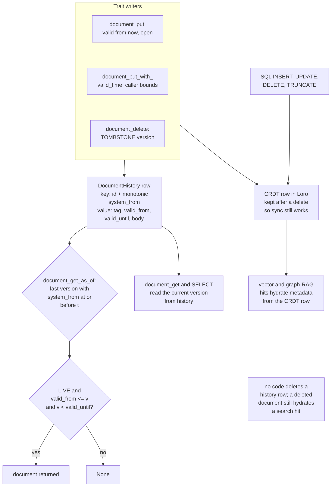

## 1. Executive Summary

NodeDB Lite is the embedded edition of [NodeDB](../nodedb/): one Rust library
running document, key-value, vector, graph, full-text, spatial, columnar,
timeseries and array engines in-process over a paged file, offline by default,
with CRDT sync to a NodeDB Origin server. Its notable parts are a bitemporal
document collection whose valid time a caller sets apart from the system-time
key, and a plan adapter that refuses an access policy it cannot enforce rather
than dropping it. Its weak part is that it is a database and not a memory
system, and that the bitemporal history is complete only for writes through the
Rust trait.

The README calls it "[t]he embedded memory engine for AI agents" and names ma8e,
"an in-development memory-and-knowledge layer for coding agents", as its
consumer (`README.md:50`). Nothing of ma8e is in this tree. What the tree
offers an agent is `NodeDbLite`, an implementation of the `NodeDb` trait from
the `nodedb-client` crate, with `document_put`, `vector_search`,
`graph_traverse`, `text_search`, `hybrid_search` and `graph_rag_search`. There
is no memory unit, extraction, consolidation, importance or provenance of its
own, so the memory model is the caller's to build.
One piece is shaped by that consumer: a `SyncGate` that keeps confidential
documents off the wire "for hosts (e.g. ma8e)" (`nodedb-lite/src/nodedb/core/types.rs:149-154`).

This repository is separate from the server and shares no code with it in the
tree. The engines it calls — HNSW, CSR adjacency, BM25, the Loro wrappers, the
SQL parser and physical plan types, the `NodeDb` trait itself — are crates.io
dependencies on `nodedb-*` 0.6 (`Cargo.toml:15-31`), with `Cargo.lock` listed in
`.gitignore`. CI builds them from a checkout of `NodeDB-Lab/nodedb` at `main`
(`.github/actions/setup-workspace/action.yml:1-21`). What is in the tree is the
integration: storage, per-engine adapters, the bitemporal history, the
physical-plan visitor and the sync client.

**Licence.** The Apache-2.0 grant covers the integration layer, and the code
that does most of the work is not in the tree to read: every engine is a
`nodedb-*` crate resolved from crates.io on a caret requirement with no
lockfile, so what a build links is whatever 0.6.x the registry serves that day.
The README's assurance of "no BSL anywhere in its dependency tree" cannot be
checked from this repository. `deny.toml` enforces it on the graph cargo-deny
sees, since its allow list holds no BUSL entry (its `BSL-1.0` is the Boost
licence). The sync interop suite builds the BUSL-1.1 Origin server from a
sibling checkout (`scripts/ensure-origin.sh:1-25`), which the README's
statement does not mention.

Two marks, on code in this tree: `bitemporal` on the document history and
`negative_eval` on populated vector and graph exclusion tests. The server's
`scope_enforced` rests on its row-level-security walker ([NodeDB](../nodedb/));
Lite has no counterpart, since it runs one tenant and refuses the walker's
output. Section 9 gives each withheld mark.

## 2. Mental Model

A "memory" here is whatever row the caller writes. Most rows have one state,
present, and leave by deletion. A row in a collection created
`WITH (bitemporal=true)` has a history instead, and that history is the only
place in the tree where a stored thing can be true for a period and then stop
being true without being destroyed.

A bitemporal document's versions live in `Namespace::DocumentHistory` under
`{collection}:{doc_id}\x00{system_from_ms:020}`, each value a tag (`LIVE`,
`TOMBSTONE` or `GdprErased`), `valid_from_ms`, `valid_until_ms` and the body
(`nodedb-lite/src/engine/document/history/mod.rs:3-19`). A
`LatestVersion` pointer names the newest key, updated in the same batch.

- **A version is born** from `document_put`, with `valid_from` set to the
  wall-clock now and `valid_until` open, or from
  `document_put_with_valid_time`, with both bounds the caller's. The
  system-time key comes from a strictly monotonic clock so two writes in one
  millisecond keep two rows (`nodedb-lite/src/nodedb/trait_impl/document.rs:109-127`,
  `:270-286`).
- **It stops being current** when a later version or a `TOMBSTONE` is
  appended. `document_delete` on a bitemporal collection writes the tombstone,
  removes the pointer and leaves the CRDT copy for sync
  (`nodedb-lite/src/nodedb/trait_impl/document.rs:153-177`).
- **It is read** current through the pointer, or as of a system time `t` by
  scanning the document's versions newest first, taking the first with
  `system_from <= t`, and returning it only when it is `LIVE` and covers the
  requested valid time (`nodedb-lite/src/engine/document/history/ops/read.rs:80-122`).
- **It never dies.** No code deletes a `DocumentHistory` row, and the
  `GdprErased` tag is decoded but written by nothing in the document engine.

Valid time is one interval per system-time version. A document written as valid
over 2024 and then rewritten with a 2025 interval holds the 2025 interval at the current
system time and the 2024 interval only as of the earlier system time, so a
query for a 2024 valid time at the current system time returns nothing.

## 3. Architecture

Everything runs in the host process. `NodeDbLite::open` takes a storage
backend and returns an `Arc`; nothing else has to be running, no API key is
needed to store anything, and the network is touched only by `start_sync`,
behind the default `sync` cargo feature (`nodedb-lite/Cargo.toml:12-19`).

| Area | Role |
| --- | --- |
| `nodedb-lite/src/storage/` | `StorageEngine` trait over pagedb (file, memory, OPFS), namespaces, checksums, an encrypted wrapper |
| `nodedb-lite/src/engine/` | Per-engine state: CRDT documents, strict rows, columnar and timeseries, vector, sparse vector, graph CSR, FTS, spatial, array |
| `nodedb-lite/src/engine/document/history/` | The bitemporal document history |
| `nodedb-lite/src/nodedb/trait_impl/` | `NodeDb` trait methods: document, vector, graph, batch, SQL lifecycle |
| `nodedb-lite/src/nodedb/graph_rag/` | Hybrid and graph-RAG retrieval with RRF |
| `nodedb-lite/src/query/` | SQL through `nodedb-sql`, a physical-plan visitor and per-engine ops |
| `nodedb-lite/src/sync/` | WebSocket client, outbound queues, shapes, vector clock, compensation |
| `nodedb-lite-ffi/`, `nodedb-lite-wasm/` | C ABI with Kotlin and JNI, and the npm package |

### Deployment and ergonomics

Adoption is `cargo add nodedb-lite` or `npm install @nodedb-lab/nodedb-lite`. The
store is a pagedb file, not readable by hand; at rest it is plaintext only if
the caller chooses `Encryption::Plaintext`, since the enum has no default and a
passphrase derives the key through Argon2id with a `<db_path>.salt` sidecar
(`nodedb-lite/src/storage/encryption.rs:14-40`).

Building from a clone is harder than the README's three commands suggest. The
CI action's own header says `nodedb-* = "0.5"` once did not resolve because
"0.5.0 exists only in the Origin working tree", and that a caret requirement
"never matches a prerelease" of pagedb; it checks out `NodeDB-Lab/nodedb` and
`NodeDB-Lab/pagedb` at `main` and writes a `[patch.crates-io]` table over them
(`.github/actions/setup-workspace/action.yml:1-21`, `:27-38`). A test run on
CI therefore exercises this pin against whatever the Origin workspace holds
that day; only the release path, with `sources: registry`, builds against
published crates.

## 4. Essential Implementation Paths

**Bitemporal document write and read.** `document_put_impl` upserts the CRDT
row, drops its pending delta if the sync gate rejects it, and appends a `LIVE`
version for a bitemporal collection
(`nodedb-lite/src/nodedb/trait_impl/document.rs:64-136`). `versioned_put` writes
the history row and the pointer in one `batch_write`
(`nodedb-lite/src/engine/document/history/ops/write.rs:21-52`).
`document_get_as_of_impl` refuses a non-bitemporal collection and calls
`versioned_get_as_of` (`nodedb-lite/src/nodedb/trait_impl/document.rs:200-226`).

**SQL writes.** `point_insert_admitted` and `point_delete_admitted` branch only
on whether the collection is strict; a schemaless collection's row goes to
`crdt.upsert` or `crdt.delete` (`nodedb-lite/src/query/document_ops/writes/insert.rs:156-176`,
`nodedb-lite/src/query/document_ops/writes/delete.rs:46-58`). The SQL scan of a
bitemporal collection reads `scan_live_documents` from history instead
(`nodedb-lite/src/query/engine_read.rs:28-56`).

**Vector search.** `vector_search_internal` builds a prefilter bitmap from the
caller's allowed ids, `run_vector_search` searches HNSW, drops nodes the index
marks deleted and reranks, and `Hydration::result` reads the row's fields from
the CRDT store, returning the hit with empty metadata when the row is absent
(`nodedb-lite/src/nodedb/trait_impl/vector.rs:56-95`,
`nodedb-lite/src/engine/vector/search/run.rs:215-222`,
`nodedb-lite/src/engine/vector/search/hydrate.rs:36-67`).

**Graph-RAG.** `graph_rag_search` seeds from vector hits and caller seeds,
expands outgoing edges breadth-first to `graph_depth` under a visited cap,
fuses the two rankings with weighted RRF, and reads graph-only hits' metadata
from the CRDT row (`nodedb-lite/src/nodedb/graph_rag/graph.rs:25-124`).

**Policy slots.** Every physical-visitor arm that can carry an Origin policy
calls `deny_policy`, which returns `LiteError::Unsupported` for a non-empty read
program or a write check of `Predicate` or `PendingInjection`
(`nodedb-lite/src/query/physical_visitor/adapter/policy.rs:19-59`).

**Sync gate.** `should_sync_doc` asks the installed gate and returns `true` when
none is installed or its lock is poisoned (`nodedb-lite/src/nodedb/core/ops/crdt.rs:27-39`).
`document_put_impl` and `document_put_with_vector` consult it
(`nodedb-lite/src/nodedb/trait_impl/document.rs:103-106`,
`nodedb-lite/src/nodedb/trait_impl/document_vector.rs:61`).

## 5. Memory Data Model

There is no memory schema. A collection belongs to one engine and a record is
that engine's row; the collection name is the leading component of every
storage key, and a vector is "an attachment to the row with the same
collection and id", merged into the CRDT row's fields
(`nodedb-lite/src/nodedb/trait_impl/vector.rs:97-150`).

Temporal fields come in three strengths. Schemaless documents carry both clocks
as described in section 2. Graph edges in a bitemporal collection carry
`system_from` in the key and `system_to` in a trailer, system time only
(`nodedb-lite/src/engine/graph/history.rs:1-19`); strict rows keep superseded
versions in `Namespace::StrictHistory` "for audit until an explicit
`TemporalPurge`" (`nodedb-lite/src/engine/strict/crud.rs:245-249`). Columnar
collections stamp a segment with a flush time, and the columnar scan applies a
valid-time filter only to columns the caller named `_ts_valid_from` and
`_ts_valid_until` (`nodedb-lite/src/query/columnar_ops/reads.rs:90-126`).

Scope fields do not exist on a record. Lite "runs one database and one tenant,
so every scope it builds uses [`DatabaseId::DEFAULT`] and tenant zero"
(`nodedb-lite/src/nodedb/core/ops/memory_engines.rs:17-26`). KV values carry an
8-byte deadline and expire lazily on read
(`nodedb-lite/src/nodedb/collection/kv.rs:70-97`, `:208-243`).

## 6. Retrieval Mechanics

Retrieval is application-driven; nothing injects context. The arms are a BM25
text search over the persistent FTS index, HNSW vector search with optional
quantized rerank, graph traversal, R-tree predicates and a SQL subset whose
`SqlPlan` variants are listed in `docs/lite-support-matrix.md` — `JOIN`,
aggregates, CTEs and the vector and text search plans return
`LiteError::Unsupported`.

`hybrid_search` runs a vector search and a text search and fuses them by
reciprocal rank, mapping the fused score to `1.0 / (1.0 + rrf_score)` as the
returned distance (`nodedb-lite/src/nodedb/graph_rag/hybrid.rs:18-88`).
`graph_rag_search` fuses vector hits with a breadth-first expansion that ranks
nodes by depth (`nodedb-lite/src/nodedb/graph_rag/graph.rs:77-96`). Both pass
the caller's `allowed_ids` to every arm and to every neighbour, which is the
only per-query restriction the library offers.

Two failure modes follow from the hydration rule. A vector whose row was
deleted is still returned by id with empty metadata, because
`document_delete_impl` calls no vector delete and hydration does not drop a
missing row. On a bitemporal collection the CRDT row survives the delete, so the
hit, and a graph-RAG hit on the same id, carries the deleted document's fields.
Both are readings of the code; no committed test deletes a document and then
searches its vector.

A third is a parameter nothing reads. The columnar scan destructures
`system_as_of_ms` into `_system_as_of_ms` and never uses it, while the comment
above `list_rows` says the cutoff is "applied post-hoc on the segment
system_time_from_ms metadata"; `list_rows_with_temporal`, which the comment
names, does not exist (`nodedb-lite/src/query/columnar_ops/reads.rs:43-52`,
`:77-88`). A columnar `AS OF SYSTEM TIME` returns current rows.

## 7. Write Mechanics

Writes are synchronous library calls and no model is involved. A document,
CRDT or unindexed KV write updates in-memory state and is readable at once;
it reaches storage at the next flush, which a task schedules every
`auto_flush_ms`, one second by default, with no wall-clock guarantee
(`nodedb-lite/src/lib.rs:23-38`). Strict rows, indexed KV puts and bitemporal
history versions commit before the call returns. Nothing rewrites the store in
the background beyond compaction and checkpointing.

Every write emits a Loro delta into a pending queue that the sync client pushes
to Origin. When Origin rejects one, `handle_reject_with_policy_impl` consults
the collection's conflict policy, which may overwrite, rename a unique field
with a `_1` suffix, defer for retry or escalate; escalation is a
`tracing::warn!` line, and an `IntegrityViolation` deletes the local row
(`nodedb-lite/src/nodedb/sync_delegate/reject.rs:20-80`,
`nodedb-lite/src/engine/crdt/policy.rs:101-200`).

The bitemporal history is written only by the trait's document methods. SQL
`INSERT` into a bitemporal schemaless collection writes the CRDT row and no
history version, so by reading the code the next `SELECT`, which scans
history, does not return it. SQL `DELETE` removes the CRDT row and leaves the
last `LIVE` version, which `document_get` keeps returning. The committed
regression for SQL over a bitemporal collection writes its rows through
`document_put` (`nodedb-lite/tests/document_bitemporal_api.rs:300-350`).

The `SyncGate` is consulted on two of the write paths. `document_put_with_valid_time`
upserts the CRDT row without asking it,
`document_put_with_vector_batch` upserts its documents and enqueues its vectors
without asking it, `vector_insert` enqueues without asking it, and SQL writes
do not ask it
(`nodedb-lite/src/nodedb/trait_impl/document.rs:258-268`,
`nodedb-lite/src/nodedb/trait_impl/document_batch.rs:243-244`,
`nodedb-lite/src/nodedb/trait_impl/vector.rs:158-167`). Its doc comment says a
rejected document is "excluded from every outbound sync channel"
(`nodedb-lite/src/nodedb/core/types.rs:165-174`).

## 8. Agent Integration

There is no agent surface: no MCP server, CLI, hook or tool schema. An agent
reaches Lite through a host program that links the crate, the C ABI or the npm
package. The memory model, the choice of what to store, and how retrieved rows
reach a prompt are the host's.

The `NodeDb` trait is the point of the design. The same trait is implemented by
a remote client for Origin, so "[m]oving from embedded to server is a
connection string change, not a rewrite" (`README.md`, *Same API, Any
Runtime*). The trait's definition lives in `nodedb-client`, outside this tree,
and the bitemporal methods are on it; the C ABI exports `nodedb_document_put`,
`nodedb_document_get` and `nodedb_document_delete` with no time argument
(`nodedb-lite-ffi/abi/surface.txt:21-23`).

## 9. Reliability, Safety, and Trust

**Policy slots fail closed.** The module header states the rule: "Executing the
write while dropping the slot would apply an unpoliced write, so every dispatch
arm that can carry one rejects it here instead"
(`nodedb-lite/src/query/physical_visitor/adapter/policy.rs:1-7`).
`write_gate_applies` is exhaustive over `RlsWriteCheck`, "[a] new variant must
break this build and force a decision", and `PendingInjection` refuses because
"a missed injection fails loudly instead of admitting the write" (`:41-59`).
This is the server's `PendingInjection` contract applied by a consumer that
cannot evaluate the predicate, and four unit tests cover predicate, pending,
unpoliced and read-filter cases (`:65-121`).

**`scope_enforced` — withheld.** Nothing on a record names a principal. The
instance runs tenant zero, the collection is a key prefix, and the walker that
enforces the server's policies is not in this tree: no `inject_rls`, `RlsStore` or
`AuthContext` appears, and plans carrying its output are refused. An
`allowed_ids` set is a filter the caller supplies per query. Shape
subscriptions such as `WHERE user_id = $me` are evaluated by Origin; Lite keeps
the shape ids and LSN watermarks (`nodedb-lite/src/sync/shapes.rs:10-30`). One
Lite database per device or per agent is a physical partition.

**`audit_log` — withheld.** The document history appends a row for each trait
write in the same batch as the pointer, and a strict collection keeps
superseded rows. Neither is an event record: the history is the bitemporal
store that current reads come from, it names no actor or reason, it is opt-in
per collection, and SQL writes bypass it. Loro's op log is sync state that
`TemporalPurgeCrdt` compacts (`nodedb-lite/src/query/meta_ops/temporal.rs:92-115`).

**`tombstone` — withheld.** The `TOMBSTONE` tag is keyed on a document id and
marks its deletion in system time; a rejected value has no record, and
nothing consults one before a write.

**`trust_state`, `human_review` — withheld.** No field carries an epistemic
status and nothing waits for a person. Conflict policies decide between two
writers' rows and the escalation path is a log line.

**Deletion.** On a plain collection a delete removes the CRDT row and its text
and sparse entries, and by reading the code leaves an attached vector
searchable. On a bitemporal
collection a deleted document's body stays in `DocumentHistory`, where no code
deletes a row, and in the CRDT store; no `TemporalPurge` variant targets
document history.

**Sync gate.** The gate fails open: a poisoned lock syncs the document
(`nodedb-lite/src/nodedb/core/ops/crdt.rs:32-38`), and the paths in section 7
that skip it send the document or its vector to Origin regardless of the host's
policy. The C ABI and WASM bindings do not expose `set_sync_gate`.

**Dependency drift.** With no lockfile and CI patched to Origin's `main`, a test
pass at this pin says the integration compiled against an unpinned engine on
one day.

## 10. Tests, Evals, and Benchmarks

The suite is integration-heavy: 129 files under `nodedb-lite/tests/`, engine
gates per model, crash recovery, encryption round trips, corruption handling and
a large sync interop set. The interop and `sql_parity` cases spawn an Origin
binary located through `NODEDB_BIN` and return early without one
(`nodedb-lite/tests/common/origin.rs:7-12`, `:96`), and
`scripts/ensure-origin.sh` builds it only when the `nodedb-types` crate resolves
to a local Origin checkout. A Lite-only `cargo nextest run` is green with those
suites unexercised.

The negative cases that hold are the ones with a positive control in the same
result. `vector_search_allowed_ids_filters_to_set` requires the allowed row
present and its twin absent (`nodedb-lite/tests/vector_engine_gate.rs:103-133`).
`filtered_search_excludes_prefix_colliding_collection` requires exactly `["a"]`
from a search of `chat` beside a row in `chat2` that matches the filter
(`:350-377`), which targets a real class of key-prefix bug. The graph case
requires three incoming edges and excludes a fourth from another collection
(`nodedb-lite/tests/graph_direction_and_filters.rs:46-90`). The bitemporal
valid-time case requires presence at 400 and absence at 200 and at the
exclusive bound 500 (`nodedb-lite/tests/document_bitemporal_api.rs:178-228`).

The deletion cases do not. `vector_delete_removes_from_search` seeds ten
neighbours and checks the target before the delete, then asserts
`!after.iter().any(...)` with nothing requiring `after` to hold a row
(`nodedb-lite/tests/vector_engine_gate.rs:58-99`); the other deletion cases use
`all(|h| h.id != ...)` the same way. `fts_returns_only_live_versions_after_reopen`
puts its control in a second query (`nodedb-lite/tests/fts_persistence_bitemporal.rs:66-138`).
`gate_withholds_non_public_from_pending_deltas` has a control in the same list,
and asserts about the outbound delta queue rather than a read
(`nodedb-lite/tests/sync_gate.rs:27-60`).

Missing: a SQL write to a bitemporal collection read back through `SELECT` and
`document_get`; a document deleted and its vector searched; a two-interval
valid-time history; the sync gate on `document_put_with_valid_time` and
`vector_insert`; a columnar `AS OF SYSTEM TIME`. The README's performance table
is a list of targets, and no result is committed. No paper is cited.

## 11. For Your Own Build

### Steal

Store valid time in the version, not in the key. A monotonic system-time key
keeps every write distinct, and the valid interval rides in the value where a
caller can set it; the same-millisecond regression is the test to copy
(`nodedb-lite/tests/document_bitemporal_api.rs:356-402`).

When you consume a plan from a richer planner, refuse every slot you cannot
honour, exhaustively. `deny_policy` turns "Lite cannot enforce this" into an
error on the statement, and its match over the write-check enum makes a new
variant a compile error.

Test a filter against a neighbour whose key extends the target's. A row in
`chat2` is the cheapest fixture that catches a prefix scan reading past its
collection.

### Avoid

Two write paths into one store, one of which maintains the history. When the
read path is switched to the history for a flag, every writer has to switch
with it, or the store answers differently by interface.

Hydrating a search hit from a row the delete did not reach. A vector index, a
graph and a CRDT row are three copies; a delete that touches one leaves the
other two serving the content.

A comment that describes a filter the code does not apply. `_system_as_of_ms`
next to a paragraph saying the cutoff is applied is the shape that passes
review.

### Fit

Choose Lite as substrate if you are building agent memory that must run on a
phone, in a browser or offline, and sync to a server you also run; the
bitemporal document API and the shared trait are reasons to. It is a beta
database with an unpinned engine underneath, so the memory model, the deletion
guarantees and the tests that matter to memory are yours to write, and the
first thing to do is pin the `nodedb-*` versions. A reader who wanted a memory
system rather than a store to build one on should walk away; a reader who needs
erasure on a bitemporal collection should wait for a writer of `GdprErased`.

## 12. Open Questions

- Whether the `nodedb-sql` planner sends SQL DML on a bitemporal schemaless
  collection somewhere other than the `DocumentOp` arms read here. The
  planner is outside the tree; at this pin the visitor's insert and delete
  arms do not branch on the flag.
- What ma8e does with the `SyncGate` and the bitemporal API, and whether its
  capture writes through SQL. It is not public in this tree.
- Which licence each `nodedb-*` 0.6 crate on crates.io declares. The server
  workspace read at [its own pin](../nodedb/) was BUSL-1.1 with some crates
  Apache-2.0; this tree cannot say which ones Lite links.
- Whether Origin's sync endpoint rejects a delta for a document Lite holds as
  a bitemporal tombstone, since the CRDT copy is never deleted.

## Appendix: File Index

| Path | What to read it for |
| --- | --- |
| `nodedb-lite/src/engine/document/history/` | Key and value layout, `versioned_put`, `versioned_get_as_of`, `scan_live_documents` |
| `nodedb-lite/src/nodedb/trait_impl/document.rs` | Bitemporal put, delete, as-of read and valid-time put |
| `nodedb-lite/src/query/document_ops/writes/` | SQL document writes, which do not touch history |
| `nodedb-lite/src/query/engine_read.rs` | SQL scan reading history for a bitemporal collection |
| `nodedb-lite/src/query/physical_visitor/adapter/policy.rs` | Refusing Origin policy slots |
| `nodedb-lite/src/engine/vector/search/` | HNSW search, rerank and hydration from the CRDT row |
| `nodedb-lite/src/nodedb/graph_rag/` | Hybrid and graph-RAG fusion |
| `nodedb-lite/src/nodedb/core/ops/crdt.rs`, `nodedb-lite/src/nodedb/core/types.rs` | `SyncGate` |
| `nodedb-lite/src/query/columnar_ops/reads.rs` | The unread `system_as_of_ms` |
| `nodedb-lite/src/storage/encryption.rs` | Encryption at rest |
| `.github/actions/setup-workspace/action.yml`, `scripts/ensure-origin.sh` | How the engine crates and the Origin binary are resolved |
| `nodedb-lite/tests/document_bitemporal_api.rs`, `nodedb-lite/tests/vector_engine_gate.rs`, `nodedb-lite/tests/graph_direction_and_filters.rs`, `nodedb-lite/tests/sync_gate.rs` | The cases cited in section 10 |

### Recorded searches

Run from the repository root at the pinned commit with `git grep`.

- **The server's RLS walker is not in this tree.**
  `git grep -n -E 'inject_rls|rls_store|RlsStore|AuthContext'` returns
  nothing; `git grep -n -i -E 'rls|row.level' -- nodedb-lite/src` matches the
  `rls_filters` and `rls_write_check` slots in `query/physical_visitor/`.
- **Nothing deletes a document history row.**
  `git grep -n -B1 -E 'ns: Namespace::DocumentHistory' -- nodedb-lite/src`
  returns six lines, each under a `WriteOp::Put`, in `history/ops/backfill.rs`,
  `history/ops/read.rs` (a test) and `history/ops/write.rs`.
- **`GdprErased` has no writer in the document engine.**
  `git grep -n -E 'GdprErased' -- nodedb-lite` returns
  `engine/array/memtable.rs:84`, a comment in `history/ops/read.rs:66` and the
  decode in `history/value.rs:25`, `:36`.
- **SQL document writes do not consult the bitemporal flag.**
  `git grep -n -i -E 'bitemporal|history::' -- nodedb-lite/src/query/physical_visitor nodedb-lite/src/query/document_ops`
  returns only `query/document_ops/index_reads.rs:14`, `:111`, `:120`, a read
  path.
- **`document_delete` reaches no vector index.**
  `git grep -n -i -E 'vector' -- nodedb-lite/src/nodedb/trait_impl/document.rs`
  returns nothing.
- **No test deletes a document and searches its vector.**
  `git grep -n -l 'document_delete' -- nodedb-lite/tests | xargs git grep -n -l 'vector_search' --`
  returns `nodedb-lite/tests/integration/api.rs`, which deletes from
  collection `d` and searches collection `coll`.
- **The columnar `system_as_of_ms` is not read.**
  `git grep -n -E 'system_as_of' -- nodedb-lite/src/query/columnar_ops/reads.rs`
  returns the field, the `_system_as_of_ms` binding at `:49`, three comment
  lines and a second unused parameter at `:229`;
  `git grep -n list_rows_with_temporal -- nodedb-lite` returns the comment at
  `:80`.
- **The bindings expose no document time argument.**
  `git grep -n -E 'document_get_as_of|document_put_with_valid_time|get_as_of|valid_time' -- nodedb-lite-ffi nodedb-lite-wasm`
  returns nothing; the same pattern over `nodedb-lite/src` returns eight
  lines.
- **The sync gate's consumers.**
  `git grep -n -E 'should_sync|sync_gate|drop_pending' -- nodedb-lite/src`
  returns `core/ops/crdt.rs`, `core/ops/text_index.rs:30`, `core/types.rs`,
  `trait_impl/document.rs:104-105`, `trait_impl/document_vector.rs:61`, `:91`
  and `engine/crdt/engine/pending.rs:93`; nothing in `trait_impl/document_batch.rs`,
  `trait_impl/vector.rs` or `query/`.
- **No durable dead-letter queue.**
  `git grep -n -i -E 'dead.letter|dlq' -- nodedb-lite/src` returns comments in
  `engine/crdt/policy.rs`, the `DlqFull` mapping in `error/from_crdt.rs`, a doc
  line in `nodedb/collection/transaction.rs:167` and the log line in
  `nodedb/sync_delegate/reject.rs:73`.
- **No lockfile.** `git ls-files | grep -i lock` returns four source files and
  no `Cargo.lock`, which `.gitignore` lists.
- **Agent framing in the code.** `git grep -n -i 'ma8e'` returns `README.md:50`
  and `nodedb-lite/src/nodedb/core/types.rs:152`; `git grep -c -i -w 'agents' -- '*.rs'`
  returns one file, `engine/timeseries/query_routing.rs`.
- **No paper.** `git grep -n -i -E 'arxiv|bibtex|@article|@misc|citation|doi\.org'`
  returns nothing.

## History

**2026-11-26** — [`4ce3f39d2971aa100c99c9c84053ac8a3a2e717d`](https://github.com/NodeDB-Lab/nodedb-lite/commit/4ce3f39d2971aa100c99c9c84053ac8a3a2e717d). First reading at 4ce3f39, read only, from a full clone at the head of `main`. Screened first: no auto-run surface, nothing inside the seven-day cooldown, two build-time execution points (`nodedb-lite-ffi/build.rs`, `nodedb-lite/src/engine/fts/rebuild/build.rs`) and no unpinned surface among six scanned files. Nothing was installed, built or run, and the 1,824 test functions were not run. Two marks: `bitemporal` and `negative_eval` ([section 9](#9-reliability-safety-and-trust)). SQL writes bypass the bitemporal history, a deleted document's vector stays searchable, and no lockfile pins the engine crates.
