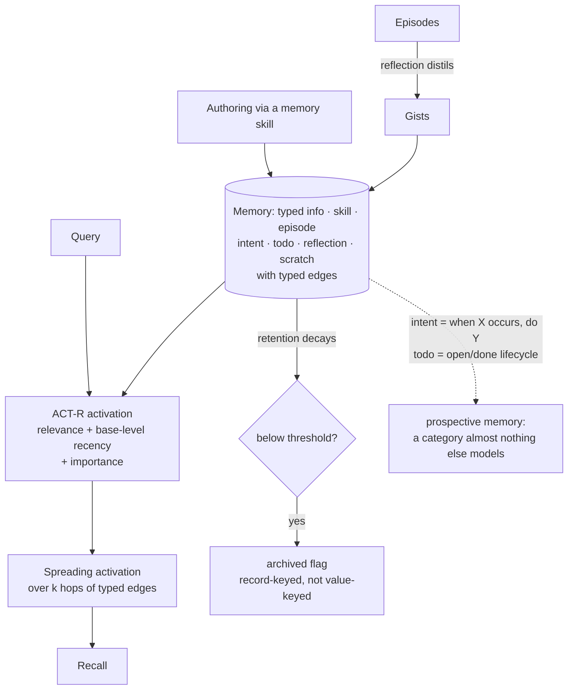

## 1. Executive Summary

`nooa-memory` is a dedicated package inside NVIDIA's Apache-2.0 Object-Oriented
Agents labs repository, with a test file for nearly every
module. It is the most direct implementation of *cognitive-psychology models* in
this atlas, and it does one thing nothing else here does.

**Every retrieval records why it ranked where it did, on the memory that was
retrieved.**

```python
class AccessRecord(BaseModel):
    """One structured access to a memory — self-contained observability."""
    ts: float
    channel: str = "recalled"
    reader_owner: str = ""          # who fetched (cross-owner analysis)
    trace_ref: str | None = None
    query: str | None = None        # truncated; None for reinforced/created
    score: float | None = None
    rank: int | None = None
    components: dict | None = None  # {rel, rec, imp, spread} at fetch time
```

The atlas lists recall observability — "why they outranked others" — as a
dimension it does not cover, because almost nothing carries it. Here the score
*decomposition* is persisted per access, alongside the rank, the truncated query,
the reader, and a `trace_ref` that "deep-links to the exact trace moment". Asking
"why did the agent surface that" is a lookup rather than a reconstruction.

The scoring being decomposed at all is the second thing. Retrieval is ACT-R,
stated as equations in the module docstring:

```text
rel(m,q) = lambda*cos + (1-lambda)*ctxOverlap        (encoding specificity)
rec(m)   = sigmoid( ln sum_k (t_now - access_k)^-d )  (ACT-R base-level)
imp(m)   = importance / 10
S_base   = a_rel*rel^ + a_rec*rec^ + a_imp*imp^
Act(n)   = S_base(n) + spread over k hops (decayed per hop)
```

That is Anderson's base-level activation with spreading activation over a typed
graph. [Generative Agents](../generative-agents/) established the
recency-relevance-importance sum with hand-tuned constants;
[HippoRAG](../hipporag/) replaced ranking with PageRank diffusion. This is the
model both are approximations of, implemented as such — a decayed power-law sum
over *every* past access rather than a single recency term.

Forgetting is equally literal, and "first-class, on two timescales": online
retention as the Ebbinghaus curve `R = exp(-Δt / S)` evaluated lazily on read,
where `S` is a `strength` counter that retrieval bumps; and offline pruning
inside reflection for memories that have decayed, are old enough, are not a
protected type, and are not high-importance.

**And unusually, the memory subsystem has been ablated against a fair
baseline.** The accompanying paper reports ARC-AGI-3 under a two-hour fleet cap,
scored by RHAE — "the competition's action-efficiency score against per-level
human baselines":

| Configuration (GPT-5.5 unless noted) | Fleet-mean RHAE |
| --- | --- |
| world-model skill **+ memory** | **50.2%** (118 levels) |
| hypothesis-driven baseline skill + memory | 41.7% |
| world-model skill **with markdown files in place of memory** | 38.4% |
| world-model + memory on GPT-5.6-sol | 85.1% (170 levels), under $20 per game |
| raw GPT-5.6-sol, ARC Prize eval | 13.3% |

The paper states the comparison as "**+11.8 RHAE points over the identical agent
with file-based notes in place of memory**".

That baseline is the point. This atlas's standing complaint is that memory
systems measure themselves against *no memory*, which flatters everything; the
honest comparison is against the cheapest thing that also persists, and a
markdown file is exactly that. Appendix D names the reproduction runs
(`20260714_201702_competition_md` is the markdown ablation), and the paper marks
its per-run correlations as "associations" given "n = 25 and 16 outcomes
right-censored by the operator kill". It is the most carefully bounded memory
result in this atlas.

Reservations. Archival is a boolean on the record, so a decayed memory can be
re-created by the next authoring pass with nothing to consult. The access log is
a capped ring, so the observability that makes this system distinctive is
bounded by design. And the paper's own operational statistics undercut two of
the design's more distinctive parts — see §10.

## 2. Mental Model

Seven memory types, and two of them are a category nothing else in this atlas
has:

| Type | Kind | |
| --- | --- | --- |
| `info` | semantic | facts, preferences, domain rules |
| `skill` | procedural | reusable verified procedures |
| `episode` | episodic | a specific task run |
| **`intent`** | **prospective** | trigger-based reminder — "when X happens…" |
| **`todo`** | **prospective** | durable commitment with an open/done lifecycle |
| `reflection` | schema / gist | insight distilled from episodes |
| `scratch` | working | transient, never durably consolidated |

**Prospective memory — remembering to do something later — is absent from every
other system here.** The nearest neighbour is
[ai-memory](../ai-memory/)'s handoff with its `next_steps` list, and that is a
record of an interrupted task rather than a trigger the agent will act on.

`status` is deliberately narrow: "TODO lifecycle: todos always carry a status; no
other type may", enforced in `model_post_init`, which raises if a non-todo
carries one. A lifecycle field that applies to exactly one type, and refuses to
be borrowed by the others, is a small piece of schema discipline worth noting.

Edges are typed and split causal from associative:

```text
derived_from · created_by   CAUSAL provenance
supports · contradicts       evidential
refines                      this updates a prior memory
causes · precedes            domain causality, temporal order
related · part_of            associative, compositional
```

`contradicts` as an edge between two memories puts this with
[Memora](../memora/) rather than with the systems that flag one row.



## 3. Architecture

`packages/nooa-memory/src/nooa_memory/` — `manager.py`, `store.py`,
`schema.py`, `retrieval.py`, `reflection.py`, `vector_backends.py`,
`generative.py`, `config.py`, `observability.py`, `references.py`,
`embeddings.py`, `monitoring.py`, `forgetting.py`, `tracing_bridge.py`,
`memory_skill/`, `descriptors.py`.

A manager installed with `enabled=False` constructs no embedder and opens no
database; the store, retrieval engine, reflection engine and forgetting engine
are cached properties built on first use (`manager.py:161-201`).

Storage is SQLite with `owner` and `status` columns added by migration
(`ALTER TABLE` guarded by a column check), indexes on both plus `archived`, and
pluggable vector backends. The connection is opened with
`check_same_thread=False` and every use of it — and of the vector index beside
it — is taken under a `threading.RLock` held by the store
(`store.py:113-119`), because *"foreground memory calls"* and the background
reflection pass touch the same connection from different threads.

### Deployment and ergonomics

A Python package with SQLite; the vector backend is pluggable and the
deterministic half of reflection needs no model at all. Nothing to stand up.

The memory is exposed to the agent as a *skill* (`memory_skill/`), which fits the
surrounding framework's conventions rather than introducing a separate protocol.

## 4. Essential Implementation Paths

### Observability that travels with the record

The docstring is explicit about the design choice and its consequence:

> "Lives ON the record (capped ring in `Memory.access_log`): copy or export one
> row and its usage story travels with it."

Most systems that log retrieval put it in a separate events table, which is
better for aggregate queries and worse for the question an operator actually
asks, which is about *one memory*. Putting the log on the record means exporting
a memory exports its history — and it means the log must be capped, or records
grow without bound.

That is a real trade and the code takes the side almost nobody takes. The atlas's
[append-only memory audit](../../patterns/append-only-memory-audit/) pattern
assumes a separate event stream; this is the other arrangement, with its own
failure mode written into the design (a ring buffer forgets the early accesses,
which are the ones that explain how a memory got established).

`reader_owner` is stored "for cross-owner analysis" — so the log answers not just
when a memory was read but *by whom*, which is the question a multi-agent
deployment needs and which no other access log here records.

### Four scores that mean different things

```python
importance: float   # 0-10, LLM "poignancy" 1-10
salience: float     # 0-1, outcome/surprise/novelty tag
confidence: float   # 0-1, belief certainty
strength: int       # spaced-repetition counter (+1 on recall)
```

Most systems in this atlas have one number and overload it. Here *how much this
matters*, *how surprising it was*, *how sure we are*, and *how well-rehearsed it
is* are separate fields, and only the last is moved by retrieval.

That last point is the one the [decay and reinforcement](../../patterns/decay-and-reinforcement/)
pattern asks for: recall bumps `strength`, which slows forgetting, and leaves
`confidence` alone. Being read a lot makes a memory *stick*; it does not make it
*true*. Several systems in this atlas collapse exactly that distinction.

The paper states a refinement that closes the loop this pattern warns about:
"**Injected memories are not reinforced, so what the harness surfaces does not
distort the usage signal.**" Spontaneous injection runs at a fixed cadence of
roughly one per turn, and those injections do *not* bump strength — only
deliberate reads do. The code logs an `injected` access without touching the
record (`manager.py:714-719`).

Injection accounting follows what the model can see. `_format_recall` renders
the block, cuts it at the character budget, and counts a memory as injected
only when its complete `[type#id]` marker lies inside the cut
(`manager.py:661-719`). A record the budget dropped gets no access entry. So the system cannot reinforce a memory
merely by having chosen to show it, which is precisely the self-amplifying
feedback the pattern says nobody dampens. It is the cleanest answer to that
hazard in the atlas.

`importance` is named "poignancy" in the comment, which is
[Generative Agents](../generative-agents/)' term — the lineage is acknowledged
rather than quietly reused.

### Forgetting as a curve, evaluated lazily

`R = exp(-Δt / S)` computed on read rather than by a sweep. A memory's retention
is therefore always current without any job having run, and the offline pass only
handles the consequence — archiving what has fallen below threshold.

The guards on that pass are worth listing because they are the ones most decay
implementations omit: old enough, not a protected type, and **not
high-importance**. A pure recency-decay sweep will eventually delete the most
important thing in the store simply because nobody asked for it recently.

### Reflection in a stated order

> "A pure-Python orchestrator running ordered ops that mirror the biological
> sequence (clean → abstract → renormalise → forget). The deterministic steps
> need no LLM and run by default:
> 1. dedup / merge — fold near-identical memories into a canonical record
> 2. edge formation — link memories whose embeddings are close
> 3. re-score importance — bump salient/frequently-recalled memories
> 4. prune / forget — archive memories that have decayed"

Two things. The order is argued rather than incidental — clean before abstract,
abstract before forget — and dedup running first means the later steps operate on
canonical records rather than on near-duplicates, which is the sequencing bug
that makes consolidation passes reinforce whatever was said most often.

And **the deterministic steps run by default while the LLM steps do not**. A
consolidation pass that improves the store without a model call is a different
operational proposition from one that costs tokens proportional to corpus size.

## 5. Memory Data Model

`Memory` carries id, type, title, content, owner, size in characters, tokens and
sentences, the four scores, mood, `reinforcement_count`, timestamps, typed
`Edge`s, `MemoryRef`s to external artifacts, and the capped `access_log`.

What is absent:

- **No value-level tombstone.** `archived` is a boolean on the record. A memory
  that decayed away can be re-authored, and nothing consults its absence.
  Archived rows are excluded from listing, from the vector index and from the
  graph spread.
- **No trust state.** `confidence` is a float; `status` exists but is reserved
  for todo lifecycle by an explicit validator.
- **No bi-temporal validity.** `created_at` and `last_accessed_at` are record
  times; nothing tracks when a fact was true. `valid_from` and `valid_to` are
  declared on the model and listed in the package README's metadata section,
  and `rg -n --glob '*.py' --glob '*.md' '\bvalid_from\b|\bvalid_to\b'` over
  the whole repository returns exactly those three lines — the declaration, its
  comment, and the documentation of a field nothing writes.
- **The access log is capped**, so the observability is a recent window rather
  than a history.

## 6. Retrieval Mechanics

Hybrid candidate recall, then ACT-R activation, then associative spread over the
typed graph for `k` hops with per-hop decay, with `owner` applied as a filter.
Components are normalized before weighting, and the per-memory breakdown is
returned alongside the result and written into the access log.

Because `rec` is a sum over *all* retained access times rather than a single
`last_accessed`, a memory read many times long ago and a memory read once
recently are distinguishable — which a single-timestamp recency term cannot do,
and which is the entire point of the base-level equation.

**`owner` gates the spread itself, not only the result set.** `_spread`
(`packages/nooa-memory/src/nooa_memory/retrieval.py:246`) closes over a
`_visible` predicate and calls it on every edge target at every hop, before
either accumulator is written:

```python
for e in edges[: cfg.per_hop_fanout]:
    if not _visible(e.target_id):
        continue
    ...
    spread[e.target_id] = spread.get(e.target_id, 0.0) + contrib
    nxt[e.target_id] = nxt.get(e.target_id, 0.0) + contrib
```

The placement is what makes it a real boundary rather than a post-filter. The
`continue` fires before `nxt` is written as well as before `spread`, so an
invisible memory never enters the next hop's frontier and cannot relay
activation between two visible memories connected only through it. The docstring
claims both halves — *"an edge must not leak — or amplify through — another
agent's memory in an owner-scoped recall"* — and the control flow delivers both.
This is the strong form of `scope_enforced`: most systems in this atlas that
carry the mark apply the key to the rows they return, and a graph traversal that
does that alone is still reading the foreign node to decide it should be dropped.

`_visible` loads the target with `store.get` and requires three things: the row
exists, it is not archived, and its owner matches the scope
(`retrieval.py:259-268`). Unowned memories stay visible: the column is
`owner TEXT NOT NULL DEFAULT ''` (`store.py:72`), and `owner_matches` accepts
`""` against every scope (`schema.py:109`). A dangling edge target is dropped.

The archived clause applies with or without an owner scope. Until commit
`7985a640`, merged on 4 November 2026, an unscoped spread skipped the predicate
and a scoped one checked the owner alone, so an archived neighbour of a
relevant memory could be activated and returned.
`test_recall_does_not_resurface_archived_neighbor` asserts the neighbour is
recalled before `store.archive` and absent after, with its access count at 0.
`test_spread_does_not_relay_through_archived_memory` asserts the downstream
node is reachable through the bridge before archiving and that the spread is
empty after (`tests/memory/test_memory_retrieval.py:125-155`). Both run
unscoped and under an owner.

Three committed tests cover it. `test_spread_does_not_leak_foreign_memories`
(`test_memory_owner.py:126`) and `test_spread_confined_to_role`
(`test_memory_owner_roles.py:128`) each build one edge across an owner boundary
and assert the far node is absent from `recall` — the leak half.
`test_spread_does_not_relay_through_foreign_memories`
(`tests/memory/test_memory_owner.py:159`) builds the three-node graph that asserts the
amplify half: `alice_a → bob → alice_c`, where the only path between alice's two
memories runs through bob's. It calls `_spread` twice — unscoped first, asserting
both `bid` and `cid` *are* reachable, then scoped, asserting neither is — so the
scoped assertion cannot pass merely because nothing was reachable. Its docstring
states the invariant the `continue`'s position delivers: *"The visibility check
must drop bob before he enters the next hop's frontier, not merely before the
spread write."*

**Two things about that test are worth more than the test.** It asserts against
`_spread` rather than through `recall`, because the property is *not observable
through the public API*: a relay target owned by a third party is gated on its
own merits, and one owned by the reader is retrieved directly whether or not any
edge exists. What a relay changes is activation, and therefore ranking — and
ranking exists only inside `_spread`. A security property that can only be
asserted against a private function is a real finding about the design, not a
shortcut in the test.

And the relay is not reachable at default configuration. `hops` defaults to `1`
(`packages/nooa-memory/src/nooa_memory/config.py:34`, *"0 = vector-only; 1 = +1
graph hop; 2+ = multi-hop"*), so the second hop a relay requires does not run
unless an operator asks for it. The `continue`'s position is therefore a guard
for the `hops: 2+` case rather than a live protection — which is the refactor
risk stated precisely: the check looks incidental until someone moves it, and at
defaults nothing would fail if they did.

The decay is one factor per hop: `contrib = decay * act * e.weight * type_w`,
with `act` already carrying the earlier hops (`retrieval.py:272-284`). With
`per_hop_decay = 0.6` and the associative type weight of `0.6`, a unit seed
over unit-weight edges gives `0.36` at the first hop and `0.1296` at the
second, against an `activation_floor` of `0.05`. Until commit `d429da6c`,
merged on 4 November 2026, the loop raised the decay to the hop number on top
of the carried activation, which put the same second hop at `0.07776`.
`test_spread_decay_is_one_factor_per_hop` asserts `0.6`, `0.6**2` and `0.6**3`
along three causal edges (`tests/memory/test_memory_retrieval.py:88-106`).

*Answered by [Jeriah Keith](https://github.com/Yeriahz) in
[issue #1](https://github.com/neoneye/agent-memory-atlas/issues/1), who then
wrote the missing test upstream.*

## 7. Write Mechanics

Authoring through the memory skill, with reflection distilling episodes into
`reflection`-type gists. `update` re-validates the record when its content
changes, so the size fields are re-derived, and re-embeds only when the
embedding text changed (`manager.py:423-470`). `references.py` attaches `MemoryRef`s — kind, key,
preview, capture time — pointing at external artifacts rather than copying them.

The paper describes what that pointer does at read time, and it is stronger than
the schema suggests: "references are resolved against **live agent state at
recall time** — extending pass by reference into persistence, so recall does not
answer from stale copies". A memory that holds a reference rather than a snapshot
cannot go stale about the thing it points at, which is a different and narrower
guarantee than correctness but a real one. Owner scoping "governs reads **and
writes** when several agents share one store", so the enforcement covers both
paths rather than only retrieval.

### Operational cost

Retrieval is local: embeddings plus arithmetic, no model call, and the
`rec` term needs only the retained access timestamps. Forgetting is lazy, so it
costs nothing until a record is read. The deterministic reflection ops run
without an LLM; the generative ones are opt-in.

The recurring cost is storage rather than tokens: every access appends to a ring
on the record, and every memory carries its own edge list and reference list.
No footprint figures were found.

## 8. Agent Integration

Exposed as a skill inside the Object-Oriented Agents framework, with
`observability.py`, `monitoring.py` and `tracing_bridge.py` connecting it to the
surrounding tracing so `trace_ref` on an access record resolves to a real span.

### Context compaction is a separate mechanism

The host framework gives the model a second way to manage what it sees, and it
is not memory. `self.events.collapse(start, end, summary_text)` replaces a
range of events in the active history with one `Summary` event tagged
`start..end` (`src/nooa/runtime/events.py:220-262`,
`src/nooa/runtime/event_manager.py:669-760`). The replaced events are set to
`ARCHIVED` and removed from the active list; `events["9"]` still returns the
original. Collapsing the exact range of an existing summary rewrites its text
in place.

The harness has its own compaction beside it. A summarizer runs at a share of
the usable window, 0.8 by default, and keeps the 10 newest events
(`src/nooa/agents/summarization.py:587-621`,
`src/nooa/config/summarizer_config.py:19`). When the provider rejects a
request as too large, the actor archives the oldest events
(`src/nooa/runtime/actor.py:701-785`).

The event history lives in memory or, under a storage manager, in the
session's SQLite `events` table with a `status` column
(`src/nooa/runtime/event_backend.py:270`, `src/nooa/storage/sqlite.py:118-125`,
`:233`, `:893`). A resumed session therefore keeps its summaries and archived
originals.

The memory package reads this history in one place: `derive_queries` builds
the per-turn recall query from recent events (`retrieval.py:365`). It does not
store summaries as memories, and no file under `packages/nooa-memory/src`
calls `collapse`. A summary is a statement about one session's transcript,
addressed by position in that transcript. It has no owner, type, edges or
decay, and none of the seven marks is assessed against it.

NVIDIA's dev note of 23 November 2026,
[*Letting Models Manage Their Own Context*](https://nvidia-nemo.github.io/Applied-Research/dev-notes/posts/2026-11-23-model-driven-context-management/),
is about this API and does not mention the memory package. It compares the
harness summarizer with letting the model call `collapse`. Section 10 gives
its figures and what of the experiment is in this tree.

## 9. Reliability, Safety, and Trust

Strengths:

- **Score components persisted per access**, making "why was this retrieved"
  answerable after the fact.
- **`reader_owner` on every access**, so cross-owner reads are visible.
- **ACT-R base-level recency** over all access times, not one timestamp.
- **Four distinct scores**, with retrieval moving only the rehearsal counter.
- **Ebbinghaus retention evaluated lazily**, so no sweep is needed to be current.
- **Prune guards** for protected types and high importance.
- **Prospective memory** as first-class types.
- **Typed edges** separating causal from associative, with `contradicts` as an
  edge.
- **`status` restricted to one memory type** by a validator.
- **Deterministic reflection by default**, LLM steps opt-in.
- **A test file per module**, including owner roles, contract, and hygiene.
- **The store serialises its own concurrency.** The connection is opened
  `check_same_thread=False` and every use of it and of the vector index runs
  under a re-entrant lock, so the background reflection pass and a foreground
  recall cannot interleave on one SQLite handle; two committed cases cover it,
  one wrapping the connection and the index in guards that assert the lock is
  held on every call, the other running reflection against foreground writes.
- **Archived memories are out of the graph.** `_visible` refuses an archived
  edge target, so it neither receives nor relays activation, with two tests
  that assert the path is live before archiving.
- **A committed negative case with a positive control.**
  `test_spread_does_not_relay_through_foreign_memories` asserts a foreign memory
  is neither activated nor used as a relay, and asserts first that the same path
  *is* live unscoped, so the exclusion cannot pass vacuously.

Gaps:

- **No value-level tombstone**; archival is a record flag.
- **No trust state.**
- **Bi-temporal columns that nothing writes, documented as if they were
  features.** `schema.py:223-224` declares `valid_from` and `valid_to`, the
  second carrying the comment *"bi-temporal: invalidate-don't-delete"*, and the
  package README lists `valid_from/valid_to` in the metadata a memory carries
  (`README.md:118`). Those three lines are every occurrence of either name in
  any Python or Markdown file in the repository — no writer, no reader, no
  test. The mark is withheld not because the design lacks the idea but because
  the idea is a schema comment with a documentation entry; the intent is
  recorded twice and the mechanism is absent, which is a more specific
  criticism than an absence would be.
- **A capped access log**, so the distinctive observability is bounded and the
  earliest accesses — the ones explaining how a memory became established — are
  the first to go.
- **Many tunable constants** (`lambda_embed`, `d`, the three `a_*` weights,
  `spread_gamma = 0.5`, `per_hop_decay = 0.6`, `activation_floor = 0.05`, the
  hop count); no ablation of them is committed here.
- **The harness behind the README's own numbers is not in the repository.**
  Its results table names five scripts and reports six figures, and the text
  above it says the bench harness *"is not published in this repository"* —
  see section 10.
- **A labs repository**, so the stability commitment is whatever the surrounding
  framework offers.

## 10. Tests, Evals, and Benchmarks

Twenty-six test modules holding 286 cases, covering retrieval, forgetting,
reflection and its interrupt path, owner roles, contract, embeddings and their
integration, observability, monitoring, references, todo, schema, store and a
v2 store, routes, skill, authoring, generative, vector backends, background
reflect plus hygiene, and the packaged README. Nothing was run for this review.

**The README's numbers have no harness in this repository, and the project
says so.** Its *"When does memory help?"* table reports six results — memory
+75% on unguessable cross-session facts, +44–60% on LoCoMo, reflection +50%
under a tight retrieval budget, +70% on LongMemEval with reflection neutral,
reflection −20% on pinpoint lookup, and a demo showing memory backfiring when
stale — naming the five scripts that produced them. The line above the table
reads *"Measured internally with gpt-5.4 + text-embedding-3-large (the bench
harness is not published in this repository)"*. Until issue #104 of 6 August
2026 that text instead pointed five times at `examples/memory_bench/`, a
directory absent from the repository at every depth, and named two factory
functions inside it *"for working implementations"*; the fix replaced each
reference with the published quickstart, marked the results as internally
measured, and added `test_memory_readme.py`, which asserts that the string
`memory_bench` does not appear and that every relative link in the file
resolves on disk. That test guards the README's *links*, not its *claims* —
which is why `valid_from/valid_to` remain documented and unwritten.

The end-to-end ablation is in §1. What makes the accompanying paper worth reading
against the code is that its Appendix D reports operational statistics from the
evaluation fleet — and **two of them cut against the design**.

**Consolidation output is almost never read.** "Reflection records are 22% of rows
yet ~1% of both read channels (importance 3.9), and 45% of all records ended
archived by decay-based forgetting." A fifth of the store is distilled insight
that retrieval essentially does not surface. This atlas has asked repeatedly
whether consolidation earns its cost and never had a number; here is one, from
the authors, and it is unflattering. The paper does not hide it — and it adds the
mechanism behind it from internal pilots: "reflection helped when retrieval was
the bottleneck and **hurt pinpoint lookup (abstraction blurs the exact fact)**,
which is why consolidation is configurable per store."

**The prospective types went unused.** "The `intent` and `scratch` types went
unused; `todo` appeared in 18 records." The category this report calls novel and
absent from every other system was, in the one measured deployment, dormant. That
does not make it a bad idea — an unused type may simply need a skill that uses it
— but it does mean the atlas should credit the *modelling* and not assume the
behaviour.

Other reported figures: per-game store sizes of 23 / 129 / 255
(min / median / max), and memory engagement tracking performance — winning games
"check memory 1.63 times and write 1.87 memories per decision (medians, vs. 1.21
and 1.46 for the remaining games)", at Spearman ρ = +0.52 for reads per decision
and +0.36 for writes. The paper labels these associations rather than effects,
noting the sample and the censoring.

Retrieval observability also goes further than the schema showed: "a retrieval
call can be replayed with `explain()`", and "memory events bridge to OpenTelemetry
spans with trace ↔ record cross-links".

**The dev note's experiment is reported, and its harness is not in this tree.**
The note gives the model the events API, a context-usage readout, an
instruction to consider compacting at 85% and a warning near the limit, and
sweeps hard request budgets from 8K to 512K tokens. Its stated results on
OfficeQA Pro v2, 90 questions:

| Model, budget | Harness-driven | Model-driven |
| --- | --- | --- |
| GPT-6.1 Sol, 32K | 21% | 56% |
| Kimi K3, 32K | 41%, 62M input tokens | 43%, 36M input tokens |
| Kimi K3, 64K | 52% | 57% |

The note reports a much smaller effect on MLE-bench Lite, that Opus 5.5 called
the API in 4% of tasks against 42–53% for the other three models, and that
without the 85% instruction Kimi and DeepSeek compacted early and scored about
8 points below the harness baseline at 128K and above.

In the tree: the API, the summarizer and the context-usage block, whose text
names `self.events.collapse` (`src/nooa/context_blocks/models.py:462-468`).
Not in the tree: any file naming OfficeQA or MLE-bench, the 85% instruction or
the pressure warning as text, and the SGLang suffix-cache prototype the note
credits with a 4–15% cut in prefill compute. The figures are the note's own and
were not reproduced. They measure answer accuracy under a context budget
within one run, and say nothing about the memory package.

The evaluation the design still invites is the *internal* one: the components are
computed, weighted, normalized and stored, so the contribution of `rel`, `rec`,
`imp` and `spread` to any past retrieval is already recorded, and no ablation of
those weights was found. The subsystem has been measured as a whole; its scorer
has not been measured against itself.

## 11. For Your Own Build

### Steal

- **Persist the score components with each access.** It converts "why did the
  agent say that" from an investigation into a query, and it is a dict on a row.
- **Record who read a memory**, not just when. In any multi-agent deployment the
  interesting question is cross-owner reads, and no other access log here
  captures it.
- **Keep rehearsal separate from belief.** Retrieval should move a strength
  counter and leave confidence alone — being read often makes a memory stick,
  not true.
- **Compute recency over all access times**, not the last one, if you want a
  frequently-consulted old memory to outrank a once-read recent one.
- **Evaluate decay lazily on read** so retention is always current without a
  sweep.
- **Guard the prune** with protected types and an importance floor, or recency
  decay will eventually delete the most important thing you have.
- **Model prospective memory.** "Remind me when X" and "this commitment is still
  open" are memories, and nothing else in this atlas stores them.
- **Restrict a lifecycle field to the type that owns it**, and validate it —
  `status` here raises if a non-todo carries one.
- **Run the deterministic consolidation steps by default** and make the LLM ones
  opt-in.
- **Do not reinforce what the harness chose to show.** If injection bumps the
  same counter as a deliberate read, the system is measuring its own decisions
  and calling it usage.
- **Ablate against the cheapest thing that also persists.** "With memory versus
  without" flatters every memory system; "versus the identical agent with
  markdown files" is the comparison that means something.
- **Publish the unflattering operational statistics.** Reflection output being
  22% of rows and 1% of reads is the most useful number in this paper precisely
  because it does not support the design.

### Avoid

- **An access log on the record as your only history.** Portability is a real
  benefit and the cap is the price; if you need the full story, keep a stream
  too.
- **Archival as correction.** A decayed memory that can be re-authored has not
  been forgotten.
- **Six coupled constants with no ablation**, in a scorer whose components you
  are already storing — the data to tune it is being collected and not used.

### Fit

Right if you want a memory whose behaviour is explainable after the fact and
grounded in a model you can read the equations for, and if the cognitive framing
is a feature rather than an affectation — the ACT-R and Ebbinghaus
implementations here are literal, not gestural. Wrong if you need correction
semantics: this system knows a great deal about how a memory became reachable and
nothing about whether it was ever right.

## 12. Open Questions

- The access-log ring holds 64 entries per memory (`config.py:141`). What
  happens to the explanation of an old, heavily-used memory once its formative
  accesses roll off?
- Have the six scoring constants been ablated? The subsystem has been measured
  end to end; the scorer has not been measured against itself, and the stored
  components make it cheap.
- What prevents an archived memory being re-authored identically?
- Is `intent` acted on by a scheduler, or does it only surface when retrieval
  happens to reach it? The paper reports the type unused in evaluation, so the
  question is what would have to exist for it to be used.
- If reflection output is 22% of rows and ~1% of reads, what is consolidation
  buying, and would the store be better without it in this workload?
- Will `examples/memory_bench/` be published? The README's six figures name
  the scripts that produced them, and a reader who wants to check the +70% has
  nothing to open.

## Appendix: Sources Beyond the Code

- Paper: *NVIDIA-labs OO Agents: Native Python Object-Oriented Agents*,
  [arXiv:2607.20709](https://arxiv.org/abs/2607.20709) — memory architecture in
  §3.7 (*"Long-Term Memory: the Agent Curates Its Own State"*, inside the Agent
  Loop section) and Appendix C (*"Memory-System Details"*), the ARC-AGI-3
  ablation in §4.4 (*"Advancing the score–cost Pareto frontier on ARC-AGI-3"*)
  and Figure 7, operational statistics and reproduction run ids in Appendix D
  (§D.4, *"Memory-system usage during play"*).
- Blog: [Six agent harness capabilities for higher model performance](https://developer.nvidia.com/blog/six-agent-harness-capabilities-for-higher-model-performance/).
- Dev note: [Letting Models Manage Their Own Context: Where We Stand](https://nvidia-nemo.github.io/Applied-Research/dev-notes/posts/2026-11-23-model-driven-context-management/),
  23 November 2026, on the events API. It cites
  [arXiv:2607.21616](https://arxiv.org/abs/2607.21616) for the early-compaction
  behaviour it calls context anxiety.

Claims taken from these are attributed in the text. The RHAE figures and the
operational statistics are reported, not reproduced here.

## Appendix: File Index

- Schema: `packages/nooa-memory/src/nooa_memory/schema.py` (`MemoryType`,
  `EdgeType`, `Edge`, `MemoryRef`, `AccessRecord`, `Memory`, `TODO_STATUSES`).
- Retrieval: `retrieval.py` (ACT-R equations, `_spread`, component breakdown).
- Forgetting: `forgetting.py` (`R = exp(-Δt / S)`, prune guards).
- Reflection: `reflection.py` (ordered ops), `generative.py`.
- Store: `store.py` (owner/status migration, indexes).
- Observability: `observability.py`, `monitoring.py`, `tracing_bridge.py`.
- Skill surface: `memory_skill/`.
- Tests: `packages/nooa-memory/tests/memory/` (26 modules, 286 cases).
- Package documentation: `packages/nooa-memory/src/nooa_memory/README.md`.
- Context compaction, outside the package: `src/nooa/runtime/events.py`,
  `src/nooa/runtime/event_manager.py`, `src/nooa/runtime/event_backend.py`,
  `src/nooa/storage/sqlite.py`, `src/nooa/agents/summarization.py`,
  `src/nooa/runtime/actor.py`, `src/nooa/context_blocks/models.py`.

### Recorded searches

Run from the repository root at the pinned commit with `/usr/bin/git grep`.

- **Nothing writes the bi-temporal fields.**
  `git grep -n -w -E 'valid_from|valid_to' -- '*.py' '*.md'` returns
  `schema.py:223-224` and `README.md:118` of the memory package.
- **The memory package does not call collapse.**
  `git grep -n 'collapse' -- packages/nooa-memory/src` returns nothing;
  `git grep -n 'def collapse' -- src/nooa/runtime` matches three files.
- **The dev note's benchmarks are not named in the tree.**
  `git grep -n -i -l -E 'officeqa|mle-bench|mlebench|mle_bench' -- .` returns
  nothing; `git grep -n -i -l 'swe-bench' -- .` matches `README.md`.
- **No pressure warning or 85% instruction as text.**
  `git grep -n -i -E 'context[_ -]pressure|85%' -- '*.py' '*.md' ':!*tests*' ':!CHANGELOG.md'`
  returns lines of `util/eval_pipeline` about a process memory limit.
- **No suffix-cache prototype.** `git grep -n -i 'sglang' -- .` returns one
  comment in `packages/nooa-cli/src/nooa_cli/commands/_connect_wizard.py`.
- **The README's harness is unpublished.**
  `git grep -n -i -E 'not published|memory_bench' -- packages/nooa-memory`
  returns the README line at `:412` and the test that guards it.
- **The memory viewer only reads.**
  `git grep -n -E '@router\.(get|post|put|delete|patch)' -- src/nooa/viewer/memory_routes.py`
  returns five `get` routes.

## History

**2026-11-24** — [`7b8ec1c76db9dee5e3eca504c7a537d491497290`](https://github.com/NVIDIA-NeMo/labs-OO-Agents/commit/7b8ec1c76db9dee5e3eca504c7a537d491497290). Re-read at the head of `main`, 816 commits past `362f8bd`, 23 of them touching the memory package, after NVIDIA's dev note on model-driven context management. Both marks hold. Archived memories are excluded from the graph spread and the per-hop decay is a single factor, each with tests ([section 6](#6-retrieval-mechanics)); the earlier text's second-hop figure of 0.07776 described the compounded decay. The events API the note describes is context compaction outside the memory package and carries no mark ([section 8](#8-agent-integration)); its figures are reported in [section 10](#10-tests-evals-and-benchmarks). Screened first: no auto-run surface, seven dependency files inside the seven-day cooldown, ten `conftest.py` files, seven unpinned surfaces. Nothing was installed, built or run.

**2026-09-16** — [`362f8bd217fcc39f75b70d4b668e49fc86dec104`](https://github.com/NVIDIA-NeMo/labs-OO-Agents/commit/362f8bd217fcc39f75b70d4b668e49fc86dec104) — re-read at a commit dated 2026-09-16, 203 commits past the previous pin. Both marks re-tested and held. The single change to the anchored file is a one-line type-name check on the event being folded in; no mechanism behind a mark moved. Screened before reading, from a full clone: no auto-run surface, six build-time execution points, six unpinned dependency surfaces and four dependency files inside the seven-day cooldown. Nothing was installed, built or run.

**2026-09-08** — [`fbbbfb16d68d66dc1ff029a9c06844d3b900e29d`](https://github.com/NVIDIA-NeMo/labs-OO-Agents/commit/fbbbfb16d68d66dc1ff029a9c06844d3b900e29d) — 187 commits on, three of them touching the memory package, and every module in it except `store.py` is byte-identical to the previous pin. `manager.py`, `retrieval.py`, `schema.py`, `reflection.py`, `forgetting.py`, `config.py` and the rest were compared by object hash rather than by reading the diff. Both marks re-checked against the code: the `continue` in `_spread` still fires before both accumulators, and all three owner tests are present, so `scope_enforced` and `negative_eval` are unchanged. `capability_evidence` records were added for both.

`7d03281` gives the store a `threading.RLock` and opens its connection `check_same_thread=False`, with the whole body of every method moved under the lock; two cases in `test_memory_store.py` cover it, one asserting the lock is held on every connection and index call, the other overlapping reflection with foreground writes. `store.py` grows from 487 lines to 526, almost all of it re-indentation.

`5ea7b5d` closes the provenance gap in the package README, reported as issue #104 on 6 August 2026: the file had cited `examples/memory_bench/` five times as the source of its measured results, including a six-row table and two named factory functions, and that directory is in no revision of the public repository. The references were replaced with the published quickstart, the table's preamble was changed to say the bench harness is not published, and `test_memory_readme.py` was added to keep the citation from returning. The figures stay and remain unreproducible from this tree, which section 10 states.

The bi-temporal gap is unchanged and one line larger: `valid_from` and `valid_to` are declared at `schema.py:223-224` and listed in the README's metadata section at `README.md:113`, and a search over every Python and Markdown file in the repository returns those three lines and nothing else. The paper is unchanged at v1 of 22 July 2026.

Screened again before reading: 0 auto-run surfaces, 5 build-time execution points, 6 unpinned surfaces, nothing inside the seven-day cooldown, `AGENTS.md` treated as data; nothing was installed or run, and the read was made from a full clone.

**2026-08-06** — [`bfb347bca53c1eaa0449d7acfebdefb29075fc23`](https://github.com/NVIDIA-NeMo/labs-OO-Agents/commit/bfb347bca53c1eaa0449d7acfebdefb29075fc23) — 83 commits on, four of them touching the memory package. The mechanism is unchanged; the coverage is not.

`a22d5c4` merged on 1 August adds `test_spread_does_not_relay_through_foreign_memories`, which builds the three-node `alice_a → bob → alice_c` graph, asserts through `_spread` that neither bob nor the node reachable only through him is activated under an owner scope, and asserts first that both *are* reachable unscoped so the exclusion cannot pass on an empty frontier. Its docstring names the invariant the `continue`'s position delivers. `negative_eval` is earned. The pull request that carried it credits this atlas by name and links this page — a fact about that repository, recorded here as one.

The bi-temporal gap is restated accurately. `schema.py:223` declares `valid_from` and `valid_to` with the comment *"bi-temporal: invalidate-don't-delete"*, and both names appear nowhere else in `src/` or `tests/` — a declared intent with no implementation, which is a different claim from the absence the report previously stated. Both fields were present at the previous pin.

Nothing was run — four dependency surfaces were inside the seven-day cooldown.

**2026-07-28** — [`f22805b52ea8a073dabc018cefe3db1ccf609a29`](https://github.com/NVIDIA-NeMo/labs-OO-Agents/commit/f22805b52ea8a073dabc018cefe3db1ccf609a29) — first reading.
