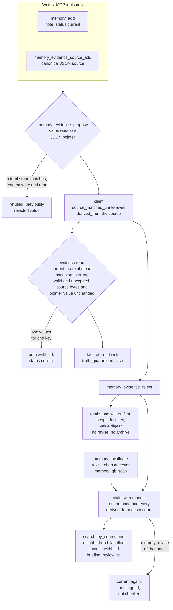

## 1. Executive Summary

Noosphere Lite MCP is a local, single-user memory server for MCP agents. It
stores notes and typed links in an encrypted event journal that it replays in
full on every call. The notable part is how much it refuses: diverged mirrors,
a rejected value proposed again, a claim whose source bytes moved, a fact two
sources disagree on. Its weakness is that every boundary it draws holds on one
lane only. The unscoped note tools read across projects. Any tool caller can
write a node of any kind, a tombstone included. A search costs up to 51 full
decrypt-and-replay passes under an exclusive lock.

The store is an append-only NLV1 journal of AES-256-GCM frames. Each frame's
associated data carries its sequence number and a SHA-256 chain over every
earlier frame. Two copies sit on different filesystems, enforced by `st_dev`,
and a read that finds them diverged refuses to choose.
Notes carry a `current` or `stale` status that cascades along `derived_from`
links. Validity time is kept apart from record time, and a record with no
validity is withheld from any historical query.

The second lane is the evidence gate. A claim is a value at a JSON pointer into
a stored source, labelled `source_matched_unreviewed`. It is re-derived from the
source on every read, and rejecting it writes a tombstone keyed on scope, fact
key and value digest that no tool can lift. The code labels its own limits
throughout, with `truth_guaranteed: False` on every result and docstrings
calling scope a filter rather than an access control.

## 2. Mental Model

A memory is a **node**: title, body, tags, a free `kind`, a source label, a
random id, `recorded_at`, optional `observed_at`, `valid_from` and `valid_to`,
`archived` and `status` (`noosphere_lite/vault.py:322-340`). Nodes are joined
by directed links keyed on `(from, to, relation)` with a relation name matching
`[A-Za-z][A-Za-z0-9_-]{0,63}` (`vault.py:398-408`). Only `derived_from` has
semantics: it is the dependency edge staleness travels along.

A note is believed as `current` the moment it is written, and the README says
plainly what that means: *"Current means 'not flagged stale', not 'fact
checked'."* It stops being believed in four ways:

- **Invalidation.** `memory_invalidate` marks the node and every transitive
  `derived_from` descendant `stale`, with the reason and time
  (`vault.py:454-483`).
- **Upstream revision.** `memory_revise` replaces a node's body, keeps it
  `current`, and marks its descendants stale (`vault.py:485-515`).
- **Git drift.** `memory_git_scan` with `invalidate_stale` invalidates a note
  whose anchored file changed (`noosphere_lite/git_drift_r03.py:162-183`).
- **Archive.** `memory_archive` hides the node from every read except the
  journal (`vault.py:517-522`).

Revising a stale node is the only way back to `current`, and it clears that
node alone (`vault.py:500-507`).

**Evidence** is a second kind of belief with its own gate
(`noosphere_lite/evidence.py`). A source is a JSON document stored as canonical
JSON. A claim names a fact key, a scope and a JSON pointer into one source. The
value is read from the source, never supplied by the caller, and the claim is
linked `derived_from` that source (`evidence.py:79-116`). Every claim is
`source_matched_unreviewed`. No path writes another review state or sets
`publication_approved` to true, and the docstring says no approval endpoint is
provided (`evidence.py:53-58`).

A claim reaches a reader only if, at that read, it is current, no tombstone
matches it, every ancestor is current, it is valid at the instant asked, it has
not expired, its source is current with unchanged bytes, and the pointer still
yields the same value (`evidence.py:189-235`). If two surviving claims give one
key different values, both are withheld and the status is `conflict`
(`evidence.py:245-251`). Rejection is final: the tombstone cannot be revised,
archived or lifted, and invalidating it changes nothing, because both readers
collect tombstones without looking at their status (`evidence.py:96-105`,
`:152-159`, `vault.py:498-499`, `:519-520`).

Control is the agent's. Every verb is an MCP tool, no model runs inside the
server, and no background process changes state.

## 3. Architecture

The package is a Python 3.11 library behind a stdio MCP server, with no daemon,
network listener or model (`noosphere_lite/mcp_server.py:8-176`). Its
dependencies are `cryptography` and the MCP SDK, both bounded in
`pyproject.toml`, with no lockfile. The vault imports `fcntl`, so it runs on
Linux and macOS and not on Windows (`vault.py:7`).

**Persistence** is two files, `journal.nlv`, one in the primary directory and
one in the mirror. Each starts with the magic bytes `NLV1\n` and continues with
length-prefixed frames: a 12-byte random nonce, then the AES-GCM ciphertext of
one JSON event (`vault.py:24-28`, `:285-316`). The associated data is
`Noosphere-Lite-MCP/v1:`, the 8-byte sequence number and the running digest,
where each digest is SHA-256 over the previous digest and the whole frame
(`vault.py:248-258`). A frame edited, swapped or removed from the middle fails
decryption at that sequence number. The 32-byte key is a separate file outside
both data directories (`vault.py:135-139`).

**Every read rebuilds the store.** `_snapshot` takes the exclusive lock, reads
both copies, decrypts and replays every frame of each into dictionaries of nodes
and links, and reconciles them (`vault.py:263-283`, `:318-320`). The longer
valid copy wins, provided every other valid copy is its prefix; a copy that
fails to read or decrypt is rewritten from the winner by an atomic replace; two
valid copies that disagree on a common prefix raise `"mirrors diverged; refusing
automatic data loss"`. No index, cache or plaintext copy persists.

**The guards are on the filesystem.** Both directories must exist, be real
directories rather than symlinks, and carry no group or other permission bits.
The key and journals are opened with `O_NOFOLLOW` and refused if group- or
world-accessible. The two directories must have different `st_dev`, unless
`NSL_DEVELOPMENT_SAME_DEVICE=1` or `--development-same-device` is set
(`vault.py:74-100`, `:141-148`, `noosphere_lite/__main__.py:21-29`). The journal
is capped at 150,000 events, a frame at 1 MiB and an event at 64 KiB
(`vault.py:26-28`).

**Git provenance** is optional. `NSL_GIT_ROOTS_JSON` maps up to 20 aliases to
absolute worktree roots. Anchoring and status checks run `git rev-parse` and
`git hash-object --no-filters` with a five-second timeout, `GIT_OPTIONAL_LOCKS=0`
and no shell (`git_drift_r03.py:34-69`).

### Deployment and ergonomics

Running it needs nothing beyond Python and the two dependencies: no service, no
API key and no GPU. `python -m noosphere_lite init` creates both journals and a
fresh key and refuses to overwrite an existing vault. `status` and `mcp` follow
(`__main__.py:15-43`). The default layout puts both copies under
`~/.local/share`, which is one filesystem on most machines. A first run without
`NSL_PRIMARY` and `NSL_MIRROR` on separate mounts therefore fails with
`"mirrors must be on different filesystems"`, and the README tells the operator
to prepare two mounts first. The store is unreadable without the key, which is
the design: there is no plaintext file to repair by hand, and losing every copy
of the key loses the memory. Two plaintext exporters exist as functions, an OKF
Markdown tree and LadybugDB staging CSVs, and nothing in the MCP server or the
CLI calls them (`noosphere_lite/interop.py:25-76`).

## 4. Essential Implementation Paths

**Write.** Every mutation goes through `MemoryVault._append`
(`vault.py:285-316`). It takes the lock, reconciles, checks the event count,
calls the event builder against the reconciled state when it is a function,
serialises and size-checks the event, checks that both link endpoints exist,
seals the frame, and appends and fsyncs it to the primary and then the mirror.
`add`, `link`, `unlink` and `archive` pass a dictionary. `invalidate` and
`revise` pass a builder, so the descendants they stale are computed under the
same lock as the append (`vault.py:476-482`, `:494-514`).

**Read.** `search` scores every non-archived node that is not an evidence kind
or a Git anchor (`vault.py:349-387`). `context` packs search hits into a
character budget (`vault.py:436-452`). `neighbors` walks links in both
directions to depth three (`vault.py:410-434`). The MCP layer wraps the last
two: `memory_search` adds a Git provenance label to each hit, and
`memory_context` withholds any hit whose Git status is `stale_needs_review`
(`mcp_server.py:31-75`, `noosphere_lite/context_r02.py:51-72`).

**Evidence.** `add_source` canonicalises JSON and stores it as an
`evidence_source` node (`evidence.py:64-77`). `propose` reads the pointer,
scans for a matching tombstone, writes the claim and links it to the source
(`evidence.py:79-116`). `reject` writes the tombstone and then invalidates the
claim, in that order on purpose: *"If invalidation fails, reads still exclude
the rejected value"* (`evidence.py:118-138`). `query` is the gate, with ten discard reasons,
and the conflict filter (`evidence.py:140-256`).

**Briefing.** `briefing` selects non-archived nodes of five kinds tagged
`project:<name>`, sends stale or undated-under-`at` ones to `review_required`,
orders the rest negative, invariant, open loop, decision, fact, then newest, and
appends the evidence query for the same scope (`noosphere_lite/briefing.py:111-203`).
`by_source` matches the stored source label exactly and opens no file
(`briefing.py:205-244`).

**Git drift.** `anchor` refuses a dirty or stale target, records the committed
blob id and the commit as a `git_anchor` node, and links the memory
`derived_from` the anchor (`git_drift_r03.py:99-118`). `inspect_anchor` compares
the live committed and worktree blobs with the recorded one. `status`
aggregates every anchor on a memory, and reports `stale_needs_review` for any
memory that is itself stale or archived, anchored or not
(`git_drift_r03.py:120-160`).

**Link suggestions.** `suggest_links` proposes up to 30 unlinked nodes sharing
at least two rare terms, one of them in a title or tag, and halves the score of
a stale node. It writes nothing (`noosphere_lite/discovery.py:43-96`).

## 5. Memory Data Model

The replayed state is two dictionaries: nodes by id, and links by `(from, to,
relation)` with the link time as value (`vault.py:35-41`, `:194-229`). Six
event types exist, and an unknown one fails the replay. `put` inserts a whole
node and `revise` replaces it. `link` and `unlink` set and remove a link.
`archive` and `mark_stale` set flags on existing nodes.

| Field | Written by | Read by |
| --- | --- | --- |
| `kind` | the caller of `memory_add`, truncated to 32 characters; the evidence and Git code for its own kinds | search's exclusion, briefing's selection, the evidence gate, `revise` and `archive` refusals |
| `status`, `stale_reason`, `stale_at` | `mark_stale` and the `revise` cascade; `revise` resets the node itself | every read path (section 6) |
| `recorded_at`, `created`, `updated` | `add` stamps all three; `revise` updates `updated` only | briefing's ordering, result payloads |
| `valid_from`, `valid_to` | the caller of `memory_add`, `memory_revise` and `memory_evidence_propose` | `as_of` in search, the evidence gate and the briefing |
| `observed_at` | the caller of `memory_add` and `memory_evidence_source_add` | result payloads and exports only |
| `source` | the caller of `memory_add`, up to 500 characters | `memory_by_source` exact match |
| `archived`, `archived_at` | `archive` | every read path, which skips it |

Evidence nodes keep their structure in the body as canonical JSON. A claim holds
`fact_key`, `scope`, `value`, `value_digest`, `pointer`, `source_id`,
`source_sha256`, `author` (always `"unreviewed"`, since no MCP tool passes it),
`review_state`, `stale_after` and `publication_approved` (`evidence.py:106-110`,
`mcp_server.py:131-140`). A tombstone holds `scope`, `fact_key`,
`value_digest`, `reason` and `rejected_claim_id` (`evidence.py:130-132`). A Git
anchor holds `repo_alias`, `relative_path`, `expected_blob`, `observed_commit`
and `memory_id` (`git_drift_r03.py:108-110`).

**Scope** is a string on claims and a `project:<name>` tag on notes, each
matched exactly by the lane that reads it and by no other (section 9). There
is no user, agent or tenant key, and no per-agent permission, which the README
lists as roadmap.

## 6. Retrieval Mechanics

**Search is lexical and exhaustive.** For each eligible node, `search` adds 10,
5 and 3 when the whole query is a substring of the title, the tags or the body,
then 5, 3 and 1 per query word of two or more characters found in each. It
sorts by score and id and returns at most 50 hits with a 220-character snippet
(`vault.py:349-387`). No vector, no stemming, no recency weight. Status does not
affect the score; a stale hit is returned with `status: "stale"`.

**`as_of` is a validity filter.** A node is kept only when the instant falls in
`[valid_from, valid_to)`, and a node with neither bound is dropped rather than
assumed valid (`vault.py:364-372`). The evidence gate and the briefing apply
the same rule (`evidence.py:210-218`, `briefing.py:48-60`). Legacy
`memory_context` refuses `as_of` and points the caller at the strict mode
(`context_r02.py:51-52`).

**Context assembly has two modes.** The legacy mode takes up to 16 search hits,
reads each in full, and adds them while the title, body and 200 characters fit
the budget of 500 to 40,000 characters. It then drops every hit whose Git
status is `stale_needs_review`, which includes every stale note, and labels the
rest `unreviewed_legacy_memory` (`vault.py:436-452`, `context_r02.py:53-72`).
The strict mode returns evidence facts only, skipping a whole fact rather than
truncating one that does not fit (`context_r02.py:22-50`).

The order of those two steps has two consequences. A stale note uses budget
before it is dropped, so the call can return fewer current notes than the budget
had room for, flagged as `truncated`. A stale note is also counted twice in
`needs_review`, once by `vault.context` and again as Git-withheld
(`vault.py:451`, `context_r02.py:62-67`).

**The evidence query** returns at most 50 facts sorted by key and claim id, with
a count of discarded claims per reason: `not_current`, `rejected_value`,
`unsafe_review_state`, `stale_dependency`, `unknown_historical_validity`,
`expired`, `missing_or_stale_source`, `source_changed`,
`value_disagrees_with_source` and `malformed_or_unverifiable`
(`evidence.py:160-256`). The text filter is a substring of the fact key or of
the value's canonical JSON. The dependency check walks every ancestor and runs
the Git inspection live for each anchor it meets (`evidence.py:169-187`).

**Graph reads** return neighbours of every kind, evidence nodes included, and
`memory_read` returns any non-archived node by id (`vault.py:342-347`,
`:410-434`). A claim's value is therefore reachable from its source's
neighbourhood without the gate, outside any scope, and labelled only by its
`kind` and `status`.

## 7. Write Mechanics

Every write is an explicit MCP call. Nothing is extracted, summarised or
deduplicated: two `memory_add` calls with the same title and body make two
nodes. `add` validates sizes (title 1 to 256 characters, body up to 48,000,
up to 32 tags of up to 64), parses the three timestamps strictly, and refuses
an instant without an offset (`vault.py:322-340`, `:48-67`).

`revise` refuses `evidence_claim` and `evidence_tombstone`, and accepts every
other kind, a source and a Git anchor included (`vault.py:498-499`). Revising a
source is fail-closed: its claims go stale through the cascade and fail the
source hash at read. Revising an anchor can rewrite its expected blob, and the
cascade then stales the anchored memory, which a second revise makes current.

Deletion does not exist. `archive` appends an event that hides the node from
reads, and the tool's own warning says the encrypted history keeps it
(`vault.py:517-522`). A node removed from every view still sits, decryptable,
in both journals for as long as the key exists.

`memory_add` passes the caller's `kind` through (`mcp_server.py:21-29`). A note
written with `kind="evidence_claim"` is ignored by the evidence gate unless it
is also linked `derived_from` a current source whose pointer yields its value,
which makes it equivalent to a proposed claim except that it skipped the write
check (`evidence.py:223-235`, `tests/test_evidence.py:116-124`). A note written
with `kind="evidence_tombstone"` and a well-formed body is read as a tombstone
by both checks, and is as permanent as a real one.

### Operational cost

A write blocks for one lock, one full decrypt and replay of both copies, and two
appends with fsync. It is readable by the next call with no lag.

Reads cost the same replay, repeated. `memory_search` takes one snapshot for the
search and one more per hit for the Git label, so a 50-hit search replays the
journal 51 times (`mcp_server.py:35-39`, `git_drift_r03.py:144-145`).
Legacy `memory_context` takes up to 33: one search, 16 reads and 16 Git
statuses. Each replay decrypts every frame of both copies under the exclusive
lock, so concurrent clients serialise. The README's own limit is the 150,000
event cap and *"large deployments require further performance work"*.

Injection is bounded by the caller's `max_chars`, 40,000 at most for context
and 24,000 for a briefing. Nothing injects automatically, so the prompt prefix
is the host's to manage.

## 8. Agent Integration

The MCP server registers 22 tools with FastMCP on SDK 1.x or `MCPServer` on 2.x
(`mcp_server.py:9-174`). The README's table, headed *"Eighteen MCP tools"*,
lists eighteen, and its later R02 and R03 sections add
`memory_source_grounded_context` and the three Git tools. The groups are notes
(add, read, search, context, revise, invalidate, archive, status), graph (link,
unlink, neighborhood, suggest links), evidence (source add, propose, reject,
evidence context, source-grounded context), briefing (briefing, by source) and
Git (anchor, status, scan).

The agent holds every verb, including `memory_evidence_reject` and
`memory_git_scan` with `invalidate_stale`. Tool results carry the trust labels
in-band: `evidence_status: "unreviewed_legacy_memory"`, `truth_guaranteed:
False` and a `warning` string, for a host or a model to read. There is no
session hook, no automatic save and no automatic injection.

Adapting it to another agent means speaking stdio MCP. The vault, the evidence
gate and the briefing are plain classes, so embedding them without MCP is a
dozen lines.

## 9. Reliability, Safety, and Trust

### The journal

Authenticated sequencing defeats most tampering with one copy, and reconciliation
repairs it from the other (`tests/test_vault.py:34-48`). Three cases fall outside.

- **A copy that fails is replaced without a trace.** `_reconcile` treats an
  `OSError` and an authentication failure alike, rewrites the copy and logs
  nothing. `memory_status` then returns `"mirrors_valid": True` as a literal
  (`vault.py:270-283`, `:524-529`). An operator cannot tell a repaired tamper
  from a healthy vault.
- **A tail cut from both copies is a valid shorter journal.** No head sequence
  or final digest is stored outside the journals, so removing the last frames
  of both is a rollback the replay accepts. An attacker needs write access to
  both mounts, not the key.
- **An append can report failure after it landed.** The frame is written to the
  primary and then the mirror, and an exception on the mirror reaches the
  caller after the primary holds it (`vault.py:303-316`). The next read copies
  it to the mirror. A caller who retries an `add` gets two nodes.

### Scope and the unscoped tools

The evidence query filters on the claim's stored scope exactly, and the briefing
on an exact `project:<name>` tag (`evidence.py:194-195`, `briefing.py:127-128`).
Tests assert both boundaries. The code calls both an organisational filter,
*"NOT an ACL"*, and the note tools bear that out: `memory_search`,
`memory_context`, `memory_neighborhood`, `memory_read` and
`memory_suggest_links` take no scope and return every project's notes. A claim
from any scope is reachable through its source's neighbourhood and
`memory_read`. This is the shape for which `scope_enforced` is withheld: the
predicate is real on two lanes, and a sibling tool on the same surface reads
past it.

### The tombstone's reach

The tombstone is keyed on the value, checked on write and on read, and
immutable, and it covers one lane. Three things sit outside it:

- The same value written as a note through `memory_add` is searchable and
  enters legacy context, labelled unreviewed.
- `memory_add(kind="evidence_tombstone")` writes a tombstone no rejection
  produced. A hand-written body can suppress a value no claim ever proposed, and
  no verb removes it.
- A rejection made in error is final for that scope and key. The only route
  back is a new fact key.

### Trust labels

The system cannot be talked into calling something true, because nothing in it
says anything is: `truth_guaranteed` is a constant `False`, `review_state` has
one value, and `publication_approved` has no writer of true. The `stale` state
does real work. It is withheld by legacy context, moved to review by the
briefing, and fatal to a claim and to every claim derived from it. Its
weakness is that the producing agent clears it: revising the stale note
restores `current`, with no check that the cause was addressed
(`tests/test_vault.py:85-94`).

A note anchored to a Git file is withheld from context as soon as the file
drifts, while its descendants stay current until `memory_git_scan` runs with
`invalidate_stale` (`git_drift_r03.py:144-183`). The evidence gate does better
and checks the anchors of every ancestor live (`evidence.py:180-185`).

### Marks

- **`tombstone` — earned on the evidence lane.** A durable record keyed on
  `(scope, fact_key, value_digest)`, refused on `propose` and filtered on
  `query`, that neither revise, archive nor invalidate can lift.
- **`trust_state` — earned.** `current` and `stale` are a stored field with four
  writers, a reset only by revision, and three read paths that withhold the
  stale value. It is a thin ladder, and the README says `current` is not a
  check.
- **`bitemporal` — earned.** Caller-supplied validity is kept beside an
  automatic `recorded_at`, filtered by `as_of`, and never defaulted to the write
  time. There is no record-time query.
- **`audit_log` — earned.** The journal is the store, every mutation is an
  authenticated chained frame, and nothing rewrites one. Events carry no actor
  and nothing reads the history.
- **`negative_eval` — earned.** Exact-list `as_of` search results with the
  excluded notes present, a rejected value absent beside a new one, and a scope
  pair with both arms.
- **`scope_enforced` — withheld**, for the unscoped note tools above.
- **`human_review` — withheld.** No state waits for anyone. Every claim stays
  unreviewed, rejection is an agent tool, and the reviewer workflow in
  `examples/reviewed_plasticity` is a separate SQLite example the package does
  not import.

## 10. Tests, Evals, and Benchmarks

The package suite is 71 `unittest` functions in eight files under `tests/`, run
with `python -m unittest discover -s tests`. No CI workflow is committed. I did
not run the suite: `pyproject.toml` changed on 8 November 2026, inside the
atlas's seven-day dependency cooldown.

What it covers, by reading:

- **Journal integrity.** No plaintext on disk, identical copies, recovery from
  one corrupt copy, refusal when both are tampered or the key is wrong, refusal
  on one filesystem without the override (`tests/test_vault.py:19-67`).
- **Cascades.** Two-level staleness from a revision, invalidation and
  re-revision, and a dependency cycle (`test_vault.py:69-101`).
- **The evidence gate.** Pointer resolution, the rejected value, conflicts, a
  revised source, scope, validity windows, expiry, Unicode pointers, malformed
  pointers, the exclusion from search, immutability, an unlinked forged claim,
  and an unlinked stale source (`tests/test_evidence.py`).
- **Context, briefing, Git drift and suggestions.** The two context modes and
  their budgets, briefing order, exact project and source matches, stale notes
  sent to review, a changed file withholding its note, a reverted file not
  revalidating it, symlink and path refusals, and suggestion thresholds
  (`tests/test_context_r02.py`, `tests/test_briefing.py`,
  `tests/test_git_drift_r03.py`, `tests/test_discovery*.py`).

Gaps, each confirmed by a recorded search:

- **The read-side tombstone filter has no case.** Every rejection test rejects
  through `reject`, which stales the claim, and the gate drops it as
  `not_current` before the tombstone check (`evidence.py:198-203`). A second
  claim with the same value, or a claim written through `memory_add`, would
  reach it. No test asserts a `rejected_value` count.
- **No case exercises the MCP layer**, where the Git label, the stale withholding
  in legacy context and the double `needs_review` count live.
- **No case covers the failure modes** of a failed mirror append, both tails
  truncated, or a forged tombstone.

The 17 functions in `tests/test_reviewed_plasticity.py` and the 14 in
`examples/memory_synthesis/` test example code the package does not import.

`benchmarks/discovery-pilot-2026-11-08/` is an exploratory audit of link
suggestions on the author's private graph. One AI reviewer labelled 24 sampled
links, finding 3 useful, 6 plausible and 15 noise. Its README says the result is
not a figure for this package and makes no precision or recall claim;
`evaluate.py` re-aggregates the frozen labels. No paper is cited in the tree.

## 11. For Your Own Build

### Steal

- **Chain the sequence number and a running digest into each frame's associated
  data.** It turns an AEAD log into a tamper-evident one at the cost of 40
  bytes of AAD and no extra storage.
- **Refuse to reconcile mirrors that disagree on a common prefix.** Take the
  longer copy only when the shorter is its prefix, and raise otherwise; it is
  the one rule that keeps a replica from overwriting the good copy with the
  bad.
- **Re-derive a claim from its source on every read.** Storing the pointer and
  the source digest beside the value makes "the source changed" a read-time
  refusal rather than a background job.
- **Key the rejection on scope, key and canonical value digest, write it before
  the invalidation, and check it on both paths.** The ordering means an
  interrupted rejection still excludes the value.
- **Withhold historical answers with unknown validity.** Dropping a record with
  no bounds from an `as_of` query, instead of assuming it always held, is one
  line and removes a whole class of confident wrong answers.
- **Withhold both values of a conflict.** Returning neither, with a status that
  says why, is cheaper than any resolution policy and never wrong.

### Avoid

- **A free `kind` on the general write tool.** Any lane keyed on a node kind
  inherits every write that can name that kind; restrict privileged kinds to
  the code that owns them.
- **A status field computed as a constant.** `mirrors_valid: True` will be read
  as a check by every operator who sees it.
- **Replaying the whole store per helper call.** Fetching a snapshot once per
  request and passing it down would cut the 51 replays of a search to one.
- **Filtering after budgeting.** Drop what will be withheld before packing the
  context budget, or the budget is spent on material nobody receives.
- **A boundary on some read tools and not on others.** If scope is only a
  filter, say so, as this code does, and do not let a test of the scoped lane
  stand in for the unscoped ones.

### Fit

This suits one person on one Linux machine who wants agent memory that is
encrypted at rest, survives a disk, and is explicit about how little it vouches
for. It asks for two mounts and a key backup, and gives a store no one can read
or repair without that key. It does not suit anything shared: the scope is a
filter, the agent holds every verb, and every boundary holds on one lane while
a sibling tool reads around it. Expect the whole-journal replay to set the size
limit long before the 150,000-event cap. Reaching that limit means a snapshot
cache or an index, and the design deliberately has neither.

## 12. Open Questions

- What replay latency a journal of 10,000 or 100,000 events gives, and whether
  51 replays per search is noticeable at that size.
- Whether the MIT releases the AUTHORS file mentions are an earlier repository,
  and whether they share the journal format.
- Whether the reviewed-plasticity example's independent-reviewer rule is meant
  to become the approval path that `publication_approved` anticipates.
- How a host is expected to respond to `mirrors diverged`, since the code
  offers no tool to choose a copy.

## Appendix: File Index

- Journal, replay, reconciliation, notes and links: `noosphere_lite/vault.py`
- Evidence gate, tombstone and conflicts: `noosphere_lite/evidence.py`
- Context modes: `noosphere_lite/context_r02.py`
- Briefings and source cards: `noosphere_lite/briefing.py`
- Git anchors and drift: `noosphere_lite/git_drift_r03.py`
- Link suggestions: `noosphere_lite/discovery.py`
- MCP server and CLI: `noosphere_lite/mcp_server.py`, `noosphere_lite/__main__.py`
- Plaintext exporters: `noosphere_lite/interop.py`
- Tests: `tests/test_*.py`
- Examples outside the package: `examples/reviewed_plasticity/`,
  `examples/memory_synthesis/`
- Link-suggestion pilot: `benchmarks/discovery-pilot-2026-11-08/`

### Recorded searches

Run from the repository root at the pinned commit with `/usr/bin/git grep`.

- **No scope on the note tools.**
  `git grep -n -w scope -- noosphere_lite/vault.py noosphere_lite/discovery.py noosphere_lite/mcp_server.py`
  returns only `mcp_server.py` lines 70-151, the evidence tools and the context
  tool's pass-through.
- **Suggestions do not filter on kind.**
  `git grep -n -w kind -- noosphere_lite/discovery.py` returns one line, the
  output field at `discovery.py:87`.
- **No writer of an approved or reviewed state.**
  `git grep -n -E 'publication_approved|review_state' -- noosphere_lite`
  returns the claim constructor at `evidence.py:109-110`, the gate's check at
  `:204-205` and the result label at `:241`.
- **No approve verb.**
  `git grep -n -i -E 'approv|promot' -- noosphere_lite` returns four docstrings
  and the two `publication_approved` lines above.
- **No test reaches the read-side tombstone filter.**
  `git grep -n rejected_value` returns `evidence.py:202` only.
- **No record-time query.**
  `git grep -n recorded_at -- noosphere_lite` returns stamps, payloads, the
  briefing's sort key and the exporters, and no comparison against a query
  instant.
- **No history reader.**
  `git grep -n -i -E 'history|journal_events|def events' -- 'noosphere_lite/*.py'`
  returns three docstrings and one warning string.
- **The examples are not imported or packaged.**
  `git grep -n -E 'examples|reviewed_plasticity|memory_synthesis' -- noosphere_lite pyproject.toml`
  returns nothing; the same pattern over `README_EN.md` matches.
- **The exporters have test callers only.**
  `git grep -n -E 'export_okf|export_ladybug_csv|networkx_report|interop'`
  returns their definitions, three lines of `docs/TEMPORAL_AND_INTEROP.md` and
  `tests/test_temporal.py:6`, `:48` and `:52`.
- **No CI and no paper.** `ls .github` fails;
  `git grep -n -i -E 'arxiv|bibtex|@article|@misc|citation|doi\.org'` matches
  only `research/connectomics-r01/`, a connectome dataset study.

## History

**2026-11-08** — [`b7f8c27c3505d9a3e99753f8b8d275c8274f4262`](https://github.com/Garyu-tt/noosphere-lite-mcp/commit/b7f8c27c3505d9a3e99753f8b8d275c8274f4262). First reading, from a shallow clone of `main` at the merge of the repository's sixth pull request. Screened first: no auto-run or build-time execution, and `pyproject.toml` inside the seven-day cooldown with no lockfile. I installed and ran nothing; the suite was read, not run. The README and `docs/` were read as data. Five marks: `tombstone`, `trust_state`, `bitemporal`, `audit_log` and `negative_eval`; `scope_enforced` is withheld because the note tools take no scope, and `human_review` because nothing approves a claim.
