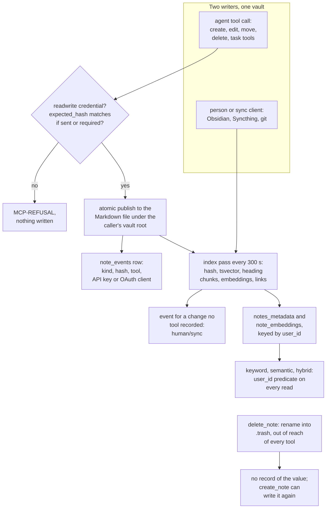

## 1. Executive Summary

obsidian-mcp is a self-hosted MCP server that serves a person's existing
Obsidian vault as long-term memory to claude.ai, ChatGPT, Claude Code and
other clients, over a Postgres index with keyword, vector and hybrid search,
a wikilink graph and a task index. Its notable part is the change feed: every
agent write is recorded with the API key or OAuth client that made it, and
every edit by a person or a sync client is recorded as `human/sync`, so an
agent can ask what changed since its last session and who changed it. Its weak
part is that the memory has no state of its own: a note is believed because
it exists, a deleted note leaves nothing that stops it being written again,
and a tool write is not searchable until the next five-minute index pass.

The server runs no extraction and no consolidation. The agent decides what to
write, through 13 write tools, and the person edits the same files in
Obsidian. The README states the position directly, that "an agent remembers
something because it wrote a note, and forgets it because someone deleted
one" (`README.md:116-118`).

"Guarded writes" means three things in code: a stale `expected_hash` refuses
the write before any byte moves, a create never overwrites, and every path
resolves beneath the caller's own vault root. No write waits for a person.

The licence is MIT, in `LICENSE`; the vendored Obsidian Markdown skill is MIT
under its own file with its upstream commit recorded.

Two marks, both on the owner predicate over the index: `scope_enforced` and
`negative_eval`. The change feed is the near-miss for `audit_log`, withheld
because retention and two wipe paths delete its events. Section 9 gives the
reason for each of the five withheld.

## 2. Mental Model

A memory is a **Markdown file in the vault**. Its frontmatter, tags,
wikilinks and checkbox tasks are the structure; the server imposes no folder,
schema or "memory" note type. A note is ground truth for every connected agent
the moment it is on disk.

A note becomes memory by one of two routes.

- **An agent writes it.** `create_note`, `edit_note`, `set_frontmatter`,
  `move_note`, `write_file`, `import_from_url` and the four task tools publish
  bytes atomically under the caller's vault root. A readwrite credential is
  required, and an edit carrying `expected_hash` is refused if the file
  changed since it was read (`src/mcp_server/tools.py:3996-4060`).
- **A person writes it.** Obsidian, a sync client or git changes the file,
  and the next index pass discovers it.

Either way, the index pass turns the file into an index row, heading chunks
with embeddings, link rows and task rows, and appends a change event. Agent
writes carry their attribution from the call; a change the pass discovers
carries none.

A note stops being memory when the file goes. `delete_note` renames it into
`.trash/`, a dot directory the indexer skips and every tool refuses
(`src/services/vault.py:588-594`), or unlinks it with `permanent=true`. The
next pass removes the index rows and appends a `deleted` event. Nothing
records what the note said, and nothing stops the same content being created
again. There is no candidate state, no confidence and no expiry.

The server's guide to the agent is the vault's own `CLAUDE.md`, which
`get_vault_guide` returns with a primer on Obsidian Markdown
(`src/mcp_server/tools.py:3845-3849`). It is a note like any other.

## 3. Architecture

One FastAPI process serves the MCP endpoint, the OAuth authorisation server,
the control panel and a periodic indexer, over PostgreSQL 16 with pgvector and
a vault directory mounted read-write (`src/main.py`, `server.json`). An
embedding backend is required: Ollama with bge-m3 by default, OpenAI or a
Hugging Face TEI server. A reranker is optional (`RERANK_URL`).

- **`src/mcp_server/`** holds the 33 tools (`server.py` registers them,
  `tools.py` implements them), the authentication middleware (`auth.py`) and
  the list filter that hides write tools from a read-only OAuth grant
  (`tool_permissions.py`).
- **`src/services/indexer.py`** runs the passes: hash, derive, embed, links,
  tasks, change events, quarantine of notes that poison the database, and
  vault-root overlap detection.
- **`src/services/vault.py`, `vault_fs.py`** do path validation, anchored
  `openat`-style publication, no-clobber creation and the `.trash` rename.
- **`src/services/search.py`, `hybrid.py`, `embeddings.py`, `rerank.py`** are
  the three search paths.
- **`src/services/change_feed.py`** is the feed's writer, retention and
  renderer.
- **`src/oauth/`** implements registration, consent, tokens, grant families
  and revocation.

The periodic loop sleeps `INDEX_INTERVAL_SECONDS`, 300 by default, between
passes (`src/config.py:528`, `src/services/indexer.py:8683`), and a full-hash
pass runs at start-up and every 24 hours. The panel has a manual Reindex.

### Deployment and ergonomics

Three things must run: the server, Postgres with pgvector, and an embedding
service, which can be local (Ollama or TEI) or OpenAI with a key. Docker
Compose files, a Kubernetes kustomization and a registry manifest are in the
tree. A remote client needs a public hostname behind TLS; the README describes
a Caddy or Traefik front.

The store is the vault: plain Markdown a person reads and repairs in Obsidian.
Losing the database loses the index, the change feed and the credentials, and
a re-index rebuilds the first. Switching the embedding model requires
`make reset-embeddings`.

Multi-user mode is off by default (`src/config.py:1289`). With it on, each
user has a `vault_path`, and the indexer refuses to serve two users whose
roots overlap until an administrator fixes the assignment
(`src/services/indexer.py:528`).

## 4. Essential Implementation Paths

- **Authentication.** The middleware resolves a bearer API key or an OAuth
  access token, then sets `current_permission`, `current_user_id` and the
  actor from the credential row (`src/mcp_server/auth.py:950-962`,
  `:1170-1185`). Every tool reads the user from that context variable.
- **Write gate.** `_vault_admission_error`, run by every tool's `_tracked`
  wrapper, resolves the caller's vault root before the body runs and refuses
  an unassigned or quarantined caller (`src/mcp_server/tools.py:1173-1236`). Write tools call `_require_write`
  (`:4181`); the set of write tools is one frozenset
  (`src/mcp_server/tool_permissions.py:36-54`).
- **Create.** `create_note_impl` refuses a supplied hash as `no_incumbent`,
  opens the target beneath the root, checks size, confirms the vault
  assignment and publishes with `overwrite=False`, then records a `created`
  event (`src/mcp_server/tools.py:4630-4726`).
- **Edit and preconditions.** `_precondition_error` compares the caller's
  `expected_hash` with the incumbent bytes and refuses `stale_precondition`;
  with `WRITE_PRECONDITION_REQUIRED` it refuses a missing hash
  (`src/mcp_server/tools.py:3996-4060`, `src/config.py:900`).
- **Delete.** `delete_note_impl` renames into `.trash/` with
  `RENAME_NOREPLACE`, or unlinks (`src/mcp_server/tools.py:7196`,
  `src/services/vault.py:3057`).
- **Tool events.** `_record_note_events` calls
  `change_feed.record_tool_events` after a confirmed publication, never on a
  refusal or dry run (`src/mcp_server/tools.py:1029-1044`,
  `src/services/change_feed.py:416-459`).
- **Index pass.** The pass appends discovered changes with suppression of any
  a tool already recorded (`src/services/indexer.py:4502`,
  `src/services/change_feed.py:201-247`).
- **Search.** `keyword_arm_rows` and the vector statement both pass through
  `apply_note_filters` (`src/services/search.py:94`,
  `src/services/embeddings.py:2899`); `hybrid_search` runs both arms to depth
  50 and fuses them (`src/services/hybrid.py:63`, `:218-267`).
- **Change feed read.** `get_changes_impl` reads the caller's scope from a
  cursor (`src/mcp_server/tools.py:10372`).

## 5. Memory Data Model

**The note row.** `notes_metadata` holds `user_id`, `file_path`, `title`,
`tags`, `frontmatter` as JSONB, `content_hash`, a weighted tsvector, stat
columns for the shortcut, `content_changed_at`, truncation markers and
derivation versions (`src/models/db.py:613-866`). `note_embeddings` holds
heading chunks with their context prefix and a vector; `note_links` holds
resolved and dangling wikilinks and Markdown links; `note_tasks` holds one row
per checkbox with its state and Tasks-plugin dates
(`src/models/db.py:867-1073`).

**Scope.** `user_id` is on `notes_metadata`, `note_events` and the
credentials. Link, embedding and task rows reach ownership through their note.
NULL is the single-user owner, and a database can hold both.

**Time.** `content_changed_at` moves only when the bytes change; a file's
modification time is kept beside it. Task rows carry due, scheduled and start
dates from the note's own syntax. No column says when a fact held.

**The change feed.** `note_events` holds a per-user `seq`, `occurred_at`,
`kind` (created, modified, moved, deleted, gap, reset), `path`, `from_path`,
`content_hash`, `source` (mcp or index), `tool`, `actor_kind`, `actor_label`
and a principal pair used for `by="me"` and never rendered
(`src/models/db.py:1196-1245`). CHECK constraints tie a move to a source path
and an actor to the mcp source.

**Usage log.** `usage_logs` records every tool call, reads included, with the
tool, parameters, duration and a denormalised actor that survives the
credential's deletion (`src/models/db.py:540-612`).

## 6. Retrieval Mechanics

Retrieval is tool-mediated. Nothing is injected; the MCP `instructions`
paragraph tells the agent which search tool to use and to call
`get_vault_guide` once per session (`src/mcp_server/server.py:149-157`).

- **`keyword_search`** builds a tsquery from the configured text-search
  configs over a tsvector that weights title and aliases above tags above the
  body. Full matches come first and partial matches fill the page tagged
  `match: any`, each with a highlighted snippet (`src/services/search.py`).
- **`semantic_search`** queries heading-aware chunks, each embedded under a
  `Title > Heading` prefix, and returns one row per note with the matched
  section's locator.
- **`hybrid_search`** fuses the top 50 of each arm by reciprocal rank with
  k = 60 and prints each arm's rank and term. If the embedder is down it
  returns the keyword ranking marked `keyword-only`
  (`src/services/hybrid.py:63`, `:218`, `src/config.py:702`).
- **`rerank=true`** asks an operator-configured reranker to reorder the
  fetched candidates.
- **Graph tools** walk `note_links` for backlinks, outgoing links,
  neighbourhoods and orphans; `find_related` is a vector neighbour search.

A semantic or hybrid page carries `confidence: ok | low`; the threshold ships
at 0, so it always says `ok` until an operator calibrates it, and it filters
nothing.

Every index read is scoped by `apply_note_filters`, which appends
`user_id = :uid` or `user_id IS NULL` on every call
(`src/services/filters.py:26-71`). Frontmatter and tag filters are caller
arguments; a vault that marks notes `status: superseded` is excluded only if
the agent asks for it.

The failure mode is staleness: an index row reflects the file at the last
pass, so a note written since then is found by `read_note` at its path and
by no search until the next pass runs.

## 7. Write Mechanics

Writes are synchronous and hot-path: the tool publishes the file before it
returns, and the change event is appended in its own transaction after the
publication. The index follows on the next pass, so a new note is searchable
up to 300 seconds later plus its embedding time. Nothing rewrites the store
in the background; the 24-hour full-hash pass re-reads every file to catch
edits the stat shortcut missed.

**What the guard guards.** An edit, frontmatter change, move or delete that
carries `expected_hash` is refused before mutation when the file's current
hash differs, with the current hash in a machine-readable refusal. A
deployment can require the hash on every destructive call; the default does
not (`src/config.py:900`), and the MCP instructions tell the agent that an
unguarded stale edit overwrites. Creation never overwrites. Paths are
validated beneath the caller's root, symlinked leaves are refused, and the
assignment is re-confirmed immediately before publication.

**What it does not guard.** No content check, no provenance on the note and
no person: `dry_run=true` returns a diff to the agent that asked for it.
`import_from_url` writes a public page's bytes into the vault, and the note
itself carries no mark that it came from the web; the change feed records the
tool.

**Deletion and correction.** An edit replaces the bytes. A delete renames the
file into `.trash/`. The value is gone from the index at the next pass, and
any agent may write it again.

### Operational cost

No model call sits on the write path. Each pass hashes changed files and
embeds changed chunks; a model switch re-embeds the vault. The usage log and
change feed add one insert per tool call and one per published change.

## 8. Agent Integration

The 33 tools are published with titles and MCP annotations: 19 read-only, 11
destructive, `import_from_url` open-world. A client that honours annotations
prompts before destructive calls; the server does not depend on that.

**How several clients connect.** claude.ai, Claude Desktop and ChatGPT
register through OAuth dynamic registration or a Client ID Metadata Document,
and a person signs in to the panel and approves the client on a consent page
that offers read or read-and-write, clamped to what the client registered
for (`src/oauth/scope.py:88-126`). Claude Code and n8n use bearer API keys
created in the panel with `read` or `readwrite`. Every credential is bound to
one user, and the user's vault is the whole of what it reaches: there is no
per-client folder or note restriction. A read-only OAuth grant does not even
see the write tools listed.

**What the agent controls.** Everything about content. It chooses what to
write, where, and when to delete. `get_changes(since="ev:<n>")` gives it a
durable cursor it is told to keep in its own notes, so a later session can
read what other agents and the person changed in between, filtered by
`by="me" | "agents" | "human"`.

**The guide is writable.** `get_vault_guide` returns the vault root's
`CLAUDE.md`, and no write path treats that file differently from any other
note (recorded search below). Any readwrite credential of the user can
therefore change the instructions every other connected agent loads.

## 9. Reliability, Safety, and Trust

### The change feed

`append_events` is the only insert into `note_events`. It takes a per-user
advisory lock, assigns consecutive seqs under it, folds any recorded gap rows
into one `gap write_failed` line, and suppresses a pass event that repeats
the latest tool event at the same path and hash
(`src/services/change_feed.py:250-351`). A cursor is therefore exact within a
user, and a seq reveals nothing about another tenant's volume.

Its limits are deliberate and stated in the code.

- A tool's event is best-effort: a lock timeout or error is swallowed, and
  the next pass records the change as `human/sync`
  (`src/services/change_feed.py:416-459`).
- Retention deletes events older than 90 days and beyond 100,000 per user,
  never the newest, and raises a watermark so an old cursor reads
  `history_truncated` (`src/config.py:569-573`,
  `src/services/change_feed.py:528-589`).
- A vault-root reassignment that changes provenance deletes the user's index
  rows and every event, and starts a new history with `reset`
  (`src/services/indexer.py:2630-2665`, `src/services/change_feed.py:494-525`).
- Permanently deleting a user purges the feed (`:482-491`).
- An event holds a hash, not content. Two human edits between passes appear
  as one `modified`.

### Tenancy

The owner predicate is total: an ownerless credential reads exactly the
NULL-owned slice, never everything, which closes the case where multi-user
mode is turned off after users exist (`src/services/filters.py:49-56`). The
graph tools apply ownership in the join's ON clause, so a link into another
user's note neither resolves nor bridges a neighbourhood. Overlapping vault
roots are quarantined rather than served.

### What has no protection

- **Stale reads overwrite by default.** `expected_hash` is optional unless
  the operator sets `WRITE_PRECONDITION_REQUIRED`.
- **The guide is a note.** An agent can rewrite `CLAUDE.md`, which other
  agents read as their instructions.
- **Every client sees everything.** A ChatGPT connector approved read-only
  reads the same notes as the owner's Claude Code key.
- **Deletion keeps the bytes.** A soft delete leaves the file in `.trash/`
  until a person empties it; the database keeps the hash in the feed.

### Marks

- **`scope_enforced` — earned.** `user_id` is stored on each index row and
  applied in SQL on every index read; the value comes from the resolved
  credential. In the default single-user mode it separates nothing, and file
  access is a separate per-user root.
- **`negative_eval` — earned.** The owner-scoping integration module seeds two
  owners on one term and one vector and requires each search to return its
  own note and omit the other owner's.
- **`human_review` — withheld.** No write waits. The consent page approves a
  credential, not memory content; `dry_run` is the agent's own preview; a
  person editing in Obsidian edits after the fact.
- **`trust_state` — withheld.** A note has no status. `note_tasks.state`
  tracks a checkbox's workflow, and the search confidence token filters
  nothing.
- **`tombstone` — withheld.** No record of a deleted value exists; a
  `deleted` event is keyed on the path and its hash and nothing consults it
  before a write.
- **`audit_log` — withheld.** `note_events` records every note creation,
  modification, move and deletion, with the credential and tool for agent
  writes, through one insert site that no code updates. It is not
  append-only: default retention deletes events older than 90 days or beyond
  100,000 per user (`src/config.py:569-573`), a vault-root reassignment
  deletes the user's events (`src/services/change_feed.py:494-525`), and a
  user deletion purges them (`:482-491`). An event holds a hash, not content.
- **`bitemporal` — withheld.** `content_changed_at` and the event time are
  record times; no column records when a fact held.

## 10. Tests, Evals, and Benchmarks

CI runs the whole suite with a pgvector service and sets
`PGVECTOR_TEST_ADMIN_URL`, so the integration modules run there, and fails
the build if the mount-namespace test was skipped (`.github/workflows/ci.yml`).
A schema gate migrates fresh databases to head. I ran nothing from the
repository.

Memory-relevant coverage:

- owner scoping across list, recent, keyword, semantic, tags, related, links,
  backlinks, neighbourhood and orphans, against both owners
  (`tests/integration/test_issue_127_owner_scoping_pg.py:177-385`);
- the change feed: an agent edit recorded once with its key and a later
  human edit recorded as `index`; each write tool's kind; a refused and a
  dry-run edit recording nothing; tenants' private gapless feeds; `by="me"`;
  retention by age and cap; discard on reassignment
  (`tests/integration/test_change_feed_pg.py:155-1053`);
- write preconditions on notes and files, including stale, missing and
  over-cap hashes (`tests/test_write_preconditions_notes.py`,
  `tests/test_write_preconditions_files.py`);
- read-only grants refused and write tools hidden from their list
  (`tests/test_issue_358_scoped_tools_list.py`).

Not covered: no test deletes a note and checks that anything stops it being
written back, and none checks what happens when an agent edits `CLAUDE.md`.

**Retrieval evaluation.** `make search-eval` mines judgments from the
operator's own usage log, a search followed by a read of one of its results,
and scores arms with recall, MRR and nDCG (`scripts/search_eval/`). The
committed `tests/fixtures/search_eval/expected-report.json` is the harness's
golden output over a 12-query fixture with fixture arms. The README reports a
2026-11-01 measurement on a 196-query reference vault, with reranking raising
semantic recall@10 from 0.505 to 0.582 and lowering hybrid MRR from 0.533 to
0.465 (`README.md:2300-2307`); the vault and its judgments are not in the
tree, so the numbers cannot be recomputed from it. The tree cites no paper.

## 11. For Your Own Build

### Steal

- **Attribute every write to the credential, and mark the rest.** A change
  feed that names the API key or OAuth client for agent writes and records
  out-of-band edits as `human/sync` answers "who changed this" across agents
  and a person sharing one store.
- **A per-scope sequence assigned under a lock.** It makes a resumable cursor
  exact and leaks no other tenant's volume.
- **A total owner predicate.** Map "no owner" to `IS NULL`, never to "no
  filter", and put ownership in the join's ON clause for link tables.
- **Hash preconditions on destructive writes,** with the refusal carrying the
  current hash, and a deployment switch that makes them mandatory.

### Avoid

- **An index that lags its own writes.** If the writing tool does not index
  what it wrote, the agent that just saved a fact cannot find it by search.
- **Serving agent instructions from a file agents can write.** Either protect
  the guide or record it as a privileged path.
- **One permission bit per credential for a shared personal store.** A
  connector that only needs one folder gets the whole vault.

### Fit

This suits one person, or a small household of users, who already keeps an
Obsidian vault and wants every agent they use to read and write it under
their own eyes, with Postgres and an embedding service to run. It is a large,
heavily specified codebase for a single maintainer, with a long upgrade
section, and it changes quickly. Walk away if memory must be corrected so it
stays corrected, if writes must wait for a person, or if different agents
should see different parts of the store.

## 12. Open Questions

- Whether an agent-facing index refresh after a write was considered and
  refused, or is pending.
- Whether `CLAUDE.md` is meant to be agent-writable.
- How the README's 2026-11-01 reranker measurement relates to the judgments a
  fresh deployment would mine.
- `server.json` still names image `v0.9.2` while the pinned commit is tagged
  `v1.6.0`; whether the registry entry is maintained.

## Appendix: File Index

- Tools and server: `src/mcp_server/server.py`, `src/mcp_server/tools.py`,
  `src/mcp_server/tool_permissions.py`, `src/mcp_server/read_result.py`,
  `src/mcp_server/vault_guide_primer.md`
- Authentication: `src/mcp_server/auth.py`, `src/oauth/`, `src/auth/`,
  `src/services/api_keys.py`
- Vault I/O: `src/services/vault.py`, `src/services/vault_fs.py`,
  `src/services/vault_overlap.py`, `src/services/transfer.py`
- Index: `src/services/indexer.py`, `src/services/embeddings.py`,
  `src/services/links.py`, `src/services/task_index.py`
- Retrieval: `src/services/search.py`, `src/services/fts.py`,
  `src/services/hybrid.py`, `src/services/rerank.py`,
  `src/services/filters.py`, `src/services/search_confidence.py`
- Change feed: `src/services/change_feed.py`
- Schema: `src/models/db.py`, `alembic/versions/`
- Configuration: `src/config.py`
- Tests: `tests/integration/test_issue_127_owner_scoping_pg.py`,
  `tests/integration/test_change_feed_pg.py`,
  `tests/test_write_preconditions_notes.py`, `.github/workflows/ci.yml`
- Evaluation: `scripts/search_eval/`, `tests/fixtures/search_eval/`

### Recorded searches

Run from the repository root at the pinned commit with `/usr/bin/git grep`.

- **No value-keyed refusal.**
  `git grep -n -i -E 'tombstone|blocklist|deny_?list|rejected_value' -- src alembic`
  returns nothing; the same pattern over `.` matches
  `tests/test_oauth_cimd_jwks.py:524` and two docs lines.
- **No validity time.**
  `git grep -n -w -E 'valid_from|valid_to|valid_until|valid_at' -- src alembic`
  returns nothing; `git grep -n -w -E 'content_changed_at|expires_at' -- src/models/db.py`
  matches `:338`, `:821` and `:1447`.
- **No review or status on a note.**
  `git grep -n -i -E 'pending|approv|review|verified|status' -- src/models/db.py`
  returns migration comments, OIDC and OAuth consent comments,
  `note_tasks.status_char` at `:969` and the transfer-token state at `:1503`.
- **No per-credential folder restriction.**
  `git grep -n -i -E 'allowed_folder|path_prefix|folder_scope|allowed_paths' -- src alembic`
  returns nothing; `git grep -n -E 'permission: Mapped' -- src/models/db.py`
  matches `:336`.
- **No chat-model call in the server.**
  `git grep -n -i -E 'chat/completions|ChatCompletion|messages\.create|/api/generate|/api/chat' -- src`
  returns nothing; `git grep -n -E '/api/embed' -- src` matches
  `src/config.py:521` and `src/services/embeddings.py:1111`.
- **No write triggers an index pass.**
  `git grep -n -i -E 'wake|nudge|index_soon|inotify|watchdog' -- src`
  returns one comment, `src/services/transfer.py:1246`;
  `git grep -n -E 'asyncio\.sleep\(settings\.index_interval_seconds\)' -- src`
  matches `src/services/indexer.py:8683`.
- **Writes to the change feed.**
  `git grep -n -i -E 'UPDATE note_events|update\(NoteEvent|DELETE FROM note_events|insert\(NoteEvent|INSERT INTO note_events' -- src scripts alembic docker`
  matches `src/services/change_feed.py:346`, `:503` and `:632`; the purge's
  DELETE is built from a table-name loop at `:490-491`.
- **CLAUDE.md is only read.**
  `git grep -n 'CLAUDE.md' -- src/mcp_server/tools.py src/services/vault.py src/services/vault_fs.py`
  matches `tools.py:176`, `:178`, `:1190`, `:3846` and `:3849`.
- **No paper reference.**
  `git grep -n -i -E 'arxiv|bibtex|@article|@misc|doi\.org|zenodo' -- .`
  returns nothing.

## History

**2026-11-25** — [`2a482ba9eb49cce2602664bc660d094db92f9b36`](https://github.com/maxkuminov/obsidian-mcp/commit/2a482ba9eb49cce2602664bc660d094db92f9b36). First reading, from a full clone at the head of `main`, the commit triage selected. Screened first: one auto-run surface, `server.json`, an MCP registry manifest declaring a start command, which was not run; nothing inside the seven-day cooldown; two build-time execution points, the `Makefile` and `tests/conftest.py`; one unpinned requirement, `pip-audit` in `requirements-dev.txt`. `AGENTS.md`, `CLAUDE.md` and the docs were read as data. Nothing was installed, built or run, and the tests were not run. Two marks: `scope_enforced` and `negative_eval` ([section 9](#9-reliability-safety-and-trust)); `audit_log` withheld because retention and root changes delete change-feed events. A tool write waits for the next index pass, the vault guide is agent-writable, and deletion keeps no record of the value.
