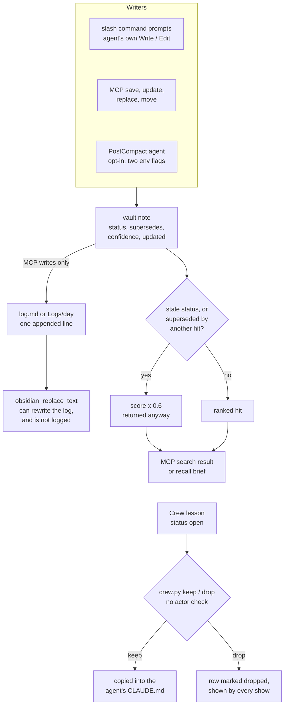

## 1. Executive Summary

obsidian-second-brain makes an Obsidian vault an agent's memory. It is 49 slash
commands, compiled from one source to eight agent CLIs, that tell the model how
to read and write notes, plus a Claude Code plugin with three hooks and a
twelve-tool MCP server over the same vault. Its strength is the deterministic
layer around a model that writes: guarded edits, a quote checker on
contradictions, and a search that reads a note's own `status` and `supersedes`
fields. Its weakness is that each guard advises rather than withholds. A
superseded or rejected note is multiplied by 0.6 and returned, and every
correction verb is one the agent holds.

Most of the memory behaviour is prompt text, not code. `references/ai-first-rules.md`
and the command files decide what is saved, where, and how a contradiction is
resolved; the agent carries it out with its own file tools. The code owns
search, validation, the MCP bookkeeping, maintenance scripts and Crew, a
shared logbook in which several agents record jobs and leave each other
lessons. No code path deletes a note. No capability mark is earned, and
section 9 names the near-miss behind each one. MIT, with no rider.

## 2. Mental Model

A memory is a **note**: a markdown file with `type`, `date`, `tags` and
`ai-first: true` in its frontmatter, a `## For future agent` preamble, and
wikilinks to every person, project and concept it names
(`references/ai-first-rules.md:9-104`). Per-type schemas add a `status`
vocabulary, for example `proposed | accepted | superseded` on an ADR and
`open | resolved` on a conflict note (`:282`, `:396`). External claims carry an
inline `(as of 2026-04, source)` stamp, and a `confidence` of `stated`, `high`,
`medium` or `speculation` where the model judges one applies.

How a note becomes a belief is a prompt. `/obsidian-save` tells the model to
scan the conversation for decisions, people, tasks and ideas, search for an
existing note, and create or append (`commands/obsidian-save.md:12-30`). There
is no candidate state. A note is true from the moment it is written, and its
`confidence` label is read by nothing in the code (Recorded searches).

How it stops being one is also a prompt, with one deterministic step.
`/obsidian-reconcile` has subagents return each contradiction as two quoted
lines with paths. `scripts/verify_quotes.py` drops any pair whose quotes do not
occur verbatim in the named notes (`verify_quotes.py:53-96`). The model then
rewrites the older note with a `## History` line, or writes a
`Conflict - Topic.md` with `status: open` for the user
(`commands/obsidian-reconcile.md:26-47`). The old value survives only as prose.

A note leaves belief in three weaker ways. Its `status` set to one of ten stale
values, or a `supersedes:` link from another result, multiplies its search
score by 0.6. Merging rewrites the loser as a `type: redirect` stub
(`scripts/merge_notes.py:1-33`). Archiving prefixes the filename with
`_archived_`, which search does not read. None of these removes the note from
search.

## 3. Architecture

**The skill.** `commands/` holds 49 command prompts; `scripts/build.sh` and
`adapters/` compile them for Claude Code (an identity copy), Codex CLI, Gemini
CLI, OpenCode, Hermes, Pi, a unified `.agents/skills` tree and Grok Bot
(`architecture.md:24-35`). At run time a command reads and writes vault files
with the host agent's tools and shells out to Python scripts for deterministic
work: health checks, link repair, merges, quote checks, research fetches.

**The plugin.** `.claude-plugin/plugin.json` registers the commands and one MCP
server, started as `uv run --no-project --with "mcp<2" python
integrations/obsidian-mcp-server/server.py`. `hooks/hooks.json` registers three
hooks:

- **SessionStart** runs `hooks/load_vault_context.sh`. It finds a Python that
  runs and executes `load_vault_context.py`, which injects the skill's install
  path and, when the session's `cwd` is inside the vault, the vault's
  `_CLAUDE.md` operating manual if it fits under 9,500 characters, else a
  pointer saying it is not loaded (`load_vault_context.py:56-57`, `:84-100`,
  `:168-197`). It injects no note content. `architecture.md:165` says it injects
  `index.md` and the recent log as well; the code passes only their paths.
- **PostToolUse** on `Write|Edit|MultiEdit|NotebookEdit|create_file` runs
  `hooks/validate-ai-first.sh`, a 529-line check of frontmatter, preamble,
  banned characters, secrets and tag syntax on vault markdown. It returns a
  warning to the model and never reverts the write (`validate-ai-first.sh:13-61`).
- **PostCompact** runs `hooks/obsidian-bg-agent.sh` asynchronously. It exits at
  once unless both `OBSIDIAN_VAULT_PATH` and `OBSIDIAN_BG_AGENT_ENABLED=1` are
  set (`:35-40`). When armed, it reads the newest `isCompactSummary` entry from
  the transcript and runs `claude --dangerously-skip-permissions
  --strict-mcp-config --tools "Read,Write,Edit,Glob,Grep" -p` in the vault on a
  prompt that frames the summary as untrusted data (`:97-108`, `:134-205`,
  `:224-244`).

`hooks/obsidian-recall.py`, a bounded UserPromptSubmit recall, and the Hermes
`on_session_finalize` consolidation ship as example configurations only and are
not registered by the plugin. `scripts/setup.sh` adds the PostCompact entry to
`~/.claude/settings.json` and never sets the enable flag (`setup.sh:116-145`).
`install.sh` registers the SessionStart hook for the non-plugin install
(`install.sh:75-94`).

**The MCP server.** `vault_ops.py` is stdlib-only. Search walks the vault
newest-first up to 10,000 files, scores lexically, and fuses a semantic arm
when `.obsidian-semantic-index.json` exists and an embedding endpoint answers
(`vault_ops.py:221-245`, `:595-680`). The index is built on demand by
`scripts/eval/semantic_search.py --build` against local Ollama `bge-m3` by
default, or any OpenAI-compatible endpoint.

**Crew.** `scripts/crew.py` is one standard-library file. `/crew setup` copies
it to `~/.config/crew/` and merges `show --new --hook` into SessionStart and
UserPromptSubmit for Claude Code and Codex, and sessionStart and postToolUse
for Cursor. It also writes a marked team-rules block into each agent's global
rules file (`crew.py:426-538`).

### Deployment and ergonomics

Nothing has to run for the vault itself. The commands need a host CLI and the
vault on disk; the scripts and the MCP server need Python and `uv`. Semantic
search needs Ollama or an embedding API, and the research commands use
Perplexity, Grok and Gemini when keyed and about ten free sources otherwise. No
key is needed to store anything. The store is the user's own markdown and is
repairable by hand in Obsidian.

The MCP server's dependency is resolved at every launch: `--with "mcp<2"`
installs the newest 1.x from the index, with no lockfile behind it
(`plugin.json`, `server.py:31-39`). The Telegram journal is a launchd job
polling every 60 seconds and filing voice, text and images into the vault
through Whisper and Claude vision (`integrations/telegram-journal/telegram_journal.py:1-23`).

## 4. Essential Implementation Paths

- **Command writes.** `commands/obsidian-save.md:12-30` spawns subagents per
  note type that search, then create or append with the host's file tools.
  Every writing command repeats the AI-first and anti-fabrication rules.
- **MCP writes.** `obsidian_save_note` refuses an existing path and writes
  frontmatter with `source: mcp` (`vault_ops.py:898-969`). `obsidian_update_note`
  appends a section or merges scalar fields and stamps `updated`
  (`:981-1038`). `obsidian_replace_text` swaps one unique block
  (`:1041-1070`). `obsidian_move_note` copies with `O_EXCL`, reads back, then
  unlinks the source (`:1073-1181`). All four refuse paths outside the vault
  and under `_PROTECTED_WRITE_DIRS`, and update and replace refuse a note that
  changed since the call read it (`:50`, `:1510-1525`).
- **Bookkeeping.** After each MCP write `_bookkeep` validates the note, adds an
  `index.md` entry for a new one, appends one line to `Logs/<day>.md` or
  `log.md`, and runs `OBSIDIAN_POST_WRITE_CMD` if set (`:794-809`, `:880-895`).
  A write to `log.md`, `index.md` or `logs/` skips this step
  (`_is_bookkeeping_surface`, `:788-791`).
- **Search.** `search` (`:595-680`) scores each note through the cached
  `_scan_entry` (`:420-464`), sorts, calls `_semantic_fuse` (`:531-592`), then
  `_freshness_rerank` (`:158-193`).
- **Context injection.** SessionStart injects the manual only. The opt-in
  recall hook calls `vault_ops.search(..., semantic=False)`, drops `raw/`
  results, abstains unless the top hit shares a term with the prompt, and
  injects at most four notes in 900 characters (`obsidian-recall.py:63-132`).
- **Correction.** `/obsidian-reconcile` with `verify_quotes.py`;
  `scripts/merge_notes.py` with `/obsidian-merge`;
  `scripts/freshness_lint.py`, which flags volatile present-tense claims
  without an `as of` stamp; and `scripts/checkin.py`, which asks the owner
  whether old person and project notes hold and stamps `last-checked`
  (`checkin.py:1-24`, `:267-289`).
- **Crew.** `append_job` (`crew.py:175-182`), `add_lesson` (`:227-247`),
  `records` and `show` (`:250-299`), `decide` (`:352-393`).
- **Background.** `hooks/obsidian-bg-agent.sh`,
  `hooks/obsidian-hermes-session-end.sh`, the Telegram journal.

## 5. Memory Data Model

The schema is the frontmatter vocabulary in `references/ai-first-rules.md`,
not a type in code. The MCP server writes `type`, `date`, `tags`, `ai-first`
and `source: mcp` on save and `updated` on every update
(`vault_ops.py:935-944`, `:1013`). `validate_note` checks presence of the four
required keys, the preamble and resolvable wikilinks (`:1184-1255`). The
`status` vocabulary differs per type. Search is its one retrieval reader;
`checkin.py` skips closed statuses when choosing notes to ask about, the OKF
export maps stale ones to `deprecated`, and `vault_stats.py` counts them
(`checkin.py:41`, `:143`, `export_okf.py:168-185`).

Time is three dates, all set by whoever writes the note: `date`, `updated`, and
on checked notes `last-checked`. `_note_age_days` takes the newest of `updated`
and `date` from the first 400 characters, else the file's mtime
(`vault_ops.py:142-155`). The `as of` stamps are prose, read only by
`freshness_lint.py`.

Relations are wikilinks, plus a `relations:` block or a legacy `supersedes:`
scalar whose inverse is `superseded_by`. `scripts/link_graph.py --lint` flags
unknown edge types, dangling targets and two notes that supersede each other
(`link_graph.py:60-86`). Search reads `supersedes:` only within its own
candidate set.

**Scope** is the vault: one directory per installation, named by
`OBSIDIAN_VAULT_PATH`, with no key on a note. `_SKIP_DIRS` keeps `.obsidian`,
`.git`, `.trash`, `.claude`, templates and agent build directories out of every
scan (`vault_ops.py:42-44`). A Crew lesson is one table row:
`ID | Date | From | For | Kind | Status | Text | Evidence`, with status `open`,
`kept` or `dropped` (`crew.py:35`, `:227-247`).

## 6. Retrieval Mechanics

Inside the Claude Code skill, retrieval is the model's: commands tell it to
read `index.md`, search by name and folder, and read files. The MCP search is
the one ranked path, used by other MCP clients, the recall hook and the eval.

**Lexical arm.** Query terms drop stopwords and tokens of two characters or
fewer; CJK runs become overlapping bigrams (`vault_ops.py:79-104`). Each term
scores `5 × (1 + log1p(title count))` on the stem and `1 + log1p(body count)`
on the body, the body divided by `1 + log1p(len/1000)`. Counts are substring
matches (`:634-650`). A static weight multiplies the score: 0.15 for `raw/` and
`log.md`, 0.5 for log, daily and dev-log types, 1.5 for person, company, tool
and entity notes, and 0.6 for a stale status (`:106-119`, `:445-452`).

**Semantic arm.** A note scores its best chunk's cosine. The fusion takes the
top 25 of each arm, at k = 60, with the semantic vote weighted 20 to the
lexical vote's 1 (`:236-257`, `:561-586`). A single-term query skips it
(`:613-618`). Any failure falls back to lexical. A stderr warning fires when
more than 5% of notes are missing from the index, which never invalidates
itself (`:258-266`, `:507-528`).

**Rerank.** `_freshness_rerank` rescores the fused list by rank: a stale status
or a `supersedes:` link from another candidate each multiply by 0.6, and a
query containing `current`, `now`, `today`, `still`, `latest` or `actual` adds
a recency factor between 0.6 and 1.0 (`:158-202`). The ten stale values are
`superseded`, `declined`, `rejected`, `archived`, `obsolete`, `cancelled`,
`closed`, `parked`, `inactive` and `done` (`:127-128`). The results go back
with path, title and a 320-character snippet, at most 20.

Failure modes follow from the shape. A rejected note that is the only strong
match ranks first. A supersession edge is seen only when both notes are in the
same result list. A note written since the last index build is invisible to
the semantic arm on a non-English query.

## 7. Write Mechanics

Writes are hot-path and model-authored. A command runs in the session, and the
model decides what is vault-worthy, searches for duplicates and writes. Dedup
is the instruction "search before creating anything"; the MCP save refuses only
an existing filename (`vault_ops.py:948-954`). No extraction runs in code, and
no step checks a claim before it is stored. The validator hook checks form, not
content.

Updates edit in place. Through MCP an update appends or merges scalar fields
and cannot rewrite the body; `replace_text` rewrites one exact block. Both
compare the file with what they read and refuse on a difference, which turns a
concurrent writer's lost update into a reported error (`:1510-1525`). The
appends to `index.md` and `log.md` carry the same race, unguarded, and the
docstring says so.

Deletion is outside the code. The MCP surface has no delete verb. The one
script that unlinks a vault file removes an archived chat's superseded parts
under `raw/sessions/` (`session_archive.py:321-324`). `references/write-rules.md:142`
tells the model never to delete and to archive instead. A delete happens only when the agent or the
person removes a file.

Untrusted input is handled by framing. `ai-first-rules.md:120-136` tells the
model to record instruction-shaped source text as a claim, the background
prompt brackets the summary as untrusted, and the recall brief and Crew header
say the lines are records. The PostCompact agent's tool list makes that a
boundary: it has no Bash and no network, only `Read`, `Write`, `Edit`, `Glob`
and `Grep` (`obsidian-bg-agent.sh:224-240`).

### Operational cost

Command writes block the session for as long as the model and its subagents
take. A note is searchable lexically as soon as its file exists, and
semantically after the next manual index build. The PostCompact agent is
asynchronous and adds one headless model run per compaction, with a 120-second
lock against bursts (`obsidian-bg-agent.sh:84-92`). The Hermes hook runs at
most once every six hours by default. No pass rewrites the whole store.
Injection per turn is the manual at SessionStart, up to 9,500 characters, and
900 characters of recall when armed; both sit in the session's opening or
per-prompt context.

## 8. Agent Integration

The agent holds every verb. In Claude Code it writes with its own file tools,
and through MCP it can save, append, set any scalar frontmatter field including
`status`, replace text and move notes. The update tool's description tells the
model that a stale status fades a note in all future search, and the response
echoes `faded` when one is set (`server.py:115-138`, `vault_ops.py:1030-1037`).
`obsidian_get_skill` returns a command's playbook for the model to execute with
the other tools (`server.py:205-213`).

Session lifecycle is covered by the SessionStart manual and, when armed, by the
PostCompact propagation, which is the one compaction-boundary write. Adapting
it to another agent is the project's premise: the eight adapters translate
command bodies, and the MCP server serves any client. On hosts without hooks,
the validation rests on the prompt text alone (`architecture.md:162`).

**Crew** is the cross-agent channel. Each agent records `add --agent X --area
--did --where` after a job and reads the others' new records on its next hook
through a per-agent, per-session cursor of line hashes (`crew.py:269-299`).
Lessons are addressed `--for` one agent or `all`. Inputs are folded to one
line, `|` is replaced and `<` and `>` are escaped, so a record cannot forge a
table cell or a rules-block marker (`:38-48`).

## 9. Reliability, Safety, and Trust

### A status that ranks and never withholds

The project's account of the failure is exact: a "what is current" query
ranked a superseded note above the one that held. Its fix is a multiplier.
`_STALE_STATUSES` is read in three places, two that multiply the score by
`_STATUS_FADE = 0.6` and one that reports the fade to the caller
(`vault_ops.py:139`, `:183`, `:451`, `:1033`). No search read excludes a note
on status. A `rejected` decision that is the strongest term match comes back
first, and a weaker one comes back lower. The test pins the near-tie
(`tests/test_freshness.py:31-46`).

### The operation log is a note the agent can edit

Every MCP mutation appends one dated line naming the action and the note. The
log file is not in `_PROTECTED_WRITE_DIRS`, so `obsidian_replace_text` and
`obsidian_update_note` accept `log.md` or a `Logs/` day file like any other
note (`vault_ops.py:50`, `:1057-1067`). Neither edit is logged, because
`_bookkeep` skips bookkeeping surfaces (`:788-791`, `:885`). The command path
writes its log lines as model prose, and the PostCompact agent holds `Write`
and `Edit` over the whole vault.

### The human decision on a lesson

Crew's header says only an explicit human keep promotes a rule
(`crew.py:29-32`). `keep` and `drop` are argparse subcommands with no actor or
terminal check (`:566-568`, `:352-393`). The rules block that `setup` installs
in every agent's global rules file gives the exact command and says to run it
only when the human asks (`:409-423`, `commands/crew.md:80-90`). The agent that
wrote a lesson can therefore keep it. A kept lesson becomes a marked section in
that agent's `CLAUDE.md`, `AGENTS.md` or Cursor rule with `alwaysApply: true`.
A dropped lesson is kept as evidence and returned by every `show`, since
`records` reads lessons without a status filter (`:259-265`).

### Data loss and supply chain

The vault is the user's files, and no code path deletes a note. The MCP move
refuses an existing destination and removes the source only after a byte-exact
read-back (`vault_ops.py:1095-1170`). `update.sh` runs `git pull` on the skill
checkout with no pin, and the MCP server installs the newest `mcp` 1.x at each
launch. The PostCompact agent runs with `--dangerously-skip-permissions`, behind
two environment flags.

### Marks

None is carried.

- **`tombstone`** — no write path compares a new value with a rejected one.
  The MCP save checks only the filename (`vault_ops.py:948-954`), and
  `add_lesson` consults no dropped row. A merge's redirect stub, an archive
  prefix and a dropped lesson are each keyed on a file or a row id.
- **`trust_state`** — `status` is a discrete field with `rejected` and
  `superseded` among its values, and every retrieval read spends it as a 0.6
  weight; the check-in scan's skip of closed statuses decides what to re-ask,
  not what to believe.
  Crew's `open | kept | dropped` gates the copy into a rules file, and `show`
  returns all three.
- **`bitemporal`** — `date`, `updated` and `last-checked` are record and
  review times. The `as of` stamps are text read by a linter, and no query
  takes an as-of time.
- **`scope_enforced`** — the vault is a physical partition. Crew's `for`
  column does filter `show` (`crew.py:261-262`), but it routes lessons
  within one shared log rather than bounding one: `digest` returns every row,
  the reader names itself, and the system's stated purpose is that every
  agent reads every other's records.
- **`audit_log`** — the MCP log is an append on one path, inside a note the
  same tool surface can rewrite without a trace, beside a command path that
  logs in prose.
- **`human_review`** — Crew's keep is a CLI verb the installed rules tell the
  agent how to run. Conflict notes with `status: open` and check-in cards are
  resolved by the agent applying the person's answer. The Obsidian plugin is a
  read-only lint view.
- **`negative_eval`** — no committed case asserts that a superseded, rejected
  or dropped item is absent from a populated result. See section 10.

## 10. Tests, Evals, and Benchmarks

`pytest -q` runs 908 test functions in CI on Ubuntu and on Windows, after a
ruff gate and three generator checks; the Obsidian plugin's lint has its own
node suite (`.github/workflows/ci.yml:12-90`). I did not run them.

The guarded writes are covered closely. `test_mcp_vault_ops_safety.py`,
`test_concurrent_writes.py` and `test_mcp_bookkeeping.py` test path escapes,
protected directories, stale-read refusal and that each write reports its log
line. `test_crew.py` covers parallel writers, cursor consumption, marker
injection, and that only `keep` writes a rules file (`:160-215`).

`negative_eval` is withheld because the populated exclusions keep out
something other than a memory. `test_mcp_vault_ops_skips_claude_dir` asserts
`wiki/Real.md` present and every `.claude/` path absent in one search
(`tests/test_smoke.py:973-988`). The excluded files are agent configuration,
and the case tests which files the store is. `test_vault_scan_finds_cjk_topic`
asserts an unrelated note absent beside a match, which is retrieval precision
(`tests/test_research_cjk_and_models.py:63-78`). The freshness test asserts a
superseded note loses rank 1 and is returned (`tests/test_freshness.py:46`).
No case sends a lesson to one agent and asserts it absent from another's `show`.

`scripts/eval/BENCHMARK.md` defines a seeded 300-note synthetic corpus with
three query sets and reports, at v0.14.0, keyword recall@10 of 100% on both
engines, paraphrase recall@1 of 25.0% lexical against 66.7% hybrid, and
multilingual 4.2% against 62.5%. No run output is committed, so the table does
not recompute from the tree. Its arithmetic is consistent with 12, 12 and 24
cases. It states that the hybrid rows were not re-run after two corpus-hash
changes. `scripts/eval/behavior_eval.py` adds an answer-level eval judged by a
model other than the writer.

No paper describes the project. `CITATION.cff` cites the software.
`scripts/session_archive.py:6-9` cites
[arXiv:2610.34073](https://arxiv.org/abs/2610.34073), *Memory Tax: Dissecting
the Net Value of Agent Memory*, for its reason to keep raw chats. The id
resolves to that title. I read no further than the title.

## 11. For Your Own Build

### Steal

- **Make the background writer's tool list the boundary, not its prompt.**
  `--tools "Read,Write,Edit,Glob,Grep"` with `--strict-mcp-config` removes
  Bash, network and MCP from an unattended run. The comment explains why
  `--allowedTools` alone does not.
- **Refuse an edit when the file changed since the call read it.** One string
  comparison before the atomic replace turns a silent lost update into an
  error the caller can redo.
- **Require two verbatim quotes before resolving a contradiction.** A script
  that finds each quoted line in its note stops a model from "fixing" a
  disagreement it invented.
- **Read the supersession edge in both directions.** A note that another
  candidate claims to supersede is demoted even when its own status was never
  updated.
- **Abstain on weak recall.** An injected brief that needs one shared term
  with the prompt, caps at four notes and logs each decision is cheap to run
  on every prompt.

### Avoid

- **Spending a rejection as a weight.** Once a status says a note does not
  hold, a read that wants current truth should drop it and a forensic read
  should ask for it.
- **An audit log the audited tools can write.** Put it under the same
  protection as raw sources, or outside the vault, and log edits to it.
- **A human gate the agent can type.** If only a person may keep a lesson,
  check for an interactive terminal or move the verb off the agent's rules
  block.

### Fit

This suits one person who keeps an Obsidian vault, works across
several agent CLIs, and wants every agent to read and write the same plain
notes under strong conventions. The cost is a token-heavy write path, since
saving is a multi-agent model run. Correctness rests on the model following
616 lines of rules and on the user reading the vault. Walk away if memory must
be correctable by mechanism rather than by convention: a retracted fact keeps
ranking, nothing stops it being re-saved, and every guard is either advice or
a verb the agent holds.

## 12. Open Questions

- How often a rejected or superseded note is the top hit on a real vault, and
  whether the 0.6 fade was measured against an exclusion arm.
- How many installations arm the PostCompact agent, and how often its
  unattended writes are later corrected by hand.
- Whether Crew's `keep` is meant to be agent-reachable, given that the rules
  block teaches the command to every agent.
- How `mcp<2` resolution at every launch has behaved across 1.x releases,
  beyond the `from __future__` incident the server's header records.

## Appendix: File Index

- Schema and rules: `references/ai-first-rules.md`, `references/write-rules.md`,
  `references/freshness-policy.md`, `references/crew.md`
- Commands: `commands/obsidian-save.md`, `commands/obsidian-reconcile.md`,
  `commands/obsidian-merge.md`, `commands/crew.md`
- MCP server and search: `integrations/obsidian-mcp-server/server.py`,
  `integrations/obsidian-mcp-server/vault_ops.py`
- Hooks: `hooks/hooks.json`, `hooks/load_vault_context.sh`,
  `hooks/load_vault_context.py`, `hooks/validate-ai-first.sh`,
  `hooks/obsidian-bg-agent.sh`, `hooks/obsidian-recall.py`,
  `hooks/obsidian-hermes-session-end.sh`
- Maintenance: `scripts/verify_quotes.py`, `scripts/merge_notes.py`,
  `scripts/freshness_lint.py`, `scripts/checkin.py`, `scripts/link_graph.py`,
  `scripts/vault_health.py`, `scripts/session_archive.py`
- Crew: `scripts/crew.py`
- Install and update: `.claude-plugin/plugin.json`, `install.sh`,
  `scripts/setup.sh`, `update.sh`, `adapters/`
- Eval and tests: `scripts/eval/`, `tests/`

### Recorded searches

Run from the repository root at the pinned commit with `/usr/bin/git grep`.

- **Status is read only as a weight on search.**
  `git grep -n -E '_STALE_STATUSES' -- '*.py' ':!tests'` returns the
  definition, the two multiplications at `vault_ops.py:183` and `:451`, and the
  `faded` report at `:1031-1033`. `git grep -n -E 'status' -- scripts/checkin.py scripts/export_okf.py scripts/vault_stats.py`
  returns the check-in skip, the OKF mapping and the stats counter, none on a
  retrieval path.
- **No code reads `confidence`.**
  `git grep -n 'confidence' -- '*.py' ':!tests' ':!scripts/research'` returns
  the recall hook's abstention wording, the Telegram journal's own routing
  field, a bootstrap template and Crew's preamble.
- **No validity time.**
  `git grep -n -i -E 'valid_?(from|to|until)|event_time|occurred_at' -- '*.py' '*.sh' '*.ts' ':!tests'`
  returns nothing; adding `last-checked` to the pattern returns seven hits in
  `scripts/checkin.py`.
- **No code deletes a note.**
  `git grep -n -E 'unlink\(|rmtree|os\.remove' -- '*.py' ':!tests'` returns 13
  lines: temporary files, the research cache, `move_note`, and
  `session_archive.py:324`, which removes an archived chat's superseded parts.
- **No MCP delete.**
  `git grep -n -E 'unlink|rmtree|os\.remove' -- integrations/obsidian-mcp-server/`
  returns `move_note`'s source and rollback unlinks and `_write_atomic`'s
  temporary-file cleanup.
- **Archived files are searched.**
  `git grep -n -E '_archived_' -- integrations scripts/eval hooks` returns
  nothing; the same search over `scripts/bootstrap_vault.py` returns the
  convention at `:494` and `:610`.
- **Crew keep checks no terminal.**
  `git grep -n -E 'isatty' -- scripts/crew.py` returns the interactive setup
  prompt at `:586` only.
- **No dropped-lesson check on write.**
  `git grep -n -E 'dropped' -- scripts/crew.py` returns the legacy row regex
  and `decide`.
- **No test of the lesson recipient filter.**
  `git grep -n -E 'target=' -- tests/test_crew.py` returns four `lesson(...)`
  calls; none is followed by a `show` for a different agent asserting the
  lesson absent.
- **The recall hook is not registered.**
  `git grep -n -E 'obsidian-recall' -- hooks/hooks.json .claude-plugin scripts/setup.sh install.sh`
  returns nothing; `hooks/recall.hook.example.json` names it.
- **Setup never arms the background agent.**
  `git grep -n -E 'OBSIDIAN_BG_AGENT_ENABLED' -- scripts/setup.sh install.sh`
  returns one `echo` telling the user how to set it.
- **No populated exclusion of a corrected item.**
  `git grep -n -E '(superseded|rejected|dropped|archived).*(not in|not any)|(not in|not any).*(superseded|rejected|dropped|archived)' -- tests`
  returns an export field check and a redacted-chat check; the four words
  occur 44 times under `tests/`.
- **No committed benchmark output.**
  `git ls-files scripts/eval '*.jsonl' '*results*'` returns the eval scripts,
  three markdown files and two `.example.jsonl` case files.
- **No paper.**
  `git grep -n -i -E 'arxiv|bibtex|@article|@misc|doi\.org' -- README.md CITATION.cff architecture.md`
  returns README lines naming arXiv as a research source.

## History

**2026-11-05** — [`deff215377f0ecae68deed1074046f883425388e`](https://github.com/eugeniughelbur/obsidian-second-brain/commit/deff215377f0ecae68deed1074046f883425388e). First reading, from a depth-1 clone at the head of `main`. Screened first: four auto-run surfaces, all the plugin's own (the marketplace and plugin manifests, `hooks/`, and `hooks/hooks.json` registering SessionStart, PostToolUse and an opt-in PostCompact command); the manifest also starts the MCP server through `uv`. The screen's "Stop" match is the manifest's description text. Three dependency files changed on 4 November 2026, inside the cooldown. MIT, no rider. Nothing installed, built or run. No marks: every stale status ranks rather than filters, and every correction verb is the agent's ([section 9](#9-reliability-safety-and-trust)).
