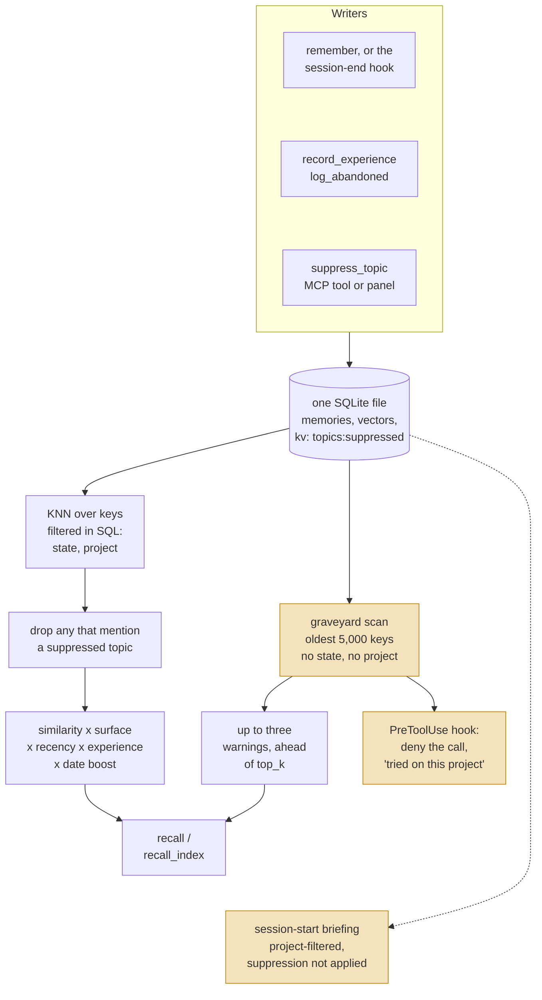

## 1. Executive Summary

OmniMem is a **self-hosted MCP memory server for coding agents** built around a
graveyard: an episodic memory carries effort, outcome and a list of approaches
that were tried and abandoned, and that list is consulted by keyword before
anything is embedded. Release 7.0.5 is one Rust binary over one SQLite file,
run headless as `omnimem serve` or as a desktop tray app, with embeddings
computed locally by an ONNX build of all-MiniLM-L6-v2 and Claude used only for
optional extras. The 6.x Python stack on Valkey continues on the `v6.7.x`
branch; this report reads `main`. Development happens on a Forgejo instance,
Squarecows, and the GitHub repository pinned here is its mirror.

**The graveyard speaks first, and at the point of action.** `mentions`
(`crates/omnimem-engine/src/recall.rs:35-50`) requires a match bounded by
non-alphanumeric characters, and `normalise_name` (`:97-112`) folds separators so
`tollgate-rs` and `Tollgate RS` compare equal. Up to three hits lead a recall
result outside its `top_k` budget, each carrying the reason, what worked
instead, the lesson and a firmness clause scaled by effort (`:141-200`,
`:461-505`). The same sentence is what a Claude Code `PreToolUse` hook returns
when it denies an `Edit`, `Write` or mutating `Bash` call whose new text names a
dead end (`crates/omnimem/src/hook.rs:434-477`). The hook exists, its module
comment says, because agents with the server attached made no memory calls of
their own.

**Topic suppression is the tombstone, in the read-path form.**
`topics:suppressed` is a set in the `kv` table, written only by `suppress_topic`
— an MCP tool and a settings-panel route — and read once per recall, where any
candidate whose content mentions a member on word boundaries is dropped before
scoring (`recall.rs:511-516`, `:682-687`; `tools.rs:960-990`). Until 7.0.3 an
abandonment at effort 4 or 5 also wrote the set. The changelog withdrew that
because suppression hid the memory explaining the failure and was store-wide;
`record_experience` reports the names under `auto_suppressed` and writes nothing
(`experience.rs:187-225`). The briefing that the session-start hook injects lists
the set and does not apply it.

**The graveyard scan is the one read with no predicate.** `abandoned_entries`
asks SQLite for episodic rows carrying the field among the first 5,000 keys in
key order (`recall.rs:357-361`, `crates/omnimem-store/src/store.rs:463-469`),
with no state and no project. Keys are ULIDs, so that is the oldest five
thousand: past that size a newly recorded dead end never warns, and a log line
is the only signal (`crates/omnimem-engine/src/lib.rs:160-168`). An archived
memory's dead end keeps warning, and the hook's refusal, which says the approach
*"was already tried on this project"* (`hook.rs:441`), can cite another project's.

**Memory here is visibility, not belief.** The lifecycle is `active →
deprioritised → archived → deleted`, a surface score per state
(`lifecycle.rs:76-94`), and archived rows are excluded in SQL before the vector
search (`store.rs:692-714`). Facts and preferences extracted from a memory
follow it through every per-memory transition and come back with it, recording
`retired_with` so a fact turned down on its own stays down
(`lifecycle.rs:179-267`). No state says whether a memory is true.
Contradictions are links appended to both rows (`maintenance.rs:62-90`), nothing
removes one, and the session-start context tells the agent to treat both sides
as unsettled for as long as the link stands.

**Three reasons are accepted and dropped.** `transition` stores a reason only
when the new state is `deprioritised` (`lifecycle.rs:130-134`), so the
maintenance pass's *"auto-maintenance: duplicate of `<key>`"* reaches the log and
nothing else (`maintenance.rs:274-276`). `suppress_topic` validates its reason,
echoes it and stores the topic alone (`tools.rs:980-989`). And
`remember(force=true)` skips the duplicate check, the contradiction check and
the extraction queue together (`tools.rs:295-314`).

**The skill compiler is the most careful writer in the tree.** A skill is
compiled from a domain's lessons with no model in the loop; `propose` stashes the
draft with the sha of the body it was diffed against, and `write` commits only
that stash and refuses when the stored body moved
(`crates/omnimem-engine/src/compiler.rs:462-493`). The agent holds both modes of
the same tool, which is why `human_review` is withheld (§9).

## 2. Mental Model

A memory is a record with a state, a score multiplier and the record of what it
cost. It enters `active` through `remember`, which asks two questions of its
nearest neighbours in the same project: is one the same claim (cosine 0.92 —
refuse and return the key), and does one say the opposite (cosine 0.7 and a
negation pair — store and warn). It leaves `active` by a verb from a person or
an agent, or by the maintenance pass, and takes its extracted facts with it.

Around that loop sits the experience layer. `record_experience` and
`log_abandoned` append to a graveyard that nothing prunes; the graveyard feeds
recall warnings, the pre-tool-use refusal and the session-start briefing, three
readers with three different scopes. The suppression set is a separate list a
person or agent keeps by hand, applied by recall alone.

The shaded nodes are the finding. The two readers the hooks put in front of the
agent carry less of the filtering than recall does: the graveyard scan none of
it, the briefing the project and not the suppression set.

## 3. Architecture

**Eleven crates, one engine.** `omnimem-store` owns SQLite, and
`omnimem-engine` holds recall, the lifecycle, experience, projects,
contradictions, maintenance, enrichment and the skill compiler. `omnimem-mcp`
registers the tools and the OAuth server. `omnimem-settings` renders the panel's
pages and calls the same engine functions. `omnimem-rss`, `-embed` and `-llm` are
the feed thread, the ONNX encoder and the Anthropic client; `omnimem-desktop` is
the tray app; `crates/omnimem` is the binary, its CLI and the Claude Code hooks.

**SQLite as the only store.** A memory is a JSON object of string fields in one
row; `state`, `project`, `project_name`, `feed_name` and the timestamps are
generated columns with indexes, so a filter cannot drift from the record
(`crates/omnimem-store/src/schema.rs:53-77`). Vectors sit in their own table
with `ON DELETE CASCADE`, load into one contiguous matrix per namespace and are
searched exactly (`vectors.rs`). A ranked key with no row is dropped
(`store.rs:677-678`), so the phantom entries of 6.x's separate index have
nothing left to happen to. `PRAGMA data_version` is checked before each search,
and the matrix reloads when another process committed (`store.rs:164`).

**Models.** Embeddings are all-MiniLM-L6-v2 at a pinned Hugging Face revision
(`crates/omnimem-embed/src/model.rs:14-18`), checked against reference vectors
the Python engine wrote. Claude is optional and used in four places — fact
extraction, query expansion, RSS summaries and the tier-2 contradiction check —
and every one fails open: no key, no extraction, raw storage.

### Deployment and ergonomics

`.deb`, `.rpm`, tarball, MSI, DMG, Flatpak and a Docker image are built in CI.
Only `/mcp`, the OAuth routes and `/healthz` are served over HTTP; the settings
panel reaches the desktop window over a custom scheme with no listener. A
non-loopback bind without authentication refuses to start
(`crates/omnimem-mcp/src/http.rs:136-143`), and OAuth codes and tokens are kept
as SHA-256 hashes (`crates/omnimem-store/src/oauth.rs:34`). Restore merges by
`updated_at`, newer wins (`crates/omnimem-store/src/backup.rs:266-290`).

## 4. Essential Implementation Paths

- **Store:** `crates/omnimem-store/src/store.rs` — `SearchFilter`
  (`:38-51`), `MemoryFilter` (`:57-86`), `list_memories` with the project
  predicate (`:409-426`) and the key cap (`:463-469`), `search` (`:653-690`),
  `filtered_keys` (`:692-714`), `push_state_filter` (`:827-837`);
  `schema.rs:53-95`.
- **Recall:** `crates/omnimem-engine/src/recall.rs` — `mentions` (`:35-50`),
  `decay` (`:77-86`), `warning_text` (`:141-200`), `compute_experience_weight`
  (`:248-265`), `abandoned_entries` (`:339-419`), `recall_results`
  (`:444-646`), `score_hits` (`:652-775`), the recall log (`:779-799`).
- **Lifecycle:** `lifecycle.rs` — states (`:44-85`), `transition`
  (`:97-177`), `cascade_to_derived` (`:185-267`), the suppression set
  (`:13`, `:269-271`).
- **Tools:** `tools.rs` — `remember` (`:276-369`), `resolve_recall_scope`
  (`:515-590`), `recall` (`:600-630`), `recall_index` (`:633-725`), the
  by-query targets (`:796-812`), `forget` (`:922-958`), `suppress_topic`
  (`:960-990`); `dedup.rs:31-60`.
- **Experience:** `experience.rs` — `record_experience` (`:111-227`),
  `log_abandoned` (`:229-256`), `experience_summary` (`:299-406`),
  `abandoned_warnings` (`:414-425`), `warn_if_abandoned` (`:427-445`).
- **Briefing:** `briefing.rs` — `scan_episodic_once` (`:50-135`),
  `new_knowledge` (`:137-195`), `session_briefing` (`:211-217`),
  `briefing_inner` (`:219-321`).
- **Contradiction and maintenance:** `contradiction.rs:12-99`;
  `maintenance.rs` — `link_contradiction` (`:62-90`), `check_contradictions`
  (`:95-206`), `run_maintenance` (`:248-346`); `llm.rs:292-345`.
- **Enrichment:** `llm.rs` — `extract_facts` (`:161`), `enrich`
  (`:388-523`); `temporal.rs:297-333`.
- **Skills:** `compiler.rs` — `compile_skill` (`:190-247`),
  `commit_proposal` (`:462-493`); `skill_tools.rs` — `bless` (`:245`).
- **Hooks:** `crates/omnimem/src/hook.rs` — `render_briefing` (`:132-238`),
  `proposal_text` (`:270-298`), `redact` (`:310-328`), `deny_reason`
  (`:434-447`), `warnings_for` (`:460-477`), `record_session` (`:494-543`);
  `install_hooks.rs`.
- **MCP surface:** `crates/omnimem-mcp/src/handler.rs:49-169`, `args.rs`,
  `descriptions.rs`, `instructions.md`.

## 5. Memory Data Model

Five namespaces share one shape and differ in fields. Every row carries
`content`, `state`, `surface_score`, `created_at`, `updated_at`, `tags`,
`provenance`, `licence` and the v7 identity fields `origin_id`, `content_hash`,
`epoch` and `classification`. Episodic rows add `project`, `effort_score`,
`outcome`, `iterations`, `experience_weight`, `abandoned_approaches`,
`breakthrough`, `lesson`, `gotchas`, `deprioritised_reason`,
`reinstate_hints`, `contradictions` and `event_date`. Extracted facts add
`enriched_from`, `source_doc_id`, `as_of` and, once their source has taken them
down, `retired_with`, `retired_state` and `retired_surface`. Project rows are
keyed by name; skills are whole documents with rule and source manifests.

**Provenance and licence are labels, not states.** The core crate says so in its
own words: two axes, *"never scored on"*
(`crates/omnimem-core/src/classification.rs:1-6`). `provenance` is `asserted`,
`concluded` or `retrieved` — who is speaking — and the session-end hook stamps
its records `concluded`. No read path filters on either.

**Record time, the source's record time, and event time.** `created_at` is when
the row was written. `as_of`, set on an extracted fact, is the source memory's
`created_at` (`llm.rs:484-486`), shown to the agent as a date so that a fact does
not read as true today. `event_date` is when the thing happened, set by the
extractor or inherited down a chain — the fact's own date, the source's, the
source's write time (`:491-500`) — and read only by `temporal_boost`, which
multiplies a candidate within a week of a date the query names by 1.5, falling
to 1.0 at sixty days (`temporal.rs:312-333`). No read filters on any of the
three, which is why `bitemporal` is withheld with the axes named.

**What is recorded about a removal.** A deprioritised row keeps its reason and
hints. An archived row keeps nothing about why. A deleted row is gone with its
graveyard entries, its links and the facts drawn from it; the suppression set
survives it, and the recall log (`log:recall:*`, thirty days) names the key.

## 6. Retrieval Mechanics

`recall` and `recall_index` resolve a project or domain filter to a project list
(`tools.rs:515-590`) and call one pipeline (`recall.rs:444-646`). The graveyard
scan runs first, on a cached parse of every abandoned approach the capped scan
returns. A warning's adjusted score decays with age but never below 0.6
(`:52-54`, `:466-471`); it is placed ahead of the results and outside `top_k`
(`:626-630`), and states its age once it is a day old.

Then the query is embedded once and each namespace searched. The `SearchFilter`
admits `active` and `deprioritised` rows of the requested projects in SQL
(`:658-661`), and only those keys are ranked; at least twenty candidates, fifty
under a project filter (`:269-275`). Per hit: archived and deleted dropped again,
content mentioning a suppressed topic dropped, the project re-checked
(`:677-693`). The score is `similarity × surface × recency × experience ×
temporal`, or with `RECALL_EXPERIENCE_SPAN` set, the experience weight added as
a bounded nudge instead (`:709-714`). Recency declines from the day of writing to
0.9 at ninety days, then 0.05 a month to a floor of 0.3 (`:77-86`). A
deprioritised row whose hint the query mentions is pinned to 0.6 and flagged.

Two collapses follow: duplicates by `(key, result_type)`, so a warning never
folds into the memory carrying it, and an extracted fact whose source also
matched is dropped and its score handed to the source (`:562-595`). The floor
reads raw similarity, not the adjusted score, with warnings and reinstate
candidates exempt (`:602-615`). The recall is logged with its keys and scores,
and each returned row's counters bumped (`:779-799`).

`why_did_you_mention` (`audit.rs:141`) reads the last recall logs back by keyword
and then by embedding, and returns the query and result keys that surfaced a
topic.

## 7. Write Mechanics

**`remember` is synchronous, refuses duplicates and warns on contradictions.**
It embeds, asks the namespace for its five nearest live rows and returns
`duplicate_found` if one in the same project is within 0.92 (`dedup.rs:31-60`),
then asks for ten and attaches a `contradiction_warning` if one within 0.7
carries the other half of a negation pair (`contradiction.rs:60-99`). The row is
written with its vector and is searchable at once. In `full` mode a job is
queued in a table, so a crash mid-extraction leaves it for the next start; the
worker writes each fact into the knowledge or preference namespace at surface
0.5 after its own duplicate check (`llm.rs:450-513`). `force` skips all three.

**The negation heuristic is cheap and broad.** Seventeen regex pairs —
*don't*/*do*, *never*/*always*, *avoid*/*use*, *without*/*with*,
*remove*/*add*, *failed*/*succeeded* — fire when one text has the negative and
the other the positive (`contradiction.rs:12-30`); the similarity gate is what
keeps it usable. The tier-2 check asks Claude for JSON, confirms only a literal
`true`, and treats a failed call as not a contradiction, so the pair is skipped
(`llm.rs:292-345`, `maintenance.rs:181-187`).

**Links are written and never unwritten.** `link_contradiction` appends
`{key, explanation, detected_at}` to both rows (`maintenance.rs:62-90`). No tool,
route or maintenance step removes an entry; the panel's two buttons archive one
side and leave the survivor carrying the link.

**Lifecycle transitions cascade to derived facts.** `cascade_to_derived` finds
every knowledge and preference row whose `enriched_from` or `source_doc_id` is
the key, moves it with the source, and records the state it had before, so
reinstating the source restores each fact as it was and never revives one
deprioritised on its own (`lifecycle.rs:185-267`). A maintenance archive of a
duplicate takes that duplicate's facts too. The bulk project tools bypass the
cascade: they write the state with one `set_fields_multi` (`projects.rs:580-629`),
reaching facts through their shared project label and leaving no `retired_with`
mark; `reinstate_project` returns every deprioritised or archived row in the
project, a fact turned down on its own included.

**Deletion asks first.** `forget` resolves a key or a query — the query path
takes recall's top three above 0.85, warnings excluded — and returns a preview
with a hint unless `confirm=true` (`tools.rs:922-958`). The query path runs
through the suppression filter, so a suppressed memory cannot be found by query
to be forgotten; it can be by key.

**The session-end hook writes on its own.** It reads the transcript, skips a
session that edited nothing, redacts credentials by pattern, and stores the first
ask, the closing message and the changed file names as an episodic memory
tagged `session-log` (`hook.rs:413-431`, `:494-543`). It goes through
`remember`, duplicate and contradiction checks included.

## 8. Agent Integration

Forty-eight MCP tools are registered in `handler.rs:49-169`, over streamable
HTTP with a shared bearer token, OAuth 2.1, or either. An 89-line instruction
block goes to every client on connect (`crates/omnimem-mcp/src/instructions.md`):
call `briefing` first, and call `warn_if_abandoned` before suggesting or agreeing
to a library — *"including one the human proposes"* — and say so if it warns. The agent
can write four namespaces, move any row through every state, delete with a flag
it sets, suppress and unsuppress topics, bless memories, and call both modes of
`compile_skill`.

**Three Claude Code hooks** carry memory without the agent choosing to.
`session-start` renders the project's briefing — current state, the graveyard,
breakthroughs, contradiction warnings, capped at 6,000 characters — through
`session_briefing`, which skips the maintenance counter and the skill scan
(`briefing.rs:201-217`, `hook.rs:132-238`). `pre-tool-use` guards `Edit`,
`MultiEdit`, `Write`, `NotebookEdit` and a `Bash` command that contains one of
eleven mutating fragments, reads only the text a call would put in place, and
fails open (`hook.rs:36-52`, `:270-298`). `session-end` is the writer in §7.
`omnimem install-hooks` adds the three to a Claude Code settings file.

**The two hooks read the graveyard at different scopes.** The session-start
graveyard comes from `experience_summary`, filtered to the project in SQL and
not by state (`experience.rs:305-309`). The pre-tool-use scan calls
`abandoned_warnings` with no project at all (`hook.rs:474-476`,
`experience.rs:414-425`), and its refusal says the approach was tried *"on this
project"*. Neither applies the suppression set.

## 9. Reliability, Safety, and Trust

**`tombstone` — earned, in the read-path form.** The record is a durable set of
lowercased strings with one writer, `suppress_topic`; the consultation is in the
recall pipeline, so recall, `recall_index`, the panel's search and the by-query
lifecycle tools never return a candidate that mentions a member. Matching is on
word boundaries with a three-character floor, so *"docker"* hides every memory
naming Docker and none naming `dockerfile`. The limits are the reach and the
record: the session-start briefing and the graveyard warnings bypass the set, and
the reason a caller gives is not stored. The graveyard itself is a second
value-keyed record that warns rather than hides.

**`scope_enforced` — earned, on the vector-search arm.** `project` is a SQL
predicate on every namespace recall searches, project namespace included through
`project_name`, and the Rust loop re-checks it (`store.rs:700-707`,
`recall.rs:688-693`). The briefing's episodic scan and experience summary filter
on it in SQL. The graveyard arm does not: a recall scoped to project B can open
with up to three warnings drawn from project A, each labelled with its project.

**`negative_eval` — earned.** Four cases assert exclusion against a populated
result, with the control in the same case. Another project's row stays out of a
scoped recall, and an out-of-domain memory out of a domain-filtered one. A
suppressed memory stays out of recall and returns once lifted. At the store, an
archived row and another project's row stay out of filtered searches whose exact
key lists are asserted.
No engine test puts an archived row in front of `recall`, the graveyard across
projects, or a suppressed topic in front of the briefing.

**`human_review` — withheld**, on the skill gate. `compile_skill` is registered
for the agent (`handler.rs:164`) and `mode` is a caller argument
(`crates/omnimem-mcp/src/args.rs:435-447`), so a model can call `propose` and then
`write`. The description's *"'write' commits only a previously proposed and
accepted diff"* (`descriptions.rs:184`) names no acceptor, and `bless`
(`handler.rs:167`) calls the compile-time gate *"the safety net"*. The stash and
the sha comparison guard against a stale write, which is a different thing from
an actor. The panel's contradiction, duplicate and lifecycle pages act on
memories already in recall.

**`trust_state` — withheld.** `state` is a visibility lifecycle with a filter
behind it; `provenance` names a speaker and filters nothing. No field says a
memory is believed, unverified or wrong, and the nearest epistemic record, the
contradiction link, is symmetric and never cleared.

**`bitemporal` — withheld.** `as_of` is the source's record time copied onto a
fact for display; `event_date` is an event axis used as a ranking boost. There is
no validity interval and no as-of read.

**`audit_log` — withheld.** The schema holds memories, vectors, the `kv` table,
store metadata, the enrichment queue and OAuth tables (`schema.rs`); no table
records a mutation. `log:recall:*` records reads for thirty days. Mutations bump
`updated_at` and write to the process log; nothing in the store says who or what
transitioned a row.

Other observations:

- **The duplicate check refuses; the contradiction check warns.** A
  contradiction may be the correction, so the store holds both sides until a
  person acts.
- **Fail-open is the pattern for every model call**, and in the tier-2
  contradiction check that means an API failure reads as *not a contradiction*.
- **Restore merges by `updated_at`**, so a backup cannot overwrite a newer row
  and cannot delete one either; a row forgotten after the backup returns.
- **The instruction block is the largest trust mechanism the agent sees**, and
  the hooks are where the project moved the graveyard check from prose into
  enforcement.

## 10. Tests, Evals, and Benchmarks

The Rust suite runs against an in-memory SQLite store and a deterministic
bag-of-words embedder, so similarity is predictable and no service is needed
(`crates/omnimem-engine/tests/tools.rs:1-62`). The lifecycle table is asserted
transition by transition. The recall suite asserts warnings first and outside the
floor, the fact-to-source collapse, reinstate candidates, the project and domain
filters and suppression. `phase3.rs` asserts that recording an abandonment leaves
the suppression set empty (`:106-174`), that facts follow their source through
deprioritise, archive, reinstate and forget (`:966-1034`), and that a recalled
fact carries its source's date (`:1056`).

The hook's unit tests assert that
reads are never proposals, that `old_string` is never searched, and that
credentials do not survive redaction (`hook.rs:604-768`). Coverage runs in CI
under `cargo llvm-cov`; the changelog records 86.4% of lines when it landed.

A benchmark harness is committed under `scripts/benchmarking`: LongMemEval
through the same MCP client for 6.x and 7.x, and a dead-end benchmark for the
hooks. No result file is committed. The changelog's figures — ten pairs of runs
on one task, every attempt at the abandoned approach stopped, 27% less cost —
name measurements the tree does not hold.

## 11. For Your Own Build

### Steal

- **A graveyard checked by keyword before the embedding**, on word boundaries
  with separators folded. One string comparison stands between a session and a
  dead end someone already paid for.
- **Enforce the memory at the point of action.** A hook that denies the
  mutating call and returns the reason and the way out works on an agent that
  never asks.
- **Facts follow their source.** A derived fact that outlives the memory it
  came from keeps asserting what its source stopped saying; record what the
  cascade changed so a reinstate restores exactly that.
- **Filter in the store, re-check in the loop.** Generated columns make the
  predicate impossible to drift from the record.
- **Commit only the draft that was reviewed**, pinned to the sha of what it was
  diffed against.
- **Keep a recall log and a tool that reads it.**

### Avoid

- **A capped scan in key order.** With time-ordered keys, the cap keeps the
  oldest records and drops the newest — the dead ends most likely to matter.
- **A reader without the predicate its sibling has.** The graveyard reads every
  project and state while the search beside it reads one; a refusal that says
  *"this project"* should be computed from this project.
- **Links that nothing clears.** Give the adjudication a place to land.
- **A reason accepted and dropped**, on archive and on suppression alike.
- **One flag that turns off three checks.**
- **A field named for what the code stopped doing.** `auto_suppressed` lists
  names nothing suppressed.

### Fit

This suits a developer who wants one memory across Claude Code, Cursor, Copilot
and the rest, on their own machine, with a tray app they can act in and a
graveyard that stops a repeated mistake before it runs. The lifecycle vocabulary
matches how people change their minds about advice, and the derived-fact cascade
is a real answer to stale extraction. It is single-user with project scoping,
its trust story ends at *these two disagree*, and a team running many projects
on one store should scope the graveyard before relying on the hook's refusals.

## 12. Open Questions

- **Is the graveyard meant to cross projects?** The skill compiler's docs
  embrace cross-project lessons; the hook's refusal text says otherwise, and no
  test pins either reading.
- **How is a contradiction meant to be resolved?** The instruction block asks
  the agent to ask the human; the store has no verb for the answer.
- **What happens at 5,000 episodic memories?** The session-end hook adds one per
  working session, and the changelog cites stores of about 3,000 and 3,500.
- **Where are the benchmark results?** The harness is committed and its
  outputs are not.

## Appendix: File Index

**Store**
- `crates/omnimem-store/src/schema.rs` — tables, generated columns, the `kv`
  table
- `crates/omnimem-store/src/store.rs` — filters, listing, search, key
  validation; `vectors.rs` — the in-memory matrix; `kv.rs`, `backup.rs`,
  `migrations.rs`, `queue.rs`, `oauth.rs`

**Engine**
- `crates/omnimem-engine/src/recall.rs` — the pipeline, the graveyard scan,
  warnings, the recall log
- `lifecycle.rs` — states, transitions, the derived-fact cascade, suppression
- `tools.rs` — remember, recall tools, lifecycle tools, suppression, backups
- `experience.rs`, `briefing.rs`, `maintenance.rs`, `contradiction.rs`,
  `dedup.rs`, `llm.rs`, `temporal.rs`, `audit.rs`, `classification.rs`,
  `lineage.rs`, `projects.rs`, `domains.rs`
- `compiler.rs`, `skills.rs`, `skill_tools.rs`, `skill_scan.rs`, `transfer.rs`

**Surfaces**
- `crates/omnimem-mcp/src/handler.rs`, `args.rs`, `descriptions.rs`,
  `instructions.md`, `http.rs`, `oauth/`
- `crates/omnimem/src/hook.rs`, `install_hooks.rs`, `main.rs`
- `crates/omnimem-settings/src/management.rs`, `lifecycle.rs`, `skills.rs`,
  `search.rs`, `memories.rs`
- `crates/omnimem-core/src/classification.rs`, `hash.rs`, `key.rs`

**Documentation**
- `docs/claude-code-hook.md`, `docs/features.md`, `docs/architecture.md`,
  `docs/memory-types.md`, `docs/rust-port-plan.md`, `docs/v7-change-spec.md`,
  `CHANGELOG.md`, `scripts/benchmarking/README.md`

**Tests**
- `crates/omnimem-engine/tests/tools.rs`, `phase3.rs`, `skills.rs`, `llm.rs`
- `crates/omnimem-store/tests/store.rs`, `backup.rs`
- `crates/omnimem-settings/tests/management.rs`, `memories.rs`, `projects.rs`
- inline `#[cfg(test)]` modules in `recall.rs`, `hook.rs`, `experience.rs`

**Searches that ground the absence claims above** (run at the pinned commit with
`/usr/bin/git`):
- `git grep -n '"contradictions".to_owned()' -- crates` — one writer,
  `maintenance.rs:81`; no removal.
- `git grep -n 'deprioritised_reason' -- crates/omnimem-engine/src` — stored at
  `lifecycle.rs:133` and `projects.rs:623`, both under the deprioritised branch;
  `git grep -n -E 'archive_reason|archived_reason' -- crates` — empty.
- `git grep -n -E 'suppressed_topics\(\)|SUPPRESSED_KEY' -- crates` — one
  `set_add` (`tools.rs:984`); readers at `recall.rs:512`, `briefing.rs:280`
  (listed, not applied) and `tools.rs:999`.
- `git grep -n 'abandoned_warnings(' -- crates` — the hook calls it at
  `hook.rs:475` with the proposal only; `sed -n 357,361p
  crates/omnimem-engine/src/recall.rs` — the scan's filter names no state and no
  project.
- `git grep -n '"abandoned_approaches"' -- crates` — appended at
  `experience.rs:169` and `:248`; nothing removes an entry.
- `git grep -n -w -i -E 'verified|believed|epistemic|unverified' -- crates/omnimem-engine/src crates/omnimem-store/src` — empty.
- `git grep -n -w -E 'valid_from|valid_until|valid_to|valid_at' -- crates` —
  empty; `git grep -n -w 'as_of' -- crates` — written at `llm.rs:485`, read for
  display at `recall.rs:758-767`.
- `git grep -n -E 'provenance[^,;]*(==|!=)|(==|!=)[^,;]*provenance|matches!\([^)]*provenance' -- crates/omnimem-engine/src crates/omnimem-store/src`
  — empty; no read compares provenance.
- `git grep -n 'CREATE TABLE' -- crates` — eight tables, none a mutation log.
- `git grep -n -w 'archived' -- crates/omnimem-engine/tests/tools.rs` — one hit,
  a transition error message; no recall case stores an archived row.
- `git grep -n -E 'abandoned_warning|warn_if_abandoned' -- crates/omnimem-engine/tests`
  — three cases, each with a single unscoped memory; none stores a second
  project. `git grep -n -E 'suppress' -- crates/omnimem-engine/tests/phase3.rs` —
  no briefing case reads the suppression set.
- `git grep -c 'Tool::new(' -- crates/omnimem-mcp/src/handler.rs` — 48.
- `git grep -n -i -E 'arxiv|bibtex|doi\.org' -- README.md docs` — no paper.
- `git ls-files | grep -i -E 'results?/|\.jsonl$|\.csv$'` — no benchmark
  result committed.

## History

**2026-11-03** — re-pinned to [`3790d5b75296904478c6c86fe54bbd22c20254e9`](https://github.com/richarvey/OmniMem/commit/3790d5b75296904478c6c86fe54bbd22c20254e9), release 7.0.5. The Python server, web UI, RSS worker and Valkey were replaced by a Rust workspace on SQLite, so every anchor is new and the report is rewritten against the crates. Marks unchanged: `tombstone`, `scope_enforced` and `negative_eval` hold on Rust code and tests ([§9](#9-reliability-safety-and-trust)). Since 7.0.3 recording an abandonment writes nothing to the suppression set, and suppressed topics and graveyard names match on word boundaries. New, in [§8](#8-agent-integration): Claude Code hooks, whose pre-tool-use guard reads every project's graveyard in every state over the oldest 5,000 episodic keys. The census published at the previous pin was measured at the 2026-09-05 commit and understated that tree; the header is measured here. Screened first: two Cargo files inside the cooldown and one `build.rs`; nothing was built or run.

**2026-09-19** — re-pinned to [`63685f8cb5cbbe11ffca829e6a0fcf0bc9c83d6f`](https://github.com/richarvey/OmniMem/commit/63685f8cb5cbbe11ffca829e6a0fcf0bc9c83d6f). `human_review` is **withdrawn**. Half of what it rested on was the web UI's archive, deprioritise and delete actions, which act on memories already in recall. The other half was the skill gate, described as making acceptance structural — and the tool registration says otherwise: `compile_skill` is registered at `mcp_server/server.py:304` and takes `mode` as a caller parameter, so a model can call `propose` and then `write` itself, with the docstring's *"commits the stashed proposal after human review"* being a sentence rather than a check. `bless` is registered at `:307` and calls that compile-time gate *"the safety net"*. The TTL stash and the sha comparison protect against a stale write, which is optimistic concurrency and not an actor boundary. `tombstone`, `scope_enforced` and `negative_eval` stand. Screened again first; nothing was installed and no suite was run.

**2026-09-16** — [`6aaee7e8f5ac4abcf50cfed3af012e9f7a903c29`](https://github.com/richarvey/OmniMem/commit/6aaee7e8f5ac4abcf50cfed3af012e9f7a903c29) — re-read at a commit dated 15 September 2026, 36 commits past the previous pin. All four marks re-tested and held. `lifecycle.py`, the contradictions review surface and `test_recall.py` are unchanged, so the tombstone, review and negative-evaluation evidence stands as written. `recall.py` gained 243 lines and the scope predicate came with them rather than after them: `normalise_project_filter` is the one normaliser, `_build_filter_expr(namespace, project_filter)` builds the per-namespace expression, and `_candidate_k` widens the candidate pool when a filter will thin it. Two additions are recorded here for the first time — the `is_phantom` test that drops a hit whose backing record is gone, with the note explaining why the obvious `content == ""` test would have made every description-less project unrecallable, and the two-threshold score cut justified by the encoder's own overlap. Screened before reading, from a full clone: no auto-run surface, one build-time execution point, four unpinned dependency surfaces and one dependency file inside the seven-day cooldown; an agent-addressed instruction file was recorded as data. Nothing was installed, built or run.

**2026-09-05** — [`50fde316a1fcdd53a75a66d982b7bdee987ba364`](https://github.com/richarvey/OmniMem/commit/50fde316a1fcdd53a75a66d982b7bdee987ba364) — first reading, at the merge of the v6.4.x branch on the GitHub mirror. Screened first: no auto-run surface, one build-time execution path (a pytest `conftest.py`), three unpinned requirement files, nothing inside the seven-day cooldown, and a `CLAUDE.md` addressed to a reading agent, treated as data. Nothing was installed or run; the tests were read, not executed. Four marks — `tombstone` in the read-path form on topic suppression, `scope_enforced`, `human_review`, `negative_eval` — with `trust_state` withheld on a lifecycle that records visibility and never belief, `bitemporal` on an event axis used as a boost, and `audit_log` on a recall log that records reads. The findings recorded are the contradiction link that nothing clears, the archive reason that nothing stores, and the one flag that disables three checks.
