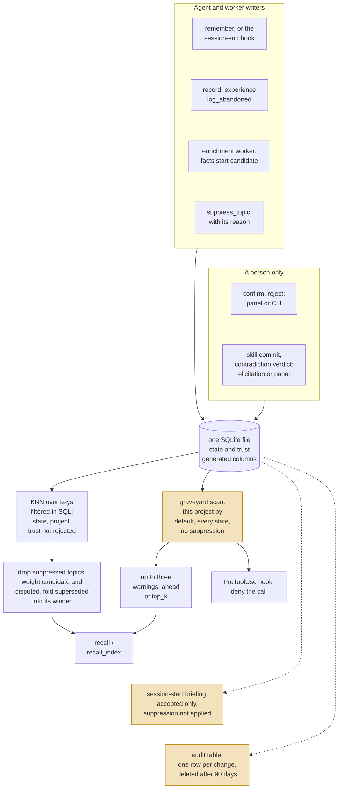

## 1. Executive Summary

OmniMem is a **self-hosted MCP memory server for coding agents** built around a
graveyard: an episodic memory carries effort, outcome and a list of approaches
that were tried and abandoned, and that list is consulted by keyword before
anything is embedded. Release 7.0.8 is one Rust binary over one SQLite file,
run headless as `omnimem serve` or as a desktop tray app, with embeddings
computed locally by an ONNX build of all-MiniLM-L6-v2 and Claude used only for
optional extras. The 6.x Python stack on Valkey continues on the `v6.7.x`
branch; this report reads `main`. Development happens on a Forgejo instance,
Squarecows, and the GitHub repository pinned here is its mirror.

**The graveyard speaks first, and at the point of action.** `mentions`
(`crates/omnimem-engine/src/recall.rs:36-50`) requires a match bounded by
non-alphanumeric characters, and `normalise_name` (`:98-112`) folds separators so
`tollgate-rs` and `Tollgate RS` compare equal. Up to three hits lead a recall
result outside its `top_k` budget, each carrying the reason, what worked
instead, the lesson and a firmness clause scaled by effort (`:159-225`,
`:518-560`). The same sentence is what a Claude Code `PreToolUse` hook returns
when it denies an `Edit`, `Write` or mutating `Bash` call whose new text names a
dead end (`crates/omnimem/src/hook.rs:459-490`, `:529-546`). The hook exists, its
module comment says, because agents with the server attached made no memory calls
of their own.

**The graveyard reads the caller's project.** Under `GRAVEYARD_SCOPE=project`,
the default (`crates/omnimem-engine/src/config.rs:216`), `abandoned_matches`
skips a dead end recorded on another project (`recall.rs:472-497`, `:119-122`),
and the hook takes its project from `OMNIMEM_PROJECT` or the call's working
directory (`hook.rs:97-115`). A refusal that cites another project's dead end,
possible under `all`, says where it was recorded (`hook.rs:459-490`). The scan
has no key cap and no state filter, by design: an archived memory's lesson keeps
warning (`recall.rs:391-401`). An unscoped recall reads every project, and so does
`warn_if_abandoned`, whose arguments are fixed by the 6.x contract
(`experience.rs:449-452`).

**Trust is a second axis beside state.** `state` says whether a memory is
visible; `trust` says whether OmniMem believes it — `candidate`, `accepted`,
`disputed`, `superseded` or `rejected` (`trust.rs:1-19`). A rejected memory is
excluded in SQL from every recall search (`recall.rs:770-783`); a candidate or
disputed one is weighted down, and a superseded one appears only inside its
winner's hit (`:725-761`, `:840-848`). The briefing lists only accepted memories,
and skills compile only from them.

**A person's yes, in three places.** An extracted fact starts `candidate`, and
`set_trust`, the only writer that confirms one, is called by the settings window
and the `omnimem trust` CLI and by no MCP tool (`trust.rs:133-178`). Under
`HUMAN_APPROVAL=human`, the default, an agent's `compile_skill(mode="write")`
and `check_contradictions(mode="resolve")` are intercepted before dispatch and
put to the person through MCP elicitation; a client that cannot be asked leaves a
pending proposal for the settings window (`crates/omnimem-mcp/src/handler.rs:803-822`,
`resolution.rs:496-595`).

**The audit log is real and time-limited.** Each state change, delete and
suppression writes a row in the change's own transaction, with the actor and the
MCP client's name (`crates/omnimem-store/src/audit.rs:1-23`, `:573-630`). A
forget scrubs the forgotten text from earlier rows. `AUDIT_RETENTION_DAYS=90` deletes older rows at
startup and on every maintenance pass (`audit.rs:822-831`,
`maintenance.rs:287`), which is why `audit_log` is withheld (§9).

## 2. Mental Model

A memory is a record with a state, a trust value, a score multiplier and the
record of what it cost. It enters through `remember`, which asks two questions of
its nearest neighbours in the same project: is one the same claim (cosine 0.92 —
refuse and return the key), and does one say the opposite (cosine 0.7 and a
negation pair — store and warn). An agent's own memory starts `accepted`; a fact
OmniMem extracts from it starts `candidate`. A memory leaves `active` by a verb
from a person or an agent, or by the maintenance pass, and takes its extracted
facts with it. It leaves `accepted` only by a person's verdict or a
model-confirmed contradiction.

Around that loop sits the experience layer. `record_experience` and
`log_abandoned` append to a graveyard that nothing prunes; the graveyard feeds
recall warnings, the pre-tool-use refusal and the session-start briefing. The
suppression set is a list a person or agent keeps by hand, applied by recall
alone.

The shaded nodes are the findings. The graveyard scan and the briefing skip the
suppression set that recall applies, the graveyard skips state and trust as well,
and the audit table keeps 90 days by default.

## 3. Architecture

**Eleven crates, one engine.** `omnimem-store` owns SQLite and the audit table,
and `omnimem-engine` holds recall, the lifecycle, trust, experience, projects,
contradictions and their resolution, maintenance, enrichment and the skill
compiler. `omnimem-mcp` registers the tools, the elicitation gate and the OAuth
server. `omnimem-settings` renders the panel's pages and calls the same engine
functions. `omnimem-rss`, `-embed` and `-llm` are the feed thread, the ONNX
encoder and the Anthropic client; `omnimem-desktop` is the tray app;
`crates/omnimem` is the binary, its CLI and the Claude Code hooks.

**SQLite as the only store.** A memory is a JSON object of string fields in one
row; `state`, `project`, `project_name`, `feed_name`, the timestamps and `trust`
are generated columns with indexes, so a filter cannot drift from the record
(`crates/omnimem-store/src/schema.rs:130-148`, `:18-66`). The trust default is
spelled once as SQL (`TRUST_EXPR`) and once in Rust (`trust_of`,
`crates/omnimem-store/src/store.rs:61-69`), so a 6.x backup needs no rewrite.
Vectors sit in their own table with `ON DELETE CASCADE`, load into one contiguous
matrix per namespace and are searched exactly; `PRAGMA data_version` is checked
before each search, and the matrix reloads when another process committed
(`store.rs:131`, `:170-190`).

**Models.** Embeddings are all-MiniLM-L6-v2 at a pinned Hugging Face revision
(`crates/omnimem-embed/src/model.rs:18`), checked against reference vectors
the Python engine wrote. Claude is optional and used in four places — fact
extraction, query expansion, RSS summaries and the tier-2 contradiction check —
and every one fails open: no key, no extraction, raw storage.

### Deployment and ergonomics

`.deb`, `.rpm`, tarball, MSI, DMG, Flatpak and a Docker image are built in CI.
Only `/mcp`, the OAuth routes and `/healthz` are served over HTTP; the settings
panel reaches the desktop window over a custom scheme with no listener. A
non-loopback bind without authentication refuses to start
(`crates/omnimem-mcp/src/http.rs:136-143`), and OAuth codes and tokens are kept
as SHA-256 hashes (`crates/omnimem-store/src/oauth.rs:34`). `OAUTH_BASE_URL`
takes several addresses, and `*` answers any host. Restore merges by
`updated_at`, the store winning a tie, and adds audit rows it lacks
(`crates/omnimem-store/src/backup.rs:1-12`, `:289-310`). A background check reads
the latest release from the Squarecows Forgejo API into the `kv` table, and the
tray, panel and briefing read it back; `UPDATE_CHECK=false` stops it
(`crates/omnimem-app/src/update.rs:17`, `crates/omnimem-engine/src/release.rs:1-18`).

## 4. Essential Implementation Paths

- **Store:** `crates/omnimem-store/src/store.rs` — `SearchFilter` (`:41-55`),
  `trust_of` (`:61-69`), `MemoryFilter` (`:74-105`), `list_memories`
  (`:408`), `search` (`:730`), `filtered_keys` (`:769-792`), `push_state_filter`
  (`:905-916`), `push_trust_filter` (`:918-925`); `schema.rs` — `TRUST_EXPR`
  (`:23`), v5 (`:35-66`), the audit table (`:69-88`).
- **Audit:** `crates/omnimem-store/src/audit.rs` — levels (`:43-80`), actors
  (`:96-116`), `enter` (`:230`), `op` (`:262`), the `KEPT` field list (`:323`),
  `scrub_forgotten` (`:401-450`), the recorder (`:573-630`), `prune_audit`
  (`:822-831`); `crates/omnimem-engine/src/audit_log.rs:112-121`.
- **Recall:** `crates/omnimem-engine/src/recall.rs` — `mentions` (`:36-50`),
  `decay` (`:78`), `normalise_name` (`:98`), `elsewhere` (`:119-122`),
  `warning_text` (`:159-225`), `compute_experience_weight` (`:286`),
  `abandoned_entries` (`:377-465`), `abandoned_matches` (`:472-497`),
  `recall_results` (`:501-715`), `fold_superseded` (`:725-761`), `score_hits`
  (`:763-900`), the recall log (`:914`).
- **Trust:** `trust.rs` — values (`:28-32`), `dispute` (`:58-64`), `set_trust`
  (`:138-178`), `unconfirmed_from` (`:194-225`); `briefing.rs:62-73`,
  `:158-162`; `skills.rs:155-162`.
- **Lifecycle:** `lifecycle.rs` — the suppression keys (`:13-16`), states
  (`:48`), `transition` (`:100-215`), `cascade_to_derived` (`:220`).
- **Tools:** `tools.rs` — `remember` (`:317-410`), `resolve_recall_scope`
  (`:556-640`), `recall` (`:641`), `recall_index` (`:674`), `forget` (`:976`),
  `suppress_topic` (`:1015-1055`), `backup_path` (`:1124-1135`),
  `restore_from_file` (`:1207`); `dedup.rs`.
- **Experience:** `experience.rs` — `record_experience` (`:120`),
  `log_abandoned` (`:239`), `experience_summary` (`:310`),
  `abandoned_warnings` (`:429`), `warn_if_abandoned` (`:449-470`).
- **Briefing:** `briefing.rs` — `scan_episodic_once` (`:53-152`),
  `new_knowledge` (`:154`), `session_briefing` (`:229`), `briefing_inner`
  (`:237`).
- **Contradiction, resolution and maintenance:** `contradiction.rs`;
  `maintenance.rs` — `link_contradiction` (`:66-110`), `check_contradictions`
  (`:119`), `run_maintenance` (`:283`); `resolution.rs` — the link format
  (`:1-21`), outcomes (`:48-59`), `link_is_resolved` (`:184`),
  `review_resolution` (`:283`), `resolve_contradiction` (`:354-495`),
  `propose_resolution` (`:496`), `accept_pending_resolution` (`:574`).
- **Skills:** `compiler.rs` — `compile_skill` (`:305-360`),
  `review_skill_proposal` (`:361`), `commit_approved_skill` (`:390`),
  `pending_skill_proposals` (`:419`), `commit_proposal` (`:674`);
  `skill_tools.rs` — `bless` (`:246`).
- **Approval:** `crates/omnimem-mcp/src/approval.rs` — `can_ask` (`:48`),
  `ask_human` (`:60-104`); `handler.rs` — `resolve_with_approval` (`:573`),
  `write_with_approval` (`:632`), the interception (`:803-822`).
- **Hooks and CLI:** `crates/omnimem/src/hook.rs` — `GUARDED` (`:37`),
  `project_name` (`:97`), `render_briefing` (`:132`), `proposal_text`
  (`:290`), `redact` (`:330`), `deny_reason` (`:459`), `guard` (`:529`),
  `record_session` (`:564`); `trust_cli.rs`, `main.rs`, `install_hooks.rs`.
- **MCP surface:** `crates/omnimem-mcp/src/handler.rs:50-177`, `:205-449`,
  `args.rs`, `descriptions.rs`, `instructions.md`.

## 5. Memory Data Model

Five namespaces share one shape and differ in fields. Every row carries
`content`, `state`, `surface_score`, `created_at`, `updated_at`, `tags`,
`provenance`, `licence` and the v7 identity fields `origin_id`, `content_hash`,
`epoch` and `classification`, and may carry `trust` and `trust_prior`, the value
a disputed, superseded or rejected memory returns to. Episodic rows add
`project`, `effort_score`, `outcome`, `iterations`, `experience_weight`,
`abandoned_approaches`, `breakthrough`, `lesson`, `gotchas`,
`deprioritised_reason`, `archived_reason`, `reinstate_hints`, `contradictions`
and `event_date`. Extracted facts add `enriched_from`, `source_doc_id`, `as_of`
and, once their source has taken them down, `retired_with`, `retired_state` and
`retired_surface`. A superseded memory carries `superseded_by`. Project rows are
keyed by name; skills are whole documents with rule and source manifests.

**Provenance and licence are labels; trust is the belief.** The core crate calls
provenance and licence two axes *"never scored on"*
(`crates/omnimem-core/src/classification.rs:1-6`). `provenance` is `asserted`,
`concluded` or `retrieved` — who is speaking. `trust` is a separate column with
its own default: an extracted fact, which carries `enriched_from`, is
`candidate`; anything else is `accepted` (`schema.rs:18-25`).
`TRUST_ENRICHMENT=accepted` makes extracted facts start believed
(`llm.rs:490`).

**A contradiction link carries its verdict.** A link is
`{key, explanation, detected_at, verified}` on both rows; a resolution is
written onto the link as `{outcome, winner, reason, resolved_at, resolved_by,
history}` and the link is never deleted, because the next scan would find the
pair again (`resolution.rs:1-21`). Re-resolving keeps the earlier verdict in
`history`, and `reopened` puts the warning back.

**Record time, the source's record time, and event time.** `created_at` is when
the row was written. `as_of`, set on an extracted fact, is the source memory's
`created_at`, shown to the agent as a date so that a fact does not read as true
today. `event_date` is when the thing happened, read only by `temporal_boost`,
which multiplies a candidate within a week of a date the query names by 1.5,
falling to 1.0 at sixty days. No read filters on any of the three, which is why
`bitemporal` is withheld with the axes named.

**What is recorded about a removal.** A deprioritised row keeps its reason and
hints, an archived row its reason; reinstating clears both
(`lifecycle.rs:140-168`). A suppressed topic keeps its reason under
`topics:suppressed:reasons`. A deleted row is gone with its graveyard entries,
its links and the facts drawn from it; its audit rows keep who, when, the action
and the state with the text scrubbed, until retention deletes them.

## 6. Retrieval Mechanics

`recall` and `recall_index` resolve a project or domain filter to a project list
(`tools.rs:556-640`) and call one pipeline (`recall.rs:501-715`). The graveyard
scan runs first, on a cached parse of every abandoned approach in the episodic
namespace, filtered to the caller's projects unless `GRAVEYARD_SCOPE=all`. A
warning's adjusted score decays with age but never below 0.6 (`:55`,
`:523-528`); it is placed ahead of the results and outside `top_k`, and states
its age once it is a day old.

Then the query is embedded once and each namespace searched. The `SearchFilter`
admits `active` and `deprioritised` rows of the requested projects whose trust is
not `rejected`, in SQL (`:770-783`), and only those keys are ranked. Per hit:
archived and deleted dropped again, content mentioning a suppressed topic
dropped, the project re-checked (`:796-818`). The score is `similarity × surface
× recency × experience × temporal`, or with `RECALL_EXPERIENCE_SPAN` set, the
experience weight added as a bounded nudge instead; then multiplied by 0.8 for
`disputed` and 0.9 for `candidate` (`:840-848`). Recency declines from the day of
writing to 0.9 at ninety days, then 0.05 a month to a floor of 0.3 (`:78`). A
deprioritised row whose hint the query mentions is pinned to 0.6 and flagged.

Three collapses follow: duplicates by `(key, result_type)`, so a warning never
folds into the memory carrying it; an extracted fact whose source also matched is
dropped and its score handed to the source; and a superseded memory is listed
under its winner's `replaces`, or dropped when the winner stands and did not
match (`:725-761`). The floor reads raw similarity, not the adjusted score, so
the trust weights reorder results and never remove one. The recall is logged with
its keys and scores, and each returned row's counters bumped (`:914`).

`why_did_you_mention` (`audit.rs`) reads the last recall logs back by keyword and
then by embedding, and returns the query and result keys that surfaced a topic.

## 7. Write Mechanics

**`remember` is synchronous, refuses duplicates and warns on contradictions.**
It embeds, asks the namespace for its five nearest live rows and returns
`duplicate_found` if one in the same project is within 0.92, then asks for ten
and attaches a `contradiction_warning` if one within 0.7 carries the other half
of a negation pair. The row is written with its vector and is searchable at once.
In `full` mode a job is queued in a table, so a crash mid-extraction leaves it
for the next start; the worker writes each fact into the knowledge or preference
namespace at surface 0.5, as a candidate, after its own duplicate check. `force`
skips all three (`tools.rs:336-351`).

**The negation heuristic links; the model disputes.** Seventeen regex pairs —
*don't*/*do*, *never*/*always*, *avoid*/*use*, *without*/*with*,
*remove*/*add*, *failed*/*succeeded* — fire when one text has the negative and
the other the positive (`contradiction.rs`); the similarity gate is what keeps it
usable. The tier-2 check asks Claude for JSON and confirms only a literal `true`.
`link_contradiction` appends the link to both rows and, when the model confirmed
it, marks it `verified` and disputes both sides (`maintenance.rs:66-110`). A
failed call reads as not a contradiction.

**A resolution moves trust and goes through the lifecycle.** `supersedes` names a
winner and marks the loser `superseded`, optionally deprioritising or archiving
it through `transition`, so its facts follow; `both_wrong` rejects both;
`both_valid` and `false_positive` end the dispute; a pair still disputed by
another open link stays disputed (`resolution.rs:354-495`, `trust.rs:74-102`). A
resolved pair is not relinked by the next scan and drops out of the briefing, the
session-start hook and the panel's list, while recall and `explain_memory` show
the verdict. Forgetting one side settles the survivor (`resolution.rs:709`).

**Lifecycle transitions cascade to derived facts.** `cascade_to_derived` finds
every knowledge and preference row whose `enriched_from` or `source_doc_id` is
the key, moves it with the source, and records the state it had before, so
reinstating the source restores each fact as it was and never revives one
deprioritised on its own (`lifecycle.rs:220`). A maintenance archive of a
duplicate takes that duplicate's facts too.

**Deletion asks first.** `forget` resolves a key or a query — the query path
takes recall's top three above 0.85, warnings excluded — and returns a preview
with a hint unless `confirm=true` (`tools.rs:976`). The query path runs through
the suppression filter, so a suppressed memory cannot be found by query to be
forgotten; it can be by key. The delete and the audit scrub share a transaction.

**Every change is attributed.** The MCP handler, the panel, the hooks, the
workers and the CLI each set an ambient actor on their thread before calling the
engine (`audit.rs:96-116`, `:230`), and the engine names the operation around a
write (`:262`). At the default `lifecycle` level a state change, delete,
suppression, trust verdict, resolution and skill write is recorded with the
fields that moved; `writes` adds every other write without text, `full` adds the
text (`audit.rs:43-56`, `config.rs:325-335`).

**The session-end hook writes on its own.** It reads the transcript, skips a
session that edited nothing, redacts credentials by pattern, and stores the first
ask, the closing message and the changed file names as an episodic memory
tagged `session-log` (`hook.rs:564`). It goes through `remember`, duplicate and
contradiction checks included.

## 8. Agent Integration

Forty-eight MCP tools are registered in `handler.rs:50-177`, over streamable
HTTP with a shared bearer token, OAuth 2.1, or either. A 96-line instruction
block goes to every client on connect (`crates/omnimem-mcp/src/instructions.md`):
call `briefing` first, and call `warn_if_abandoned` before suggesting or agreeing
to a library — *"including one the human proposes"* — and say so if it warns. The
agent can write four namespaces, move any row through every state, delete with a
flag it sets, suppress and unsuppress topics, bless memories, propose skills and
contradiction verdicts, and restore a backup file from the backups directory.
It cannot change a memory's trust, accept a pending proposal or change
`HUMAN_APPROVAL`, which is read from the environment and set in the panel's
configuration page.

**The elicitation gate.** The handler checks the tool name and `mode` before
dispatch and, under `HUMAN_APPROVAL=human`, routes the two gated calls to
`ask_human`, a one-boolean form the client renders to the person
(`approval.rs:60-104`). The person sees the diff or both memories, the outcome
and the agent's reason; accept commits exactly what was shown, re-checked against
the stash's sha; decline writes nothing and keeps the stash; no answer in ten
minutes writes nothing (`handler.rs:457-708`). The audit row for an accepted write
carries the reason *"approved by the user via elicitation"*.

**Three Claude Code hooks** carry memory without the agent choosing to.
`session-start` renders the project's briefing — current state, the graveyard,
breakthroughs, open contradiction warnings, a newer-release line, capped at 6,000
characters — through `session_briefing` (`briefing.rs:229`, `hook.rs:132`).
`pre-tool-use` guards `Edit`, `MultiEdit`, `Write`, `NotebookEdit` and a `Bash`
command that contains a mutating fragment, reads only the text a call would put
in place, scopes to the project, and fails open (`hook.rs:37`, `:290`, `:529`).
`session-end` is the writer in §7. `omnimem install-hooks` adds the three to a
Claude Code settings file, with a shell-runnable path on Windows.

**The repository maps its marks to this atlas.** `docs/atlas-evidence.md` lists,
per mark, the code OmniMem says enforces it, the test that fails without it and
its stated limits, with a status column the page calls *"OmniMem's own
reading"*. Its `audit_log` row is marked claimed; the retention default is why
§9 withholds it.

## 9. Reliability, Safety, and Trust

**`tombstone` — earned, in the read-path form.** The record is a durable set of
lowercased strings with one writer, `suppress_topic`, and a reason kept beside
it; the consultation is in the recall pipeline, so recall, `recall_index`, the
panel's search and the by-query lifecycle tools never return a candidate that
mentions a member. Matching is on word boundaries with a three-character floor,
so *"docker"* hides every memory naming Docker and none naming `dockerfile`. The
limit is the reach: the session-start briefing and the graveyard warnings bypass
the set, and two `#[ignore]` tests in `negative_recall.rs:796-841` assert the
behaviour that would close it. The graveyard itself is a second value-keyed
record that warns rather than hides.

**`trust_state` — earned.** `trust` is a discrete field with five values, and
`rejected` withholds: every recall search excludes it in SQL, and the briefing
and the skill compiler admit only `accepted`, so a candidate is withheld from
both. A model-confirmed contradiction disputes both sides and a heuristic one
disputes nothing (`maintenance.rs:89-101`, `trust.rs:36-48`). The limits are
stated in the code. The weights reorder and the floor reads raw similarity, so
a candidate or disputed memory is returned whenever it matches. The graveyard ignores
trust as it ignores state, so a rejected memory's dead end still warns and still
denies a tool call. And `restore_from_file` writes whatever trust a backup row
carries when the row is newer than the store's.

**`scope_enforced` — earned, on both arms.** `project` is a SQL predicate on
every namespace recall searches, project namespace included through
`project_name`, and the Rust loop re-checks it (`store.rs:769-792`,
`recall.rs:809-814`). The briefing's episodic scan and experience summary filter
on it in SQL. The graveyard and the hook filter on it under the default scope,
in Rust over a cached parse (`recall.rs:486`). The exceptions are explicit: a
dead end recorded with no project warns in every project, an unscoped recall and
`warn_if_abandoned` read all of them, and `GRAVEYARD_SCOPE=all` crosses projects
with each warning naming its source.

**`human_review` — earned.** The test is whether the agent that wrote a memory
can clear its review, and here it has no verb that does. A candidate fact waits
until `set_trust` confirms it, and `set_trust` has callers only in the settings
window (`crates/omnimem-settings/src/trust.rs:195-256`) and the CLI
(`crates/omnimem/src/trust_cli.rs:60-140`). A skill write and a contradiction
verdict are proposals the person accepts through the client's elicitation
dialog, or, from a client that cannot ask, in the settings window or with
`omnimem contradictions`; `accept_pending_resolution` and the stashed skill
commit have no MCP caller. Three limits:
- **The CLI has no terminal check,** so an agent with a general shell on the same machine can run
  `omnimem trust confirm`.
- **Elicitation is the client's,** so a client that auto-accepts it approves for
  the agent.
- **Agent-written memories start `accepted`.** The queue holds OmniMem's own
  conclusions, not the agent's, and `HUMAN_APPROVAL=agent` removes both gates.

**`audit_log` — withheld, on retention.** The table is a named record of
mutations in the store's own database: one row per change, inserted inside the
change's transaction so it cannot record a write that rolled back
(`audit.rs:1118-1170`), with the actor, the client, the fields that moved and the
reason. `forget` replaces the forgotten text in earlier rows and keeps the rows,
which is a privacy redaction and would not cost the mark. The default does:
`AUDIT_RETENTION_DAYS=90` deletes every row older than ninety days, at startup
(`crates/omnimem-app/src/services.rs:80`) and on every maintenance pass
(`maintenance.rs:287`). With `AUDIT_RETENTION_DAYS=0` the log keeps everything.
A restore also inserts the audit rows a backup file carries that the store lacks.

**`bitemporal` — withheld.** `as_of` is the source's record time copied onto a
fact for display; `event_date` is an event axis used as a ranking boost. There is
no validity interval and no as-of read.

Other observations:

- **The duplicate check refuses; the contradiction check warns.** A
  contradiction may be the correction, so the store holds both sides until a
  person settles it.
- **Fail-open is the pattern for every model call**, and in the tier-2
  contradiction check that means an API failure reads as *not a contradiction*
  and disputes nothing.
- **Restore merges by `updated_at`**, so a backup cannot overwrite a newer row
  and cannot delete one either; a row forgotten after the backup returns.
  `set_trust` leaves `updated_at` alone, so restoring an older dump does not undo
  a person's verdict, and a hand-written file in the backups directory can.
- **The instruction block is the largest trust mechanism the agent sees**, and
  the hooks are where the project moved the graveyard check from prose into
  enforcement.

## 10. Tests, Evals, and Benchmarks

The Rust suite runs against an in-memory SQLite store and a deterministic
bag-of-words embedder, so similarity is predictable and no service is needed.
The lifecycle table is asserted transition by transition. `phase3.rs` asserts that
recording an abandonment leaves the suppression set empty, that facts follow
their source through deprioritise, archive, reinstate and forget, that a recalled
fact carries its source's date, and that project scope keeps dead ends to their
own project (`:1230`).

**`negative_recall.rs` asserts what every read channel must not return.** Each
excluded memory is a near-duplicate of the query, and the test asserts it scores
above the weak band with the suite's own embedder. That way only the exclusion
under test can keep it out, and each test also asserts that an active control
comes back (`:1-34`). The conditions are:
- archived, forgotten, a leftover `state=deleted` row;
- a suppressed topic, another project, below the floor;
- rejected and superseded;
- another project's dead end, and an empty domain and project intersection.

The channels are recall, `recall_index`, recall with query expansion (the RRF
path) and the briefing. The module comment says each predicate was broken by hand
and its test watched fail; I did not repeat that, and ran nothing.

The other new suites cover the gates and the log. `tests/trust.rs` asserts what a memory starts as, that each resolution
outcome moves trust, that a heuristic link disputes nothing, and that every
engine call an agent's tool reaches — retag, licence, provenance, promote,
deprioritise, reinstate, recall — leaves a candidate a candidate (`:335-353`).
`crates/omnimem-mcp/tests/approval.rs` drives the elicitation gate over HTTP:
accept commits byte for byte, decline writes nothing, a client without
elicitation gets `awaiting_approval` and leaves a pending resolution, and
`HUMAN_APPROVAL=agent` writes on the agent's say-so. `tests/audit_log.rs` asserts
each level's contents, the actor per entry point, the scrub on forget and
`delete_project`, and that retention prunes old rows and `0` keeps them (`:530`).
The hook's unit tests assert that reads are never proposals, that `old_string` is
never searched, that credentials do not survive redaction, and that the hook
denies only for the project that recorded the dead end.

A benchmark harness is committed under `scripts/benchmarking`: LongMemEval
through the same MCP client for 6.x and 7.x, and a dead-end benchmark for the
hooks. No result file is committed. The changelog's figures — ten pairs of runs
on one task, every attempt at the abandoned approach stopped, 27% less cost —
name measurements the tree does not hold.

## 11. For Your Own Build

### Steal

- **A graveyard checked by keyword before the embedding**, on word boundaries
  with separators folded. One string comparison stands between a session and a
  dead end someone already paid for.
- **Enforce the memory at the point of action.** A hook that denies the
  mutating call and returns the reason and the way out works on an agent that
  never asks.
- **Two axes, visibility and belief.** `state` and `trust` as separate generated
  columns let a read say *on record, not believed* without hiding the row.
- **Your own conclusions start as candidates.** An extracted fact is a claim
  OmniMem made, so it waits for a person before it reaches the briefing or a
  skill.
- **Put the question to the person, not the model.** Elicitation turns an
  agent's `write` into a dialog the model never answers, and a client that cannot
  ask leaves the proposal parked rather than written.
- **Facts follow their source.** Record what the cascade changed so a reinstate
  restores exactly that.
- **A negative suite whose excluded rows are near-duplicates of the query**, with
  the similarity asserted and a control in every case.

### Avoid

- **A retention default on the audit log.** Ninety days answers *what changed
  this quarter*, not *why does the store believe this*.
- **A filter the sibling reader lacks.** Recall applies suppression and trust;
  the graveyard and the briefing each skip part of that.
- **A human-only CLI with no terminal check** beside an agent that has a shell.
- **One flag that turns off three checks.**
- **A field named for what the code stopped doing.** `auto_suppressed` lists
  names nothing suppressed.

### Fit

This suits a developer who wants one memory across Claude Code, Cursor, Copilot
and the rest, on their own machine, with a tray app they can act in, a graveyard
that stops a repeated mistake before it runs, and a person's yes on what the
store concludes by itself. It is single-user with project scoping. A deployment
that must answer for a change months later should set `AUDIT_RETENTION_DAYS=0`,
and one that gives the agent a shell should treat the CLI as part of the agent's
reach.

## 12. Open Questions

- **Should the graveyard respect trust?** A rejected memory's dead end still
  denies a tool call; the evidence page says dead ends are experience, not
  beliefs, and no test pins either reading.
- **Is ninety days the intended audit horizon?** The log records reasons and
  verdicts that outlive it.
- **Where are the benchmark results?** The harness is committed and its outputs
  are not.

## Appendix: File Index

**Store**
- `crates/omnimem-store/src/schema.rs` — tables, generated columns, the trust
  default, the audit table, the `kv` table
- `crates/omnimem-store/src/store.rs` — filters, `trust_of`, listing, search,
  key validation; `audit.rs` — levels, actors, the recorder, the scrub, pruning;
  `vectors.rs`, `kv.rs`, `backup.rs`, `migrations.rs`, `queue.rs`, `oauth.rs`

**Engine**
- `crates/omnimem-engine/src/recall.rs` — the pipeline, the graveyard scan,
  warnings, the supersession fold, the recall log
- `trust.rs`, `resolution.rs`, `audit_log.rs`, `release.rs`
- `lifecycle.rs` — states, transitions, the derived-fact cascade, suppression
- `tools.rs` — remember, recall tools, lifecycle tools, suppression, backups
- `experience.rs`, `briefing.rs`, `maintenance.rs`, `contradiction.rs`,
  `dedup.rs`, `llm.rs`, `temporal.rs`, `audit.rs`, `classification.rs`,
  `lineage.rs`, `projects.rs`, `domains.rs`, `config.rs`
- `compiler.rs`, `skills.rs`, `skill_tools.rs`, `skill_scan.rs`, `transfer.rs`

**Surfaces**
- `crates/omnimem-mcp/src/handler.rs`, `approval.rs`, `audit_client.rs`,
  `args.rs`, `descriptions.rs`, `instructions.md`, `http.rs`, `oauth/`
- `crates/omnimem/src/hook.rs`, `install_hooks.rs`, `trust_cli.rs`, `main.rs`
- `crates/omnimem-settings/src/management.rs`, `trust.rs`, `audit_log.rs`,
  `lifecycle.rs`, `skills.rs`, `search.rs`, `memories.rs`, `configuration.rs`
- `crates/omnimem-app/src/services.rs`, `update.rs`
- `crates/omnimem-core/src/classification.rs`, `hash.rs`, `key.rs`

**Documentation**
- `docs/atlas-evidence.md`, `docs/audit-log.md`, `docs/claude-code-hook.md`,
  `docs/skill-compiler.md`, `docs/features.md`, `docs/configuration.md`,
  `docs/architecture.md`, `docs/memory-types.md`, `CHANGELOG.md`,
  `scripts/benchmarking/README.md`

**Tests**
- `crates/omnimem-engine/tests/negative_recall.rs`, `trust.rs`,
  `resolution.rs`, `audit_log.rs`, `tools.rs`, `phase3.rs`, `skills.rs`, `llm.rs`
- `crates/omnimem-mcp/tests/approval.rs`, `http.rs`, `oauth.rs`
- `crates/omnimem-store/tests/store.rs`, `backup.rs`
- `crates/omnimem-settings/tests/trust.rs`, `audit_log.rs`, `management.rs`,
  `memories.rs`, `projects.rs`
- `crates/omnimem/tests/trust_cli.rs`, `contradictions_cli.rs`, `audit_cli.rs`
- inline `#[cfg(test)]` modules in `recall.rs`, `hook.rs`, `audit.rs`,
  `schema.rs`, `experience.rs`

**Searches that ground the absence claims above** (run at the pinned commit with
`/usr/bin/git`):
- `git grep -n -E '\.set_trust\(|confirm_from_source|accept_pending_resolution|commit_approved_skill' -- 'crates/*/src/*'`
  — callers in `omnimem-settings/src/trust.rs`, `management.rs`,
  `crates/omnimem/src/trust_cli.rs`, `main.rs`, and the elicitation-accepted
  branch of `handler.rs:665`; none in a tool dispatch arm.
- `git grep -n -E 'is_terminal|isatty|IsTerminal' -- crates/omnimem/src` —
  empty; the CLI does not check for a terminal.
- `git grep -n -i -E 'delete from audit|update audit' -- 'crates/*/src/*'` —
  `prune_audit` (`audit.rs:831`) and the scrub (`audit.rs:446`).
- `git grep -n 'prune_audit' -- 'crates/*/src/*'` — called at
  `omnimem-app/src/services.rs:80` and `maintenance.rs:287`.
- `git grep -n -E 'SUPPRESSED_KEY|suppressed_topics\(\)' -- crates/omnimem-engine/src`
  — read by `recall.rs:572-582` and listed by the briefing; not read by
  `abandoned_matches` or `scan_episodic_once`.
- `git grep -n 'trust' -- crates/omnimem-engine/src/recall.rs` — no hit inside
  `abandoned_entries` or `abandoned_matches`.
- `git grep -n -w -E 'valid_from|valid_until|valid_to|valid_at' -- crates` —
  empty; `git grep -n -w 'as_of' -- crates/omnimem-engine/src` — written in
  `llm.rs` and read for display in `recall.rs`.
- `git grep -n -E 'provenance[^,;]*(==|!=)|(==|!=)[^,;]*provenance|matches!\([^)]*provenance' -- crates/omnimem-engine/src crates/omnimem-store/src`
  — empty; no read compares provenance.
- `git grep -c 'Tool::new(' -- crates/omnimem-mcp/src/handler.rs` — 48.
- `git grep -n -i -E 'arxiv|bibtex|doi\.org|@article|@misc' -- README.md docs` —
  no paper.
- `git ls-files | grep -i -E 'results?/|\.jsonl$|\.csv$'` — no benchmark
  result committed.

## History

**2026-11-05** — re-pinned to [`ae72d64bc22ae6deeb0d4c765888e444c3b5ea9f`](https://github.com/richarvey/OmniMem/commit/ae72d64bc22ae6deeb0d4c765888e444c3b5ea9f), release 7.0.8. Two marks earned: `trust_state`, on a five-value `trust` column whose `rejected` is excluded from recall in SQL, and `human_review`, on extracted facts held as `candidate` until a person confirms them in the settings window or the CLI, and on skill writes and contradiction verdicts the agent can only propose ([§9](#9-reliability-safety-and-trust)). `audit_log` stays withheld: the new mutation log is pruned at 90 days by default. The graveyard is scoped to the project by default with no key cap, contradictions are resolvable, and archive and suppression reasons are stored, which closes three risks published at the previous pin. Screened first: five Cargo files inside the cooldown and one `build.rs`; nothing was built or run.

**2026-11-03** — re-pinned to [`3790d5b75296904478c6c86fe54bbd22c20254e9`](https://github.com/richarvey/OmniMem/commit/3790d5b75296904478c6c86fe54bbd22c20254e9), release 7.0.5. The Python server, web UI, RSS worker and Valkey were replaced by a Rust workspace on SQLite, so every anchor is new and the report is rewritten against the crates. Marks unchanged: `tombstone`, `scope_enforced` and `negative_eval` hold on Rust code and tests ([§9](#9-reliability-safety-and-trust)). Since 7.0.3 recording an abandonment writes nothing to the suppression set, and suppressed topics and graveyard names match on word boundaries. New, in [§8](#8-agent-integration): Claude Code hooks, whose pre-tool-use guard reads every project's graveyard in every state over the oldest 5,000 episodic keys. The census published at the previous pin was measured at the 2026-09-05 commit and understated that tree; the header is measured here. Screened first: two Cargo files inside the cooldown and one `build.rs`; nothing was built or run.

**2026-09-19** — re-pinned to [`63685f8cb5cbbe11ffca829e6a0fcf0bc9c83d6f`](https://github.com/richarvey/OmniMem/commit/63685f8cb5cbbe11ffca829e6a0fcf0bc9c83d6f). `human_review` is **withdrawn**. Half of what it rested on was the web UI's archive, deprioritise and delete actions, which act on memories already in recall. The other half was the skill gate, described as making acceptance structural — and the tool registration says otherwise: `compile_skill` is registered at `mcp_server/server.py:304` and takes `mode` as a caller parameter, so a model can call `propose` and then `write` itself, with the docstring's *"commits the stashed proposal after human review"* being a sentence rather than a check. `bless` is registered at `:307` and calls that compile-time gate *"the safety net"*. The TTL stash and the sha comparison protect against a stale write, which is optimistic concurrency and not an actor boundary. `tombstone`, `scope_enforced` and `negative_eval` stand. Screened again first; nothing was installed and no suite was run.

**2026-09-16** — [`6aaee7e8f5ac4abcf50cfed3af012e9f7a903c29`](https://github.com/richarvey/OmniMem/commit/6aaee7e8f5ac4abcf50cfed3af012e9f7a903c29) — re-read at a commit dated 15 September 2026, 36 commits past the previous pin. All four marks re-tested and held. `lifecycle.py`, the contradictions review surface and `test_recall.py` are unchanged, so the tombstone, review and negative-evaluation evidence stands as written. `recall.py` gained 243 lines and the scope predicate came with them rather than after them: `normalise_project_filter` is the one normaliser, `_build_filter_expr(namespace, project_filter)` builds the per-namespace expression, and `_candidate_k` widens the candidate pool when a filter will thin it. Two additions are recorded here for the first time — the `is_phantom` test that drops a hit whose backing record is gone, with the note explaining why the obvious `content == ""` test would have made every description-less project unrecallable, and the two-threshold score cut justified by the encoder's own overlap. Screened before reading, from a full clone: no auto-run surface, one build-time execution point, four unpinned dependency surfaces and one dependency file inside the seven-day cooldown; an agent-addressed instruction file was recorded as data. Nothing was installed, built or run.

**2026-09-05** — [`50fde316a1fcdd53a75a66d982b7bdee987ba364`](https://github.com/richarvey/OmniMem/commit/50fde316a1fcdd53a75a66d982b7bdee987ba364) — first reading, at the merge of the v6.4.x branch on the GitHub mirror. Screened first: no auto-run surface, one build-time execution path (a pytest `conftest.py`), three unpinned requirement files, nothing inside the seven-day cooldown, and a `CLAUDE.md` addressed to a reading agent, treated as data. Nothing was installed or run; the tests were read, not executed. Four marks — `tombstone` in the read-path form on topic suppression, `scope_enforced`, `human_review`, `negative_eval` — with `trust_state` withheld on a lifecycle that records visibility and never belief, `bitemporal` on an event axis used as a boost, and `audit_log` on a recall log that records reads. The findings recorded are the contradiction link that nothing clears, the archive reason that nothing stores, and the one flag that disables three checks.
