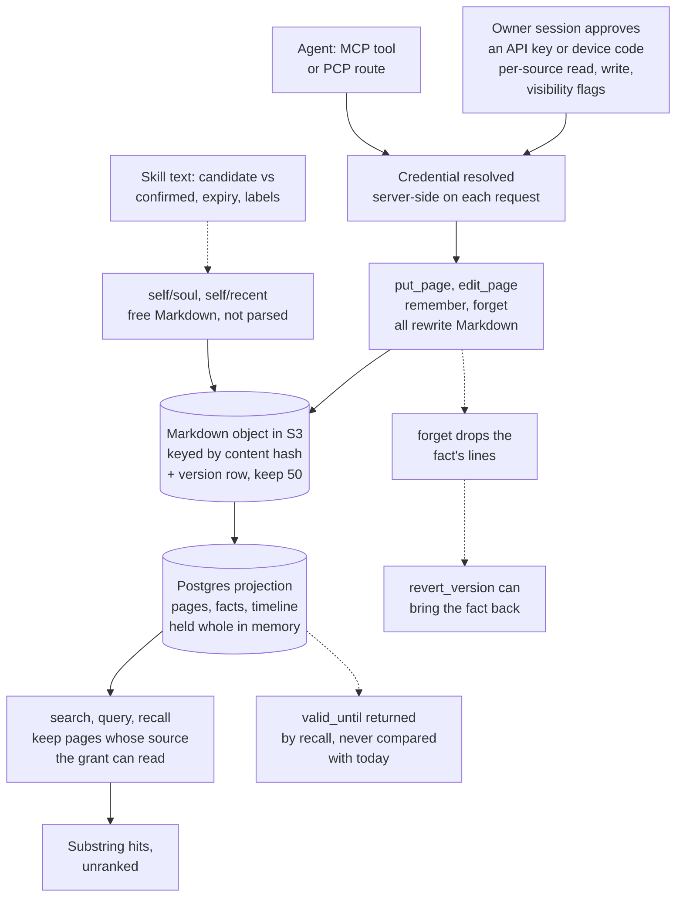

## 1. Executive Summary

OneSelf is a self-hosted server that keeps one person's context as Markdown
pages and lets any approved agent read and write it over MCP or HTTP. Two
built-in pages hold the agent's portrait of the person: `self/soul` for
long-term traits and `self/recent` for current life. What is notable is the
access model: the owner approves every agent credential with per-source read,
write and visibility flags, every read path applies them, and a page an agent
may not read answers exactly like one that does not exist. What is weak is
that the memory rules the README leads with are skill text, not server code:
a fact's `valid_until` is never compared with the date, and a candidate
observation differs from a confirmed trait only by a Markdown heading.

The server stores and serves. There is no model call, no embedding and no
extraction in the tree. The agent that connects does the
observing and writing, guided by a 525-line skill in Chinese that the server
publishes at `/skills/oneself/`.

Retrieval is a case-sensitive substring match. `search` covers type, title,
body and frontmatter strings; `recall` covers the facts parsed from a page's
`## Facts` fence; `query` filters by source, type, tag and update time. No
result is ranked.

Correction is page editing. `forget` deletes a fact's lines from the current
Markdown, every write appends a version, and `revert_version` can restore a
version that still holds the forgotten fact.

**Licence.** MIT in `LICENSE`, under a copyright line naming CyberFD, which is
the name on commits made under the repository owner's GitHub address. No
`package.json` in the workspace declares a licence. The two vendored
development skills under `.agents/skills/` carry their own Apache-2.0 and MIT
files and are not part of the product. Nothing restricts use.

Two marks are earned: `scope_enforced` on the per-source grants, and
`negative_eval` on committed cases requiring a forgotten fact and an ungranted
source to stay out of populated results. Section 9 gives the reason for each of
the five withheld.

## 2. Mental Model

A memory here is **a line of Markdown on a page the owner's agents can
reach**. There are three kinds, and the server knows about two of them:

- **A fact**: an item in a page's `## Facts` fence with an `id`, an `entity`,
  a `statement`, an optional `confidence` between 0 and 1 and an optional
  `valid_until` date (`packages/domain/src/fences.ts:3-9`, `:18`). The server
  parses it into the `facts` table and `recall` returns it.
- **A timeline entry**: `date | title | detail` under `## Timeline`, parsed
  into `timeline_entries`.
- **A portrait judgment** on `self/soul` or `self/recent`: free Markdown in a
  shape the skill defines, with a source label, a scope, evidence links, and
  on Recent an `observed_at` and a `valid_until`. The server does not parse
  it. It refuses `remember`, `forget` and `add_timeline_entry` on those two
  pages (`packages/domain/src/standing-judgment.ts:56-61`) and checks only
  that Soul's type is `soul` with a `name` field and Recent's type is `recent`
  with an `as_of` date (`:29-54`).

A memory is believed from the moment its page is written. There is no
pending state and no review. It stops being served in four ways: the agent
edits it out, `forget` removes its lines, the page is soft-deleted, or the
page's source is soft-deleted. Each of the last two is reversible for 30 days.
Then the hourly pass removes the page and its version history
(`packages/domain/src/maintenance.ts:11-66`).

The skill draws a finer state machine on the portrait. A single observation
stays in the evidence pages. A pattern worth watching goes into Soul's
`Observations — 候选观察` section with `first_seen` and `last_seen`. Repeated
independent evidence promotes it into one of six sections, and promotion
deletes the candidate. A Recent judgment past its `valid_until` is moved to
the Recent timeline or deleted. Every one of these transitions is an
instruction to the agent (`skills/oneself/references/self.md`). The server
enforces none of them, and the acceptance tests assert that the instructions
are present in the skill text (`tests/acceptance/skills.test.ts:149-212`).

## 3. Architecture

One Node 24 process built on Hono serves the PCP API, the MCP endpoint, the
OAuth device flow, the admin UI and the owner's public site
(`apps/server/src/index.ts`). Beside it run PostgreSQL 18 and RustFS, an
S3-compatible object store. `compose.yaml` adds one of four ingress profiles:
local port, Cloudflare Tunnel, Caddy or Tailscale.

The design separates source from projection. Page Markdown, uploaded originals
and site files live in object storage under content-addressed keys
(`pages/<source>/<slug>/<sha256>.md`, a `CHECK` in
`packages/db/src/schema.ts:74-77`). PostgreSQL holds what the Markdown
projects to. `rebuildProjections` can regenerate the projection from the
objects (`packages/domain/src/maintenance.ts:72-161`).

The runtime keeps the whole projection in memory. At start
`loadProjection` reads every source, page, fact, chunk, tag, timeline entry
and version and the Markdown object of every page
(`apps/server/src/app/postgres-state.ts:95-270`). Every operation, reads
included, runs through one promise chain, `exclusive`
(`apps/server/src/app/runtime.ts:298-305`). A write computes the next state
as a pure function, stores new objects, then writes the diff to Postgres in
one transaction (`:2091-2116`, `saveDomain` at
`apps/server/src/app/postgres-state.ts:276-489`). Only `search` queries
Postgres directly; every other read scans the in-memory state.

The domain rules are pure TypeScript in `packages/domain`, the storage adapters
in `packages/adapters`, the operation table in `packages/operations`, and
dependency-cruiser holds the direction (`.dependency-cruiser.cjs`).

### Deployment and ergonomics

A one-line installer downloads a CLI binary that writes `.env`, pulls the
image and starts Compose; `bin/oneself update | doctor | backup | restore`
operate it (`apps/cli/src/`). The operator runs three containers and one
ingress. No API key for a model provider is needed, because the server calls
none. The store is human-readable: each page is a Markdown file in a bucket,
and `pnpm data:export` packs the database and the bucket prefixes into one
archive (`scripts/data-transfer.ts`). Memory scales with the corpus, since the
process holds all of it.

## 4. Essential Implementation Paths

- **Operation table.** `packages/operations/src/registry.ts:21-120`: 43
  operations, three of them HTTP-only key management. MCP tools are generated
  from it with the operation name as the description
  (`apps/server/src/mcp/routes.ts:23-30`).
- **Authentication.** `apps/server/src/app/runtime.ts:2178-2247`: an API key
  by hash, a bearer token through the OAuth engine, or the owner's session
  cookie, each producing a `Credential` with its source grants.
- **Grants.** `packages/domain/src/access.ts:36-51` (`sourceFlags`); owner
  approval of keys and device codes at `runtime.ts:1603-1638`, `:1704-1746`,
  `:1822-1854`, each behind `#ownerActor`.
- **Page write.** `packages/domain/src/pages.ts:445-507` (`preparePut`:
  source exists, grant allows write, hash matches, Markdown projects,
  standing-page contract, visibility flag, file ownership) and `:509-559`
  (`commitWrite`: object, record, version, trim to 50, file attachment).
  Edits at `:170-220` require the current hash and each search string to occur
  exactly once.
- **Structure writes.** `apps/server/src/app/structure.ts:78-119`
  (`rememberFact`, `forgetFact`, `addTimeline`) rewrite the fences;
  `runtime.ts:1120-1189` checks the standing-page refusal and calls
  `#writeOne`.
- **Reads.** `apps/server/src/app/search.ts:26-107`; `runtime.ts:788-866`
  (`search`, with the Postgres branch at `:816-850`), `:868-938` (`query`),
  `:940-990` (`recall`); `packages/adapters/src/postgres-store.ts:296-326`
  and `:657-684` (SQL search).
- **Delete, restore, versions.** `packages/domain/src/pages.ts:294-420`;
  hourly purge in `packages/domain/src/maintenance.ts:11-66`, scheduled at
  `apps/server/src/index.ts:81-87`.
- **Portrait seeding.** `packages/domain/src/pages.ts:111-150`
  (`ensureStandingJudgment`) and `packages/domain/src/standing-judgment.ts`.

## 5. Memory Data Model

`pages` is keyed `(source, slug)` and holds type, title, `visibility`
(`public` or `private` under a `CHECK`), frontmatter as JSONB, body,
`content_hash`, `object_key`, `updated_at`, `deleted_at` and
`hidden_by_source` (`packages/db/src/schema.ts:47-81`). `facts`,
`timeline_entries`, `tags`, `links` and `chunks` hang off it by the same key
(`:137-238`). `page_versions` records hash, object key, frontmatter and
`written_at` per write (`:83-106`).

`sources` is a list of ids with a `deleted_at`. `self` is created on start and
cannot be deleted. The scope a credential carries is a JSONB array of
`{id, read, write, visibility}` on `api_keys` and `oauth_grants`, plus
`unrestricted_data` and `site_write` booleans (`:316-390`).

Time is thin. A page has `updated_at`; a version has `written_at`; a fact has
`valid_until` as a date and nothing else. There is no `valid_from`, no
`created_at` on a fact, and no record of which credential wrote anything.

`chunks` splits each body into pieces of at most 1,000 characters on every
write. Nothing reads them for retrieval; the search code says so in its
docstring (`apps/server/src/app/search.ts:22-25`).

## 6. Retrieval Mechanics

Three reads, all deterministic and all unranked.

**`search`** matches a case-sensitive substring against type, title, body and
each string or string-array value in the frontmatter. With Postgres it is one
`LIKE` per field plus a JSONB walk (`postgres-store.ts:657-684`), ordered by
source and slug, 20 hits by default and at most 50, and the server cuts a 140-character snippet
around the first match. The body is never returned. "Shanghai" does not find
"shanghai".

**`query`** lists pages by source, type, tag and `updated_after` or
`updated_before`, newest first (`runtime.ts:868-938`).

**`recall`** walks every page the credential can read and returns facts whose
`entity` equals the argument or whose `statement` contains it
(`runtime.ts:940-990`). It returns `confidence` and `valid_until` and filters
on neither. A fact whose `valid_until` passed a year ago is returned as a
current one.

Nothing is injected automatically. The skill tells the agent to read
`self/soul` and `self/recent` before answering who the person is, and to use
`search`, `list_pages` or `recall` before writing. What enters the agent's
context, and how much, is the agent's choice.

## 7. Write Mechanics

Every write is a page write. `put_page` replaces a page, optionally guarded by
the current hash; `edit_page` applies search-and-replace pairs and requires the
hash; `put_pages` writes a batch all or nothing. `remember`, `forget`,
`add_tag`, `add_link` and `add_timeline_entry` read the current Markdown,
rewrite a fence or the frontmatter, and call the same write
(`runtime.ts:2071-2089`, `:2125-2149`).

Each write stores the Markdown object first, then updates the projection and
appends a version in one transaction. A broken fence fails the parse and
nothing is written (`packages/domain/src/page-rules.test.ts:429-461`).

The agent decides what to write. The server has no deduplication beyond a
fact-id collision on one page (`structure.ts:83-85`) and no conflict
detection. The skill asks the agent not to save material from a task that was
not a request to save, not to promote a single event into Soul, to label each
judgment's source, and to keep candidates separate. None of it is checked.

### Operational cost

A write blocks on one object put and one Postgres transaction. It is visible
to the next read, which runs after it on the same promise chain. No model is
called on either path. The only background pass is the hourly purge of
expired soft deletes and unreferenced objects; it does not read content. The
read path returns at most 50 hits or facts and injects nothing.

## 8. Agent Integration

An agent installs the skill with `npx skills add <origin> -a <agent> -s
oneself -y`, requests a device code, and waits for the owner to approve it at
`/admin/device` with a label and per-source flags
(`skills/oneself/SKILL.md`). It then calls MCP tools or PCP routes; the two
are generated from one table, and the same flags give the same results. The
skill tells the agent to keep the refresh token in
`~/.config/oneself/config.json` with mode `0600`.

The MCP tools carry no descriptions beyond their names
(`apps/server/src/mcp/routes.ts:28`). The instruction channel is the skill:
which pages to read, which fence to use, how to write a portrait judgment,
when not to write at all. A client that connects over MCP without the skill
gets 40 bare verbs.

The agent cannot create or approve keys, approve a site launch, or change
visibility through the owner's route. It can change a page's visibility
through `put_page` when its grant has the visibility flag
(`pages.ts:693-704`).

## 9. Reliability, Safety, and Trust

### Scope is the strongest part

Every read path applies the credential's grants. `visiblePages` drops deleted
pages, pages in deleted sources and pages whose source the credential cannot
read (`apps/server/src/app/search.ts:81-107`); `readablePage` does the same for
single-page reads and answers `not_found` whether the page is private,
deleted, ungranted or absent (`packages/domain/src/pages.ts:621-639`). The
Postgres search receives the readable source ids and adds `source IN (...)`;
an empty list returns nothing before the query runs
(`postgres-store.ts:296-307`).

The scope value is resolved by the server from the credential, never from an
argument. The owner sets the flags while approving, and the agent's `source`
argument only narrows within them. Two broad grants exist: the owner's
session and a grant with `unrestricted_data`, which reads and writes every
source including `self`.

The boundary is between agents, not people. An instance has one owner
(`CHECK id = 1` on `owners`).

### Expiry is stored and not read

`valid_until` is parsed as a calendar date, stored in `facts.valid_until`,
round-tripped through the projection and returned by `recall`. No code
compares it with the clock. A fact the agent wrote as true until 2026-12-20 is
recalled in 2027 with nothing to mark it stale.

The Recent page's `valid_until` is weaker still: it is a field in free
Markdown, and expiry depends on the agent reading it and editing the page.

### Forget is a page edit, and history can undo it

`forget` removes the fact's lines from the current Markdown. The previous
version's object still holds them, which a committed test asserts
(`tests/smoke/structure.test.ts:53-98`). `revert_version` on that version
writes the fact back as a new write. So does any agent that writes the same
statement again: nothing records that a value was withdrawn.

Versions are trimmed to 50 per page, so on a page an agent edits often the
history behind a correction disappears after 50 more writes. A deleted page
records no version for its deletion; after 30 days its versions are removed
with it.

### The portrait has no writer of record

Neither a page nor a version records which credential wrote it. Any grant
with write on `self` can replace `self/soul` whole with `put_page` and no
hash; the contract check needs only `type: soul` and a `name` field. Whether
a trait came from the owner, from evidence, or from the agent's inference is a
label the agent writes in prose.

### Marks

- **`scope_enforced` — earned.** A source key on every page, applied from an
  owner-approved grant on every read path, with tests.
- **`negative_eval` — earned.** `tests/smoke/retrieval.test.ts:89-149`
  writes two facts, forgets one, and requires recall for its statement to
  return no facts and recall for the other to return exactly that one. These
  "smoke" files run in-process with in-memory fakes under the default config,
  so CI runs them. The SQL search test requires a `notes`-only key to get the
  `notes` hit and not the matching `secrets` or `publics` pages, though the
  filtering there is the test's own fake.
- **`bitemporal` — withheld.** `valid_until` is an end date with no start and
  no reader; record time is `updated_at` and `written_at`.
- **`trust_state` — withheld.** The server has no status on a fact or page.
  `confidence` is returned and filters nothing. The candidate section on Soul
  is a heading in prose.
- **`tombstone` — withheld.** `forget` deletes lines. Nothing keyed on the
  withdrawn value stops `remember`, `put_page` or `revert_version` from
  restoring it.
- **`audit_log` — withheld.** `page_versions` records one row per write with a
  hash and a time, but no actor and no operation, nothing for a delete, a
  restore or a source change, and the trim at 50 and the 30-day purge delete
  rows.
- **`human_review` — withheld.** A write is live at once. The owner approves
  credentials and site launches (`decideActivation`, `runtime.ts:1551-1601`),
  which are permission and publication, not memory content. The admin UI
  reads and deletes pages and edits none.

## 10. Tests, Evals, and Benchmarks

I ran none of the suites. The counts are from reading.

The tree has 448 `it` and `test` calls in 66 files. The `tests/smoke/` files
are misnamed for their runtime: they boot the server in-process with the
in-memory object store and no database (`apps/server/src/index.ts:50`), and
the default Vitest config
includes them (`vitest.config.ts:6-13`), so `pnpm check` in CI runs them.
`closed-loop.test.ts` alone needs PostgreSQL and RustFS and runs under
`vitest.smoke.config.ts`. `packages/adapters/src/postgres-store.test.ts`
skips unless `ONESELF_POSTGRES_TESTS=1` and a Postgres URL are set (`:14-21`).
The SQL search predicate is therefore exercised in CI only against a proxy
whose `searchPages` is the test's own filter
(`apps/server/src/app/search-sql.test.ts:184-254`).

Tested well: hash-guarded writes and edits, all-or-nothing batches, fence
round-trips, soft delete and the 30-day window, version trimming, grant
flags, OAuth refresh rotation, rate limits and ingress header trust.

Not tested: a fact past `valid_until` (no code would treat it differently), a
forgotten fact restored by `revert_version` and recalled, a restricted key's
`recall` across sources, and anything about the portrait beyond the seeded
templates and the refusal of structure writes on them.

`tests/acceptance/skills.test.ts` asserts that sentences are present in the
skill files. It tests the instructions exist, not that any agent follows them.

There is no retrieval evaluation, no benchmark and no paper.

## 11. For Your Own Build

### Steal

- **Resolve the scope from the credential and let the caller only narrow
  it.** Per-source read, write and visibility flags set by a person at
  approval, applied on every read, with unreadable answering as missing.
- **Keep the store as content-addressed text and the database as a
  projection.** A rebuild from objects is one function, and an export is a
  bucket and a dump.
- **Guard edits with the current hash and an exactly-once search string.** A
  stale or ambiguous edit fails before writing.
- **Refuse structured verbs on pages whose shape a person owns.** The
  portrait cannot be appended to by `remember`; it must be edited whole.

### Avoid

- **A validity field with no reader.** If a fact carries an end date, the
  recall path should filter or flag on it, and a test should pin a fact past
  it.
- **Correction by deletion beside a restore verb.** A forget that a revert
  can undo needs a record of the withdrawn value that the revert checks.
- **Putting the memory model in the prompt.** Candidate versus confirmed,
  source labels and expiry are the parts most worth enforcing, and here they
  are the parts left to the agent.
- **A version table with no writer identity.** With several agents writing
  one portrait, "which one said this" is the first question after a bad edit.

### Fit

This suits one person who wants several agents to share a private,
self-hosted notebook they can back up and read as files, with a clean
permission model. It assumes the connected agent is competent and follows a
long skill. A reader who wants the server to hold the line — on stale facts,
withdrawn values, or unconfirmed inferences about a person's health and
mood — should walk away or plan to build that layer, because here it is
advice to the model.

## 12. Open Questions

- Is `valid_until` meant to be filtered server-side, or is expiry a
  deliberate agent responsibility?
- The README promises that a candidate observation is not treated as a
  confirmed trait. Is any client-side or future server check planned?
- How large a corpus does the in-memory projection target before load time or
  memory becomes the limit?

## Appendix: File Index

| Path | Role |
| --- | --- |
| `packages/db/src/schema.ts` | Tables, checks and grant shape |
| `packages/domain/src/pages.ts` | Put, edit, delete, restore, versions, revert, read checks |
| `packages/domain/src/access.ts` | Per-source flags from a credential |
| `packages/domain/src/fences.ts` | Facts and Timeline parsing |
| `packages/domain/src/standing-judgment.ts` | Soul and Recent seeds and contract |
| `packages/domain/src/maintenance.ts` | Hourly purge and projection rebuild |
| `apps/server/src/app/runtime.ts` | Every operation, authentication, write publication |
| `apps/server/src/app/search.ts` | In-memory search and `visiblePages` |
| `apps/server/src/app/structure.ts` | remember, forget, timeline, tag and link rewrites |
| `apps/server/src/app/postgres-state.ts` | Projection load and diff save |
| `packages/adapters/src/postgres-store.ts` | SQL, including the search predicate |
| `apps/server/src/mcp/routes.ts` | MCP tools from the operation table |
| `skills/oneself/` | The agent skill and its references |
| `tests/smoke/retrieval.test.ts`, `tests/smoke/structure.test.ts` | Forget and recall cases |
| `apps/server/src/app/search-sql.test.ts` | Source predicate sent to SQL search |

### Recorded searches

Run from the repository root at the pinned commit with `/usr/bin/git grep`.

- **No read compares `valid_until` with a date.**
  `git grep -n -E 'validUntil|valid_until' -- '*.ts' ':!*.test.ts'` returns
  the parser, the schema, the projection load and save, the route and MCP
  argument mapping, the fence writer and the `recall` output at
  `apps/server/src/app/runtime.ts:984`; none compares it.
- **No embedding, vector arm or full-text index.**
  `git grep -n -i -E 'embedding|pgvector|vector|bm25|tsvector|to_tsquery' -- '*.ts' '*.sql'`
  returns only `THREE.Vector3` in `apps/admin/src/nebula-scene.ts`;
  `git grep -n 'LIKE' -- packages/adapters/src/postgres-store.ts` matches the
  search clause.
- **No model call.**
  `git grep -n -i -E 'openai|anthropic|ollama|chat/completions|gpt-' -- '*.ts'`
  returns nothing; `git grep -n -i 'modelcontextprotocol' -- '*.ts'` matches
  `apps/server/src/mcp/routes.ts`.
- **No audit or event table.**
  `git grep -n -E 'audit|event_log|history' -- packages/db/src/schema.ts 'packages/db/migrations/*.sql'`
  returns nothing; `git grep -n 'page_versions' -- packages/db/src/schema.ts`
  matches.
- **No status column on memory.**
  `git grep -n -E 'status' -- packages/db/src/schema.ts` returns
  `site_activations` and `api_key_requests` only.
- **No value-keyed suppression.**
  `git grep -n -i -E 'tombstone|forgotten|blocklist|suppress' -- '*.ts' ':!*.test.ts'`
  returns nothing; `rememberFact` refuses only a repeated id
  (`apps/server/src/app/structure.ts:83-85`).
- **Chunks are not read for retrieval.**
  `git grep -n -w 'chunks' -- '*.ts' ':!*.test.ts'` returns the schema, the
  projection load and save, the splitter and the export list.
- **The admin UI writes no page content.**
  `git grep -n -E 'pcp/v1/pages|/admin/pages' -- apps/admin/src ':!*.test.ts'`
  returns a GET at `apps/admin/src/http.ts:246`, a DELETE at `:268` and the
  visibility POST at `:275`.
- **No paper reference.**
  `git grep -n -i -E 'arxiv|bibtex|doi\.org|CITATION|@article|@misc' -- .`
  returns nothing; `git grep -n -i 'license' -- README_EN.md` matches.

## History

**2026-11-25** — [`5543985e3b50f170bf2df803e0d8ee9f45876eec`](https://github.com/ptonlix/OneSelf/commit/5543985e3b50f170bf2df803e0d8ee9f45876eec). First reading, from a full clone at the head of `main`, four commits after `a0dc086e1faa`, the commit triage selected. Screened first: no auto-run surface, nothing inside the seven-day cooldown, no build-time execution, one unpinned manifest in a vendored skill's eval fixture, and an `AGENTS.md` addressed to reading agents, read as data. No submodules. Nothing was installed, built or run, and the test counts are from reading. Two marks: `scope_enforced` and `negative_eval` ([section 9](#9-reliability-safety-and-trust)). `valid_until` has no reader, `revert_version` restores a forgotten fact, and the portrait's rules are skill text.
