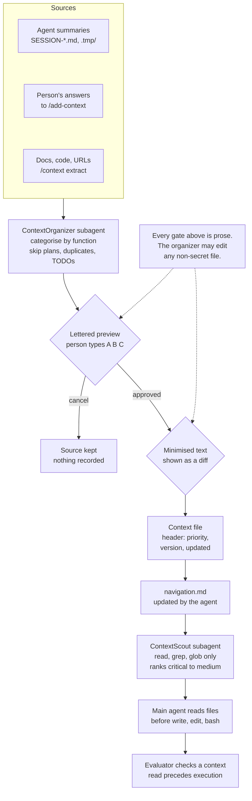

## 1. Executive Summary

OpenAgents Control (OAC) is a set of agents, subagents, slash commands and
context files for OpenCode, with a Claude Code plugin carrying a subset. Its
memory is a Markdown library of project standards under `.opencode/context/`.
Agents are told to read the relevant files before any write, edit or shell
call, and a person extends the library through commands that run staged
approval workflows.

What is notable is the write path. `/context harvest` reads the summary files
an agent leaves behind, sorts each passage into one of five functions, drops
planning talk, duplicates and TODO lists, and shows a lettered preview before
anything is written. A second preview shows the minimised text, and a third
choice decides what happens to the source file. The retrieval subagent has no
write, edit or shell permission.

What is weak is that every one of those rules is prose the model follows. The
subagent that runs the workflows holds an unrestricted edit permission outside
three secret-file globs, no script checks a context file's size or header, and
the shipped library breaks both limits. The project's evaluator for context
loading accepts file names that the agent prompt and the root index no longer
use. No capability mark is earned.

## 2. Mental Model

A memory is a context file: a short Markdown page about one topic, opened by a
one-line header.

```text
<!-- Context: {category}/{function} | Priority: {level} | Version: X.Y | Updated: YYYY-MM-DD -->
```

The header is required on every file
(`.opencode/context/core/context-system/standards/frontmatter.md:11-17`).
Priority is one of `critical`, `high`, `medium`, `low`, defined by the share of
use cases a file serves (`:28-32`). Version starts at 1.0, and `/add-context`
bumps the minor number for a content change and the major for a structural one
(`.opencode/command/add-context.md:40-41`).

A passage becomes a context file in one of two ways. A person answers the six
questions of `/add-context`, which writes `technical-domain.md` under
`project-intelligence/`. Or an agent's leftover summary is harvested: the
workflow reads the file, keeps design decisions, working patterns, errors with
their fixes and reference data, and skips planning discussion, conversational
notes, duplicates and TODO lists
(`.opencode/context/core/context-system/operations/harvest.md:64-85`,
`:296-309`).

Nothing is a candidate in the store. A proposed item exists only as a lettered
line in the agent's reply until the person types its letter; after that it is a
file with the same standing as every other file. There is no state that
withholds a file from being read, and no record of a rejected item, so a
passage the person declined is offered again the next time its source file is
scanned.

A file stops being current by being edited in place. `/context update` asks
what changed, greps the library for the topic, shows a per-line diff, copies
the old files to `.tmp/backup/`, then rewrites them and adds a migration note
under `errors/` (`operations/update.md:22-140`). Project-intelligence files
are renamed `filename.deprecated.md` with `DEPRECATED` and `REPLACED BY`
comments, and decision history is never deleted
(`.opencode/context/core/standards/project-intelligence-management.md:131-144`).



## 3. Architecture

The system is files. Agents live in `.opencode/agent/`, commands in
`.opencode/command/`, and the library in `.opencode/context/`, which holds 293
Markdown files and three symlinks at this commit. `core/` carries universal
standards and the context system's own rules; `project-intelligence/` carries
six project files, which ship as unfilled templates. Each directory has a
`navigation.md`.

Two roots exist. `core/config/paths.json` names `.opencode/context` as local
and `~/.config/opencode/context` as global, and ContextScout falls back to the
global root for `core/` only, never for project intelligence
(`.opencode/agent/subagents/core/contextscout.md:30-39`).

The Claude Code plugin under `plugins/claude-code/` ships the same library
through a symlink, twelve skills, six commands and a `SessionStart` hook. The
hook prints the `using-oac` skill, a skill catalogue and an instruction to run
context discovery once per session
(`plugins/claude-code/hooks/session-start.sh:71`). Discovery reads `.oac.json`
or tries five roots in order and takes the first with a `navigation.md`
(`plugins/claude-code/skills/context-discovery/context-discovery-protocol.md:19-58`).

Beside the prompts sit a TypeScript eval framework (`evals/framework/`), a
CLI and a compatibility layer that converts agents for other tools
(`packages/`), and an OpenCode plugin, `agent-validator.ts`, that logs context
reads and execution calls for later analysis.

### Deployment and ergonomics

Nothing has to be running. Installation copies files, either by `install.sh`
or by the plugin's installer, which sparse-clones the `main` branch and writes
the fetched commit into `.context-manifest.json`. No API key is needed beyond
the host's model. The store is readable and repairable by hand, and a team
shares it by committing `.opencode/context/`. Backups and harvest archives go
under `.tmp/`, which `.gitignore:192` excludes.

## 4. Essential Implementation Paths

- **Command entry.** `.opencode/command/context.md` defines four rules
  (`:15-29`), a map of which rule files each operation must read first
  (`:156-192`), and routing: harvest, extract, organize, update, error, create
  and migrate go to ContextOrganizer, map and validate to ContextScout
  (`:200-212`).
- **Harvest.** `operations/harvest.md`: detection patterns (`:21-36`), six
  stages — scan, analyze, approve, extract, cleanup, report (`:43-245`).
- **Update.** `operations/update.md`: eight stages, with approval at stages 1
  and 3 and a backup at stage 4 (`:22-161`).
- **Error entries.** `operations/error.md`: search for a similar entry, choose
  between a new entry, an update or a skip, preview, write (`:22-204`).
- **Project patterns.** `.opencode/command/add-context.md`: detect existing
  files with their versions (`:201-251`), review each pattern (`:275-345`),
  delegate the write to ContextOrganizer.
- **Writer.** `.opencode/agent/subagents/system-builder/context-organizer.md`:
  permissions (`:6-13`), one-file-per-fact rule (`:26-28`), operations
  (`:105-128`).
- **Reader.** `.opencode/agent/subagents/core/contextscout.md`: permissions
  (`:5-19`), rules (`:27-49`), four steps (`:69-76`).
- **Load rule.** `.opencode/agent/core/openagent.md:30-56` and `:243-267`.
- **Check.** `evals/framework/src/evaluators/context-loading-evaluator.ts`.

## 5. Memory Data Model

A context file has four metadata fields, all in the header comment, and a body
shaped by its function. An error entry, for instance, is `Symptom`, `Cause`,
`Solution`, `Code`, `Prevention`, `Frequency` and `Reference`
(`operations/error.md:166-178`).

The size rule is stated four ways. `/context` says files MUST be under 200
lines (`command/context.md:15-17`). ContextOrganizer gives per-function limits
of 100 for concepts and lookup, 150 for guides and errors, 80 for examples
(`context-organizer.md:50`). The error workflow says 150. The shipped library
follows none of them consistently: 83 of its 293 files are over 200 lines, the
longest 4,616.

Project intelligence adds two files with internal structure. `decisions-log.md`
gives each decision a date, an owner and a `Status` of Decided, Pending, Under
Review or Deprecated, plus a table of overturned decisions with what replaced
them (`.opencode/context/project-intelligence/decisions-log.md:11`, `:110-116`).
`living-notes.md` holds debt, open questions and known issues, each with its
own status vocabulary. Both are templates at this commit, and no agent prompt
or script reads either status field.

There is no provenance field. Harvest's minimised text carries a *"Reference
link: to original source"* (`harvest.md:157`), and the source is then archived
to a git-ignored directory or deleted. Scope is the directory a file sits in.
Time is the `Updated` date and whatever git records.

Session state is separate and short-lived. OpenCoder writes
`.tmp/sessions/{date}-{slug}/context.md` after approval, as the hand-off to
its subagents (`.opencode/agent/core/opencoder.md:180-183`), and the plugin's
cleanup script removes session directories older than seven days
(`plugins/claude-code/scripts/cleanup-tmp.sh:23`). These are work orders for
one task and nothing later reads them as knowledge, unless a person harvests
them.

## 6. Retrieval Mechanics

Retrieval is a subagent reading an index. ContextScout resolves the root,
reads `navigation.md` there, follows the links that match the request, verifies
each path exists, and returns a list grouped Critical, High, Medium with one
line per file (`contextscout.md:69-76`). It may use read, grep and glob; bash,
edit, write and task are denied in its permission block (`:5-19`). The caller
reads the files itself.

Five files bypass discovery. OpenAgent's prompt names the standard to read for
code, docs, tests, review and delegation tasks, and tells the agent to stop if
it finds itself executing without one loaded (`openagent.md:36-53`). The root
index gives the same five paths under *Quick Routes*
(`.opencode/context/navigation.md:25-36`).

Nothing bounds what is loaded except the file size rule, and nothing ranks by
anything but the index's layout and the header's priority. A file that is not
linked from a `navigation.md` is reachable only by grep. A superseded passage
still in a file, or a `.deprecated.md` file still linked, is returned like any
other; the deprecation process asks the agent to mark the file in the index
(`project-intelligence-management.md:131-139`) and no reader checks the mark.

## 7. Write Mechanics

Every write is started by a person typing a command. No hook, schedule or
agent rule writes to the library on its own; the nearest thing is the harvest
scan, which lists candidate files when `/context` runs with no argument.

Harvest's approval stage is specific. Each item gets a letter, a target path
and a 60-character preview, with skipped items shown and the reason given, and
the person types letters, `all`, `none` or `cancel`
(`harvest.md:87-143`). The rule beside it reads *"NEVER auto-harvest without
user confirmation"* (`:90-93`). One option cuts across the other safeguards:
`none` means *"Skip harvesting, delete files anyway"* (`:136`), while the
cleanup rule two stages later says only files whose content was harvested may
be cleaned up (`:236-239`).

Deduplication is the agent's reading. ContextOrganizer must call ContextScout
before writing and must keep each fact in one file (`context-organizer.md:20-28`).
The error workflow searches existing entries and offers to extend a similar one
instead of adding another (`error.md:22-73`). `/context organize` handles a
target that already exists by offering merge, rename or skip.

The workflows disagree in small ways about their own store. The error workflow
tells the agent to update `README.md` after a new file (`error.md:183-186`);
every other workflow, and ContextScout, use `navigation.md`. The context-manager
skill ships a `router.sh` whose every operation prints its name and a pointer
to `SKILL.md` and does nothing else.

### Operational cost

A write blocks the person, by design: harvest has three prompts and update
two. A written file is retrievable on the next ContextScout call. No pass
rewrites the store. On the read path each task costs one subagent call that
reads several index files, then the standards themselves; the plugin's hook
injects the skill catalogue at the top of every session.

## 8. Agent Integration

The agent has wide agency over the library and narrow instructions about it.
Any OpenCode agent with edit permission can change a context file directly;
the commands are the sanctioned route. The main agents are told to call
ContextScout first, propose a plan, and wait for approval before any write
(`opencoder.md:53-55`).

In Claude Code the plugin offers discovery and installation only. Its commands
are brainstorm, debug, install-context, cleanup, help and status, and no
harvest or add-context path is ported. Its session hook warns when no
`.context-manifest.json` exists under `.claude/` or `~/.claude/`
(`session-start.sh:54-59`), which is where the shell and JavaScript installers
write it (`install-context.js:227`). The `/oac-status` command and the
TypeScript installer use the plugin root instead
(`commands/oac-status.md:11`, `install-context.ts:23`), so status reports
whatever manifest ships with the plugin, not the project's.

Porting the design means porting prompts. The frontmatter rule, the
five-function layout and the harvest stages are host-neutral text.

## 9. Reliability, Safety, and Trust

**The approval gates are instructions, not checks.** The workflow files say
MUST wait for user input. ContextOrganizer's permission block denies edits to
`*.env*`, `*.key` and `*.secret` paths and the task tool for all but
ContextScout, and grants everything else (`context-organizer.md:6-13`). The
agent that proposes an item is the agent that writes it, with the same tool,
whether or not the person answered. `agent-validator.ts` observes tool calls
through `tool.execute.before` (`:126`) and contains no statement that refuses
one. This is why `human_review` is withheld: no stored state holds an item
until someone other than the producing agent resolves it, and nothing
distinguishes a file written after approval from one written without it.

**The format rules are not checked either.** No script under `scripts/`,
`.github/`, `.opencode/plugin/` or `.opencode/skills/` parses the header comment
or counts a context file's lines; the two results are in the Recorded Searches. Ten shipped context files
do not open with the header and 83 exceed the size limit, in a library whose
command file calls both absolute.

**A status that nothing filters on is a label.** A decision marked Deprecated,
a file renamed `.deprecated.md` and a living-notes issue marked Fixed all stay
where ContextScout can return them. That keeps `trust_state` off the record:
the fields are discrete, and none withholds anything.

**A declined item leaves no trace.** There is no rejected-value record, so
there is no tombstone, and a harvest over the same source re-proposes it.

**Recovery is local and untracked.** Update backups and harvest archives live
under `.tmp/`, ignored by git. The library itself is meant to be committed,
which makes git the only history of a mutation; there is no append-only record
of the system's own, so `audit_log` is not earned.

**Injected text.** `/context extract from {url}` distils a web page into a
file every later agent is told to treat as a standard. The preview is the one
defence, and it shows 60 characters per item at the first gate.

Bitemporal validity, a scope key on reads and negative retrieval cases are
absent; the searches are recorded below.

## 10. Tests, Evals, and Benchmarks

I ran nothing. The counts are from the tree: 1,341 `it(` or `test(` cases in
66 files, and 263 YAML cases under `evals/agents/`. Pull requests run
`npm run test:ci`, described in the workflow as *"the offline, deterministic
Vitest allowlist only"*, with model-dependent agent tests not run
(`.github/workflows/pr-checks.yml:220-232`). The model-run workflow sits at
`.github/workflows/evals/run-evaluations.yml`, a subdirectory.

The memory-relevant check is `ContextLoadingEvaluator`. It classifies a session
by regex over the user message, finds reads of paths matching a context
pattern, and fails a session whose first execution precedes any such read
(`context-loading-evaluator.ts:45-53`, `:92-130`). It then checks that the
right file was read, by substring against a map (`:59-87`, `:171`).

That map is out of step with the prompt it grades. It accepts `code.md`,
`docs.md`, `tests.md`, `review.md` and `delegation.md`. OpenAgent's prompt and
the root index name `code-quality.md`, `documentation.md`, `test-coverage.md`,
`code-review.md` and `task-delegation-basics.md`. Three old names survive as
symlinks and two as stub files pointing at the new ones, so both resolve on
disk, but the evaluator compares the path string the agent read. Only
`code-review.md` contains its expected pattern; the other four produce a
`wrong-context-file` error (`:384-389`). The eval cases under `evals/agents/`
are split the same way: 46 references to `standards/code.md` against 21 to
`standards/code-quality.md`.

The committed result shows it. `evals/results/latest.json` holds one case, run
on 17 January 2026 against `core/opencoder`, failed with four errors. One is
`wrong-context-file` for a delegation task, listing `code-quality.md` and
`test-coverage.md` among the files the agent had loaded (`:41`).

No case covers a write to the library. No file under `evals/` mentions harvest
or add-context, so the approval stages, the skip rules, the version bump and
the backup have no test. No paper accompanies the project; the two arXiv
references in the tree are citations in prompt-design notes.

## 11. For Your Own Build

### Steal

- **Preview the minimised text, not the source.** Harvest asks twice: once for
  which items to keep and once for what will be written. The second prompt is
  the one that shows what a later agent will read.
- **State what is not memory.** The skip list — planning talk, conversational
  notes, duplicates, TODO lists, session metadata — is a write filter a person
  can audit in five lines.
- **A retrieval agent with no write tools.** Denying edit, write, bash and task
  in the permission block makes discovery safe to run without approval.
- **Check the read happened.** An evaluator that orders context reads against
  the first execution call turns "load standards first" into something a run
  can fail.

### Avoid

- **A limit only a prompt enforces.** The size and header rules cost one script
  to check, and the library drifted past both without one.
- **Renaming a file the grader knows by its old name.** Symlinks kept the paths
  alive and hid that the evaluator and half the eval cases still expect them.
- **An approval gate inside the approved agent.** If the writer holds the edit
  tool, the gate holds only as long as the model follows the workflow. Put the
  write behind a tool call the host can prompt on, or a staging directory a
  person promotes from.
- **A destructive option beside a safety rule.** `none`, which deletes sources
  without harvesting them, contradicts the rule that only harvested files are
  cleaned up.

### Fit

This suits a team that wants its coding standards in the repository, read by
agents before they write, and is willing to curate them by hand. The cost is
attention: every addition is a three-prompt conversation, and nothing ages a
file out. It does not suit memory an agent accumulates unattended, anything
that needs a fact withheld until checked, or a store too large for a model to
navigate by index. A reader who wants only the standards-loading habit can
take the header format, the five folders and ContextScout, and leave the rest.

## 12. Open Questions

- How often does ContextOrganizer write without waiting? Only model runs with
  the validator's logs would show it.
- Does ContextScout return `.deprecated.md` files in practice, or does the
  navigation marking keep them out?
- Which name do agents read under the prompt variants in `.opencode/prompts/`,
  and does the evaluator pass on any of them?
- Is the 200-line rule meant for the shipped `core/` library, or only for
  files the workflows create?

## Appendix: File Index

- **Commands:** `.opencode/command/context.md`,
  `.opencode/command/add-context.md`.
- **Workflows:** `.opencode/context/core/context-system/operations/`
  (`harvest.md`, `extract.md`, `update.md`, `error.md`, `organize.md`,
  `migrate.md`).
- **Format rules:** `.opencode/context/core/context-system/standards/`
  (`frontmatter.md`, `mvi.md`, `structure.md`, `templates.md`),
  `.opencode/context/core/standards/project-intelligence-management.md`.
- **Agents:** `.opencode/agent/subagents/system-builder/context-organizer.md`,
  `.opencode/agent/subagents/core/contextscout.md`,
  `.opencode/agent/core/openagent.md`, `.opencode/agent/core/opencoder.md`.
- **Store:** `.opencode/context/navigation.md`,
  `.opencode/context/core/config/paths.json`,
  `.opencode/context/project-intelligence/`.
- **Claude Code plugin:** `plugins/claude-code/hooks/session-start.sh`,
  `plugins/claude-code/skills/context-discovery/context-discovery-protocol.md`,
  `plugins/claude-code/scripts/install-context.js`,
  `plugins/claude-code/scripts/cleanup-tmp.sh`.
- **Checks:** `evals/framework/src/evaluators/context-loading-evaluator.ts`,
  `evals/results/latest.json`, `.opencode/plugin/agent-validator.ts`,
  `.github/workflows/pr-checks.yml`.

### Recorded searches

Run with `/usr/bin/git grep` from the root of a checkout at
`1ed1dd88d14ce0a4e32b458b6817cdda6f6b1590`.

- `git grep -l -i -E 'harvest|add-context' -- evals` — no match; no eval or test names either write command.
- `git grep -n -c -i 'harvest' -- plugins/claude-code` — no match; the plugin ports no harvest path.
- `git grep -n -F '<!-- Context' -- '*.ts' '*.js' '*.sh' '*.py'` — no match, where the same pattern matches line 1 of `.opencode/context/core/navigation.md`; no code reads the header comment.
- `git grep -n -E 'wc -l|-gt 200|> 200' -- scripts .github .opencode/plugin .opencode/skills` — four `wc -l` counts of agents, tests and prompt variants and one 200-character summary check in `task-cli.ts`; none over a context file.
- `git grep -n -E 'throw|deny|block|abort' -- .opencode/plugin/agent-validator.ts` — no match; the validator refuses nothing.
- `git grep -n -E 'Under Review|Deprecated Decisions' -- .opencode plugins ':!*decisions-log.md'` — no match; no prompt or script reads the decision status.
- `git grep -n -E 'code-quality\.md|documentation\.md|test-coverage\.md|task-delegation-basics\.md' -- evals/framework/src` — `context-loading-evaluator.ts:516`, three lines of `minimax-prompt-variant.test.ts` and two agent-path entries in `test-runner.ts`; none in the evaluator's file map.
- `git grep -h -o -E 'standards/(code|code-quality|docs|documentation|tests|test-coverage)\.md' -- evals/agents | sort | uniq -c` — 46 `code.md`, 21 `code-quality.md`, 26 `docs.md`, 2 `documentation.md`, 16 `tests.md`, 7 `test-coverage.md`.
- `git ls-files -s '.opencode/context/*.md'` — 293 regular files and 3 symlinks; a loop over the regular files finds 83 with more than 200 lines and 10 whose first line does not start `<!-- Context:`.
- `git grep -l -i -E 'embedding|sqlite|pgvector|chroma|fts5' -- '*.ts' '*.js' '*.sh' '*.py'` — `plugins/claude-code/hooks/session-start.sh` only, for the phrase "JSON embedding"; no index or database.
- `git grep -n -i -E 'arxiv|bibtex|CITATION\.cff'` — citations in `dev/ai-tools/opencode/context/how-context-works.md` and `docs/agents/research-backed-prompt-design.md`; no paper about this project.

## History

**2026-11-13** — [`1ed1dd88d14ce0a4e32b458b6817cdda6f6b1590`](https://github.com/darrenhinde/OpenAgentsControl/commit/1ed1dd88d14ce0a4e32b458b6817cdda6f6b1590) — first reading, at the head of `main`, dated 19 October 2026. No marks: the approval gates, the size and header rules and the deprecation states are prompt text with no check and no reader that filters. LICENSE read in full: MIT with no rider. Screened before reading: five auto-run surfaces (the OpenCode bundle, the Claude Code marketplace and plugin manifests, and a `SessionStart` hook that prints a skill file as context), two build-time execution points, seven unpinned manifests, every lockfile unchanged for 25 days. Nothing was installed or run; one line of plain Node reproduced the evaluator's substring test on the five file names.
