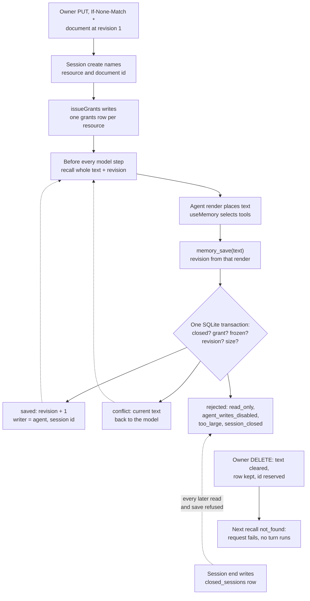

## 1. Executive Summary

OpenComputer is a self-hostable coding-agent platform: a Slack gateway that
starts Claude Code, Codex or OpenCode sessions in rootless Podman, and a
Serverless Agents service on Cloudflare Workers whose agents declare memory in
code. That memory is the subject here. It is a store of whole text documents per
project and environment, recalled in full before every model step and replaced
by one `memory_save` tool under a revision check. What is notable is the
transactional discipline: a save checks session closure, grant, write policy,
the render's revision and size in the same SQLite transaction that writes. What
is weak is everything that is not a single current value. There is no version
history and no mutation log, and deleting a document breaks every session bound
to it at its next model step.

It carries `scope_enforced` and `negative_eval`.

**Licence.** The two client SDKs declare a licence the tree does not contain:
`sdks/typescript/package.json:29` and `sdks/python/pyproject.toml:14` say MIT,
while the only licence file is the root Apache-2.0 `LICENSE`, and neither SDK
directory carries its own. A reader embedding the SDK has two claims and one
text. Separately, the pull request that imported the Serverless Agents service
states that *hosted-only code and production configuration stay private and are
laid over at deploy time*, so the hosted service runs code this tree does not
hold. The memory store itself is in the tree.

**The write is one transaction, and it refuses rather than merges.**
`MemoryDurableObject.save` reads the `closed_sessions` row, the session's grant,
the document's `agent_writes` policy, its revision and the resource's
`max_bytes`, and only then updates text, summary, revision and writer
(`services/managed-agents/src/edge/memory-do.ts:624-668`). The revision a save
is checked against is not the model's: the host takes it from the snapshot of
the render that produced the tool call
(`services/managed-agents/src/runtime/cloud-reactive-plugin.ts:229-238`). A
second save in the same response conflicts with the first, and the conflict
returns the current text for the next step to reconcile.

**Deletion fails closed, and closed means the session stops.** A delete keeps
the row with `deleted = 1` so the id cannot be reused
(`memory-do.ts:377-387`), and the grant that named it stays. The next `recall`
returns `not_found`, and both runtimes treat any rejected recall as a failure of
the request (`services/managed-agents/src/edge/index.ts:2366-2378`). Every
session bound to that document can no longer take a turn.

## 2. Mental Model

A memory is a document an agent's code declared and an owner created. Nothing
becomes memory by being said: there is no extraction, no summarisation of the
conversation, and compaction leaves the store alone. The model writes only by
replacing the whole text of one document it was bound to read-write, and the
text it writes is stored as the current value with no candidate state between.

The store holds claims, not beliefs. A document has no status beyond whether
agents may write it (`agent_writes`) and whether it is deleted. Everything
recalled is presented to the render as text plus `sources` (id, title, revision,
update time), and the agent's own render function decides where the text goes.
The documentation asks the author to treat it *as data the model reads, not as
instructions it follows* (`docs/agents/memory.mdx`), and nothing enforces that.

A document dies one way: an owner deletes it, and the id stays reserved. A
session's access dies one way: the session ends and its id is written to
`closed_sessions`, permanently. Freezing is reversible and affects only future
agent saves.

## 3. Architecture

The memory store is a Cloudflare Durable Object class, `MemoryDurableObject`,
exported by the Serverless Agents edge Worker
(`services/managed-agents/src/edge/memory-do.ts:189`). One instance exists per
account, project and environment, addressed by `memoryObjectName`
(`services/managed-agents/src/edge/memory-contract.ts:263`). Its SQLite holds
five tables (`memory-do.ts:196-242`). Three other parts talk to it:

- **The edge Worker's owner routes**, `/v1/projects/:p/memory[/:r/documents[/:id]]`,
  authenticated by the account's API key and stamping the writer as owner
  (`services/managed-agents/src/edge/memory-routes.ts:186-343`).
- **The session Durable Object**, which records an admission row in the same
  transaction as the session row and drives `issueGrants` and `closeSession` to
  acknowledgement, re-driven by its alarm (`services/managed-agents/src/edge/memory-session.ts:131-157`, `:242-360`).
- **Two runtimes for the model loop.** The Workerd host calls the object over
  RPC through `memory-client.ts`; a sandbox runtime, which cannot reach a
  Durable Object, calls `/v1/sessions/:id/memory[/save|read|list]` on the edge
  with its runtime token (`services/managed-agents/src/edge/index.ts:2339-2442`).

The Slack product in `computer/` has no memory of this kind. Its gateway
persists a session registry so a restart resumes a Slack thread's conversation
(`computer/src/main.ts:79-101`), and a workspace fork gets a generated
`AGENTS.md` repository index that Claude Code reads (`computer/src/host/claim.ts:7`).

### Deployment and ergonomics

The store needs Cloudflare Workers with Durable Objects, or the self-hosted
equivalent the documentation describes; the Serverless Agents CI dry-runs each
Worker configuration with no secrets. Storing anything requires a project, a
deployment that declares the resource, and an API key. The store is not a file
a person can open: repair goes through the owner API, CLI or web page, and
`opencomputer memory export` writes one JSON file per document, read one at a
time, which the documentation says is not a consistent snapshot. Production adds
private code laid over this tree at deploy time.

## 4. Essential Implementation Paths

**Declaration.** `defineMemory({ id, description, provider })` in
`agent/src/memory.ts` produces a descriptor; the CLI's compiler extracts literal
declarations from agent source and inlines the same module, kept byte-identical
by a CLI test. Promotion of an environment allocates an `activation_seq`,
applies resource limits to the Memory object with `applyConfig`, then selects
the code (`services/managed-agents/src/edge/memory-activation.ts:12-30`,
`memory-do.ts:394-463`). A stale sequence is a no-op and a provider-kind change
is rejected.

**Admission.** Session create parses `memory` bindings (`memory-bindings.ts:17-64`),
checks each resource is declared and each bound document exists
(`memory-bindings.ts:85-107`), records the admission row and calls
`issueGrants`, which re-checks atomically and inserts one `grants` row per
resource (`memory-do.ts:465-516`). An identical retry returns the same grants; a
different set for the same session id conflicts.

**Recall.** Before each model step the runtime recalls every bound resource
(`index.ts:2366-2380` for the sandbox; `workerd-runtime/index.ts:1619` for
Workerd). A document grant returns the row's text and revision; a collection
grant returns `overviewLine` entries until 50 entries or 16,384 bytes
(`memory-do.ts:580-622`). The Workerd host pins what the request saw in
`workerd_request_snapshot` (`workerd-runtime/index.ts:825`, `:1590`).

**Save.** `memory_save` resolves the target among the resources the render
selected and sends the snapshot's revision (`cloud-reactive-plugin.ts:199-238`;
`workerd-runtime/index.ts:3084-3105`). `save` runs the checks and `writeText`
(`memory-do.ts:624-668`, `:760-779`). The Workerd host writes a
`workerd_memory_saved` outbox row and emits `opencomputer.memory.saved` from it
(`workerd-runtime/index.ts:3105`, `:2483-2492`); the sandbox route appends
`memory.saved` to the session's events after the save returns (`index.ts:2404-2411`).

**Owner mutation.** `createDocument`, `replaceDocument`, `patchDocument` and
`deleteDocument`, each a compare-and-set transaction with the writer stamped by
the route (`memory-do.ts:266-390`, `memory-routes.ts:221-343`).

**Closure.** Session end writes `memory_closure` and calls `closeSession`,
which inserts into `closed_sessions` (`memory-session.ts:311-360`,
`memory-do.ts:568-576`).

## 5. Memory Data Model

`documents` is keyed on `(resource, id)` and carries `title`, `summary`, `text`,
`agent_writes` (`enabled` or `disabled`, enforced by `CHECK`), an integer
`revision`, `bytes`, `deleted`, `created_at`, `updated_at` and `writer_json`
(`memory-do.ts:197-214`). The writer is `{ kind: "owner" }` or
`{ kind: "agent", sessionId }`; `assertWriter` refuses anything else, and no
route passes a user-supplied writer (`memory-do.ts:162-176`).

There is one value per document. `writeText` overwrites text, summary and
writer and increments the revision (`memory-do.ts:760-779`); the previous text
is not kept anywhere in the object. The two timestamps are record time. There is
no validity time, supersession link, TTL or pin.

`grants` is keyed on `(session_id, resource)` with `scope`, `document_id` and
`access` (`memory-do.ts:229-237`); `closed_sessions` holds session ids
(`memory-do.ts:238-241`). Neither table is ever pruned: the only `DELETE FROM`
in the memory modules clears a deployment's declarations in the Account
object (`memory-activation.ts:217`).

Scope has two layers. Account, project and environment are a physical
partition: a separate object, with no key on a row. Inside the object, the
grant row is the scope key the session's reads are filtered by, and a document
id chosen by the application is how one end user's notes are kept from
another's (`docs/agents/document-memory.mdx`, *Session bindings*).

## 6. Retrieval Mechanics

There is no search. Retrieval is projection: the whole bound document, or for a
collection the most recently updated entries as `id | title | summary | date`
lines with newlines flattened (`memory-do.ts:135-139`, `:600-621`). The listing
order is `updated_at DESC, id ASC` over non-deleted rows (`memory-do.ts:716-736`),
and an owner's retitle or freeze moves a document to the top because
`patchDocument` sets `updated_at` (`memory-do.ts:348-358`).

Recall is automatic and unconditional: every bound resource is recalled before
every render, and a rejected recall fails the request even when the render
would not have used the hook (`docs/agents/document-memory.mdx`, *Reading*;
`index.ts:2368-2376`). Size is bounded by declaration rather than by a token
budget: at most eight bindings of up to 16,384 bytes each, plus 240-byte
summaries, with no truncation (`memory-contract.ts:246-256`).

The Workerd host cannot tell which render a tool call came from, because its
pinned OpenCode context hook carries no message id. It records the assistant
message ids each render saw and answers a tool call from an earlier render with
`{ status: "rejected", reason: "stale" }` rather than saving against the latest
snapshot (`workerd-runtime/index.ts:3035-3058`; `workerd-runtime/README.md`,
*Project memory*). The sandbox plugin applies the same refusal
(`cloud-reactive-plugin.ts:199-204`).

## 7. Write Mechanics

Writes are explicit and agent-initiated or owner-initiated; nothing is
extracted. The model sends the whole text; omitting `summary` keeps it and
`""` clears it. Agents cannot change ids, titles or write policy, because the
tool schema has no such field and the save path updates only text and summary
(`memory-tools.ts:24-44`, `memory-do.ts:649-660`).

Conflicts are refused. A stale revision returns `{ status: "conflict", text,
summary }` (`memory-do.ts:646-648`), and there is no merge. A committed save
whose reply was lost conflicts on retry; the documentation tells the agent
author to read again first.

Lowering `maxBytes` never truncates. An oversized document stays readable and
its next replacement must fit, and the limit is applied by promotion before the
code that relies on it is selected (`memory-do.ts:781-806`;
`services/managed-agents/test/memory-do.test.ts:209-233`).

### Forgetting

Delete clears content and keeps the id (`memory-do.ts:377-387`). The comment
calls this *a minimal tombstone*, and it is one keyed on the document id: a new
document with other text can say the same thing. Copies outside the object
remain, and the documentation lists them: history, tool results and exports.

### Operational cost

A save blocks the tool call for one Durable Object round trip and is readable
at the next model step, which recalls again. No background pass reads or
rewrites the store. Each step re-sends the full projection of every binding;
if the agent's render places memory text in its system prompt, a save mid-turn
changes that prompt for the next step, and with it the provider's cached prefix.
That last point is an inference from the render contract, not something the
tree measures.

## 8. Agent Integration

The agent author writes `useMemory(notes)` in a render function and receives
`{ text, sources, writable }` (`agent/src/index.ts:1704`); the render chooses
where the text goes. Calling the hook also selects the memory tools for that
step, so tool exposure follows what the render read, and a save can only target
a resource the render selected (`cloud-reactive-plugin.ts:204-215`).

The model holds three tools with fixed names and schemas shared by both runtimes
(`services/managed-agents/src/runtime/memory-tools.ts:10-97`). Each tool's
description lists the selected resources with their declared descriptions, and
the result types are values the model can act on: `saved`, `conflict`, or
`rejected` with a reason and, for `not_bound` and `read_only`, the list of
resources it could have targeted.

Bindings are fixed at session create by whoever holds the API key; schedules
and webhooks do not set them, and the model cannot choose another document. The
sandbox runtime reads its runtime token from a file named by
`OPENCOMPUTER_REACTIVE_SESSION_PATH` (`cloud-reactive-plugin.ts:100`, `:252-261`).

The `httpMemory` provider for an external memory service compiles, and is
refused at admission: `validateMemoryBindings` returns *uses the http provider,
which is not available for sessions yet* (`memory-bindings.ts:96-98`). The
documentation calls it a contract preview.

## 9. Reliability, Safety, and Trust

### A deleted document stops the sessions bound to it

Deletion does not revoke or rewrite grants. The bound session's next recall
gets `not_found` (`memory-do.ts:585-586`), the sandbox route turns that into a
409 (`index.ts:2370-2376`), and the plugin throws *Memory recall failed*
(`cloud-reactive-plugin.ts:163-172`). The documentation states the rule —
*any failure blocks inference* — and a deleted id cannot be recreated to repair
it. An owner who deletes a shared notes document ends the useful life of every
open session that names it.

### Nothing records what changed

The `documents` row carries the last writer and a revision counter; the text
before a save is gone. The `memory.saved` event records resource, document id,
revision and bytes for agent saves only, in the session's event log, written
after the Memory object's transaction commits, and the documentation calls its
delivery best-effort. Owner creates, replacements, freezes and deletes write no
event. `audit_log` is withheld on that: the record covers one writer, holds no
content and is not part of the mutation.

### Freezing is permission, and owner edits come after the write

`agent_writes = disabled` makes every later agent save return
`agent_writes_disabled` (`memory-do.ts:643-645`), and the web page links an
agent writer to its session (`web/src/managed-agents/Memory.tsx:82-99`). An
agent's save still commits the moment it is made; a person reviews by reading
and rewriting afterwards. `human_review` is withheld: nothing waits for a
person.

### What holds up

Every outcome is a typed value and nothing documented throws
(`memory-do.ts:30-41`). Recovery for admission and closure is armed before the
RPC leaves, so an object that dies mid-call is woken by its alarm
(`memory-session.ts:4-22`). Session end is not reported as successful until the
closure is acknowledged, and an unacknowledged end is reported as uncertain
(`services/managed-agents/test/memory-admission.test.ts:375-418`).

## 10. Tests, Evals, and Benchmarks

I ran none of the suites. They run on `@cloudflare/vitest-pool-workers` with
real Durable Object evictions: `evict()` drops the object and the next call
constructs a fresh one over the same storage
(`services/managed-agents/test/memory-do.test.ts:13-18`, `:52-55`).

The case behind `negative_eval` is `memory-do.test.ts:483-505`. The store holds
`workshop`, `other` and a deleted `budget`. A session bound to `workshop` is
refused `other`, a session bound to the collection reads `other` as the
positive control, the deleted document reads as `deleted`, and the collection
list matches exactly `other` and `workshop`. `memory-do.test.ts:132-146` adds a
listing equal to the one live document after a delete and an eviction.

Other memory suites cover admission retries and lost replies
(`memory-admission.test.ts`), environment identity across promotions
(`memory-environment.test.ts`), owner routes (`memory-routes.test.ts`), the
Workerd host against a scripted client (`workerd-memory.test.ts`, 26 cases),
and an integrated test that saves in one session and recalls in the next
across a crash mid-closure (`integrated-memory.test.ts:455`).

No test asserts the behaviour section 9 leads with: what a bound session does
after its document is deleted beyond the rejected recall. No paper or benchmark
concerns the memory; the README's benchmark measures time to a pull request
against other cloud agents.

## 11. For Your Own Build

### Steal

- **Take the expected revision from the render, not from the model.** The host
  knows what text the model was shown; let it stamp the save, and a model that
  re-saves within one response conflicts with itself instead of silently
  overwriting.
- **Check closure, grant, policy, revision and size in the transaction that
  writes.** A permission read in one call and a write in the next is a race;
  one transaction is not.
- **Record session end as a permanent row and refuse to report success until
  the store acknowledges it.** Revocation that can be lost should say it is
  uncertain.
- **Return refusals as values with the alternatives.** `not_bound` with the list
  of bindable resources lets the model recover without a tool error.

### Avoid

- **Failing every request when one bound object disappears.** Fail closed on
  the write; on the read, a deleted binding can be reported in the projection
  and the turn allowed to run.
- **Overwriting the only copy.** A document store with compare-and-set and no
  prior versions can tell you a conflict happened and cannot show you what was
  lost to the write that won.

### Fit

This suits a team building agents on this platform that wants a few small,
human-editable documents per project shared between sessions, with a person
able to read and correct them through a page. It does not suit anyone who needs
search over many memories, recall of what the model learned without the author
deciding where it goes, or an answer to *what did this say last week*. Outside
the platform the store is not separable: it is a Durable Object class tied to
the session, account and promotion objects around it.

## 12. Open Questions

- Whether a process in the sandbox other than the plugin can read the runtime
  token file, and so call the save route with a revision of its choosing. The
  grant would still bind it; the render-revision discipline would not.
- What the private overlay changes in production, and whether any of it touches
  memory.
- Whether grants and closed-session rows are ever compacted in production; the
  tree never deletes them.
- How the self-hosted deployment provides Durable Objects, which this reading
  did not trace.

## Appendix: File Index

| File | Role |
| --- | --- |
| `services/managed-agents/src/edge/memory-do.ts` | The store: schema, owner operations, grants, recall, save, closure |
| `services/managed-agents/src/edge/memory-contract.ts` | Types, limits, `memoryObjectName` |
| `services/managed-agents/src/edge/memory-routes.ts` | Owner REST routes with ETag preconditions |
| `services/managed-agents/src/edge/memory-session.ts` | Admission and closure rows, re-drive |
| `services/managed-agents/src/edge/memory-bindings.ts` | Binding parse and validation; HTTP provider refusal |
| `services/managed-agents/src/edge/memory-activation.ts` | Promotion of resource limits |
| `services/managed-agents/src/edge/index.ts` | Session create, sandbox runtime memory route |
| `services/managed-agents/src/runtime/memory-tools.ts` | Tool names, schemas, descriptions |
| `services/managed-agents/src/runtime/cloud-reactive-plugin.ts` | Sandbox runtime recall and tool execution |
| `services/managed-agents/src/workerd-runtime/index.ts`, `memory-client.ts`, `README.md` | Workerd host recall, snapshot, stale refusal, saved outbox |
| `agent/src/memory.ts`, `agent/src/index.ts` | `defineMemory`, `useMemory` |
| `web/src/managed-agents/Memory.tsx` | Owner page |
| `docs/agents/memory.mdx`, `document-memory.mdx`, `memory-providers.mdx` | Contract documentation |
| `services/managed-agents/test/memory-do.test.ts`, `memory-admission.test.ts`, `integrated-memory.test.ts` | The tests cited |

### Recorded searches

Run with `/usr/bin/git` in a depth-1 clone at the pinned commit.

- `git grep -n -E 'CREATE TABLE' -- services/managed-agents/src/edge/memory-do.ts` — five tables: `documents`, `resource_config`, `activation`, `grants`, `closed_sessions`; none holds prior text or events.
- `git grep -n -i -E 'embedding|vector|fts5|bm25|similarity' -- 'services/managed-agents/src/edge/memory-*.ts' services/managed-agents/src/runtime/memory-tools.ts services/managed-agents/src/workerd-runtime/memory-client.ts` — nothing. Control: `git grep -c -E 'ORDER BY updated_at DESC' -- services/managed-agents/src/edge/memory-do.ts` — 2.
- `git grep -n -E 'DELETE FROM' -- 'services/managed-agents/src/edge/memory-*.ts'` — `memory-activation.ts:217` only. Control: the same pattern counts 4 in `session-do.ts`.
- `git grep -n -E 'recordMemorySaved|memory\.saved' -- services/managed-agents/src` — the sandbox route, the session object's append, the Workerd emit and its smoke test; no owner route.
- `git grep -n -i -E 'memor(y|ies)' -- computer/src`, setting aside RAM limits — the session registry and `AGENTS.md` index only.
- `git ls-files | grep -i -E '(^|/)(licen[sc]e|copying|notice|contributing|third.party)'` — `LICENSE` and `computer/NOTICE`. `git grep -n -i -E '"licen[sc]e"|^licen[sc]e *=' -- '*.json' '*.toml' ':!*package-lock.json'` — Apache-2.0 twice, MIT in both SDK manifests.
- `git grep -n -i -l -E 'arxiv|bibtex|@article|@misc|CITATION\.cff|LoCoMo|LongMemEval' -- .` — no paper on the system.

## History

**2026-11-18** — [`4129fb169152e6ff072bd013c625b79577134cce`](https://github.com/diggerhq/opencomputer/commit/4129fb169152e6ff072bd013c625b79577134cce) — first reading, from a depth-1 clone with history counts from the GitHub API. Screened before reading: no auto-running hooks; a `Makefile` and a `prepublishOnly` script as build-time execution; 28 dependency manifests reported inside the seven-day cooldown, which a shallow clone overstates by dating every file to the tip; `AGENTS.md` treated as data. Nothing was installed or run. Two marks: `scope_enforced` on the session grant, and `negative_eval` on the binding test. `audit_log` and `human_review` are withheld.
