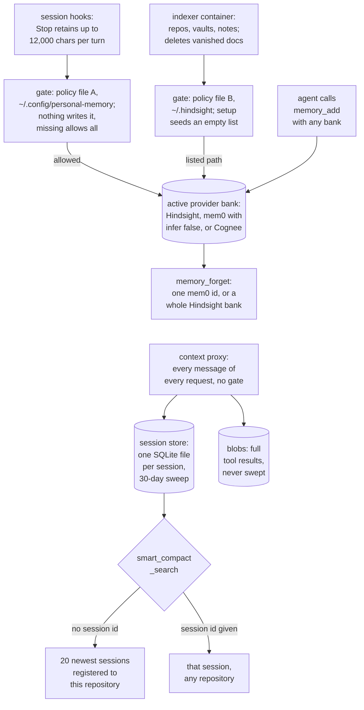

## 1. Executive Summary

OpenMem is a memory layer for coding agents: Claude Code, Codex, Cursor and
OpenCode. It has two halves. The **memory** half puts a stable set of
`memory_*` MCP tools, session hooks and a source indexer in front of whichever
provider is active, [Hindsight](../hindsight/), [mem0](../mem0/) or
[Cognee](../cognee/). OpenMem stores nothing of its own there; it resolves a
bank and forwards. The **context** half is a proxy in front of the model API. It
records every message of every request it handles in a per-session SQLite file,
trims old turns out of the request without summarising them, and gives the
agent tools to search what was trimmed. What is notable is that second store:
verbatim, append-only within a session, searchable across a repository's
recent sessions, with careful engineering around it. What is weak is the
boundary around both halves.

Four findings shape the rest of this report.

- **The workspace policy has no writer.** Hooks decide whether a workspace may
  recall and retain by reading `~/.config/personal-memory/coding-agent.json`
  (`cli/coding-agent/access-policy.mjs:5-24`). Every reference to that path in
  the tree is a read (Recorded searches), and a missing file allows every
  workspace (`:22`). Setup seeds `optInOnly: true` with an empty `optInPaths`
  into a different file, `~/.hindsight/coding-agent.json`
  (`providers/hindsight/lib/coding-agent.mjs:84-93`), which the indexer honours
  and the hooks ignore. `REVAMP.md:11` records that last fact.
- **The session store ignores the policy entirely.** Neither the proxy nor the
  OpenCode 2 plugin's store write consults it. `docs/coding-agent-hooks.md:54`
  says trimming still runs for denied workspaces; it means each of their
  messages is stored for 30 days.
- **Deletion has two granularities under one verb.** `memory_forget` deletes one
  mem0 memory by id, or drops an entire Hindsight bank, and the bank is a model
  argument (`cli/mcp/memory-facade.mjs:373-389`).
- **The benchmark measures the context half, and its point estimates
  recompute.** Both README headlines follow from the per-cell means committed
  in `site/src/data/contextbench.json`. The per-seed rows behind the intervals
  are gitignored, and nothing evaluates the provider half.

No marks. Section 9 names each and why it is withheld.

## 2. Mental Model

There is no OpenMem memory object. There are two stores, written by different
paths and held to different policies, and neither carries a belief state.

**Provider memory is whatever the provider makes of a string.** A Stop hook
reads the new tail of the agent's transcript and sends it to `memory_add` as one
text block, under `Session turn (<agent> <sid>):`
(`cli/coding-agent/hook-runner.mjs:240-256`). The provider decides what that
becomes. Hindsight extracts asynchronously. mem0 is called with `infer: false`
(`memory-facade.mjs:414`), so the block is stored verbatim and mem0's own
add-update-delete reconciliation never runs. Cognee adds it to a dataset that
graph search reads only after `cognify`. Nothing in OpenMem can mark a provider
memory wrong; the shipped skill tells the agent to add a correcting memory that
states the old claim and the new one (`.agents/skills/openmem/SKILL.md`).

**The session store is a record of what was said, not a belief.** Each content
block of each request becomes a row, keyed on a fingerprint chained to the row
before it, so a resent history inserts nothing and a rewritten one inserts from
the first changed row on (`docs/context-store.md`, *Rows*). A row is never
updated except for `in_context`, which flips to 0 when a trim drops it from the
request, with `trimmed_at_seq` and `trimmed_at` recording which cut and when
(`proxy/openmem_context/sessiondb.py:165-221`). It cannot turn out to be false,
so it has no correction path. It stops existing when its session file is
swept.

**The bank is the only scope, and it is a string.** It is resolved from the
workspace's git root through `index.yml` banks, then two JSON mappings, then
`coding-agent::<repo>` (`cli/coding-agent/bank-from-cwd.mjs:126-140`). Hooks
pass the resolved bank. The `memory_*` tools take whatever bank the model
names, and fall back to `openmem-mcp` (`memory-facade.mjs:222`).

## 3. Architecture

OpenMem is a Node CLI and MCP server (`cli/openmem.mjs`, `cli/openmem-mcp.mjs`),
a Python context-proxy package loaded as a LiteLLM pre-call hook
(`proxy/openmem_context/`), a Python indexer (`bin/hindsight-project-index`,
`indexer/`), and a Docker Compose stack the wizard writes into a stack root
(`compose.yaml`, `cli/stack.mjs`). Node 24 or newer is required for the built-in
`node:sqlite` with FTS5.

**The provider is a separate server, and exactly one is active.**
`MEMORY_PROVIDER` selects it, and `providers/<id>/manifest.json` declares its
compose services, ports, indexer sink and support level. Hindsight, mem0 and
Cognee are `supported`; Graphiti, Letta and Zep are placeholder manifests
marked `planned`. The default Hindsight stack runs `ghcr.io/vectorize-io/hindsight`
pinned by digest (`compose.yaml:51`) beside LiteLLM and the indexer. Switching
providers restarts compose and migrates nothing (`docs/architecture.md`).

**The session store is local files.** Under `~/.local/share/openmem/context`
sit `sessions/<sid>.json` registrations, `<sid>.db` databases, `<sid>.trim.json`
proxy state and a shared `blobs/` directory, with directories mode 700 and files
600 (`docs/context-store.md`, *Location*). The context-proxy container
bind-mounts the directory and runs as the host user. Two writers produce
identical rows: the Python proxy and the OpenCode 2 plugin
(`cli/coding-agent/session-db.mjs`). A parity test compares their schemas and
rows (`scripts/tests/test_context_parity.mjs`).

**Embeddings are optional and background.** When an OpenAI-compatible
embeddings endpoint is configured, the head of each row, its first 4,000
characters, is embedded in batches, trimmed rows first and then newest first
(`proxy/openmem_context/embed.py:63-64`). A row that keeps failing is recorded
with `dim = 0` and never retried.

### Deployment and ergonomics

The wizard (`npx @bcmyguest/openmem`) plans every write and prints it on a
dry run, then writes env files, the compose project and the index
configuration. `install-coding-agent --yes` copies a runtime to
`~/.local/share/personal-memory/agent-runtime` and wires hooks into each
agent's configuration (`CLAUDE.md`, *Gotchas*). The operator runs Docker and
one provider, plus an LLM route if the provider is Hindsight. The session store
needs no service. It works with the proxy alone, or with no proxy on OpenCode 2.
`docs/compatibility.md` grades each feature per agent: the unified `memory_*`
MCP is covered by tests and not yet verified live on Claude Code, Codex CLI,
Cursor CLI or OpenCode 1.x, and the context proxy is verified live on Claude
Code and Codex CLI.

## 4. Essential Implementation Paths

**SessionStart.** `runHook` reads the policy, resolves the bank, registers the
session in `sessions/<sid>.json`, recalls *"What should I know about this
project and recent decisions?"* with `budget: low` and 1,200 tokens, and
returns a banner plus the framed recall (`hook-runner.mjs:207-234`). A denied
workspace returns before registration (`:209`).

**Prompt.** Each user prompt is the recall query, eight hits, 8,000 characters
with the frame (`hook-runner.mjs:235-239`, `cli/coding-agent/session-facade.mjs:4`).

**Stop.** `readNewTranscript` resumes from a saved byte cursor guarded by a
256-byte anchor, reads at most the last 256 KiB, keeps user and assistant text
and tool-use arguments up to 800 characters each, drops thinking and tool
results, and keeps the last 12,000 characters (`hook-runner.mjs:33-34`,
`:56-63`, `:135-196`). The cursor advances only after `memory_add` returns.

**Proxy request.** `_rewrite_session` loads the trim state, renders the stored
cut, estimates prompt tokens from provider-reported usage, and cuts at the
threshold or on a `.force` flag (`proxy/openmem_context/core.py:361-450`). The
cut keeps the first real user turn and the reply before the cut, prepends a
pointer, and drops the oldest tool steps inside the current turn
(`docs/context-store.md`, *Trim*). Every request's rows go to the session
store whether or not anything was cut.

**Trim pointer.** `pointer_text` tells the model how many messages are gone and
that it *"MUST call smart_compact_search"* before answering about them
(`core.py:95-108`). When the session's registration names a bank,
`_build_note` appends a Hindsight recall on the cut turn's text and a notice if
ingest is still pending (`core.py:272-292`).

**Indexer.** `sync` compares each document's digest with a state file, retains
changed documents with a stable `document_id`, and deletes ids whose source
disappeared, unless `--limit` or `--kind` narrowed the run
(`bin/hindsight-project-index:360-399`).

## 5. Memory Data Model

**Provider side.** OpenMem defines no schema. `memory_add` sends `content` and
the bank: Hindsight `items: [{content}]` with `async`, mem0 one user message
with `user_id` set to the bank, `agent_id: "openmem-mcp"` and `infer: false`,
Cognee a form with `datasetName` and `raw_data` (`memory-facade.mjs:344-357`,
`:402-420`, `:452-470`). Indexer writes are richer: a `document_id` derived from
a SHA-256 of the source label, a content digest, tags, metadata and context
(`bin/hindsight-project-index:151-181`). On Hindsight the timestamp is the
literal `"unset"` when the caller passes none (`indexer/sinks/hindsight.py:91`).

**Knowledge pages and initiatives are Hindsight objects.** `memory_capture_initiative`
creates a page under an `Initiatives` folder whose body Hindsight regenerates
hourly from a `source_query` over the bank, scoped by a prompt clause to the
project's own code (`cli/mcp/knowledge.mjs:114-121`, `:249-280`). It then
retains a marker memory with a `document_id` derived from the page id
(`:281-300`). On mem0 and Cognee these tools return `supported: false`.

**Session store** (`docs/context-store.md`, schema version 3):

| Table | Holds |
| --- | --- |
| `messages` | `seq`, chained `fingerprint` (unique), `thread`, `role`, `kind` (text, tool_use, tool_result, thinking summary), tool `name`, full `text`, `blob_id`, `in_context`, `trimmed_at_seq`, `trimmed_at`, `created_at` |
| `lines` | one row per line of a message, for line-level counts |
| `messages_fts`, `lines_fts` | FTS5 over both, filled by insert triggers |
| `vectors` | float32 embedding per row and model; `dim = 0` marks a skipped row |
| `events` | one row per trim, fail-open and model call, with token estimates and provider-reported usage; never message content |

Thinking rows carry summary text only, never signatures. A compressed tool
result is stored in full in `messages.text` and again in `blobs/<id>.txt`,
keyed on the first 16 hex digits of its SHA-256.

## 6. Retrieval Mechanics

**Provider retrieval is the provider's.** `memory_search` and `memory_recall`
are one call: Hindsight `/memories/recall`, mem0 `/search` with
`filters.user_id`, Cognee search with an optional dataset list
(`memory-facade.mjs:358-372`, `:421-435`, `:471-477`). `memory_reflect` uses
Hindsight's reflect endpoint, or searches and asks LiteLLM to synthesise on the
other two (`cli/mcp/memory-reflect-consolidate.mjs:28-70`). On Cognee the
default search type is `GRAPH_COMPLETION` (`cli/cognee-mcp.mjs:61`). The
indexer's sink says a retained document is not searchable until `cognify`
finishes (`indexer/sinks/cognee.py:17-18`), and no hook triggers it.

**Session retrieval is OpenMem's own.** `smart_compact_search` takes exactly one
of `query` or `pattern` (`cli/mcp/context-store.mjs:60-95`).

- With `query`, FTS5 BM25 over `messages_fts` is fused by reciprocal rank
  (k = 60) with up to 50 cosine neighbours when the session has vectors
  (`:34-36`, `:387-401`, `:474-512`).
- With `pattern`, a JavaScript regex is scanned over rows and lines under a
  one-second budget (`:30`, `:359-377`).
- Results are filtered by `role`, defaulting to user and tool rows, and by
  `in_context`. They carry up to five neighbouring rows of the same thread,
  and `line_matches` gives an exact count across the session.

**Which sessions are searched.** Without `session_id`, `workspaceSessions`
reads every registration and keeps those whose `cwd` equals the MCP process's,
lies under its git root, or belongs to a linked worktree of the same
repository, newest 20 first (`context-store.mjs:23`, `:250-274`). With a
`session_id`, that one session is opened, wherever it was registered (`:434`).
Sessions with no registration, the fingerprint-id ones, are reachable only by
id.

**Model-written SQL.** `smart_compact_sql` accepts one `SELECT` or `WITH`
statement after comments, strings and quoted identifiers are blanked, rejects
nineteen write and control keywords, and runs it in a child process on a
read-only connection. On Node 24.10 and later a SQLite authorizer also denies
every action but read, select, function and recursive, with a two-second
kill and a 200-row cap (`context-store.mjs:37-47`, `:570-583`,
`cli/mcp/context-sql-runner.mjs:10-34`).

**Injection.** Every recall that reaches a prompt passes through one frame: a
fixed sentence saying the text is data, then an
`<openmem-recall untrusted="true">` block in which any `<` that starts an
`openmem-recall` tag is escaped (`core.py:47-52`, `:118-127`,
`cli/coding-agent/recall-frame.mjs`). The proxy and the JS port must keep the
constants identical, and the parity test checks them.

## 7. Write Mechanics

**Writes rarely block the agent.** Hindsight `memory_add` defaults to async, so
it returns after enqueueing and `memory_status` reports when ingest has drained
(`memory-facade.mjs:225-232`, `knowledge.mjs:86-100`). The Stop hook always
passes `async: true` (`session-facade.mjs:53`). mem0 writes are synchronous,
and `memory_status` reports mem0 as always ready (`knowledge.mjs:205-207`).
Cognee writes wait for the next `cognify` on that dataset: the indexer's
`flush(bank)` after a batch that touched it (`indexer/sinks/cognee.py:295-298`),
or an explicit `memory_consolidate`.

**Session-store writes happen before the request is forwarded.** One `BEGIN
IMMEDIATE` transaction inserts unseen rows and flips changed `in_context` flags.
A request that adds nothing writes nothing, and a database error logs one
`fail-open` line and forwards the request (`docs/context-store.md`, *Rows*).
A row is searchable lexically as soon as the transaction commits; its vector
arrives later.

**No background pass rewrites either store.** OpenMem's indexer turns
Hindsight's `enable_auto_consolidation` off on every bank it prepares and sets
a chunk extraction strategy (`indexer/sinks/hindsight.py:36-53`). Whatever
Hindsight does inside a bank on its own is Hindsight's.

**Deletion, by path.**

| Path | Deletes |
| --- | --- |
| `memory_forget` on mem0 | one memory by id (`memory-facade.mjs:436-443`) |
| `memory_forget` on Hindsight | the whole named bank; a per-memory id is refused as *"not wired"* (`:373-389`) |
| `memory_forget` on Cognee | nothing; refused (`:478-480`) |
| indexer | provider documents whose source file vanished (`bin/hindsight-project-index:386-391`) |
| TTL sweep | session files whose newest mtime is past 30 days, at most once a day (`proxy/openmem_context/ttl.py:24-78`, `session-db.mjs:50`, `:554-597`) |

Blobs are not swept: `docs/context-store.md:219` says they are shared between
sessions. A tool result large enough to be compressed, 4,000 estimated tokens
by default, therefore outlives the session row that pointed at it, and
`smart_compact_get` reads it by id without a session check
(`context-store.mjs:620-632`).

**Import.** `memory_import` replays a PMM export through `memory_add`. Its
`skip_duplicates` strategy checks ids and whitespace-normalised content against
the target bank on mem0 only; on Hindsight and Cognee both strategies import
every record again (`cli/mcp/portability.mjs:119-157`). `docs/memory-portability.md`
says so.

### Operational cost

Every proxied request costs one SQLite transaction and, at a trim, one
Hindsight recall with a configurable timeout. Embedding is off the request
path. The store's size is bounded by the TTL for databases and unbounded for
blobs. A Stop hook costs one provider write per turn.

## 8. Agent Integration

The unified MCP server lists 19 tools: ten in the facade's own list,
`memory_project_scope` among them, five knowledge-page and ingest-status tools,
and four session-store tools (`memory-facade.mjs:16-194`,
`knowledge.mjs:23-101`, `context-store.mjs:58-160`). Each carries MCP
annotations, and `memory_forget` is the one marked `destructiveHint: true`
(`memory-facade.mjs:101`).

**Hooks.** `install-coding-agent` wires SessionStart, prompt and Stop hooks for
Claude Code, Codex and Cursor through `hook-runner.mjs`, and native plugins for
OpenCode 1 and 2 (`cli/coding-agent/`). With `integration = "provider"`, the
upstream Hindsight coding-agent plugin replaces the hooks on Hindsight stacks
and the unified MCP stays. The Codex and Cursor transcript adapters are marked
best-effort and unverified in the code (`hook-runner.mjs:69-70`, `:98-100`).

**The proxy.** Claude Code and Codex reach it by pointing their base URL at a
LiteLLM instance pinned to `v1.109.0-dev.1` (`compose.yaml:172`). It adds a
constant standing instruction to every system prompt while trimming is on, so
the cached prefix never changes (`core.py:36-45`). The session id comes from
the `x-claude-code-session-id` header, the request metadata, Codex's
`prompt_cache_key`, or a fingerprint of the system prompt and first user
message (`docs/context-store.md`, *Session id*).

**The skill.** `.agents/skills/openmem/SKILL.md` tells the agent to pass the
project bank, check `memory_pages_search` before changing a convention, add a
correction when code contradicts a memory, and confirm scope before
`memory_forget`.

## 9. Reliability, Safety, and Trust

**The access policy is split across two files, and setup writes the wrong one
for the hooks.** Three readers use the openmem file: the hook gate
(`access-policy.mjs:8-34`), bank mapping (`bank-from-cwd.mjs:132`) and the
indexer's bank mapping (`bin/hindsight-project-index:298`). None writes it. The
indexer's opt-in reads only the legacy file
(`bin/hindsight-project-index:27`, `:414-426`), and the wizard seeds and edits
only that file (`providers/hindsight/lib/coding-agent.mjs:84-93`, `:143-190`).
`docs/coding-agents.md:41` and `:60` describe the legacy file and then say
`optInOnly: true` keeps unlisted workspaces opted out. That holds for the
indexer. The hooks, finding no openmem file, recall and retain in every
workspace, `/tmp` included.

**The session store is outside the policy.** The proxy holds no reference to
`optInOnly`, `optInPaths` or `accessAllowed`, and the OpenCode 2 plugin calls
`trimContext` whatever `allowed` says (Recorded searches;
`cli/coding-agent/opencode2-plugin/index.js:78`, `:207`). Denial removes
registration, so a denied session drops out of the default search and stays
readable by id.

**A secret pasted into a session has no delete path short of the file.** No
tool deletes a row or a session. The TTL removes the database; a compressed
tool result survives in `blobs/` indefinitely.

**Deletion granularity varies under one verb.** On Hindsight, `memory_forget`
with a bank drops the bank, with the indexer's documents and every retained
turn in it. The guard is the tool description's *"Confirm with the user
first"*, the skill's matching line and the destructive annotation.

**What is careful.** Recalled text is framed and escaped on every injection
path. Model SQL is checked three ways. The sanitised session id cannot name a
path outside `sessions/`, and explicit ids with separators are refused
(`docs/context-store.md`, *Session id*). A trim never splits a tool call from
its result, and signed reasoning in older kept messages is stripped so the API
does not reject a modified prefix (*Trim*).

**Marks, each withheld.**

- **Tombstone — withheld.** No record of a rejected value exists. Correction is
  a new memory beside the old one, and the indexer's delete is a delete-sync.
- **Trust state — withheld.** No status field on either store. `in_context` is
  a context-window flag, and filtering on it is a view of the transcript, not a
  verdict on its truth.
- **Bi-temporal — withheld.** `created_at` and `trimmed_at` are record times.
  The indexer's `timestamp` defaults to `"unset"`, and nothing tracks validity.
- **Scope enforced — withheld.** On the provider side the bank is a
  model-supplied argument on every `memory_*` tool, and the filter that applies
  it is the provider's. On the session side the store is a physical partition,
  one file per session, and the repository filter only chooses which files to
  open; an explicit id bypasses it.
- **Audit log — withheld, and the events table is not it.** `events` is
  append-only, but it records trims, fail-opens and model usage: what reached
  the model in a run, which cannot turn out false. Provider mutations leave no
  OpenMem record.
- **Human review — withheld.** No surface for a person to inspect or approve a
  memory; the CLI's `context status` reports trim statistics.
- **Negative eval — withheld.** The session-store tests that exclude rows,
  such as `default roles skip assistant rows` with a count beside it
  (`scripts/tests/test_session_db.mjs:99`), test the context-window store. No
  case asserts that provider recall leaves particular material out.

## 10. Tests, Evals, and Benchmarks

I did not run any suite. `npm test` runs every `scripts/tests/test_*.mjs` and
the wizard shell test, stopping at the first failure. Each Node script counts
`check` failures and exits non-zero, and `test_context_proxy.mjs` runs the
proxy's unittest suite as one of them. CI runs that, the indexer's pytest suite
and a site build (`.github/workflows/ci.yml`). The 31 tests under `sync/tests/`
and 16 under `bench/tests/` are in no CI step.

**What the tests pin.** Facade routing per provider against a stub `fetch`
(`test_memory_facade.mjs`). Hook access, bank resolution and transcript
cursors (`test_session_shim.mjs`). Session-store schema and row parity between
Python and JS (`test_context_parity.mjs`, `test_session_db.mjs`). SQL
rejection of writes, `ATTACH`, `PRAGMA` and a second statement, search filters
and vector skipping (`test_session_db.mjs:61-79`, `:216-224`). Tool
annotations and session-id traversal (`test_context_store.mjs:65`, `:140`). The facade tests cannot reach a provider, so
what a bank returns is never asserted.

**ContextBench, run E.** Three arms on held-out seeds 45 to 47 through Claude
Code with Claude Haiku 5.5, no Bash or file tools: keep everything, native
compaction, and OpenMem trimming (`docs/context-management.md:42`). The README
reports smart minus keep-everything +0.469 over eight log pairs and smart minus
native +0.495 over nine. Both point estimates recompute from the per-cell
means in `site/src/data/contextbench.json`.

| Arm | kv R4000 | log L1600 | log L6400 | log L12800 |
| --- | --- | --- | --- | --- |
| Keep everything | 1.000 (3) | 0.569 (3) | 0.486 (3) | 0.354 (2) |
| Native compaction | 1.000 (3) | 0.583 (3) | 0.458 (3) | 0.347 (3) |
| OpenMem | 1.000 (3) | 1.000 (3) | 0.875 (3) | 1.000 (3) |

Pooling the paired differences gives (3 × 0.431 + 3 × 0.389 + 2 × 0.646) / 8 =
0.469 against keep-everything, and (3 × 0.417 + 3 × 0.417 + 3 × 0.653) / 9 =
0.495 against native. The L12800 smart mean of 1.000 fixes each seed at 1.0,
which is why the two-seed cell pairs exactly. The bootstrap intervals need the
per-seed rows in `bench/results-E/summary.json`, and `bench/.gitignore` excludes
`results-*/`, so they cannot be checked from the tree.

Three limits, all stated in the project's own docs. The tasks are synthetic
recall and counting over long logs, not coding. The native arm recorded zero
compactions. Compact-Bench real-coding results are pending
(`docs/evidence-plan.md`).

No paper is attached to OpenMem. The arXiv identifiers in the tree cite other
work: MemGPT and Context Language Models in the README, and papers named in
the research and feed docs.

## 11. For Your Own Build

### Steal

- **Trim to a verbatim store instead of summarising.** A trimmed request plus a
  searchable record of everything trimmed keeps exact values that a summary
  loses, and the run-E log cells are a measured case for it.
- **Chain row fingerprints over content, not wire format.** It makes a resent
  history idempotent across three API shapes and two writers, and makes a
  rewritten history visible as new rows.
- **Keep the trimmed prefix byte-stable.** Store the cut, gap and strip points
  with fingerprints and render the same bytes until the next trim, so the
  prompt cache survives trimming.
- **One frame for every recall.** A single escaped untrusted-data block shared
  by the hooks, the plugins and the proxy is cheaper to audit than one per path.
- **Layer the guards on model-written SQL.** A keyword check, a read-only
  connection, an authorizer and a killable child process each catch what the
  others miss.

### Avoid

- **A policy file with readers and no writer.** If setup cannot produce the
  file a gate reads, the gate's default is the policy. Write it at setup, or
  fail closed when it is missing.
- **Two policy files for one decision.** Hooks and indexer answer *"may this
  workspace become memory?"* from different files with different semantics.
- **One delete verb at two blast radii.** If a bank drop is necessary, give it
  its own tool and keep it off the agent's default surface.
- **A retention rule that covers the index and not the content.** A TTL on
  session databases is not a TTL on what they stored while blobs persist.
- **Calling an extractor with extraction off.** mem0 with `infer: false` is a
  vector store without the update logic it was chosen for.

### Fit

OpenMem suits one developer on one machine who already runs, or is willing to
run, Hindsight in Docker, and whose real problem is long agent sessions losing
detail to compaction. The context half is the reason to take it; it works with
no provider at all. As a memory layer it adds bank resolution and hooks but no
semantics: what you get is the provider's model, sometimes with that provider's
reconciliation switched off. Teams, shared machines and anyone who needs a
workspace kept out of memory should not adopt it until the access policy has
one file that setup writes and both stores obey.

## 12. Open Questions

- Does Hindsight's bank delete also remove its knowledge pages and initiative
  markers? The facade cannot say; the engine at the pinned digest was not read.
- How large does `blobs/` grow over months of use, and is a sweep keyed on
  referencing rows planned? `docs/context-store.md` states the current rule only.
- Do the run-E intervals hold when recomputed from the per-seed rows, and does
  the effect survive on Compact-Bench coding tasks?
- Should a denied workspace's sessions be stored at all? The current design
  stores them so trimming still works, and nothing says whether that was a
  decision or a side effect.

## Appendix: File Index

- **Unified MCP:** `cli/openmem-mcp.mjs`, `cli/mcp/memory-facade.mjs`,
  `cli/mcp/knowledge.mjs`, `cli/mcp/memory-reflect-consolidate.mjs`,
  `cli/mcp/portability.mjs`, `cli/mcp/pmm-records.mjs`, `cli/mcp/export/`.
- **Session store and its tools:** `cli/mcp/context-store.mjs`,
  `cli/mcp/context-sql-runner.mjs`, `cli/coding-agent/session-db.mjs`,
  `proxy/openmem_context/sessiondb.py`, `proxy/openmem_context/ttl.py`,
  `proxy/openmem_context/embed.py`, `docs/context-store.md`.
- **Proxy:** `proxy/openmem_context/core.py`, `adapters.py`, `compress.py`,
  `recall.py`, `store.py`, `settings.py`; the JS port
  `cli/coding-agent/context-trim.mjs`.
- **Hooks and policy:** `cli/coding-agent/hook-runner.mjs`, `session-facade.mjs`,
  `access-policy.mjs`, `bank-from-cwd.mjs`, `recall-frame.mjs`,
  `opencode2-plugin/index.js`, `providers/hindsight/lib/coding-agent.mjs`.
- **Indexer:** `bin/hindsight-project-index`, `indexer/watch.py`,
  `indexer/sinks/`.
- **Tests and bench:** `scripts/tests/`, `proxy/tests/`, `indexer/tests/`,
  `bench/`, `site/src/data/contextbench.json`, `docs/evidence-plan.md`.

### Recorded searches

Checked against the checkout at the pinned revision, from the tree root.

- `git grep -n -E "accessConfigPath|personal-memory/coding-agent\.json" -- ':!site' ':!docs' ':!scripts/tests' ':!bench'` — the path constant, two `readFileSync` readers, the indexer's mapping constant, a skill line and a config comment; no write.
- `git grep -n -E "coding-agent\.json" -- wizard cli providers` — every write targets `~/.hindsight/coding-agent.json` or the tracked template.
- `git grep -n -E "optInOnly|optInPaths|accessAllowed|readAccessConfig" -- proxy cli/coding-agent/context-trim.mjs cli/coding-agent/session-db.mjs cli/mcp/context-store.mjs` — no match.
- `git grep -n -E "overwrite" -- cli` — the `merge_strategy` enum (`memory-facade.mjs:145`) and two installer comments; no branch on the value.
- `git grep -n -E "memory_consolidate|cognify" -- cli indexer/sinks bin` — the facade tool, its Cognee call and the indexer sink; no hook calls either.
- `git grep -n -E "blobs" -- proxy/openmem_context cli/coding-agent cli/mcp` — writers, the `smart_compact_get` reader and the installer's mkdir; neither sweep names the directory.
- `git grep -n -E "dropSession\(|drop_session\(" -- cli proxy` — four callers; each closes a cached connection and deletes nothing.
- `git grep -n -i -E "tombstone|valid_from|validFrom|supersed|quarantine|approv" -- cli proxy indexer bin providers wizard` — one match, the initiative tool's *"approved feature plan"* description.
- `git grep -l -i -E "arxiv|bibtex|@article|CITATION" -- ':!bench' ':!site'` — the README and five docs or config files, all citing other work; no `CITATION.cff`.
- `git grep -n -E "sync/tests|bench/tests" -- .github package.json scripts` — one fixture path in `test_cli_package.mjs`; no runner.

## History

**2026-11-01** — [`af42d8cabfdf9911c85b0ff6554b0bec760e8cb6`](https://github.com/bcmyguest/openmem/commit/af42d8cabfdf9911c85b0ff6554b0bec760e8cb6) — first reading, at the head of `main`, from a shallow clone, with history from a treeless bare clone. No marks. Apache-2.0, no rider; no `.gitmodules`. Screened before reading: one auto-run surface, `server.json`, an MCP registry manifest naming the npm package; two `conftest.py` files; three manifests with floating ranges behind lockfiles. The screen put six dependency surfaces inside the cooldown; by history five are, last changed 27 to 31 October, and `site/pnpm-lock.yaml`, last changed 20 October, is not. `CLAUDE.md` was read as data. The facade, hooks, policy readers, wizard seed, indexer, proxy core, both session-store writers, the MCP search and SQL tools and the committed ContextBench means were read; the Hindsight, mem0 and Cognee engines were not. Nothing was installed, built or run.
