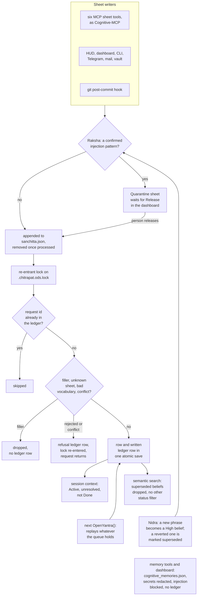

## 1. Executive Summary

OpenYantra is a local, single-user memory toolkit that keeps a structured model
of one person as sheets in a LibreOffice workbook, written through one gated
writer and served to Claude Desktop and Cursor over MCP. The gate is the
notable part: an injection scan that can hold a write for a person to release,
an admission filter, vocabulary checks, and a row on an append-only ledger
sheet.

A sheet change and its ledger row land in one atomic save, under a file
lock that every process takes and that one thread can enter twice, so a write
that validation rejects or the conflict guard refuses saves its ledger row and
returns. When the lock call fails, the write runs under the thread lock alone.
The MCP memory tools and the dashboard write a separate JSON store with a
secret filter and an injection block and no ledger. Nidra promotes a matched
phrase to Beliefs once, and marks a belief superseded when a revert names it;
search and every context compiler leave a superseded belief out through one
shared predicate. The SQLite engine has no producer.

`LICENSE` is the MIT text; `SPEC_LICENSE` dedicates the protocol's table
schemas, sheet templates and interchange formats to the public domain under
CC0 1.0.

The README describes a SQLite WAL store shared by the HUD, the CLI and the MCP
server. At this commit the HUD and the MCP sheet tools share the workbook, the
MCP memory tools use a JSON file, and SQLite holds only hand-drawn graph edges.
Four marks are earned, all on the sheet engine: `audit_log` on the ledger
sheet, `human_review` on the quarantine, `trust_state` on the Beliefs sheet's
`Superseded_By`, and `negative_eval` on a resolved loop, a Done task and a
superseded belief the reads must leave out. Section 9 gives the reason for each
of the three withheld.

## 2. Mental Model

A memory is a **row in a sheet** of `chitrapat.ods`. The sheets are Identity,
Goals, Projects, People, Preferences, Beliefs, Tasks, Open Loops, Session Log,
Agent Config, the ledger (Agrasandhanī), Inbox and Corrections, plus Quarantine
and Security Log created on first use. A row is identified by its first column
— the attribute, task text or loop topic — and carries `Confidence` (High,
Medium, Low, Inferred), `Source` (User-stated, Agent-observed, Agent-inferred,
System), `Importance` 1 to 10 and `Last Updated` (`openyantra/core.py:75-104`,
`:2788-2884`).

A row becomes a belief by passing four gates in order, and nothing marks it as
less than true afterwards:

- **Raksha** redacts secrets, then scans the joined field text. A confirmed
  injection, jailbreak, impersonation or zero-width pattern sends the write to
  Quarantine; a suspicious one adds a `_security_flag` column and lets it
  through (`core.py:752-770`, `openyantra/yantra_security.py:457-555`).
- **Admission** drops a write whose content contains a noise phrase, whose
  content is at most two words including a filler word, or whose importance is
  below 2, with no ledger row (`core.py:117-169`).
- **Validation** rejects an unknown sheet or a value outside the controlled
  vocabulary (`core.py:454-469`).
- **Conflict** refuses an update that would change a High-confidence field from
  a request that is not High (`core.py:471-489`).

A row stops counting through a lifecycle column read by the context builder: a
loop resolved, a task Done, a project not Active, a goal not Active or In
Progress (`core.py:1199-1213`). Identity, People and Preferences rows have no
such column and change only by overwrite. Beliefs carry `Superseded_By`, which
Nidra fills when a revert names a belief, and search and every context compiler
drop a row that carries it (section 6). The `delete` operation is in the
vocabulary and has no branch in the committer, so nothing is ever deleted
(`core.py:85`, `:495-614`). A git revert adds a new Session Log row labelled
*Reverted / Superseded Decision*; the reverted commit's own row is untouched
(`openyantra/yantra_git.py:106-127`).

The **cognitive store** is a second memory with no relation to the first: a JSON
list of notes with a key, a type, an agent name, content, tags and a timestamp.
A write replaces the note with the same key case-insensitively, and a delete
removes it (`openyantra/cognitive_db.py:40-135`). Only the MCP `memory_*` tools
and the dashboard's cognitive routes reach it, and no context builder reads it.

Control is hybrid. The agent writes through MCP, a person writes through the
HUD, the dashboard, the CLI, Telegram, LibreOffice or Obsidian, and Nidra
resolves loops when someone runs it.

## 3. Architecture

Everything is one Python package, `openyantra/`, constructed per process. Each
of the MCP server, the dashboard, the Telegram bot, the iOS Shortcut server, the
mail daemon, the CLI and the git hook opens its own `OpenYantra` on the same
workbook.

- **`core.py`** holds `OpenYantra`, the writer `LedgerAgent` and the queue
  `WriteQueue`. The constructor replays the queue, opens the search index, and
  creates a SQLite `SyncEngine` beside the workbook (`core.py:684-722`).
- **`yantra_security.py`** is Raksha: regex lists, secret redaction and trust
  tiers keyed on the writer's agent name.
- **`vidyakosha.py`** is the search sidecar: a FAISS flat inner-product index,
  a pickled BM25 index and a JSON registry of indexed rows.
- **`yantra_sqlite.py`** creates fifteen tables mirroring the sheets, plus
  `_meta`, `_sync_state` and `edges`, at every start (`yantra_sqlite.py:128-381`). Only
  `edges` is written in product code, by the dashboard.
- **`cognitive_db.py`** and **`cognitive_mcp.py`** are the JSON store and a
  hand-written line-delimited JSON-RPC server announcing protocol `2024-11-05`.
- **`yantra_ui.py`** is a FastAPI app on `127.0.0.1:7331` serving
  `UI/v4/dashboard.html` and `UI/v4/hud.html`; `desktop.py` opens either in
  pywebview or a browser.

Beside the workbook the package keeps `sanchitta.json`, `chitrapat.db`,
`cognitive_memories.json`, `settings.json`, `vidyakosha.faiss`,
`vidyakosha_bm25.pkl`, `vidyakosha_registry.json`, a `pratibimba/` folder of
per-agent snapshots and yearly `chitrapat_sessions_<year>.ods` archives.

A write is a whole-file rewrite. The writer parses every sheet with pandas,
writes them all to `chitrapat.tmp.ods` and moves it over the workbook with
`os.replace` (`core.py:498-614`, `:616-639`). `_workbook_lock` takes a
re-entrant lock on `.chitrapat.ods.lock` around the whole of `_process` and
around `_write_sheet`, and the queue file takes one on `sanchitta.lock` around
each load and save (`:396-397`, `:325-326`); section 9 describes the class.
`portalocker>=2.7` is a core dependency in `pyproject.toml`, `install.sh` and
`install.ps1`, and the `Dockerfile` installs the package with `pip install -e .`.
Both fall back to the thread lock alone when the import fails or the lock call
raises (`:67-71`, `:285-296`).

### Deployment and ergonomics

The core needs Python 3.9 or later with `odfpy` and `pandas`. Search adds
`scikit-learn` and `faiss-cpu`, MiniLM is optional, and the dashboard adds
FastAPI, uvicorn and `webauthn`. No API key is needed to store anything. Nidra
calls a local Ollama on `localhost:11434` when one answers and falls back to a
template sentence. Everything runs offline.

The store is the point of the design. A person can open `chitrapat.ods` in
LibreOffice, read every sheet and fix a row by hand. Such an edit bypasses
Raksha and the ledger. The `yantra sync` command that the skill file describes
as importing such edits calls `SyncEngine.import_ods`, whose body opens the file
and returns a note: *"stub returns OK for now"* (`yantra_sqlite.py:762`). A hand
edit takes effect because the workbook is the store; the search index sees it
at the next write.

The first-run path is `curl … install.sh | bash` or `install.ps1`; section 8
lists what each writes.

## 4. Essential Implementation Paths

- **Sheet write.** `OpenYantra.request_write` (`core.py:746-798`) runs Raksha,
  then `LedgerAgent.submit`, which appends the request to `sanchitta.json`,
  calls `_process`, and removes the entry by request id in a `finally` block
  (`:379-385`, `:344-350`, `:413-452`). `_process` first returns
  `already_committed` for a request id the ledger sheet holds
  (`:399-411`), then runs admission, `_validate`, `_check_conflict` and
  `_seal`, and `_commit_and_audit` writes the sheet change and the `written`
  ledger row in one save; a rejection or conflict goes to `_log_audit`. On
  `written`, `request_write` calls `VidyaKosha.sync` over the whole workbook,
  because the `incremental_update` it checks for is not defined (`:781-785`).
  It then asks `SHEET_TABLE_MAP` for an edge table; that map is keyed `Tasks`,
  `OpenLoops`, while sheet names carry emoji, so the lookup is always `None`
  (`:792`, `yantra_sqlite.py:61-77`).
- **Replay.** `OpenYantra.__init__` calls `replay_queue`, which empties the queue
  and runs `_process` on every request in it (`core.py:688-693`, `:387-390`).
- **Capture.** MCP sheet tools (`cognitive_mcp.py:401-460`); the dashboard and
  HUD through `POST /api/inbox` (`yantra_ui.py:193-198`, `UI/v4/hud.html:408`);
  `yantra inbox` (`cli.py:274-277`); Telegram commands and plain messages
  (`telegram_bot.py:151-240`); the iOS Shortcut server (`ios_shortcut.py:55-93`);
  the SMTP daemon (`yantra_mail.py:20-49`); Obsidian import
  (`yantra_vault.py:181-245`); the post-commit hook (`yantra_git.py:63-127`);
  and the CrewAI, LangChain and OpenClaw adapters.
- **Routing.** `route_inbox` sends each unrouted Inbox row to the sheet a
  keyword list picks, as a Low-confidence `Agent-inferred` row, then marks the
  Inbox row by its full content (`core.py:831-867`, `:2477-2498`).
- **Consolidation.** `NidraConsolidator.consolidate` clusters the last 25
  sessions, resolves loops, promotes preferences and logs a summary session
  (`yantra_nidra.py:245-385`), from `yantra dream`, `POST /api/nidra/consolidate`
  or the HUD.
- **Context.** `load_session_context` (`core.py:1190-1236`) feeds
  `build_system_prompt_block` (`:1238-1284`) and `build_context_markdown`
  (`:1919-2079`), which MCP `get_system_context` returns; `SutraCompiler.compile`
  packs a token budget (`yantra_sutra.py:76-372`).
- **Search.** `OpenYantra.search` (`core.py:1293-1359`) over `VidyaKosha.query`
  (`vidyakosha.py:355-448`), reached through the LangChain retriever and the
  CrewAI adapter; `CognitiveMemoryStore.search` (`cognitive_db.py:137-181`);
  `SyncEngine.traverse` (`yantra_sqlite.py:923-967`).
- **Correction.** Update, resolve and supersede through `_commit_and_audit`,
  the last from Nidra's revert pass (`yantra_nidra.py:288-324`); the corrections queue
  (`core.py:869-909`, `yantra_ui.py:205-221`); quarantine release
  (`core.py:1511-1531`, `yantra_ui.py:238-241`); cognitive delete
  (`cognitive_db.py:123-135`); session-log archival (`core.py:1378-1423`).

## 5. Memory Data Model

The controlled vocabularies are sets in `core.py:75-85`: project, task and goal
statuses, four priorities, `Yes`/`No`, three preference strengths, four
confidence values, four sentiments, four sources and seven operations. Column
names follow the template, and `_commit_and_audit` adds any new field as a new column, so
a writer that names a field wrongly widens the sheet instead of failing.

**Row identity is the first column's text.** `update`, `resolve`, `archive`
and `supersede` build a mask on the first column equal to `row_identifier` and
change every matching row (`core.py:532-581`). An update that matches nothing appends a new row with the
requested fields, so a mistyped task name sent to the dashboard's complete
route creates a row with status Done and no task text.

**Provenance is caller-supplied.** `Source` and `Added By` come from the
request. `add_task`, `add_project` and `update_identity` hardcode
`source="User-stated"` and `confidence="High"`, so a task the agent creates
through MCP is recorded as the person's statement (`core.py:1063-1103`).

**Scope.** One workbook per person. The one key is the Agent Config sheet's
`Agent` column, which `load_session_context` uses to pick the instructions an
agent receives, with `ALL` as the wildcard (`core.py:1193-1197`). The cognitive
notes carry an agent name that no read consults.

**Time.** `Last Updated` in UTC seconds, `Opened` on loops, `Deadline` on tasks
and goals, and the ledger's request timestamp. There is no validity time.
`TTL_Days` on loops is read by `check_anishtha_ttl`, which reports expired loops
and changes nothing (`core.py:943-972`).

**Belief columns.** Beliefs carries `Contradiction_Flag`, written as `No` by
Nidra's promotion and as `Superseded by <successor>` by a `supersede`, beside
`Superseded_By` (`core.py:566-581`, `:2837-2838`). `diff_beliefs` returns
same-topic groups to the CLI and the dashboard's insights (`core.py:911-941`, `:2175`, `:2223-2230`).

**The SQLite schema** mirrors the sheets with lowercase columns and a `UNIQUE`
request id on `ledger` for idempotent writes (`yantra_sqlite.py:128-381`).
`SyncEngine.write` has callers only in `tests/test_setu.py`.

**Committed data files.** The root `chitrapat.ods` is a workbook bootstrapped on
20 May 2026 at v2.12, holding a first name, a city and an occupation in
Identity. Its Session Log has the bootstrap row twice, 15 seconds apart. Its
ledger has the same four writes twice, under the same request ids and
timestamps: the queue replay as it ran before `e6a19a1`, when nothing removed
a processed entry, recorded in the project's own file. `cognitive_memories.json` is an empty list, and `settings.json` holds the
defaults with empty key fields. `.gitignore` lists all three as user data.
`openyantra/chitrapat_template.ods` is the blank template.

## 6. Retrieval Mechanics

**Context injection** is assembled from sheets, not search.
`load_session_context` returns the identity map, the agent's instructions,
Active projects, unresolved loops sorted by importance and capped at 15, Active
or In Progress goals, tasks whose status is not Done, pending corrections, the
unrouted Inbox count and the Beliefs rows that are not superseded
(`core.py:1190-1236`). Archived and Blocked tasks pass that filter. No other code
reads the `beliefs` list.

`is_superseded` counts a row as superseded when
`Superseded_By` holds anything but an empty or null-like value, when
`Contradiction_Flag` starts with *superseded*, or when `Status` is Superseded or
Reverted (`core.py:172-197`). `build_context_markdown` caps each section at four
to eight items and adds Values and Constraints beliefs at High confidence that
are not superseded, the first five People rows and Strong preferences
(`core.py:1919-2079`). It is the only reader that uses `Confidence` to exclude a
row. `yantra context` takes the first five beliefs of importance 7 or more that
are not superseded (`yantra_context.py:147-157`), and `SutraCompiler` filters
projects, loops, goals and tasks by status and Beliefs by the same predicate
(`yantra_sutra.py:231-247`).

Three reads apply no supersession filter. MCP `read_sheet` returns the sheet's
rows with their `Superseded_By` column (`cognitive_mcp.py:391-399`). The HUD's
recall fetches the Beliefs sheet whole, and the terminal and Telegram morning
brief and the digest each draw a *past memory* from Goals and Beliefs
(`core.py:1840-1859`, `yantra_digest.py:201-203`, `yantra_morning.py:127-131`);
the MCP `morning_brief` tool asks for markdown, which omits that line.

**Semantic search** indexes eight sheets: Identity, Goals, Projects, People,
Preferences, Beliefs, Tasks and Open Loops (`vidyakosha.py:237-240`). Each row
becomes `[sheet] column: value …` without the confidence, source and date
columns. The vector arm is FAISS `IndexFlatIP` over TF-IDF with truncated SVD,
or MiniLM when installed; BM25 runs at k1 1.5 and b 0.75. Each arm is
normalised by its maximum and fused at 0.7 vector to 0.3 BM25, and
`OpenYantra.search` then multiplies by importance and a one-year recency ramp
(`vidyakosha.py:355-448`, `core.py:1293-1359`). A superseded belief is skipped
while the fused list is cut to `top_k`, and `OpenYantra.search` filters again
unless the caller passes `include_superseded`, which no caller does
(`vidyakosha.py:432-446`, `core.py:1328-1333`). **No other status filter
applies**, so a resolved loop, a Done task and a Cancelled project rank like
live ones. The index row carries the sheet row as it stood at the last rebuild,
which every committed write triggers.

A per-agent snapshot freezes the registry at session start and keeps querying
the live FAISS and BM25 indexes, so positions in a rebuilt index can address a
different row of the frozen registry (`vidyakosha.py:450-464`, `:501-511`).

**The HUD's recall** fetches the Beliefs sheet and filters it by substring in
the browser (`UI/v4/hud.html:433-445`). **MCP `memory_search`** is a substring
match over key and content with type, all-tags and date-prefix filters, and
returns every match. **`graph_traverse`** is a recursive CTE walking edges both
ways for up to six hops, with a path-substring cycle guard.

The MCP server injects nothing on its own; the model has to call
`get_system_context`. Cognitive notes are never part of any context.

## 7. Write Mechanics

Every write is an explicit call. No model extracts or rewrites memory; Nidra's
Ollama call produces only the summary sentence it logs as a session.

**Admission drops short filler.** `_is_worth_remembering` joins the content
fields, leaving out importance, confidence, priority, status, source, author,
date and deadline. It drops the write when that text contains one of six
phrases such as *user said thanks*, or when it is at most two words and one of
them is a filler word such as `sure`, `noted` or `great` (`core.py:117-169`).
"Make sure the backup runs" is admitted; "Sure thing" is dropped with status
`filtered` and no ledger row. The filler set lists `thank you` and `got it` as
entries, and a single word never equals either. Session Log, Inbox and
Corrections writes skip the filter.

**Conflict detection is a refusal with nowhere to go.** A conflicting update
returns `resolution: pending_user`; the requested value is kept only as text in
the ledger row's reason (`core.py:431-441`). Most MCP and adapter writes are
High confidence, so the guard rarely fires.

**Duplicates are made, not removed.**

- When the workbook lock is not taken, a second process replaying the queue
  while the first is inside `_process` applies the request again; an `add`
  lands a second row (section 9).
- Obsidian import reads every line of `Inbox.md` again on each sync and never
  clears the file (`yantra_vault.py:232-245`).

**Nidra.** `prune_and_resolve_loops` resolves an open loop when its topic, or
its first three words of four or more letters, appears in the decisions and topics
of the last 30 sessions (`yantra_nidra.py:191-243`). Revert rows are part of
that corpus. `detect_promotable_preferences` scans the last 30 sessions and 20
Inbox rows for phrases such as *user prefers*, *always use* and *never prefer*
(`yantra_nidra.py:104-189`). Each new match longer than eight characters
becomes a Beliefs row with Topic `Pref: <first 35 characters>`, Position
`User Preference: <phrase>`, Confidence High, Source `Agent-inferred` and
Importance 8, written through `request_write` as `NidraConsolidator` with the
topic as its row identifier (`:173-182`, `:255-286`). The phrase is the text
after the trigger, so *never use tabs for indentation* and *always use tabs for
indentation* both become `User Preference: tabs for indentation`. Three checks
sit in front of it:

- **Already stored.** The known set holds each stored Position, the same
  Position without its *User Preference:* prefix, and each Topic, and a phrase
  promoted in this run joins it (`:111-120`, `:183-186`). A second run adds
  nothing, and a superseded row keeps its phrase out.
- **Reverted.** A pre-pass over the last 50 sessions strips the `Reverted /
  Superseded Decision [<hash>]:` label and a leading `Revert "` from each
  decision part that says *reverted*, keeping what is left when it has four or
  more characters (`:131-142`). A non-empty session whose decisions contain one
  of those phrases, or are contained in one, is skipped, and so is any phrase
  found inside one or containing one (`:144-153`, `:166-169`). The git hook
  writes a revert as `Reverted / Superseded Decision [<hash>]: Revert
  "<subject>"` (`yantra_git.py:106-117`), so the phrase is the reverted
  commit's subject, suppressed while the revert row is in the window.
- **Inbox.** The scan reads `Content`, the Inbox sheet's text column, after
  `Item` and `Raw Input` (`:158`, `core.py:2868-2870`).

After promotion, a second pass over the same 50 sessions marks beliefs
superseded (`:352-388`). For each reverted phrase it drops a leading *always*
or *never* plus *use* or *prefer*, and any Beliefs row without `Superseded_By`
whose Position contains the remainder, or is contained in the phrase, gets a
`supersede` request keyed on its Topic, setting `Superseded_By: Reverted in
session log`. The match is by substring over every belief, whoever wrote it, so
reverting *Always use tabs for indentation* supersedes a belief reading *Never
use tabs for indentation* as well. Every row sharing the Topic is marked.

Two promotions whose first 35 characters agree share a topic, and
`diff_beliefs` groups rows that are not superseded by topic (`core.py:911-941`).

Promoted rows are not in the session context's principles section, which admits
the Values and Constraints domains only (`core.py:2013-2024`); they reach
semantic search, `read_sheet`, the HUD's recall, `yantra context` and the Sutra
compiler until a revert supersedes them.

**The MCP sheet writes.** `add_inbox_item` calls `inbox` with source
`Agent-observed`; `add_open_loop` calls an alias of `flush_open_loop`;
`complete_task` sets Status Done with source `Agent-observed`; and
`add_project` passes its arguments by name (`cognitive_mcp.py:401-460`,
`core.py:802-824`, `:1015-1041`). All six write as `Cognitive-MCP`, the agent name
the server constructs `OpenYantra` with, and no tool argument names the
requesting agent (`cognitive_mcp.py:63`). The iOS Shortcut server passes its
default source, `iOS Shortcut`, to `inbox`, so the constructor's
`assert source in SOURCE` refuses the write unless the request body names a
valid source (`ios_shortcut.py:66`, `:75`, `core.py:211-214`).

### Operational cost

Writes block the caller and are retrievable when the call returns, and each
holds the workbook lock throughout, so writes from every process run one at a
time. One sheet write parses the ledger sheet for its request id, then every other
sheet, the target sheet and the ledger again, writes the whole workbook once, then rebuilds the search index: it reads eight
sheets again, refits TF-IDF, re-encodes every row and rewrites the FAISS, BM25 and
registry files. Each write's cost therefore grows with the whole workbook, and
with MiniLM installed every write re-embeds the store. The `yantra_sqlite.py`
docstring's 2 ms writes describe the unwired SQLite path.

Nidra reads the last
25 to 30 sessions per run with a ten-second Ollama timeout and runs only when
asked. The OpenClaw adapter prepends the context block to the system prompt at
session start, so any write since the last session changes the prompt prefix.

## 8. Agent Integration

The MCP server registers sixteen tools (`cognitive_mcp.py:121-319`). Five work
on the JSON store: `memory_write`, `memory_read`, `memory_search`,
`memory_delete` and `memory_stats`. Eleven work on the workbook:
`get_system_context`, `health_check`, `morning_brief`, `read_sheet`,
`graph_traverse` and six writes. The model names the agent on every `memory_write`, can delete any key
including the `agent-hierarchy-connections` record behind the dashboard's agent
hierarchy, and can read any sheet, the ledger and Quarantine included.

The adapters are thin. The LangChain chat history writes a session row on
flush, and its retriever wraps `search`. The CrewAI memory routes `save` by kind
and wraps `search`. The OpenClaw hooks inject the prompt block at session start,
re-inject open loops after compaction and log a session at the end. The
`pre_compact_hook` that its comment says preserves open loops returns the
payload unchanged (`adapters/openclaw.py:37-40`). `SKILL.md` describes the
library API for an agent and was read as data.

### What the setup commands and installers write

- **`yantra mcp setup`** writes `mcpServers.openyantra` into Claude Desktop's
  `claude_desktop_config.json` and `~/.cursor/mcp.json` at their per-OS paths,
  pointing at the interpreter, the absolute path of `cognitive_mcp.py` and the
  workbook. It copies an existing file to `.json.bak`, replaces a file it cannot
  parse with a fresh one holding only its own entry, and creates both files
  whether or not the client is installed (`mcp_setup.py:18-122`).
- **`yantra hook install`** writes `.git/hooks/post-commit` in the target
  repository, replacing any existing hook without a check. The hook runs
  `python -m openyantra.cli hook run` in the background with output discarded,
  against `OPENYANTRA_FILE` or a `chitrapat.ods` in the repository root
  (`yantra_git.py:28-60`, `cli.py:23-24`).
- **`install.sh`** fetches forty files one at a time from `raw…/main`,
  continuing past any that fail. It installs Homebrew through its own
  `curl | bash` when Python is missing, runs `sudo` package installs on Linux,
  and pip-installs eleven unpinned packages into `~/openyantra/.venv`. It writes
  the `yantra` launcher, a desktop shortcut whose quarantine attribute it
  strips, and PATH and `OPENYANTRA_FILE` lines appended to `~/.zshrc`,
  `~/.bashrc` or `~/.bash_profile` (`install.sh:21`, `:186-376`).
- **`install.ps1`** does the same on Windows. It writes `yantra.ps1`, a
  `yantra.bat` that runs it with `-ExecutionPolicy Bypass`, a desktop shortcut,
  and the user-level `PATH` and `OPENYANTRA_FILE` variables.
- **The `Dockerfile`** installs the core dependencies only and starts
  `cognitive_mcp`. Without `faiss` or a workbook inside the container, only the
  JSON memory tools work.

No installer registers a hook or an MCP config on its own; both need the
commands above.

## 9. Reliability, Safety, and Trust

### The workbook lock

Both file locks are one class, `_ReentrantFileLock`, keyed on the resolved
lock path in a process-wide registry. Each path holds a `threading.RLock`, a
depth count and the open file. The first entry in a process takes the RLock,
opens the lock file and takes an exclusive `portalocker` lock; a nested entry
by the same thread takes the RLock again and raises the depth, and the file
lock is released when the depth returns to zero (`core.py:262-313`). Threads in
one process wait on the RLock, and processes wait on the file lock.

`_process` runs inside `_workbook_lock` (`core.py:396-397`, `:413-414`). A
request that `_validate` rejects or `_check_conflict` refuses goes to
`_log_audit`, which saves the ledger through `_write_sheet`, and `_write_sheet`
enters the same lock again (`:428-436`, `:641-660`, `:616-617`). The nested
entry finds the depth above zero, so the `rejected` or `conflict` row is saved
and the request returns. A write naming a Status or Priority outside the
vocabulary, a write to an unknown sheet, or a Medium-confidence update to a
field a High-confidence row holds each end there. The first two have a test
that reads the `rejected` row back
(`tests/test_posix_lock_and_lineage_filtering.py:40-108`); the conflict path
has none. I ran nothing from the repository.

### Replay, the single save and the lock

`LedgerAgent.submit` appends each request to `sanchitta.json`, runs `_process`,
and removes the entry by request id in a `finally` block, whether the write
committed, was refused or raised (`core.py:379-385`, `:344-350`). The next
`OpenYantra` constructor in any process empties the file and runs `_process` on
whatever is in it (`:690-692`, `:387-390`). `_process` returns
`already_committed` when the ledger sheet holds the request id
(`:399-411`, `:415-418`). `_commit_and_audit` builds the target sheet and the
ledger with the new `written` row and writes both, with every other sheet, to
one temporary file that replaces the workbook (`:498-614`). A crash leaves
either both or neither. The ledger check and the save run under the workbook
lock, so a second process cannot replay a request between them.

Both guarantees hold across processes only while the file lock is taken. The
lock class catches any exception from opening or locking the file, logs it at
debug level and carries on under the thread lock alone (`core.py:285-296`), and
an import failure has the same effect; the queue lock is the same class. Replay
skips Raksha. A quarantined request never enters the queue, and a release
submits a new request with a new id.

### The gate covers one store of two

The single-writer design is real for the workbook and absent for the JSON
store. `CognitiveMemoryStore.write` redacts secrets from the key and the content
and asks Raksha to scan the content. A scan rating a confirmed or critical
prompt injection raises `ValueError`, which the MCP server returns to the model
as a tool error (`cognitive_db.py:60-81`, `cognitive_mcp.py:94-102`). When the
import, the redaction or the scan raises anything else, four regexes for
key-value secrets, `sk-`, `ghp_` and `AKIA` keys stand in for the redaction, and
no injection check runs. The block covers the prompt-injection type only, where
the sheet path quarantines jailbreak, impersonation and encoding matches too,
and a blocked note is refused rather than held for review.

The key is matched
after redaction, so a key holding a secret updates its own note (`:87-93`). The
store keeps no admission filter and writes no ledger row, and `memory_delete`
removes the note with no trace (`cognitive_mcp.py:330-366`). `memory_write`
redacts once more before calling the store, and the dashboard's
`POST /api/cognitive/write` reaches the same store (`yantra_ui.py:255-269`).
Raksha skips scanning entirely for the agent name `User`
(`yantra_security.py:475-483`). The MCP sheet tools write as `Cognitive-MCP`,
which has no registered tier and is scanned.

### Concurrency and data loss

`LedgerAgent` holds a `threading.RLock` inside one process, and the workbook
lock orders `_process` and `_write_sheet` across the MCP server, the dashboard,
the bot, the hook and the CLI. Three writers read their sheet before the lock
and write it under the lock: `_quarantine`, `_log_security` and
`archive_session_log`. A sheet write landing between that read and that write
is lost (`core.py:1533-1553`, `:1555-1573`, `:1378-1423`). A crash mid-write
leaves the previous workbook whole. A sheet that fails to parse is written back
empty, and a ledger that fails to parse is written back holding only the new
row (`:498-614`). `archive_session_log` rewrites the Session Log directly,
outside the ledger.

### Declared and unwired

- **The SQLite engine.** The README calls it the shared store; nothing outside
  tests calls `SyncEngine.write`, `import_ods` is a stub, and the dashboard's
  preference for SQLite reads is gated on the same mismatched map, so it reads
  the workbook (`yantra_ui.py:166-187`). `export_ods` would replace the workbook
  with the SQLite tables, which `test_sync_wal_reconciliation` shows; it fires
  only when SQLite's ledger has rows, and nothing writes them.
- **Edge inference.** `infer_edges` is tested with lowercase keys and is never
  reached from `request_write` (section 4).
- **Ledger verification.** `Raksha.verify_mudra` has no caller and hashes four
  keys where `_seal` hashes eleven, so it could not match a stored seal
  (`yantra_security.py:345-360`, `core.py:491-493`). `yantra integrity` checks
  only the `sha256:` prefix (`core.py:1425-1474`).
- **Corrections.** `propose_correction` has no caller in the product, so the
  queue fills only from library code. The dashboard's review updates the
  Corrections row keyed on its target sheet, which marks every correction for
  that sheet with the same decision (`yantra_ui.py:212-216`).
  `apply_corrections` has no caller.

### Capture channels open to others

The Telegram bot checks no sender. Anyone who messages it can add Inbox items,
tasks, goals and loops and read open-loop topics and health counts
(`telegram_bot.py:97-240`). The iOS Shortcut server binds `0.0.0.0:7332` with
`Access-Control-Allow-Origin: *` and no token (`ios_shortcut.py:81-83`, `:171`).
The mail daemon accepts any SMTP client on `127.0.0.1:2525`. The dashboard has
no authentication unless passkeys are enabled, and then only cookies from
that process's memory count (`yantra_ui.py:113-127`).

### Revert tracking

The git hook detects a revert by a subject starting with *revert* or a body
containing *reverts commit*, and writes the Session Log row with a
*Reverted / Superseded Decision* prefix and `Status: REVERTED` in the notes
(`yantra_git.py:106-117`). Nidra's promotion scan skips that row and suppresses
any phrase it contains, so a commit subject *Always use tabs for indentation*
is not promoted while its revert is among the last 50 sessions. The reverted
commit's own row is unchanged. A preference promoted before the revert is
marked `Superseded_By` at the next consolidation run, and search and every
context compiler then leave it out. `read_sheet` returns it with the column, and
the HUD's recall and the morning brief show it unmarked (section 6). Loop
resolution reads revert rows, so a revert whose subject
repeats an open loop's topic resolves that loop.

### Marks

Four are earned; all apply to the sheet engine and none covers the JSON
store.

- **`audit_log` — earned.** The ledger sheet is appended for every request
  `_process` handles and written by nothing else: a `written` row in the same
  save as the change, a `rejected` or `conflict` row by `_log_audit`. Each row
  records who wrote to which sheet, when, with which operation, row identifier,
  confidence and source, and a hash of the request, and replay consults it
  before applying a request. The limits are real: an add names no row, and no
  row carries the value.
- **`human_review` — earned.** A write matching a confirmed pattern waits in
  Quarantine, out of every sheet, the index and the context, until a person
  presses Release. No agent-facing surface carries a release verb, and the
  agent cannot write the Quarantine sheet. The dashboard does not show the held
  content, release does not close the item, and a released row is relabelled as
  the user's own statement at High confidence (`core.py:1519-1523`). The
  release route is a POST on `127.0.0.1` that needs no credential while
  passkeys are off, their default (`yantra_ui.py:238-241`, `:777`), so an
  agent with a general shell or HTTP tool can reach it; the mark rests on the
  declared tool surface carrying no release verb.
- **`tombstone` — withheld.** No record keyed on a value refuses a later write.
  A superseded belief's Position stays in Nidra's known set, which keeps that
  phrase from being promoted again, but no other writer consults it, and a
  cognitive delete removes the note.
- **`trust_state` — earned.** `Superseded_By` on Beliefs means *recorded but
  not believed*. `supersede` requests and Nidra's revert pass write it, and one
  predicate, `is_superseded`, drops the row from search, from the session
  context, from `build_context_markdown`, `yantra context` and the Sutra
  compiler, and from `diff_beliefs` (`core.py:172-197`, `:566-581`,
  `yantra_nidra.py:302-324`). The state covers Beliefs only; an `update` naming
  the column can overwrite it (`core.py:532-546`), and no product caller sends
  one. MCP `read_sheet` returns the row with its column, and the HUD's recall,
  the morning brief and the digest show its Position to the person unmarked.
  `Confidence` is a four-value label that one context section and the conflict
  guard use; search and the other reads return every level.
- **`bitemporal` — withheld.** No validity time exists beside `Last Updated`.
- **`scope_enforced` — withheld.** The Agent column selects configured
  instructions, not memories. Every memory sheet, the index and the JSON store
  are shared by every agent.
- **`negative_eval` — earned.** Two open loops are written and one resolved,
  and two tasks are written and one marked Done; `load_session_context`, the
  read behind MCP `get_system_context`, must return the live loop and the
  pending task and must not return the resolved loop or the Done task
  (`tests/test_negative_eval.py:66-85`, `:88-114`). A third case holds an
  injected task in Quarantine and asserts it is absent from the session context
  and the context markdown beside a real task that must be present (`:18-63`).

  A superseded belief must be absent from search, both context compilers, the
  Sutra compiler and the session context while a live belief on the same topic
  is present, and this search arm checks its positive control unconditionally
  (`tests/test_posix_lock_and_lineage_filtering.py:111-245`). The search arm in
  `tests/test_negative_eval.py` checks its control only when search returns
  something. The
  filtered-filler, reverted-decision and repeated-consolidation cases keep
  material out of a sheet or a promotion list, which are write decisions
  (`tests/test_negative_eval.py:117-146`, `:149-183`, `:186-207`). Search has no
  status filter for loops, tasks or projects and no case for them.

## 10. Tests, Evals, and Benchmarks

The suite is 96 pytest functions in 20 files. CI installs `.[full,dev]` and runs
`pytest -v` on Ubuntu with Python 3.9 to 3.12 and on macOS and Windows with
3.11 (`.github/workflows/ci.yml:38-80`). I did not run it. The README badge
reads `Tests-95/95 Passing`.

What is covered:

- the JSON store's write, read, delete, search and date filters
  (`tests/test_cognitive.py`);
- edge add, delete and traversal, and `infer_edges` called directly
  (`tests/test_sutradhar.py`);
- secret redaction for five key formats (`tests/test_security_sanitizer.py`);
- git-hook install, ingest and revert labelling (`tests/test_git_hook.py`);
- Nidra clustering, loop resolution, candidate detection with a reverted
  decision left out, and two consolidation runs, the first landing one belief
  under its own `Pref:` topic and the second adding none
  (`tests/test_nidra.py:37-63`, `:95-125`);
- all six MCP sheet write tools against a real workbook, read back from the
  sheets, and `memory_write` redacting an Anthropic-format key
  (`tests/test_cognitive.py:205-298`);
- in `tests/test_atlas_audit_fixes.py`, admission of *Make sure the backup
  runs nightly* beside the drop of *Sure* and *Sure thing*, an empty queue after
  a write, an Inbox row over 50 characters routed without an extra row, and
  redaction inside the JSON store;
- in the same file, no duplicate after a second constructor, and a committed
  request passed to `_process` again returning `already_committed` with one row
  in the sheet;
- the session context leaving out a resolved loop, a Done task and a
  quarantined write, each beside one that must be present
  (`tests/test_negative_eval.py`);
- in `tests/test_audit_round3_verification.py`, `portalocker` importable, a
  written row and its ledger row read back, and a replay returning
  `already_committed`;
- in the same file, a session with no decisions kept beside a revert, and a
  promoted belief absent from the session context's `beliefs` after its revert,
  with no belief required present (`:90-123`);
- also there, a secret-bearing key updating its own note, and an injection
  refused by the JSON store; `tests/test_superseded_lineage.py` supersedes a belief by
  hand and checks the same list;
- in `tests/test_posix_lock_and_lineage_filtering.py`, a write to an unknown
  sheet and one with a Status outside the vocabulary each returning `rejected`
  with its `rejected` ledger row read back (`:40-108`);
- in the same file, a superseded belief
  beside a live one on the same topic, the live one present and the superseded
  one absent in `build_context_markdown`, `yantra context`, the Sutra compiler,
  the session context and search, with search's opt-in returning it
  (`:111-245`);
- vault export and import, the passkey flow, the token-budget packer, MCP
  config writing and dashboard routes.

What is not: no test sends a write the conflict guard refuses, since the case
named for it sends a Status outside the vocabulary and asserts `rejected`
(`tests/test_posix_lock_and_lineage_filtering.py:69-108`), and none exercises
the release of a quarantined write, a request left in the queue and replayed by
a constructor, or two processes.

The idempotency tests call `_process` directly
after the first write has finished, and the queue test constructs the second
instance after the first has acknowledged. The superseded rows that search and
the compilers are tested on are written by an `add` that sets `Superseded_By`
and `Status` itself; the cases that mark a belief by a `supersede` request or
Nidra's revert pass read only the session context's `beliefs` list.
The `"error" not in resp` checks cannot fail, because tool
errors return inside `result` with `isError` (`tests/test_cognitive.py:121`,
`cognitive_mcp.py:94-102`); the sheet-tool test also reads each sheet back, and
that can. Importing `cognitive_mcp` at collection creates
`~/openyantra/cognitive_memories.json` in the real home directory and, if
`~/openyantra/chitrapat.ods` exists, opens it and replays its queue.

There is no retrieval-quality evaluation and no benchmark. `WHITEPAPER.md` is
the project's paper, written at v2.10. Its validation section reports four
rounds of review by eight language models with quoted verdicts, which is
opinion rather than measurement, and it lists LOCOMO and DMR evaluation as not
done. Its description of the write gates and trust tiers matches the code. It
claims Mudra verification on read, which has no caller, and an incremental
index sync, which is a full rebuild. No arXiv or DOI reference exists in the
tree.

## 11. For Your Own Build

### Steal

- **One choke point for every write, with a ledger row per outcome.** Recording
  `rejected` and `conflict` beside `written` makes a refused write visible
  instead of silent. Write the ledger row in the same save as the change, as
  this one does for `written`, so a replay check can trust it. Give the ledger
  the row id and the value, which this one lacks.
- **A security hold the agent cannot drain.** Put the release verb on a surface
  the agent has no tool for, keep the held write out of every sheet and index,
  and show the person what is held, not only why.
- **A store a person can open with a desktop application.** A workbook with one
  sheet per kind of memory is legible without the product, which no database
  file is.

### Avoid

- **A lock that degrades to a thread lock on error.** Both file locks log any
  exception from opening or locking the file at debug level and carry on under
  the thread lock alone, which orders nothing across processes. Fail the write
  instead, since the replay guard relies on the file lock.
- **A test named for a path it does not reach.** The case named for a
  conflicting write sends a Status outside the vocabulary and asserts
  `rejected`, so the conflict guard's refusal has no test. Assert the outcome
  the name promises.
- **Two stores behind one name.** If the agent's memory tools and the person's
  workbook are both "memory", put both behind the gate, or the model will use
  the ungated one.
- **Provenance set by the helper rather than the caller.** A helper that stamps
  `User-stated` on every task turns the agent's writes into the person's
  statements.

### Fit

This suits one person who wants to keep a hand-readable record of their own
projects, people and open threads, edit it in LibreOffice, and hand a summary
of it to a chat assistant. It is not ready as an agent's working memory: what
the agent stores through the MCP memory tools never reaches its own context. The
maintenance budget is a single author's, and the installer runs whatever `main`
holds. Walk away if anyone else can reach the Telegram bot, or if you need to
delete anything.

## 12. Open Questions

- Which store the author intends to be authoritative: the whitepaper's v3.0
  plan makes the workbook the contract and SQLite the engine, and the code at
  the pin wires neither direction.
- How often the Raksha patterns hold legitimate text in practice, and whether
  anyone uses the Release button.
- Whether `read_sheet`, the HUD's recall and the morning brief are meant to
  show superseded beliefs, which every compiler and search leave out.
- Whether the MCP memory tools are meant to stay outside the ledger and the
  quarantine, given that the store refuses injections outright.

## Appendix: File Index

- Writer, queue, context, search wrapper: `openyantra/core.py`
- Security, trust tiers, quarantine scan: `openyantra/yantra_security.py`
- Search sidecar: `openyantra/vidyakosha.py`, `openyantra/yantra_sutra.py`
- SQLite schema, edges, unwired sync: `openyantra/yantra_sqlite.py`
- JSON store and MCP server: `openyantra/cognitive_db.py`,
  `openyantra/cognitive_mcp.py`, `openyantra/mcp_setup.py`
- Dashboard, HUD, desktop: `openyantra/yantra_ui.py`, `UI/v4/dashboard.html`,
  `UI/v4/hud.html`, `openyantra/desktop.py`
- Capture channels: `openyantra/telegram_bot.py`, `openyantra/ios_shortcut.py`,
  `openyantra/yantra_mail.py`, `openyantra/yantra_vault.py`,
  `openyantra/yantra_git.py`, `openyantra/cli.py`
- Consolidation: `openyantra/yantra_nidra.py`
- Adapters: `openyantra/adapters/langchain.py`, `crewai.py`, `openclaw.py`
- Install and container: `install.sh`, `install.ps1`, `yantra`, `Dockerfile`
- Paper and specs: `WHITEPAPER.md`, `PROTOCOL.md`, `SKILL.md`
- Tests: `tests/test_*.py`, `.github/workflows/ci.yml`

### Recorded searches

Run from the repository root at the pinned commit with `/usr/bin/git grep`.

- **SQLite writes have test callers only.**
  `git grep -n -E '\.write\(table=|engine\.write\(|db_engine\.write\(' -- .`
  returns the usage docstring at `openyantra/yantra_sqlite.py:27` and four calls
  in `tests/test_setu.py`.
- **No incremental index update.**
  `git grep -n -E 'def incremental_update' -- .` returns nothing; the same
  command with `def sync\(` matches `vidyakosha.py:290`.
- **The queue is shortened only by replay and acknowledgement.**
  `git grep -n -E 'dequeue_all|replay_queue|acknowledge' -- 'openyantra/*.py'`
  returns the noise entries at `core.py:119` and `:124`, the three definitions,
  the `submit` docstring, the `finally` call at `core.py:385`, the replay's call
  at `:388` and the constructor's call at `core.py:691`.
- **No delete branch.**
  `git grep -n -E 'operation == "delete"|"delete" and' -- 'openyantra/*.py'`
  returns nothing; `operation == "archive"` matches `core.py:558` and
  `yantra_sqlite.py:518`.
- **Both locks are one `portalocker` class; the dependency is declared.**
  `git grep -n -E 'portalocker|fcntl|flock|os\.replace' -- openyantra/core.py`
  returns the guarded import at `:68`, the class docstring at `:269`, the
  class's lock and unlock calls at `:291` and `:306`, and the `os.replace` calls
  in `_commit_and_audit` at `:609` and `_write_sheet` at `:636`.
  `git grep -n -i portalocker -- pyproject.toml install.sh install.ps1 Dockerfile yantra`
  returns `pyproject.toml:36`, `install.sh:193` and `install.ps1:139`.
- **No validity time.**
  `git grep -n -i -E 'valid_?(from|to|until)|valid_at|event_time|occurred_at' -- 'openyantra/*.py'`
  returns nothing.
- **No value-keyed refusal.**
  `git grep -n -i -E 'tombstone|blocklist|rejected_values|do_not_relearn|suppress' -- 'openyantra/*.py'`
  returns one comment about HTTP logging in `ios_shortcut.py:53`.
- **Two writers for Contradiction_Flag.**
  `git grep -n -E 'Contradiction_Flag|contradiction_flag' -- 'openyantra/*.py'`
  returns the predicate at `core.py:191`, the supersede branch at `:575-576`,
  the principles read's column list at `:2017`, the template headers at `:2798`
  and `:2838`, the migrator, the SQLite column and its default
  (`yantra_sqlite.py:103`, `:218`) and Nidra's promotion writing `No`
  (`yantra_nidra.py:277`).
- **One predicate reads Superseded_By.**
  `git grep -n -E 'Superseded_By|"beliefs"\]|get\("beliefs"' -- openyantra`
  returns the predicate at `core.py:181`, the supersede branch at `:571-574`, the
  principles read's column list at `:2017`, the template header at `:2838` and
  Nidra's revert pass at `yantra_nidra.py:307` and `:320`; nothing in the package
  reads the session context's `beliefs` key.
  `git grep -n -w -E 'is_superseded|include_superseded' -- openyantra` returns
  the definition at `core.py:172` and its export, the filters at `core.py:918`,
  `:1227`, `:1332` and `:2020`, `vidyakosha.py:439`, `yantra_context.py:150` and
  `yantra_sutra.py:247`, the Sutra module's fallback returning `False` when the
  import fails (`yantra_sutra.py:17`), and the opt-in parameter forwarded at
  `core.py:1326`, which no caller sets.
- **Three Beliefs reads with no supersession filter.**
  `git grep -n -E '_read_sheet\(SHEET_BELIEFS\)|_read_sheet\(real_sheet\)|for sheet in \[SHEET_GOALS, SHEET_BELIEFS\]|api/sheet/beliefs' -- openyantra UI`
  returns the filtered reads at `core.py:918` and `:1226` and
  `yantra_context.py:148`, Nidra's revert pass at `yantra_nidra.py:302`, and the
  unfiltered `read_sheet` at `cognitive_mcp.py:398`, the HUD's fetch at
  `UI/v4/hud.html:436`, and the past-memory draws at `core.py:1842`,
  `yantra_digest.py:202` and `yantra_morning.py:129`.
- **No caller for the correction and verification helpers.**
  `git grep -n -w -E 'propose_correction|apply_corrections|verify_mudra' -- .`
  returns their definitions, the class docstring and two lines of
  `PROTOCOL.md`.
- **Redaction and one scan are the JSON store's gates.**
  `git grep -n -w redact_secrets -- 'openyantra/*.py'` returns the two calls in
  `cognitive_db.py:64-65`, the two in `cognitive_mcp.py:340-341`, the definition
  and the recursive call inside `yantra_security.py`;
  `git grep -n -E 'scan_write|_log_audit|_is_worth' -- openyantra/cognitive_db.py openyantra/cognitive_mcp.py`
  returns the one scan at `cognitive_db.py:66`.
- **No release or approve verb on the MCP server.**
  `git grep -n -i -E 'release|approve' -- openyantra/cognitive_mcp.py` returns
  nothing; `quarantine` matches the sheet map and the `read_sheet` enum.
- **No agent filter on the JSON store's reads.**
  `git grep -n -E 'm.get\("agent"' -- openyantra/cognitive_db.py` returns
  `stats` and `get_hierarchy` only.
- **No Telegram sender check.**
  `git grep -n -E 'effective_user|effective_chat|chat_id|ALLOWED' -- openyantra/telegram_bot.py`
  returns nothing.
- **Inbox.md is read and never written.**
  `git grep -n 'Inbox.md' -- openyantra/yantra_vault.py` returns the comment and
  the path at `:232` and `:234`.
- **No release or queue-replay test.**
  `git grep -n -i -E 'release_|replay_queue|enqueue' -- tests/` returns
  nothing; `quarantin` matches only `tests/test_negative_eval.py`, whose case
  asserts the hold and never releases it.
- **No conflict refusal in the suite.**
  `git grep -n -E '"conflict"|Vivada' -- tests/` returns nothing;
  `git grep -n -E 'rejected|conflict|Vivada|"Invalid' -- tests/` returns the
  docstring at `tests/test_negative_eval.py:3` and
  `tests/test_posix_lock_and_lineage_filtering.py`, whose case named for a
  conflict asserts `rejected` at `:107`.
- **No paper reference.**
  `git grep -n -i -E 'arxiv|bibtex|@article|@misc|doi\.org|zenodo' -- .`
  returns nothing.

## History

**2026-11-10** — [`7910d7f74715fcc73f25083d5984eafa34f16b91`](https://github.com/revanthlevaka/OpenYantra/commit/7910d7f74715fcc73f25083d5984eafa34f16b91). Five commits past `5f7b724`; the fix's message cites this atlas's reading. Pull request [30](https://github.com/revanthlevaka/OpenYantra/pull/30) made both file locks one re-entrant class, so a rejected or conflicting write saves its ledger row and returns ([section 9](#9-reliability-safety-and-trust)). One predicate drops a superseded belief from search, the session context and the three compilers; `read_sheet`, the HUD's recall and the morning brief do not filter ([section 6](#6-retrieval-mechanics)). `trust_state` is earned on `Superseded_By`, and `negative_eval` gains a superseded-belief case with an unconditional search control: four marks. The case named for a conflict asserts a rejection. I re-ran the recorded searches, screened again with the same findings, and installed and ran nothing.

**2026-11-09** — [`5f7b72466f04079e2b9a4dbeb61fe262bc1f5fad`](https://github.com/revanthlevaka/OpenYantra/commit/5f7b72466f04079e2b9a4dbeb61fe262bc1f5fad). Four commits past `5ab4989`, with an identical tree. Pull request [28](https://github.com/revanthlevaka/OpenYantra/pull/28) replaced both file locks with a re-entrant per-path lock and filtered superseded beliefs on every context and search path. It was merged at 07:16 UTC and reverted by pull request [29](https://github.com/revanthlevaka/OpenYantra/pull/29) at 07:24, with CI green on both and no reason given. A refused write blocks on POSIX, and only the session context's `beliefs` list honours a supersession ([section 9](#9-reliability-safety-and-trust), [section 7](#7-write-mechanics)). Marks unchanged. I re-ran the recorded searches at the new head with the same results, screened again with the same findings, and installed and ran nothing.

**2026-11-08** — [`5ab49899bebb123bc973d139c5d0f3656a69f66a`](https://github.com/revanthlevaka/OpenYantra/commit/5ab49899bebb123bc973d139c5d0f3656a69f66a). Twelve commits past `27aa1e3`; the last adds a demo GIF. `portalocker` is declared, a sheet change and its ledger row land in one save, and a workbook lock spans `_process`, which closes replay's second application while the lock is taken. The lock is taken again inside `_log_audit`, so on Linux and macOS a rejected or conflicting write blocks forever ([section 9](#9-reliability-safety-and-trust)). Empty decisions are no longer skipped, and Nidra supersedes a belief a revert names, by substring; only the session context's `beliefs` list honours the mark ([section 7](#7-write-mechanics)). The JSON store matches keys after redaction and refuses injections. Three marks hold, and `negative_eval` gains a Done-task case. I screened again and got the same findings; I installed and ran nothing from the tree.

**2026-11-08** — [`27aa1e3eecb4769a1a8a82c9de62269a0605b375`](https://github.com/revanthlevaka/OpenYantra/commit/27aa1e3eecb4769a1a8a82c9de62269a0605b375). One commit past `e6a19a1`. Nidra's duplicate check matches the stored form, each promotion gets its own topic, and a reverted commit's phrase is suppressed; a session with no decision text is then skipped whenever any revert exists ([section 7](#7-write-mechanics)). Admission drops only short filler. The JSON store redacts secrets itself. Replay skips a request the ledger holds, and the workbook is replaced atomically; a crash between the sheet and ledger writes, or a replay overlapping another process, applies a request twice, and the new queue lock needs `portalocker`, which no manifest installs ([section 9](#9-reliability-safety-and-trust)). `LICENSE` is plain MIT. `negative_eval` is earned on a resolved loop the session context must omit; three marks. Screened again with the same findings; nothing was installed or run.

**2026-11-07** — [`e6a19a119699f3a1c9e1c5891c494d5b27d2168e`](https://github.com/revanthlevaka/OpenYantra/commit/e6a19a119699f3a1c9e1c5891c494d5b27d2168e). One commit past `bf86ff2`; its subject cites this atlas. Each queue entry is acknowledged after `_process`, which ends the routine second application; a request a crash or a second process leaves in the queue is still applied again ([section 9](#9-reliability-safety-and-trust)). The four MCP sheet tools that failed write, `route_inbox` marks rows by full content, admission matches whole words, and `memory_write` redacts secrets. Preference promotion lands, and its duplicate check never matches, so every run adds each phrase again ([section 7](#7-write-mechanics)). `LICENSE` grants MIT to the whole software. The first reading counted 70 test functions where there were 71. Both marks hold. Screened again with the same findings; nothing was installed or run.

**2026-11-07** — [`bf86ff26b72ee241d6c9915afc7d0604db9bbbdb`](https://github.com/revanthlevaka/OpenYantra/commit/bf86ff26b72ee241d6c9915afc7d0604db9bbbdb). First reading, from a full clone at the head of `main`, the commit adding revert detection. Screened first: no auto-run surface, `pyproject.toml` inside the seven-day cooldown and with no lockfile, and `tests/conftest.py` executing on collection; the MCP setup, hook installer and installers were read for what they write. `SKILL.md`, `PROTOCOL.md` and `WHITEPAPER.md` were read as data. Nothing was installed, built or run. The licence names three files for MIT, one absent. Two marks, `audit_log` and `human_review`, both on the sheet engine; `negative_eval` is withheld because its one populated read-path case pins a traversal depth ([section 9](#9-reliability-safety-and-trust)).
