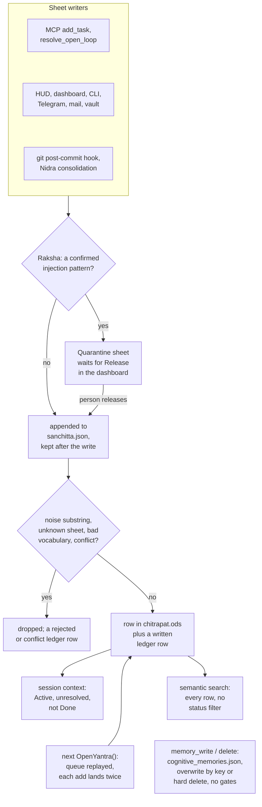

## 1. Executive Summary

OpenYantra is a local, single-user memory toolkit that keeps a structured model
of one person as sheets in a LibreOffice workbook, written through one gated
writer and served to Claude Desktop and Cursor over MCP. The gate is the
notable part: an injection scan that can hold a write for a person to release,
an admission filter, vocabulary checks, and a row on an append-only ledger
sheet. The weakness is around the gate. Its crash-safety queue is never
acknowledged, so the next process to open the workbook applies every write
again. The MCP memory tools write a separate JSON store no gate reaches. The
SQLite engine and the advertised preference promotion have no working producer.

The licence grant is narrower than the tree. `LICENSE` puts the protocol under
CC0 1.0 and names three library files for MIT, one of which, `openyantra.py`,
was removed on 20 May 2026. No stated grant covers the CLI, the MCP server, the
adapters or the rest of `openyantra/`, although `pyproject.toml` declares the
package MIT. A reader who wants to reuse code should treat the MIT grant as
covering `vidyakosha.py` and `yantra_ui.py` and ask about the rest.

The README describes a SQLite WAL store shared by the HUD, the CLI and the MCP
server. At this commit the HUD and the MCP sheet tools share the workbook, the
MCP memory tools use a JSON file, and SQLite holds only hand-drawn graph edges.
Two marks are earned, both on the sheet engine: `audit_log` on the ledger sheet
and `human_review` on the quarantine. Section 9 gives the reason for each of the
five withheld.

## 2. Mental Model

A memory is a **row in a sheet** of `chitrapat.ods`. The sheets are Identity,
Goals, Projects, People, Preferences, Beliefs, Tasks, Open Loops, Session Log,
Agent Config, the ledger (Agrasandhanī), Inbox and Corrections, plus Quarantine
and Security Log created on first use. A row is identified by its first column
— the attribute, task text or loop topic — and carries `Confidence` (High,
Medium, Low, Inferred), `Source` (User-stated, Agent-observed, Agent-inferred,
System), `Importance` 1 to 10 and `Last Updated` (`openyantra/core.py:68-96`,
`:2526-2622`).

A row becomes a belief by passing four gates in order, and nothing marks it as
less than true afterwards:

- **Raksha** redacts secrets, then scans the joined field text. A confirmed
  injection, jailbreak, impersonation or zero-width pattern sends the write to
  Quarantine; a suspicious one adds a `_security_flag` column and lets it
  through (`core.py:530-548`, `openyantra/yantra_security.py:457-555`).
- **Admission** drops a write whose text contains a noise phrase or whose
  importance is below 2, with no ledger row (`core.py:109-145`).
- **Validation** rejects an unknown sheet or a value outside the controlled
  vocabulary (`core.py:307-322`).
- **Conflict** refuses an update that would change a High-confidence field from
  a request that is not High (`core.py:324-342`).

A row stops counting through a lifecycle column read by the context builder: a
loop resolved, a task Done, a project not Active, a goal not Active or In
Progress (`core.py:954-968`). Identity, People, Preferences and Beliefs rows have
no such column; they change only by overwrite. The `delete` operation is in the
vocabulary and has no branch in the committer, so nothing is ever deleted
(`core.py:77`, `:348-400`). A git revert adds a new Session Log row labelled
*Reverted / Superseded Decision*; the reverted commit's own row is untouched
(`openyantra/yantra_git.py:106-127`).

The **cognitive store** is a second memory with no relation to the first: a JSON
list of notes with a key, a type, an agent name, content, tags and a timestamp.
A write replaces the note with the same key case-insensitively, and a delete
removes it (`openyantra/cognitive_db.py:40-111`). Only the MCP `memory_*` tools
and the dashboard's cognitive routes reach it, and no context builder reads it.

Control is hybrid. The agent writes through MCP, a person writes through the
HUD, the dashboard, the CLI, Telegram, LibreOffice or Obsidian, and Nidra
resolves loops when someone runs it.

## 3. Architecture

Everything is one Python package, `openyantra/`, constructed per process. Each
of the MCP server, the dashboard, the Telegram bot, the iOS Shortcut server, the
mail daemon, the CLI and the git hook opens its own `OpenYantra` on the same
workbook.

- **`core.py`** holds `OpenYantra`, the writer `LedgerAgent` and the queue
  `WriteQueue`. The constructor replays the queue, opens the search index, and
  creates a SQLite `SyncEngine` beside the workbook (`core.py:462-500`).
- **`yantra_security.py`** is Raksha: regex lists, secret redaction and trust
  tiers keyed on the writer's agent name.
- **`vidyakosha.py`** is the search sidecar: a FAISS flat inner-product index,
  a pickled BM25 index and a JSON registry of indexed rows.
- **`yantra_sqlite.py`** creates fifteen tables mirroring the sheets, plus
  `_meta`, `_sync_state` and `edges`, at every start (`yantra_sqlite.py:128-381`). Only
  `edges` is written in product code, by the dashboard.
- **`cognitive_db.py`** and **`cognitive_mcp.py`** are the JSON store and a
  hand-written line-delimited JSON-RPC server announcing protocol `2024-11-05`.
- **`yantra_ui.py`** is a FastAPI app on `127.0.0.1:7331` serving
  `UI/v4/dashboard.html` and `UI/v4/hud.html`; `desktop.py` opens either in
  pywebview or a browser.

Beside the workbook the package keeps `sanchitta.json`, `chitrapat.db`,
`cognitive_memories.json`, `settings.json`, `vidyakosha.faiss`,
`vidyakosha_bm25.pkl`, `vidyakosha_registry.json`, a `pratibimba/` folder of
per-agent snapshots and yearly `chitrapat_sessions_<year>.ods` archives.

A write is a whole-file rewrite. `_write_sheet` parses every sheet with pandas,
then writes them all back through `pd.ExcelWriter` in place, with no temporary
file and no file lock (`core.py:402-417`). The atomic temp-and-replace export
and the portalocker lock exist only in `SyncEngine.export_ods`, which no
production path triggers (`yantra_sqlite.py:594-718`).

### Deployment and ergonomics

The core needs Python 3.9 or later with `odfpy` and `pandas`. Search adds
`scikit-learn` and `faiss-cpu`, MiniLM is optional, and the dashboard adds
FastAPI, uvicorn and `webauthn`. No API key is needed to store anything. Nidra
calls a local Ollama on `localhost:11434` when one answers and falls back to a
template sentence. Everything runs offline.

The store is the point of the design. A person can open `chitrapat.ods` in
LibreOffice, read every sheet and fix a row by hand. Such an edit bypasses
Raksha and the ledger. The `yantra sync` command that the skill file describes
as importing such edits calls `SyncEngine.import_ods`, whose body opens the file
and returns a note: *"stub returns OK for now"* (`yantra_sqlite.py:762`). A hand
edit takes effect because the workbook is the store; the search index sees it
at the next write.

The first-run path is `curl … install.sh | bash` or `install.ps1`; section 8
lists what each writes.

## 4. Essential Implementation Paths

- **Sheet write.** `OpenYantra.request_write` (`core.py:524-576`) runs Raksha,
  then `LedgerAgent.submit`, which appends the request to `sanchitta.json` and
  calls `_process` (`:256-259`, `:270-305`). `_process` runs admission,
  `_validate`, `_check_conflict`, `_seal`, `_commit` and `_log_audit`. On
  `written`, `request_write` calls `VidyaKosha.sync` over the whole workbook,
  because the `incremental_update` it checks for is not defined (`:559-563`).
  It then asks `SHEET_TABLE_MAP` for an edge table; that map is keyed `Tasks`,
  `OpenLoops`, while sheet names carry emoji, so the lookup is always `None`
  (`:570`, `yantra_sqlite.py:61-77`).
- **Replay.** `OpenYantra.__init__` calls `replay_queue`, which empties the queue
  and runs `_process` on every request in it (`core.py:466-471`, `:261-264`).
- **Capture.** MCP sheet tools (`cognitive_mcp.py:395-463`); the dashboard and
  HUD through `POST /api/inbox` (`yantra_ui.py:193-198`, `UI/v4/hud.html:408`);
  `yantra inbox` (`cli.py:274-277`); Telegram commands and plain messages
  (`telegram_bot.py:151-240`); the iOS Shortcut server (`ios_shortcut.py:55-93`);
  the SMTP daemon (`yantra_mail.py:20-49`); Obsidian import
  (`yantra_vault.py:181-245`); the post-commit hook (`yantra_git.py:63-127`);
  and the CrewAI, LangChain and OpenClaw adapters.
- **Routing.** `route_inbox` sends each unrouted Inbox row to the sheet a
  keyword list picks, as a Low-confidence `Agent-inferred` row, then marks the
  Inbox row by its first 50 characters (`core.py:604-640`, `:2215-2236`).
- **Consolidation.** `NidraConsolidator.consolidate` clusters the last 25
  sessions, resolves loops, computes promotions and logs a summary session
  (`yantra_nidra.py:208-303`), from `yantra dream`, `POST /api/nidra/consolidate`
  or the HUD.
- **Context.** `load_session_context` (`core.py:945-984`) feeds
  `build_system_prompt_block` (`:986-1032`) and `build_context_markdown`
  (`:1658-1817`), which MCP `get_system_context` returns; `SutraCompiler.compile`
  packs a token budget (`yantra_sutra.py:71-365`).
- **Search.** `OpenYantra.search` (`core.py:1041-1098`) over `VidyaKosha.query`
  (`vidyakosha.py:355-439`), reached through the LangChain retriever and the
  CrewAI adapter; `CognitiveMemoryStore.search` (`cognitive_db.py:113-157`);
  `SyncEngine.traverse` (`yantra_sqlite.py:923-967`).
- **Correction.** Update and resolve through `_commit`; the corrections queue
  (`core.py:642-682`, `yantra_ui.py:205-221`); quarantine release
  (`core.py:1250-1270`, `yantra_ui.py:238-241`); cognitive delete
  (`cognitive_db.py:99-111`); session-log archival (`core.py:1117-1162`).

## 5. Memory Data Model

The controlled vocabularies are sets in `core.py:68-77`: project, task and goal
statuses, four priorities, `Yes`/`No`, three preference strengths, four
confidence values, four sentiments, four sources and six operations. Column
names follow the template, and `_commit` adds any new field as a new column, so
a writer that names a field wrongly widens the sheet instead of failing.

**Row identity is the first column's text.** `update`, `resolve` and `archive`
build a mask on `df.iloc[:, 0] == row_identifier` and change every matching row
(`core.py:365-397`). An update that matches nothing appends a new row with the
requested fields, so a mistyped task name sent to the dashboard's complete
route creates a row with status Done and no task text.

**Provenance is caller-supplied.** `Source` and `Added By` come from the
request. `add_task`, `add_project` and `update_identity` hardcode
`source="User-stated"` and `confidence="High"`, so a task the agent creates
through MCP is recorded as the person's statement (`core.py:820-860`).

**Scope.** One workbook per person. The one key is the Agent Config sheet's
`Agent` column, which `load_session_context` uses to pick the instructions an
agent receives, with `ALL` as the wildcard (`core.py:948-952`). The cognitive
notes carry an agent name that no read consults.

**Time.** `Last Updated` in UTC seconds, `Opened` on loops, `Deadline` on tasks
and goals, and the ledger's request timestamp. There is no validity time.
`TTL_Days` on loops is read by `check_anishtha_ttl`, which reports expired loops
and changes nothing (`core.py:716-745`).

**Unwired columns.** Beliefs carries `Contradiction_Flag`, created by the
template and the migrator and written by nothing; `diff_beliefs` returns
same-topic pairs to the CLI (`core.py:684-714`).

**The SQLite schema** mirrors the sheets with lowercase columns and a `UNIQUE`
request id on `ledger` for idempotent writes (`yantra_sqlite.py:128-381`).
`SyncEngine.write` has callers only in `tests/test_setu.py`.

**Committed data files.** The root `chitrapat.ods` is a workbook bootstrapped on
20 May 2026 at v2.12, holding a first name, a city and an occupation in
Identity. Its Session Log has the bootstrap row twice, 15 seconds apart. Its
ledger has the same four writes twice, under the same request ids and
timestamps, which is the replay in section 9 recorded in the project's own
file. `cognitive_memories.json` is an empty list, and `settings.json` holds the
defaults with empty key fields. `.gitignore` lists all three as user data.
`openyantra/chitrapat_template.ods` is the blank template.

## 6. Retrieval Mechanics

**Context injection** is assembled from sheets, not search.
`load_session_context` returns the identity map, the agent's instructions,
Active projects, unresolved loops sorted by importance and capped at 15, Active
or In Progress goals, tasks whose status is not Done, pending corrections and
the unrouted Inbox count (`core.py:945-984`). Archived and Blocked tasks pass
that filter. `build_context_markdown` caps each section at four to eight items
and adds Values and Constraints beliefs at High confidence, the first five
People rows and Strong preferences (`core.py:1658-1817`). It is the only reader
that uses `Confidence` to exclude a row.

**Semantic search** indexes eight sheets: Identity, Goals, Projects, People,
Preferences, Beliefs, Tasks and Open Loops (`vidyakosha.py:237-240`). Each row
becomes `[sheet] column: value …` without the confidence, source and date
columns. The vector arm is FAISS `IndexFlatIP` over TF-IDF with truncated SVD,
or MiniLM when installed; BM25 runs at k1 1.5 and b 0.75. Each arm is
normalised by its maximum and fused at 0.7 vector to 0.3 BM25, and
`OpenYantra.search` then multiplies by importance and a one-year recency ramp
(`vidyakosha.py:355-439`, `core.py:1041-1098`). **No status filter applies**,
so a resolved loop, a Done task and a Cancelled project rank like live ones.

A per-agent snapshot freezes the registry at session start and keeps querying
the live FAISS and BM25 indexes, so positions in a rebuilt index can address a
different row of the frozen registry (`vidyakosha.py:441-455`, `:492-502`).

**The HUD's recall** fetches the Beliefs sheet and filters it by substring in
the browser (`UI/v4/hud.html:433-445`). **MCP `memory_search`** is a substring
match over key and content with type, all-tags and date-prefix filters, and
returns every match. **`graph_traverse`** is a recursive CTE walking edges both
ways for up to six hops, with a path-substring cycle guard.

The MCP server injects nothing on its own; the model has to call
`get_system_context`. Cognitive notes are never part of any context.

## 7. Write Mechanics

Every write is an explicit call. No model extracts or rewrites memory; Nidra's
Ollama call produces only the summary sentence it logs as a session.

**Admission is a substring match.** `NOISE_PATTERNS` includes `sure`, `noted`,
`great` and `understood`, and `_is_worth_remembering` tests each with `in`
against the lower-cased field text (`core.py:109-145`). "Ensure the backup
runs" contains `sure`, so that task is dropped with status `filtered` and no
ledger row. Session Log, Inbox and Corrections writes skip the filter.

**Conflict detection is a refusal with nowhere to go.** A conflicting update
returns `resolution: pending_user`; the requested value is kept only as text in
the ledger row's reason (`core.py:283-293`). Most MCP and adapter writes are
High confidence, so the guard rarely fires.

**Duplicates are made, not removed.**

- The queue replay applies every `add` a second time (section 9).
- `route_inbox` marks an Inbox row by its first 50 characters; a longer row
  matches nothing, the update appends a junk row, and the next route sends the
  original again (`core.py:631-638`).
- Obsidian import reads every line of `Inbox.md` again on each sync and never
  clears the file (`yantra_vault.py:232-245`).

**Nidra.** `prune_and_resolve_loops` resolves an open loop when its topic, or
its first three words of four or more letters, appears in the decisions and topics
of the last 30 sessions (`yantra_nidra.py:154-206`). Revert rows are part of
that corpus. `detect_promotable_preferences` scans for phrases such as *user
prefers* and *always use*, skipping any session whose decision text contains
*reverted* or *superseded* (`:104-152`). Its candidates go to a sheet named
`Beliefs & Principles`, which is not a sheet, so `_validate` rejects every one
(`:224-242`, `core.py:308-309`). The CLI reports zero promoted.

**Four of six MCP write tools fail.** `add_inbox_item` and `complete_task` build
a `WriteRequest` with `source="MCP tool call"`, which the constructor's
`assert source in SOURCE` refuses (`cognitive_mcp.py:400-407`, `:443-451`,
`core.py:158-161`). `add_open_loop` calls `oy.add_open_loop`, which does not
exist (`cognitive_mcp.py:418`). `add_project` passes `next_step` into the
`priority` position, so an empty step is an invalid priority and the write is
rejected (`:462`, `core.py:820`). The iOS Shortcut server fails the same
assertion unless the request body names a valid source (`ios_shortcut.py:66`,
`:75`).

### Operational cost

Writes block the caller and are retrievable when the call returns. One sheet
write reads the target sheet, reads and rewrites every sheet, does the same
again for the ledger row, then rebuilds the search index: it reads eight
sheets again, refits TF-IDF, re-encodes every row and rewrites the FAISS, BM25 and
registry files. Each write's cost therefore grows with the whole workbook, and
with MiniLM installed every write re-embeds the store. The `yantra_sqlite.py`
docstring's 2 ms writes describe the unwired SQLite path.

Nidra reads the last
25 to 30 sessions per run with a ten-second Ollama timeout and runs only when
asked. The OpenClaw adapter prepends the context block to the system prompt at
session start, so any write since the last session changes the prompt prefix.

## 8. Agent Integration

The MCP server registers sixteen tools (`cognitive_mcp.py:121-319`). Five work
on the JSON store: `memory_write`, `memory_read`, `memory_search`,
`memory_delete` and `memory_stats`. Eleven work on the workbook:
`get_system_context`, `health_check`, `morning_brief`, `read_sheet`,
`graph_traverse` and six writes, of which `add_task` and `resolve_open_loop`
succeed. The model names the agent on every `memory_write`, can delete any key
including the `agent-hierarchy-connections` record behind the dashboard's agent
hierarchy, and can read any sheet, the ledger and Quarantine included.

The adapters are thin. The LangChain chat history writes a session row on
flush, and its retriever wraps `search`. The CrewAI memory routes `save` by kind
and wraps `search`. The OpenClaw hooks inject the prompt block at session start,
re-inject open loops after compaction and log a session at the end. The
`pre_compact_hook` that its comment says preserves open loops returns the
payload unchanged (`adapters/openclaw.py:37-40`). `SKILL.md` describes the
library API for an agent and was read as data.

### What the setup commands and installers write

- **`yantra mcp setup`** writes `mcpServers.openyantra` into Claude Desktop's
  `claude_desktop_config.json` and `~/.cursor/mcp.json` at their per-OS paths,
  pointing at the interpreter, the absolute path of `cognitive_mcp.py` and the
  workbook. It copies an existing file to `.json.bak`, replaces a file it cannot
  parse with a fresh one holding only its own entry, and creates both files
  whether or not the client is installed (`mcp_setup.py:18-122`).
- **`yantra hook install`** writes `.git/hooks/post-commit` in the target
  repository, replacing any existing hook without a check. The hook runs
  `python -m openyantra.cli hook run` in the background with output discarded,
  against `OPENYANTRA_FILE` or a `chitrapat.ods` in the repository root
  (`yantra_git.py:28-60`, `cli.py:23-24`).
- **`install.sh`** fetches forty files one at a time from `raw…/main`,
  continuing past any that fail. It installs Homebrew through its own
  `curl | bash` when Python is missing, runs `sudo` package installs on Linux,
  and pip-installs eleven unpinned packages into `~/openyantra/.venv`. It writes
  the `yantra` launcher, a desktop shortcut whose quarantine attribute it
  strips, and PATH and `OPENYANTRA_FILE` lines appended to `~/.zshrc`,
  `~/.bashrc` or `~/.bash_profile` (`install.sh:21`, `:186-375`).
- **`install.ps1`** does the same on Windows. It writes `yantra.ps1`, a
  `yantra.bat` that runs it with `-ExecutionPolicy Bypass`, a desktop shortcut,
  and the user-level `PATH` and `OPENYANTRA_FILE` variables.
- **The `Dockerfile`** installs the core dependencies only and starts
  `cognitive_mcp`. Without `faiss` or a workbook inside the container, only the
  JSON memory tools work.

No installer registers a hook or an MCP config on its own; both need the
commands above.

## 9. Reliability, Safety, and Trust

### Every write is applied twice

`LedgerAgent.submit` appends each request to `sanchitta.json` before processing
it and never removes it afterwards (`core.py:256-259`). The next `OpenYantra`
constructor in any process empties the file and runs `_process` on every
request in it (`:466-471`, `:261-264`). Every `add` therefore lands a second
row, every replayed write appends a second ledger row with the same request
id, and an update is applied again over whatever happened in between.
The Telegram bot builds a new instance per message and the CLI one per command,
so the second application follows at the next message or command. The committed
workbook records it (section 5). Replay also skips Raksha, though a quarantined
request never enters the queue.

### The gate covers one store of two

The single-writer design is real for the workbook and absent for the JSON
store. `memory_write` goes straight to `CognitiveMemoryStore.write`, with no
Raksha scan, no secret redaction, no admission filter and no ledger row, and
`memory_delete` removes the note with no trace (`cognitive_mcp.py:330-360`).
The README's claim that secrets are redacted *before saving* holds for sheet
writes only. The MCP `add_inbox_item` tool passes the model's `source` argument
as the requesting agent; Raksha skips scanning entirely for the agent name
`User` (`yantra_security.py:475-483`). That tool fails on the source assertion
before reaching the scan, which is the only thing keeping a model from choosing
the unscanned tier.

### Concurrency and data loss

`LedgerAgent` holds a `threading.Lock`, which serialises writes inside one
process. The MCP server, the dashboard, the bot, the hook and the CLI are
separate processes doing read-modify-write on one file with no file lock, so
two concurrent writes lose one. `_write_sheet` rewrites the file in place; a
crash mid-write can leave a truncated workbook, and a sheet that fails to parse
is written back empty (`core.py:402-417`). `archive_session_log` rewrites the
Session Log directly, outside the ledger (`core.py:1117-1162`).

### Declared and unwired

- **The SQLite engine.** The README calls it the shared store; nothing outside
  tests calls `SyncEngine.write`, `import_ods` is a stub, and the dashboard's
  preference for SQLite reads is gated on the same mismatched map, so it reads
  the workbook (`yantra_ui.py:166-187`). `export_ods` would replace the workbook
  with the SQLite tables, which `test_sync_wal_reconciliation` shows; it fires
  only when SQLite's ledger has rows, and nothing writes them.
- **Edge inference.** `infer_edges` is tested with lowercase keys and is never
  reached from `request_write` (section 4).
- **Ledger verification.** `Raksha.verify_mudra` has no caller and hashes four
  keys where `_seal` hashes eleven, so it could not match a stored seal
  (`yantra_security.py:345-360`, `core.py:344-346`). `yantra integrity` checks
  only the `sha256:` prefix (`core.py:1164-1213`).
- **Corrections.** `propose_correction` has no caller in the product, so the
  queue fills only from library code. The dashboard's review updates the
  Corrections row keyed on its target sheet, which marks every correction for
  that sheet with the same decision (`yantra_ui.py:212-216`).
  `apply_corrections` has no caller.

### Capture channels open to others

The Telegram bot checks no sender. Anyone who messages it can add Inbox items,
tasks, goals and loops and read open-loop topics and health counts
(`telegram_bot.py:97-240`). The iOS Shortcut server binds `0.0.0.0:7332` with
`Access-Control-Allow-Origin: *` and no token (`ios_shortcut.py:81-83`, `:171`).
The mail daemon accepts any SMTP client on `127.0.0.1:2525`. The dashboard has
no authentication unless passkeys are enabled, and then only cookies from
that process's memory count (`yantra_ui.py:113-127`).

### Revert tracking at the pin

The pin's commit detects a revert by a subject starting with *revert* or a body
containing *reverts commit*, and writes the Session Log row with a
*Reverted / Superseded Decision* prefix and `Status: REVERTED` in the notes
(`yantra_git.py:106-117`). Nidra's promotion scan skips that row. Three limits
follow from the code. The reverted commit's own row is unchanged, so its text
remains a promotion source. Loop resolution reads revert rows, so a revert whose
subject repeats an open loop's topic resolves that loop. And promotion is
rejected at the writer, so the skip guards a write that cannot land.

### Marks

Two are earned; both apply to the sheet engine and neither covers the JSON
store.

- **`audit_log` — earned.** The ledger sheet is appended by `_log_audit` for
  every request `_process` handles and written by nothing else. Each row records
  who wrote to which sheet, when, with which operation, row identifier,
  confidence and source, and a hash of the request. The limits are real: an
  add names no row, no row carries the value, and the replay duplicates
  entries.
- **`human_review` — earned.** A write matching a confirmed pattern waits in
  Quarantine, out of every sheet, the index and the context, until a person
  presses Release. No agent-facing surface carries a release verb, and the
  agent cannot write the Quarantine sheet. The dashboard does not show the held
  content, release does not close the item, and a released row is relabelled as
  the user's own statement at High confidence (`core.py:1258-1262`). The
  release route is a POST on `127.0.0.1` that needs no credential while
  passkeys are off, their default (`yantra_ui.py:238-241`, `:777`), so an
  agent with a general shell or HTTP tool can reach it; the mark rests on the
  declared tool surface carrying no release verb.
- **`tombstone` — withheld.** No record keyed on a value refuses a later write.
  A revert writes a new labelled row and blocks nothing; a cognitive delete
  removes the note.
- **`trust_state` — withheld.** `Confidence` is a four-value label. One context
  section admits only High beliefs, and the conflict guard protects High
  fields, but search, `load_session_context`, `read_sheet` and the prompt block
  return every level, and no value means *recorded but not believed*.
- **`bitemporal` — withheld.** No validity time exists beside `Last Updated`.
- **`scope_enforced` — withheld.** The Agent column selects configured
  instructions, not memories. Every memory sheet, the index and the JSON store
  are shared by every agent.
- **`negative_eval` — withheld.** The suite's populated negative on a read path
  asserts a traversal depth: at one hop, a node two hops away is absent while
  the one-hop node is present (`tests/test_sutradhar.py:70-78`). That pins a
  parameter, not the exclusion of material the system should withhold. The
  reverted-decision case keeps text out of a promotion candidate list, a write
  decision rather than a retrieval (`tests/test_nidra.py:37-54`).

## 10. Tests, Evals, and Benchmarks

The suite is 70 pytest functions in 15 files. CI installs `.[full,dev]` and runs
`pytest -v` on Ubuntu with Python 3.9 to 3.12 and on macOS and Windows with
3.11 (`.github/workflows/ci.yml:38-80`). I did not run it. The README badge
reports 69 passing.

What is covered:

- the JSON store's write, read, delete, search and date filters
  (`tests/test_cognitive.py`);
- edge add, delete and traversal, and `infer_edges` called directly
  (`tests/test_sutradhar.py`);
- secret redaction for five key formats (`tests/test_security_sanitizer.py`);
- git-hook install, ingest and revert labelling (`tests/test_git_hook.py`);
- Nidra clustering, loop resolution and candidate detection
  (`tests/test_nidra.py`);
- vault export and import, the passkey flow, the token-budget packer, MCP
  config writing and dashboard routes.

What is not: no test exercises Raksha's blocking, the quarantine or its release,
the ledger, the admission filter, the queue replay or any MCP sheet tool. The
four failing MCP write tools follow from that gap. Nidra's tests assert
candidates and never that a belief lands, which is how promotion shipped
rejected. The MCP test's `"error" not in resp` checks cannot fail, because tool
errors return inside `result` with `isError` (`tests/test_cognitive.py:121`,
`cognitive_mcp.py:94-102`). Importing `cognitive_mcp` at collection creates
`~/openyantra/cognitive_memories.json` in the real home directory and, if
`~/openyantra/chitrapat.ods` exists, opens it and replays its queue.

There is no retrieval-quality evaluation and no benchmark. `WHITEPAPER.md` is
the project's paper, written at v2.10. Its validation section reports four
rounds of review by eight language models with quoted verdicts, which is
opinion rather than measurement, and it lists LOCOMO and DMR evaluation as not
done. Its description of the write gates and trust tiers matches the code. It
claims Mudra verification on read, which has no caller, and an incremental
index sync, which is a full rebuild. No arXiv or DOI reference exists in the
tree.

## 11. For Your Own Build

### Steal

- **One choke point for every write, with a ledger row per outcome.** Recording
  `rejected` and `conflict` beside `written` makes a refused write visible
  instead of silent. Give the ledger the row id and the value, which this one
  lacks.
- **A security hold the agent cannot drain.** Put the release verb on a surface
  the agent has no tool for, keep the held write out of every sheet and index,
  and show the person what is held, not only why.
- **A store a person can open with a desktop application.** A workbook with one
  sheet per kind of memory is legible without the product, which no database
  file is.

### Avoid

- **A write-ahead queue with no acknowledgement.** Remove the entry when the
  write commits, or replay is a second write. Key replay on a request id the
  target row records.
- **Two stores behind one name.** If the agent's memory tools and the person's
  workbook are both "memory", put both behind the gate, or the model will use
  the ungated one.
- **Substring admission rules.** A noise list matched with `in` drops any text
  that contains *sure* or *great*; match whole messages or drop the filter.
- **Provenance set by the helper rather than the caller.** A helper that stamps
  `User-stated` on every task turns the agent's writes into the person's
  statements.

### Fit

This suits one person who wants to keep a hand-readable record of their own
projects, people and open threads, edit it in LibreOffice, and hand a summary
of it to a chat assistant. It is not ready as an agent's working memory. Writes
double, concurrent writers lose data, four of the six MCP write tools fail, and
what the agent stores through MCP never reaches its own context. The
maintenance budget is a single author's, and the installer runs whatever
`main` holds. Walk away if more than one process writes, if anyone else can
reach the Telegram bot, or if you need to delete anything.

## 12. Open Questions

- Whether the doubled rows in the committed workbook were noticed, and whether
  the queue was meant to be cleared by `SyncEngine.write`'s request-id check.
- Which store the author intends to be authoritative: the whitepaper's v3.0
  plan makes the workbook the contract and SQLite the engine, and the code at
  the pin wires neither direction.
- How often the Raksha patterns hold legitimate text in practice, and whether
  anyone uses the Release button.
- Whether `Beliefs & Principles` and its `Belief / Principle` column are a
  planned sheet or a leftover name.

## Appendix: File Index

- Writer, queue, context, search wrapper: `openyantra/core.py`
- Security, trust tiers, quarantine scan: `openyantra/yantra_security.py`
- Search sidecar: `openyantra/vidyakosha.py`, `openyantra/yantra_sutra.py`
- SQLite schema, edges, unwired sync: `openyantra/yantra_sqlite.py`
- JSON store and MCP server: `openyantra/cognitive_db.py`,
  `openyantra/cognitive_mcp.py`, `openyantra/mcp_setup.py`
- Dashboard, HUD, desktop: `openyantra/yantra_ui.py`, `UI/v4/dashboard.html`,
  `UI/v4/hud.html`, `openyantra/desktop.py`
- Capture channels: `openyantra/telegram_bot.py`, `openyantra/ios_shortcut.py`,
  `openyantra/yantra_mail.py`, `openyantra/yantra_vault.py`,
  `openyantra/yantra_git.py`, `openyantra/cli.py`
- Consolidation: `openyantra/yantra_nidra.py`
- Adapters: `openyantra/adapters/langchain.py`, `crewai.py`, `openclaw.py`
- Install and container: `install.sh`, `install.ps1`, `yantra`, `Dockerfile`
- Paper and specs: `WHITEPAPER.md`, `PROTOCOL.md`, `SKILL.md`
- Tests: `tests/test_*.py`, `.github/workflows/ci.yml`

### Recorded searches

Run from the repository root at the pinned commit with `/usr/bin/git grep`.

- **SQLite writes have test callers only.**
  `git grep -n -E '\.write\(table=|engine\.write\(|db_engine\.write\(' -- .`
  returns the usage docstring at `openyantra/yantra_sqlite.py:27` and four calls
  in `tests/test_setu.py`.
- **No incremental index update.**
  `git grep -n -E 'def incremental_update' -- .` returns nothing; the same
  command with `def sync\(` matches `vidyakosha.py:290`.
- **The queue is emptied only by replay.**
  `git grep -n -E 'dequeue_all|replay_queue' -- 'openyantra/*.py'` returns the
  two definitions and the constructor's call at `core.py:469`.
- **No delete branch.**
  `git grep -n -E 'operation == "delete"|"delete" and' -- 'openyantra/*.py'`
  returns nothing; `operation == "archive"` matches `core.py:390` and
  `yantra_sqlite.py:518`.
- **No file lock or atomic replace on the write path.**
  `git grep -n -E 'portalocker|fcntl|flock|os\.replace' -- openyantra/core.py`
  returns nothing; across `openyantra/` it matches only `yantra_sqlite.py`.
- **No validity time.**
  `git grep -n -i -E 'valid_?(from|to|until)|valid_at|event_time|occurred_at' -- 'openyantra/*.py'`
  returns nothing.
- **No value-keyed refusal.**
  `git grep -n -i -E 'tombstone|blocklist|rejected_values|do_not_relearn|suppress' -- 'openyantra/*.py'`
  returns one comment about HTTP logging in `ios_shortcut.py:53`.
- **No writer for Contradiction_Flag.**
  `git grep -n -E 'Contradiction_Flag|contradiction_flag' -- 'openyantra/*.py'`
  returns the template header, the migrator, the header validator and the
  SQLite column default.
- **No caller for the correction and verification helpers.**
  `git grep -n -w -E 'propose_correction|apply_corrections|verify_mudra' -- .`
  returns their definitions, the class docstring and two lines of
  `PROTOCOL.md`.
- **No add_open_loop method.**
  `git grep -n -E 'def add_open_loop' -- .` returns nothing.
- **No release or approve verb on the MCP server.**
  `git grep -n -i -E 'release|approve' -- openyantra/cognitive_mcp.py` returns
  nothing; `quarantine` matches the sheet map and the `read_sheet` enum.
- **No agent filter on the JSON store's reads.**
  `git grep -n -E 'm.get\("agent"' -- openyantra/cognitive_db.py` returns
  `stats` and `get_hierarchy` only.
- **No Telegram sender check.**
  `git grep -n -E 'effective_user|effective_chat|chat_id|ALLOWED' -- openyantra/telegram_bot.py`
  returns nothing.
- **Inbox.md is read and never written.**
  `git grep -n 'Inbox.md' -- openyantra/yantra_vault.py` returns the comment and
  the path at `:232` and `:234`.
- **No paper reference.**
  `git grep -n -i -E 'arxiv|bibtex|@article|@misc|doi\.org|zenodo' -- .`
  returns nothing.

## History

**2026-11-07** — [`bf86ff26b72ee241d6c9915afc7d0604db9bbbdb`](https://github.com/revanthlevaka/OpenYantra/commit/bf86ff26b72ee241d6c9915afc7d0604db9bbbdb). First reading, from a full clone at the head of `main`, the commit adding revert detection. Screened first: no auto-run surface, `pyproject.toml` inside the seven-day cooldown and with no lockfile, and `tests/conftest.py` executing on collection; the MCP setup, hook installer and installers were read for what they write. `SKILL.md`, `PROTOCOL.md` and `WHITEPAPER.md` were read as data. Nothing was installed, built or run. The licence names three files for MIT, one absent. Two marks, `audit_log` and `human_review`, both on the sheet engine; `negative_eval` is withheld because its one populated read-path case pins a traversal depth ([section 9](#9-reliability-safety-and-trust)).
