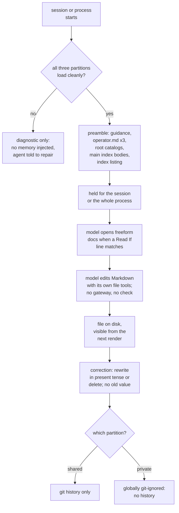

## 1. Executive Summary

Operator Memory is a set of plugins from Aerovato Research that gives a coding
agent a "brain" of Markdown on disk. Shared core code renders one preamble per
session from three directories. That preamble carries fixed guidance, standing
instructions, catalogs of what the brain holds and a map of the codebase. Adapters
for Claude Code, Codex, OpenCode, Pi, DeepSeek Harness and Kiro inject it. The
agent reads deeper documents and writes new ones with its ordinary file tools.

What is notable is how little the code does and how deliberately. There is no
extractor, no search index, no embedding and no background pass. The code
loads a fixed set of files, renders them in a stable order, and injects the result once so the
prefix stays cacheable (`packages/core/src/preamble.ts:25-102`). If any partition
fails to load, it injects no memory at all and tells the agent to repair the
load first (`:28-33`).

What is weak is that everything memory-shaped beyond loading is a sentence
addressed to the model. Placement, the rule that shared documents never cite private ones, when to
write and when to delete are prompt rules in about 200 lines of fixed guidance.
Nothing in the code checks any of them, except one lint the agent must choose
to run.

**Licence.** No issue found. `LICENSE` is the BSD 3-Clause text with a 2026
copyright to Kevin Liao at Aerovato Research. The root `package.json`, the seven
adapter and helper package manifests and the Claude Code `plugin.json` all say
`BSD-3-Clause`. `packages/core` is marked `private` and carries no licence field,
so it falls under the root `LICENSE`. `CONTRIBUTING.md` sets a working rule for
maintainers and no contributor licence terms.

## 2. Mental Model

A memory is a Markdown document the agent wrote. It is not extracted, scored or
indexed by the system. The preamble tells the model *"You own the brain"* and to
*"add to it and maintain it without waiting for the user"*
(`packages/core/src/prompts/preamble-v1.ts:13`). A belief is formed when the
model decides something is durable and writes it to a spec, guide, plan or
instruction file. It reaches later sessions when the document is reachable from
something injected: an `operator.md`, a root `catalog.md` entry or the main index.

There are three kinds of document, and they are trusted differently by position,
not by state. Instruction files are injected in full and merged by authority:
private project over user over shared project (`preamble.ts:140-158`). Catalogs
and the main index are injected in full as maps. Freeform documents are never
injected; the model opens them when a catalog's `Read If` line matches its task,
and the guidance calls specs *"system truth the code cannot own"*
(`preamble-v1.ts:64`).

A belief stops being one when the model rewrites or deletes it. The tenets say
*"rewrite its canonical home in the present tense"* and *"state what is true
now"* (`preamble-v1.ts:194`), and v2.0 adds *"delete obsolete documentation"*
(`preamble-v2.ts:126`). There is no superseded state and no record of the old
value. In the shared partition git keeps it. In the private partition nothing
does, because the helper puts `.operator/` in the user's global git excludes
(`packages/helper/src/git.ts:7`, `:91-105`).

The write policy is itself versioned and assigned by machine. About 80% of
machines get guidance v1.1 and 20% get v2.0, from a SHA-256 of the OS machine
identifier (`packages/core/src/preamble-rollout.ts:11-24`). The two differ on
memory admission. v1.1 writes the user partition *"only"* when the user
explicitly asks (`preamble-v1.ts:73`). v2.0 writes it when the user asks to
remember, lists *"inferred preferences"* as user content, and also forbids
inferring traits from incidental behaviour (`preamble-v2.ts:50`, `:60`).

## 3. Architecture

The system is a Bun monorepo of thin harness adapters around two shared pieces.
`@aerovato/operator-core` loads the partitions and renders the preamble
(`packages/core/src/memory/load.ts:41-65`, `packages/core/src/preamble.ts`).
`@aerovato/operator-helper` is a global npm CLI. It seeds core files, prints the
setup guides the agent follows, lints indexes, installs adapters, and runs
`operator-helper preamble` for adapters that cannot import core
(`packages/helper/src/cli.ts:57-129`).

Persistence is three directories. `.operator/` is the private project partition,
`.operator-shared/` is the shared one committed with the repository, and
`~/.operator/user/` is the user partition, whose parent is created with mode
`0700` (`packages/helper/src/filesystem.ts:64-73`). Each holds `operator.md`,
`catalog.md` and, for projects, an `index/` tree. Everything else is freeform.

The adapters differ in how they reach the model:

- **Claude Code** — an in-process mod, not command hooks. `hooks/hooks.json`
  names one module, `./register.js` (`packages/claude-code/hooks/hooks.json:1-4`).
  It runs the helper through `$.process.run`, appends the text as a
  session-scoped section on `prompt.compose`, and prepends it to subagent prompts
  on `agent.spawn` (`packages/claude-code/src/register.ts:5-44`).
- **Codex** — `SessionStart` and `SubagentStart` command hooks that spawn the
  helper (`packages/codex/hooks/hooks.json:4-31`, `packages/codex/src/hook.ts:36-48`).
- **OpenCode V2, Pi, DeepSeek Harness** — import core directly and push the text
  into the system prompt, a synthetic first message, or the first system-prompt
  section (`packages/opencode-v2/src/index.ts:40-65`,
  `packages/pi/src/index.ts:21-47`, `packages/deepseek/src/index.ts:20-32`).
- **Kiro** — a `SessionStart` command hook and an always-included steering file
  written by the helper (`packages/helper/src/templates/kiro.ts:6-29`).

### Deployment and ergonomics

Nothing runs between sessions. Adoption is a global npm install of the helper, an
`operator-helper install` call naming the harness, and two setup conversations,
`/operator:user-init` and `/operator:project-init`. No API key, model
configuration, database or network service is needed to store anything; the
model the harness already uses does all writing. The store is plain Markdown a
person can read and repair by hand, and `operator-helper memory check` reports
which partition fails to load (`packages/helper/src/commands/memory/check.ts:6-30`).

`project init` writes `.operator/` into the user's global git excludes file,
resolved from `core.excludesFile` or `~/.config/git/ignore`
(`packages/helper/src/git.ts:67-105`). That hides a directory of that name in
every repository on the machine, not only this one.

## 4. Essential Implementation Paths

- **Load.** `loadMemorySnapshot` resolves the three roots and loads them in
  parallel (`packages/core/src/memory/load.ts:46-64`). A project partition reads
  `operator.md`, `catalog.md` and every `.md` file under `index/`, recursively
  and sorted (`packages/core/src/memory/project.ts:87-135`). The user partition
  reads only `operator.md` and `catalog.md` (`packages/core/src/memory/user.ts:54-76`).
  A missing file is `null`; an unreadable one is an error for the partition.
- **Frontmatter.** Each index file must carry non-empty string `description` and
  `read_if` (`packages/core/src/memory/frontmatter.ts:17-56`). An invalid one
  stays in the listing with a repair instruction in place of its metadata
  (`preamble.ts:207-216`).
- **Render.** `renderPreamble` chooses the guidance version and returns the
  diagnostic alone if any partition failed. Otherwise it emits guidance,
  instructions, the user catalog, project catalogs, the index listing with main
  bodies, the tenets and then setup warnings (`packages/core/src/preamble.ts:25-102`).
- **Inject.** One call per adapter, cached as described in section 8.
- **Write.** No code path. The model writes with the harness's tools under the
  guidance in `packages/core/src/prompts/preamble-v1.ts:66-181` or
  `preamble-v2.ts:43-140`. The helper writes only seed files when they are
  missing (`packages/helper/src/filesystem.ts:82-96`,
  `packages/helper/src/commands/project/init.ts:16-114`).
- **Lint.** `operator-helper index lint` checks index frontmatter, main-index
  titles and whether a shared index mentions `.operator/`
  (`packages/helper/src/lint.ts:24-67`). It reads only `index/` trees.

## 5. Memory Data Model

The schema is a directory convention. The only typed fields in code are an index
file's `description` and `read_if` (`frontmatter.ts:7-10`). Catalog entries carry
`Description` and `Read If` lines by template, not by parser
(`packages/core/src/templates/catalog.ts`). No document has an id, author,
timestamp, status, confidence or source.

Scope is the directory a document sits in. Instructions from all three
partitions are concatenated least to most authoritative, so a conflict is
resolved by the model reading the later one, not by a merge
(`preamble.ts:140-158`). The user partition is injected into every project.
Episodic and semantic material are not separated: a spec, a guide, a plan and a
personal style rule are all freeform files told apart by folder name and catalog
text.

## 6. Retrieval Mechanics

There is no retrieval in the code. The preamble is the whole automatic read. It
includes the bodies of up to three `operator.md` files, up to three root
catalogs and up to two main indexes, plus one line pair per index file
(`preamble.ts:161-249`). The bodies of subindexes and freeform documents never
enter it; the model reaches them with its own read tools by following a catalog
or index entry. The architecture document states the position directly:
*"Nothing is ranked, guessed, or retrieved by similarity"*
(`docs/architecture.md:3`).

Two failure modes follow. Nothing bounds the preamble: every injected file is
included whole, and no truncation exists in core or the adapters (Recorded
searches). This repository's own shared partition injects 19,455 bytes of
instructions, catalog and main index before the guidance. And under-recall is
the model's choice: a document whose catalog entry is missing or whose `Read If`
line does not match is invisible to every later session.

## 7. Write Mechanics

Every write is the model calling the harness's file tools during ordinary work.
The guidance asks it to record contracts, invariants, decisions and lessons the
code cannot show, and not to restate implementation (`preamble-v1.ts:66-69`,
`:145-181`). It also asks for one canonical home per fact, splitting and
consolidating documents, and keeping the catalog in sync. No code checks any of
this, deduplicates, or filters what the model writes.

Correction overwrites. A changed contract is rewritten in place and an obsolete
document deleted (`preamble-v2.ts:126`, `:150`). No extractor reads transcripts,
so nothing in the system re-derives a value a person removed. Only the model can
re-assert it, from the code or the conversation.

The setup guides are the one place a person decides content before it lands.
`project init` prints a seven-phase guide that has the agent ask which material
is shared, which existing `AGENTS.md`, `CLAUDE.md` or `specs/` content to migrate,
and to confirm a summary (`packages/helper/src/templates/project/setup.ts:61-159`).
These are instructions to the model; the helper itself only creates missing seed
files.

### Operational cost

Writes do not block on anything but the file write. A memory is on disk at once
and reaches the preamble at the next render: the next session on OpenCode, Pi,
DeepSeek and Kiro, and the next Claude Code process, since that adapter renders
once per process. No background pass exists. The read cost is the whole preamble
on every model call, unbounded, placed so it stays byte-identical for the
session.

## 8. Agent Integration

Injection is automatic and held fixed. The shared spec asks for a contribution
*"rendered once and held immutable for the session so its prefix remains
cacheable"* (`.operator-shared/specs/preamble.md:5`). Claude Code memoises the
first render, and any failure, at module scope for the process
(`packages/claude-code/src/register.ts:3`, `:20-23`). Its harness guide says
`/clear`, `/resume` and `/branch` do not refresh it
(`docs/harnesses/claude-code.md:33`). OpenCode V2 caches per session id, Pi per
session until `session_shutdown`, and DeepSeek per agent
(`packages/opencode-v2/src/preamble.ts:21-26`, `packages/pi/src/index.ts:55-61`,
`packages/deepseek/src/index.ts:20-25`).

Codex is the stated exception. It renders afresh on `startup`, `clear` and
`compact`, skips `resume` and `fork` because history already holds the preamble,
and renders again for each delegated subagent (`packages/codex/src/hook.ts:10`,
`:38`). A helper failure returns `continue: false`, which stops a Codex session
from starting (`:13-16`, `.operator-shared/specs/codex/implementation.md:16-20`).

The model has no memory tool. Its only verbs are its file tools and three
user-invoked skills, `/operator:user-init`, `/operator:project-init` and
`/operator:index`, each marked `disable-model-invocation: true`
(`packages/claude-code/skills/project-init/SKILL.md:1-4`). Subagents in Claude
Code receive the preamble by prompt rewrite on `agent.spawn`, which the parent's
transcript does not show (`register.ts:41-44`).

## 9. Reliability, Safety, and Trust

### Load failure is all-or-nothing

If any partition returns an error, the preamble contains the guidance and an
`operator-diagnostic` block and nothing else: no instructions, catalogs, tenets
or warnings (`preamble.ts:28-33`, `:110-137`). The diagnostic tells the agent to
repair only the reported failures, preserve content, and ask before deleting.
After repair, the user starts a new session. An unreadable index file or an
obstructed path therefore withholds the user's instructions too. The spec makes
the trade explicit: no partial memory is injected
(`.operator-shared/specs/preamble.md:38`).

### What the injected text is trusted to do

Every injected document is presented as instruction or truth. A repository's
`.operator-shared/operator.md`, catalog and main index are committed files. A
person who clones a repository and runs a harness with Operator installed gets
them in the system prompt and in every subagent prompt. No confirmation step
exists in Operator's code. Whether the harness's own folder-trust prompt runs
first is outside this tree. The authority order puts the user's private and
global instructions above shared ones, which settles stated conflicts and not
instructions the user never contradicted.

### The rules that are only prose

- **Private must not leak into Shared.** Stated at `preamble-v1.ts:76` and
  `preamble-v2.ts:51`; checked only for `index/` files by `index lint`, which
  the agent runs on request (`packages/helper/src/lint.ts:46-52`).
- **Project facts stay out of the user partition.** Stated at
  `preamble-v1.ts:73` and `preamble-v2.ts:50`; the user partition is a directory
  the model can write like any other.
- **Do not change user-authored documents.** v2.0 asks the model to mark them
  and leave them alone (`preamble-v2.ts:119`); nothing records who wrote a file.

### The project's own brain

This repository runs Operator on itself, and its shared instructions show the
failure the design accepts. `.operator-shared/operator.md:5` says the MVP
*"supports OpenCode and Pi"*, while the README lists seven harness rows and the
file's own package list never names the Claude Code adapter. The brain goes stale when the model forgets to update
it, as `docs/architecture.md` says under *Failure Is Visible*.

### Marks

All seven were considered; none is awarded.

- **`tombstone`** — withheld. Nothing records a rejected value. The guidance
  erases the old text on correction. The failure a tombstone guards against,
  re-extraction, has no producer here, because nothing extracts.
- **`trust_state`** — withheld. No document carries a status, and the code
  reads no field that could exclude one (Recorded searches).
- **`bitemporal`** — withheld. No time is stored on a document; the
  `Last Updated` lines in this project's own specs are hand-written prose.
- **`scope_enforced`** — withheld. The three partitions are directories
  (`load.ts:46-48`), a physical partition with no key on a document and no
  predicate on a read. The user partition is read in every project.
- **`audit_log`** — withheld. No mutation record exists. The shared partition
  has git history; the private partition is globally git-ignored.
- **`human_review`** — withheld. No document waits for anyone. The setup guides'
  questions are instructions to the model, and the model writes every document
  directly.
- **`negative_eval`** — withheld, a near miss.
  `packages/core/src/preamble.test.ts:166-211` asserts subindex bodies are
  absent from a preamble that contains the main index, and `:314-351` asserts a
  loaded partition's content is absent when another fails. Both are populated.
  Both assert the shape of an assembled preamble, not that wrong, stale or
  out-of-scope material stays out of a recall.

## 10. Tests, Evals, and Benchmarks

The suite has 186 vitest cases in 34 files. CI runs format, lint, typecheck and
tests with a frozen lockfile on push and pull request
(`.github/workflows/ci.yml`, `scripts/check.sh`). I ran none of it. The core
tests pin render order and byte stability (`packages/core/src/preamble.test.ts:65-164`),
loader behaviour on missing, malformed and obstructed files
(`packages/core/src/memory/load.test.ts:29-240`), and the 80/20 version
assignment (`packages/core/src/preamble-rollout.test.ts`). The adapter tests check
caching and failure. For Claude Code that includes one helper run shared by a
concurrent compose and spawn (`packages/claude-code/test/register.test.ts:44-61`).
For Codex it includes which session sources inject (`packages/codex/test/hook.test.ts:17-58`).

Nothing tests the thing the product claims, that sessions document their work
and later sessions use it. No eval, benchmark or result is committed. The
README's *"Looking for benchmarks?"* link goes to an issue comment. In it the
project's author, on 4 October 2026, says the existing memory benchmarks test
RAG recall and that a long-horizon task benchmark has not been run for lack of
resources. No paper is associated with the project; the argument is in
`docs/comparison.md` and a linked blog post.

## 11. For Your Own Build

### Steal

- **Fail closed on a partial load.** If one memory source cannot be read, inject
  none and say why. A preamble missing the user's instructions but carrying the
  shared ones is worse than a repair prompt.
- **Inject maps, not bodies.** Put instruction files, a catalog with a
  "read if" condition per entry, and a codebase index into the prefix; leave
  documents on disk for the model to open. It is a retrieval policy with no
  retriever, and it keeps the prefix stable.
- **Render once per session and keep the bytes.** One coalesced render shared by
  the main thread and subagents, with a test for the shared bytes, is cheap
  insurance for the prompt cache.

### Avoid

- **Write policy that exists only as guidance.** A boundary such as "shared never
  references private" belongs in a check the write path runs, not a lint the
  model may invoke.
- **Erasing on correction.** Rewriting in present tense keeps documents clean
  and leaves no answer to "what did we believe before"; keep the prior text
  somewhere other than an optional git history.
- **An unbounded always-on preamble.** Cap each injected file, or the map grows
  until it crowds out the work it is meant to orient.

### Fit

This suits a single developer or a small team who already keep `AGENTS.md` or
`CLAUDE.md` files and want the agent to grow them into a structured, versioned
set of specs and maps. The cost is only tokens and the discipline of reviewing
what the agent writes. Walk away if memory must be correctable on the record,
scoped per tenant, or kept out of a model's reach: every guarantee here is the
model's compliance with a prompt. Walk away too if you cannot afford a preamble
that grows with the documentation.

## 12. Open Questions

- How large the preamble gets on a long-running project, and whether the
  maintainers intend a cap; nothing in the tree measures it.
- Whether the 80/20 rollout of v1.1 and v2.0 guidance is evaluated anywhere, and
  what decides the winner; no collection path exists in the tree, and the spec
  says the machine identifier is never transmitted.
- Whether Claude Code's folder-trust prompt runs before the mod's
  `prompt.compose` hook in an untrusted clone, which decides how far a committed
  `.operator-shared/operator.md` reaches.

## Appendix: File Index

- Loading: `packages/core/src/memory/load.ts`, `packages/core/src/memory/project.ts`,
  `packages/core/src/memory/user.ts`, `packages/core/src/memory/common.ts`,
  `packages/core/src/memory/frontmatter.ts`
- Rendering: `packages/core/src/preamble.ts`, `packages/core/src/preamble-rollout.ts`,
  `packages/core/src/prompts/preamble-v1.ts`, `packages/core/src/prompts/preamble-v2.ts`,
  `packages/core/src/templates/`
- Helper: `packages/helper/src/cli.ts`, `packages/helper/src/git.ts`,
  `packages/helper/src/lint.ts`, `packages/helper/src/filesystem.ts`,
  `packages/helper/src/commands/project/init.ts`,
  `packages/helper/src/templates/project/setup.ts`
- Adapters: `packages/claude-code/src/register.ts`, `packages/claude-code/hooks/hooks.json`,
  `packages/codex/src/hook.ts`, `packages/codex/hooks/hooks.json`,
  `packages/opencode-v2/src/index.ts`, `packages/opencode-v2/src/preamble.ts`,
  `packages/pi/src/index.ts`, `packages/deepseek/src/index.ts`,
  `packages/helper/src/templates/kiro.ts`
- Specs: `.operator-shared/specs/preamble.md`, `.operator-shared/specs/codex/implementation.md`,
  `docs/architecture.md`, `docs/harnesses/claude-code.md`
- Tests: `packages/core/src/preamble.test.ts`, `packages/core/src/memory/load.test.ts`,
  `packages/claude-code/test/register.test.ts`, `packages/codex/test/hook.test.ts`

### Recorded searches

Run from the repository root at the pinned commit with `/usr/bin/git grep`.

- **No size cap on injected memory.**
  `git grep -n -i -E 'truncat|maxBytes|max_bytes|MAX_|slice\(0' -- packages/core packages/claude-code packages/codex/src packages/opencode-v2/src packages/pi/src packages/deepseek/src`
  returns nothing; the same pattern over `packages/helper/src` matches
  `commands/install/codex.ts:125`.
- **No retrieval engine.**
  `git grep -n -i -E 'embedding|vector|bm25|fts5|sqlite' -- packages`
  returns nothing; the same pattern with `-c` over `README.md` counts 1.
- **No runtime memory writer.**
  `git grep -n -E 'writeFile|writeText|unlink|rename\(' -- packages/core/src/memory packages/core/src/preamble.ts packages/claude-code/src packages/codex/src packages/opencode-v2/src packages/pi/src packages/deepseek/src`
  matches only `packages/core/src/memory/load.test.ts:221`, a test fixture; with
  `-c` over `packages/helper/src/filesystem.ts` it counts 4.
- **No status, time or confidence field.**
  `git grep -n -i -E 'valid_from|valid_to|created_at|updated_at|timestamp|confidence|trust' -- packages/core/src ':!*.test.ts'`
  returns nothing; the same pattern over `packages/pi/src/index.ts` matches the
  message `timestamp` at line 79.
- **No tombstone or supersession in code.**
  `git grep -n -i -E 'tombstone|supersed' -- packages ':!*.md'` matches only the
  setup guide's prose at `packages/helper/src/templates/project/setup.ts:111`
  and `:121`.
- **The private-path check is the index lint alone.**
  `git grep -n -F 'includes(".operator/")' -- packages` matches
  `packages/helper/src/lint.ts:46` and the two global-ignore checks at
  `packages/helper/src/git.ts:88` and `:97`.
- **The Claude Code plugin registers no command hooks.**
  `git grep -n -E 'SessionStart|PostToolUse|"Stop"' -- packages/claude-code`
  returns nothing; with `-c` over `packages/codex/hooks/hooks.json` it counts 1.
- **No paper.**
  `git grep -n -i -E 'arxiv|bibtex|@article|@misc|CITATION|doi\.org'` matches
  only the word "citation" in `.operator-shared/index/harnesses/deepseek-harness/runtime.md:56`;
  the tree has no `CITATION.cff`.

## History

**2026-11-21** — [`93c3fce64f0a72adeb89fa868600eb418548ec07`](https://github.com/aerovato/operator-memory/commit/93c3fce64f0a72adeb89fa868600eb418548ec07) — first reading, of the core loader and renderer, both guidance versions, the helper CLI and templates, every adapter and its tests, and the project's own shared partition. Screened first: five auto-run surfaces, a Claude Code marketplace manifest, the `packages/claude-code` plugin manifest and its `hooks/hooks.json` (one in-process module, `register.js`), and two committed `.githooks`; one build-time execution point, the `prepare` script setting `core.hooksPath`; four unpinned surfaces with `bun.lock` present; nothing inside the cooldown. BSD-3-Clause, no rider. Nothing installed, built or run. No marks.
