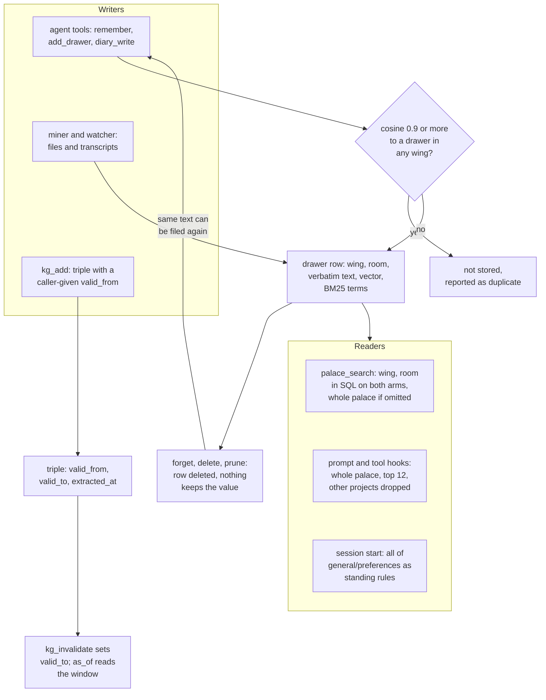

## 1. Executive Summary

Palace is local memory for coding agents in one Rust binary and one SQLite
file. It began on 8 April 2026 as a *"complete Rust rewrite of mempalace"*, and
its modules still say *"Port of searcher.py"* and *"Direct port of
knowledge_graph.py"*. What is notable is how memory reaches the model. Hooks
inject standing preferences and project diary at session start, then up to
three cited lines when a prompt or an investigation tool call matches something
stored. What is weak is everything after the write: no status, no record of
what changed, and a forgotten value can be filed again. A model-callable
`palace_prune` deletes every drawer older than a given age.

The relationship to [MemPalace](../mempalace/) is a port that has diverged,
not a fork. It shares no git history with the Python project, and `palace
migrate` imports a MemPalace install. Chroma plus a separate SQLite graph
became one `palace.db` with vectors in a BLOB column and a hand-built BM25
table. The wing, room, drawer, closet, tunnel and AAAK vocabulary is
MemPalace's. The knowledge graph is the closed-window version: no `supersede`,
no half-open boundary, and nothing like MemPalace's write-ahead log of
mutations. The hooks, preference recall, ranking adjustments and model
migration are this project's own.

Three marks. `scope_enforced` is earned on wing and room predicates in SQL on
both search arms. `negative_eval` is earned on populated tests that keep
another wing's or project's material out. `bitemporal` is earned on the
triple's caller-stated validity beside its write time. Section 9 gives the
reasons for the four withheld.

**Licence.** The MIT grant in `LICENSE` names *"AncientiCe and contributors"*
and no one else. MIT requires *"the above copyright notice"* in *"all copies
or substantial portions"*, and eleven modules describe themselves as ports of
MemPalace files, among them `src/knowledge_graph.rs:3`, `src/searcher.rs:4`
and `src/layers.rs:8`. `git grep -i copyright` finds no other notice in the
tree. The team edition that remote mode connects to, Palace Server, is
commercial and not in this repository.

## 2. Mental Model

A memory is a **drawer**: verbatim text filed under a wing, usually a project
or topic, and a room, a category such as `decisions` or `preferences`. Nothing
summarises or rewrites the text. A drawer comes from one of four places:

- **The agent files it.** `palace_remember`, `palace_add_drawer` and
  `palace_diary_write` store what the model passes. The installed rule tells
  it to save after substantive work and to put the user's preferences in
  `general/preferences` (`src/install.rs:14`).
- **A miner reads it.** `palace mine`, `palace_mine` and the file watcher
  chunk project files; `mine-convos` chunks transcripts into exchanges, or
  runs a regex extractor that keeps decision, preference, milestone, problem
  and emotional sentences (`src/general_extractor.rs:1-4`).
- **An import copies it**, from a MemPalace install or a palace export.
- **The stop hook asks for it.** A session that did work and saved nothing is
  blocked once with an instruction to call `palace_diary_write` and
  `palace_kg_add` (`src/hooks.rs:188-197`, `:945-959`).

Beside drawers, the **knowledge graph** holds subject-predicate-object
triples. A triple holds from a caller-stated `valid_from` until
`palace_kg_invalidate` sets `valid_to`, and stays as history after that.

A drawer has one state: present. It is treated as true when recalled, with its
provenance attached so the model can cite it. It stops counting only by
deletion: `palace_forget` or `palace_delete_drawer` by id, `palace_prune` by
age, or a re-mine that replaces the drawers of a changed file. Nothing keeps
the deleted value, so the same text can be filed again.

## 3. Architecture

Everything runs in one `palace` process per invocation against one file,
`palace.db`, opened in WAL mode with a busy timeout because an MCP server per
client, the hooks and the miners share it (`src/db.rs:12-64`). Schema
migration runs on every open (`src/db.rs:97-356`).

- **Store.** `src/store.rs` holds drawer CRUD, brute-force cosine search over
  BLOB vectors, the preference pass, dedup and the wings registry.
- **Ranking.** `src/ranker.rs` holds BM25 over the `bm25_terms` table, fusion
  and the adjustments; `src/searcher.rs` adds query rewriting, the preference
  merge, the optional rerank and neighbouring chunks.
- **Graph.** `src/knowledge_graph.rs` holds triples and entities.
- **Surfaces.** `src/mcp_server.rs` is a stdio JSON-RPC loop with 50 tools;
  `src/hooks.rs` answers four hook events in eight client dialects
  (`src/hooks.rs:33-42`); `src/cli.rs` and `src/install.rs` configure twelve
  clients and write the rule files; `src/palace.rs` is the library facade.
- **Embeddings.** `src/embedder.rs` runs ONNX Runtime in-process with an
  inline BERT tokenizer. The default is an int8 `all-MiniLM-L6-v2`, about
  23 MB, fetched from Hugging Face on first use
  (`src/embedding_models.rs:62-93`). `src/embedding_migration.rs` builds a
  second model's vectors beside the first, verifies and cuts over.

Remote mode replaces all of this for MCP calls. `palace mcp` becomes a
stdio-to-HTTP bridge to a Palace Server endpoint with a bearer key
(`src/remote.rs:1-7`, `src/mcp_server.rs:28`). The hooks do not read the mode
and keep recalling from the local file (`src/hooks.rs:1107-1117`).

### Deployment and ergonomics

Nothing has to run besides the binary. Install is a release download with a
SHA-256 check, Homebrew or `cargo build`; `palace install` then registers the
MCP server, hooks and rule text in every client it finds. No API key is
needed. The first embedding call downloads the model from the `main` revision
of a third-party Hugging Face repository with no checksum
(`src/embedder.rs:331-337`), and the `ort` crate's `download-binaries`
feature fetches ONNX Runtime at build time (`Cargo.toml`). After that it runs
offline. Intel macOS is unsupported for lack of an ONNX Runtime build.

The store is a SQLite file a person can query by hand. `palace export` writes
drawers as JSON without vectors, and `palace_memory_report` prints a summary
for people who will not open the file.

## 4. Essential Implementation Paths

- **Agent write.** `tool_remember` checks palace-wide dedup at cosine 0.9,
  then stores at importance 5 with the text's hash in `source_file` so
  distinct facts get distinct ids (`src/mcp_server.rs:1739-1809`).
  `tool_add_drawer` does the same with an id hashed from the first 100 bytes
  and the clock (`:959-1018`). `tool_diary_write` dedups at 0.95 within the
  agent's diary wing only (`:1314`). All three end in `store::add_drawer` or
  `add_drawer_with_id`, an `INSERT OR IGNORE` that also detects a hall,
  entities and a preference span and indexes BM25 terms
  (`src/store.rs:65-207`).
- **Mining.** `miner.rs` walks a project with the `ignore` crate, chunks files
  and calls `replace_file_drawers`, which deletes every drawer with that
  `source_file` and re-inserts, then records the file's content hash so an
  unchanged file is skipped next time (`src/store.rs:407-450`).
- **Search.** `tool_search` passes the model's `wing` and `room` to
  `search_memories_with` (`src/mcp_server.rs:909-930`), which rewrites and
  sanitises the query, embeds it, runs `hybrid_search` and merges the
  preference pass (`src/searcher.rs:126-229`).
- **Hook recall.** `recall_lines` searches with no wing or room for twelve
  candidates and filters them through `ProjectScope` (`src/hooks.rs:450-510`,
  `:630-680`).
- **Session start.** `session_start_response` assembles the protocol,
  standing preferences and recent project diary within 9,000 bytes
  (`src/hooks.rs:233-278`, `:729-800`, `:861-928`).
- **Correction.** `update_drawer_content` rewrites and re-embeds in place
  (`src/store.rs:216-262`); `delete_drawer` and `tool_prune` delete
  (`src/store.rs:209-214`, `src/mcp_server.rs:2082-2095`); `kg::invalidate`
  sets `valid_to` (`src/knowledge_graph.rs:365-385`).
- **Telemetry.** Every MCP call is recorded to `usage_events` by
  `record_event` for the `palace gain` report and the stop hook's nudge
  (`src/usage.rs:61-75`).

## 5. Memory Data Model

**Drawers** hold `id`, `wing`, `room`, `content`, `embedding`, `source_file`,
`chunk_index`, `added_by`, `filed_at`, `created_at`, `importance`,
`entity_metadata`, `hall`, `normalize_version`, `metadata` and
`pref_embedding` (`src/db.rs:109-126`). `filed_at` and `created_at` are both
set to the insert time. Mined ids are derived from wing, room, source file and
chunk index, so a re-mine is idempotent (`src/store.rs:52-56`). `added_by` is
a string the caller supplies and defaults to `mcp`.

**Scope.** `wing` and `room` are free strings. The `wings` registry records
which wings are mined projects, with their path; `palace_remember` and
`palace_add_drawer` register a new wing as `topic` (`src/store.rs:1005-1013`).
Diaries go to `wing_diary__<agent>` and carry `project_path` in metadata when
the model supplies it.

**Preferences.** A preference span is detected from the text, room and source
type and stored in `metadata.preference` with its own embedding, so a
preference can match a query that shares no keyword with the drawer around it
(`src/store.rs:1199-1250`). Tagging rules are versioned, and a palace re-tags
every drawer once when the version moves (`src/db.rs:382-407`).

**The graph.** `triples` carry `valid_from`, `valid_to`, `confidence`,
`source_closet`, `source_file` and `extracted_at` (`src/db.rs:212-223`).
Entity ids are lowercased names with spaces replaced, so two people with one
name are one entity (`src/knowledge_graph.rs:44-46`). `add_triple` returns the
existing id for an identical open triple and otherwise inserts (`:180-216`).

**Carried over and unwired.** `closets` and `tunnels` are MemPalace's layers.
`add_closet` has no caller outside tests, although the importer's comment
calls closets *"an index palace derives from drawers"*
(`src/mempalace_import.rs:14-15`). Tunnels are written by
`palace_create_tunnel` and read by traversal tools, not by search.

**Telemetry tables.** `usage_events`, `hook_sessions` and `gain_feedback`
record tool calls, per-session hook activity and inferred usefulness
(`src/db.rs:230-274`). They are not memory, and section 9 says why they are
not an audit either.

## 6. Retrieval Mechanics

**Two arms over the same scope.** The vector arm reads every drawer vector
matching the filter, newest first, and computes cosine in Rust
(`src/store.rs:607-637`, `:720-753`). With the default
`keyword_match_cosine`, it keeps every cosine so a keyword-only hit gets its
real similarity. The BM25 arm queries `bm25_terms` once per unique query
term, joined to `drawers` with the wing and room predicates
(`src/ranker.rs:436-512`). Both cost a scan proportional to the scoped store
on every query.

**Fusion.** Cosine is rescaled from the model's floor and weighted 0.65,
normalised BM25 0.35 for MiniLM. Additive adjustments follow
(`src/ranker.rs:12-38`, `:164-317`):

- a coding-intent boost from keyword lists, capped at 0.65;
- a preference match up to 0.22;
- a date boost up to 0.12 when the query has a time phrase;
- a recency boost up to 0.05 with a 35-day half-life;
- a 0.12 discount for mined files on a plain-language question;
- a same-source bonus of 0.1 times the source's best other hit;
- a 0.9 decay per higher-ranked drawer from the same source.

The preference pass adds up to ten
preference drawers at 0.4 of their cosine when that cosine is at least 0.25
(`src/searcher.rs:271-318`). `rerank` is a token-overlap score blended at
0.35, not a model (`src/reranker.rs:1-30`).

**What the model sees.** `palace_search` returns text, wing, room, source
file, both timestamps, every score component and, by default, the
neighbouring chunks of the same source (`src/searcher.rs:183-229`).

**Hook injection.** The prompt hook runs on any prompt of three words or more
that is not a slash command. The post-tool hook runs after a non-mutating tool
call whose input carries a pattern, query, command or path; the Claude Code
plugin matches Grep, Read and Glob (`src/hooks.rs:1125-1156`,
`plugin/hooks/hooks.json`). Each searches the whole palace for twelve
candidates and keeps up to three lines of 240 characters at a recall score of
0.4 or more, keeping one recorded memory over mined code where it can
(`src/hooks.rs:179-183`, `:450-510`). Lines carry wing, room and drawer id.
Session start injects the protocol, up to twenty standing rules from
`general/preferences` at 300 characters each, the last 30 days of this
project's diary and three recent project drawers (`src/hooks.rs:233-278`,
`:707-800`, `:861-928`). All of it arrives as hook context in the
conversation, not in the system prompt.

**The graph is separate.** `palace_kg_query` returns every triple for an
entity, current and ended, unless `as_of` is passed
(`src/knowledge_graph.rs:391-467`). Search never reads the graph.

**Failure modes.** With no wing, tool search ranks every project together.
The hook's twelve candidates can be filled by other projects' drawers before
the filter drops them, so this project's memory is missed rather than leaked.
A plain-language question about code is pushed toward filed memories by the
mined discount, which is the intent and also a bias against the source of
truth.

## 7. Write Mechanics

**Every agent write is synchronous and cheap.** The tool embeds the text
locally, runs the dedup scan and inserts; the drawer is searchable when the
call returns. No model call is made on any write path. The dedup reads every
vector in the palace for `palace_remember` and `palace_add_drawer`
(`src/store.rs:863-889`), so write cost grows with the store.

**Dedup crosses wings on purpose.** A remembered fact near-identical to any
drawer in any wing is not stored, and the call returns `success: true` with
`inserted: false` and the match (`src/mcp_server.rs:1760-1773`). A test pins
this across rooms (`tests/test_mcp_server.rs:788-822`). A fact already filed
in project A is therefore absent from a wing-scoped search in project B.

**Update is in place.** `palace_update_drawer` overwrites content and
re-embeds with no copy (`src/store.rs:216-262`). An edit to a mined drawer
lasts until the file changes, when `replace_file_drawers` deletes every drawer
with that `source_file` and re-inserts. That delete is keyed on `source_file`
alone, so a hand-filed drawer whose `source_file` names a mined path goes
with it (`src/store.rs:416-420`).

**Deletion is total and reachable by the agent.** `palace_forget` and
`palace_delete_drawer` delete one row by id. `palace_prune` runs
`DELETE FROM drawers WHERE datetime(filed_at) <= datetime('now', printf('-%d days', ?1))`
with no wing, room or source condition, and its description warns only
*"Irreversible, so export first if unsure"* (`src/mcp_server.rs:2082-2095`,
`:2765-2774`). Foreign keys cascade to the BM25 rows, and a trigger removes
stored vectors of other models (`src/db.rs:291-295`).

**Conflict handling is in the graph only.** `palace_conflicts` lists
subject-predicate pairs with more than one object and is read-only. The rule
text asks the agent to invalidate before adding. Nothing compares a new
drawer with an old one beyond the dedup threshold.

**Noisy input.** The miner skips a deny-list of directories and oversized
files. Nothing filters what the agent files, and the write path has no secret
detection.

### Operational cost

Per write: one ONNX embedding and one full vector scan. Per search: one query
embedding, a scan of every in-scope vector, one BM25 query per term and a row
read per candidate. Per prompt: one such search over the whole palace.
Session start costs a list query and up to 9,000 bytes of context, a budget
set from Claude Code's 10,000-character hook limit (`src/hooks.rs:203-207`).
Nothing runs in the background. Two passes touch the whole store, both on
demand: re-tagging preferences when the tagging version changes, and
re-embedding during a model migration.

## 8. Agent Integration

The MCP server registers 50 tools (`src/mcp_server.rs:252-311`). The model
holds every verb: write, update, delete, prune, import, mine any directory it
names, rename and merge wings, and migrate embeddings. `palace install`
writes a rule into each client's instruction file calling the protocol
*"MANDATORY"*, and the MCP `initialize` result repeats it as server
instructions (`src/install.rs:14`, `src/mcp_server.rs:112-122`).

Hooks make recall automatic. Each of the eight dialects has its own event
names and output shape; clients whose prompt hook cannot inject, such as
Cursor and VS Code, get recall only at session start and after tools. The
Claude Code plugin registers the four hooks and the MCP server
(`plugin/hooks/hooks.json`, `plugin/.mcp.json`).

**Standing rules are injected verbatim from one room.** Every drawer in
`general/preferences` is a candidate for every session start, ranked by
importance then recency. The only exclusion is a rule whose first 100
characters name another registered project and not this one
(`src/hooks.rs:806-832`). Anything an agent files there through
`palace_remember(wing="general", room="preferences")`, as the rule tells it
to, becomes standing context for every later session in every project.
Recent diary text arrives the same way, under a heading saying a prior agent
may already have done the work.

**Compaction.** `hooks/palace_precompact_hook.sh` and `palace_save_hook.sh`
are legacy wrappers that exec `palace mcp`. The installed hooks do not handle
compaction; the stop hook's save nudge is the end-of-session mechanism.

Adapting this to another agent means speaking MCP and, for automatic recall,
the client's hook protocol. `palace::palace::Palace` is the in-process
alternative, with `ingest_turn` storing an exchange and its regex-extracted
memories (`src/palace.rs:346-384`).

## 9. Reliability, Safety, and Trust

### Scope holds on the tool path and leans on a deny-list in the hooks

The SQL predicate is the strong part: a wing-scoped search never scores a
drawer from another wing. Who supplies the wing is the weak part. For tools it
is the model, and the default is no wing. For hooks it is the working
directory mapped through the registry, and the hooks do not use it as a
predicate. They search everything and drop hits from wings registered as
*other projects* (`src/hooks.rs:630-680`). A wing created by
`palace_remember` is registered as a topic, so a decision filed under another
project's name before that project was mined passes the filter. Diaries are
kept when they name no project at all.

### No status, no record, no memory of a deletion

A drawer is present or absent. Every write is live, every deletion removes
the value, and the only history is the graph's closed windows. An agent that
read injected content can file it into `general/preferences`, and it will be
injected into every later session as a standing rule. An agent can prune the
whole store by age.

### Three truncations that panic the server

`tool_add_drawer` hashes `&content[..100.min(content.len())]`,
`tool_diary_write` takes `&entry[..50.min(entry.len())]`, and
`tool_check_duplicate` prints `&m.text[..200]` (`src/mcp_server.rs:994`,
`:1365`, `:949`). These are byte slices. In Rust a slice that ends inside a
multibyte character panics, and the stdio loop has no `catch_unwind`
(`src/mcp_server.rs:66-96`). A drawer or diary entry whose 100th or 50th
byte falls inside a character such as `é` or `─` therefore ends the MCP
process. `src/layers.rs:364-366` records the same defect fixed in the
wake-up layer, with a regression test using `─`.

### Remote mode splits the memory

In remote mode MCP calls go to the server while every hook opens the local
`palace.db` (`src/hooks.rs:1107-1117`). A team's saved memory is on the
server, and the automatic recall comes from whatever is in the local file.

### Supply chain

The default model comes from the `main` revision of `Xenova/all-MiniLM-L6-v2`
with no pinned revision or hash (`src/embedder.rs:331-337`). A changed file
upstream changes every vector a new palace writes.

### Marks

- **`scope_enforced` — earned.** `wing` and `room` are applied in SQL on the
  vector arm, the BM25 arm, the preference pass, listing and neighbour
  context (`src/store.rs:1149-1167`, `src/ranker.rs:488-489`). Limits as
  above: the model supplies the wing, the default is unscoped, the hooks
  post-filter, and dedup is palace-wide.
- **`negative_eval` — earned.** A scoped preference search over two wings
  must return exactly the target wing's drawer from a pass with no floor
  (`tests/test_coding_agent_memory.rs:274-312`); a neighbour lookup must stay
  in its wing (`tests/test_store.rs:578-611`); the post-tool hook must not
  inject another project's matching decision and must inject it from inside
  that project (`tests/hooks.rs:136-153`).
- **`bitemporal` — earned.** Triples carry a caller-stated validity window
  beside `extracted_at`, and `as_of` reads filter on the window alone
  (`src/knowledge_graph.rs:406-410`). The window is closed at both ends with
  dates compared as strings, so an invalidate-and-add on one date leaves both
  facts true on that date. [mempalace-code](../mempalace-code/) keeps the
  same shape, and [MemPalace](../mempalace/) replaced it with a half-open
  window and `supersede`. No test passes `as_of`.
- **`audit_log` — withheld.** `usage_events` records MCP calls for the gain
  report, not mutations. It holds no content and misses the CLI, the miners
  and the hooks. It is off under `PALACE_GAIN_DISABLED` and deleted by the
  `palace gain` reset (`src/usage.rs:536-541`, `src/gain.rs:250-260`). Its
  delete entry reads the drawer id from `id` while `palace_delete_drawer`
  takes `drawer_id` (`src/usage.rs:305-310`, `src/mcp_server.rs:1021`), so
  the id is never recorded.
- **`tombstone` — withheld.** Deletion keeps nothing, and `add_triple`
  checks only for an open identical triple, so an invalidated fact can be
  added again.
- **`trust_state` — withheld.** No status exists. `confidence` on a triple
  is stored, and no tool sets it below 1.0.
- **`human_review` — withheld.** No write waits. Every verb, including prune,
  is on the agent's tool surface.

## 10. Tests, Evals, and Benchmarks

CI runs `cargo test --all-features` with the Hugging Face cache restored, so
tests that embed run against the real model (`.github/workflows/ci.yml:87-93`).
No test is marked `#[ignore]`. I ran nothing from the repository.

What the memory tests cover: drawer CRUD, ids, scope in listing and
neighbour context (`tests/test_store.rs`); preference tagging and filtered
preference recall (`tests/test_coding_agent_memory.rs`); dedup across rooms
and per agent (`tests/test_mcp_server.rs:788-900`); hook injection, budget,
standing-rule caps and project filtering (`tests/hooks.rs`); concurrent
writers on one file (`tests/test_concurrency.rs`); model migration and
rollback (`tests/test_embedding_migration.rs`); KG add, invalidate, timeline
and dedup (`tests/test_knowledge_graph.rs`).

What is not covered: no test passes `as_of` to the graph; no test files
non-ASCII text through `palace_add_drawer` or `palace_diary_write`; no test
calls `palace_prune`; no test checks that a forgotten fact stays forgotten.

**The LongMemEval guard cannot fail on retrieval.** The CI step *"Check
LongMemEval sampled baseline guard"* runs
`sampled_longmemeval_baseline_guard_is_configured`, which parses
`tests/baselines/longmemeval.json` and asserts its own constants. With
`PALACE_RUN_LONGMEMEVAL=1` it still runs no retrieval
(`tests/longmemeval_sample.rs:17-31`).

**The coding-agent eval is keyword-only in CI.** It calls `hybrid_search`
with no query vector over 51 questions and asserts recall@1 of at least 0.86
and recall@5 of at least 0.98 (`tests/coding_agent_eval.rs:33`, `:68`,
`:82`). `docs/benchmarks.md:119` says the coding boosts include phrases taken
from this eval's questions.

**The LongMemEval figures are not reproducible from the pin.** The runner
lives on the `benchmarks/longmemeval-beam-runner` branch, which commits no
result files. `docs/benchmarks.md:85` says *"No parameters were fitted on
`s_cleaned`"*; `SOURCE_DECAY` in `src/ranker.rs:28-33` is documented as
*"Measured on LongMemEval S exchange chunks"*, with the 395-of-470 coverage
it bought. `SOURCE_WEIGHT` was chosen on the M split (`:23-27`). The tree
cites no paper.

## 11. For Your Own Build

### Steal

- **Recall on investigation, not only on the prompt.** Firing a scoped
  search after Grep and Read, with a high floor and three short cited lines,
  catches the moment an agent is about to rediscover something.
- **A byte budget measured against the host's limit.** Size the
  session-start block from the client's documented truncation point and
  degrade the protocol text first.
- **Vectors of other models kept beside the active ones.** Building,
  verifying and cutting over a second model's vectors in a side table, with
  triggers invalidating them on edit, makes a model change reversible
  (`src/db.rs:282-313`).
- **A preference span with its own embedding.** Embedding the preference
  sentence apart from its chunk lets a preference answer a question that
  shares none of its words.

### Avoid

- **A standing-instructions room any writer can fill.** If memory is
  injected as instructions, the room it comes from needs a writer the agent
  is not.
- **Deny-list scoping on an unscoped search.** Search with the scope as a
  predicate, as the tool path already can, instead of filtering a top-k of
  everything.
- **A delete-by-age verb on the agent's tool surface.**
- **Byte-index truncation of user text in a long-running server.**
- **A benchmark guard that asserts its own configuration.**

### Fit

This suits one developer who wants several coding agents on one machine to
share memory with no services, and who will read what the hooks inject. The
maintenance budget is low and the install is one command. It is the wrong
base for a team, where remote mode hands memory to a closed server while the
hooks keep reading the local file. It is also wrong for anyone who needs a
correction to hold, a record of what changed, or memory that an agent cannot
erase. For the same design with a mutation log and a half-open temporal
window, read [MemPalace](../mempalace/) itself.

## 12. Open Questions

- Whether the hooks are meant to recall from the local palace in remote mode.
- Whether the closets table is kept only for import compatibility.
- Which LongMemEval numbers were produced before `SOURCE_DECAY` was set, and
  whether the S-split figures were re-run after it.
- What the release binaries carry of ONNX Runtime and its notices; the build
  downloads it, and no release artifact was inspected.

## Appendix: File Index

- Storage and schema: `src/db.rs`, `src/store.rs`, `src/wings.rs`,
  `src/embedding_migration.rs`
- Write path: `src/mcp_server.rs` (`tool_remember`, `tool_add_drawer`,
  `tool_diary_write`, `tool_update_drawer`, `tool_forget`, `tool_prune`),
  `src/miner.rs`, `src/convo_miner.rs`, `src/watcher.rs`,
  `src/general_extractor.rs`, `src/preference.rs`
- Retrieval: `src/ranker.rs`, `src/searcher.rs`, `src/reranker.rs`,
  `src/query_rewriter.rs`, `src/time_query.rs`
- Context assembly: `src/hooks.rs`, `src/layers.rs`, `src/install.rs`
- Graph: `src/knowledge_graph.rs`, `src/palace_graph.rs`
- MCP and integration: `src/mcp_server.rs`, `src/remote.rs`, `src/palace.rs`,
  `plugin/`, `src/opencode_plugin.js`
- Import: `src/mempalace_import.rs`, `docs/migrating.md`
- Embeddings: `src/embedder.rs`, `src/embedding_models.rs`
- Telemetry: `src/usage.rs`, `src/gain.rs`, `src/hook_sessions.rs`
- Tests and evals: `tests/`, `.github/workflows/ci.yml`, `docs/benchmarks.md`

### Recorded searches

Run from the repository root at the pinned commit with `/usr/bin/git grep`.

- **No mutation journal or write-ahead log.**
  `git grep -n -i -E 'wal_log|write.ahead|audit' -- src` returns only the
  string `cargo audit` and a tool description; the control
  `git grep -n -i 'journal_mode=WAL' -- src` matches `src/db.rs:58`.
- **No supersession in the graph.** `git grep -n -i 'supersed' -- src`
  returns one display label at `src/cli.rs:969`.
- **No value-keyed refusal.**
  `git grep -n -i -E 'tombstone|blocklist|denylist|suppress|do_not_remember|rejected' -- src`
  returns the miner's directory deny-list and one test string in
  `src/hooks.rs`.
- **No memory status.**
  `git grep -n -i -E "verified|quarantin|candidate|'pending'|approve" -- src`
  returns embedding-migration metadata, the rerank flag and migrate
  candidates.
- **Hooks do not read the MCP mode.**
  `git grep -n -i 'remote' -- src/hooks.rs src/hook_sessions.rs` returns
  nothing; `git grep -n -i -E 'mcp_mode|is_remote|remote_mode' -- src`
  returns `src/config.rs`, `src/cli.rs`, `src/embedding_migration.rs:765` and
  `src/mcp_server.rs:28`.
- **Closets have no producer.** `git grep -n -w 'add_closet' -- src tests`
  returns the definition and three test files.
- **No panic guard in the server.**
  `git grep -n -E 'catch_unwind|panic::' -- src` returns nothing.
- **Byte-index truncations.**
  `git grep -n -E '\[\.\.[0-9]+\.min\(|\[\.\.[0-9]+\]' -- src` returns
  `src/mcp_server.rs:949`, `:994` and `:1365` among hash-prefix slices.
- **No as-of test.** `git grep -n -E 'as_of|kg_query_as_of' -- tests`
  returns nothing.
- **No ignored tests.** `git grep -n 'ignore' -- tests` returns no
  `#[ignore]` attribute.
- **Model download unpinned.**
  `git grep -n -i -E 'sha256|checksum|revision|with_revision|Repo::with' -- src/embedder.rs src/embedding_models.rs src/embedding_migration.rs`
  returns only token-map lookups.
- **No other copyright notice.** `git grep -n -i 'copyright'` returns
  `LICENSE:3`, `:12` and `:18`.
- **No paper reference.**
  `git grep -n -i -E 'arxiv|bibtex|@article|@misc|doi\.org|citation' -- . ':!Cargo.lock'`
  returns uses of "citation" meaning a drawer id; there is no `CITATION.cff`.

## History

**2026-11-25** — [`eda4d350b722408607d8d27db99f4d3ec9f66f7b`](https://github.com/AncientiCe/palace-rs/commit/eda4d350b722408607d8d27db99f4d3ec9f66f7b). First reading, from a full clone at the head of `main`; triage had selected `9ceaae8c39c3`, an earlier commit. No submodules. Screened first: seven auto-run surfaces (the Claude Code marketplace and plugin manifests, `hooks/` with `palace_precompact_hook.sh` and `palace_save_hook.sh`, `plugin/hooks/hooks.json`, `plugin/.mcp.json`, `server.json`), none executed; `Cargo.toml` and `Cargo.lock` inside the seven-day cooldown; no build-time execution in the tree; no unpinned surface. `AGENTS.md`, `CLAUDE.md` and the rule text were read as data. Nothing was installed, built or run, and the 480 test functions were not run. Three marks: `bitemporal`, `scope_enforced`, `negative_eval` ([section 9](#9-reliability-safety-and-trust)).
