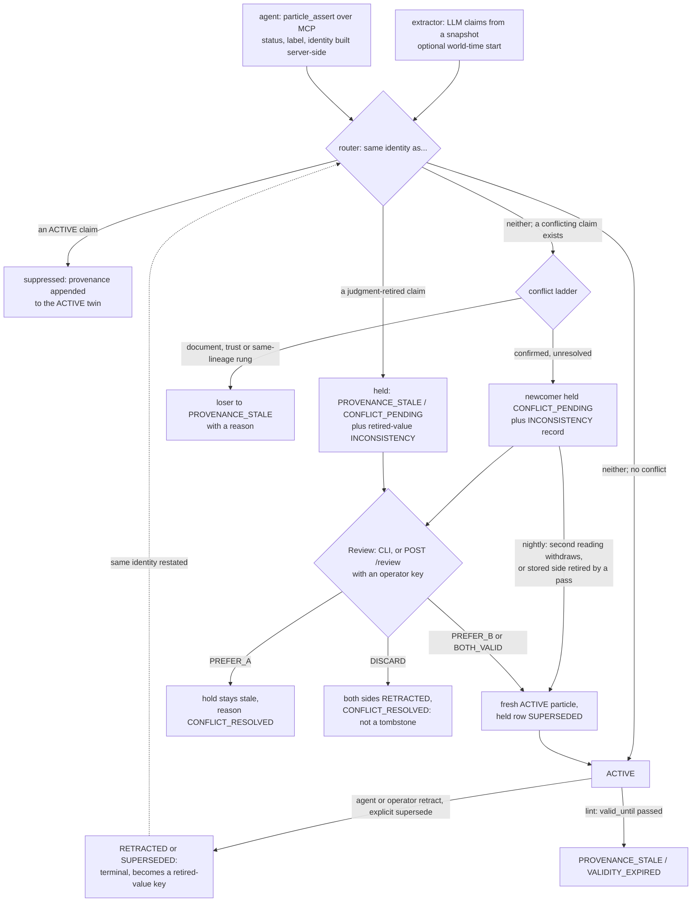

## 1. Executive Summary

Particles is a single-operator belief store for agents: sources go into an
append-only corpus, an LLM extracts claim-granular *particles* from them, and
agents assert, supersede or retract their own particles over MCP. A particle is
never edited for what it says. It changes status, and recall reads only the
`ACTIVE` ones, ranked by similarity and a confidence that trust and recency
adjust at read time.

What is notable is how contradiction and correction are handled. A claim that
contradicts a stored one is kept, quarantined, behind an `INCONSISTENCY` record
until a person rules on it. A claim whose exact text was retracted or
superseded by a judgment is held the same way when a source says it again.
The trust-, status- and identity-bearing fields of an agent's write are built
by the server, never taken from the call. A claim also carries when it began
to hold in the world, separately from when the store recorded it, and a window
query reads that axis.

What is weak is the boundary between projects. `particles init claude-code`
binds the MCP server and the hooks to the session's project, but four scoped
MCP reads take an `all_projects` argument that lifts the lens, and the subject,
lint, event and show tools carry none. A keyless HTTP engine serves reads
only; the review CLI resolves in-process with no credential.

The engine is one of three repositories. It pins
`linkedparticles-core==1.224.6` (`pyproject.toml:80`), which ships the schema,
the status table, the scoring formulas and the extractor into the same
`particles` import package; this report reads it at
[`dec9ca2228eff59ea80a84098314e550c3283bc6`](https://github.com/LinkedParticles/particles-core-py/commit/dec9ca2228eff59ea80a84098314e550c3283bc6),
tag `v1.224.6`, and cites it as *core*. The specification lives in
[particles-standard](https://github.com/LinkedParticles/particles-standard),
read at
[`def8546824f42aa9446ab3666cda606d587ac542`](https://github.com/LinkedParticles/particles-standard/commit/def8546824f42aa9446ab3666cda606d587ac542),
release 1.224.3. The public history is an export: one squashed commit per
release, starting at version 1.130.0, stamped *"from the development upstream
at export time"* (`pyproject.toml:17-18`).

Six marks: `tombstone`, `trust_state`, `bitemporal`, `audit_log`,
`human_review` and `negative_eval`. Section 9 names the one withheld,
`scope_enforced`.

## 2. Mental Model

A particle becomes a belief when it is written `ACTIVE`. Two producers do
that. Extraction reads a deposited corpus snapshot with an LLM and proposes
claims; an agent calls `particle_assert` with one sentence, a subject list, a
self-reported confidence and an excerpt that is deposited as the claim's
source. Both go through the same router before anything is written.

**Every candidate is routed in a fixed order** (`particles/ingest/routing.py:71-107`).
Document-meta and non-asserted prose skip conflict checks and are kept off the
default read surface. An exact twin of an `ACTIVE` claim is suppressed into
it, with the new source appended as provenance. Otherwise a twin of a claim
retired by judgment sends the candidate to a hold. Otherwise a conflicting
`ACTIVE` claim sends it to the conflict ladder. Otherwise it is inserted
`ACTIVE`. Identity is the normalised text, the resolved subject set and the
stance holder (core `particles/core/duplicate_key.py:87-147`).

**The ladder can resolve a conflict without a person, or hold it.** Rungs for a
superseding document, a source-trust differential and a strictly newer
extracted claim from the same source lineage demote the loser to
`PROVENANCE_STALE` with a reason. The same-lineage rung refuses a pair with an
agent- or operator-asserted side (`particles/ingest/update_supersession.py:440-457`).
A confirmed contradiction no rung resolves becomes an `INCONSISTENCY` record
naming both sides, and the newcomer is stored in full, born `PROVENANCE_STALE`
with reason `CONFLICT_PENDING`. Agent writes run the ladder fail-closed, so an
unverifiable contradiction is held too (`particles/operations/agent_write.py:590-593`).

**A belief stops being one by status, never by edit.** `SUPERSEDED` and
`RETRACTED` are terminal except for one reversible edge, un-merging an
automatic duplicate merge (core `particles/core/status.py:71-106`).
`PROVENANCE_STALE` covers expiry of a `valid_until`, a missing source, a
retracted dependency and the demotions above. Review resolves a hold:
`PREFER_A` keeps the incumbent; `PREFER_B` and `BOTH_VALID` mint a fresh
`ACTIVE` particle from a quarantined side; `DISCARD` retracts both; `DEFER`
leaves it open. Every non-`DEFER` closure retracts the record.

**The tombstone is the retired row itself.** A retraction or an explicit
supersession is a judgment, so the retired particle stays in the store and its
identity becomes a key the router consults. When a source restates it, the
candidate is held behind an `INCONSISTENCY` record marked as a retired-value
record, and only Review lifts it (`particles/ingest/pipeline.py:3415-3464`).

## 3. Architecture

The engine is a library with four surfaces over it: a Typer CLI, a FastAPI
server (`particles engine serve`), a stdio MCP server, and the Claude Code
hooks (`ARCHITECTURE.md`). Every surface reaches the operations through one
`Backend` seam, local in-process or HTTP to a remote engine, so a laptop
agent can write into a shared engine (`particles/mcp/tools/write.py:5-20`).

**Persistence is SQLAlchemy over SQLite.** A `postgresql+asyncpg` URL is
accepted, but no Postgres driver is a dependency and the deployment is
documented as deferred (`particles/db.py:21-25`;
`docs/operator-guide/container-deployment.md:501-502`). The particle store,
subject store, trust store, relation graph and operator event log are tables
in one database per store handle, migrated by alembic. The corpus is a
content-addressed blob store on disk plus entry and snapshot rows. The service
is declared single-writer, and a cross-process file lock serialises writers.

**Retrieval scores every `ACTIVE` embedding on each query.** A per-process
cache holds the decoded `ACTIVE` rows and reloads only those a SQLite change
journal names since its last build, so a warm query skips the JSON decode; the
cosine is one matrix pass over the whole set
(`particles/store/candidate_cache.py:1-50`;
`particles/operations/query/main.py:373-380`). There is no vector index.
Embeddings come from a local `sentence_transformers` model in core;
extraction, the second reading and the natural-language answer call a
configured provider, Anthropic or any OpenAI-compatible endpoint, named per
purpose (core `particles/llm/adapters/`; core `particles/config.py:939-995`).

**Background work is a nightly consolidation cycle** run from cron or the
resident daemon, and each run is recorded as a `CONSOLIDATION_RUN` event
(`particles/operations/consolidation.py:6-31`). Its passes, in order, are
refresh, extract catch-up, the reconcile and update sweeps, paraphrases,
re-anchoring, the held-claim release, a contradiction census with an LLM
second reading, disclosure records, the curation queue, utility mining,
abstraction, a `MEMORY.md` projection, rank lift and a closure measure
(`:201-217`).

### Deployment and ergonomics

`pip install linkedparticles` brings both distributions; `particles db init`
creates a SQLite store and nothing else needs to run for recall. A model
provider is required to extract, to answer a question in prose and to run the
census. Deposit, agent assertion, the digest and structural queries make no
model call. The store is not hand-repairable as text, but `particles events`,
`lint`, `review`, `particle show`, exporters to Obsidian, Logseq and JSONL,
and the `--as-of` and `--during` lenses make it inspectable.
`particles interchange export` and `import` round-trip a store through the
ladder, and `restore` rebuilds a bundle into an empty store with ids kept
(`particles/api/cli/interchange.py:162-301`). A container image and a chart
live under `deploy/`.

## 4. Essential Implementation Paths

**Agent write.** `particle_assert` (`particles/mcp/tools/write.py:91-148`)
checks the store against `mcp.write.enabled_stores`, default empty, and calls
the backend with the server's project binding. `assert_belief`
(`particles/operations/agent_write.py:736-824`) gathers the belief in
`_gather_belief` (`:413-501`): a body check on length and sentence count,
subject resolution, the excerpt deposited as a `CONVERSATION` entry tagged with
the server-bound project key (`:302-316`). Confidence is clamped to
`max_asserted_confidence` and labelled `AGENT_ASSERTED`, and `asserted_by` is
the configured identity (`:466-494`). `_apply_belief` calls
`reconcile_and_insert(..., fail_closed=True)` (`:590-593`) and records
`PARTICLE_ASSERTED`.

**Routing and the hold.** `reconcile_and_insert`
(`particles/ingest/pipeline.py:2266-2332`) builds the duplicate index and the
retired-value index for the one candidate (`:2447-2462`) and routes it; a
retired twin goes to `_hold_retired_reassertion` (`:2650-2670`). The
extraction pass builds the same indexes per snapshot (`:1500-1515`) and holds
the same way (`:1712-1730`). `_hold_retired_reassertion` (`:3415-3464`)
appends the observation to an open hold or writes the quarantined candidate
and a retired-value record.

**Supersede and retract.** `supersede_belief` (`agent_write.py:827-982`) loads
the target through `_load_mutable_target` (`:653-733`), which refuses a
non-`ACTIVE` target, a `HUMAN_REVIEW`-calibrated one, one another principal or
the extractor produced unless `allow_cross_asserter`, and, on a bound server,
one out of view for the project; it retires the predecessor with
`EXPLICIT_SUPERSESSION`, asserts the successor with `supersedes` set, and
records `PARTICLE_SUPERSEDED`. `retract_belief` (`:1124-1171`) does the same
with `EXPLICIT_RETRACTION`.

**Status changes.** `update_particle_status`
(`particles/store/particle_store.py:591-660`) validates against the core table,
enforces the reason gate on the one reversible edge, stamps `retired_at` on
leaving `ACTIVE` and clears it on a return, and drops a retracted particle
from its co-evidential groups.

**Query.** `query` in `particles/operations/query/main.py:732-844` gathers
candidates in `_gather_scored` (`:191-528`): the window route when a window is
set, the `ACTIVE` cache otherwise, the widened as-of set under an instant
(`:227-260`). It applies the document-meta, non-asserted, stance, tag,
structured-claim and recency filters, then the observer (`:347-361`), then
scores. The MCP `query` tool marks each hit contested when an open
`INCONSISTENCY` names it.

**World time.** `gather_window_candidates`
(`particles/operations/query/window.py:266-321`) loads every dated particle
across statuses, drops the never-believed ones (`as_of.py:81-95`), closes a
retired state at its successor's start or its retirement, and reads each
against the window with core `read_window` (`particles/core/validity.py:157-209`).
`set_validity_record` (`particle_store.py:2386-2451`) is the shared writer for
`particles validity` and `particles particle date`.

**Session start.** The `SessionStart` hook and the `particles://digest/{store}`
resource reach `build_digest_located` (`particles/operations/digest.py:82-173`):
every `ACTIVE` particle, the session's observer, ranked, capped by
`digest_max_beliefs`, contested ones badged. No model call.

**Review.** `particles review` (`particles/api/cli/review.py:23-140`) and
`POST /review/{id}` (`particles/api/app.py:2380-2418`) call `resolve` in
`particles/operations/review.py:146-341`, which promotes, demotes or retracts,
writes a trust statement for a `PREFER` ruling on an ordinary conflict, closes
the record and records `REVIEW_RESOLVED`.

**Hard delete.** `delete_entry` (`particles/operations/corpus_delete.py:167-228`)
deletes the entry and every particle whose only source it was, strips its refs
from the rest, and records `CORPUS_ENTRY_DELETED` with counts only, including
the judgment-retired rows it erased (`:127-137`, `:210`).

## 5. Memory Data Model

`ParticleRow` (`particles/store/particle_store.py:99-443`) carries `content`,
a confidence value with variance and calibration source, `uncertainty_nature`
(`EPISTEMIC` or `ALEATORY`), `asserted_by`, `asserted_at`, `status` and
`status_reason`. Beside those sit `particle_type`, `assertion_modality`,
`valid_until`, `valid_from`, `valid_kind`, `supersedes`, `retired_at`,
`born_retired` and `content_norm_hash`. Provenance refs, the extractor
reference and provider model, the embedding and its model id, subject ids,
properties, tags and an optional structured claim complete the row.

**Provenance is mandatory.** An agent assertion with neither an excerpt nor an
existing corpus entry is refused (`agent_write.py:180-223`), and a
`ProvenanceEdgeRow` indexes particle to corpus entry and snapshot. The corpus
keeps every snapshot of a source, so a claim points at the bytes it came from.

**Time has two axes.** `asserted_at` (`:111`, defaulting to the insert instant)
and `retired_at` (`:135`) are record time, and the `--as-of` lens evaluates
what the store believed at an instant (`particles/operations/query/as_of.py`).
`valid_from` and `valid_kind` (`:125-126`) and `valid_until` (`:121`) are world
time. An `EVENT` is a point; a `STATE` runs from its start to its own end, or
for a retired claim to the earliest of that, its successor's start and its
retirement (core `particles/core/validity.py:118-140`). The basis of a start
rides in `properties`: `stated`, `as-of`, `session`, `prose`, `coarse` or
`operator`.

**Three writers set a start.** The extractor's gate requires a parseable date,
a kind and a confidence at the floor, and drops the future-date condition the
`valid_until` gate keeps, so "started at Acme in 2019" extracted today stores a
2019 start on a row asserted today (core
`particles/extraction/general.py:3173-3281`, applied at `:3499-3535`, on by
default at core `particles/config.py:1495-1528`). `particles validity` reads
absolute dates already in claim text, never overwriting a `stated` or
`operator` value (`particles/operations/validity.py:151-258`). `particles
particle date --from` records an operator verdict and a `PARTICLE_DATED` event
(`particles/api/cli/particle.py:656-782`; `validity.py:277-310`). The agent's
tools carry no validity field.

**Scope is not on the particle.** A project key is a `project:` tag on a corpus
entry, and a belief's observer scope is derived at read time from the entries
its provenance names, through co-evidential groups and derivation premises
(core `particles/core/observer_scope.py:1-24`;
`particles/store/observer_scope_join.py:1-30`). An entry with no key is global
unless a harness tagged it, in which case it is unattributed and in view for
no project. The agent cannot name the key: `_scope_tags` drops any caller
`project:` tag and adds the server's own, or `scope:unattributed` on an unbound
server (`agent_write.py:302-316`).

**Principals.** `asserted_by` is the configured `mcp:claude-code` for every
agent on a server, `mcp:memory-compat` for the facade, the extractor for
extracted claims and `curation.operator_identity` for operator corrections.
The HTTP engine resolves each bearer to a principal with a role, reader, agent
or operator, from `PARTICLES_API_KEY` and a per-client keys file
(`particles/api/auth.py:33-42`). `SECURITY.md` rules out multi-tenant use and
calls project scope a relevance default, not isolation (`SECURITY.md:872`,
`:1046-1049`).

## 6. Retrieval Mechanics

Retrieval is dense cosine over the candidate set, after filters that only
narrow it. Hits are ranked by `0.6 · cosine + 0.4 · effective confidence`
(`particles/operations/query/main.py:122-129`; core `particles/config.py:2689-2690`).
Effective confidence is stored confidence times source trust and an extractor
trust weight, with a recency factor from the source's publication date
(`main.py:385-404`). Utility mined from tool use is applied only on the
projection path, `retrieve_ranked(apply_utility=True)`
(`main.py:882-984`; `particles/operations/projection/project.py:186-191`).
Trust is the operator's present policy even under `--as-of`. `top_k` defaults
to 40 on the MCP tool, and an LLM writes the answer; `parse_grounded` checks
every cited handle against the set the composer was shown and labels any unit
without a valid one `UNATTRIBUTED` (`particles/operations/query/grounding.py:198-240`).

The filters that withhold rather than rank are status (`ACTIVE` only),
document-meta and non-asserted prose, stance particles and, when an observer is
set, project scope. A contradiction is disclosed, not hidden: both sides of an
open `INCONSISTENCY` stay `ACTIVE` when the conflict was disclosed by the
census, and each hit carries a `contested` id.

A world-time window replaces the status filter with the window evaluation,
before every other filter and before ranking. A retired claim is admitted for
the period it held and returns with its retirement and successor attached; a
restatement stands in for the original it supersedes; undated claims are
counted in a coverage disclosure and never placed.

The structural mode answers predicate, comparison and aggregate questions over
structured claims with no embedding and no model call. The memory-server facade
answers `search_nodes` with a case-insensitive substring match over an
in-memory projection of `ACTIVE` particles (`particles/mcp/memory_compat/ops.py:632-654`);
it is the only lexical read, and nothing fuses it with the cosine path.

**Failure modes.** Every query scores every `ACTIVE` embedding, so latency and
memory scale with the store; the cache removes the decode cost for a warm
process, not the scan, and a fresh process's first query pays the full load. A
vector from another embedding model is skipped with a warning, so a model
change makes old claims unsearchable until re-embedded. The digest injects up
to `digest_max_beliefs` lines ranked by effective confidence, 200 by default
(core `particles/config.py:3383`), regardless of the session's question.

## 7. Write Mechanics

Extraction writes are batch: a session's transcript and memory files are
harvested into the corpus at `SessionEnd`, and extraction runs inline only when
`extract_inline` is set, default false, otherwise in the nightly cycle
(`particles/api/cli/hook.py:503-627`, `:589-592`; core `particles/config.py:3461`).
A harvested fact is therefore retrievable after the next cycle by default.
Agent assertions are synchronous and retrievable at once.

**When a write calls a model.** Each assertion embeds the claim and searches
the `ACTIVE` set for a conflict partner. The store-wide nearest claim pairs at
cosine 0.80 (`extraction.similarity_threshold`), and a subject-keyed search
pairs a same-subject claim from 0.45 (`particles/ingest/pipeline.py:2466-2516`,
`:2729-2794`; core `particles/config.py:1285`, `:1900`). A pair gets the
ladder's contradiction probe; an assertion with no pair makes no model call.

**Deduplication is exact, never by similarity.** The module states the reason:
below identity, cosine did not order duplicate-likelihood, and its worst false
positive sat at 0.9951 (`particles/ingest/duplicate_suppression.py:38-44`). A
duplicate becomes another provenance ref on the existing claim.

**Agent-generated facts are labelled and capped.** Calibration source
`AGENT_ASSERTED`, confidence at most 0.90, an `AUTHOR` trust statement seeded
at 0.8 and never raised over an operator's demotion
(`agent_write.py:147-177`; core `particles/config.py:3343-3354`). A compound
assertion is refused by a size gate.

**Hostile input** is fenced, not filtered: deposited text is wrapped in a
per-call nonce fence before every model call and the model is given no tools
(`README.md`, *Security posture*). Secrets in a deposit are stored verbatim
(`SECURITY.md:688`).

### Operational cost

- Agent write: synchronous, one transaction, one embedding and a scan of every
  `ACTIVE` embedding; one probe when a pair is found.
- Extraction: one or more LLM calls per snapshot chunk, deferred to the cycle
  by default; lag until the next cycle.
- Background: the nightly cycle probes a delta window from the previous run's
  start, with capped census and release probes and a spend budget; it does not
  read the whole store again each night.
- Read: the digest is bounded by `digest_max_beliefs` and rendered fresh each
  session start; `query` scores the whole `ACTIVE` set per call and may make
  one answer call.

## 8. Agent Integration

`particles mcp serve` registers sixteen read tools always and eight write
tools only when a store is write-enabled: `particle_assert`,
`particle_supersede`, `particle_retract`, `deposit_text`, `link_add`,
`link_remove`, `particle_tag`, `particle_untag`
(`particles/mcp/server.py:94-125`, `:160-185`). The digest is an MCP resource,
with a second template that names a project. `particles init claude-code`
installs `SessionStart` and `SessionEnd` hooks, enables a `memory` store for
writes, rescopes the store as its last store step, and registers the MCP server
with `--project-observer cwd` (`particles/api/cli/init.py:1004-1017`,
`:1064-1110`). The hooks' `claude_code.observer_scope` defaults to `project`
(core `particles/config.py:3516`).

A second MCP server reproduces the reference memory server's nine tools over
the same store, with deletes mapped to retractions and an entity deletion to a
tombstone particle tagged on the subject (`particles/mcp/memory_compat/`).
`delete_observations` retracts through `retract_belief`, so a re-added
identical observation is held, and `add_observations` names each held item
with its record (`particles/mcp/memory_compat/ops.py:209-241`, `:405-463`).

The bundled skill tells the agent that ruling on a contradiction *"is the
operator's decision, not yours"* (`particles/skills/keeping-it-clean.md:23`).
The tool surface agrees: no review verb is registered.

## 9. Reliability, Safety, and Trust

**The agent cannot author its own standing.** Status, calibration label,
principal and project key are server-side; confidence is clamped; mutation is
own-beliefs-only and, on a bound server, in-view only, and an operator
correction labelled `HUMAN_REVIEW` is out of the agent's reach
(`agent_write.py:653-733`).

**The transition table is enforced at one seam.** Every status write passes
`validate_transition` in `update_particle_status`, and the one reversible edge
is gated on its reason there too (`particle_store.py:591-660`).

**A keyless engine serves reads only.** On the default `dev-key` with no
per-client key, every mutating route refuses with 503 even from loopback, and
an operator-scope route also refuses an agent-role key with 403
(`particles/api/auth.py:27-31`, `:697-711`, `:745-763`). The review route, the
operator supersede and retract, subject creation, links and trust writes carry
`OPERATOR_GATE`, and `tests/test_auth.py:663-774` asserts the 503 for each of
them from loopback. Read, not run.

**Corpus delete outranks the tombstone.** A hard delete removes every particle
sourced only from the entry, retracted twins included, so re-depositing the
document re-mints what had been retracted. The plan counts those rows so the
CLI can say so before confirming, and the event carries the count
(`particles/operations/corpus_delete.py:19-23`, `:127-137`).

**Links stay inside the lens on a bound server.** `link_add` requires both
endpoints to be the agent's own `ACTIVE` beliefs in view for the project, and
refuses a co-evidential link between beliefs with different observer scopes,
since the scope join pools a group's sources
(`agent_write.py:1274-1287`, `:1301-1338`;
`particles/store/observer_scope_join.py:15-19`). An unbound server has no
lens to keep.

**Code and specification.** In the standard's
`docs/spec/technical-specification.md`, the §6.6 row for an agent revision
names `EXPLICIT_SUPERSESSION` (`:413`), as the code sets it
(`agent_write.py:925-927`), and the wrapper-terminal rule retracts a closed
record on every path (`:425`), which core's table enforces with no
`INCONSISTENCY → PROVENANCE_STALE` edge (`particles/core/status.py:84-88`).
The §6.2 entry for `valid_from` (`:83-84`) matches the window route. On these
points code and specification agree.

Capability marks:

- `tombstone` — awarded. A judgment-retired identity holds every restatement
  for review, on both write paths, by default. The test module's docstring
  takes its test list from the Agent Memory Atlas, and one case names
  [Verel](../verel/)'s red-team sequence (`tests/test_retired_value_quarantine.py:5-25`, `:208-227`).
  It is exact-text only, and `DISCARD` deliberately does not arm it
  (core `particles/core/conflict_review.py:241-252`), which
  `tests/test_retired_value_quarantine.py:458-486` pins beside the held
  contrast case.
- `trust_state` — awarded. `CONFLICT_PENDING`, `INCONSISTENCY`, `RETRACTED`
  and `SUPERSEDED` are excluded by the query cache, the digest and the facade;
  the as-of and window lenses admit once-believed retired claims, labelled, and
  never a held one.
- `bitemporal` — awarded. A start that can precede its own row has three live
  writers, the extractor's on by default, and `query --during`/`--on` and the
  MCP `query` tool select on it across statuses. The limits are in the
  record above: the start is rewritten in place, and extraction cannot
  backdate an end.
- `audit_log` — awarded. `operator_events` is append-only by convention and
  written in the mutation's transaction.
- `human_review` — awarded. The hold waits for `review`, which no agent tool
  reaches, and the HTTP route needs an operator key. The automatic closures
  act only on records whose stored side an autonomous pass retired or that a
  second reading no longer confirms, never on retired-value holds. Two limits
  stand: `reviewer_id` is a supplied string, and a general shell on the same
  host can run the CLI.
- `negative_eval` — awarded; section 10.
- `scope_enforced` — withheld. The key and the predicate are real, the read
  lens and the write guards share them, and `particles init claude-code` binds
  them by default. But `query`, `particles_list`, `particle_search` and
  `graph_view` each take `all_projects=True` from the caller
  (`particles/mcp/observer.py:39-41`), a committed test pins that widening as
  the caller's (`tests/test_observer_scope_surfaces.py:460-471`), and the
  digest template accepts any project name. The subjects, lint, events,
  `particle_show` and facade tools carry no observer.

## 10. Tests, Evals, and Benchmarks

I read the tests at the pin and ran none of them.

**Negative retrieval.** `tests/test_query_negative_retrieval.py` drives the
real `query` with only the embedding model and the answer generator mocked,
and gives every particle the same embedding so only filters can decide.
`test_query_excludes_retracted_particles` asserts the retracted id absent and
`ids == [kept.id]` (`:107-124`); the superseded and `INCONSISTENCY` cases have
the same shape (`:127-173`); the as-of case asserts the later claim absent
then and present without the instant (`:176-199`). The observer case asserts
project A's view holds its own and global beliefs and excludes the other
project's, an unattributed harvest and a cross-project derivation, then that
the unscoped query returns all six (`:274-290`).

**World time.** `tests/test_window_query.py:246-294` stores a dated residence,
retires it behind a successor with an `as-of` start, and asserts a window
inside the old period returns it `IN_FORCE`, closed at the successor's start,
a window after the move returns only the successor, and a query with no window
never returns the retired claim. `:351-363` asserts a born-retired claim is
never admitted. The extractor's start gate keeps a past start
(`tests/test_validity_extraction.py:275-281`) and drops a past `valid_until`
(`:89`). No window test sets an observer.

**Tombstone.** `tests/test_retired_value_quarantine.py` covers re-assertion of
a retracted claim, the supersede-then-restate sequence, non-judgment
retirements not firing, the `ACTIVE` twin winning, idempotence, normalisation
variants, the off switch, both review outcomes, the trust cascade leaving the
hold to a person, and the `DISCARD` re-mint beside its contrast case
(`:130-638`).

**Operator surface.** `tests/test_auth.py:663-774` asserts that every
operator-scope route refuses a loopback caller on the `dev-key` with 503, and
`tests/test_write_route_gate.py:197-247` that every write route names a gate
and takes no store lock when refused.

**Conformance.** Core ships a self-certification runner over the standard's
`artifacts/conformance/profile.yaml`: numeric vectors for effective confidence,
recency, calibration and noisy-or merging, and categorical vectors for the
conflict-ladder ordering, the context fingerprint and cascade gating (core
`particles/conformance/runner.py:5-34`). Status transitions and the
retired-value rule are covered by unit tests, not by vectors.

**LongMemEval.** The README reports Recall@40 0.969 and end-to-end QA 0.804,
against a full-context ceiling of 0.878 and a no-memory floor of 0.047. I
recomputed each from the committed per-question records with a standalone
script. The QA figure is the mean of three runs scoring 121, 121 and 120
correct in 150 (`docs/benchmarks/longmemeval-s150-v2-p2-topk40-subjects-names*-2026-09-20.json`).
Recall is 0.9685 over 143 non-abstention questions. The ceiling is 130 correct
in 148 and the floor 7 in 150, both from
`longmemeval-s150-v2-rejudge-p2-2026-09-19.json`, a run two days before the
lead row's. The benchmarks page records the arms where Particles loses. The
query-latency figures in `docs/benchmarks/query-latency.md` were not
recomputed, and this report quotes none.

**No paper.** The standard carries a whitepaper and a technical specification
as Markdown; no arXiv, DOI or `CITATION.cff` is in the engine or core.

**Missing.** No case asserts the `all_projects` widening refused; the
committed one pins it allowed.

## 11. For Your Own Build

### Steal

- **Make the tombstone the retired row.** Key retirement-by-judgment on the
  same identity the deduplicator uses, consult it on every write path before
  the conflict logic, and hold a match for review instead of refusing it, so
  the source's restatement is on record.
- **Route every candidate through one ordered decision**: duplicate of a live
  claim, twin of a retired one, conflict, insert. Each later rung can then
  assume the earlier ones did not fire.
- **Build trust-bearing fields on the server.** Status, calibration label,
  principal and scope key never come from the agent's arguments.
- **Say which retirements are judgments.** A list that excludes source
  withdrawal, reindex, merge and expiry keeps the tombstone from freezing
  claims that were never judged wrong.
- **Gate a world-time start differently from an end.** A wrong end retires a
  true claim; a wrong start only misplaces one in a window, so the start gate
  can accept the past.
- **Publish per-question records under every headline number.**

### Avoid

- **A scope argument the caller can lift.** A boolean on each tool that drops
  the observer makes the lens a convenience filter, however it is bound.
- **A mutable valid-time column with no history.** A start overwritten in place
  by a pass that records no event cannot say what the store held about world
  time before the pass ran.
- **Leaving the strongest rejection out of the tombstone.** If "neither side is
  worth keeping" does not hold the value, say so where the reviewer chooses it.

### Fit

This suits one operator who wants claims with provenance, contradictions put in
front of them rather than resolved by recency, questions about a period
answered by when things held, and a record of every correction. A nightly
cycle on a configured model provider does the extraction. It is not a
multi-tenant memory: `SECURITY.md` rules that out, and the project scope is a
lens, not a wall. At a large store the brute-force cosine will hurt first.
A team that wants a small memory for coding sessions is adopting a
specification and a curation discipline with it, though the standard is a
document, not a dependency.

## 12. Open Questions

- How large do stores get in use before the per-query scan of every `ACTIVE`
  embedding dominates latency in a warm process?
- How often do the second reading and the release pass return a held claim
  without a person? The closure measure records it per store in each
  `CONSOLIDATION_RUN` event (`particles/operations/closure_measure.py:1-25`);
  no committed figure spans stores.
- Can an agent's `deposit_text` entry reach nightly extraction, and so carry a
  world-time start the agent wrote into the text? This reading did not trace
  the catch-up selection.

## Appendix: File Index

- **Schema and status:** `particles/store/particle_store.py`,
  `particles/store/event_store.py`, `particles/store/observer_scope_join.py`,
  `particles/store/candidate_cache.py`; core `particles/core/status.py`,
  `particles/core/duplicate_key.py`, `particles/core/observer_scope.py`,
  `particles/core/conflict_review.py`, `particles/core/validity.py`,
  `particles/core/held_release.py`, `particles/config.py`.
- **Write path:** `particles/operations/agent_write.py`,
  `particles/ingest/pipeline.py`, `particles/ingest/routing.py`,
  `particles/ingest/duplicate_suppression.py`,
  `particles/ingest/update_supersession.py`, `particles/corpus/deposit.py`;
  core `particles/extraction/general.py`.
- **Correction:** `particles/operations/review.py`,
  `particles/operations/_quarantine.py`,
  `particles/operations/contradiction_disclosure.py`,
  `particles/operations/held_release.py`, `particles/operations/cascade.py`,
  `particles/operations/corpus_delete.py`,
  `particles/operations/lint/staleness.py`, `particles/operations/validity.py`.
- **Retrieval and context:** `particles/operations/query/main.py`,
  `particles/operations/query/observer_scope.py`,
  `particles/operations/query/as_of.py`, `particles/operations/query/window.py`,
  `particles/operations/query/grounding.py`, `particles/operations/digest.py`.
- **Surfaces:** `particles/mcp/server.py`, `particles/mcp/tools/`,
  `particles/mcp/observer.py`, `particles/mcp/resources.py`,
  `particles/mcp/memory_compat/`, `particles/api/app.py`,
  `particles/api/auth.py`, `particles/api/_keys.py`,
  `particles/api/cli/review.py`, `particles/api/cli/particle.py`,
  `particles/api/cli/validity.py`, `particles/api/cli/hook.py`,
  `particles/api/cli/init.py`, `particles/api/cli/_claude_code.py`.
- **Background:** `particles/operations/consolidation.py`,
  `particles/operations/closure_measure.py`.
- **Tests and benchmarks:** `tests/test_query_negative_retrieval.py`,
  `tests/test_retired_value_quarantine.py`, `tests/test_window_query.py`,
  `tests/test_validity_extraction.py`, `tests/test_auth.py`,
  `tests/test_write_route_gate.py`, `tests/test_observer_scope_surfaces.py`,
  `docs/benchmarks.md`, `docs/benchmarks/*.json`; core
  `particles/conformance/runner.py`, `artifacts/conformance/profile.yaml`.

### Recorded searches

Checked against the engine at the pinned revision and core at `v1.224.6`, with
`git grep` on tracked files; `git ls-files -i -c --exclude-standard` lists no
committed-but-ignored file in either.

- `git grep -n -i -E 'arxiv|zenodo|bibtex|@article|@misc|doi\.org'` in engine and core — a DOI URI template in the subject-authority registry and two benchmark answer strings; no `CITATION.cff`.
- `git grep -n -E 'delete\((OperatorEvent|operator_event)|update\((OperatorEvent)|operator_events' -- particles alembic` — the table definitions, migration `017` and two benchmark reads; no update or delete.
- `git grep -n -i -E 'create trigger' -- alembic particles` — only the particle change-journal triggers in `alembic/versions/054_particle_change_journal.py` and `particles/store/change_journal.py`; none on `operator_events`.
- `grep -c record_event particles/operations/lint/staleness.py` — 0.
- `git grep -n -E 'record_event' -- particles/operations/validity.py` — the operator verb and the session re-date only; `regenerate_validity` records none.
- `git grep -n -E 'all_projects|observer_for|bound_project\(\)' -- particles/mcp` — `query`, `particles_list`, `particle_search` and `graph_view` take `all_projects`; the write tools stamp `bound_project()`.
- `git grep -n -E 'observer|project' -- particles/mcp/tools/subjects.py particles/mcp/tools/lint.py particles/mcp/tools/events.py particles/mcp/tools/links_suggest.py` — no match; `sed -n 23,49p particles/mcp/tools/particles.py | grep -c -E 'observer|project'` — 0; `git grep -n -E 'observer|project_key|bound_project' -- particles/mcp/memory_compat/` — no match.
- `git grep -n -E 'review_resolve\(|operations\.review import' -- particles` — the CLI, the HTTP app, the client backends and the curation session; no MCP tool.
- `git grep -n -E 'valid_' -- particles/mcp/tools/write.py` — no match.
- `git grep -n -E 'search_nodes' -- particles` — the facade's `graph.py`, `ops.py` and `server.py` only; the query path never calls it.
- `git grep -n -E 'all_projects' -- tests` — the golden tool schema and `tests/test_observer_scope_surfaces.py`, which pins the widening allowed.
- `grep -n -i -E 'particles-standard' pyproject.toml` in engine and core — no match.
- `git grep -n -E 'extraction_submit'` — one benchmark page recording the withdrawn agent-side extraction; no tool.
- `grep -n -i -E 'asyncpg|psycopg' pyproject.toml constraints.txt` in engine, and `pyproject.toml uv.lock` in core — no match.
- `git grep -n -i -E 'bm25|fts5|tsvector' -- particles` in engine and core — no match.
- `grep -c isatty particles/api/cli/review.py` — 0.
- `git grep -n -E 'observer' -- tests/test_window_query.py` — no match.
- `git grep -n -i 'tombstone' -- particles` — the facade's entity tombstones, a graph legend, the retired-value and corpus-delete docstrings and the interchange store.
- `git ls-files | grep -i -E '(^|/)(AGENTS|CLAUDE)\.md$'` in engine and core — none committed.

## History

**2026-11-05** — [`806de74b1f6b2b300ca1a403a4f7500212dce565`](https://github.com/LinkedParticles/particles-engine-py/commit/806de74b1f6b2b300ca1a403a4f7500212dce565) — release 1.224.6, 22 commits past the previous pin; core at [`dec9ca2228eff59ea80a84098314e550c3283bc6`](https://github.com/LinkedParticles/particles-core-py/commit/dec9ca2228eff59ea80a84098314e550c3283bc6), the standard at [`def8546824f42aa9446ab3666cda606d587ac542`](https://github.com/LinkedParticles/particles-standard/commit/def8546824f42aa9446ab3666cda606d587ac542). `bitemporal` awarded: `valid_from` and `valid_kind`, first published in release 1.190.0, have three writers and a window read ([section 5](#5-memory-data-model)). The dev-key operator routes gained a gate, links stay inside a bound lens, init binds the observer, and cascade closures retract ([section 9](#9-reliability-safety-and-trust)). Three claims were wrong at the previous pin: provider adapters and the code citation gate existed (understated), and utility never ranked `query` (overstated) ([section 6](#6-retrieval-mechanics)). `stack_storage` drops Postgres, which ships no driver. Screened: the same `RUNS` and `EXEC` findings, `FRESH` on three files from the 1 November export; nothing was installed, built or run.

**2026-10-04** — [`a2533495cf9f2072bde1167467f080494d9ef954`](https://github.com/LinkedParticles/particles-engine-py/commit/a2533495cf9f2072bde1167467f080494d9ef954) — first reading, at the head of `main`, release 1.172.0. Five marks; section 9 names the two withheld. Core read at [`16543c081fd59b0e37481527728f48ac9d90d5d6`](https://github.com/LinkedParticles/particles-core-py/commit/16543c081fd59b0e37481527728f48ac9d90d5d6) and the specification at [`bf3528f48b32f1103366b3b33eba222facf5e08c`](https://github.com/LinkedParticles/particles-standard/commit/bf3528f48b32f1103366b3b33eba222facf5e08c). Screened before reading: two auto-run surfaces (`hooks/`, mkdocs build hooks; `server.json`, an MCP registry manifest), two build-time execution points, two dependency files inside the cooldown and two unpinned. Core: one execution point, one inside the cooldown from its depth-1 clone, one unpinned. No agent instruction file is committed. The LongMemEval figures were recomputed from committed JSON with a standalone script; nothing from either tree was installed, built or run.
