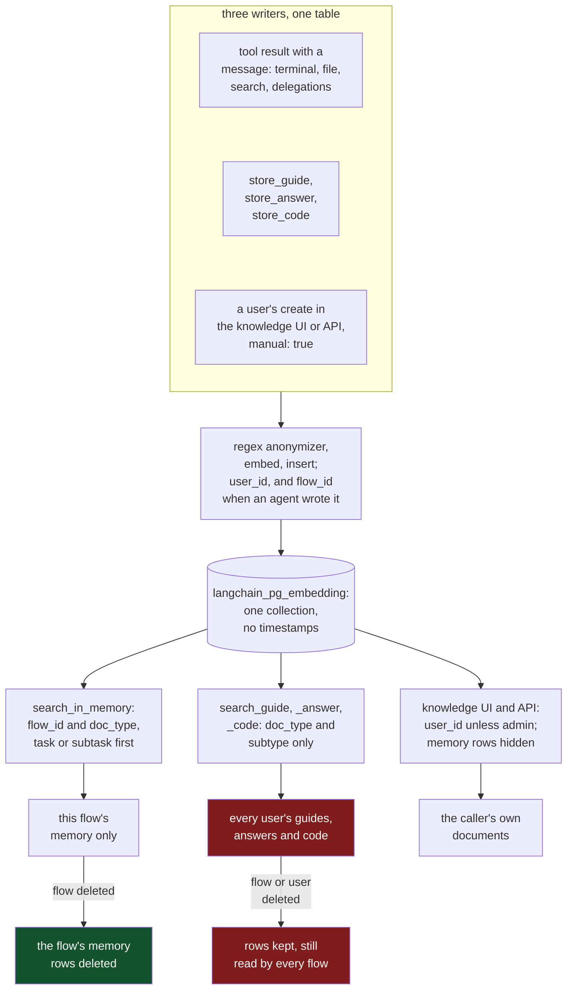

## 1. Executive Summary

PentAGI is a self-hosted multi-agent penetration-testing system: a Go backend
runs a primary agent that delegates to pentester, coder, installer, searcher,
memorist and other agents inside a Docker sandbox, behind a React UI and
GraphQL and REST APIs. Its long-term memory is one pgvector table written three
ways — tool output the executor stores without being asked, guides, answers and
code that agents store through tools, and documents a person types into the
knowledge UI — plus an optional Graphiti graph of every agent response and tool
call. What is notable is a flow key on all recalled tool output and an owner
predicate on every human read. What is weak is that the agents' guide, answer
and code searches filter on document type alone, so every flow reads what any
user's agents stored or any user typed, while no user can see or delete another
user's rows.

It carries `negative_eval`, on the human knowledge API.

**Licence.** `EULA.md` says a user accepts it *"when downloading either the
source code or the Docker images"*, and grants a revocable licence to use the
software *"solely for lawful penetration testing purposes"*, terminable without
notice with every copy destroyed. The same file says MIT prevails *"with respect
to the source code"* where the two conflict, so the field-of-use limit binds the
images and the web UI rather than code lifted from the tree; the installer
presents the same file for acceptance (`backend/cmd/installer/files/links/EULA.md`
is a link to it). `NOTICE` says the VXControl Cloud SDK is AGPL-3.0 with an
exception for this project; the README calls it MIT, and the SDK's `LICENSE` at
the pinned `v1.0.1` is MIT. Its anonymizer sits on every vector write path.

**Recalled tool output stays inside its flow.** The executor stores the
arguments and result of terminal, file, search and delegation calls as `memory`
chunks carrying `user_id`, `flow_id`, `task_id` and `subtask_id`
(`backend/pkg/tools/executor.go:597-643`). `search_in_memory` always filters on
`flow_id` and `doc_type`, and when a task or subtask filter finds nothing it
retries with those two keys still applied (`backend/pkg/tools/memory.go:74-84`,
`:142-169`, `:261-266`).

**Guides, answers and code are one pool per instance.** Each stored row records
its user and flow, the human API filters on the user, and the agents' three
searches send `doc_type` and a subtype and nothing else
(`backend/pkg/tools/guide.go:95-98`, `search.go:93-96`, `code.go:98-101`).
Committed tests require that two-key filter exactly
(`backend/pkg/tools/guide_test.go:81`, `search_test.go:81`, `code_test.go:104`).
The default `User` role may create documents
(`backend/migrations/sql/20260501_120000_knowledge.sql:13`), and those enter
other users' flows too.

## 2. Mental Model

Memory here is retrieved text, not belief. Four kinds of thing are written and
none carries a status.

- **A memory fact**: a chunk of one tool call's arguments and result, written
  by the executor after the tool returns. It belongs to one flow.
- **A guide, an answer, a code sample**: text an agent decides is reusable,
  written through a store tool under a subtype (`install`, `vulnerability`,
  `python`). It records an owner and a flow and is read by all.
- **A manual document**: the same three types typed by a person, marked
  `manual: true`. Agents read it exactly as they read their own.
- **A Graphiti episode**: every agent response and every non-delegation tool
  call, sent to a Graphiti service under the flow's group id when the service
  is enabled. Entity extraction happens in that service.

A row exists or it does not. A person may rewrite or delete a guide, answer or
code document they own, or any one with `knowledge.admin`; nobody edits a memory
fact; deleting a flow deletes its memory facts. Retrieval presents every row
under a heading such as *"Retrieved Memory Fact"* or *"Document"* with a match
score, so a scanner banner from a target and a guide typed by a colleague reach
the prompt on the same footing.

## 3. Architecture

| Component | Role |
| --- | --- |
| PostgreSQL with pgvector (`vxcontrol/pgvector:latest`) | Every relational table and `langchain_pg_embedding` |
| `vxcontrol/langchaingo` v0.1.14-update.8 | The pgvector store library: `AddDocuments`, `SimilaritySearch`, metadata filters |
| An embedding provider (`EMBEDDING_PROVIDER`, default `openai`) | Required for any vector read or write |
| Graphiti (`vxcontrol/graphiti:latest`) and Neo4j 5.26.2 | Optional knowledge graph, `docker-compose-graphiti.yml` |

All vector stores share one `pgxpool` (`backend/docs/database.md:37`, `:59`)
and use the collection `langchain`
(`backend/pkg/database/knowledge/vectorstore/vectorstore.go:9-18`). The tools
go through langchaingo; the knowledge API and the slow store path run sqlc
queries against the same table (`backend/sqlc/models/knowledge.sql`).
Migrations create no approximate index on the embedding, only one on
`doc_type` and `flow_id` expressions, so each search is an exact scan of the
rows its predicates admit
(`backend/migrations/sql/20260722_120000_embedding_metadata_indexes.sql`,
`backend/docs/database.md:427`).

The metadata predicate is built in the dependency, not in this tree. At the
pinned tag `filterPredicates` sorts the keys, refuses any key that is not a bare
identifier, and binds each value as a parameter compared with
`cmetadata ->> 'key'`, under a comment that a caller's filter *"may be the only
thing keeping one tenant's documents out of another's results"*
(`vectorstores/pgvector/pgvector.go:479-505` in vxcontrol/langchaingo). Values
are compared as text, so a stored JSON number `42` matches the filter string
`"42"`.

`TENANT_ID` separates PentAGI installations that share infrastructure: each
gets its own Postgres schema through a rewritten `search_path`, and its Graphiti
group ids become `<tenant>-flow-<id>` (`backend/pkg/database/tenant.go:31-80`,
`backend/pkg/config/tenant.go:79-81`). Inside one installation there are many
users and one table.

### Deployment and ergonomics

`docker compose up` for the core stack, or the installer's terminal wizard,
which also asks for EULA acceptance. Without a working embedding provider the
executor never opens a vector store, so the memory tools are not offered and
tool results are not stored (`backend/pkg/tools/tools.go:415-439`); the
knowledge API then refuses create, update and search and still lists and
deletes. Graphiti is a second compose file, an LLM configuration for its own
extraction (`examples/graphiti/*.yaml`), and `GRAPHITI_ENABLED=true`
(`backend/pkg/config/config.go:306`). The store is SQL and repairable by hand;
`etester` can flush the table or re-embed every row after a model change
(`backend/cmd/etester/flush.go:29`, `reindex.go`).

## 4. Essential Implementation Paths

| Path | Location |
| --- | --- |
| Automatic store of tool results | `backend/pkg/tools/executor.go:382-396`, `:597-683`; allow-list `registry.go:154-172` |
| Memory search with flow key and fallback | `backend/pkg/tools/memory.go:66-249`, `:261-266` |
| Guide store and search | `backend/pkg/tools/guide.go:87-393` |
| Answer store and search | `backend/pkg/tools/search.go:85-385` |
| Code store and search | `backend/pkg/tools/code.go:70-410` |
| Store with a truncated embedding | `backend/pkg/tools/vecstore_helper.go:36-70` |
| Tools per agent type | `backend/pkg/tools/tools.go:886-945` (assistant), `:1165-1168` (installer), `:1275-1290` (coder), `:1403-1418` (pentester), `:1498-1501` (searcher), `:1703-1716` (memorist), `:1778-1791` (enricher) |
| Knowledge store for people | `backend/pkg/database/knowledge/knowledge.go:249-763` |
| Knowledge SQL | `backend/sqlc/models/knowledge.sql:1-169` |
| GraphQL resolvers | `backend/pkg/graph/schema.resolvers.go:1198-1300`, `:2570-2630` |
| REST routes | `backend/pkg/server/services/knowledge.go:151-516` |
| Flow deletion purge | `backend/pkg/graph/schema.resolvers.go:221-227`, `backend/pkg/server/services/flows.go:658-668` |
| Graphiti writes | `backend/pkg/providers/performer.go:96`, `:164`, `:191`, `:219`, `:978-1185` |
| Graphiti search tool | `backend/pkg/tools/graphiti_search.go:125-620` |
| Vector store activity log | `backend/migrations/sql/20241130_183411_new_type_logs.sql:34-56`, `backend/sqlc/models/vecstorelogs.sql` |

## 5. Memory Data Model

`langchain_pg_embedding` has five columns: `collection_id`, `embedding`,
`document`, `cmetadata` (JSON) and `uuid`
(`backend/migrations/sql/20260501_120000_knowledge.sql:37-46`). Everything else
is a key in `cmetadata`:

- **`doc_type`**: `memory`, `guide`, `answer` or `code`.
- **`user_id`**, **`flow_id`**, **`task_id`**, **`subtask_id`**: set from the
  executor's context on every agent write; a manual document has `user_id` only.
- **`tool_name`**, **`tool_description`**: on memory facts.
- **`guide_type`**, **`answer_type`**, **`code_lang`**: the subtype the search
  tools filter on. Unknown guide and answer types become `other`.
- **`question`**, **`description`**: co-indexed text on the agent-authored types.
- **`part_size`**, **`total_size`**: chunk and source lengths.
- **`manual`**: `true` only on documents created through the knowledge API
  (`backend/pkg/database/knowledge/knowledge.go:113`, `:486`).

There is no timestamp on a row. The migration that introduced the knowledge
API back-filled `user_id` from each row's flow and gave every remaining row
`user_id = 1` (`backend/migrations/sql/20260501_120000_knowledge.sql:54-69`).

**`bitemporal` is withheld**: no time field exists on the table. **`trust_state`
is withheld**: `manual` is the only discrete field, and its one reader is an
optional filter in the human API (`knowledge.go:232`, `:450`,
`backend/pkg/server/services/knowledge.go:55-60`); no agent search reads it.
**`tombstone` is withheld**: deletion removes the row and leaves nothing behind.

## 6. Retrieval Mechanics

Each agent search tool takes one to five English questions, runs one
similarity search per question with limit 3 and score threshold 0.2, merges the
results by a SHA-256 of the content keeping the higher score, and returns the
best three (`backend/pkg/tools/memory_utils.go:20-54`). Output is Markdown:
a heading per hit with its score, the task, subtask and tool name for memory
facts, the original question and subtype for guides, then the stored text with
no delimiter beyond a rule line.

The read arms and the keys each applies:

| Arm | Who holds it | Predicates |
| --- | --- | --- |
| `search_in_memory` | memorist, enricher, assistant | `flow_id`, `doc_type = memory`, then `task_id` and `subtask_id` when given; an empty result retries without the last two |
| `search_guide` | installer, pentester, assistant | `doc_type = guide`, `guide_type` |
| `search_answer` | searcher, assistant | `doc_type = answer`, `answer_type` |
| `search_code` | coder, assistant | `doc_type = code`, `code_lang` |
| `graphiti_search` | memorist, enricher, pentester, coder | the flow's group id, set when the tool is built (`backend/pkg/tools/tools.go:1281-1287`) |
| knowledge list, get, search (GraphQL and REST) | people | `user_id` in SQL unless `knowledge.admin`; `doc_type <> memory` |

**`scope_enforced` is withheld.** Three of those arms carry the stored key: the
memory search on `flow_id` on both of its queries, the human API on `user_id`
in each of its SQL statements (`backend/sqlc/models/knowledge.sql:12-22`,
`:49-60`, `:125-144`, `backend/pkg/server/services/knowledge.go:181-186`), and
Graphiti on a group id the tool, not the model, supplies. The guide, answer and
code arms apply no user, flow or tenant key, and they are the arms four agent
types read reusable knowledge through. The tool schemas tell the model the
store is *"shared across all engagements"* (`backend/pkg/tools/args.go:284`),
so the pooling is a design choice; the owner key is still written on every row,
enforced for people, and absent for agents.

The memorist's prompt says its vector store and knowledge graph are shared
across all engagements (`backend/pkg/templates/prompts/memorist.tmpl:18`), and
both of its arms are pinned to the current flow. A question about an earlier
engagement reaches nothing.

Graphiti offers seven search kinds — recent context, episode context, temporal
window, successful tools, entity relationships from a node, entities by label,
diverse results — each sent to the Graphiti service with the group id. What the
service does with a `center_node_uuid` from another group is not visible here.

## 7. Write Mechanics

**Tool results.** After a tool on the allow-list returns, and only when its
call carried a non-empty `message` argument, the executor formats the arguments
as JSON and the result as Markdown, runs the regex anonymizer over the whole
text, splits it into 2,000-character chunks with 100 characters of overlap,
stamps the ids, and calls `AddDocuments` (`backend/pkg/tools/executor.go:382-396`,
`:597-643`). The allow-list holds the terminal, the file tool, nine search
engines, and the delegations to the searcher, coder, installer, pentester and
adviser, so a sub-agent's final report is stored as a memory fact of the flow
that asked for it (`backend/pkg/tools/registry.go:154-172`).

**Store tools.** `store_guide`, `store_answer` and `store_code` fill a blank
question, default the subtype, anonymize, and store one document. If the text
exceeds the embedding byte limit the full text is stored and the vector is
computed from the question plus a truncated body, through a direct sqlc insert
(`backend/pkg/tools/guide.go:280-333`, `vecstore_helper.go:36-70`). The tool
descriptions also ask the model to replace IPs, domains, credentials and paths
with placeholders (`backend/pkg/tools/args.go:284`, `:297`, `:310`). Nothing
checks for a near-duplicate before writing.

**People.** A create embeds and inserts with `manual: true`; an update
re-embeds and overwrites text, vector and metadata in one statement; a rename
rewrites metadata only. The owner recorded on the row survives an update by an
administrator (`backend/pkg/database/knowledge/knowledge.go:564-597`). No
previous version is kept.

**Deletion.** Deleting a flow, through GraphQL or REST, deletes the rows with
that `flow_id` and `doc_type = memory` and leaves the flow's guides, answers
and code (`backend/sqlc/models/knowledge.sql:146-154`,
`backend/pkg/server/services/flows.go:658-668`). Deleting a user removes the
`users` row, and its flows cascade (`backend/pkg/server/services/users.go:828`,
`backend/migrations/sql/20241026_115120_initial_state.sql:120`); no statement
touches the embeddings, so the user's memory rows are orphaned and their
guides, answers and code remain in every flow's searches. Nothing deletes
Graphiti episodes.

**Graphiti.** When enabled, the performer sends each agent response and each
non-delegation tool call, arguments and result included, to the flow's group
(`backend/pkg/providers/performer.go:164`, `:191`, `:219`). These messages are
not passed through the anonymizer.

### Operational cost

Every write blocks the agent. A stored tool result costs one embedding call
per chunk before the turn continues, and each Graphiti message waits up to
`GRAPHITI_TIMEOUT`, 30 seconds by default (`backend/pkg/config/config.go:307`).
A row is retrievable once its insert commits. A search costs one embedding per
question and an exact scan over the rows its predicates admit; the guide,
answer and code arms admit every row of their type in the installation. At most
three hits are returned per call. No background pass reads or rewrites the
store.

## 8. Agent Integration

Memory is part of the agent runtime, not a separate service. The primary agent
does not search memory itself; it delegates to the memorist, whose prompt tells
it to search Graphiti first when enabled and then split the question into
vector queries (`backend/pkg/templates/prompts/memorist.tmpl:23-30`). The
enricher uses the same two tools to add context before the adviser answers.
Specialists read and write their own document type: installer and pentester
guides, searcher answers, coder code. The interactive assistant reads all four
types and stores none (`backend/pkg/tools/tools.go:886-945`).

The model has no verb that edits or deletes a stored row. Every write it makes
is an insert, and the largest stream of inserts is the automatic one it does
not choose.

A person sees memory through the knowledge page of the UI and through the
flow's vector-store tab, which reads `vecstorelogs`.

**`human_review` is withheld.** Agent writes land immediately; a person can
later edit or delete a document they own, which is authoring after the fact.
No row waits on anyone.

## 9. Reliability, Safety, and Trust

### One user's knowledge enters every user's flows

A document created by a user holding the default `User` role, or stored by that
user's agents, is returned by `search_guide`, `search_answer` or `search_code`
in every other user's flow whenever its type matches and its similarity clears
0.2. The reader cannot see it in the knowledge UI, which shows only their own,
and cannot delete it. Only an administrator can. The text reaches the prompt
under the same heading as an agent's own document, with no marker
distinguishing a manual one.

Two consequences follow for a shared installation. Findings flow outward: an
answer of type `vulnerability` stored during one engagement is retrievable in
another user's engagement, with only the regex anonymizer and the model's
compliance with the instruction to anonymize standing between them. And
instructions flow inward: any user can plant a `pentest` guide that other
users' pentester agents retrieve as procedure.

### Rows outlive what they describe

Deleting a flow removes its memory facts and keeps its guides, answers and
code. Deleting a user keeps everything. The migration that introduced
ownership purged memory rows of flows already deleted
(`backend/migrations/sql/20260501_120000_knowledge.sql:82-93`), a one-time
clean-up of the state the delete paths leave for the other three types.

### The activity log is not an audit trail

`vecstorelogs` records each agent `store` and `retrieve` with the query, the
filter and the result text, and nothing updates or deletes its rows. **`audit_log`
is withheld** on what it leaves out: the action enum has no update or delete,
a row carries no document id to join to, `flow_id` is `NOT NULL` so manual
creates, edits and deletions write nothing, and the flow purge writes nothing
(`backend/migrations/sql/20241130_183411_new_type_logs.sql:34-48`).

### What holds up

- Memory facts are pinned to the flow on both queries of the fallback, and a
  test asserts the filter for four combinations of ids
  (`backend/pkg/tools/memory_test.go:97-156`).
- The store library binds every filter value and refuses a malformed key.
- Every human read path applies the owner predicate in SQL, and the GraphQL
  and REST surfaces share one implementation.
- Both flow-deletion paths purge the flow's memory facts.
- The installation tenant is a schema, not a key a query could forget.

## 10. Tests, Evals, and Benchmarks

1,391 Go test functions in 258 files. CI runs `go test ./... -race -v` with no
database (`.github/workflows/ci.yml:140`); the nine files tagged `postgres`
need `PENTAGI_TEST_DSN` and `-tags postgres`, which only `CLAUDE.md:123`
names, so the live migration and vector-store tests do not run there. I ran
none.

The memory tests use a fake vector connection that records each search's
question, limit, threshold and filter map, and a mocked sqlc querier. They
assert the predicates sent and the formatting of results; none runs a
predicate against stored rows.

**`negative_eval` is earned on the knowledge API.** Two cases assert that
particular rows are absent from a populated result beside one that must be
present: a flow-filtered listing for user 5 over rows owned by user 5, user 9
and nobody returns exactly user 5's
(`backend/pkg/database/knowledge/knowledge_test.go:639-648`), and a
flow-filtered search over hits from flows 10 and 20 returns exactly flow 10's
(`:410-421`). Both exercise the Go-side filters. The SQL owner predicate is
asserted only as the parameter passed to the mock (`:423-433`), and no test
covers an agent arm returning or withholding another user's row.

`TestGuide_Handle_StoresAGuideWhereItsSearchLooks` compares the search filter
with `maps.Equal` to `{doc_type, guide_type}`
(`backend/pkg/tools/guide_test.go:58-91`), and the answer and code tests do the
same (`search_test.go:81`, `code_test.go:104`), so adding an owner or flow key
to any of the three searches fails them.

`examples/tests/` holds per-provider compatibility reports from the `ctester`
tool and `examples/reports/` two sample pentest write-ups; neither measures
retrieval. The README links one survey paper as reading (`README.md:4228`); no
paper describes this system.

## 11. For Your Own Build

### Steal

**Store the scope keys on every row even where a pool is intended.** Every row
here carries owner, flow, task and subtask, which is why one migration could
back-fill ownership and why scoping the guide search would be a one-line change.

**Keep the scope key through a widening fallback.** The memory search drops the
task and subtask filters when they find nothing and keeps the flow key.

**Let the library refuse what it cannot render.** A filter key that is not an
identifier is an error, not a silently dropped predicate.

**Purge per-run memory with the run.** Tool output belongs to an engagement and
is deleted when the engagement is.

### Avoid

**Do not enforce an owner key for people and omit it for agents.** The agent is
the reader whose output reaches a prompt.

**Do not let a test pin the absence of a scope key.** An exact-match assertion
on the filter turns the leak into a regression a fix would trip.

**Do not put text a person typed and text an agent derived on the same footing
in a prompt.** The `manual` flag exists and no agent read uses it.

**Do not delete a principal without deciding what happens to what they wrote.**

**Do not send raw tool output to one memory and anonymized output to another.**

### Fit

PentAGI's memory fits a single operator, or a team that deliberately shares one
knowledge base, running engagements against targets they are allowed to mix:
tool output stays in its engagement, and methods learned in one carry to the
next. It does not fit a shared installation where engagements belong to
different clients, because guides, answers and code cross users by design and
no user can see what crossed. It is not a memory component to lift: it is a
table and four tools inside a large product, without timestamps, history,
status or an audit trail.

## 12. Open Questions

- **Is the cross-user pool meant to include manual documents from ordinary
  users?** The tool text says shared across engagements; the knowledge API
  treats documents as owned.
- **Should a flow's guides, answers and code survive its deletion?** The purge
  comment says memory rows will never be re-used; the other types are kept
  without a comment either way.
- **What does the Graphiti service do with group ids?** Entity extraction,
  episode storage and the handling of a node from another group live in
  `vxcontrol/graphiti`, not in this tree.
- **Which patterns does the anonymizer hold?** The list is loaded from the
  VXControl Cloud SDK plus configured secrets (`backend/pkg/tools/tools.go:376-384`);
  whether it masks target hosts was not checked.
- **Where is the history before 26 March 2026?** The branch starts at a
  parentless commit titled `repo final state`.

## Appendix: File Index

| File | Role |
| --- | --- |
| `backend/pkg/tools/executor.go`, `registry.go` | Automatic storing of tool results, the allow-list |
| `backend/pkg/tools/memory.go`, `memory_utils.go` | Memory search, merge and deduplication |
| `backend/pkg/tools/guide.go`, `search.go`, `code.go`, `vecstore_helper.go` | Store and search of guides, answers and code |
| `backend/pkg/tools/tools.go` | Vector store setup and tools per agent type |
| `backend/pkg/tools/graphiti_search.go`, `backend/pkg/graphiti/client.go` | Graphiti search and client |
| `backend/pkg/providers/performer.go` | Graphiti writes |
| `backend/pkg/database/knowledge/knowledge.go` | Knowledge store for people |
| `backend/sqlc/models/knowledge.sql`, `vecstorelogs.sql` | SQL for documents and the activity log |
| `backend/pkg/graph/schema.resolvers.go`, `backend/pkg/server/services/knowledge.go`, `flows.go`, `users.go` | GraphQL and REST, flow and user deletion |
| `backend/migrations/sql/20260501_120000_knowledge.sql`, `20260722_120000_embedding_metadata_indexes.sql` | Table, privileges, back-fill, purge, index |
| `backend/pkg/config/tenant.go`, `backend/pkg/database/tenant.go` | Installation tenant |
| `backend/pkg/templates/prompts/memorist.tmpl`, `backend/pkg/tools/args.go` | What the agents are told |
| `backend/pkg/database/knowledge/knowledge_test.go`, `backend/pkg/tools/memory_test.go`, `guide_test.go` | Memory tests |
| `LICENSE`, `EULA.md`, `NOTICE` | Licence terms |

### Recorded searches

Run with `/usr/bin/git` in a shallow clone at the pinned commit.

- `git ls-files 'backend/*.go' | grep -v '_test.go$' | xargs cat | wc -l` — 246,468 in 503 files; the same list filtered on `^// Code generated` — 114,678.
- `git grep -h -c -E '^func Test' -- 'backend/*_test.go'`, summed — 1,391 in 258 files.
- `git grep -n -A4 'filters := map' -- backend/pkg/tools/guide.go backend/pkg/tools/search.go backend/pkg/tools/code.go backend/pkg/tools/memory.go` — `flow_id` appears only in `memory.go`.
- `git grep -n -E '"manual"|\.Manual|Manual:' -- backend/pkg/tools ':!*_test.go'` — three `Manual: false` assignments in event payloads; no read.
- `git grep -n -E 'created_at|updated_at' -- backend/sqlc/models/knowledge.sql backend/migrations/sql/20260501_120000_knowledge.sql` — nothing. Control: the same pattern over `backend/sqlc/models/vecstorelogs.sql` matches four lines.
- `git grep -n -i -E '(UPDATE|DELETE FROM) vecstorelogs' -- backend` — nothing. Control: `git grep -n -i 'INSERT INTO vecstorelogs' -- backend` matches two.
- `git grep -n -E 'PutLog|CreateVectorStoreLog' -- backend/pkg/database/knowledge backend/pkg/graph/schema.resolvers.go backend/pkg/server/services/knowledge.go backend/pkg/server/services/flows.go` — nothing. Control: `guide.go` has two.
- `git grep -n -E 'DELETE FROM langchain_pg_embedding' -- backend ':!*_test.go'` — the migration purge, three sqlc statements and the REST flow purge; `etester/flush.go:29` builds its statement with `fmt.Sprintf`.
- `git grep -n -i -E 'langchain|embedding' -- backend/pkg/server/services/users.go` — nothing. Control: `git grep -n -c 'Delete' -- backend/pkg/server/services/users.go` matches.
- `git grep -n -i -E 'DeleteGroup|delete_group|DeleteEpisode|ClearGraph|graphiti.*[Dd]elete' -- backend` — route groups named `...DeleteGroup` in `router.go` only. Control: `git grep -n -c AddMessages -- backend/pkg/graphiti/client.go` matches.
- `git grep -n -i -E 'replac|anonymi' -- backend/pkg/providers/performer.go` — one log message at `:484` about replacing invalid JSON. Control: `executor.go:609` calls `ReplaceString`.
- `git grep -n -i -E 'hnsw|ivfflat' -- backend` — `docs/database.md:427` only.
- `git grep -n -E '\-tags[ =]+postgres|tags=postgres' -- .` — `CLAUDE.md:123` only. Control: `git grep -n -c 'go test' -- .github/workflows/ci.yml` matches.
- `git grep -n -i -E 'arxiv|bibtex|@article|@misc|doi\.org|CITATION' -- . ':!*.sum' ':!*pnpm-lock.yaml'` — `README.md:4228`, a survey listed as reading, and search-engine citation handling.
- `git ls-files | grep -i -E '(^|/)(licen[sc]e|copying|notice|contributing|third.party|eula)'` — `LICENSE`, `NOTICE`, `EULA.md` and its installer link, `CONTRIBUTING.md`, `licenses/README.md`, `examples/neo4j/plugins/LICENSE.txt` (Apache-2.0, beside a bundled APOC jar) and a font licence.
- `gh api 'repos/vxcontrol/pentagi/commits?per_page=1&sha=<pin>' -i` — 953 pages; the last is the parentless `repo final state`, 26 March 2026.
- `gh api 'repos/vxcontrol/cloud/contents/LICENSE?ref=v1.0.1'` — MIT.

## History

**2026-11-17** — [`cffed9485aa1cca70762cd08a57ac62a80406258`](https://github.com/vxcontrol/pentagi/commit/cffed9485aa1cca70762cd08a57ac62a80406258) — first reading, of the memory surfaces, from a shallow clone with commit and contributor counts from the GitHub API. The screen found a `.vscode/settings.json`, 101 floating ranges in `frontend/package.json` resolved by a lockfile, and `backend/go.sum` and `frontend/pnpm-lock.yaml` unchanged for 25 days; `CLAUDE.md` was treated as data, and nothing was installed or run. The metadata filter was read in vxcontrol/langchaingo at v0.1.14-update.8, fetched as one file; the Graphiti service and the anonymizer's pattern list were not opened. One mark: `negative_eval`.
