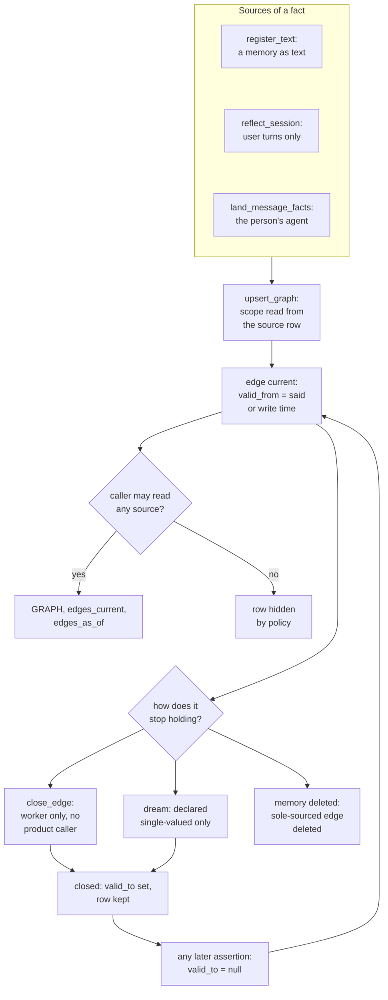

## 1. Executive Summary

Percolate is a PostgreSQL extension from Percolation Labs in which agents,
workflows, runs and documents are rows driven from SQL. A Python worker and
an Agent Runtime over Pydantic AI do the outside calls. Its memory is a typed
graph: text memories and a user's conversation turns are read by an extractor
into edges that carry their sources and the interval over which they held.

What is notable is that a fact's visibility is read through the memory it
came from. An edge is readable only by a caller who may read one of the
resources or sessions in its provenance, so a fact merged from two people's
memories is visible to each through their own. Valid time and record time are
separate columns with a read that composes them, and deleting a memory deletes
the edges it alone asserted.

What is weak is ending a fact. Any later assertion of a closed edge reopens
it. Replacing a memory's text in place leaves the old text's facts current. In
the shipped vocabulary no relation is single-valued, and the one function that
closes a single fact at a stated time has no caller outside tests and
examples.

**Licence.** MIT, and the code carries no restriction. The term that travels
is in the sample data: `dev/examples/advanced-walk/samples/beam/` and
`dev/examples/muddling-through/samples/beam/` hold BEAM-derived files under
CC BY-SA 4.0, whose share-alike clause attaches to anything built from them.
The QASPER-derived questions are CC BY 4.0. The root `LICENSE` names
Percolation Labs and `core/LICENSE` names "Percolate". `core/` is a mirror of
a separate repository, percolate-core, overwritten on each sync, so its terms
are that repository's as copied here. `CONTRIBUTING.md` asks for no
contributor agreement.

## 2. Mental Model

A memory is one of three things the graph reads facts out of: a **resource**
registered as text (`content.register_text`), an uploaded file, or a
**session's user turns**. The belief itself is an `aiq.edges` row: a subject
node, a relation from a closed vocabulary, an object node, a weight,
`valid_from` and `valid_to`, and `provenance.sources`, one entry per reading
with its resource or session, message ids, agent, run and time
(`specs/world-model-ingestion/graph.sql:1166-1177`). Edge identity is
`(src_id, dst_id, relation)`, so the same fact from two memories is one row
with two sources (`specs/ai-query-layer/schema.sql:335-374`).

A fact becomes current when an extractor lands it through `aiq.upsert_graph`.
It holds from when its source was said if the writer knows that, otherwise
from the write. Names the extractor cannot resolve exactly become **soft
nodes**, private to the memory's owner where the memory is private, until a
reconcile pass or a judge binds them to a typed node.

A fact stops holding in four ways, and only one removes it:

- **Closed at a stated time.** `aiq.close_edge` sets `valid_to` on exactly one
  current edge and records who closed it and when (`graph.sql:1326-1374`).
- **Superseded by dream.** For a relation declared `single_valued`, every
  current edge but the newest per subject ends where the next begins
  (`graph.sql:1904-1923`).
- **Withdrawn.** `aiq.retract_derived` ends what one agent asserted; a
  withdrawn period is a record-time end and drops out of every as-of read
  (`specs/ai-query-layer/schema.sql:605-654`, `:695`).
- **Deleted with its memory.** Deleting a resource strips its entries from
  every edge's sources and deletes the edges left with none
  (`graph.sql:1474-1506`).

Every other `DELETE` or `TRUNCATE` on `aiq.edges` is refused by a trigger
(`graph.sql:1392-1405`). A closed fact is not final. The upsert's conflict
branch sets `valid_to = null` on any re-assertion, from any source, and drops
the `closed` record (`graph.sql:1201-1261`). A fact is ground truth as soon as
it lands: no state marks it as a candidate.

A separate memory lives in the clue walk, which keeps per-document verdicts
from earlier walks and reads them as of a past run's start
(`dev/tests/query/44-a-walk-reads-its-memory-as-of-a-past-start.sql`). It was
read here only to that cutoff.

## 3. Architecture

The extension is pure SQL generated from `specs/` by
`extension/percolate/build-sql.py`, plus a Rust `percolate_parser` extension
for P8QL compiled with pgrx. It installs into PostgreSQL 19 as a
non-superuser, so row-level security holds against the application role.
pgvector holds one table per registered embedding model, and pg_trgm backs
fuzzy lookup.

The processes around it hold no state of their own. The Python worker in
`core/` claims workflow tasks with `SKIP LOCKED`, calls models and embedders,
and writes results back. The Content Server takes uploads into object storage.
The Agent Runtime runs an agent turn from the agent's row. An MCP server
fronts PostgREST with a P8QL `query` tool and, when it runs without connector
keys, six memory tools (`core/percolate_core/query/mcp.py:731-760`).

Standing it up means Docker Compose or a Helm chart from a separate
get-percolate repository, or the two extensions installed into an existing
PostgreSQL 19. An embedding provider is needed for vector search and a model
provider for extraction; `register_text` and the lexical half of `aiq.search`
work without either. The store is ordinary tables, readable and repairable in
psql.

## 4. Essential Implementation Paths

- **Register a memory.** `content.register_text` keys on
  `(channel, external_id)`, writes owner, org and visibility from the caller,
  records chunks, and starts the channel's `ingest_workflow` if it has one
  (`specs/world-model-ingestion/schema.sql:557-683`). Re-registering changed
  text appends the old text to `metadata.replaced` and re-chunks (`:653-661`);
  the first `p_metadata`, including `said_at`, is kept (`:635-637`).
- **Extract from a document.** `content.install_ingest_workflow` with graph
  indexing adds a matrix over windows to the upload pipeline. Each child calls
  the extractor agent, and `content.land_graph_windows` drops out-of-range and
  off-vocabulary edges, counts them, and calls `upsert_graph` with the
  resource and its `said_at` (`specs/world-model-ingestion/ingestion.sql:296-436`).
- **Extract from a conversation.** `reflect_session` windows each user
  message as `<speaker> wrote: <words>` and lands each with the session id,
  the message id and its `created_at` as `valid_from` (`ingestion.sql:1055-1087`,
  `:394-401`). Assistant turns are not windows.
- **The person's agent extracts.** `agentic.land_message_facts` refuses a
  message the caller may not read or one the assistant wrote, and lands the
  graph as `agent:<user id>` (`ingestion.sql:1143-1176`).
- **Land.** `aiq.upsert_graph` validates, reads org, visibility and owner from
  the named resource or session and refuses a context org that disagrees,
  takes advisory locks in key order, resolves each node, and upserts edges
  (`graph.sql:651-1303`).
- **Reconcile.** `aiq.dream` supersedes single-valued relations, promotes soft
  nodes whose key exactly matches one typed node, and queues the rest as
  `bind` judgements (`graph.sql:1868-1998`).
- **Read.** `aiq.query` dispatches P8QL; `aiq.search` fuses full-text and
  vector ranks (`specs/ai-query-layer/schema.sql:4287-4410`);
  `aiq.graph_neighbors` reads `edges_current` or, with `AS OF`,
  `edge_periods` (`:1914-1930`).
- **Delete.** `trg_forget_deleted_sources` on `content.resources`
  (`graph.sql:1474-1506`); chunk vectors go by `trg_forget_vectors`.

## 5. Memory Data Model

`content.resources` carries `owner_id`, `org_id` and `visibility`, a channel,
`external_id`, and `metadata` holding the caller's `said_at`, `agent`, `run`
and the `replaced` list. Its chunks hold the text, and each embedding space is
a table keyed by chunk.

`aiq.nodes` carries an entity type, org, visibility and owner. A soft node is
a candidate identity keyed `(org_id, claimed_kind, key)`. `aiq.edges` holds
the relation, a weight from the vocabulary's `machine_weight`, `valid_from`
defaulting to `now()`, a nullable `valid_to`, `provenance`, `org_id`,
`created_at`, and `recall_count` and `probe_count`, which a read path bumps
through `aiq.note_recall`. `aiq.edge_retractions` records each interval a
revived edge did not hold (`specs/ai-query-layer/schema.sql:544-594`).

`aiq.judgements` is the queue for cases a rule cannot decide: `bind`, `merge`,
`withdraw`, `challenge` and `link`, with status `open`, `claimed`, `to_human`,
`decided` or `moot`, a verdict, a reason, the decider and a tier
(`graph.sql:2042-2066`). `aiq.node_distinctions` records a pair of nodes
decided distinct, which refuses a later promotion between them.

Conversation history is `agentic.sessions` and `agentic.messages`, windowed
and summarized per branch. It is session state that `reflect_session` reads,
not the memory.

## 6. Retrieval Mechanics

Retrieval is tool-mediated. The Agent Runtime does not inject memory into a
turn: `core/percolate_core/agentic` contains no reference to an `aiq.`
relation. An agent reads memory through the P8QL MCP tool, a workflow `p8ql:`
step, or SQL. `SEARCH` over chunks fuses full-text and vector ranks by
reciprocal rank fusion and returns memory text. `BY AGENT` and `BY RUN` become
a join on the resource's metadata inside each half, so the limit counts only
rows in scope (`specs/ai-query-layer/schema.sql:3895-3926`).

`GRAPH` walks typed edges from a node. A current read goes through
`aiq.edges_current`, whose predicate is the one currency rule
`aiq.edge_is_current` (`schema.sql:426-448`). `GRAPH ... AS OF` reads
`aiq.edge_periods`, which cuts revived edges' holes out and leaves withdrawn
periods out (`schema.sql:605-654`). `aiq.edges_as_of(valid_at, known_at)`
returns the edges recorded by `known_at` that held at `valid_at`, counting an
end only if it was recorded by `known_at` (`graph.sql:1425-1451`).

Text search and the graph do not consult each other. `aiq.search` reads no
edge or validity column (`schema.sql:4287-4410`), so "Maya lives in Leeds"
stays a search hit after the Leeds edge is closed. The project's own memory
eval applies the validity filter in the harness's SQL, not in a product read
(`dev/evals/memory/percolate_run.py:222-236`).

## 7. Write Mechanics

`register_text` is a synchronous write as the caller; chunks are searchable by
text when it returns. Extraction is a workflow: a matrix of model calls
rate-limited to a bucket of 20 refilling at one per second, then a SQL
fan-in. A memory's facts land seconds to minutes after it is registered,
depending on the queue, and nothing blocks the agent's turn. Dream, once
scheduled, runs every 15 minutes by default over subjects with an edge created
or dated since the last run (`graph.sql:2855-2883`, `:1904-1909`).

The machine path never matches fuzzily. `upsert_graph` defaults `fuzzy` to
false (`graph.sql:684`), and `aiq.resolve_ref` returns a miss for a key that
names two nodes at the nearest scope (`graph.sql:580-640`), so an unknown or
ambiguous name becomes a soft node rather than a bind to a near one.
Concurrent landings take advisory locks on node keys in sorted order, a fix for
a deadlock measured with eight workers (`graph.sql:880-889`).

**A re-assertion revives a closed fact.** The conflict branch appends the new
source, drops `closed`, sets `valid_to = null` and keeps the earliest
`valid_from` (`graph.sql:1201-1261`). The dedup key suppresses only a
duplicate source entry; the revival happens on every assertion. Where dream
has ended "Maya lives in Leeds", re-running `reflect_session` over the
conversation that said it reopens the edge. Dream does not catch this: its
supersession selects subjects whose edges have `created_at` or `valid_from`
after the watermark (`graph.sql:1904-1909`), and a revival changes neither
column.

**Replacing a memory's text does not reach the graph.** `register_text` keeps
the old text in `metadata.replaced` and starts a new extraction run for the
new text (`schema.sql:653-670`). Nothing in `specs/` reads `replaced` or
`text_hash` to withdraw what the old text yielded, so the old facts stay
current, citing a memory whose text no longer says them.

**Who ends a fact in a default deployment.** `close_edge` is granted to the
worker role and has no caller in `specs/` or `core/` (`graph.sql:1326`,
`:3150`). The default vocabulary declares no relation `single_valued`
(`graph.sql:3365-3382`), so dream supersedes nothing until a deployer
declares one, and `aiq.schedule_dream` has no caller in the tree. The Zep and
advanced-memory tutorials declare single-valued relations in their own setup
blocks. A conversation stating a move leaves both homes current.

## 8. Agent Integration

The MCP server's memory tools are `read_session`, `land_message_facts`,
`list_judgements`, `claim_judgement`, `decide_judgement` and
`release_judgement`, each a pass-through to the SQL function as the caller
(`core/percolate_core/query/memory_tools.py:30-115`). They are listed only
when the server runs without connector keys and forwards the client's own
`Authorization` (`mcp.py:736-738`); a per-user connector key allows only
`query` and the canvas tools (`core/percolate_core/query/connector_auth.py:24-44`).

The person's agent is therefore the extractor and the judge.
`decide_judgement` always sends `p_tier: "agent"` (`memory_tools.py:106`) and
may bind a soft node to a typed one, mark them distinct, or hand the case to a
person with `{"decision": "human"}`. The P8QL tool runs plain SQL in a
read-only transaction (`specs/ai-query-layer/schema.sql:4510`), so it cannot
write memory.

Adapting it to another agent means pointing that agent at the MCP server or at
PostgREST. The memory is SQL, so any client with a token reaches the same rows
under the same policies.

## 9. Reliability, Safety, and Trust

### Scope

The read gate is the source, not the writer's context. `upsert_graph` reads
the org, visibility and owner of the named resource or session and refuses a
context org that disagrees (`graph.sql:777-833`). The edge policy
`edges_via_endpoints` requires both endpoints readable and
`aiq.edge_sources_readable`, which is true when the caller may read any
resource or session in `provenance.sources` (`graph.sql:3287-3317`).
Resources carry the generated scope policy over owner, org and visibility
(`specs/world-model-ingestion/integration.sql:324`,
`specs/user-rbac/schema.sql:1075-1083`, `:1556-1589`).

The policy is row-level. A caller who reads a merged edge through their own
memory receives the whole `provenance` column, including the other memory's
`resource_id`, agent, run and times. The scope test asserts that the second
owner reads the shared row
(`dev/tests/rbac/21-a-fact-is-read-through-its-memory.sql:185-201`).

### What a delete reaches

Deleting a resource removes its chunks, its vectors, and the edges it alone
asserted, and strips it from edges others also assert
(`dev/tests/content/12-mem0-quickstart.sql:301-351`). Soft nodes it created
remain. The extraction run's task rows keep the model's graph JSON until
`workflow.purge_completed` removes completed runs, 30 days by default
(`specs/workflow-engine/schema.sql:8250-8252`).

### Identity merges

Dream binds a soft node only on an exact key match within its kind and org.
Everything else becomes a `bind` judgement, which the agent can claim and
decide. A wrong bind can be undone by name through `aiq.unresolve_node`, and
`aiq.node_distinctions` keeps a decided pair apart.

### Marks

- **`scope_enforced`** — awarded on row policy over stored owner, org and
  visibility, applied to every edge through its sources and to every chunk
  through its resource. Agent and run are caller-chosen search predicates on
  top.
- **`bitemporal`** — awarded. `valid_from` comes from the message's
  `created_at` on the conversation path and from the resource's `said_at` on
  the document path, beside the edge's `created_at` and the close's recorded
  instant, and `edges_as_of` composes them. An upload passes metadata `"{}"`
  (`core/percolate_core/content/server.py:153-156`), so a file's facts hold
  from the extraction. The stated-time close has no product caller.
- **`negative_eval`** — awarded; see section 10.
- **`tombstone`** — withheld. A closed or withdrawn edge revives on any
  re-assertion, and `node_distinctions` is keyed on a pair of node ids, which
  blocks a merge and not a value.
- **`trust_state`** — withheld. A fact has no status; it is current or closed,
  which is validity. Edge `weight` and `aiq.source_reliability` are numbers.
  Judgement status belongs to the queue item, and the facts of an open case
  are served. `claims.bears_on` carries `proposed`, `confirmed` and
  `disputed` on a link between a fact and a research question, and its reads
  drop `disputed` (`specs/claims/schema.sql:1441-1448`, `:1566-1575`). The
  link is an annotation; the fact it points at carries no state.
- **`human_review`** — withheld. Facts are served when they land, and the
  judgement queue is decided through `decide_judgement`, which the agent
  holds. `claims.review_bears_on` refuses any caller `rbac.current_actor()`
  does not call a person (`specs/claims/schema.sql:1529-1531`), a verified
  principal check, but it reviews the link, and a proposed link is returned
  by both reads before review.
- **`audit_log`** — withheld. Edges are updated in place: sources are
  appended, `valid_to` set and cleared. `edge_retractions` records only holes
  a revival closed, and judgements and node resolutions record identity
  decisions, not fact mutations. The append-only `claims.tx` belongs to the
  research claims layer.

## 10. Tests, Evals, and Benchmarks

The SQL suite is 240 files across six surfaces, rbac, query, workflow,
content, agentic and research, each one transaction that rolls back.
`dev/check.sh` runs them against a database built from the tree, and
`.github/workflows/check.yml` runs it on push, pull request and nightly. A
file can be deferred when it needs a newer parser or core than the image has,
and the runner names each deferral. The 615 pytest functions in `core/tests`
are not run by this repository's CI. I ran none of it.

`negative_eval` rests on three populated cases:

- `dev/tests/content/12-mem0-quickstart.sql:141-160` asks as Maya for the
  coach's memories where the planner's outrank them and requires exactly the
  coach's two; agent and run together must narrow to their empty overlap.
- `:301-351` deletes one memory and requires its diet edge gone while the
  `works_at` edge a second memory also asserted stands on the survivor alone,
  and a non-owner's delete removes nothing.
- `dev/tests/content/13-mem0-agent.sql:84-90` requires `GRAPH` now to equal
  exactly Lisbon and Harbour Health, so the closed Leeds edge is excluded
  beside live edges, and `AS OF` March to equal Leeds.

Scope has its own file asserting that another user, with or without a shared
org, reads no node, edge or document node from a private memory, through the
table, `GRAPH` and the walk
(`dev/tests/rbac/21-a-fact-is-read-through-its-memory.sql`). No test
re-asserts a closed fact and checks it stays closed, and none replaces a
memory's text and checks the old facts.

`dev/evals/memory/` compares Percolate with Mem0 and Graphiti on a 48-fact,
46-question fixture with a shared embedder and no judge. I recomputed hit@1
and recall@5 from the committed `ranked.jsonl` against `fixture.json` with my
own script: `percolate-valid` is 35/46 (76%) and 87%, and
`percolate-search` 24/46 (52%) and 80%, as `scores.txt` states. In that
row the facts are written from the fixture's triples, `valid_from` and
`valid_to` are set by operator `UPDATE` from the fixture's answer key, and the
validity filter is the harness's SQL (`percolate_run.py:142-148`, `:222-236`).
The README states each of these. Its extraction run, with Percolate's own
extractor and dream inferring supersession, records 59% and 74% for
`percolate-valid-dream` (`dev/evals/memory/scores-extract-full.txt`). No paper
is associated with the project; the arXiv ids in the tree name the BEAM and
QASPER datasets and the sources of design notes.

## 11. For Your Own Build

### Steal

- **Scope a derived fact by its source row.** Read owner, org and visibility
  from the memory the fact came from at write time, and refuse a caller's
  context that disagrees, instead of trusting what the extractor passes.
- **Gate a merged fact through any of its sources.** One row per fact with a
  list of sources, readable when the caller may read one of them, lets two
  people's identical facts share a row without either reading the other's
  memory text.
- **Delete by refcount.** A memory's delete strips its entry from every fact
  it supported and deletes only the facts left with none.
- **Take evidence about the user only from what the user wrote.** The
  assistant's restatement never becomes a fact.

### Avoid

- **Revival without a guard.** If a fact's identity is the triple, a closing
  must survive a later assertion from a source it already superseded, or a
  reconciliation that ran once is undone by the next import.
- **A watermark on creation time for a pass that repairs updates.** A scan
  that selects by `created_at` misses every row that changed in place.
- **An in-place edit that does not reach what was derived.** Keep the old
  text, and also withdraw the facts extracted from it.

### Fit

This suits a team already running PostgreSQL that wants memory, workflows and
permissions in one database, with row policies doing the scoping. The memory
is a well-scoped, dated fact graph with careful deletion. Its correction story
needs deployer work: declare which relations are single-valued, schedule
dream, and route supersession through `close_edge`. Walk away if you want
memory that settles conflicts on its own, or a review step before a fact is
served. Walk away too if you cannot run PostgreSQL 19 with custom extensions.

## 12. Open Questions

- Whether a re-assertion of a superseded fact from its original source is
  meant to revive it, given that `close_edge` is documented as ending exactly
  the fact a memory replaced.
- Whether the full `provenance` of a merged edge is meant to be visible to
  every reader who reaches the row through one source.
- Whether the get-percolate deployment schedules dream and declares
  single-valued relations by default; this tree does neither.

## Appendix: File Index

- Graph memory: `specs/world-model-ingestion/graph.sql` (`upsert_graph`,
  `resolve_ref`, `close_edge`, `edges_as_of`, `forget_deleted_sources`,
  `dream`, `judgements`, `edge_sources_readable`),
  `specs/ai-query-layer/schema.sql` (`aiq.edges`, `edge_is_current`,
  `edges_current`, `edge_retractions`, `edge_periods`, `retract_derived`,
  `scoped_source`, `search`, `graph_neighbors`),
  `specs/ai-query-layer/reliability.sql`
- Writers: `specs/world-model-ingestion/schema.sql` (`register_text`),
  `specs/world-model-ingestion/ingestion.sql` (`land_graph_windows`,
  `session_windows`, `land_message_facts`, `install_reflect_workflow`)
- Scope: `specs/user-rbac/schema.sql` (`may_read`, `add_scope_policy`,
  `current_actor`), `specs/world-model-ingestion/integration.sql`
- Agent surface: `core/percolate_core/query/mcp.py`,
  `core/percolate_core/query/memory_tools.py`,
  `core/percolate_core/query/connector_auth.py`,
  `core/percolate_core/content/server.py`
- Claims links: `specs/claims/schema.sql` (`bears_on`, `propose_bears_on`,
  `review_bears_on`)
- Tests and evals: `dev/tests/content/12-mem0-quickstart.sql`,
  `dev/tests/content/13-mem0-agent.sql`,
  `dev/tests/rbac/21-a-fact-is-read-through-its-memory.sql`,
  `dev/tests/query/46-a-fact-is-read-on-both-clocks.sql`, `dev/evals/memory/`

### Recorded searches

Run from the repository root at the pinned commit with `/usr/bin/git grep`.

- **`close_edge` has no product caller.**
  `git grep -n -E 'close_edge\(' -- specs core` matches only its definition at
  `specs/world-model-ingestion/graph.sql:1326`, the revoke at `:3116` and the
  grant at `:3150`; the same pattern over `dev` matches tests and tutorial
  blocks.
- **The default vocabulary declares no single-valued relation.**
  `git grep -n -E '"single_valued"' -- specs core` returns nothing; the same
  pattern over `dev/examples` matches the advanced-memory and Zep setup blocks.
- **Nothing reads a replaced text.**
  `git grep -n -E "metadata->'replaced'|text_hash" -- specs core` matches only
  `register_text` at `specs/world-model-ingestion/schema.sql:634-656`.
- **Text search reads no validity.**
  `sed -n 4287,4410p specs/ai-query-layer/schema.sql | grep -c -E 'edge|valid_'`
  counts 0; the same count over `aiq.graph_neighbors` at lines 1914-1975 is 9.
- **The Agent Runtime reads no memory relation.**
  `git grep -n 'aiq\.' -- core/percolate_core/agentic` returns nothing;
  `git grep -c 'aiq\.' -- core/percolate_core/query/mcp.py` counts 16.
- **An upload carries no `said_at`.**
  `git grep -n -i 'said_at' -- core/percolate_core/content` returns nothing;
  `git grep -c 'said_at' -- specs/world-model-ingestion/ingestion.sql` counts 5.
- **Dream is never scheduled in the tree.**
  `git grep -n -E 'schedule_dream\(' -- specs core` matches only the definition
  at `graph.sql:2855` and the revoke at `:3128`.
- **No value-keyed rejection on the graph.**
  `git grep -n -i -E 'tombstone|rejected_value|blocked_value|never_again' -- specs core`
  matches only erasure records in `specs/claims` and
  `specs/research-platform` and snapshot bytes at
  `specs/world-model-ingestion/schema.sql:1373`.
- **This repository's CI runs no pytest.**
  `git grep -n -E 'core/tests|pytest' -- .github dev/check.sh` returns nothing;
  `git grep -c 'dev/tests' -- dev/check.sh` counts 8.
- **No paper.** The tree has no `CITATION.cff`, and
  `git grep -l -i -E 'arxiv|bibtex|@article|@misc'` lists BEAM and QASPER
  sample files, the generated extension SQL and design notes under `specs/`.

## History

**2026-11-20** — [`2bb9b3bd6b6ca5ec19a9718fe751d0ffe024ba7b`](https://github.com/Percolation-Labs/percolate/commit/2bb9b3bd6b6ca5ec19a9718fe751d0ffe024ba7b) — first reading, from a full clone of `main` at extension version 0.2.45, scoped to the graph memory, its writers from text, uploads and conversations, its scope policy, reconciliation and judgement queue, the MCP memory tools and their tests; the workflow engine, research claims and walk were read only where they touch those paths. Screened first: no auto-run, build-time execution or unpinned surface; four manifests inside the seven-day cooldown, and an uninstalled pre-push hook. MIT. Nothing installed, built or run; I recomputed the memory eval's scores from its committed ranked file. Three marks: `bitemporal`, `scope_enforced`, `negative_eval`.
