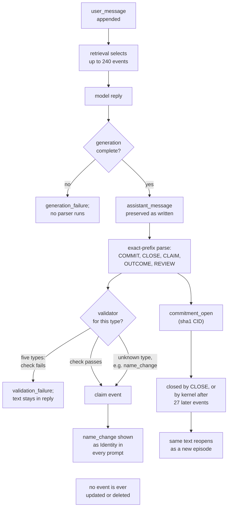

## 1. Executive Summary

Persistent Mind Model (PMM) is a single-user Python agent runtime that wraps a
language model in an event ledger. Every user message, reply, commitment,
claim, concept operation and reflection is a row in one SQLite table. Each turn
it rebuilds three projections from that table, retrieves a bounded slice of
it, and parses the model's exact-prefix control lines into new events.

What is notable is how strictly it keeps layers apart. The assistant's text is
preserved before any parser runs; a structured line that fails validation
becomes a typed `validation_failure`, not silence; and a claim may cite
evidence only if retrieval selected that event this turn. Writes go through a
fenced single-writer lease, and every projection can be replayed from the log.

What is weak is correction. The ledger has no delete and no forget, so a user
cannot remove anything they said. The identity line injected into every prompt
comes from `name_change` claims, which pass validation as an unknown type. The
hash chain is checked for linkage only, never re-derived.

**Licence.** PMM-1.0 §1 defines a Derivative Work as *"any modification,
extension, or system implementing or inspired by PMM principles"*, and §3 puts
every Commercial Use, including use for *"organizational benefit"*, behind a
signed agreement. A reader who builds an event-sourced memory after reading
this code is therefore told a licence may be owed; §5 claims the disclosure
covers *"any system that maintains AI identity, memory, or agency through
append-only cryptographic event logs"*. The §2 non-commercial grant is
*"revocable"*, and §9 lets the licensor amend it. §2 does permit publishing
analyses. §8 accepts contributions only under a CLA whose link the tree does
not contain.

## 2. Mental Model

PMM's memory is history, not facts. Nothing is extracted from a conversation
into a profile; the user's messages and the model's replies stay as events,
and everything else is a further event the model or the runtime appended about
them. The system prompt states the premise: *"There is no you outside E"*,
where E is the ledger (`pmm/runtime/prompts.py:18-47`).

Four kinds of thing can become state.

- **A commitment** opens when the model writes `COMMIT: <text>`; its CID is the
  first 8 hex digits of `sha1(text)` (`pmm/core/commitment_manager.py:97`). One
  CID has at most one active open. `CLOSE: <cid>` closes it, and the same text
  later opens a new episode under the same CID. The autonomy kernel also closes
  any open commitment followed by more than 27 events
  (`pmm/runtime/autonomy_kernel.py:107`, `:661-674`).
- **A claim** is a `CLAIM:<type>=<json>` line. Five types are checked against
  the ledger or the Mirror; any other type is accepted with code
  `ACCEPTED_UNKNOWN_TYPE` (`pmm/core/validators.py:172-206`). An accepted claim
  becomes a `claim` event; a rejected one becomes `validation_failure`, while
  the reply that carried it stays in history.
- **An identity** is adopted when the model proposes a token, the runtime
  appends an anchor reflection, and the model ratifies it on a later turn
  (`pmm/core/identity_manager.py:29-155`). All three acts come from the same
  model.
- **A concept** is defined, aliased, related or bound to events through a
  `concept_ops` header the model emits, or by runtime fallbacks. A later define
  for the same token replaces the current definition in the projection
  (`pmm/core/concept_graph.py:154-190`).

Nothing dies. A closed commitment's episode stays retrievable as history, a
rejected claim stays in the reply that made it, and a replaced concept
definition stays in `concept_history`. The ledger is treated as ground truth
for *what was said*; the code is explicit that a validated event is not a
proved one. The commitment-outcome policy says recording an outcome *"does not
mean PMM has proved the observation true"*
(`docs/commitment-outcome-later-review-policy.md:16-18`).

## 3. Architecture

PMM is a library with three entry points: `pmm` (interactive), `pmm-turn`
(one turn, JSON out) and `pmm-codex`, which registers the STDIO MCP server with
Codex CLI (`pyproject.toml:29-32`). All of them open one SQLite file through
`EventLog`. Model calls go to Ollama or OpenAI, or to a deterministic dummy
adapter.

`EventLog` owns the database. Its `events` table has `id`, `ts`, `kind`,
`content`, `meta`, `prev_hash` and `hash` (`pmm/core/event_log.py:284-293`).
Beside it sit a writer lease, a projection-status table, and four registries
recording which events are the authoritative terminal outcome, commitment
outcome, review or reinterpretation (`:347-422`). A writer acquires the lease
with a fencing token; a `BEFORE INSERT` trigger aborts any insert whose
connection does not hold an unexpired lease (`:434-451`). Leases last 30
seconds with a 5-second heartbeat (`:207-208`).

`RuntimeLoop` rebuilds three projections at start and registers each as a
required listener: `MemeGraph`, a networkx graph of message, commitment and
reflection links; `Mirror`, open commitments and stale flags; and
`ConceptGraph`, concepts and bindings (`pmm/runtime/loop.py:271-306`). A
projection that fails to rebuild or to consume an event fails the managed
operation closed.

### Deployment and ergonomics

It needs Python, `networkx`, `openai` and `mcp`, and either a local Ollama or
an OpenAI key; the dummy adapter runs with neither. Install is `pip install -e
".[full,dev]"`. Everything is local and offline with Ollama. The store is a
SQLite file a person can query by hand, and `scripts/export_session.py` dumps
it. Only one writer may hold a database at a time, and the README warns
against concurrent one-shot writers.

## 4. Essential Implementation Paths

- **Turn.** `RuntimeLoop._run_turn_serialized` appends the `user_message`,
  runs `run_retrieval_pipeline`, renders the prior completed pair and the
  context, calls the adapter, and appends either `assistant_message` or
  `generation_failure` as the turn's single terminal outcome
  (`pmm/runtime/loop.py:616-958`).
- **Structured effects.** After the reply is stored, the loop compiles concept
  ops, parses `REF:` lines, appends `retrieval_selection` and `metrics_turn`,
  synthesises a reflection, summary and lifetime-memory chunk when thresholds
  are met, then opens commitments, validates claims, derives identity
  adoptions, applies closures and validates outcome and review candidates
  (`:1018-1309`).
- **Append.** `EventLog._append_owned` routes commitment, identity-adoption,
  outcome, review and reinterpretation kinds to governed transactions, rejects
  unknown kinds, checks a `forbid_sources` policy for four sensitive kinds, and
  inserts with `INSERT OR IGNORE` on the digest (`pmm/core/event_log.py:742-1066`).
- **Retrieve.** `run_retrieval_pipeline` seeds concepts, selects bound events
  and threads, refines with the hash-vector stage, pins lifetime-memory chunks,
  expands one hop in `MemeGraph`, selects commitment episodes, and merges with
  per-event reason tags (`pmm/retrieval/pipeline.py:91-736`).
- **Render.** `render_context_with_metrics` writes the concept story, threads,
  graph, identity and open commitments, retrieval provenance and raw evidence
  (`pmm/runtime/context_renderer.py:225-276`).
- **MCP.** `pmm_status`, `pmm_read_events` and `pmm_get_event` open the ledger
  read-only; `pmm_turn` runs `pmm.runtime.oneshot_cli` in a subprocess with a
  240-second timeout (`pmm/runtime/mcp_server.py:48-187`).

## 5. Memory Data Model

Every memory is an event row; there is no second table of facts. `meta` is
canonical JSON and carries the relationships: `about_event` from a reply to its
user message, `cid` and `open_event_id` on commitment events, `origin_event_id`
from a structured effect to the reply that produced it, and binding
attribution (`model_declared`, `operator_declared`, `runtime_*`) on concept
bindings (`pmm/core/binding_attribution.py`).

Temporal data is one field, `ts`, stamped at insert. The digest deliberately
excludes it, so two runs that produce the same content hash alike
(`pmm/core/event_log.py:1006-1014`). Ordering, not time, carries meaning:
commitment outcomes are validated on event-id order
(`docs/commitment-outcome-later-review-policy.md:53`), and so is identity
adoption.

There is no scope key on any record. The identity subject is the constant
`pmm.self` (`pmm/core/identity_adoption.py:16`). Isolation between minds is a
separate database file.

Three derived tiers sit on top of the raw events. `summary_update` is an
identity summary after three reflections or more than ten events;
`lifetime_memory` is a deterministic chunk every 120 events, listing top
concepts, commitments opened and closed, and up to 32 sampled messages with
their ids (`pmm/runtime/lifetime_memory.py:23-24`); `retrieval_selection`
records what each turn selected and why.

## 6. Retrieval Mechanics

Retrieval is deterministic and runs on every turn. It returns event ids, never
a ranked list of facts.

- **Concept seeding.** `CTLLookupInjector` matches query words against every
  concept token by full or suffix match, plus a five-word synonym map to
  `user.identity` (`pmm/runtime/ctl_injector.py`). `user.identity` is sticky,
  and tokens with `identity.`, `role.`, `policy.`, `commitment.` or
  `governance.` prefixes are force-included (`pmm/retrieval/pipeline.py:30-67`).
- **Concept and thread selection.** Events bound to seeded concepts, and the
  current episode of each CID bound to them.
- **Vector refinement.** `DeterministicEmbedder` sums a sha256-derived vector
  per whitespace token and normalises it (`pmm/retrieval/vector.py:20-63`), so
  the cosine is a hashed bag-of-words overlap with no learned model. It
  re-embeds candidate content on every call; the stored `embedding_add` rows
  feed only status commands and dedup, and `build_index` has no caller.
  Message refinement considers only `user_message` and `assistant_message`
  (`:80-84`).
- **Summaries.** The two newest `lifetime_memory` chunks are pinned with their
  sampled message ids, plus the earliest chunk naming each seeded concept.
- **Episodes.** A concept-to-CID link selects only the current episode. An
  older episode is added only when an independently selected event belongs to
  it, capped at two episodes of twelve events each
  (`pmm/retrieval/pipeline.py:38-39`, `:495-501`, `:520-522`).

The budget is a count: `limit_total_events` starts at 120 and grows with
`log1p` of ledger size to a cap of 240 (`:34`, `:52`). Evidence is rendered as
`[id] kind: content`, each truncated to 300 characters
(`pmm/runtime/context_renderer.py:557-586`). No token budget is computed.

The rendered context precedes the base prompt in the system message
(`pmm/runtime/loop.py:735`), so the part that changes every turn sits at the
front, where a provider's prefix cache would need it to be stable.

## 7. Write Mechanics

The model writes memory by emitting control lines after its prose:
`COMMIT:`, `CLOSE:`, `CLAIM:`, `REFLECT:`, `COMMITMENT_OUTCOME:`,
`COMMITMENT_REVIEW:` and `REFLECTION_REINTERPRETATION:`, plus an optional JSON
header with `concepts` and `concept_ops` (`pmm/runtime/prompts.py:55-66`).
`REF:` lines are parsed too. Parsers run only on a `complete` generation
already stored as `assistant_message`, so a truncated reply cannot open a
commitment.

When no concepts are declared, the loop binds the turn to
`identity.continuity` with origin `runtime_continuity_fallback`; on turns where
the ledger count is a multiple of 37 past 20 it seeds three ontology tokens
instead (`pmm/runtime/loop.py:653`, `:915-926`). Validated claims are
auto-bound to a concept named after their type.

Writes are synchronous and block the turn: each is its own `BEGIN IMMEDIATE`
transaction, and a new event is retrievable on the next turn. There is no LLM
extraction pass; reflections, summaries and lifetime chunks are deterministic.
Two full-ledger reads run on every turn regardless of size:
`maybe_append_identity_adoptions` reads all events
(`pmm/core/identity_manager.py:43`), and appending the per-turn
`retrieval_selection`, a policy-sensitive kind, scans the whole ledger for
the latest policy (`pmm/core/event_log.py:957-995`). That policy check fails
open if the policy cannot be read (`:994`).

There is no update and no delete. A commitment closes and reopens; a concept
is redefined by a later define, and the `supersedes` field that define may
carry is stored and serialised but never branched on.

## 8. Agent Integration

PMM is the agent, not a memory for one. Its MCP server exposes the ledger to
another agent: three read-only tools page events and fetch one in full, and
`pmm_turn` runs a whole PMM turn with PMM's configured model
(`pmm/runtime/mcp_server.py:48-187`). `pmm-codex` registers that server with
Codex CLI (`pmm/runtime/codex_cli.py`). The calling agent therefore talks to a
second mind; it does not store its own memories in PMM.

Inside PMM, the model has broad agency over its memory and no tools: it writes
by emitting text lines, and the runtime decides what each line becomes. Its
reads are automatic. Autonomy is on by default in the interactive CLI and off
in `pmm-turn` and MCP (`pmm/runtime/oneshot_cli.py:181-187`). With it on, a
supervisor appends `autonomy_stimulus` every ten seconds, and each stimulus
appends at least an `autonomy_tick` and an `outcome_observation` before or
after the kernel reflects, summarises or indexes (`pmm/runtime/loop.py:323-336`,
`:1354-1420`). Because auto-closure counts events, an idle interactive session
ages its open commitments toward closure.

The repository ships an auditing skill for coding agents that work on PMM
itself (`.agents/skills/pmm-development-auditor/`); it governs development,
not memory.

## 9. Reliability, Safety, and Trust

### What validation covers

Claim validation checks evidence ids for existence and, in the managed loop,
for membership in this turn's retrieval selection
(`pmm/core/validators.py:144-170`). Type-specific checks exist for
`identity_proposal`, `identity_ratify`, `event_existence`,
`commitment_status` and `reference`. Every other type is accepted.

`render_identity_claims` builds the `Identity:` line of every prompt from
`claim` events of type `name_change` (`pmm/runtime/context_utils.py:19-45`),
which is not a validated type. The newest such claim wins. The identity
adoption protocol, the most guarded path in the tree, never feeds that line; it
feeds identity-concept bindings in `ConceptGraph`.

### What the ledger guarantees

The append path and the fenced lease are careful: a reply computed after the
writer lost its lease is discarded, not stored (`pmm/runtime/loop.py:740-748`).
The chain is weaker than the licence's *"cryptographically-chained"* suggests.
Nothing in SQLite prevents an `UPDATE` or `DELETE` on `events`; the test suite
itself edits `meta` in place to simulate legacy rows. `ledger_metrics` counts
`prev_hash` discontinuities but never recomputes a digest, so an edited
`content` with its `hash` left alone reads as intact
(`pmm/core/ledger_metrics.py:40-53`).

### What cannot be removed

The user has no way to delete a message, and the model has no way to retract
a claim. A rejected claim's text remains in its `assistant_message`, which
retrieval can select and the evidence renderer prints unfiltered; only the
prior-pair renderer strips control lines (`pmm/runtime/context_renderer.py:162-192`).

### A model-supplied path

`_parse_ref_lines` opens any path written in a `REF: <path>#<id>` line as a
read-only SQLite database and records whether that event exists, with its hash
(`pmm/runtime/loop.py:562-604`). The kernel's own reflection proposes
`../other_pmm.db#47` whenever a commitment is open
(`pmm/runtime/autonomy_kernel.py:686-691`).

### Marks

- **`audit_log`** — awarded. The `events` table is the store, every mutation is
  an insert, and no production path rewrites or removes an event. The limits
  are those above: immutability by convention, linkage-only checking, and a
  digest that omits `ts`.
- **`negative_eval`** — awarded; see section 10.
- **`trust_state`** — withheld. Four candidates have the shape and none is an
  epistemic status a read filters on. Claim versus `validation_failure` is a
  kind fixed at write; nothing later moves a claim, and the identity read takes
  an unvalidated type. Commitment open versus closed is an obligation's
  lifecycle; it decides which episode retrieval drags in, not whether a memory
  is believed. Authoritative versus non-authoritative outcomes, reviews and
  reinterpretations are structural provenance re-derived on read, and the
  policy says authority proves nothing about truth. Identity adoption is the
  model ratifying its own proposal.
- **`human_review`** — withheld. No surface puts a memory in front of a person
  before it takes effect; the CLI's `/pm` commands are configuration,
  checkpoint and backfill.
- **`tombstone`** — withheld. The identity-adoption path looks up an earlier
  `validation_failure` by attempted digest only to avoid writing a second
  failure record (`pmm/core/event_log.py:1703-1716`). No write path consults a
  rejected value.
- **`bitemporal`** — withheld. One `ts`, stamped at insert.
- **`scope_enforced`** — withheld. There is no scope key; one file per mind is
  a physical partition.

## 10. Tests, Evals, and Benchmarks

There are 551 pytest functions in 103 files. No CI workflow is committed, and
I ran none of them. The suites cover the governed append paths, writer
fencing, projection barriers, terminal outcomes, commitment episodes, claim
and evidence validation, identity adoption, retrieval provenance and the MCP
and one-shot entry points. The three files triage named,
`tests/test_ctl_injector.py`, `tests/test_concept_context.py` and
`tests/test_concept_metrics.py`, hold 486 lines on concept-token matching and
rendering.

`negative_eval` rests on
`pmm/tests/test_commitment_episode_retrieval.py:299-320`. One commitment is
opened and closed, the same text reopened, and the new episode bound to a
concept. Retrieval for that concept must return the current assistant event
and open and must not return the first episode's assistant event, open or
close. Vector search and summary pinning are disabled, so the absences are not
an empty result. The material excluded is an earlier episode, not a corrected
or out-of-scope value.

The hash chain has no failing case. `pmm/tests/test_metrics.py:26` and `:56`
assert `broken_links == 0` on ledgers nobody tampered with.

Two experiments are committed and marked nonproduction. The concept-authorship
channel's artifacts recompute as its README states: Gemma's spontaneous
appropriate authorship is 14/15 in
`conformance-025-reserved-template/report.json` and 7/15 once a current-turn
reference is required, in `conformance-03-turn-ref/report.json`, which records
`structural_and_behavioral_pass: false`. The continuity-fallback ablation
reports that its pilot failed its own diagnostic gate. No paper is associated;
the Zenodo record the README links, dated 28 November 2025, is a software
archive of v1.2 with no quantitative results.

## 11. For Your Own Build

### Steal

- **Store the reply before parsing it.** Make the terminal outcome one event
  per user message, and let structured effects only append after it, so a
  parser bug can never lose what the model said.
- **Type the failure.** When a structured line fails validation, append a
  `validation_failure` that cites the reply, rather than dropping it.
- **Bound evidence to what was retrieved.** Refuse a claim whose cited ids were
  not in this turn's selection; it stops a model citing events it never saw.
- **Fence the writer in the database.** A lease row and an insert trigger that
  checks owner and fence make a stale process fail loudly.

### Avoid

- **An accept-unknown default on the path that feeds the prompt.** A
  compatibility pass-through is harmless until a renderer reads one of the
  types it lets through.
- **A chain check that never re-hashes.** Linkage proves order, not content;
  verification has to recompute each digest and fail a test that tampers.
- **Staleness counted in events when idle ticks write events.** Measure age on
  the clock, or exclude the system's own heartbeats from the count.
- **A memory with no erasure.** An append-only log needs a redaction that keeps
  the row and records itself, or a user cannot withdraw what they said.

### Fit

This suits a researcher studying one long-running, self-describing agent who
wants every step of its self-model replayable. It does not suit memory for a
product. There are no users, no scopes, no deletion, and no facts extracted
for recall; the store grows with every heartbeat and every turn, with two
full-ledger scans per turn. Walk away too if a commercial use is likely: the
licence reaches systems *"inspired by"* this one.

## 12. Open Questions

- Whether `name_change` is meant to become a validated claim type, given that
  it is the one claim the prompt's identity line reads.
- How the ledger is meant to handle a user's request to forget, since the
  primer tells the model every message lives there *"forever"*.
- What the two full-ledger scans cost per turn at the multi-thousand-event
  sizes the Zenodo record mentions; nothing committed measures it.
- Where the CLA named in §8 of the licence is published.

## Appendix: File Index

- Ledger and writer: `pmm/core/event_log.py`, `pmm/core/writer_session.py`,
  `pmm/core/ledger_metrics.py`
- Projections: `pmm/core/meme_graph.py`, `pmm/core/mirror.py`,
  `pmm/core/concept_graph.py`, `pmm/core/concept_ops_compiler.py`
- Commitments, claims and identity: `pmm/core/commitment_manager.py`,
  `pmm/core/commitment_outcome.py`, `pmm/core/validators.py`,
  `pmm/core/identity_manager.py`, `pmm/core/identity_adoption.py`
- Turn and autonomy: `pmm/runtime/loop.py`, `pmm/runtime/autonomy_kernel.py`,
  `pmm/runtime/autonomy_supervisor.py`, `pmm/runtime/lifetime_memory.py`,
  `pmm/runtime/identity_summary.py`
- Retrieval and context: `pmm/retrieval/pipeline.py`, `pmm/retrieval/vector.py`,
  `pmm/runtime/ctl_injector.py`, `pmm/runtime/context_renderer.py`,
  `pmm/runtime/context_utils.py`, `pmm/runtime/prompts.py`
- Entry points: `pmm/runtime/cli.py`, `pmm/runtime/oneshot_cli.py`,
  `pmm/runtime/mcp_server.py`, `pmm/runtime/codex_cli.py`
- Tests: `pmm/tests/test_commitment_episode_retrieval.py`,
  `pmm/tests/test_metrics.py`, `pmm/tests/test_claim_persistence.py`,
  `pmm/tests/test_context_utils.py`
- Experiments: `experiments/concept_authorship_channel/`,
  `experiments/continuity_fallback_ablation/`

### Recorded searches

Run from the repository root at the pinned commit with `/usr/bin/git grep`.

- **No production code updates or deletes an event.**
  `git grep -n -i -E 'DELETE FROM|UPDATE events SET' -- pmm scripts experiments`
  matches only the three authority-registry deletes at
  `pmm/core/event_log.py:1292`, `:1353` and `:1411`, and lines in
  `pmm/tests`, where the same pattern hits four test files.
- **No trigger guards update or delete.**
  `git grep -n -i -E 'BEFORE (UPDATE|DELETE)|AFTER (UPDATE|DELETE)'` returns
  nothing; `git grep -n 'BEFORE INSERT'` matches `pmm/core/event_log.py:435`.
- **No forget or delete verb.**
  `git grep -n -i -E 'def (forget|delete|remove|purge|redact|erase)' -- pmm`
  returns nothing; `git grep -n -i -E 'def (close|open)_commitment' -- pmm/core/commitment_manager.py`
  matches two lines.
- **Chain checking never re-derives a digest.**
  `git grep -n 'broken_links' -- pmm tests scripts` matches only
  `pmm/core/ledger_metrics.py` and the two zero assertions in
  `pmm/tests/test_metrics.py`; `git grep -n -E 'sha256\(' -- pmm/core/event_log.py`
  matches nine lines, every one computing a digest for an insert.
- **No scope key.**
  `git grep -n -i -w -E 'tenant|tenant_id|workspace|workspace_id|project_id|agent_id' -- pmm`
  returns nothing; `git grep -n 'IDENTITY_SUBJECT_ID_V1 =' -- pmm` matches
  `pmm/core/identity_adoption.py:16`.
- **No validity time.**
  `git grep -n -i -E 'valid_from|valid_to|valid_until|event_time|occurred_at|as_of' -- pmm`
  returns nothing; `git grep -n -E '"ts"' -- pmm/core/event_log.py` matches.
- **The stored embedding index is not read for scoring.**
  `git grep -n 'build_index(' -- pmm scripts experiments` matches only its
  definition at `pmm/retrieval/vector.py:221`.
- **`supersedes` is never branched on.**
  `git grep -n 'supersedes' -- pmm ':!pmm/tests'` matches assignments and
  validation in `concept_schemas.py`, `concept_ops_compiler.py` and
  `concept_graph.py:44`, `:55` and `:176-178`, and no condition on the stored
  value.
- **No approval verb on any entry point.**
  `git grep -n -i -E 'approve|ratif' -- pmm/runtime/cli.py pmm/runtime/mcp_server.py pmm/runtime/codex_cli.py pmm/runtime/oneshot_cli.py`
  returns nothing; the same pattern over `pmm/runtime/prompts.py` matches.
- **No CI.** `git ls-files .github` lists nothing.
- **No CLA link.**
  `git grep -n -i -E 'CLA([^[:alnum:]]|$)|contributor license'` matches only
  `LICENSE.md:134` and `:136`.
- **No paper.** `git grep -n -i -E 'arxiv|bibtex|@article|@misc|citation|doi|zenodo'`
  outside `experiments/` JSON matches the Zenodo link in `LICENSE.md:82` and
  `README.md:194` and no arXiv id; the tree has no `CITATION.cff`.

## History

**2026-11-20** — [`f7814dc86ed410b9745faa20fdd435890b63c36a`](https://github.com/scottonanski/persistent-mind-model-v1.0/commit/f7814dc86ed410b9745faa20fdd435890b63c36a) — first reading, from a full clone of `main`, scoped to the ledger, writer, projections, turn loop, retrieval, validators, identity, commitment, autonomy and MCP paths and their tests; the coherence, learning and meta-learning packages were read only where they append events. Screened first: no auto-run surface, nothing inside the cooldown, no build-time execution, one unpinned surface (`pyproject.toml` with no lockfile); `AGENTS.md` was treated as data. A custom non-commercial licence with no rider against analysis. Nothing installed, built or run. Two marks: `audit_log`, `negative_eval`.
