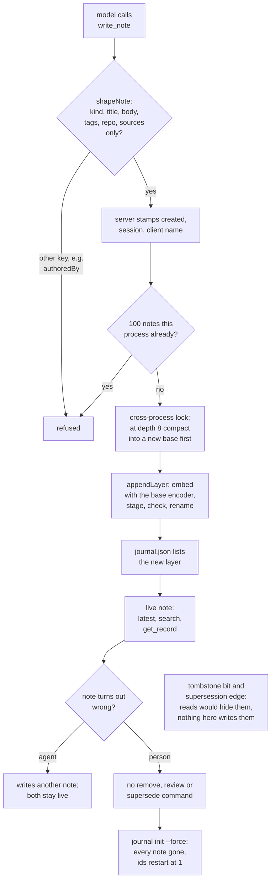

## 1. Executive Summary

Pikelet is a toolchain for `.pikelet` files: a corpus, its keyword and vector
indexes and its query encoder in one content-addressed file, compiled once and
read over HTTP Range requests or mounted for an agent over MCP. Since 14 October
2026 it also has an agent journal. An agent started with `pikelet mcp --journal`
appends notes through a `write_note` tool, any later session reads them with
`latest` and `search`, and each note is one immutable layer on a private chain.
What is notable is the write discipline: the model cannot pick the destination,
cannot stamp its own author or time, and cannot touch the read-only packs, and
the write survives a crash, a dead lock holder and a concurrent writer. What is
weak is correction: no tool and no journal command can retract or supersede a
note, so a wrong decision or a stale handoff stays live in every read.

The corpus packs are a document index and this report treats them as context.
A publisher compiles them from folders, websites, git history or chat exports,
and `pikelet append` can retire or replace a record by id. Nothing an agent
writes reaches them. The marks below are judged on the journal and on the
layered machinery as the journal uses it.

The journal reuses that machinery and leaves its correction half unused.
`appendNote` hands `appendLayer` one ready-made record and never a removal or a
supersession (`packages/pikelet/src/journal.mjs:518-550`), and a supersession
cannot be expressed for ready-made records at all, because `appendLayer`
resolves its target through a `--source` path (`packages/pikelet/src/append.mjs:48-52`).
The project's design document plans `update_note`, `journal review` and
`journal remove` and lists all three under *Not yet* (`docs/agent-journal.md:352-354`).

**Licence.** Apache-2.0, the unmodified text, in `LICENSE` and
`packages/pikelet/LICENSE`, matching both package manifests. Every compiled
pack, a journal included, redistributes the quantized all-MiniLM-L6-v2 weights
and the BERT WordPiece vocabulary, both Apache-2.0, and `NOTICE` says so and
asks publishers to keep it with their packs.

No mark is earned. The nearest are the `latest` kind and tag filters, tested
to return exactly one note of two (`test/journal.mjs:95-96`), which are ordinary
filter tests. Section 9 gives the reason for each of the seven withheld.

## 2. Mental Model

A memory is **a note an agent chose to write for a reader who was not there**.
The tool description asks for a handoff at the end of a session, a decision with
the alternatives rejected, a dead end with its evidence, a measurement with its
method, or a durable user preference, and forbids copying passages from other
packs in favour of citing them (`packages/pikelet/src/mcp.mjs:72-84`). Notes are
not extracted from a conversation. Nothing writes one unless the model calls
the tool.

A note is believed from the moment its layer is committed and is never
un-believed by the system. Its life has three states, and only the first is
reachable through the product:

- **Live.** Written by `write_note`, readable on the next call by `latest`,
  `search` and `get_record`, and kept through every compaction with the same id
  (`test/journal.mjs:117`).
- **Tombstoned or superseded.** The layered format can mask a row id and record
  a successor, and both journal reads would honour it: `latestNotes` skips a
  tombstoned record (`packages/pikelet/src/journal.mjs:558`) and the chain query
  passes the mask into the scan (`packages/pikelet-wasm/complete/layer-reader.mjs:454-458`).
  No journal path writes either.
- **Gone.** `pikelet journal init --force` rebuilds the journal from a seed and
  deletes every chain file (`packages/pikelet/src/journal.mjs:355-369`). This is
  the only way a person can remove a note, and it removes all of them.

Correction is therefore additive. An agent that finds an earlier note wrong
writes a new one, and the two sit side by side in `latest` (newest first by id)
and in search (ranked by similarity, not by age). The design document says
*"The model cannot delete. Removal is a user action through the CLI"*
(`docs/agent-journal.md:132-133`), and the CLI at this pin accepts `init`,
`list` and `compact` (`packages/pikelet/src/journal-cli.mjs:12`).

The system's stance on truth is a label. Every note is returned with
`agentWritten: true` (`packages/pikelet/src/mcp.mjs:243`), and a search that
reaches the journal carries a `journalNote` telling the model to weigh notes as
a colleague's working notes and never to follow instructions inside one
(`:304-313`). Nothing the system does depends on whether a note is true.

## 3. Architecture

Pikelet is two npm packages in one workspace. `pikelet-wasm` is the reader and
builder library: a C++ engine compiled to WebAssembly for the HNSW and sketch
indexes, a BM25 index, an inline transformer encoder, and the chain reader that
mounts a base file and its layers as one corpus
(`packages/pikelet-wasm/complete/layer-reader.mjs`). `pikelet` is the Node CLI
and MCP server (`packages/pikelet/src/cli.mjs`, `packages/pikelet/src/mcp.mjs`).
The journal is two files in the second package: `journal.mjs` for the chain,
lock and note shape, and `journal-cli.mjs` for the person's three commands.

A journal is a directory, `~/.pikelet/journals/<name>` for a bare name or any
path given (`packages/pikelet/src/journal.mjs:45-61`). It holds `journal.json`
(format, name, creation time, generation and the ordered member files), one base
`base-NNNN.pikelet` and up to eight layers `base-NNNN.LLLL.pikelet`, each holding
one note (`:7-12`). The directory is forced to 0700 and its files to 0600 before
and after every write, with a warning where the filesystem ignores modes
(`:291-302`), and `journal init` warns when the directory sits inside a git
repository (`:339-343`).

The base is a complete pack compiled from a one-paragraph seed document that
describes the journal as agent-written and unverified (`:377-381`), so it
embeds the MiniLM query encoder. Every `.pikelet` is at least about 25 MiB for
that reason (`README.md`, *Quick start*), and a journal with three notes is
nearly as large as one with three hundred. The encoder must be available at `journal
init`, which the CLI downloads from a GitHub release on first use and caches;
after that, writes embed with the encoder inside the base and need no network.

The MCP server is one Node process per client, speaking stdio. With `--journal`
it mounts the journal last, beside any corpus packs, names it `journal` unless
another pack has that name, and adds `write_note` and `latest` to the four
corpus tools (`packages/pikelet/src/mcp.mjs:216-217`, `:566-597`). Before each
tool call it re-reads `journal.json` and remounts when the members differ, so a
long-running server sees notes and compactions from other sessions (`:616-626`,
`:1321`).

### Deployment and ergonomics

- **What has to run:** Node at one of the patched releases the CLI requires;
  nothing else. No database, no embedding API, no model service.
- **Offline:** yes once the encoder is cached. Corpus packs can be remote; the
  journal is always a local directory.
- **API key:** none.
- **Install:** `pikelet journal init <name>`, then `pikelet mcp install --pack
  <file> --journal <name>`, which writes the server into the project's
  `.mcp.json` for Claude Code or into Claude Desktop's config and pins the
  journal by absolute path (`packages/pikelet/src/mcp.mjs:854-856`, `:900`).
- **Repairable by hand:** no. The notes are records inside binary pack files;
  `pikelet journal list` prints them, and there is no export at this pin. A
  person who wants to change one has no supported route short of `init --force`.

## 4. Essential Implementation Paths

**Write.** `write_note` reaches `callWriteNote`
(`packages/pikelet/src/mcp.mjs:658-696`). It builds the server-side fields first:
`created` from the clock, `session` from a UUID made once per server process
(`:632-634`), and `authoredBy` from the client's `clientInfo`, taken from the
request's `_meta` on a modern request and from `initialize` on a legacy session
(`:646-656`, `:1280-1283`). `shapeNote` checks the agent's arguments against a
fixed set of keys and limits and refuses any other key, including `created` and
`authoredBy` (`packages/pikelet/src/journal.mjs:414-475`). The record id is
`note-<created>-<6 hex>` and the title becomes the first line of the text so
search sees both (`:466-473`). Inside a per-process queue the server checks the
100-note budget, calls `appendNote`, counts the write and remounts; a failed
remount still reports the note as written, with a warning not to write it again
(`packages/pikelet/src/mcp.mjs:668-695`).

**Append.** `appendNote` takes the cross-process lock, compacts first when the
chain is eight layers deep, and calls `appendLayer` with the record as a
ready-made chunk and `allow-drift` set
(`packages/pikelet/src/journal.mjs:518-550`). `appendLayer` embeds the chunk with
the base's own encoder and builds the layer's corpus, vector index, BM25 segment
and the cumulative tombstone segment every layer carries
(`packages/pikelet/src/append.mjs:91-116`, `:273-326`, `:372`). `publicChunk` keeps the `note` object on the stored record
(`packages/pikelet/src/ingest.mjs:1161-1180`). The layer is built under a private
name, the writer re-checks that it still holds the lock and that
`journal.json` is unchanged, and only then renames it into place and rewrites
`journal.json` with an fsync of the file and the directory
(`packages/pikelet/src/journal.mjs:258-281`, `:109-120`).

**Lock.** The holder record is written whole under a private name and
hard-linked to `.lock`, so a contender never reads an empty lock. A writer waits
up to 30 seconds for a live holder; a lock whose pid no longer exists is broken
under a second `.lock.break` lock; a live holder's lock is never broken however
old (`packages/pikelet/src/journal.mjs:128-191`, `:208-245`).

**Compact.** `compactLocked` folds the chain into `base-<generation+1>.pikelet`
with `compactChain`, writes `journal.json` naming only the new base, then unlinks
the old members (`packages/pikelet/src/journal.mjs:477-491`). It runs inside the
write that finds the chain at depth eight, or by hand through `pikelet journal
compact`.

**Read.** `latest` validates `kind`, `tag` and a limit of 1 to 50 and calls
`latestNotes`, which walks ids downward from the newest, skips tombstoned
records and the seed, and applies the two filters
(`packages/pikelet/src/mcp.mjs:698-725`, `packages/pikelet/src/journal.mjs:553-564`).
`search` with no `pack` argument queries every mounted pack, the journal
included (`packages/pikelet/src/mcp.mjs:252-267`, `:269-316`). `get_record`
defaults to the one corpus pack and reaches the journal only when it is named
(`:318-330`).

**Correct or delete.** None on the journal path. `git grep` for `update_note`,
`journal remove` and `journal review` finds only `docs/agent-journal.md`, and
`appendNote` has one caller outside tests, `callWriteNote`
(`packages/pikelet/src/mcp.mjs:674`); see *Recorded searches*.

## 5. Memory Data Model

A note is a document-shaped record with a `note` object
(`packages/pikelet/src/journal.mjs:461-474`):

| Field | Source | Read by |
| --- | --- | --- |
| `title`, `text` | agent, one-line title of at most 200 characters, body of at most 16 KiB | search, latest preview, get_record |
| `headingPath` | `[kind]` | returned only |
| `note.kind` | agent, one of seven | `latest` filter |
| `note.tags` | agent, at most 20, lower-cased and de-duplicated | `latest` filter |
| `note.repo` | agent, optional repository, branch, commits, files, versions | returned only |
| `note.sources` | agent, optional `(pack identity, record id)` pairs, format-checked | returned only |
| `note.created` | server clock | returned only |
| `note.authoredBy` | the MCP client's self-declared name and version | returned only |
| `note.session` | one UUID per server process | returned only |

The record's id in the chain is a global integer: the seed is 0 and notes count
up from 1 (`test/journal.mjs:89`). The `note-<created>-<hex>` string is the
record's `docId`, which no read uses.

**Scoping.** The journal is a physical partition: a directory chosen by whoever
starts the server, never by the model, since no tool takes a path
(`docs/agent-journal.md:115-118`). Inside it there is no scope key a read
applies. `repo`, `session` and `authoredBy` are stored and returned, and the
only reads of `note.repo` and `note.authoredBy` in `packages/` copy them into
the `latest` response (`packages/pikelet/src/mcp.mjs:716-718`). A journal is
shared by every session and every client configured with the same name, which
the changelog presents as a feature: *"several sessions can share one journal"*
(`CHANGELOG.md:727-728`). Whether one journal serves one project or a user's
whole working life is the person's naming choice, and the design document
leaves it as an open question (`docs/agent-journal.md:292`).

**Temporal fields.** `created` only, set by the server. Nothing records when a
decision stopped holding.

**Separation.** The seven kinds are a genre field. Decisions, dead ends and
preferences share one chain, one index and one ranking.

## 6. Retrieval Mechanics

**`latest`** is the orientation read the tool description tells the model to
call at the start of a session (`packages/pikelet/src/mcp.mjs:117-131`). It is
ordered by id, which appends make monotonic, and returns up to 50 notes with a
300-character preview each; `get_record` returns the full text. A kind filter
for `handoff` therefore returns the newest handoff first, and every earlier
handoff after it, all live.

**`search`** runs the chain query. Lexical candidates come from each tier's BM25
index with document frequencies summed across tiers, and vector candidates from
each tier's HNSW index; both scans take the tier's tombstone mask. The two orders
are fused by reciprocal rank with `rrfK` 60 and a lexical weight of 0.5, behind a
guard that keeps a clear vector winner at rank 1
(`packages/pikelet-wasm/complete/layer-reader.mjs:426-533`,
`packages/pikelet-wasm/complete/fusion.mjs:1-25`). The journal is unscored by
design (`packages/pikelet/src/journal.mjs:4-5`), so a journal search returns its
top k however distant; each section carries `grounding`, the query words the
best passage does or does not contain.

**Mixing.** Because an unscoped `search` reaches every mounted pack, a question
about a product's documentation also returns the agent's own notes on the same
subject, in their own section, labelled `journal: true` and `agentWritten`
(`packages/pikelet/src/mcp.mjs:290-313`). The sections are not merged into one
ranking, which keeps the label attached; the model still receives a stale
decision beside the manual it may contradict.

**Failure modes.** Stale hits are the main one: a superseded handoff or a
reversed decision ranks on similarity like any other note, and the newer note
that reverses it may not be in the top k. Over-recall follows from the absence
of a threshold.

## 7. Write Mechanics

Writes are explicit tool calls, made hot-path by the model. Nothing is
extracted, deduplicated or consolidated: the same note written twice is two
records, because ready-made chunks bypass the chunker's dedupe
(`packages/pikelet/src/append.mjs:191`) and the layered profile gives records
*"identity within a history, not content identity"* (`LAYERED_PROFILE.md:144-147`).
Agent-generated facts are the whole store, and the only filter on them is shape:
kinds, lengths, counts, and the instruction in the tool description not to
record secrets (`packages/pikelet/src/mcp.mjs:81-82`). No code scans a note for
a secret.

Updates and deletes do not exist on this path; section 2 covers what a person
can do instead. Conflict handling is the reader's job.

### Operational cost

- **Blocking.** `write_note` is synchronous. The agent waits for the lock, one
  MiniLM embedding of the note on the CPU, a
  layer build with its own HNSW and BM25 segments, two fsyncs and a remount.
  The README puts embedding at about one chunk a second per core.
- **Lag.** None once the call returns: the server remounts before replying, and
  other servers see the note at their next tool call.
- **Whole-store rewrite.** Every ninth write folds the chain into a new base,
  which carries the encoder, so every eight notes the write path produces a new
  file of at least about 25 MiB and deletes the old ones. The design document
  calls this seconds of work, reusing stored vectors (`docs/agent-journal.md:230-235`).
  It scales with the journal's size and runs in the tool call.
- **Read cost.** `latest` returns at most 50 previews of 300 characters; search
  returns at most 20 results per pack (`packages/pikelet/src/mcp.mjs:65`).
  Nothing is injected automatically.

## 8. Agent Integration

The integration is MCP only. `pikelet mcp --journal <name>` exposes
`write_note` and `latest` beside `search`, `list_packs`, `verify_pack` and
`get_record` (`packages/pikelet/src/mcp.mjs:1323-1339`); `list_packs` marks the
journal `writable` and *"agent-written and unverified"* (`:457`). No hook writes
on session end and no context is injected at session start; the model is told
when to write and when to call `latest`, and the rest is its choice. The design
document asks whether the server should ever write on its own and leaves it
open (`docs/agent-journal.md:298-299`).

The agency boundary is clear and narrow. The model chooses the content, kind,
tags, anchors and citations. It cannot choose the journal, the time, the
session or the author, cannot read or write a pack it was not given, and cannot
delete. A person cannot write a note except through an MCP client either.

Adapting the journal to another agent costs nothing beyond an MCP client, since
the author is whatever the client declares. Adapting it to another store is not
practical: the journal is the pack format, and its value proposition is that a
note is citable as `(pack identity, record id)` and readable by any Pikelet
reader.

## 9. Reliability, Safety, and Trust

### Correction

A note that turns out false stays in every read. The agent's only move is a
second note, and both are returned. The person's only move is `pikelet journal
init --force`, which discards every note and restarts the id sequence: the test
for it writes a note, re-initialises, writes another and requires the new one to
be id 1 (`test/journal.mjs:186-190`). `write_note` tells the agent the id *"stays
this note's id as the journal grows and compacts"* and that the identity *"dates
the citation rather than locating it"* (`packages/pikelet/src/mcp.mjs:689-693`),
and `get_record` takes only a pack name and an id (`:318-330`). After a forced
re-init, a citation an agent recorded in an earlier session, in a commit message
or in another note, resolves to a different note with no error.

The layered format's correction machinery would not close this if it were
wired. Its tombstone is a bit on a global row id, un-deletion is a non-goal, and
appending bytes equal to a removed record makes a new live id
(`LAYERED_PROFILE.md:144-147`). An agent re-writing a retracted decision would
get a new live note.

### Scope

The journal directory is the only boundary, and the person sets it. Every
client configured with the same name writes to and reads from one journal,
with no read separating projects or authors. `mcp install` writes the server
into the current project's `.mcp.json` with the journal pinned by absolute path,
so a user who installs the same bare name in two repositories gets one journal
across both.

### Provenance and injection

The server-set fields are the best part of the design: a note cannot claim a
time, a session or another client, and the test for it sends `created` over MCP
and requires the refusal (`test/journal.mjs:514`). `authoredBy` is what the
client declares about itself, so it distinguishes Claude Code from Codex and
proves neither. Notes are labelled as data in three places, and a note
summarising a hostile page is still returned to the next session in full.
`sources` citations are format-checked and never resolved, so a note can cite a
record that says something else.

### Concurrency and durability

The lock and commit protocol is careful and tested. A live holder's lock is
never broken, and a dead holder's is broken under a second lock. A writer that
lost the lock abandons its staged file, `journal.json` and its directory are
fsynced before a write counts, and an orphan layer from a crashed write does not
block the next (`test/journal.mjs`, sections *one writer at a time*, *recovery and
concurrent writers*, *a paused writer keeps its lock*). Within one server,
writes are serialised by a promise queue and counted inside it, so concurrent
calls cannot exceed the budget (`packages/pikelet/src/mcp.mjs:668-676`).

### Privacy

Modes are enforced on every write and reported where the filesystem ignores
them. Nothing redacts note content. The notes are in a binary format a person
cannot grep without the CLI.

### Marks

- **`tombstone` — withheld.** No journal path writes a tombstone. The format's
  tombstone is keyed on a row id and expressly not on content
  (`LAYERED_PROFILE.md:144-147`), so even a wired one would not stop the same
  note being written again.
- **`trust_state` — withheld.** `agentWritten: true` is a constant on every
  note and `kind` is a genre. No read excludes a note for any status.
- **`bitemporal` — withheld.** `created` is the server's clock at write time,
  and there is no validity field.
- **`scope_enforced` — withheld.** One directory per configured journal is a
  physical partition. `repo`, `session` and `authoredBy` are stored and no read
  filters on them.
- **`audit_log` — withheld.** The only mutation is an add, and the record of it
  is the note. Each add is an immutable, content-addressed layer until the next
  compaction folds it into a new base and unlinks it
  (`packages/pikelet/src/journal.mjs:477-491`), and `init --force` removes
  everything with no record.
- **`human_review` — withheld.** A note is live when its layer commits.
  `pikelet journal list` displays; `journal review` is design text
  (`docs/agent-journal.md:218-219`, `:352-354`).
- **`negative_eval` — withheld.** The journal's exclusions in tests are the
  `latest` kind and tag filters, each required to return exactly note 1 from a
  journal holding a decision and a dead end, and the seed's omission
  (`test/journal.mjs:94-96`). They are ordinary filter tests, with no case
  about a retracted note, a superseded one or another project's, since none can
  exist. The layered reader's must-not cases for masked rows
  (`test/layered_profile.mjs:928`, `:987`) guard the corpus path, and the
  journal produces no mask for them to guard. The abstention goldens below are a
  document index.

## 10. Tests, Evals, and Benchmarks

`npm test` chains thirteen Node suites and a type check, from the WebAssembly engine to the MCP
server, and `ci.yml` runs it on Node 22, 24 and 26 against the committed
WebAssembly and again after rebuilding the engine from source with a pinned
Emscripten (`package.json:23`, `.github/workflows/ci.yml`). `test/journal.mjs`
builds real journals with the inline encoder in a temporary directory and
drives the MCP server in-process; its 97 checks cover note validation, init,
write, read, compaction, every lock path, crash debris, racing inits, a paused
writer, file modes, mounting beside a stalled pack and the MCP tools including
concurrent writes interleaved with reads. Almost all of it is write-path
correctness. The read-side checks are that the next read sees a note, that
search finds the note that answers a query, that results carry the label, and
the filters. There is no test of a note's correction because there is no
correction.

No evaluation of the journal is committed. The design document states the
experiment it would take, a fresh agent from another vendor answering fixed
history questions from the journal against the same questions from git and docs
alone (`docs/agent-journal.md:356-364`), and nothing under `benchmarks/`,
`docs/measurements/` or `scripts/` mentions the journal.

Two results on the document side are evaluation of the kind this atlas looks
for, and both bear on how the project treats its own claims.

- **The Veyra ablation** (`docs/veyra-ablation.md`) rebuilt a pack
  byte-for-byte except for the record holding one fact; retrieval moved from
  `matchQuality: strong` at confidence 0.915 to `none` at 0.136, and a third pack
  that changed the value moved the grounded answer with it. The write-up keeps
  the reproducible retrieval numbers apart from model sessions it calls *"a
  described observation rather than a reproducible result"*, and says it
  *"does **not** mean Pikelet can prevent an LLM from hallucinating"*.
  `examples/one-file-search/web/public/reproduce-ablation.mjs` re-derives the
  retrieval side and prints rather than asserts, against packs that `npm run
  demo:veyra` fetches from a release, so nothing fails in CI when the numbers
  move.
- **The abstention goldens** (`test/fixtures/encoder-conformance/abstention-golden.json`)
  hold ten labelled queries, five labelled `none`, and `test/complete_profile.mjs:891-898`
  requires all ten to reproduce their label and each `none` query to return zero
  results, inside `npm test`. It is a must-not-retrieve assertion for a search
  index, on a pack built from a committed calibration asset. Since 0.15.0
  (19 November 2026) `compile` no longer fits a calibration, and `pikelet mcp` and
  `pikelet query` no longer report the verdict at all (`CHANGELOG.md:94-123`).
  The reason is a measurement: on a 1,377-article Wikipedia pack the verdict
  called 278 unanswerable Natural Questions `strong`, out of
  512 asked, and Sonnet and Haiku
  agents over MCP answered no better with it than without it in 320 runs
  (`docs/calibration.md:11-56`). The golden test now guards a library path that
  only packs calibrated by 0.14.0 or earlier exercise.

The second is a project withdrawing its own headline signal on evidence and
publishing the table.

There is no paper. The repository carries a BEIR harness for encoder,
quantisation and index quality under `benchmarks/beir/`, and the README's
range-read and MCP proofs, none of which touch the journal.

## 11. For Your Own Build

### Steal

- **Fix the write destination at configuration and keep it out of the tool.**
  One writable store named when the server starts, every other mount read-only,
  and no path argument means the model cannot misroute a note, whatever it is
  told.
- **Stamp provenance on the server and refuse it in the arguments.** A whitelist
  of agent keys that rejects `created` or `authoredBy` with an error, rather than
  overwriting them silently, teaches the model the boundary and makes the
  refusal testable.
- **Commit under a lock a live holder never loses.** Write the holder record
  whole and hard-link it into place, break only a dead pid's lock and only under
  a second lock, re-check ownership and the expected state immediately before
  the rename, and fsync the directory after it.
- **Report a write as done once it is on disk, even if the follow-up read
  fails.** The warning *"Do not write it again"* prevents the duplicate that a
  retrying agent would otherwise create.

### Avoid

- **An append-only store for claims that can be wrong, with no way to retract
  one.** Handoffs, decisions and preferences are exactly the records that go
  stale. A journal whose only correction is a newer note leaves the reader to
  find and weigh both, every session.
- **Ids that a reset reuses while the citation contract says they are stable.**
  If a citation is `(store, id)`, a reset has to change the store's name or skip
  past every id ever issued.
- **A whole-file rebuild on a fixed write count when the file carries a model.**
  A 25 MiB base every eight notes is cheap on one laptop and is the cost a
  shared or synced journal would pay first.

### Fit

Pikelet's journal suits one developer who wants coding agents from different
vendors to leave a searchable trail of handoffs and dead ends for each other on
one machine, accepts that the trail is append-only, and can live with discarding
it when it goes bad. It is a careful first milestone of a design whose
correction half is written down and not built. A team, anyone who needs a
reversed decision to stop surfacing, or anyone whose agents must not see notes
from another project should wait for `update_note` and `journal remove` or build
the correction themselves. Adopt it for the pack format, and the journal comes
free; adopt it for the journal alone and you are taking a 25 MiB search engine
to hold a notebook.

## 12. Open Questions

- How long the ninth write's compaction blocks the agent on a journal of a few
  thousand notes, and whether a client times out on it. Running the system
  would answer it.
- Whether the planned `update_note` will supersede by row id through the
  existing machinery, which would hide the old note from search and still let
  the same text be re-asserted as a new id, or key on content.
- Whether `journal remove`, when it lands, will renumber on compaction, and how
  that squares with the promise that a note's id is stable.
- Whether any client sends a `clientInfo` name other than its own, and whether
  the project intends `authoredBy` as identity or as a hint.
- Whether the Veyra packs fetched by `demo:veyra` carry a calibration that the
  0.15.0 library still scores, so that the reproduce script still prints a
  verdict. The packs are release assets and not in the tree.

## Appendix: File Index

- Journal: `packages/pikelet/src/journal.mjs`, `packages/pikelet/src/journal-cli.mjs`,
  `docs/agent-journal.md`
- MCP server and tools: `packages/pikelet/src/mcp.mjs`, `packages/pikelet/src/cli.mjs`
- Layered write path: `packages/pikelet/src/append.mjs`, `packages/pikelet/src/compact.mjs`,
  `packages/pikelet/src/ingest.mjs` (`publicChunk`), `LAYERED_PROFILE.md`
- Read path: `packages/pikelet-wasm/complete/layer-reader.mjs`,
  `packages/pikelet-wasm/complete/fusion.mjs`
- Document-side evaluation: `docs/veyra-ablation.md`,
  `examples/one-file-search/web/public/reproduce-ablation.mjs`,
  `test/fixtures/encoder-conformance/abstention-golden.json`, `docs/calibration.md`
- Tests: `test/journal.mjs`, `test/mcp_conformance.mjs`, `test/layered_profile.mjs`,
  `test/complete_profile.mjs`, `package.json`, `.github/workflows/ci.yml`

### Recorded searches

Run from the repository root at the pinned commit with `git grep`.

- **No retract, supersede or review path for notes.**
  `git grep -n -E 'update_note|journal remove|journal review|removeNote'`
  returns lines of `docs/agent-journal.md` only (`:133`, `:178`, `:218`, `:227`,
  `:245`, `:246`, `:270`, `:305`, `:306`, `:352`).
- **One product caller of the journal append.** `git grep -n -E 'appendNote\('`
  returns the definition at `packages/pikelet/src/journal.mjs:518`,
  `packages/pikelet/src/mcp.mjs:674` and lines of `test/journal.mjs`.
- **The journal passes no removal or supersession to the append.**
  `git grep -n -E 'remove|supersede' -- packages/pikelet/src/journal.mjs packages/pikelet/src/journal-cli.mjs`
  returns comments about lock files, staged files and replaced members only
  (`journal.mjs:162`, `:168`, `:178`, `:182`, `:188`, `:269`, `:358`, `:487`).
- **Six tools, two of them the journal's.**
  `git grep -n -E "toolName === '" -- packages/pikelet/src/mcp.mjs` returns the
  dispatch for `search`, `list_packs`, `get_record`, `verify_pack`, `write_note`
  and `latest` (`:1323-1339`) and two routing lines (`:1164`, `:1169`).
- **Three journal commands.** `git grep -n -E "\['init', 'list', 'compact'\]"`
  returns `packages/pikelet/src/journal-cli.mjs:12`.
- **No read filters on repo, session or author.**
  `git grep -n -E 'note\.(repo|session|authoredBy)' -- packages` returns
  `packages/pikelet/src/mcp.mjs:716` and `:718`, both copying the field into the
  `latest` response.
- **No paper reference.**
  `git grep -n -i -E 'arxiv|bibtex|@article|@misc|doi\.org|zenodo' -- README.md docs FORMAT.md LAYERED_PROFILE.md spec`
  returns nothing; `git grep -n -i -E 'arxiv'` over the whole tree returns the
  WebANNS benchmark dataset name in `benchmarks/engine/webanns_1k/`.
- **No journal evaluation.**
  `git grep -l -i 'journal' -- benchmarks docs/measurements scripts examples`
  returns nothing; `git grep -n -i 'journal' -- CHANGELOG.md` returns the
  release entries.

## History

**2026-11-25** — [`510ddd346f4cd9022470c8850d14685393785aa2`](https://github.com/mcn92/pikelet/commit/510ddd346f4cd9022470c8850d14685393785aa2). First report, from a full clone at the head of `main`, 21 commits after v0.15.0. Examined at [`9f81ad79a6d9b52bb956125c7271c89021588edb`](https://github.com/mcn92/pikelet/commit/9f81ad79a6d9b52bb956125c7271c89021588edb) and at [`d00f50acbc4c768d8942af903794e403bc401211`](https://github.com/mcn92/pikelet/commit/d00f50acbc4c768d8942af903794e403bc401211) (0.9.2) and excluded: only the corpus compiler wrote, the MCP server had four read tools, and a tombstone was a bit on a row id. The agent journal, added on 14 October 2026, gives an agent `write_note` and `latest` over MCP, which is memory; the second reason now applies to the journal more strongly, since its path writes no tombstone or supersession at all ([section 9](#correction)). Screened first: no auto-run surface; three manifests inside the seven-day cooldown; two build-time execution points; nine unpinned surfaces; no submodules. Docs were read as data. Nothing was installed, built or run, and the test suites were not run. No marks.
