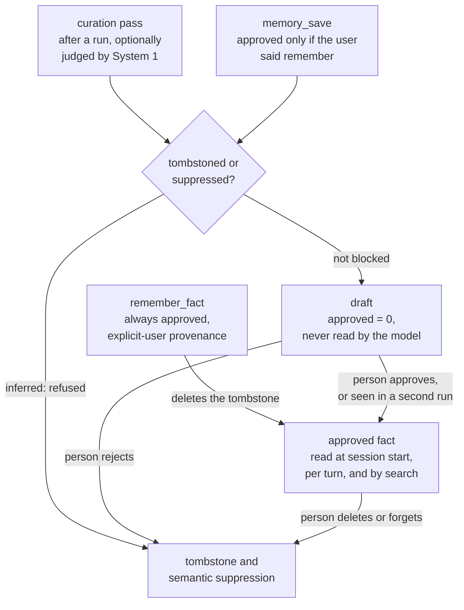

## 1. Executive Summary

POK-Agent is **a Windows computer-use agent written in Rust**. A large model plans
(System 2), and an optional small decision model (System 1) answers typed
questions and replays recorded action programs on screen: local Laya, or the
hosted JEV. It runs as a Tauri desktop app with voice, a CLI and a WhatsApp
gateway. It is Apache-2.0.

Its memory has two halves in one SQLite file. **Facts** are short durable
statements about the user, a project or the environment. **Procedures** are
reusable skills; a workflow can carry an action program that System 1 replays
when the same task comes back. That replay is the "muscle memory" the README is
named for.

What is good:

- **Rejection is remembered by value.** Rejecting a draft, deleting a fact, or
  "forget and prevent relearning" records the fact's fingerprint, and forgetting
  also records its canonical text, so the curation pass cannot learn it again in
  the same or similar words (`crates/pok-ai-core/src/memory.rs:279-306`).
- **Drafts stay out of every read.** All three fact reads that reach the model
  select approved, enabled rows only.
- **Skills earn and lose trust.** Replay requires a trust score of
  `(successes + 1) / (uses + 2)`; a grounded success raises it, and three failures
  that outnumber successes disable the skill.

Three marks are earned: `tombstone`, `trust_state` and `negative_eval`.

What is weak:

- **The agent's own tool writes approved facts.** `remember_fact` saves with
  `approved=true` and explicit-user provenance on every call. Its sibling
  `memory_save` checks the user's request for "remember" first. An explicit-user
  write deletes a matching tombstone and skips the semantic suppression, so the
  model can restate a value the user chose to forget.
- **Repetition stands in for review.** An inferred draft seen in a second run is
  promoted to approved by the fact budget, with no person involved.
- **An explicit correction rewrites in place.** A statement similar enough to a
  stored fact replaces its text and fingerprint, and the earlier wording is kept
  nowhere.

## 2. Mental Model

A fact is **a statement with a provenance and an admission state**. Provenance
says who asserted it: `explicit_user`, `inferred_curation`, `user_approved` or
`legacy`. Admission decides whether the model reads it. A procedure is **a
recipe with a track record**: what it is for, its steps, and how often it worked.

### How a thing becomes a belief

Four producers:

- **`remember_fact`** (`crates/pok-ai-core/src/builtins/memory_tools.rs:16-54`),
  registered for every desktop session with risk class `ReadOnly`. It saves the
  text approved, as an explicit user statement. Its description asks the model to
  use it only when the user asks; the handler does not check.
- **`memory_save`** (`memory_tools.rs:184-231`) takes an `approved` flag and
  honours it only when the task's root request contains "remember", "save this",
  "store this" or "keep this in memory". Otherwise the fact is an inferred draft.
- **The curation pass** (`crates/pok-ai-core/src/session/curation.rs`) proposes
  facts after a run. With a System 1 router configured and the text not flagged
  as sensitive, the router chooses create, reject, reinforce, propose an update,
  or conflict against up to four related facts; otherwise the fact is saved
  locally as a draft.
- **Skills** are saved from runs the agent's own checks call successful, with the
  action program System 1 recorded.

`save_with_provenance` then decides (`memory.rs:279-450`):

1. A tombstoned fingerprint is refused unless the write is approved and explicit.
2. An inferred write similar to a suppressed text is refused.
3. An exact repeat reinforces.
4. An inferred write that fails the hygiene rules is refused. The rules exclude
   task findings and notes about website behaviour.
5. A near-duplicate reinforces an inferred repeat. An explicit statement rewrites
   the stored fact's text instead.
6. Anything else is inserted, marked `possible_duplicate` when it is close to an
   existing fact.

The fact budget then runs (`crates/pok-ai-core/src/memory/budget.rs:114-160`):

- it promotes inferred drafts reinforced twice;
- it expires unreinforced drafts after 14 days;
- it caps drafts at 15, inferred facts at 60 and swarm playbooks at 8, keeping
  the most reinforced.

### How a belief stops being one

A person rejects a draft, disables, deletes or forgets a fact, or merges
duplicates, which can be undone. Each of reject, delete and forget writes a
tombstone; forget also writes a semantic suppression. The budget deletes inferred
facts past their caps without a tombstone, so a capped-out fact can come back. A
skill is disabled after three failures that outnumber its successes, or deleted
with a task-key tombstone.

## 3. Architecture

A Cargo workspace. `pok-ai-core` holds the session loop, the decision router, the
tool registry, the browser and Windows automation, the coding tools, the swarm,
the gateway, and the memory store. `pok-ai-windows` binds the Windows
accessibility tree, and `pok-ai-voice` the speech stack. `pok-ai-cli` is the
command line. `apps/desktop` is the Tauri app.

The memory store is one SQLite file under the data directory's `memory/` folder.
It holds `memories` with an FTS5 index, `procedures` with an FTS5 index,
`memory_tombstones`, `memory_semantic_suppressions`, and `memory_merges`, which
records the merged rows as JSON so `undo_memory_merge` can restore them. Every
call takes one process-wide mutex on the connection. Skills are also written as
Markdown files for the user to read.

The desktop app exposes the review surface as Tauri commands (`apps/desktop/src-tauri/src/lib.rs:1345-1460`):

- approve or reject a draft;
- list the memory library;
- enable, disable, delete, or forget and prevent relearning;
- scan for duplicates, merge, and undo a merge;
- enable or disable a procedure.

The CLI has `memory approve` and a context query.

### Deployment and ergonomics

A Windows build of the desktop app, or the CLI. Planning needs a model provider;
System 1 is optional, and its hosted form, JEV, receives typed state and memory
proposals when configured. The store is local and readable with any SQLite
client. Cargo manifests changed inside the seven-day cooldown at this pin.

## 4. Essential Implementation Paths

**Store** — `crates/pok-ai-core/src/memory.rs`: `save_with_provenance`
(`:279-450`), `search` (`:452-491`), `approve` and `reject_draft` (`:508-543`),
`delete_memory` and `forget_memory_and_prevent_relearning` (`:837-906`),
`merge_memories` and `undo_memory_merge` (`:718-828`), `retrieve_context`
(`:1620-1687`).

**Hygiene** — `crates/pok-ai-core/src/memory/budget.rs`: `inferred_fact_rejection`,
`enforce_fact_budgets` (`:114-160`).

**Tools** — `crates/pok-ai-core/src/builtins/memory_tools.rs`: `remember_fact`,
`memory_search`, `memory_save`, `context_search`, `context_read`, `skill_create`,
`skill_search`, `skill_load`.

**Curation** — `crates/pok-ai-core/src/session/curation.rs`, with the router in
`session/decision_router.rs`.

**Skills** — `save_or_reinforce_procedure`, `record_skill_failure`,
`mark_skill_verified` (`memory.rs:908-1572`);
`crates/pok-ai-core/src/session/skill_replay.rs` and `fast_actions.rs`.

**Injection** — `crates/pok-ai-core/src/session/mod.rs:449` and
`session/run_loop.rs:418`.

## 5. Memory Data Model

`memories` carries `id`, `source`, `text`, `approved`, `enabled`, `created_at`,
`updated_at`, `fingerprint` (SHA-256 of the canonical text), `kind`,
`reinforcement_count`, `review_status`, `related_memory_id`, `version` and
`provenance` (`memory.rs:20-36`). `version` increments on every reinforcement or
rewrite, and an explicit rewrite replaces `text` and `fingerprint` on the same
row. The version count records that a change happened, not what it replaced.

`procedures` carries a kind, a task signature, title, summary, applications,
steps, an optional command template and replayable `program`, evidence,
`enabled`, `success_count`, `failure_count`, `retrieval_count` and a
`previous_version` added by migration, so one earlier version of a rewritten
skill can be reverted to.

`memory_tombstones` is `(fingerprint, item_type, deleted_at)`;
`memory_semantic_suppressions` holds canonical texts. Ordinary deletion stores
only the exact fingerprint, and the test says so: *"ordinary deletion retains
only an exact fingerprint"* (`memory.rs:2352-2385`). A rewording of a deleted
fact can therefore be relearned, and a rewording of a forgotten one cannot.

There is no scope on a fact, no confidence, and no validity time.

## 6. Retrieval Mechanics

Facts are found by FTS5 BM25 over approved, enabled rows, then re-scored by
`deterministic_relevance`, a term-overlap measure with a floor of 0.5.
`retrieve_context` returns at most two workflows and the facts that clear the
floor for the current prompt. The session also injects up to 50 approved facts
from source `user` at start. Skills are searched separately by title, summary
and applications; replay requires local relevance and the trust score, and each
step's labels must not name a value from the skill's original task that the new
request does not ask for (`crates/pok-ai-core/src/session/skill_replay.rs:1-60`).

Failure modes:

- **Lexical only.** A fact phrased differently from the prompt is found only
  through shared terms.
- **Session-start facts are not ranked.** The 50 most recent approved user facts
  are injected whatever the request.

## 7. Write Mechanics

Fact writes are synchronous and block the tool call for one transaction; the
fact is readable on the next turn. The curation pass runs after a run and may
call System 1 once per proposal that has related facts. Skill saves happen after
a run judged successful.

**A correction leaves no history.** An explicit statement at 0.78 similarity or
more to a stored fact, sharing its protected terms, rewrites that row's text and
fingerprint (`memory.rs:347-385`). The design intent is stated: *"a corrected
fact never sits next to its old version"*. The old wording is gone. Because the
old fingerprint is not tombstoned, the curation pass can propose it again as a
fresh draft.

**Budget deletions are silent forgetting.** Expired and over-cap inferred facts
are deleted without a tombstone, which is consistent with a cap rather than a
rejection, and means a fact the budget dropped can return.

### Operational cost

One mutex-guarded SQLite connection per store, with the budget running on every
inferred write; candidate lookups and merges are bounded to small result sets.
The cost that matters is System 1, which the README reports doing about half of
the on-screen actions in the best run.

## 8. Agent Integration

The agent holds eight memory tools: `remember_fact`, `memory_search`,
`memory_save`, `context_search`, `context_read`, `skill_create`, `skill_search`
and `skill_load`. None approves a draft, deletes a fact or lifts a tombstone
directly. `remember_fact` makes the first two unnecessary for any fact the
model chooses to state, and it lifts a tombstone as a side effect. The person's
surface is the desktop memory library and the CLI.

## 9. Reliability, Safety, and Trust

### Who can admit a fact

The review queue is real at the read end: a draft is invisible to the model
until it is approved. At the write end it has two bypasses, which is why
`human_review` is withheld.

- `remember_fact` writes approved. The rubric's test asks whether *"the agent that
  wrote the memory [can] also clear its review"*, and here the agent writes past
  it.
- `enforce_fact_budgets` promotes an inferred-curation draft with
  `review_status = 'independent'` from source `user`, `project` or `lesson` once it
  is reinforced twice. The test names the intent: *"a draft seen in a second run
  becomes a fact without review"* (`crates/pok-ai-core/src/memory/budget.rs:446-460`).

### What the tombstone covers

Against the curation pass and `memory_save` without the user's words, the
tombstone and the suppression hold, and the tests assert it. Against an
explicit-user write it is deliberately lifted, so that a user who re-states a fact
gets it back. `remember_fact` counts every call as that user, so the protection
depends on the model calling it only when asked.

### Data leaving the machine

When the hosted JEV is the System 1 router, curation sends a proposed fact and up
to four related stored facts to it, after `memory_text_may_be_sensitive` screens
the proposal (`crates/pok-ai-core/src/session/curation.rs:1626-1660`, `:1767`).

### Marks

`tombstone`, `trust_state` and `negative_eval` are earned; the frontmatter
records carry the evidence and the limits.

- `human_review` is withheld for the two bypasses above.
- `audit_log` is withheld. `memory_merges` logs merges for undo, and nothing
  logs approvals, rejections, rewrites or deletions.
- `scope_enforced` and `bitemporal` have no mechanism.

## 10. Tests, Evals, and Benchmarks

786 Rust test functions, with the session suite alone at 9,542 lines. CI runs
`cargo fmt`, clippy with warnings denied, and the core, CLI and voice test suites.
The memory tests cover draft hiding, rejection tombstones, semantic forgetting,
undoable merges, budgets, hygiene rules and skill relearning in a different step
order.

**The muscle-memory figure recomputes for its bucket, and the file shows the
others.** `docs/results/arena-summary.json` records five Windows Agent Arena runs
over 154 tasks and splits the second v5 pass by what replay did:

| Bucket | Tasks | Planner calls, 1st → 2nd | Median | Passed |
| --- | ---: | --- | --- | --- |
| whole program replayed | 26 | 20.6 → 14.8 | 15.5 → 9.0 | 18.0 → 17.0 |
| program partly replayed | 22 | 18.5 → 18.6 | 13.5 → 17.5 | 15.0 → 14.0 |
| opening steps only | 18 | 24.1 → 28.3 | 22.0 → 33.5 | 13.0 → 11.9 |
| no replay | 88 | 19.7 → 20.7 | 16.5 → 20.0 | 41.8 → 45.8 |

The README's *"28% fewer calls on average and 42% fewer at the median"* is the
first row. Replaying only a skill's opening steps cost more planner calls, not
fewer. The aggregates are committed; the per-task runs that
`scripts/arena/make_report.py` regenerates them from are not. The README also
states that the planner is an anonymous preview model and that about 3 in 10 runs
the agent saved as skills failed the benchmark's stricter check.

No paper describes the system; `docs/SWARM.md` cites three papers for the swarm
design. I read the tests and the summary file and ran nothing, because the Cargo
manifests changed inside the dependency cooldown.

## 11. For Your Own Build

### Steal

**Key the tombstone on the value, and add a semantic one for "forget".** An exact
fingerprint for ordinary deletion, and a canonical-text suppression when the user
says never learn this, gives two strengths of forgetting with one check on the
write path.

**Make admission a column every read filters on.** Drafts that no read can return
make the curation pass safe to run aggressively.

**Let skills lose trust.** A Laplace-smoothed success rate for replay, failures
counted per run, and a disable rule when failures outnumber successes, keeps a
bad recording from replaying forever.

**Refuse replay of a step that names the old task's values.** Checking step
labels against the new request stops a "Pacific (US & Canada)" click from
replaying into a request about another time zone.

### Avoid

**Don't give the agent a write path that claims the user's authority.** Derive
explicit-user provenance from the user's own words, as `memory_save` does, or
don't offer it.

**Don't let repetition approve.** A draft the same model proposes twice is the
same model's opinion twice.

**Don't rewrite a corrected fact in place without keeping the old value.** Keep
the prior text, or tombstone its fingerprint, so the correction is visible and
the old wording cannot drift back.

### Fit

This suits **one person who wants a desktop agent that gets faster at the tasks
they repeat** and is willing to review what it remembers. The memory library, the
forget-and-prevent action and the skill trust rules are built for that.

It is not a memory to share between people or agents. There is no scope on a
fact. The fact store is small by design, with 60 inferred facts at most. And the
guarantees around admission depend on the model using `remember_fact` only when
asked.

## 12. Open Questions

- **Should `remember_fact` check the request like `memory_save`?** The two tools
  set the same provenance under different rules.
- **Is recurrence promotion meant to bypass the queue?** It is tested and
  intentional; whether it should require a different run or a different source is
  not stated.
- **How do replayed programs behave on a stronger planner?** The arena runs use
  one preview model.

## Appendix: File Index

**Memory** — `crates/pok-ai-core/src/memory.rs`, `memory/budget.rs`,
`builtins/memory_tools.rs`.

**Session** — `crates/pok-ai-core/src/session/curation.rs`, `decision_router.rs`,
`skill_replay.rs`, `fast_actions.rs`, `run_loop.rs`, `mod.rs`.

**Apps** — `apps/desktop/src-tauri/src/lib.rs`, `crates/pok-ai-cli/src/main.rs`.

**Evidence** — `docs/results/arena-summary.json`, `scripts/arena/make_report.py`.

### Recorded searches

Run from the repository root at the pinned commit with `/usr/bin/git grep`.

- **remember_fact always writes approved, as the user.**
  `git grep -n -E 'ExplicitUser' -- crates/pok-ai-core/src/builtins`
  returns `memory_tools.rs:42`, unconditional, and `:215`, behind the
  root-request phrase check.
- **No agent tool approves, rejects or deletes.**
  `git grep -n -E '\.(approve|reject_draft|delete_memory|forget_memory_and_prevent_relearning)\(' -- crates apps`
  returns the Tauri commands in `apps/desktop/src-tauri/src/lib.rs`, the CLI at
  `crates/pok-ai-cli/src/main.rs:892`, the gateway's unrelated access-code
  `approve`, and tests.
- **Every fact read that reaches the model filters on admission.**
  `git grep -n -E '\.(retrieve_context|list_approved)\(' -- crates` returns
  `session/mod.rs:449`, `session/run_loop.rs:418` and the CLI;
  `list_memories` and `related_memories`, which do not filter, are called by the
  desktop library, duplicate scanning and curation.
- **No audit of approvals or deletions.** `git grep -n -E 'INSERT INTO memory_' -- crates`
  outside tests returns the merge log at `memory.rs:743` and the suppression at
  `:881`; tombstones are written with `INSERT OR REPLACE`, and nothing records an
  approval, a rejection or a rewrite.
- **No scope on a fact.** `git grep -n -i -E 'scope|tenant|profile_id' -- crates/pok-ai-core/src/memory.rs`
  returns nothing.

## History

**2026-11-09** — [`e97bb68b78456319ee9650b3fd0b2384f84982b5`](https://github.com/Acekorneya/POK-Agent/commit/e97bb68b78456319ee9650b3fd0b2384f84982b5). First reading, from a full clone of `main`. Screened first: no auto-run surface, five Cargo manifests inside the seven-day cooldown, one build-time `build.rs` and one floating `package.json` beside a lockfile. I installed, built and ran nothing; the suite was read, not run, and the arena summary was recomputed from the committed JSON. Three marks: `tombstone`, `trust_state` and `negative_eval` (§9).
