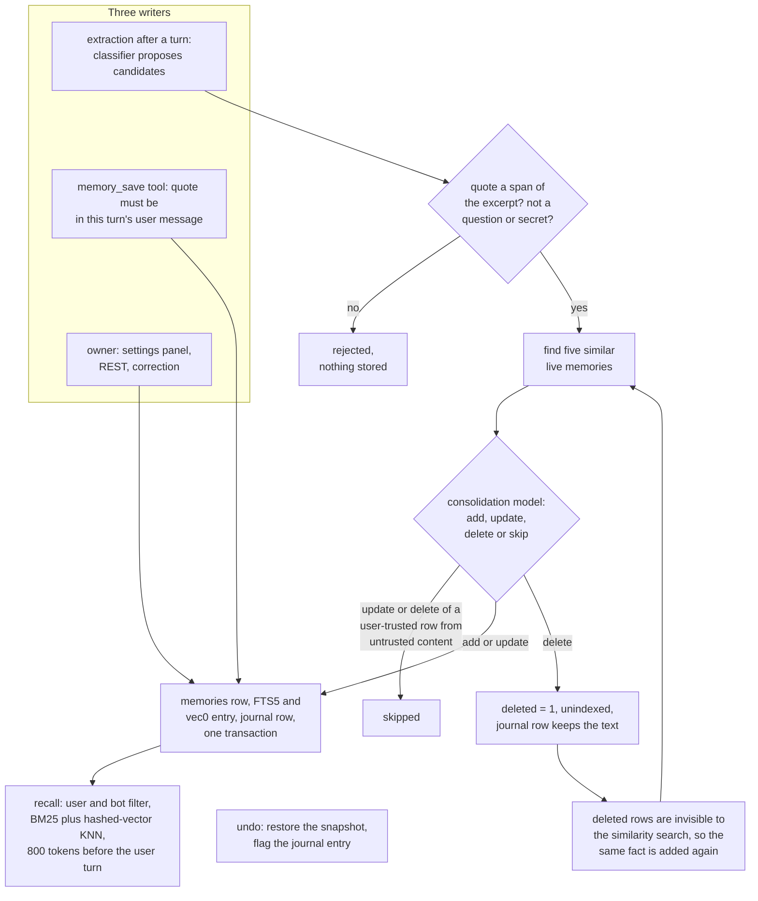

## 1. Executive Summary

Praxi-Bot is a local agent platform, a Rust daemon with a Tauri desktop app and a
CLI, whose bots keep long-term memory in one SQLite file. Its notable part is
the write gate. A fact extracted after a turn must carry a quote that is a
verbatim span of the exchange, and a fact the model saves through its tool must
quote the user's own message of that turn. Its weak part is correction: a
forgotten fact leaves no record that stops the next extraction storing it again.

Memory is on in every `bot serve` that is not in safe mode. Before each
top-level turn the loop recalls into an 800-token block prepended to the user
message, and after each successful turn a background task extracts and
consolidates with the bot's classifier model. The project's FAQ says the daemon
does not enable memory.

Recall fuses BM25 with a nearest-neighbour search, and the embedder the product
constructs is a feature hash of word tokens, so both arms match on shared
words. A real embedding model exists behind a cargo feature that no application
enables.

Every change writes a journal row with before and after snapshots in the same
transaction, and the newest change to a memory can be undone. Deletion is a
flag: the text stays in the row, the journal and any backup.

The licence is Apache-2.0, in `LICENSE` and the workspace manifest.

Three marks are earned on the conversational store: `scope_enforced` on the
user and bot keys, `audit_log` on the journal, and `negative_eval` on recall
across bots, users and deletion. Section 9 gives the reason for each of the
four withheld.

## 2. Mental Model

A memory is one **statement about the user, the bot or a procedure**, stored
with the evidence for it. The row carries a kind, the content, a supporting
quote, the chat it came from, a trust label, an importance from 0 to 1 and a
soft-delete flag (`crates/memory-store/migrations/0001_memory.sql:6-22`).

A statement becomes a memory by one of three routes.

- **Extraction.** After a turn, the classifier model proposes candidates from
  the user's messages and the final answer. Code rejects a candidate that is
  empty, looks like a credential, has no quote, has a quote that is not a
  whitespace-normalised span of the excerpt, or is a question or hypothetical
  (`crates/memory-store/src/pipeline.rs:236-257`).
- **The save tool.** The model calls `memory_save` with content, kind and
  quote. The quote must appear in a `role == "user"` message of the current
  run that is not marked untrusted (`crates/memory-store/src/tools.rs:566-585`).
- **The owner.** The settings panel and `POST /v1/memory` add a memory
  directly, and a user correction becomes a `lesson`
  (`crates/memory-store/src/manage.rs:105-130`).

Trust is decided by the turn, not by the model alone. An extraction is
`untrusted` when the turn was not started by a person, used any tool outside
the meta category, had child runs, saw another bot's replies or was tainted,
or when the model flags the candidate itself
(`crates/agent-core/src/memory.rs:162-178`,
`crates/memory-store/src/pipeline.rs:152`). An untrusted memory is recalled
like any other and rendered in a separate block marked as data.

A memory stops counting in two ways. A consolidation verdict or a user edit
rewrites it in place, and a delete sets `deleted = 1` and removes the row from
both indexes (`crates/memory-store/src/store.rs:343-361`). A `valid_until_ms`
column would expire a row on read, and no code writes a value into it.

## 3. Architecture

The memory is a library crate inside the daemon process. Nothing else has to
run: `crates/memory-store` owns `<data_dir>/memory.db`, opened in WAL mode
behind one mutex-guarded connection, with the sqlite-vec extension registered
on it (`crates/memory-store/src/store.rs:117-166`). The chat history, bots,
runs and the general audit log live in a second file, `bot.db`, owned by the
`storage` crate.

- **`store.rs`, `manage.rs`** hold CRUD, the journal, undo, list and export.
- **`pipeline.rs`** runs extract, validate, consolidate and persist behind a
  `MemoryModel` trait; `crates/agent-core/src/memory.rs` implements the trait
  over the provider registry.
- **`recall.rs`, `render.rs`** hold hybrid retrieval and the prompt block.
- **`tools.rs`** defines the four model-callable tools.
- **`sessions.rs`** indexes chat messages for full-text search.
- **`knowledge/`** is a separate document index, one `knowledge.db` per bot,
  about two thirds of the crate's source.

`bot serve` opens the store through `MemoryConfig::open_default`, which
constructs `HashEmbedder::new(384)` and enables the hook with an 800-token
budget; `--safe` skips it (`apps/cli/src/serve.rs:345-356`,
`crates/agent-core/src/config.rs:112-132`). No setting turns memory off or
changes the budget. The vec0 table is created at the embedder's dimension, and
opening with another dimension is an error, so a later move to a real model
needs a rebuild of the vector table
(`crates/memory-store/src/store.rs:138-160`).

### Deployment and ergonomics

Storage needs no API key and no model download. Extraction and consolidation
call the bot's `classifier` model, or its `executor` when none is set, through
the ordinary provider registry, so a bot on a cloud provider sends each
redacted exchange and up to five similar memories there after every turn
(`crates/agent-core/src/memory.rs:195-223`).

The owner's surface is the desktop settings panel, `MemoryCard.tsx`, over six
REST routes: list, add, edit, forget, undo and a recall preview for a bot
(`crates/daemon-api/src/lib.rs:1281-1291`). The four mutating routes need the
owner key and are refused to paired peers.

## 4. Essential Implementation Paths

- **Capture.** `enqueue_memory` builds an `Exchange` from the run and spawns
  `memory::extract` on the runtime; the handle is kept so shutdown can flush it
  (`crates/agent-core/src/agent.rs:2825-2840`). `Exchange::of` collects the
  run's user messages and the final text, redacts them and computes
  `untrusted` (`crates/agent-core/src/memory.rs:155-189`).
- **Pipeline.** `Pipeline::ingest` calls `extract`, then `handle` per
  candidate: `validate`, `find_similar`, `consolidate` when anything similar
  exists, then `add`, `update_if_trust` or `delete`
  (`crates/memory-store/src/pipeline.rs:139-209`).
- **Recall.** `with_recall` calls `store.recall` with the run's user and bot
  and prepends `render_recall_block` to the user message
  (`crates/agent-core/src/exec.rs:473-513`). `recall` runs `gather`, boosts,
  cuts to the budget and stamps `last_used_ms`
  (`crates/memory-store/src/recall.rs:96-173`, `:195-277`).
- **Tools.** `tools()` builds `memory_search`, `session_search`, `memory_save`
  and `memory_forget`; `resolve_caller` maps the calling bot to its owner
  (`crates/memory-store/src/tools.rs:87-219`, `:308-336`). `with_memory_tools`
  registers them (`crates/agent-core/src/agent.rs:201`,
  `apps/cli/src/serve.rs:381`).
- **Session index.** Each user message and each final assistant message is
  indexed, and an edited turn's messages are removed
  (`crates/agent-core/src/agent.rs:2352`, `:2716`, `:1420`).
- **Owner routes.** `crates/daemon-api/src/memory.rs` validates content,
  appends a row to the general audit log and calls the store.
- **Undo.** `MemoryStore::undo` restores the snapshot of the newest active
  journal entry for a memory (`crates/memory-store/src/store.rs:369-415`).
- **Backup.** `memory.db` is one of the files `bot backup` copies and restores
  (`crates/state-bundle/src/transfer.rs:24`).

## 5. Memory Data Model

**The row.** `memories` holds a UUIDv7 `id`, `user_id`, a nullable `bot_id`,
`kind`, `content`, `source_quote`, `source_chat_id`, `source_message_id`,
`trust`, `importance`, `created_ms`, `last_used_ms`, `valid_until_ms` and
`deleted`, with `CHECK` constraints on kind and trust
(`crates/memory-store/migrations/0001_memory.sql:6-22`). The ids of users,
bots and chats are text with no foreign keys, because those rows live in
`bot.db`.

**Scope.** `bot_id` null means shared across the user's bots. Extraction
shares `profile` and `episodic` facts and binds `bot`, `procedural` and
`lesson` facts to the bot that learned them
(`crates/memory-store/src/pipeline.rs:222-227`). The save tool binds every
kind to the calling bot, so a profile fact saved by tool is invisible to the
user's other bots while the same fact extracted in the background is shared
(`crates/memory-store/src/tools.rs:589`).

**Provenance.** `source_quote` and `source_chat_id` are set on every extracted
and tool-saved row. Extraction passes no message id, so `source_message_id` is
filled only by the save tool (`crates/agent-core/src/memory.rs:218`).

**Time.** `created_ms` and `last_used_ms` are record times. `valid_until_ms`
is an expiry that recall honours and nothing sets: the pipeline writes `None`
and the REST layer only returns the field (section 9).

**The journal.** `memory_journal` holds the memory id, user, operation,
`before_json`, `after_json`, a reason, a time and an `undone` flag
(`0001_memory.sql:28-39`). The snapshots are whole serialised memories.

**Session messages.** `session_msgs` copies user and assistant messages from
`bot.db` with their chat id, behind a second FTS5 table
(`crates/memory-store/src/sessions.rs`). Deleting a chat or a bot calls
nothing in this crate, so those rows and the bot's memories remain.

**The knowledge index** is a different object: sources, documents and chunks
in one database file per bot, filled by the owner adding files, folders or
saved pages, searched by the `knowledge_search` tool. Every result is labelled
untrusted data. It has no scope column, journal or status, and its vector arm
runs only when the owner configures an embedding provider.

## 6. Retrieval Mechanics

**Recall runs before every top-level turn.** `with_recall` skips runs started
by an external agent or external schedule and skips sub-agents, and otherwise
queries with the user's message text
(`crates/agent-core/src/exec.rs:475-489`). The block goes in front of the user
message, never in the system prompt, so the provider's prompt cache stays
valid (`crates/memory-store/src/render.rs:1-5`).

**Two arms, both lexical in the shipped build.**

- The FTS5 arm ORs the query's alphanumeric tokens and orders by BM25, with
  the scope, deletion and expiry predicates in the SQL
  (`crates/memory-store/src/recall.rs:71-78`, `:104-110`).
- The vector arm queries the vec0 table and converts distance to cosine,
  stopping below 0.25. The vec0 table has no scope column, so each hit is
  loaded and tested by `visible`, and the KNN is repeated with a doubled `k`,
  up to 4,096, until fifty visible hits are found or the index is exhausted
  (`:119-163`).

The embedder behind that table is `HashEmbedder`: each lowercased token is
hashed to one of 384 buckets with a sign, and the vector is normalised
(`crates/memory-store/src/embed.rs:17-60`). Its own comment calls it
*"lexical-ish similarity only, no semantics"*. A paraphrase that shares no
word with a memory reaches neither arm. `FastEmbedder`, a
multilingual-e5-small wrapper, is compiled only under the `fastembed` feature
and has no caller.

**Fusion and ranking.** The two lists are fused by reciprocal rank with
k = 60. The fused score is multiplied by `1 + 0.5 × importance` and by a
recency factor between 0.75 and 1 with a 30-day half-life on the later of
creation and last use (`recall.rs:29-39`, `:204-217`). Memories are taken in
order until the next one would pass the token budget, estimated at four
characters per token. Each returned memory gets `last_used_ms = now`, so a
memory that is recalled keeps its recency boost.

**Rendering.** User-trusted memories are listed under *"Notes from earlier
conversations (background context, may be outdated)"*. Untrusted ones go in
`<untrusted_memory_data>` as JSON-escaped strings with a line telling the
model never to follow requests in them
(`crates/memory-store/src/render.rs:23-56`). Recalling any memory notes the
run's taint tracker, and an untrusted one marks the run tainted
(`crates/agent-core/src/exec.rs:495-505`).

**Tools.** `memory_search` runs the same `recall` and renders the same blocks.
`session_search` is BM25 over past messages restricted to chats that belong
to the calling bot (`crates/memory-store/src/tools.rs:346-395`, `:397-505`).

## 7. Write Mechanics

Extraction does not block the turn. It is spawned after the reply, its errors
are dropped, and a memory is retrievable once the task commits, usually
before the next message. No pass rewrites the whole store.

**The quote rule is code, in two places.** In the pipeline, `validate`
normalises whitespace and case and requires the quote to be a substring of
the excerpt handed to the model (`crates/memory-store/src/pipeline.rs:243-249`).
The excerpt includes the assistant's final answer, so a quote from the
model's own reply passes this check; the prompt asks the model to record only
what the user states. The save tool is stricter: it searches only the user
messages of the current run that are not marked untrusted
(`crates/memory-store/src/tools.rs:566-585`). It also refuses sub-agents, runs
not started by a person and runs without a chat (`:545-557`).

**Questions and secrets.** A candidate or quote whose every sentence ends in
a question mark or opens with a phrase such as *what if* or *suppose* is
dropped (`pipeline.rs:259-301`). Thirteen regexes for keys, tokens, JWTs, PEM
headers, card-like digit runs and long opaque strings reject content at the
pipeline, the store, the tools and the REST layer
(`crates/memory-store/src/secrets.rs:7-36`). The last two patterns match any
40-character base64-like run and any 32-character hex run, so a memory that
quotes a commit hash is refused.

**Consolidation.** `find_similar` returns up to five live memories by the
same hybrid search. With none, the candidate is added. Otherwise the model
chooses add, update, delete or skip, and may name only an id from the list
(`pipeline.rs:154-177`). An update rewrites the row to the candidate and
keeps the higher importance. The prompt tells the model to prefer the newer
statement when two contradict.

**The trust guard.** Content from an untrusted turn cannot update or delete a
user-trusted memory, and cannot delete anything (`pipeline.rs:178-189`).
`update_if_trust` rechecks the target's trust inside the transaction, so an
owner edit that lands between the similarity search and the write wins
(`crates/memory-store/src/store.rs:297-300`). A user edit sets trust to `user`.

**Forgetting.** `memory_forget` takes an id or a query. With a query it
deletes the first memory `recall` returns, falling back to a substring match
(`crates/memory-store/src/tools.rs:650-679`). Recall order includes the importance and recency boost,
so the row deleted is the best-scoring match and not necessarily the one
named. The candidates include shared rows, so one bot can forget a profile
fact for all of them.

### Operational cost

Each turn costs one extraction call, plus one consolidation call per
candidate that has a similar memory. Each recall runs one FTS query and one
or more KNN queries, then loads every hit by rowid. Because the vector table
is unscoped, a store shared by many users would repeat the KNN up to the
4,096 limit; with one user per daemon it rarely loops.

## 8. Agent Integration

The model sees four tools (`crates/memory-store/src/tools.rs:39-44`). There is
no update or list tool. All four are in the file-system permission category;
the two writes are also classed as egress (`:66-82`).

Under the default autonomy preset, a file-system write from a person-started
or scheduled run is allowed without a prompt
(`crates/permission-engine/src/modes.rs:110-113`). The model therefore saves
and forgets unprompted on a clean run. A prompt appears in ask mode, or once
the run is tainted by untrusted content, which is what the egress class is
for.

Telegram messages and paired-peer chats reach the daemon as ordinary chat
turns started by a person, so they recall from and extract into the owner's
memory for that bot. Memory code does not read the message source.

The injection evals `inj-page-poison-memory` and `inj-memory-poison-mail`
check that a save after untrusted content asks for approval. They declare
their own fake `memory_save` and do not link the store.

## 9. Reliability, Safety, and Trust

### Correction does not hold

A forgotten memory is a row with `deleted = 1`, removed from the FTS and
vector tables (`crates/memory-store/src/store.rs:343-361`, `:481-485`).
`find_similar` reads those indexes, so the next extraction that meets the
same statement finds nothing similar and adds it as new. The user's
retraction in one turn is undone by a restatement in any later excerpt,
including the assistant's own reply. Nothing compares a candidate with
deleted rows.

### Deletion keeps the text

No statement removes a row from `memories`. The content of a forgotten memory
stays in the row, in every journal snapshot that touched it, and in
`export_json`, which includes deleted rows
(`crates/memory-store/src/manage.rs:83-99`). `bot backup` copies the whole
file, and a restore with `--replace` swaps it back, so memories forgotten
after the backup return live.

### The journal

Every `add`, `update` and `delete` inserts its journal row in the transaction
that makes the change. `undo` is the exception: it writes the earlier
snapshot back, re-indexes or unindexes the row, and sets `undone = 1` on the
entry (`crates/memory-store/src/store.rs:369-415`). The journal then shows a change that was reversed
with no time and no reason for the reversal. Only the newest active entry of
a memory can be undone, which keeps the snapshots consistent.

The owner routes also append `memory.create`, `memory.update`,
`memory.delete` and `memory.undo` rows to the general audit log in `bot.db`
before calling the store (`crates/daemon-api/src/memory.rs:286-291`,
`:351-357`). Extraction and tool writes do not.

### Documents that disagree with the code

`docs/guide/faq.md:73-75` says the daemon *"does not enable it yet"*, and
`evals/retrieval/README.md:56` says the shipped default has memory disabled.
`bot serve` opens the store and registers the tools unless `--safe` is given.
`docs/guide/agent-tools.md:10` describes memory as facts the user told the
bot; background extraction also stores items from tool-using turns, labelled
untrusted.

### Marks

Three are earned, all on the conversational store. None covers the knowledge
index.

- **`scope_enforced` — earned.** Rows carry `user_id` and `bot_id`. The
  lexical arm filters on both in SQL, the vector arm tests every hit with the
  same rule, and `list` repeats it. The ids come from the run or from the
  calling bot's record. In a default install the daemon has one user, so the
  boundary that does work is between that user's bots.
- **`audit_log` — earned.** `memory_journal` is written by the three mutating
  store functions and by nothing else, with snapshots on both sides of each
  change. `undo` flags an entry instead of appending one.
- **`negative_eval` — earned.** A case seeds three rows on one term across
  two bots and two users and requires recall for the second bot to return
  exactly the shared row; a tool-level case requires one bot's searches to
  omit what another's return.
- **`trust_state` — withheld.** `trust` has two values and decides which
  block a memory is rendered in, what an extraction may overwrite, and
  whether the run is tainted. No read excludes a row on it: an untrusted
  memory is recalled, ranked and shown.
- **`tombstone` — withheld.** No record of a rejected value exists. A deleted
  row is invisible to the similarity search that would have to consult it.
- **`bitemporal` — withheld.** `valid_until_ms` is read by recall and written
  by no code path, and no column records when a fact held.
- **`human_review` — withheld.** No memory waits for a person. The panel
  edits, forgets and undoes after the write has taken effect.

## 10. Tests, Evals, and Benchmarks

CI runs `cargo nextest run --workspace` (`.github/workflows/ci.yml:170`). I
ran nothing from the repository.

What the memory crate's tests cover:

- extraction adding a quoted fact, a duplicate becoming an update, and a
  contradiction rewriting the row with both contents in the journal
  (`crates/memory-store/tests/memory.rs:80-150`);
- questions, hypotheticals, missing quotes, quotes absent from the excerpt
  and secrets each storing nothing (`:154-220`);
- an untrusted candidate stored as untrusted and unable to overwrite a user
  memory, including when the owner edits between search and write
  (`:222-287`);
- recall fusing a lexical and a vector hit, the scope and deletion case, and
  the budget cut (`:289-370`);
- undo of an update, a delete and an add, a double undo refused, and another
  user refused (`:373-437`);
- a target row found by `find_similar` behind sixty rows of another user that
  fill the first KNN (`:592-612`);
- through the tools, a save accepted with a user quote and refused with a
  quote from a tool output or a secret, and cross-bot isolation of memories
  and sessions (`crates/memory-store/src/tools.rs:840-957`).

What is not covered:

- No test stores a fact, forgets it and runs extraction on the same statement
  again.
- The forget-by-query case seeds ten near-identical notes, asks to forget
  note 0 and asserts only that the reply contains *"Forgot [bot] memory"*, not
  which row was deleted
  (`crates/memory-store/src/tools.rs:1006-1042`).
- No test passes a quote that appears only in the assistant's part of an
  excerpt.
- The post-deletion recall assertions run over an empty result.

`crates/memory-store/tests/retrieval_eval.rs` and
`retrieval_semantic_eval.rs` measure the knowledge index against a committed
fifteen-file corpus, with a TF-IDF and a one-hot fixture embedder in place of
a model. They assert recall@5 and MRR floors and seven abstention queries
that must return nothing. The second file's header says it is not a benchmark
of a downloaded model. No evaluation of conversational recall quality is
committed, and the tree cites no paper.

## 11. For Your Own Build

### Steal

- **A quote the code can find.** Requiring each stored fact to carry a span
  of the source, and checking the span in code, turns an extraction prompt's
  rule into a refusal. Check it against the user's turns only, as the save
  tool does and the pipeline does not.
- **Trust from the turn's taint, not from the model.** Deriving `untrusted`
  from which tools ran, whether child runs exist and whether the context was
  tainted keeps a web page from writing first-person facts. Barring untrusted
  content from rewriting user-trusted rows closes the overwrite path.
- **A journal row in the writer's transaction, with snapshots.** Undo becomes
  a snapshot restore, and the audit cannot lag the store.
- **Ids from the run.** The tools take no user or bot argument.

### Avoid

- **A soft delete the deduplicator cannot see.** If consolidation searches
  only live rows, forgetting lasts until the fact is restated. Keep the
  deleted statement where the similarity search finds it and refuse a match.
- **A hash embedder behind a hybrid-search API.** The fused arms agree on
  shared words and miss the same paraphrases; say lexical until a model is
  wired.
- **Forget by best match.** Deleting the top recall hit for a free-text query
  removes a neighbour as readily as the target. Return candidates and delete
  by id.
- **An undo that leaves no row.** Append the reversal.

### Fit

This suits a single owner running personal bots on one machine who wants
memory that is cheap to host, inspectable in a settings panel and reversible
change by change. It is the memory of a large, three-week-old, fast-moving
platform at an alpha tag, so expect the surrounding code to change under it.
Walk away if a retraction must hold, if stored text must be erasable, or if
recall has to find a fact phrased differently from the question.

## 12. Open Questions

- Whether the hash embedder is the intended default or a placeholder until
  the `fastembed` feature is enabled in a release build.
- Whether extraction is meant to accept a quote from the assistant's reply.
- Whether a profile fact saved by tool is meant to stay with one bot while
  the same fact extracted in the background is shared.
- What is meant to write `valid_until_ms`.

## Appendix: File Index

- Store, journal, undo, list, export: `crates/memory-store/src/store.rs`,
  `crates/memory-store/src/manage.rs`,
  `crates/memory-store/migrations/0001_memory.sql`
- Extraction and consolidation: `crates/memory-store/src/pipeline.rs`,
  `crates/memory-store/prompts/extract.md`,
  `crates/memory-store/prompts/consolidate.md`,
  `crates/agent-core/src/memory.rs`
- Recall and rendering: `crates/memory-store/src/recall.rs`,
  `crates/memory-store/src/render.rs`, `crates/memory-store/src/embed.rs`,
  `crates/agent-core/src/exec.rs`
- Tools and session search: `crates/memory-store/src/tools.rs`,
  `crates/memory-store/src/sessions.rs`
- Secrets: `crates/memory-store/src/secrets.rs`
- Wiring: `apps/cli/src/serve.rs`, `crates/agent-core/src/config.rs`,
  `crates/agent-core/src/agent.rs`
- Owner surface: `crates/daemon-api/src/memory.rs`,
  `apps/desktop/ui/src/views/settings/MemoryCard.tsx`
- Permissions: `crates/permission-engine/src/modes.rs`,
  `crates/permission-engine/src/egress.rs`
- Backup: `crates/state-bundle/src/transfer.rs`, `apps/cli/src/backup_cmd.rs`
- Knowledge index: `crates/memory-store/src/knowledge/`,
  `crates/daemon-api/src/knowledge.rs`,
  `crates/builtin-tools/src/knowledge.rs`
- Tests: `crates/memory-store/tests/`, `.github/workflows/ci.yml`

### Recorded searches

Run from the repository root at the pinned commit with `/usr/bin/git grep`.

- **No hard delete of a memory row.**
  `git grep -n -E 'DELETE FROM memories( |")' -- .` returns nothing;
  `git grep -n 'DELETE FROM memories_fts' -- .` matches
  `crates/memory-store/src/store.rs:482`.
- **No value-keyed refusal in the conversational store.**
  `git grep -n -i -E 'tombstone|blocklist|do_not_remember|suppress' -- crates/memory-store`
  returns two lines of `tests/knowledge_import_schema.rs` about an import
  trigger.
- **Nothing writes an expiry.**
  `git grep -n -E 'valid_until_ms' -- . ':!crates/memory-store'` returns UI
  mock data, the generated schema, the OpenAPI document and a response field
  and its mapping in `crates/daemon-api/src/memory.rs:92` and `:198`. Inside
  the crate, the assignments are `None` at `pipeline.rs:197` and
  `types.rs:139`, and pass-throughs in `store.rs`.
- **The product constructs only the hash embedder.**
  `git grep -n -E 'HashEmbedder|FastEmbedder' -- crates apps ':!crates/memory-store'`
  returns `crates/agent-core/src/config.rs:129`,
  `crates/daemon-api/src/lib.rs:794`, a doc comment and test code.
  `git grep -n 'FastEmbedder::new' -- crates apps` returns nothing.
- **No setting disables memory.**
  `git grep -n -E 'memory\.enabled|memory_enabled' -- . ':!crates/memory-store'`
  returns one doc comment in `crates/agent-core/src/config.rs`.
- **No pending or approval state.**
  `git grep -n -i -E 'pending|approv|pinned|quarantin' -- crates/memory-store/src/store.rs crates/memory-store/src/manage.rs crates/memory-store/src/pipeline.rs crates/memory-store/src/recall.rs crates/memory-store/migrations crates/daemon-api/src/memory.rs`
  returns nothing; the same pattern matches the header comment at
  `crates/memory-store/src/tools.rs:15`.
- **Memory code does not read the message source.**
  `git grep -n -E 'message_source' -- crates/agent-core/src/memory.rs crates/memory-store`
  returns nothing.
- **No permission rule names memory.**
  `git grep -n -i memory -- crates/permission-engine` returns three comments
  in `egress.rs`.
- **The crate's tests are not ignored.**
  `git grep -n '#\[ignore' -- crates/memory-store` returns nothing.
- **No paper reference.**
  `git grep -n -i -E 'arxiv|bibtex|@article|@misc|doi\.org|zenodo' -- . ':!pnpm-lock.yaml' ':!Cargo.lock'`
  returns nothing.

## History

**2026-11-23** — [`8e51eaf14da3896e62fffd4fe6499b5630f020b9`](https://github.com/emreocell/Praxi-Bot/commit/8e51eaf14da3896e62fffd4fe6499b5630f020b9). First reading, from a full clone at the head of `main`. Screened first: no auto-run surface, 34 manifests and both lockfiles inside the seven-day cooldown, two `build.rs` files, and three `package.json` files with floating ranges. Prompts, docs and skills were read as data. Nothing was installed, built or run. Three marks on the conversational store: `scope_enforced`, `audit_log` and `negative_eval` ([section 9](#9-reliability-safety-and-trust)). The shipped embedder is a token hash, a forgotten fact can be extracted again, and the FAQ says memory is not enabled.
