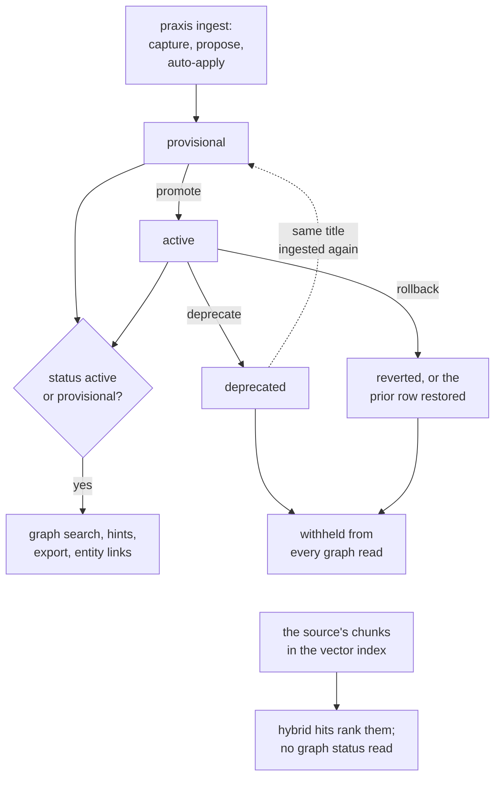

## 1. Executive Summary

Praxis is a local-first Python package and CLI that captures documents, notes,
web pages and connector queries into SQLite, then serves them to an agent as
ranked, source-linked context. It keeps two kinds of memory side by side: a
chunk index for search, and a SkillGraph of nodes, edges and evidence whose
rows carry a lifecycle status. Every graph mutation is recorded as a change set
with before and after JSON per object, and rollback refuses to overwrite an
object that moved since. Nothing in the write path calls a language model. What
is weak is the join between the two kinds. Hybrid search returns chunks, and no
chunk read consults graph status. Deprecating or rolling back a source removes
its graph hints and leaves its text in the results. Ingesting a source with the
same title again resets a deprecated node to provisional.

The Reach and Agency layers add per-client evidence cards read through a client
filter, and a client delete that is planned, confirmed, quarantined and
receipted. The filter covers only the Reach files. Core search, where an
evidence card can be copied, has no client key at all.

**Licence.** MIT, in `LICENSE`, `pyproject.toml` and `CITATION.cff`, which
agree; the copyright line names "Praxis contributors" rather than a person or
entity. The one component under other terms ships inside the installed package:
`pyproject.toml` lists `demo_data/stackoverflow_developer_survey/*` as package
data, and that excerpt is derived from Stack Overflow survey data under
*ODbL 1.0 for the survey database; DbCL 1.0 for database contents*, with
attribution required (`src/praxis/demo_data/stackoverflow_developer_survey/source_manifest.json:40-45`).
The README beside it asks redistributors to preserve those terms. `LICENSE`
does not mention it.

## 2. Mental Model

A source becomes memory in three forms. Its text is captured to disk with a
content hash and registered in `source_registry`. Its files are later chunked
into `semantic_chunks` with FTS5 rows and embeddings. And `praxis ingest` turns
it into a SkillGraph proposal: one node named after the source, evidence
pointing at the capture, and `relates_to` edges to a fixed list of ten concepts
matched by keyword (`src/praxis/commands/propose_graph_update.py:15-26`,
`:84-122`). Only the third form has a belief state.

A graph object's `status` moves through five values. Ingest writes
`provisional`. `promote` sets every object in a change set to `active`, and
`deprecate` to `deprecated` (`src/praxis/commands/change_graph_status.py:14-19`).
Rollback restores each object's prior row or, for an object the change set
created, sets `reverted` (`src/praxis/commands/graph_audit.py:432-440`). A
dedupe merge sets the duplicate to `merged`. Graph reads keep `active` and
`provisional` and drop the rest (`src/praxis/commands/graph_audit.py:15`).

The provisional stage is a default rather than a gate. Provisional rows are
served by every graph read beside active ones, and `praxis propose
--graph-status active` followed by `praxis apply` writes active rows directly
(`src/praxis/commands/propose_graph_update.py:238`). A node stops being believed
by being deprecated, rolled back or merged. That decision is keyed on the node
id, and the id is derived from the source title (`:146`), so the next ingest of
a source with that title writes `provisional` over `deprecated`.

Memory is user- or agent-driven through the CLI. Nothing runs in the
background, and nothing extracts from a conversation.

## 3. Architecture

Praxis is a Python package with a `praxis` entry point whose dispatcher runs
one of 39 command scripts with `runpy` (`src/praxis/cli.py:15-55`, `:58-93`).
State lives under `workspace/` in the checkout, or under a root named by
`PRAXIS_ROOT` (`src/praxis/paths.py:17-36`, `:72-85`):

- `kg/skill_graph.sqlite` — the graph, the source registry and captures,
  proposals, change sets, claim records and the conflict ledger
  (`bootstrap/kg/schema.sql`).
- `vectors/semantic_index.sqlite` — documents, chunks, the FTS5 table,
  embeddings, retrieval logs, and the entity and relationship-evidence tables
  (`src/praxis/commands/vector_common.py:59-143`).
- `db/praxis.sqlite` — a seeded research library of sources, patterns and
  failure modes that `export-skill-refs` writes into skill reference files.
- `reach/` and `agency/` — evidence cards, query manifests, context packs and
  client capsules as JSON and Markdown; `governance/governance.sqlite` and
  `authority/` hold policy receipts and authority anchors.

### Deployment and ergonomics

`python3 -m pip install -e .` and `praxis bootstrap` initialize the stores,
chunk, embed with the local hash model and run the doctor
(`src/praxis/cli.py:96-110`). No service runs and no key is needed: the default
embedding is a 384-dimension hashed bag of features
(`src/praxis/commands/vector_common.py:618`), and OpenAI embeddings are opt-in.
Optional extras pull PDF, OCR, speech-to-text and Google connector libraries.
The stores are plain SQLite and the captures plain files, so a person can read
and repair them by hand, and the change-set log makes a bad graph edit
reversible without that.

## 4. Essential Implementation Paths

- **Capture and ingest.** `ingest_source.main` calls `capture_source`, then
  `build_graph_proposal` with `proposal_status="auto_proposed"` and
  `graph_status="provisional"`, then `apply_proposal` in `auto` mode
  (`src/praxis/commands/ingest_source.py:31-58`). A `high` risk level refuses
  without `--allow-high-risk` (`src/praxis/commands/apply_graph_update.py:40-42`).
- **Apply.** `apply_proposal` opens a change set, runs `audited_upsert` for
  each evidence row, node and edge, marks the proposal applied, copies it to
  `research/applied/`, and runs a conflict scan on the change set
  (`src/praxis/commands/apply_graph_update.py:62-125`).
- **Lifecycle.** `change_change_set_object_statuses` opens a new change set and
  logs a `status:` item per object (`src/praxis/commands/graph_audit.py:283-374`).
  `rollback_change_set` checks every item's `after_json` against the current
  row, refuses on any mismatch without `--force`, and writes its own change set
  (`:385-458`).
- **Index.** `chunk_sources.default_files` collects capture files, exports,
  notes, source JSON and watchlists from disk (`src/praxis/commands/chunk_sources.py:83-110`);
  `index_vectors` embeds pending chunks.
- **Search.** `hybrid_search.main` takes graph hints, vector hits and FTS5 hits,
  fuses them, rescores by context priority and logs the query
  (`src/praxis/commands/hybrid_search.py:448-472`).
- **Conflicts.** `scan_change_set` runs source dedupe, entity dedupe and claim
  contradiction scans, and `insert_conflict` writes typed records
  (`src/praxis/commands/conflict_ledger.py:192-249`, `:513-541`).
- **Client deletion.** `delete_client` follows a delete plan, quarantines files,
  and deletes the client's Reach source rows and chunks
  (`src/praxis/agency/lifecycle_artifacts.py:229-266`).

## 5. Memory Data Model

The SkillGraph has `nodes`, `edges`, `evidence`, `aliases` and tags, each row
with a text `confidence` and a `status` (`bootstrap/kg/schema.sql:3-48`). A
source's confidence is derived from its credibility score and is `low` or
`medium`, never `high` (`src/praxis/commands/propose_graph_update.py:64-70`).
`graph_change_sets` carries action, mode, actor, source, capture and proposal
ids, a status and `reverted_at`; `graph_change_items` carries object type and
id, operation, and the full row as `before_json` and `after_json`
(`bootstrap/kg/schema.sql:106-131`).

`claim_records` derives a subject key and a polarity from node summaries by
word lists, and `conflict_records` plus `conflict_items` hold typed findings:
`duplicate_source`, `duplicate_content`, `duplicate_entity` and
`contradiction` (`src/praxis/commands/conflict_ledger.py:17-80`, `:371-437`).

The vector database holds chunks with `source_id`, `capture_id`,
`graph_node_ids_json`, a `confidence` and a `status` that no code sets to
anything but its `active` default. Entity mentions, resolution candidates,
evidence annotations and relation candidates carry `candidate`, `accepted` and
`needs_review` states. Reach evidence cards are JSON with `client_id`,
`query_id`, `fresh_at`, metrics, per-metric lineage, conflicts, a confidence
score and a redaction status (`src/praxis/reach/evidence.py:20-48`).

Time is record time throughout. `fresh_at` on an evidence card is the clock at
creation (`src/praxis/reach/evidence.py:209`). A query's reporting window is
kept in its `params`, and `latest_evidence` selects by client and query and
sorts by `fresh_at` (`:310-318`), so nothing reads the window as a validity
period.

## 6. Retrieval Mechanics

`praxis search` returns chunks. Vector hits score cosine similarity over every
embedding with `status = 'active'` for the model, in Python
(`src/praxis/commands/semantic_search.py:40-60`). Keyword hits take the FTS5
BM25 order and convert rank to `1/(i+1)` (`:63-84`). Graph hints are nodes
whose name, summary or alias matches the query with `LIKE`, filtered to live
statuses (`src/praxis/commands/hybrid_search.py:34-81`). The fusion weights
default to 0.45 vector, 0.45 keyword and 0.10 graph, plus 0.15 for entity
links when `--entity-aware` is set (`:424-428`).

Context priority then rescores each hit as `0.55 relevance + 0.15 trust +
0.10 freshness + 0.10 graph + 0.10 status − conflict penalty`, with the penalty
capped at 0.55 (`src/praxis/context_priority.py:129-151`, `:193-200`). The
status term reads the chunk's and the source registry's `status` columns
(`:166-170`). `STATUS_SCORES` gives `deprecated`, `reverted` and `merged` 0.0
(`:18-31`), but those are graph values: chunks are only ever `active`, and
source rows only `active` or `stale_pending_refresh`. A chunk of a deprecated
source keeps its full priority.

`praxis graph` searches and traverses the SkillGraph, with `neighbors` and an
undirected `path` search, all filtered to live statuses unless
`--include-inactive` is given (`src/praxis/commands/search_skill_graph.py:32-49`,
`:93-117`, `:172-189`). Relationship queries read `accepted_graph_edges` with
`status = 'accepted'` by default (`src/praxis/relationship_evidence/query.py:28-40`),
and entity-aware search uses only accepted mention links
(`src/praxis/entities/storage.py:424`).

## 7. Write Mechanics

Writes are synchronous CLI runs. `ingest` captures, proposes and applies in
one process, and the graph change is visible to the next graph read. Text
becomes searchable only after `praxis chunk` and `praxis embed` run; ingest
does not call them. No background pass rewrites the store. `praxis refresh
--mark-stale` sets sources past their freshness window to
`stale_pending_refresh` when someone runs it.

Extraction is deterministic. Concept edges come from substring matches on a
fixed keyword table, entities and relations from pattern extractors scored
against an ontology, and claim polarity from word lists. Relation candidates
below 0.70 confidence, outside the ontology or in conflict with a
single-valued predicate become `needs_review` with a review item; the rest are
written as accepted edges (`src/praxis/relationship_evidence/promotion.py:39-96`).

`upsert_node` replaces every column, status included, on an id conflict
(`src/praxis/commands/init_skill_graph.py:56-95`, `:75`), and `apply_proposal`
does not read the current status first. A re-ingest by the same title therefore
moves a deprecated or promoted node to `provisional`, and the change item
records it as an `update`. `praxis init-graph` re-upserts the seed graph through
the same function with no change set (`:341-362`).

`praxis add-note` writes a Markdown note and refuses bodies containing `sk-`,
`api key`, `password=` or `secret=` (`src/praxis/commands/add_memory_note.py:62-63`).
Its `--status` defaults to `reviewed` and is written into the note's text,
where nothing reads it (`:58`).

## 8. Agent Integration

The agent's surface is the CLI. No MCP server, hook or tool registry is in the
tree; `adapters/` holds Markdown design notes, and the Codex note lists the
commands an exported skill should expose, rollback among them
(`adapters/agents/codex/README.md`). An agent that can run `praxis` can ingest,
promote, deprecate, roll back, resolve conflicts and merge duplicates. Every
mutating graph verb takes `--actor`, a free string defaulting to `praxis` and
recorded without a check (`src/praxis/commands/change_graph_status.py:28`).

`export-graph` and `export-skill-refs` write Markdown into a skill folder. The
graph export is filtered to live statuses, so provisional rows from an
auto-ingest reach exported skills; `--fail-on-open-conflicts` refuses the
export while any conflict is open (`src/praxis/commands/export_skill_graph.py:38-48`,
`:197-203`). Context reaches the model only when the agent runs a search or
reads an export.

## 9. Reliability, Safety, and Trust

### What deprecation reaches

Deprecate, rollback and merge withhold an object from graph search, graph
hints, export and entity resolution. They do not reach the chunk index:
`semantic_search.py` and `chunk_sources.py` never read graph status, and chunks
are rebuilt from the capture files on disk, which deprecation leaves in place.
A source a reviewer rejected stays retrievable as text at full priority. For a
Core source, only removing its capture files and re-chunking takes it out; the
Agency delete does that for Reach evidence.

### Conflict resolution

`conflicts resolve` sets a status and a free-text resolution with no actor
(`src/praxis/commands/conflicts.py:94-117`). The next scan of the same items
reads that record and opens a new conflict with `previous_conflict_id` instead
of respecting it (`src/praxis/commands/conflict_ledger.py:209-214`), and scans
run on every apply and promote. A `keep_both` decision on a duplicate therefore
reopens the next time the change set is promoted. The suite asserts this
behaviour (`tests/test_release_hardening.py:589-623`).

### Client deletion

The Agency delete is guarded at each step: a delete plan, an
exact `--confirm-client`, a typed `DELETE`, a quarantine directory and a
receipt, and a separate `PURGE` to empty the quarantine
(`tests/test_reach_agency.py:1050-1156`). It deletes the client's
`source_registry` rows and chunks, matched by parsing the source id
(`src/praxis/agency/lifecycle_artifacts.py:198-202`, `:229-266`). It does not
touch `nodes`, `evidence` or `graph_change_items`. If a client's evidence was
ingested into the graph, its node summary survives the delete in the node row
and in the change items' JSON.

### Marks

- **`trust_state`** — awarded on graph `status`. `deprecated`, `reverted` and
  `merged` are excluded from every graph read, and the value moves only through
  promote, deprecate, rollback and merge. Two limits: `provisional` is served
  beside `active`, and the chunk index never reads the field.
- **`scope_enforced`** — awarded on `client_id` in Reach evidence cards, applied
  by `list_evidence` and `latest_evidence`, which every context pack reads. The
  client is a CLI argument the caller chooses, `reach evidence list` without
  `--client` returns every client, and Core chunks, the graph and conflicts have
  no client key.
- **`audit_log`** — awarded on change sets and items: before and after JSON per
  object, inserted and never deleted. The seed re-upsert in `init-graph` writes
  outside it, rollback and conflict scans update the set header in place, and
  conflict resolutions are not logged.
- **`negative_eval`** — awarded; see section 10.
- **`tombstone`** — withheld. Deprecation is keyed on the node id and the next
  ingest overwrites it; a resolved conflict reopens as a recurrence; a
  suppressed relationship review item is keyed on the candidate.
- **`human_review`** — withheld. Ingest is served at once as provisional, and
  promote is a CLI verb the producing caller holds with an unverified
  `--actor`. Relationship candidates do wait in `needs_review`, but
  `review resolve` changes only the review item. The one path that accepts
  them is `promote --status needs_review`, which re-runs the same checks with a
  caller-set `--min-confidence`.
- **`bitemporal`** — withheld. Every timestamp is record time.

## 10. Tests, Evals, and Benchmarks

The suite has 70 `unittest` methods. Most drive the CLI in a subprocess
against a temporary workspace built from the bootstrap files, and CI runs them
on Python 3.9 and 3.12 (`.github/workflows/ci.yml:1-34`). No test skips itself.
I ran none of it.

`negative_eval` rests on two committed cases:

- `tests/test_reach_agency.py:1050-1156` creates two clients, runs a query for
  each, deletes one through the plan, and asserts the evidence list contains
  the surviving client's card and not the deleted client's (`:1127-1129`).
- `tests/test_release_hardening.py:459-482` ingests a source, finds it with a
  graph query as `provisional` and then as `active`, deprecates the change set,
  asserts the same query returns no node, and finds it with
  `--include-inactive` as `deprecated`. The negative result is empty; the
  earlier positives on the same query are what keep it from passing on a
  broken search.

Rollback has a refusal test and a forced-rollback test (`:484-502`), dedupe
merge and split are covered (`:684-711`), and context priority is checked to
penalise a stale or conflicted row (`:419-447`). No test asserts that a
deprecated source's chunks leave `praxis search`, which section 9 shows they do
not, or that a re-ingest preserves `deprecated`.

`praxis eval` runs a handful of hard-coded queries with expected substrings
(`src/praxis/commands/eval_retrieval.py`); no result is committed. No paper is
associated with the project; `CITATION.cff` cites the repository as software.

## 11. For Your Own Build

### Steal

- **Log the whole row before and after.** A change item holding both JSON
  snapshots makes rollback a replay and lets the rollback check whether the
  object moved since. Praxis refuses rather than guesses when it has.
- **Make the lifecycle verbs change sets too.** Promote and deprecate record
  themselves the way apply does, so "who downgraded this" has the same answer
  shape as "who wrote this".
- **Plan, confirm, quarantine, receipt.** A destructive client delete that
  writes a plan first, needs the exact name and a typed word, moves files to
  quarantine and leaves a receipt is cheap to build and hard to fire by
  accident.

### Avoid

- **A rejection keyed on a derived id.** If the id comes from the title and the
  writer upserts status, the next ingest undoes the reviewer. Read the current
  status in the writer, or key the rejection on the content.
- **Belief state on the layer the agent does not read.** If retrieval returns
  chunks, a status on graph nodes has to reach the chunks, as a filter or at
  least as a score, or deprecation is cosmetic for search.
- **A review queue whose resolution moves nothing.** Resolving a review item
  should accept or reject the candidate it names, or the queue only grows.

### Fit

Praxis suits one person or a small team that wants a local, inspectable corpus
of documents and research, with source trails and reversible graph edits, and
is willing to drive it from a shell. It needs no service, no key and no GPU.
It does not suit conversational memory: nothing extracts from a session or
keeps a user profile. Walk away if several clients' data must stay apart in
search, since only the Reach files carry a client key. Walk away too if a
rejected source must stop appearing in answers, because the chunk index does
not know it was rejected.

## 12. Open Questions

- Whether the chunk index is meant to follow graph status, given that the
  README lists active and deprecated status among the ranking signals.
- Whether re-ingest is meant to reset a deprecated or promoted node to
  provisional.
- What `review resolve` on a relationship review item is meant to do to the
  candidate.
- How the adapters will expose the CLI to an agent, and whether promote and
  deprecate will be on that surface.

## Appendix: File Index

- Graph and audit: `bootstrap/kg/schema.sql`, `src/praxis/commands/graph_audit.py`,
  `src/praxis/commands/init_skill_graph.py`, `src/praxis/commands/apply_graph_update.py`,
  `src/praxis/commands/change_graph_status.py`, `src/praxis/commands/rollback_graph_change.py`
- Write path: `src/praxis/commands/ingest_source.py`, `src/praxis/commands/research_source.py`,
  `src/praxis/commands/propose_graph_update.py`, `src/praxis/commands/add_memory_note.py`
- Index and retrieval: `src/praxis/commands/chunk_sources.py`, `src/praxis/commands/vector_common.py`,
  `src/praxis/commands/semantic_search.py`, `src/praxis/commands/hybrid_search.py`,
  `src/praxis/context_priority.py`, `src/praxis/commands/search_skill_graph.py`
- Conflicts and dedupe: `src/praxis/commands/conflict_ledger.py`, `src/praxis/commands/conflicts.py`,
  `src/praxis/commands/dedupe.py`
- Entities and relationships: `src/praxis/entities/`, `src/praxis/relationship_evidence/`
- Reach and Agency: `src/praxis/reach/evidence.py`, `src/praxis/reach/context.py`,
  `src/praxis/commands/reach.py`, `src/praxis/agency/lifecycle.py`,
  `src/praxis/agency/lifecycle_artifacts.py`
- Governance: `src/praxis/governance/storage.py`, `src/praxis/governance/policy.py`
- Tests: `tests/test_release_hardening.py`, `tests/test_reach_agency.py`,
  `tests/test_relationship_evidence.py`

### Recorded searches

Run from the repository root at the pinned commit with `/usr/bin/git grep`.

- **No MCP surface.** `git grep -n -i -E 'mcp|fastmcp|modelcontextprotocol' -- src pyproject.toml`
  returns nothing; `git grep -c -i 'openai' -- src/praxis/commands/vector_common.py`
  counts 9.
- **Nothing deletes from the change log.** `git grep -n -E 'DELETE FROM graph_change' -- src`
  returns nothing; `git grep -c -E 'DELETE FROM semantic_chunks' -- src/praxis/commands/chunk_sources.py`
  counts 4.
- **Chunk reads carry no graph status.**
  `git grep -n -E 'LIVE_STATUSES|live_status_clause' -- src/praxis/commands/semantic_search.py src/praxis/commands/chunk_sources.py`
  and `git grep -n -E 'UPDATE semantic_chunks' -- src` return nothing; the
  first pattern over `src/praxis/commands/hybrid_search.py` matches lines 17
  and 49.
- **Source rows never take a graph status.** `git grep -n -E 'UPDATE source_registry' -- src`
  matches `src/praxis/commands/refresh_stale_sources.py:85`, which writes
  `stale_pending_refresh`, and `src/praxis/commands/research_common.py:194`,
  which writes the current capture and check time.
- **No validity-time field.**
  `git grep -n -i -E 'valid_from|valid_to|valid_until|valid_at|as_of|event_time|occurred_at' -- src bootstrap`
  returns nothing; `git grep -c 'fresh_at' -- src/praxis/reach/evidence.py`
  counts 8.
- **Review resolution does not move a candidate.**
  `git grep -n -E 'set_candidate_status\(' -- src` matches only
  `src/praxis/relationship_evidence/promotion.py:65`, `:88` and the definition
  at `src/praxis/relationship_evidence/storage.py:209`.
- **Core search has no client key.**
  `git grep -n -i 'client' -- src/praxis/commands/hybrid_search.py src/praxis/commands/semantic_search.py src/praxis/commands/search_skill_graph.py`
  returns nothing; `git grep -c 'client_id' -- src/praxis/reach/evidence.py`
  counts 10.
- **Client deletion leaves the graph.**
  `git grep -n -E 'DELETE FROM (nodes|edges|evidence|graph_change_items)' -- src`
  returns nothing; `git grep -n -E 'DELETE FROM source_registry' -- src`
  matches `src/praxis/agency/lifecycle_artifacts.py:237`.
- **No actor check.** `git grep -n -E 'isatty|getpass|getuser' -- src` returns
  nothing; `git grep -n -E 'add_argument\("--actor"' -- src/praxis/commands`
  matches the apply, status-change and dedupe parsers among others.
- **No paper, no rename.** `git grep -n -i -E 'arxiv|bibtex|@article' -- README.md docs CITATION.cff`
  and `git grep -n -i 'renamed' -- README.md CHANGELOG.md docs` return
  nothing; `git grep -c -i 'arxiv' -- bootstrap/db/schema.sql` counts 1.

## History

**2026-11-21** — [`9a10de4fffbe679cdb9ed7af2e199c590d10ef5a`](https://github.com/sparkplug604/praxis/commit/9a10de4fffbe679cdb9ed7af2e199c590d10ef5a) — first reading, from a clone of `main`, covering the SkillGraph write, audit and lifecycle paths, chunking and hybrid search, the conflict ledger, relationship evidence, the Reach evidence and Agency deletion paths, and their tests; intake converters and live connectors were read only where they write what those paths read. Screened first: no auto-run surface; three build-time execution points, `setup.py`, `scripts/setup.py` and `src/praxis/commands/setup.py`; one unpinned surface, `pyproject.toml` with no lockfile. MIT, no rider. Nothing installed, built or run. Four marks: `trust_state`, `scope_enforced`, `audit_log`, `negative_eval`.
