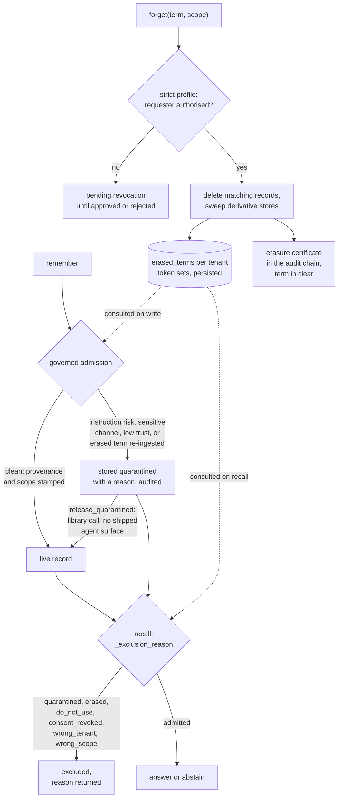

## 1. Executive Summary

Provem is positioned not as a memory but as a **governance layer over one**:
right-to-erasure, tenant and subject isolation, injection quarantine and a
tamper-evident audit, able to run over Mem0 or Graphiti or over its own SQLite
store. What is notable is that erasure is a registry of erased values consulted
on write and on recall, beside a replay script that asserts every published
number. What is weak is authority: over MCP the caller supplies the source,
trust, consent and requester that several of the checks decide on, and the
erased term itself stays in the audit chain in clear. Its README states the
thesis in a sentence: the hard question is no longer *"can I find it?"* but
*"am I allowed to use it?"*

It carries **all seven capability marks**. Where [Verel](../verel/) arrived at
them under red-team pressure, Provem arrived at them because a regulation names
each one.

**The evidence practice is the most disciplined in the corpus.** The repository
ships `scripts/verify_repro.sh`, described in its own header as a *"self-checking
EUR-0 replay of every published benchmark number"* that *"ASSERTS the exact
published values; any missing input or drifted number exits non-zero."* Run from
a clean clone at `fc722f0` and again at `9cc7401`, both on 4 August 2026:

```text
== dataset integrity ==  == baseline ==  == optimized ==  == post empty-fix ==
== headline ==  == three-system scoreboard v1 ==  == v2 ==
== neutral-prompt control (prompt-confound disclosure) ==  == manifest freshness ==
VERIFY OK (21 assertions)
```

and with `--full`, which adds the deterministic governance benchmark and the unit
tests, **VERIFY OK (25 assertions)**, exit 0. This is a stronger artifact than
anything else here: not a harness a reader may run, but a regression gate that
fails if the README drifts from the numbers.

**It publishes its losing configurations.** The tier table lists four
deployments, and two of them lose: the stdlib-retrieval tier scores 0.388 *"below
Mem0"*, and the fully keyless tier scores 0.21 against a stated **0.24
no-memory baseline** — a configuration that is worse than having no memory at
all, published in the same table as the recommended tier's 0.614.

**It discloses a confound in its own favour-adjacent result.** One replay step is
named *"neutral-prompt control (prompt-confound disclosure)"*, and the README
marks the abstention gap against Mem0 as *"a statistical tie and
prompt-confounded"*. It also configured the Zep comparison *"following its own
published evaluation checklist… to pre-empt the misconfiguration critique it
raised against Mem0's paper"*, and closes with *"We rank only what we measured."*

**And `docs/claim_register.md` records claims it has rejected.** One row reads
`Unsupported` with the evidence column literally `None (ai4privacy download
pending license review)` and the disposition *"Rejected for now; scope track runs
only on committed fixtures until a licensed real PII set is approved."* A claim
register that carries a rejected claim is the artifact this atlas has been
describing in the abstract for months.

Reservations. The governance benchmark that produces the headline compliance
numbers is self-authored, which the repository says plainly. The erasure
certificate records the erased term in clear inside a chain that cannot be
edited, so the log of a deletion holds what was deleted. And the authority
checks trust their caller: a strict-revocation profile compares a `requester`
string with the subject named in the same call.

It is Apache 2.0 licensed, with `license = "Apache-2.0"` and
`license-files = ["LICENSE"]` declared in `pyproject.toml` rather than left to a
stray file — so the metadata and the file agree, which is more than several
systems here manage.

`LICENSING.md` states the boundary in the project's own words: an **"open engine,
closed operations"** model, under which "everything the published benchmarks and
compliance claims rest on stays open, so anyone can reproduce and audit them" —
the governed memory engine, policy evaluation, tombstones, erasure, revocation
and requester authority, and the purpose stack. That is the right half to keep
open for a system whose product is governance, and it is worth reading beside
section 10: the claims are only checkable while the code behind them is.

## 2. Mental Model

A fact is admitted or quarantined, ranked or excluded with a reason, and erasure
leaves behind a durable token set that outlives the records it deleted.



The dotted edges are the mark most systems here lack. `forget` does not only
delete: it tokenizes the term and persists the token set to a per-tenant
`erased_terms` registry. Every later write whose tokens are a **superset** of an
erased set is stored quarantined, and every later recall excludes any stored
record that is. Deleting the rows removes what exists; keeping the token set is
what survives the next ingest.

## 3. Architecture

Fifty-two Python files under `src/cognitive_memory/`. The governance core is
`reliability.py` (admission, erasure, exclusion), `compliance.py` (regime
profiles, erasure modes), `policy.py`, `scope.py`, `safety.py`, `audit.py` and
`review.py`. Around it sit `retrieval.py`, `ranking.py`, `temporal.py`,
`reflection.py`, `consolidation_eval.py` and an answerer stack. `adapters/`
carries the Mem0 and Graphiti bridges, a SQLite backend and mocks.
`mcp_server.py` serves the governed engine as ten tools, and `dsar.py` with
`dsar_gateway.py` carries data-subject requests from plan to certificate.

Two memory models live side by side. `GovernedMemory` in `reliability.py`
holds `MemoryRecord`s and is what MCP and the DSAR service drive. The older
`MemoryController` holds `TemporalFact`s, reflections and the sleep cycle, and
is what the CLI demos and the consolidation evaluation drive.

`docs/` is unusually load-bearing: a claim register, a research journal
documenting *"every synthetic suite, every negative result"*, an optimization log
covering *"every optimization iteration incl. failures and the bug post-mortem"*,
a trust model naming what belongs in a gateway instead, a ship report with full
limitations, and `docs/runs/` holding the frozen artifacts and manifest.

### Deployment and ergonomics

Four tiers, with their costs stated: keyless and air-gap-safe (and worse than no
memory), stdlib retrieval with an LLM answerer, dense with an embeddings key
(*"cents per conversation, disk-cached"*), and local embeddings marked
**"projected, unbuilt"**. Marking an unbuilt tier as projected in the same table
as measured ones, rather than omitting it, is the same instinct as publishing the
losing rows.

The compliance profiles are configuration: a HIPAA-style profile is described in
`compliance.py` as *"PHI: MRN/patient identifiers, consent required, strict
erasure, long adverse-event retention"*, with `erasure_mode` validated to
`strict` or `lenient` and a config error otherwise.

## 4. Essential Implementation Paths

### A replay that asserts instead of printing

`scripts/replay_report.sh` is four lines that exec `verify_repro.sh`, kept as the
documented entry point because *"the replay is now self-checking — it ASSERTS
every published number instead of just printing them."*

The script `require`s each frozen input by path, runs each step, and `expect`s
verbatim strings in the output, counting assertions. A missing artifact exits 1
before anything runs; a drifted number exits 1 at the step that produced it.

The dataset is handled the way this atlas asks for and almost never sees.
LoCoMo is CC BY-NC, so it is not redistributed; `scripts/fetch_locomo.sh`
downloads it from the authors' repository, verifies it against a **sha256 pinned
in the reproducibility manifest**, refuses to overwrite an existing file whose
hash differs, and aborts on mismatch with *"upstream changed?"*. That is a
dataset checksum doing work rather than decorating a config block.

**Read carefully, the "zero cost" claim has one prerequisite and no exception.**
Without the dataset the gate exits 1 with `MISSING INPUT`. With it fetched — one
hash-verified download — all 21 assertions pass with no API key and no model
call, and 25 with `--full`.

### Erasure that outlives the record

```python
def _execute_forget(self, term, scope, requester="", source="user"):
    term_tokens = tokenize(term)
    self._add_tombstone(self.erased_terms, scope.tenant, term_tokens)
    self._persist_tombstone("erased", scope.tenant, term, term_tokens)
    ...
    removed = self.backend.delete_ids(remove)
    derivatives = self._purge_derivatives(matched)
    self.audit.erasure_certificate(term, remove, scope.tenant, removed, ...)
```

On the read path, in `_exclusion_reason`:

```python
if any(term <= erasure_tokens for term in self.erased_terms.get(record.scope.tenant, [])):
    return "erased"
```

And on the write path, in `remember`
(`src/cognitive_memory/reliability.py:576-580`):

```python
if not reason and self._turn_hits_erased(turn):
    reason = "erased_term_reingest"
```

Three things make this a
[rejected-value tombstone](../../patterns/rejected-value-tombstone/) rather than
a soft delete. It is keyed on the **value**, not the row. It is **normalized** —
a token set with a subset test, so a later record that restates the erased term
inside different surrounding text is still caught, which is a looser and more
forgiving key than the exact-text hash [Daimon](../daimon/) uses. And it is
**tenant-scoped**, so an erasure in one tenant does not silently censor another.

The registry is consulted in both directions. Since `b18b1d5`, on 5 August
2026, a write naming an erased term is stored quarantined with the reason
`erased_term_reingest` rather than as a clean record; the code comment gives the
choice: *"Quarantine instead of refusing so the block is auditable"*. The
re-ingested text is therefore in the store, held, and a release does not
unblock it, because recall applies the erased test to every record.

What the design keeps is the term. The SQLite `tombstones` table stores it, the
semantic matcher needs its text, and the erasure certificate carries `term` and
`removed_ids` in a hash chain that cannot be edited
(`src/cognitive_memory/audit.py:134-162`). Since `c162543`, on 2 November 2026,
`disclosure_report` gives a second view for a regulator in which term and
requester appear only as SHA-256 digests (`:164-204`). The chain itself is
unchanged, and a test asserts that the raw term is still in it
(`tests/test_disclosure_report.py:83-91`).

### Exclusion with a reason, and scope that cannot be dodged

`_exclusion_reason` returns a string per rejected record — `quarantined`,
`erased`, `do_not_use`, `wrong_tenant`, or a scope mismatch — so a recall result
carries *why* something was withheld rather than silently returning less. The
cross-tenant check is labelled *"defense in depth (backends that do not pre-filter
by tenant)"*, which is the right posture when the store is pluggable.

The subject-scope rule is the sharpest line in the file:

> "a query about subject X must not be answered by a look-alike record about
> subject Y. A subject-less query (entity="") must **NOT** be served a
> subject-scoped record either — otherwise scope isolation is bypassable by
> simply omitting the entity."

Closing the omitted-parameter bypass is the kind of thing that only gets written
after somebody tried it, and it is stated as the reason rather than left as a
condition.

### Admission that can hold a write

`store` applies governance before anything is retrievable: prompt-injection
quarantine, a sensitive-without-consent hold, provenance and scope stamped at
write. A quarantined record keeps a `quarantine_reason` and is excluded at
recall rather than dropped, so the hold is inspectable. That is a
[governed write gateway](../../patterns/governed-write-gateway/) whose refusal
state is durable. A held record comes back only through `release_quarantined`,
which rewrites it clean, audits the release with the prior reasons, and skips a
record held for instruction risk unless `override_injection` is set
(`src/cognitive_memory/reliability.py:743-775`). Nothing under `src/` calls it.

`review.py` is a separate thing. Its queue holds the sleep cycle's consolidation
proposals, its decisions come from `simulate_review` under a named policy, and
the one function that applies an approved decision is
`apply_approved_review_decisions_to_evaluation_copy`, whose docstring says it
*"should not be used as a production apply path"* (`src/cognitive_memory/review.py:66-116`).

### Subject requests through one service

`DSARService` gives erasure, consent withdrawal and access one request shape,
with `plan` as a read-only dry run, `execute` exactly once per `request_id`,
and `verify` as a later re-check (`src/cognitive_memory/dsar.py`). Under a
strict-revocation profile a request from an unauthorised requester becomes a
`PendingRevocation`, and `approve` or `reject` closes it with a reviewer's
name recorded in the audit (`src/cognitive_memory/reliability.py:945-1022`).
The gateway reaches both over HTTP behind one shared token and states that
real authentication belongs in a proxy in front of it
(`src/cognitive_memory/dsar_gateway.py:14-18`, `:319-330`).

## 5. Memory Data Model

`TemporalFact` is subject / relation / object plus `valid_at`, `invalid_at`,
`created_at`, `confidence`, `evidence`, `supersedes` and `superseded_by`,
`scope`, `privacy_policy`, `source_type`, `source_trust`, `source_timestamp`,
`source_conflict_policy` and `conflict_with`.

`valid_at`/`invalid_at` against `created_at` is world time against record time,
which is the [bi-temporal](../../patterns/bi-temporal-fact-validity/) mark, and
`source_timestamp` defaults to `valid_at` when unstated rather than to now — a
small choice that keeps an undated source from looking freshly observed.

Trust is several fields rather than one. On the governed record it is
`quarantined` with a `quarantine_reason`, which recall filters on, and `trust`,
which the write path compares with a policy floor. On a `TemporalFact` it is
`source_trust` beside `confidence`, and `source_conflict_policy` defaulting to
**`abstain_on_conflict`** — a store whose default answer to a contradiction is
to say nothing is unusual and is the correct default for the regulated setting
it targets. The review statuses belong to the simulated queue described in
section 4.

## 6. Retrieval Mechanics

The governed recall takes lexical candidates from its backend, blended BM25 in
SQLite and token overlap in memory, and runs the exclusion pass above between
candidates and answer; the recommended benchmark tier adds dense embeddings in
the answer stack, and abstention as a first-class outcome rather than an
empty result. The headline recall figures come from LoCoMo: 0.614 for the dense
tier against Mem0's 0.565 and Zep's 0.449, with p-values reported
(`Provem>Mem0 p = 2.5×10⁻⁴`, `Provem>Zep p = 1×10⁻³⁴`) and the ordering stated as
identical under all three judges.

The README's framing of its own recall result is the notable part — *"On recall
it holds its own… roughly a tie with Mem0"* — for a number that is nominally a
win. A project describing its own benchmark victory as a tie is not a common
failure mode.

## 7. Write Mechanics

Writes pass admission, are stamped with provenance and scope, and either land
live or land quarantined with a reason. Erasure is synchronous: delete, register
the token set, sweep derivative stores, emit a certificate; under a strict
profile it is held first. Background work covers reflection and
consolidation.

### Operational cost

The governance path needs no model — the entire governance benchmark is
*"deterministic, no API key"*, which is why the replay can assert its numbers for
free. Cost enters only at recall in the dense tier (embeddings, disk-cached) and
at answering. The keyless tier removes both and is honestly reported as worse
than no memory, which is the trade named rather than hidden.

## 8. Agent Integration

An MCP server with ten tools — `remember`, `recall`, `forget`, `verify`,
`list_profiles`, `audit_export`, `cleanup` and three DSAR tools — a CLI, and
adapters for Mem0 and Graphiti (`src/cognitive_memory/mcp_server.py:322-474`).
The MCP caller supplies `tenant`, `source`, `trust` and `requester`, and the
handler also reads a `consent` argument the tool schema does not list
(`:178-190`). The adapter posture is
the product thesis: the governance layer is meant to sit *over* an existing
memory rather than replace it, which is why `mem0_audit.py`, `mem0_env.py` and
the Graphiti bridge exist alongside its own store. `docs/trust_model.md` states
the boundaries and *"what belongs in a gateway"* instead — declining scope in a
security document is worth more than claiming it.

## 9. Reliability, Safety, and Trust

Strengths:

- **A replay that asserts every published number** and exits non-zero on drift;
  21 assertions, 25 with `--full`, passing when last run, at `9cc7401`.
- **A hash-pinned external dataset** fetched rather than redistributed, with an
  overwrite refusal on hash mismatch.
- **Losing configurations published** in the same table as the winner, including
  one below the no-memory baseline.
- **A disclosed prompt confound**, with its own replay step, and a
  favour-adjacent gap called a statistical tie.
- **The competitor configured to its own published checklist**, to pre-empt the
  critique it made of a third party.
- **A claim register carrying rejected and unsupported claims**, with evidence
  level and risk per row.
- **A research journal of negative results** and an optimization log including
  failures and a bug post-mortem.
- **Value-keyed, normalized, tenant-scoped erasure**, consulted on write and on
  recall, with a certificate in the audit log.
- **A disclosure view of the audit** that carries digests in place of the term
  and requester and anchors to the chain head.
- **Exclusion reasons returned per record**, so a withheld memory is explainable.
- **Scope isolation closed against the omitted-parameter bypass.**
- **`abstain_on_conflict` as the default** source-conflict policy.

Gaps:

- **The erased term stays on record.** The tombstone table and the erasure
  certificate hold it in clear, in a chain built not to be edited; the
  disclosure view hides it from a reader, not from the store.
- **Authority is the caller's word over MCP.** `source`, `trust` and `consent`
  decide two of the four quarantine reasons, and a strict-revocation profile
  authorises a `requester` equal to the subject named in the same call
  (`src/cognitive_memory/reliability.py:945-958`).
- **No approval surface ships.** `release_quarantined` has no caller under
  `src/`, the review queue is decided by a simulator, and `LICENSING.md` places
  approval workflows in a future proprietary layer.
- **The governance benchmark is self-authored**, and its 240 → 0 and 100% → 0%
  figures are measurements of the author's own scenario suite.
- **The local-embeddings tier is unbuilt**, marked projected.

## 10. Tests, Evals, and Benchmarks

12,214 lines of tests across 49 files, 827 test functions, run as part of
`verify_repro.sh --full`. I ran nothing for this reading, so what follows
reports the published figures and what asserts them, not a fresh verification.
The tree holds no CI configuration. `docs/measurement_changelog.md` records a
fresh LoCoMo run on 2 November 2026 scoring 0.647 for Provem against the
published 0.614, with the Mem0 and Zep arms declared invalid and unpublished
because an account limit and an unfinished graph build blocked them.

The compliance headline — *"Compliance violations 240 → 0, memory-poisoning
success 100% → 0%, silent compounding errors 72.6% → 0.0% (paired: governance
flips 497 trajectories out of 960, loses 0; deterministic, no API key)"* — is
reproducible without a key and is asserted by the gate. **"Loses 0" is the
claim worth noting**: reporting that the governance layer regressed no trajectory
is a stronger and more falsifiable statement than the improvement figure beside
it.

Two caveats the repository states itself and this report repeats rather than
discovers. The governance suite is self-authored, so it measures the failure
modes its author thought of; and the LoCoMo comparison, while replayable, is a
self-run evaluation of two competitors rather than a third-party leaderboard —
which is why the README separates *"independent third-party evaluations (quoted
verbatim, their setups)"* into a second ranking labelled as not comparable to the
first.

The `negative_eval` mark rests on committed cases that assert material is
**not** returned from a populated store: a paraphrase of an erased term under
the semantic matcher, paired with the same paraphrase leaking when the matcher
is off (`tests/test_semantic_erasure.py:95-117`), and a note stored, erased and
stored again over MCP, after which recall abstains
(`tests/test_mcp_server.py:85-92`). No test drives `release_quarantined`
through a shipped surface, because none exists, and no test covers the
strict-revocation check against a caller who names itself the subject.

## 11. For Your Own Build

### Steal

- **Make the replay assert, not print.** A script that re-derives your published
  numbers and exits non-zero on drift turns your README into something CI can
  fail on.
- **Pin the dataset by hash and fetch it**, when a licence forbids
  redistribution — and refuse to overwrite a local copy whose hash differs.
- **Publish the configurations that lose**, including any that are worse than the
  no-memory baseline. It costs two rows and it is the difference between a
  scoreboard and an advertisement.
- **Keep a claim register with an evidence level per claim**, and let rows say
  `Unsupported` and `Rejected for now`.
- **Register the erased value, not just delete the row.** Tokenize, normalize,
  scope it to the tenant, and consult it on every read.
- **Return a reason for every exclusion.** "Erased", "wrong_tenant" and
  "do_not_use" are three different silences and a caller needs to tell them
  apart.
- **Close the omitted-parameter bypass explicitly.** If a scoped record can be
  reached by a query that names no scope, the isolation is decorative.
- **Default to abstaining on source conflict** in any setting where a confident
  wrong answer is worse than none.

### Avoid

- **An erasure log that holds what it erased.** A certificate naming the erased
  term in clear, in an append-only chain, keeps the datum the request was
  about. Store a digest in the chain and keep the matcher's text elsewhere.
- **An authority check on two fields of one request.** Comparing `requester`
  with `subject` proves nothing when one caller writes both.
- **Shipping without a licence file** when the pitch is enterprise compliance —
  the one thing a compliance-minded adopter cannot do with an unlicensed
  repository is use it. Worth keeping as a general rule because it is the cheapest
  possible fix and the easiest to leave undone; here it was closed in one commit
  once someone pointed at it.
- **Treating a self-authored governance suite as a general result.** It measures
  the attacks the author modelled.

### Fit

Right if governance is your actual problem — regulated data, multiple tenants,
subject erasure requests, an audit you will be asked to produce — and you already
have a memory that retrieves well enough. The adapter posture means you may be
able to keep it. Seven of seven marks is a genuinely unusual position, and the
evidence practice around the claims is the strongest in this atlas.

Wrong as a drop-in recall upgrade: the recall win is real and modest, its author
calls it a tie, and two of the four deployment tiers are slower or worse than the
baseline. And wrong wherever "erased" has to mean the system no longer holds
the term at all: the registry and the certificate keep it.

## 12. Open Questions

- Who is meant to call `release_quarantined`, and through what, before the
  proprietary approval layer exists?
- Does any deployment bind `requester`, `source` and `consent` to an
  authenticated identity before they reach the engine?
- The erased-token subset test is looser than an exact hash — what is its false
  positive rate on innocent records that happen to contain the term?
- The governance benchmark is self-authored. Is there an external attack suite it
  has not been run against, beyond the injection datasets already used?
- What does the local-embeddings tier actually score, once built?
- `source_timestamp` defaults to `valid_at` — how often is a real source
  timestamp available in practice, and does the fallback distort recency?

## Appendix: File Index

- Governance core: `src/cognitive_memory/reliability.py` (`forget`,
  `erased_terms`, `_exclusion_reason`, quarantine), `compliance.py` (regime
  profiles, `erasure_mode`), `policy.py`, `scope.py`, `safety.py`.
- Audit and review: `src/cognitive_memory/audit.py` (erasure certificates,
  `disclosure_report`), `review.py` (`ReviewStatus`, `simulate_review`).
- Subject requests: `src/cognitive_memory/dsar.py`, `dsar_gateway.py`,
  `signing.py`.
- Stores: `src/cognitive_memory/adapters/sqlite_backend.py`, `controller.py`.
- Model: `src/cognitive_memory/models.py` (`TemporalFact`), `temporal.py`.
- Adapters and integration: `src/cognitive_memory/adapters/`, `mem0_audit.py`,
  `mem0_env.py`, `graphiti_env.py`, `mcp_server.py`, `cli.py`.
- Reproducibility: `scripts/verify_repro.sh`, `scripts/replay_report.sh`,
  `scripts/fetch_locomo.sh`, `docs/runs/manifest.json`, `docs/runs/`.
- Evidence documents: `docs/claim_register.md`, `docs/research_journal.md`,
  `docs/lager_optimization_log.md`, `docs/ship_report.md`,
  `docs/reliability_results.md`, `docs/trust_model.md`,
  `docs/locomo_benchmark.md`.
- Licensing: `LICENSE` (Apache 2.0), declared in `pyproject.toml` as `license = "Apache-2.0"` with `license-files`, and the open/closed boundary in `LICENSING.md`.

### Recorded searches

Run with `/usr/bin/git grep` from the root of a checkout at
`c162543623a722ec8c1d212f46d611678024113c`.

- `git grep -n 'release_quarantined'` — the definition at `src/cognitive_memory/reliability.py:743` and nine lines in `tests/test_channel_sensitivity.py` and `tests/test_mem0_reliability_adapter.py`; no caller under `src/`.
- `git grep -n -E 'approve_revocation|reject_revocation' -- src` — the two definitions and `dsar.py:298`, `:333`; reached from the gateway at `dsar_gateway.py:319-330`, not from `mcp_server.py`.
- `git grep -n -E '"name": *"' -- src/cognitive_memory/mcp_server.py` — ten tool names: remember, recall, forget, verify, list_profiles, audit_export, cleanup, dsar_plan, dsar_execute, dsar_verify; none approves or releases.
- `git grep -n -E 'simulate_review\(' -- src tests` — `cli.py:344`, `:761`, `consolidation_eval.py:501`, the definition, and the cases in `tests/test_review_queue.py`.
- `git grep -n 'ReviewStatus.APPROVED' -- src` — `review.py` and `consolidation_eval.py:631`, `:644` only; the single applier is `apply_approved_review_decisions_to_evaluation_copy` at `review.py:105`.
- `git grep -n 'erased_term_reingest' -- src tests` — set at `reliability.py:580`, asserted in `tests/test_mcp_server.py:92`, `tests/test_reliability.py:111`, `tests/test_tombstone_persistence.py:124` and named in `tests/test_memory_core.py:70`.
- `git log --format='%h %cs %s' -S'erased_term_reingest' -- src` — `b18b1d5 2026-08-05 Enforce erasure on the write path: quarantine re-ingested erased terms`.
- `ls .github/workflows` — no such directory; no CI configuration.
- `git grep -n -i -E 'arxiv|bibtex|CITATION\.cff' -- README.md docs` — citations of other systems' papers in `README.md` and `docs/agentic_reliability_benchmark.md`; no paper about Provem.

## History

**2026-11-14** — [`c162543623a722ec8c1d212f46d611678024113c`](https://github.com/BernhardJackiewicz/provem/commit/c162543623a722ec8c1d212f46d611678024113c) — two commits on, four files: a PII-free disclosure view of the audit and a fresh LoCoMo run recorded. All seven marks hold; `trust_state` and `human_review` move from the review queue to the quarantine flag and its release. Three published claims were wrong at the previous pin. Erasure was called read-side only; since `b18b1d5` on 5 August 2026 a re-ingested erased term is quarantined at write. The review queue was said to adjudicate held writes; its only decider is `simulate_review`, called from the CLI and the evaluation as well as the tests, and approvals apply to an evaluation copy. The DSAR service and its held revocations were undescribed. LICENSE read: Apache-2.0, no rider. Screened: one LFS filter, one unpinned manifest. Nothing was installed or run.

**2026-09-25** — [`f6ce1b69c27a8c7eee78a0d15d6cb018d836922f`](https://github.com/BernhardJackiewicz/provem/commit/f6ce1b69c27a8c7eee78a0d15d6cb018d836922f) — census re-measured at the same commit from a depth-1 fetch, read and never run. The summary's 21,444 and 7,658 are the first reading's figures: at `fc722f0` Python under `src/` counts exactly 21,444 lines and `tests/` 7,658, which fixes the definition. At this pin the same count gives 25,506 lines across 52 files under `src/`, and 12,111 lines across 48 files under `tests/`, matching section 10. The summary and the verdict now carry those figures. No mark moved.

**2026-09-19** — [`f6ce1b69c27a8c7eee78a0d15d6cb018d836922f`](https://github.com/BernhardJackiewicz/provem/commit/f6ce1b69c27a8c7eee78a0d15d6cb018d836922f) — `trust_state` re-tested at the unchanged pin. The `approved` gate is where the record said and appears at six sites across the review and consolidation-eval paths. Two things are added. The vocabulary's middle is doing real work: `needs_more_evidence` and `deferred` sit between approved and rejected, so a reviewer can decline to admit an item without ruling against it, and the auto-reviewer returns a named blocker and a confidence with every verdict — a high-risk item is refused with the reason `high_risk_requires_human_review` rather than being silently held. And the read side has the strongest form of withholding this sweep has found: `RecallResult` carries an `abstained` flag and the recall path returns `answer=None, abstained=True` rather than the best of a contested set, with `abstain_on_conflict` as the default source-conflict policy. Declining to answer is a stronger act than filtering a list, and the suite is built so it cannot be gamed — the module notes that the equal-trust, no-history one-against-one case is deliberately kept out of the governed arm, so a policy that simply abstained on everything could not look calibrated. Nothing was installed and no suite was run.

**2026-09-18** — re-read at the same commit; nothing upstream has moved.
`human_review` stands, and the gate is tested in both directions, which is more
than most holders manage: `test_rejected_items_do_not_mutate_memory` rejects
every item and asserts `controller.store.list_reflections() == []` with all
items `REJECTED` (`tests/test_review_queue.py:90-100`), and
`test_approved_simulation_only_affects_evaluation_copy` supplies the control —
approve, then assert the original store still has no reflections while the
evaluation copy does (`:102-113`). So the queue can withhold, and the pipeline
can write when it does not.

One thing the record should say, because the name invites a wrong reading:
`simulate_review` is not the review. It is a policy simulator with
`reviewer_id: str = "simulated_reviewer"` (`review.py:66-71`), and its only
callers anywhere are in `tests/test_review_queue.py`. Nothing under `src/`
outside `review.py` sets `ReviewStatus.APPROVED`, and there is no MCP server, no
CLI verb and no HTTP route that approves an item. The approval surface is left
to the embedding application. That is a normal shape for a library and it
satisfies the mark's test — nothing an agent holds can approve here, because
nothing in the tree can — but a reader should not mistake the simulator for a
person. No marks change.

**2026-09-09** — [`f6ce1b69c27a8c7eee78a0d15d6cb018d836922f`](https://github.com/BernhardJackiewicz/provem/commit/f6ce1b69c27a8c7eee78a0d15d6cb018d836922f) — third reading, 54 commits on: 73 files, 10,764 insertions. Screened before reading. **The suite was not run this time** — the dependency surface sat inside the seven-day cooldown — so unlike the previous reading this report does not carry a fresh `VERIFY OK`, and section 10 says so rather than letting the earlier run stand in for one.

One published claim was wrong at this commit and is corrected in both places it appeared. The core was relicensed from MIT to Apache 2.0: `LICENSE` is the Apache text and `pyproject.toml` declares `license = "Apache-2.0"`. A new `LICENSING.md` states an "open engine, closed operations" boundary, keeping open "everything the published benchmarks and compliance claims rest on" — the governed engine, policy evaluation, tombstones, erasure, revocation, requester authority and the purpose stack.

All seven marks hold on the same mechanisms; `forget`, `erased_terms`, `_exclusion_reason`, `ReviewStatus`, `TemporalFact` and the erasure certificate are all where the appendix says. The headline figures are unchanged at this commit — 240 compliance violations to 0, poisoning 100% to 0%, silent compounding errors 72.6% to 0.0%, governance flipping 497 trajectories out of 960 and losing 0.

What is new is mostly reach rather than mechanism. `reliability.py` gained roughly 890 lines carrying a trajectory harness — an `Agent` protocol with deterministic and noisy implementations, `classify_step`, `Scenario` and `run_trajectory` — which is the machinery behind the paired figures rather than a new memory behaviour. Two modules arrived beside it, `dsar.py` and `signing.py`, and a ServiceNow ITSM integration with an end-to-end validation harness under `qa/servicenow_e2e/` and a recorded real-instance run. Tests went from 7,658 lines to 12,111 across 48 files.

**2026-08-04** — [`9cc7401b97f258beca56b3caab92a16362fc00f5`](https://github.com/BernhardJackiewicz/provem/commit/9cc7401b97f258beca56b3caab92a16362fc00f5) — second reading, one commit on. `9cc7401` adds an MIT `LICENSE` and makes the package publishable, declaring `license = "MIT"` and `license-files = ["LICENSE"]` in `pyproject.toml`, so the file and the metadata agree. The previous reading recorded that no licence existed anywhere in the tree and that all rights were therefore reserved; that is no longer the case and the report no longer says it. `scripts/verify_repro.sh --full` was re-run from the new pin after fetching the hash-pinned dataset: **VERIFY OK, 25 assertions**, so the published figures still hold at this commit. Nothing about the erasure path changed — `forget` still registers the term's tokens and excludes at recall rather than refusing at write, and the store still retains a re-ingested erased value.

**2026-08-04** — [`fc722f06767eb534c7d71d0463d5d5fd2564fe4c`](https://github.com/BernhardJackiewicz/provem/commit/fc722f06767eb534c7d71d0463d5d5fd2564fe4c) — first reading. `scripts/verify_repro.sh` was executed from a clean clone after fetching the hash-pinned LoCoMo dataset: VERIFY OK, 21 assertions, and 25 with `--full` including the governance benchmark and the unit tests. Without the dataset the gate exits 1 with `MISSING INPUT`, which is the one prerequisite behind the zero-cost claim.
