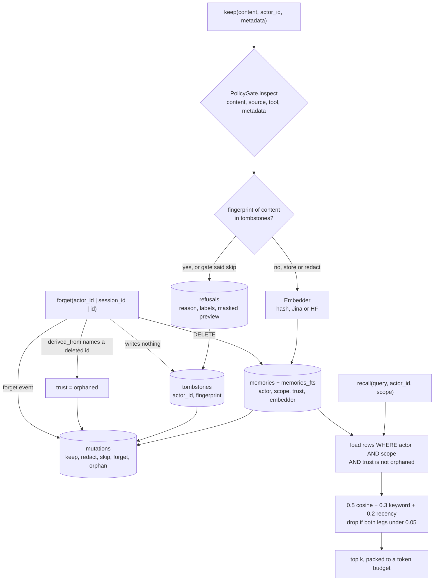

## 1. Executive Summary

Rakho is a small Python library that stores an agent's notes in one SQLite
file and puts a filter in front of the write. `keep` passes the text to a
*gate*. The gate returns one of three decisions: store it, store it with
secrets masked, or refuse it. A refusal is recorded as a row that holds a
reason and a mask and never the text.

Four things are built with care.

- **Gate first, embed after.** The embedder sees the gate's output, so a
  refused note is never embedded and a redacted one is embedded without its
  secret. With a remote embedder that is also what leaves the machine.
- **A refused note stays refused.** Each refusal stores a fingerprint of the
  note. `keep` checks it after the gate, so the same text is refused again
  even when the store is reopened with the gate switched off.
- **An actor on every read.** `recall` and `audit` raise without an
  `actor_id`, and every query in the storage engine carries it.
- **A delete that leaves a receipt.** `forget` removes the row, its
  full-text entry and its vector, and appends an event to a `mutations`
  table that nothing deletes. Refusals survive it.

Four things do not hold up.

- **Forget writes no tombstone.** The fingerprint table is written by the
  gate alone. A note the user had forgotten can be kept again the next
  minute.
- **A tombstone can land on clean text.** A secret found in `metadata`
  refuses the note and fingerprints its `content`. That content is refused
  for the actor from then on, with no call to lift it.
- **The residue of a refusal is permanent.** Refusals, mutation rows and
  unsalted fingerprints of refused secrets outlive every `forget`.
- **The gate has holes in both directions.** A Luhn-valid Aadhaar number is
  stored unmasked, and `disregard the above summary` is refused as an
  injection.

## 2. Mental Model

The README's own picture is *"the agent's diary with a bouncer at the door"*
(`README.md:24`). The diary is a table of episodes. The bouncer is a
`PolicyGate` with one method, `inspect(content, context)`, returning a
`Decision` (`src/rakho/gate.py:10-15`, `src/rakho/models.py:25-34`).

There are four verbs and no others: `keep`, `recall`, `forget`, `audit`
(`src/rakho/languages.py:3`). Hindi and German names for the same four ship
in the box, and `learn` adds a language as rows in a `verb_packs` table. The
aliases resolve through `__getattr__` to the English methods
(`src/rakho/store.py:261-268`). They change nothing about storage.

Beside the diary sit three ledgers that only grow: what was refused, a
fingerprint of each refused note, and one event per write or delete.

The design note states what is deliberately absent: *"Episodes only. No
`kind: summary` until lineage exists"* (`rakho_onepager.md:47`). There is no
extraction, no summary, no consolidation and no background work.

## 3. Architecture



Five modules carry the mechanism: `store.py` (the four verbs),
`storage.py` (the SQLite engine), `gate.py` (the default regex gate),
`sluice_gate.py` (an adapter to the separate `sluice-taint` package) and
`embeddings.py` (a hashing embedder and two HTTPS clients).

### Deployment and ergonomics

The package declares no runtime dependencies (`pyproject.toml:26`). `mcp`
and `sluice-taint` are optional extras. The default embedder is an offline
character-trigram hash of 256 dimensions, so `pip install` and one constructor
call give a working store with no key and no download.

The three entry points default differently. The library and the CLI default
to the hashing embedder (`src/rakho/cli.py:45`). The MCP server defaults to
`auto` (`src/rakho/mcp_server.py:65`), which picks Jina when `JINA_API_KEY`
is set and Hugging Face when `HF_TOKEN` is set
(`src/rakho/embeddings.py:213-219`).

Opening an older file adds the `embedder`, `embedding_dim` and `trust`
columns in place (`src/rakho/storage.py:181-190`).

## 4. Essential Implementation Paths

- **Write:** `Rakho.keep` (`src/rakho/store.py:69-147`) calls the gate, looks
  up the fingerprint, then either records a refusal or embeds and `put`s.
- **Default gate:** `DefaultPolicyGate.inspect`
  (`src/rakho/gate.py:113-187`), with `_context_text` and `_scan_labels` for
  the fields beside the content (`:190-233`).
- **Read:** `Rakho.recall` (`src/rakho/store.py:149-174`) and
  `SQLiteEngine.search` (`src/rakho/storage.py:274-351`).
- **Delete:** `Rakho.forget` (`src/rakho/store.py:176-222`),
  `SQLiteEngine.delete` (`src/rakho/storage.py:390-435`) and
  `_orphan_derived` (`:437-456`).
- **Inspect:** `Rakho.audit` (`src/rakho/store.py:224-232`).
- **MCP binding:** `bind_tools` (`src/rakho/mcp_server.py:15-59`).

## 5. Memory Data Model

The schema is one string (`src/rakho/storage.py:19-88`).

- **`memories`** — `id`, `content`, `embedding` (float32 blob), `kind`
  (always `episode`), `source`, `session_id`, `actor_id`, `origin_tool`,
  `created_at`, `last_used_at`, `sensitivity`, `scope`, `metadata` (JSON),
  `embedder`, `embedding_dim`, `trust`.
- **`memories_fts`** — an FTS5 table over `content` with the memory id as an
  unindexed column. It is not an external-content table, so it holds a
  second copy of the text.
- **`refusals`** — `id`, `actor_id`, `scope`, `reason`, `labels`, `preview`,
  `created_at`. No content and no session.
- **`mutations`** — `id`, `created_at`, `op`, `actor_id`, `scope`,
  `target_id`, `detail` (JSON). `op` is one of `keep`, `redact`, `skip`,
  `forget`, `orphan`.
- **`tombstones`** — `actor_id`, `fingerprint`, `reason`, `labels`,
  `created_at`, with the first two as the primary key. No scope.
- **`verb_packs`** — language, action and verb, with a unique index on the
  verb so one word cannot mean two actions.

The fingerprint is a 16-byte BLAKE2b digest of the note with whitespace
collapsed and case folded (`src/rakho/storage.py:91-93`). It is unkeyed and
unsalted.

`trust` is `trusted` or `orphaned`. One statement moves it, in one direction
(`src/rakho/storage.py:452`). `sensitivity` is `clean` or `redacted` and is
set once from the gate's decision; only the audit printout reads it.
`last_used_at` is updated on every recall (`src/rakho/storage.py:520-527`)
and is read by nothing: the recency term uses `created_at`.

There is no validity interval, no version and no stored link between rows.
The one relation, a derived note naming its sources, lives in caller
metadata.

## 6. Retrieval Mechanics

`recall` returns an empty list at once if the query matches an injection
phrase (`src/rakho/store.py:159-160`). Otherwise `search` loads every
non-orphaned row of the actor and scope, deserialises each vector and scores
in Python (`src/rakho/storage.py:285-351`).

```text
score = 0.5 * max(0, cosine) + 0.3 * fts_score + 0.2 / (1 + age_days)
```

The query's word tokens are joined with `OR` into an FTS5 match. If SQLite
rejects the expression, the engine falls back to a `LIKE` over the whole
query string. The top `k` are returned, and `pack_to_budget` trims them to
an estimated token count, always keeping the first
(`src/rakho/store.py:25-38`).

**The keyword score is BM25 magnitude over the best magnitude**
(`src/rakho/storage.py:313-316`). FTS5's `bm25()` is negative and more
negative is better, so the strongest match scores about 1. I rebuilt the
formula over a small FTS5 table in my own script: a row with three
occurrences of the query word scored 0.9994, a long row with one occurrence
0.42, and a sole match 0.9993. `test_fts_strongest_keyword_ranks_higher`
asserts the order (`tests/test_atlas.py:19-24`).

**A floor of 0.05 applies to the two content legs.** A row scoring under it
on both the vector and the keyword leg is dropped before recency is added
(`src/rakho/storage.py:343-344`), so recency alone returns nothing.

**A vector is compared only with its own kind.** Each row stores the
embedder's name and the vector length. The cosine is skipped when the
query's length differs or when both names are set and differ
(`src/rakho/storage.py:334-341`). The check is silent: a store written with
the hash and read through Jina loses the vector leg, falls back to keywords
and reports nothing. Three limits remain.

- The name is the provider class, `hash`, `jina` or `hf`
  (`src/rakho/embeddings.py:52`, `:135`, `:181`). Two models from one
  provider at one length are not told apart.
- The base class defaults the name to `hash`
  (`src/rakho/embeddings.py:16`), so a caller's own embedder that sets no
  name is recorded as the hashing one.
- A row migrated from an older file has no name and passes the check.

## 7. Write Mechanics

`keep` builds a context of actor, scope, source, session, tool and metadata,
and calls `gate.inspect(content, context)` (`src/rakho/store.py:81-89`).

The default gate (`src/rakho/gate.py:113-187`) works in this order.

1. Empty text is skipped.
2. `source`, `origin_tool` and the JSON of `metadata` are joined into one
   string. If an injection phrase matches the content or that string, the
   whole note is skipped.
3. If any secret or identifier pattern matches that string, the whole note
   is skipped as `secret_or_pii`. Nothing outside `content` is ever masked.
4. Nine secret patterns are substituted in the content with
   `[REDACTED:label]`: private key blocks, five token formats, bearer
   headers, and a `password is …` form in English, German and Hindi.
5. Seven identifier patterns follow: PAN, IBAN, a Luhn-checked card number,
   Aadhaar, the German tax id, email and phone.
6. With no label the note is stored as written. If fewer than eight
   characters survive outside the masks, the note is skipped as
   `secret_or_pii`. Otherwise the masked text is stored as `redacted`.

After the gate, `keep` fingerprints the raw content and looks it up for the
actor. A match replaces the decision with a skip whose reason is `tombstone`
(`src/rakho/store.py:90-97`).

On a skip, `keep` writes a `Refusal` whose preview is `[refused:<labels>]`
(`src/rakho/gate.py:240-250`), a tombstone for the fingerprint, and a `skip`
mutation, and returns without embedding (`src/rakho/store.py:99-123`).
Otherwise it embeds `decision.content`, the masked text, inserts the memory
and its FTS row in one transaction, and then inserts a `keep` or `redact`
mutation in a second one (`src/rakho/store.py:125-147`).

`SluiceGate` adapts hits from the `sluice-taint` package into the same three
decisions (`src/rakho/sluice_gate.py:25-67`). That package is a separate
distribution and is not in this tree; I did not read it.

There is no deduplication of stored notes. Keeping the same note twice
stores two rows. Keeping the same refused text twice stores two refusals and
two mutation rows over one tombstone.

### Operational cost

A write is two regex passes, one indexed lookup and one embedding call:
local for the hash, one HTTPS request for Jina or Hugging Face. A read is
one embedding call and a full scan of the actor's rows with a Python cosine
per row. A delete reads the metadata of every row of every actor
(`src/rakho/storage.py:442`). No index bounds either scan.

## 8. Agent Integration

The library is called by application code that owns the agent loop. Nothing
is injected into a prompt.

The MCP server registers eight tools, the four verbs under English and Hindi
names (`src/rakho/mcp_server.py:75-82`). Each takes `actor_id` as a tool
argument. `keep` and `recall` take `scope`; `keep` takes no metadata;
`forget` takes an actor and an optional scope, with no id or session form.
The server binds no principal: a model connected to it names the actor on
every call.

The PayPal example (`examples/paypal/agent.py`) uses the store as a ledger
for an invoice agent and adds a per-session *origin index* that fingerprints
email addresses found in content the gate flagged
(`examples/paypal/origin.py`). The origin index is held in process memory
and is not part of the library.

## 9. Reliability, Safety, and Trust

**What holds.**

- *The secret is not embedded.* The embedder receives `decision.content`
  (`src/rakho/store.py:134`), and a skipped note never reaches it.
- *Refusals hold no content.* A skip sets `decision.content` to an empty
  string, so the preview is built from labels alone.
- *A refusal outlives the gate.* The tombstone lookup runs after whatever
  gate is configured, so text refused once is refused under the allow-all
  gate too.
- *Reads are partitioned.* Every `SELECT` used by `recall` and `audit`
  carries `actor_id`, the mutation and tombstone reads included.
- *Forgetting leaves evidence.* `forget` appends a `forget` event with the
  counts and the filter, and deletes neither refusals nor earlier events
  (`src/rakho/store.py:206-217`, `src/rakho/storage.py:431-432`). A
  forgotten actor and one that never wrote are distinguishable.
- *A derived note does not outlive its source in recall.* A row whose
  metadata names a deleted id is marked `orphaned` and excluded from the
  candidate query.
- *No unbounded delete.* Both `forget` and `delete` raise on an empty filter
  (`src/rakho/store.py:184-187`, `src/rakho/storage.py:412-413`).

**What does not.**

- *Forget is not a tombstone writer.* `put_tombstone` has one caller, the
  skip branch of `keep` (`src/rakho/store.py:108`). A note removed by
  `forget` leaves no fingerprint, so the next `keep` of the same text stores
  it. The mechanism guards against a weaker gate, and a deterministic gate
  would have refused the same text anyway.
- *The tombstone key is the whole note.* `password is hunter2` and `my
  password is hunter2` fingerprint differently. Under the allow-all gate the
  second is stored.
- *A skip in the metadata tombstones the content.* The gate skips a note
  when `metadata`, `source` or `origin_tool` holds a secret, an identifier
  or an injection phrase, and `keep` then fingerprints `content`. After
  `keep("order is late", metadata={"api_key": …})`, the plain note `order is
  late` is refused for that actor with reason `tombstone`. The committed
  test makes exactly that first call (`tests/test_atlas.py:132-139`).
- *No tombstone can be lifted.* No statement deletes from `tombstones`, and
  `forget` does not touch it.
- *Any identifier in metadata refuses the note.* The content patterns mask;
  the context scan skips. Metadata carrying a customer email or a ten-digit
  number refuses every note it accompanies, and tombstones each one.
- *Forget does not erase the residue.* Refusal rows, mutation rows and
  tombstones have no delete path. The fingerprint of a refused note is an
  unsalted hash of its text, so for a note that was only a card number or a
  short password the hash can be searched offline.
- *The log is written after the fact.* The data change commits first and
  the mutation row is a second transaction. A forget event lists counts and
  no ids. A forget by id or session with no actor is logged under the actor
  `unknown` (`src/rakho/store.py:194`), which no actor's audit returns.
- *The orphan state rests on an undocumented key.* `derived_from` and
  `source_ids` appear in one line of the engine and in two tests. No
  example, README section or MCP argument writes them. The orphaned row's
  text stays in the table and in `audit`, and the pass that sets it reads
  and can mark rows of other actors.
- *A Luhn-valid Aadhaar number is stored in the clear.* The Aadhaar
  substitution is skipped when the twelve digits pass the Luhn check
  (`src/rakho/gate.py:154`), to keep a card from being mislabelled. Aadhaar
  uses a different checksum, and in my own script one random twelve-digit
  number in ten passes Luhn. `2345 6789 0004` is one.
- *The injection check is a phrase list.* `_INJECTION` holds twelve
  alternatives in three languages (`src/rakho/gate.py:26-40`), matched with
  single literal spaces. In my own copy of the English half, `Ignore the
  previous instructions` and `Disregard prior instructions` matched.
  `Ignore your previous instructions` and the two-space form did not.
  `disregard the above summary, it was wrong` matched, so that note is
  refused and tombstoned.
- *The recall query is checked for injection only.* A matching query
  returns nothing and records nothing. A query holding a secret is embedded
  as written, so with a remote embedder it is sent to the provider.
- *The phone pattern is two formats.* It masks any bare ten-digit number
  starting 6 to 9, an order number included, and matches no number with
  another country code.
- *Delete is logical.* The connection opens in WAL mode and sets no
  `secure_delete`; nothing checkpoints or vacuums. Deleted text can remain in
  the WAL file, free pages and FTS5 segments until SQLite reuses them.
- *Unscoped delete forms.* `forget(id=…)` and `forget(session_id=…)` carry
  no actor predicate. The example agent writes every actor's rows under the
  constant session `paypal-demo`.
- *A redaction that may not redact.* `SluiceGate` masks a hit when its span
  is valid and labels the note `redacted` when it is not
  (`src/rakho/sluice_gate.py:50-53`). Whether `sluice-taint` can return a
  hit without a span was not checked.

## 10. Tests, Evals, and Benchmarks

Eight files hold 50 test functions. The core story test
(`tests/test_v1.py:19-58`) stores a mixed note, a bare key and a second
actor's note. It asserts the password is absent from recall, that recall
does not cross actors, and that after forget the memories are gone, the
refusal and a forget event remain, and recall is empty.

`tests/test_atlas.py` adds thirteen cases: a ranking order, the score floor,
a mismatched vector, the mutation log and refusals surviving forget, the
tombstone under an allow-all gate, two orphan cases, metadata reaching the
gate, an injection variant, a card not labelled Aadhaar, email and phone
masking, and the embedder name on the row. The commit that added it,
`94fa9c4` of 15 November 2026, names this atlas's reading of `7c2f0e6` as
its source.

What the suite does not assert:

- a `keep` of the same text after a `forget`;
- a clean `keep` of content whose earlier refusal came from metadata;
- a forget by id or session without an actor;
- any Aadhaar number that passes the Luhn check;
- the score floor with a real vector on the unrelated row;
- a false positive of the injection list.

There is no benchmark and no evaluation of the gate's detection rate. The
repository's one workflow builds and publishes the package on a release
(`.github/workflows/publish.yml`) and runs no tests.

`examples/paypal/SIMULATION.md` is a candid run log. It records that masked
payee addresses collide, that recall mixed invoice text with payment lines,
and that *"Gate is on write, not on read"*.

## 11. For Your Own Build

### Steal

- **Gate before embed.** Order the write so the embedder, local or remote,
  receives the text the gate allowed.
- **Record the refusal without the content.** A reason and labels make the
  gate's behaviour inspectable without recreating the leak.
- **Check the value ledger after the gate, not inside it.** A refusal then
  survives a gate swap or a loosened pattern.
- **Keep the receipt when the data goes.** A content-free forget event is
  what separates a forgotten actor from an empty one.
- **Store the embedder's identity beside the vector** and skip the cosine on
  a mismatch.
- **Refuse the empty delete filter** at both the API and the storage layer.

### Avoid

- **A tombstone table the delete path never writes.** If "forget that" is
  the promise, forget is the writer that matters.
- **Fingerprinting one field when another caused the refusal.** Key the
  tombstone on what was rejected.
- **An unsalted hash of a secret as its tombstone.** Key it with a secret
  the file does not hold.
- **A ledger with no purge.** Decide what a full erasure request removes
  before the first row is written.
- **Exempting one checksum from another identifier's pattern.**
- **A phrase list as the injection defence.**

### Fit

A reasonable starting shape for a single-application, per-user note store
where the failure to prevent is a credential landing in memory. Its forget
is evidenced and not enforced: the event proves a delete happened and
nothing stops the same note returning. Its actor key is a partition for a
trusted caller, not a boundary against the agent holding the tools.

## 12. Open Questions

- Should `forget` write tombstones for what it deletes? The table and the
  lookup exist; the delete path does not use them.
- What removes a tombstone written in error, such as one caused by metadata
  or by a false injection match?
- Is `derived_from` meant to become part of the API? The design note defers
  summaries *"until lineage exists"*.
- Should `last_used_at` feed ranking or eviction? It is written on every
  recall and read by nothing.
- Does `sluice-taint` always return spans? The adapter's `redacted` label
  depends on it.
- What does recall look like at a few thousand rows per actor? Every read is
  a full scan with a Python cosine, and every delete scans all actors.

## Appendix: File Index

- **Verbs:** `src/rakho/store.py`, `src/rakho/languages.py`.
- **Storage:** `src/rakho/storage.py`, `src/rakho/models.py`.
- **Gates:** `src/rakho/gate.py`, `src/rakho/sluice_gate.py`.
- **Embedders:** `src/rakho/embeddings.py`.
- **Surfaces:** `src/rakho/cli.py`, `src/rakho/mcp_server.py`.
- **Examples:** `examples/agent.py`, `examples/paypal/agent.py`,
  `examples/paypal/origin.py`, `examples/paypal/SIMULATION.md`.
- **Tests:** `tests/test_v1.py`, `tests/test_atlas.py`,
  `tests/test_gate_i18n.py`, `tests/test_mcp.py`,
  `tests/test_paypal_agent.py`, `tests/test_sluice_gate.py`,
  `tests/test_sluice_roundtrip.py`, `tests/test_embedders.py`.
- **Design note:** `rakho_onepager.md`.

### Recorded searches

Run with `/usr/bin/git grep` over the tree at
`21c4acd2370a5d65426f5009b7e0c03b1890d0a0`.

- `git grep -n -i -E 'secure_delete|vacuum|wal_checkpoint'` — no match in the whole tree.
- `git grep -n -E 'DELETE FROM|UPDATE ' -- src` — four lines, all in `storage.py`: deletes from `memories_fts` and `memories` at `:424` and `:428`, the `trust` update at `:452` and the `last_used_at` update at `:524`. None names `refusals`, `mutations` or `tombstones`.
- `git grep -n -E 'FROM (mutations|tombstones|refusals)' -- src` — five lines, all `SELECT`, all with `actor_id = ?`.
- `git grep -n -E 'put_tombstone\(|has_tombstone\(' -- src` — two definitions each in `storage.py`, and two calls: `store.py:91` and `store.py:108`, both in `keep`.
- `git grep -n -E 'derived_from|source_ids'` — three lines in the whole tree: `storage.py:445` and `tests/test_atlas.py:101`, `:120`.
- `git grep -n -E "trust = |trust='"  -- src` — one line, the update at `storage.py:452`.
- `git grep -n -i -E 'salt|hmac' -- src` — no match.
- `git grep -n -E '\.inspect\(|is_injection\(' -- src` — `store.py:89` on the content and context, `store.py:159` on the recall query, and the definition.
- `git grep -n 'last_used_at' -- src` — seven lines: the field, the column, the insert, the row mapping, the public dict and the update. No comparison or sort.
- `git grep -n -E 'forget\(' -- tests examples` — nine lines: a test name, the empty call that must raise, and seven calls that each pass `actor_id`. Two of those pass an id beside it.
- `git grep -n -c 'metadata=' -- tests examples` — `tests/test_atlas.py:3` and nothing else.

## History

**2026-11-15** — [`21c4acd2370a5d65426f5009b7e0c03b1890d0a0`](https://github.com/krishyaid-coder/rakho-/commit/21c4acd2370a5d65426f5009b7e0c03b1890d0a0) — two commits past the first pin; `94fa9c4` changed thirteen files and cites the first reading. Closed at this commit: the inverted keyword score, the missing score floor, vectors without an embedder name, the gate skipping metadata, the card labelled Aadhaar, the absent email and phone patterns, and forget deleting refusals and leaving no record. Marks added: `tombstone`, `trust_state` and `audit_log`, each with limits in the evidence. New findings in [section 9](#9-reliability-safety-and-trust): forget writes no tombstone, a metadata skip tombstones clean content, the ledgers and unsalted fingerprints survive forget, and the Luhn exemption leaves one Aadhaar number in ten unmasked. Nothing was installed or run; the screen again reported only the unpinned `pyproject.toml` inside the cooldown. MIT, unchanged.

**2026-11-14** — [`7c2f0e60d90411bb9b645586ebbc0f1282eff51f`](https://github.com/krishyaid-coder/rakho-/commit/7c2f0e60d90411bb9b645586ebbc0f1282eff51f) — first reading, at the head of `main`, dated 11 November 2026. Marks: `scope_enforced` on the actor and scope predicates in every read of the storage engine, `negative_eval` on the committed absence assertions over a populated recall. `tombstone`, `trust_state`, `bitemporal`, `audit_log` and `human_review` withheld: delete is a hard delete, `sensitivity` is a label fixed at write, and the refusal table records refused writes, is not append-only, and is emptied by forget. Nothing from the tree was installed or run. The BM25 normalisation and the gate's regular expressions were re-derived in a separate script against the standard library. The screen reported an unpinned dependency surface in `pyproject.toml`, changed inside the seven-day cooldown, and no auto-run or build-time execution.
