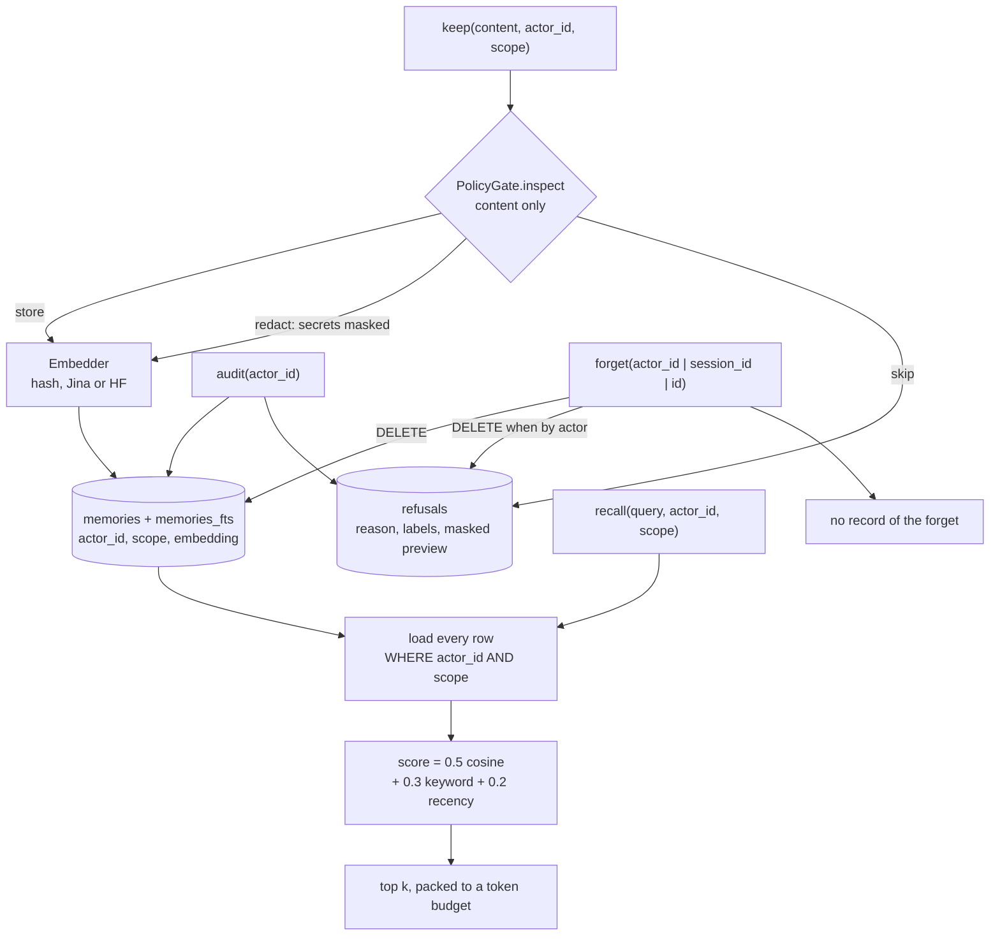

## 1. Executive Summary

Rakho is a small Python library that stores an agent's notes in one SQLite
file and puts a filter in front of the write. `keep` passes the text to a
*gate*. The gate returns one of three decisions: store it, store it with
secrets masked, or refuse it. A refusal is recorded as a row that holds a
reason and a mask and never the text.

Three things are built with care.

- **Gate first, embed after.** The embedder sees the gate's output, so a
  refused note is never embedded and a redacted one is embedded without its
  secret. With a remote embedder that is also what leaves the machine.
- **An actor on every read.** `recall` and `audit` raise without an
  `actor_id`, and every query in the storage engine carries it.
- **A bounded delete.** `forget` refuses to run without an actor, a session
  or an id, and removes the row, its full-text entry and its vector together.

Four things do not hold up against the README.

- **"You can prove it."** The proof of forgetting is an empty `audit`.
  `forget` writes no record of itself, and when called by actor it deletes
  that actor's refusal rows too. An actor that was forgotten and an actor
  that never wrote anything are indistinguishable.
- **The keyword leg of ranking is inverted.** The normalisation gives the
  strongest BM25 match a score near zero and a sole match exactly zero.
- **The gate inspects `content` and nothing else.** `metadata`, `source`
  and the recall query bypass it.
- **The injection check is ten phrases.** `Ignore the previous
  instructions` passes.

## 2. Mental Model

The README's own picture is *"the agent's diary with a bouncer at the door"*
(`README.md:24`). The diary is a table of episodes. The bouncer is a
`PolicyGate` with one method, `inspect(content, context)`, returning a
`Decision` (`src/rakho/gate.py:10-15`, `src/rakho/models.py:22-31`).

There are four verbs and no others: `keep`, `recall`, `forget`, `audit`
(`src/rakho/languages.py:3`). Hindi and German names for the same four ship
in the box, and `learn` adds a language as rows in a `verb_packs` table. The
aliases resolve through `__getattr__` to the English methods
(`src/rakho/store.py:195-202`). They change nothing about storage.

The design note states what is deliberately absent: *"Episodes only. No
`kind: summary` until lineage exists"* (`rakho_onepager.md:47`). There is no
extraction, no summary, no consolidation and no background work.

## 3. Architecture



Five modules carry the mechanism: `store.py` (the four verbs),
`storage.py` (the SQLite engine), `gate.py` (the default regex gate),
`sluice_gate.py` (an adapter to the separate `sluice-taint` package) and
`embeddings.py` (a hashing embedder and two HTTPS clients).

### Deployment and ergonomics

The package declares no runtime dependencies (`pyproject.toml:26`). `mcp`
and `sluice-taint` are optional extras. The default embedder is an offline
character-trigram hash of 256 dimensions, so `pip install` and one constructor
call give a working store with no key and no download.

The three entry points default differently. The library and the CLI default
to the hashing embedder (`src/rakho/embeddings.py:218`,
`src/rakho/cli.py:45`). The MCP server defaults to `auto`
(`src/rakho/mcp_server.py:65`), which picks Jina when `JINA_API_KEY` is set
and Hugging Face when `HF_TOKEN` is set (`src/rakho/embeddings.py:208-214`).

## 4. Essential Implementation Paths

- **Write:** `Rakho.keep` (`src/rakho/store.py:67-111`) calls the gate, then
  either `put_refusal` or embeds and `put`.
- **Default gate:** `DefaultPolicyGate.inspect`
  (`src/rakho/gate.py:108-171`).
- **Read:** `Rakho.recall` (`src/rakho/store.py:113-134`) and
  `SQLiteEngine.search` (`src/rakho/storage.py:209-272`).
- **Delete:** `Rakho.forget` (`src/rakho/store.py:136-157`) and
  `SQLiteEngine.delete` (`src/rakho/storage.py:311-370`).
- **Inspect:** `Rakho.audit` (`src/rakho/store.py:159-166`).
- **MCP binding:** `bind_tools` (`src/rakho/mcp_server.py:15-59`).

## 5. Memory Data Model

The schema is one string (`src/rakho/storage.py:16-62`).

- **`memories`** — `id`, `content`, `embedding` (float32 blob), `kind`
  (always `episode`), `source`, `session_id`, `actor_id`, `origin_tool`,
  `created_at`, `last_used_at`, `sensitivity`, `scope`, `metadata` (JSON).
- **`memories_fts`** — an FTS5 table over `content` with the memory id as an
  unindexed column. It is not an external-content table, so it holds a
  second copy of the text.
- **`refusals`** — `id`, `actor_id`, `scope`, `reason`, `labels`, `preview`,
  `created_at`. No content, no hash of the content, no session.
- **`verb_packs`** — language, action and verb, with a unique index on the
  verb so one word cannot mean two actions.

`sensitivity` is `clean` or `redacted` and is set once from the gate's
decision (`src/rakho/models.py:29-31`). Nothing reads it except the audit
printout. `last_used_at` is updated on every recall
(`src/rakho/storage.py:372-379`) and is read by nothing: the recency term
uses `created_at`.

There is no validity interval, no version, no link between rows and no
deleted marker.

## 6. Retrieval Mechanics

`search` loads every row of the actor and scope, deserialises each vector and
scores in Python (`src/rakho/storage.py:218-272`).

```text
score = 0.5 * max(0, cosine) + 0.3 * fts_score + 0.2 / (1 + age_days)
```

The query's word tokens are joined with `OR` into an FTS5 match. If SQLite
rejects the expression, the engine falls back to a `LIKE` over the whole
query string. Every row is kept and sorted, the top `k` are returned, and
`pack_to_budget` trims them to an estimated token count, always keeping the
first (`src/rakho/store.py:23-36`).

**The keyword score is inverted.** FTS5's `bm25()` is negative, and more
negative is better; the code's own comment says so. The normalisation is
`1 - abs(rank) / (worst + 1e-9)` where `worst` is the largest magnitude
(`src/rakho/storage.py:241-245`). The largest magnitude is the best match.
So the best keyword match scores about 0, the weakest matching row scores
highest, and when one row matches it scores 0, the same as a row with no
match. I rebuilt the formula over a three-row FTS5 table in my own script:
the row with three occurrences of the query word scored 0.0006, the long
row with one occurrence scored 0.60, and a sole match scored 1e-09. The
keyword leg therefore adds nothing in the commonest case and ranks backwards
otherwise. The `LIKE` fallback assigns 1.0 and is unaffected.

**There is no score floor.** Recency is always positive, so any query
returns up to `k` rows of the actor however unrelated. The tests that assert
an empty recall do so against an actor with no rows
(`tests/test_v1.py:66`, `tests/test_paypal_agent.py:82`).

**Vectors carry no model identity.** A row stores a float32 blob and no
record of which embedder made it. `cosine` returns 0.0 when lengths differ
(`src/rakho/embeddings.py:30-32`), so a store written with the 256-dimension
hash and read through the Hugging Face model loses the vector leg without an
error. The Jina client also requests 256 dimensions
(`src/rakho/embeddings.py:139`), the same length as the hash, so those two
mix without any signal and the cosine is computed across unrelated spaces.
The README states the requirement in prose: recall *"needs the same embedder
you wrote with"* (`README.md:182`). Since the MCP server and the library
default to different embedders, one file served both ways reaches this state
whenever an API key is in the environment.

## 7. Write Mechanics

`keep` builds a context of actor, scope, source, session and tool, and calls
`gate.inspect(content, context)` (`src/rakho/store.py:78-86`).

The default gate (`src/rakho/gate.py:108-171`) works in this order.

1. Empty text is skipped.
2. If an injection phrase matches, the whole note is skipped.
3. Nine secret patterns are substituted with `[REDACTED:label]`: private key
   blocks, five token formats, bearer headers, and a `password is …` form in
   English, German and Hindi.
4. Five identifier patterns follow: PAN, IBAN, Aadhaar, the German tax id and
   a Luhn-checked card number.
5. With no label the note is stored as written. If fewer than eight
   characters survive outside the masks, the note is skipped as
   `secret_or_pii`. Otherwise the masked text is stored as `redacted`.

On a skip, `keep` writes a `Refusal` whose preview is `[refused:<labels>]`
(`src/rakho/gate.py:174-184`) and returns without embedding. Otherwise it
embeds `decision.content`, the masked text, and inserts the memory and its
FTS row in one transaction (`src/rakho/storage.py:136-167`).

`SluiceGate` adapts hits from the `sluice-taint` package into the same three
decisions (`src/rakho/sluice_gate.py:25-67`). That package is a separate
distribution and is not in this tree; I did not read it.

There is no deduplication. Keeping the same note twice stores two rows, and
keeping the same poisoned text twice stores two refusals.

### Operational cost

A write is one regex pass and one embedding call: local for the hash, one
HTTPS request for Jina or Hugging Face. A read is one embedding call and a
full scan of the actor's rows with a Python cosine per row. No index bounds
the scan.

## 8. Agent Integration

The library is called by application code that owns the agent loop. Nothing
is injected into a prompt.

The MCP server registers eight tools, the four verbs under English and Hindi
names (`src/rakho/mcp_server.py:70-83`). Each takes `actor_id` as a tool
argument. `keep` and `recall` take `scope`; `forget` takes an actor and an
optional scope, with no id or session form. The server binds no principal: a
model connected to it names the actor on every call.

The PayPal example (`examples/paypal/agent.py`) uses the store as a ledger
for an invoice agent and adds a per-session *origin index* that fingerprints
email addresses found in content the gate flagged
(`examples/paypal/origin.py`). The origin index is held in process memory
and is not part of the library.

## 9. Reliability, Safety, and Trust

**What holds.**

- *The secret is not embedded.* The embedder receives `decision.content`
  (`src/rakho/store.py:108`), and a skipped note never reaches it.
- *Refusals hold no content.* A skip sets `decision.content` to an empty
  string, so the preview is built from labels alone.
- *Reads are partitioned.* Every `SELECT` on `memories` and `refusals` used
  by `recall` and `audit` carries `actor_id`.
- *Delete is whole within the row.* The FTS entry and the blob go in the
  same transaction as the row.
- *No unbounded delete.* Both `forget` and `delete` raise on an empty filter
  (`src/rakho/store.py:144-147`, `src/rakho/storage.py:333-334`).

**What does not.**

- *Forgetting leaves no evidence.* No table records a delete. `forget` by
  actor also deletes that actor's refusals
  (`src/rakho/storage.py:362-365`), which the design note lists as intended
  (`rakho_onepager.md:99`). The audit after a forget is empty by
  construction, and the same empty result follows from never having written.
- *Delete is logical.* The connection opens in WAL mode and sets no
  `secure_delete`; nothing checkpoints or vacuums. Deleted text can remain in
  the WAL file, free pages and FTS5 segments until SQLite reuses them.
- *The gate covers one field.* `metadata` is stored as given and returned by
  `audit` (`src/rakho/store.py:107`, `src/rakho/models.py:64`). `source`,
  `session_id` and `origin_tool` are stored as given. The recall query is
  embedded without inspection (`src/rakho/store.py:123`), so with a remote
  embedder a query containing a secret is sent to the provider.
- *The injection check is a phrase list.* `_INJECTION` holds ten
  alternatives in three languages (`src/rakho/gate.py:25-37`), matched with
  single literal spaces. In my own copy of the English half, `Ignore previous
  instructions` matched. `Ignore the previous instructions`, `Disregard prior
  instructions` and the same phrase with two spaces did not.
- *Pattern order mislabels a card.* The Aadhaar pattern runs before the card
  pattern. On `4111 1111 1111 1111` it masks the first twelve digits as
  `aadhaar` and leaves `1111` in the stored text.
- *No email or phone pattern.* The default gate has neither; the README's
  *"Secret, personal, shady"* (`README.md:26`) is narrower in code than in
  prose.
- *Unscoped delete forms.* `forget(id=…)` and `forget(session_id=…)` carry
  no actor predicate. The example agent writes every actor's rows under the
  constant session `paypal-demo`.
- *A redaction that may not redact.* `SluiceGate` masks a hit when its span
  is valid and still labels the note `redacted` when it is not
  (`src/rakho/sluice_gate.py:50-53`). Whether `sluice-taint` can return a
  hit without a span was not checked.

## 10. Tests, Evals, and Benchmarks

Seven files hold 37 test functions. The core story test
(`tests/test_v1.py:19-55`) stores a mixed note, a bare key and a second
actor's note, then asserts the password is absent from recall, that recall
does not cross actors, and that audit is empty after forget with the second
actor untouched. Seven cases cover German and Hindi secrets, the tax id and
injection phrases. The Sluice adapter is tested against a fake scanner; the
cases needing the real package skip when it is absent.

What the suite does not assert:

- recall after forget; deletion is checked through `audit` alone;
- any ranking order, so the inverted keyword score passes;
- an empty recall against a populated actor;
- `metadata` or the query passing the gate;
- forget by id or session.

There is no benchmark and no evaluation of the gate's detection rate. The
repository's one workflow builds and publishes the package on a release
(`.github/workflows/publish.yml`) and runs no tests.

`examples/paypal/SIMULATION.md` is a candid run log. It records that masked
payee addresses collide, that recall mixed invoice text with payment lines,
and that *"Gate is on write, not on read"*.

## 11. For Your Own Build

### Steal

- **Gate before embed.** Order the write so the embedder, local or remote,
  receives the text the gate allowed.
- **Record the refusal without the content.** A reason and labels make the
  gate's behaviour inspectable without recreating the leak.
- **Refuse the empty delete filter** at both the API and the storage layer.
- **Skip when too little survives.** A note that is all mask is noise.

### Avoid

- **Deleting the refusal log with the data** if the claim is provable
  forgetting. Keep a content-free receipt of the delete.
- **Normalising BM25 by magnitude without checking the sign.** Assert a
  ranking order in one test.
- **A vector column with no embedder identity.** Store the model name and
  dimension, and refuse or re-embed on mismatch.
- **Gating one field** of a record that has five caller-supplied ones.
- **A phrase list as the injection defence.**

### Fit

A reasonable starting shape for a single-application, per-user note store
where the failure to prevent is a credential landing in memory. It is not a
compliance mechanism for deletion, and its actor key is a partition for a
trusted caller, not a boundary against the agent holding the tools.

## 12. Open Questions

- Is deleting refusals on forget meant to survive a receipt requirement? The
  design note lists it as intended and the tagline promises proof.
- Should `last_used_at` feed ranking or eviction? It is written on every
  recall and read by nothing.
- Does `sluice-taint` always return spans? The adapter's `redacted` label
  depends on it.
- What does recall look like at a few thousand rows per actor? Every read is
  a full scan with a Python cosine.

## Appendix: File Index

- **Verbs:** `src/rakho/store.py`, `src/rakho/languages.py`.
- **Storage:** `src/rakho/storage.py`, `src/rakho/models.py`.
- **Gates:** `src/rakho/gate.py`, `src/rakho/sluice_gate.py`.
- **Embedders:** `src/rakho/embeddings.py`.
- **Surfaces:** `src/rakho/cli.py`, `src/rakho/mcp_server.py`.
- **Examples:** `examples/agent.py`, `examples/paypal/agent.py`,
  `examples/paypal/origin.py`, `examples/paypal/SIMULATION.md`.
- **Tests:** `tests/test_v1.py`, `tests/test_gate_i18n.py`,
  `tests/test_mcp.py`, `tests/test_paypal_agent.py`,
  `tests/test_sluice_gate.py`, `tests/test_sluice_roundtrip.py`,
  `tests/test_embedders.py`.
- **Design note:** `rakho_onepager.md`.

### Recorded searches

Run with `/usr/bin/git grep` over the tree at
`7c2f0e60d90411bb9b645586ebbc0f1282eff51f`.

- `git grep -n -i -E 'secure_delete|vacuum|wal_checkpoint'` — no match in the whole tree.
- `git grep -n -E 'DELETE FROM|UPDATE ' -- src` — four lines, all in `storage.py`: three deletes at `:345`, `:349`, `:364` and the `last_used_at` update at `:376`. No insert into any table records a delete.
- `git grep -n -E '\.inspect\(' -- src` — one call, `store.py:86`, on `content`.
- `git grep -n 'last_used_at' -- src` — nine lines: the field, the column, the insert, the row mapping, the public dict and the update. No comparison or sort.
- `git grep -n -i -E 'tombstone|deleted_at|is_deleted|valid_from|valid_to|supersed' -- src` — no match.
- `git grep -n -E 'embedder_name|embed_model|model_id|embedding_model' -- src` — no match.
- `git grep -n -E 'threshold|min_score' -- src` — no match.
- `git grep -n -i -E 'email|phone' -- src/rakho/gate.py` — no match. Control: `git grep -c 'aadhaar' -- src/rakho/gate.py` returns a nonzero count.
- `git grep -n -E 'forget\(' -- tests examples` — four lines: three by actor and the empty call that must raise. None by id or session.
- `git grep -n -E 'recall\(|nikaalo\(|leta\(' -- tests` — eight lines; none follows a `forget`.
- `git grep -n -c 'metadata' -- src tests examples` — hits in `models.py`, `storage.py` and `store.py` alone; no test or example passes metadata.

## History

**2026-11-14** — [`7c2f0e60d90411bb9b645586ebbc0f1282eff51f`](https://github.com/krishyaid-coder/rakho-/commit/7c2f0e60d90411bb9b645586ebbc0f1282eff51f) — first reading, at the head of `main`, dated 11 November 2026. Marks: `scope_enforced` on the actor and scope predicates in every read of the storage engine, `negative_eval` on the committed absence assertions over a populated recall. `tombstone`, `trust_state`, `bitemporal`, `audit_log` and `human_review` withheld: delete is a hard delete, `sensitivity` is a label fixed at write, and the refusal table records refused writes, is not append-only, and is emptied by forget. Nothing from the tree was installed or run. The BM25 normalisation and the gate's regular expressions were re-derived in a separate script against the standard library. The screen reported an unpinned dependency surface in `pyproject.toml`, changed inside the seven-day cooldown, and no auto-run or build-time execution.
