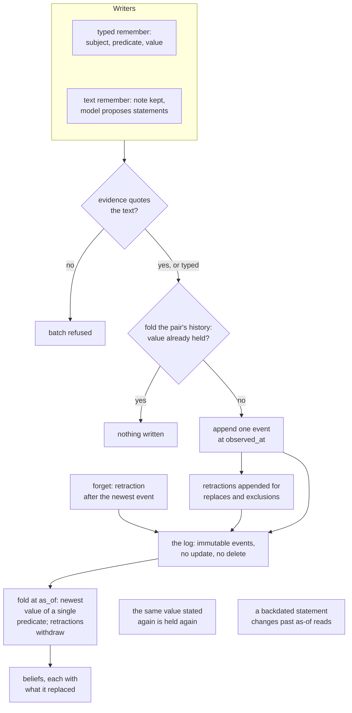

## 1. Executive Summary

Recall is a Go memory library with a `recall` binary that serves it over MCP
and HTTP. It stores every typed statement about a subject as an immutable
event and derives what is believed by folding those events, so the same call
answers what is believed now and what was believed at an earlier instant.
What is notable is how strictly that holds: exact, semantic and as-of reads
all go through one fold, and a history the backend cannot return whole is
refused rather than folded. What is weak is correction. A forgotten value
returns as soon as anything states it again, and the one clock the log keeps
can be backdated by the writer.

The design rests on a per-predicate registry. Each predicate declares a value
type, whether it holds one value or many, and which predicates exclude it, so
`dislikes mangoes` withdraws `likes mangoes`
(`internal/engine/event.go:111-121`, `:161-175`). A single-valued predicate's
newer statement replaces the older one in the fold, a retraction withdraws,
and nothing is rewritten.

Plain text goes through a model extractor that proposes typed statements, each
of which must quote the text it came from. The whole text is kept first as a
note, and the proposals are recorded beside it, so the same text is filed the
same way when it is remembered again. Without a model, text is kept as a note
and nothing replaces anything.

The second half of the repository is a State API: a lease per agent id,
working-state handoff notes, turns, tool outputs and a ledger of tool calls,
so a restarted agent resumes from its records. It is memory of the agent's own
position rather than of the world and carries no mark here.

Two marks are earned: `audit_log` on the event log, which is the store, and
`negative_eval` on fold tests that require a superseded or retracted value to
stay out of a populated answer. Section 9 gives the reason for each of the
five withheld.

**Licence.** The Apache-2.0 grant stops at the client. The store Recall uses
when nothing is configured is `polign-server`, under *"its own license, which
is not Apache-2.0"* (`THIRD_PARTY_NOTICES.md:27-32`). The tree does not hold
that text, and the vendor's `Polign/polign` README says the server's source is
not public. `python/pyproject.toml` makes `polign_db` a dependency on every
mainstream platform, and `backend/local/fetch.go` downloads the server on
first use unless `RECALL_NO_DOWNLOAD=1` is set. A reader can audit the engine
and can neither audit nor learn their rights over the default store their
memory lands in. PostgreSQL, MongoDB and Qdrant drivers in the tree run the
same engine without it. Separately, `recall` and `actor`, 46 MB and 11 MB
Mach-O executables, are committed at the root with nothing in the tree tying
them to its source.

## 2. Mental Model

A memory is a **statement**: a subject, a predicate and a typed value, with a
confidence, a source, an observation instant and, when it came from text, the
excerpt and the note that holds the whole text
(`internal/engine/event.go:12-58`). A **belief** is never stored. It is the
result of folding one subject and predicate's events up to an instant
(`event.go:60-98`, `:123-175`). The package documentation states the rule:
*"a belief is derived, never mutated"* (`doc.go:8`).

A statement becomes a belief when it is appended and the fold keeps it.

- **Typed remember.** `Store.remember` validates the value against the
  registry, reads the pair's history, folds it at the statement's instant,
  and returns without writing if the value is already held. Otherwise it
  appends one event (`internal/engine/store.go:195-352`).
- **Text remember.** `RememberTextAt` keeps the text as a note, has the
  extractor propose statements, refuses any proposal whose evidence is not a
  substring of the text, records the proposals beside the note, and remembers
  each statement at confidence 0.8 with source `agent_inferred`
  (`internal/engine/extract.go:88-253`).

A belief stops holding in four ways, all of them appended events.

- **Supersession.** A newer value of a single-valued predicate clears the
  held values in the fold (`event.go:311-323`).
- **Exclusion.** A value asserted under a predicate that excludes this one
  withdraws the same value here (`event.go:264-288`).
- **Named correction.** A statement may name beliefs under other predicates
  in `replaces`, and each is withdrawn by a retraction in its own history
  whose `replaced_by` names the statement (`store.go:409-435`).
- **Forget.** A retraction of one value or of the whole pair
  (`store.go:437-534`).

Nothing stops a belief from returning. The fold applies events in instant
order, so a value asserted after its retraction is held again, and the text
forget tool says so: *"remembering it again brings it back"*
(`cmd/recall/mcp_text.go:65`). The one time on an event is `ObservedAt`, the
writer's instant, and a writer may set it to the past
(`store.go:198-205`). As-of reads order by it, so a statement written on
20 November and dated 1 October changes what an as-of read for 2 October
returns.

## 3. Architecture

The engine is a Go package, `internal/engine`, re-exported by the root package
`recall` (`recall.go`). It talks to storage through a three-method interface,
`Put`, `List` and `Search`, with optional capabilities for keyword search,
exact gets, watermarks, leases and fenced writes
(`internal/engine/store.go:29-53`, `backends.go`).

- **`backend/local`** starts a `polign-server` for a directory on a free
  loopback port with a generated key, and leaves it running for later
  processes (`backend/local/local.go:1-20`).
- **`polign/`** is the HTTP client for that server.
- **`backend/pgvector`** creates one table per collection with an HNSW index,
  a GIN index on the metadata and a generated `tsvector`
  (`backend/pgvector/backend.go:339-352`).
- **`backend/mongodb`** and **`backend/qdrant`** do the same on those stores;
  Qdrant has no keyword search or leases.
- **`cmd/recall`** is the binary: `mcp`, `serve`, `connect`, `key`, `explain`,
  `history`, `ask`, `diff`, `reembed`, `setup` and `telemetry`
  (`cmd/recall/main.go:55-77`).
- **`model/`** holds the Anthropic, OpenAI-compatible and Ollama extractors and
  the embedders, including all-MiniLM-L6-v2 run in pure Go.
- **`python/polign_recall`** spawns `recall mcp` and speaks MCP to it over
  stdio (`python/polign_recall/client.py:553`, `:902`).

Each event is embedded when it is written. The default embedder hashes words
into 256 buckets (`internal/engine/defaults.go:195-210`), and each embedder
gets its own default collection, so turning on a model embedder starts an
empty memory unless `recall reembed` copies the log
(`cmd/recall/embedder.go:83-104`, `cmd/recall/reembed.go:15-18`).

### Deployment and ergonomics

With nothing configured, memory lives under `~/.local/share/recall` in a
polign_db the binary starts, and every agent on the machine shares it. When no
`polign-server` is installed, the binary downloads release v0.16.0 from
`dl.polign.com` once and checks it against a SHA-256 pinned per platform
(`backend/local/fetch.go:33-47`, `:92-161`). Nothing needs an API key until a
model extractor or embedder is named.

The store is not human-readable. Every event is a vector row with JSON
metadata, and the tools to read it are `recall history`, `explain`, `diff`
and an audit export with a digest, verified offline by `recall-audit`
(`internal/engine/audit.go:19-58`, `cmd/recall-audit/main.go:1-40`).

## 4. Essential Implementation Paths

- **Typed write.** The MCP `remember` tool, `POST /v1/remember` and the
  clients reach `Client.Remember`, then `Store.remember`, which resolves the
  predicate, folds the history, applies `replaces`, appends the event and its
  retractions, and reports what was superseded
  (`internal/engine/store.go:195-352`).
- **Text write.** `RememberTextAt` replays a recorded extraction for text it
  has seen, otherwise calls the extractor with the current beliefs in the
  context, re-asks about any sentence no proposal quotes, keeps the note,
  records the proposals and remembers each
  (`internal/engine/extract.go:88-253`, `:421-484`).
- **Extractor.** `model.Extractor.Extract` sends the registry and the held
  beliefs, parses statements with `replaces`, and filters through
  `Registry.AdmitProposals` (`model/model.go:127-182`).
- **Read.** `Store.Recall` dispatches to an exact pair read, a discovery read
  or `recallRanked`, which searches events, groups hits by pair and folds
  each pair's whole history at the query instant (`store.go:581-668`).
  `Client.AskWith` turns beliefs into sentences for the text tools
  (`internal/engine/ask.go:76-108`).
- **Fold.** `foldOrder` drops events after the ceiling and sorts by instant,
  placing a retraction after an assertion that shares its instant; `apply`
  runs cardinality, exclusion and retraction (`event.go:177-351`).
- **Forget.** `Store.Forget` appends a retraction at an instant after every
  event in the pair (`store.go:437-534`, `:805-813`). `ForgetText` searches
  for candidates and lets a model selector pick which to withdraw
  (`internal/engine/forgettext.go:31-85`).
- **Server.** `recall serve` maps a key to a namespace and the namespace to a
  collection, and strips or refuses identity fields in the arguments
  (`cmd/recall/serve.go:149-163`, `:316-355`).
- **State API.** `Client.Resume` takes the lease, loads the working state,
  turns, pointers, outputs and open actions from the `_agents` collection,
  and adds up to 20 memories within an 8,000-token default budget
  (`internal/engine/agent.go:322-346`, `internal/engine/agent_context.go`).

## 5. Memory Data Model

**The event.** Its fields become typed metadata: `kind`, `subject`,
`predicate`, `confidence`, `source`, `retraction`, `observed_at` as a
fixed-width string and `observed_ms` as a number, `value` and a case-folded
`value_key`, `evidence`, `evidence_id`, `replaces` as one JSON string,
`replaced_by`, and a `text` field for keyword search
(`internal/engine/codec.go:84-126`). The id is a SHA-256 prefix of subject,
predicate, value key, assert or retract, and the instant, so an assertion and
a later re-assertion of the same value are two events (`codec.go:35-60`).

**The registry** is itself a log. Each definition, redefinition, rename and
merge is an event about `recall:registry`, folded like any other, and a client
whose configured registry disagrees with the stored one is refused
(`internal/engine/schema.go:15-30`). `Redefine` applies to the whole history,
as-of reads included (`docs/reference.md:646`).

**Notes and extraction records.** Each remembered text is an event under the
multi-valued `note` predicate about `user`, at confidence 0.5. The model's
proposals are an event about `recall:extraction` whose `evidence_id` is the
note (`extract.go:55-66`, `:462-484`). Reads leave both out unless asked.

**Time.** One clock. `ObservedAt` is when the writer says the statement was
made; the backend's acceptance order is not stored and no code records it
(Recorded searches).

**Scope.** No scope field on an event. The namespace is the collection. Agent
State records carry `recall_agent` and `record` keys, and every State read
filters on both (`agent.go:912`, `:957-966`).

## 6. Retrieval Mechanics

**Retrieval is tool-mediated.** Nothing injects memory into a prompt; the
agent calls `recall`, and the text tool's description tells it to do so
*"before assuming anything about the user"* (`cmd/recall/mcp_text.go:46-61`).
A recall with no question returns the user's whole profile, up to 1,000
beliefs (`internal/engine/validation.go:10`, `ask.go:77-83`).

**Candidates, then the fold.** A query with text embeds it, searches the
events, and fuses the hits with the backend's keyword search when it has one.
Under the hashed-word embedder every keyword hit ranks ahead of the vector
hits rather than being fused (`store.go:1113-1170`, `:1234`). Hits are
grouped by subject and predicate, and each pair's whole history is folded at
the query instant (`store.go:622-668`). A search hit on a superseded value
therefore answers with the value that holds now, and a multi-valued pair
returns only the values whose own events matched.

**Filters after the fold.** Kind, `min_confidence`, an observation window and
value ranges are checked on beliefs, not events (`store.go:1061-1094`). A time
phrase in the question reorders candidates toward the span it names
(`internal/engine/when.go`).

**What comes back.** Each belief carries what it replaced, one step back, and a
list of the subject's other beliefs that hold the same value under another
predicate (`event.go:79-98`). The text tool adds the sentence of the
original text the belief came from. With a model embedder, answers below half
the best match's similarity are dropped (`ask.go:96-102`, `:329`).

**Cost per read.** Every candidate pair costs one complete history read of up
to 10,000 events, cached per pair in a materialization the writer invalidates
(`internal/engine/materialized.go`, `store.go:1105-1106`).

## 7. Write Mechanics

**Writes are synchronous.** A typed remember is a history read, a fold and one
`Put`. A text remember adds one or two extraction calls inside the call, so
the agent waits for the model. A memory is retrievable as soon as the call
returns. No background pass reads or rewrites the store.

**The quote rule is code, with two openings.** `RememberTextAt` refuses a
batch whose proposal evidence is not a substring of the text
(`extract.go:167-169`). The bundled extractor filters first through
`AdmitProposals`, and its `repairEvidence` replaces a missing quote with the
whole text when the text is at most 2,048 bytes (`extract.go:295-319`), so a
statement with no quote is kept. The `messages` form writes the conversation
as `User:` and `Assistant:` lines and quotes against all of it, so an excerpt
from the assistant's turn passes. The tool description says only what the
user said or agreed to is kept, which is a prompt rule
(`internal/engine/transcript.go:17-45`, `cmd/recall/mcp_text.go:23`, `:28`).

**Who sets source and confidence.** Extracted statements are
`agent_inferred` at 0.8. On the typed tools the model passes `source` and
`confidence`, and the default is `user_stated` at 1
(`cmd/recall/mcp_memory.go:75-83`, `store.go:164-166`, `:255-260`).

**The extractor names what a statement replaces.** Since 14 October 2026 the
extractor sees up to 64 current beliefs and its prompt asks it to set
`replaces` to every listed belief the statement makes untrue, copying each
value word for word (`model/model.go:325-327`). `Extract` passes those through
and `RememberText` withdraws each one that is held
(`model/model.go:158-177`, `extract.go:229-231`). The reference still says
*"The `model` extractor proposes none"* (`docs/reference.md:196-197`), and the
README says no model reconciles memory on its own (`README.md:161`).

**Replay.** Remembering a text already kept replays its recorded proposals
through the fold instead of asking the model again
(`extract.go:47-54`, `:125-129`). A replayed text re-asserts what it said,
including a value forgotten since.

**Bounds.** A pair's history is capped at 10,000 events. A write to a full
pair is refused, and a pair with more cannot be read
(`store.go:58-64`, `:294-296`, `:1271-1291`). Every remembered text appends to
the single `(user, note)` pair, and `recordedExtraction` reads that pair whole
on each text remember (`extract.go:421-430`). Text memory therefore refuses
new text after 10,000 distinct passages per collection, and each write before
then reads every earlier note.

### Operational cost

One history read per write and per candidate pair on read, plus the
extraction calls in text mode. The README's demo puts a saved message at about
3.0k tokens for Recall; no committed artifact holds that measurement.

## 8. Agent Integration

`recall mcp` serves text tools by default: `remember(text or messages)`,
`recall(question)`, `forget(text)`, `history` and `diff`. Without `-write`
only the reads are listed (`cmd/recall/mcp_text.go:18-101`). `-typed` serves
`list_predicates`, `remember`, `recall`, `forget`, `explain`,
`memory_history`, `timeline` and `diff`, and `-agent` adds the State API tools
(`cmd/recall/mcp_memory.go:52-170`, `cmd/recall/mcp_agent.go:253-414`).

The README's install line is `recall mcp -write` with no model. In that
configuration every remembered text is a note, nothing supersedes anything,
and the listed `forget` tool returns *"forgetting by description needs an
extraction model"* (`mcp_text.go:168-176`, `:262-265`). The agent can store
and cannot withdraw.

`recall serve` exposes the same tools over `POST /mcp`, `POST /v1/<tool>` and
`POST /v1/agent/<verb>` behind keys, with short-lived keys minted from a
Kubernetes service-account token or an Agent Substrate token. A request that
names another namespace, session or fixed agent is refused
(`cmd/recall/serve.go:316-355`).

## 9. Reliability, Safety, and Trust

### Forgetting holds until the value is said again

A retraction is keyed on subject, predicate and value, and the fold reads it.
It withdraws what is held when it is written and nothing later: a new
assertion of the same value after it is held again
(`internal/engine/store_test.go:283-300` pins this). Three paths make that
likely. The extractor reads the user's text, a replayed text re-files what it
said, and a backdated import can place an assertion before or after the
retraction depending on the date it carries.

### One clock, set by the writer

`observed_at` is accepted from any caller up to a minute in the future
(`store.go:186-205`), the MCP `remember` tools take it as an argument, and the
fold orders by it. `TestObservationTimeOverridesWriteAcceptanceOrder` pins the
consequence: a write accepted second with an earlier clock is what an as-of
read at that earlier instant returns (`concurrency_test.go:11-32`). An as-of
read answers *as of when statements were made*, which is a world-time
question, while the README presents it as what the agent believed then.

### Nothing can be erased

No driver has a delete (Recorded searches). A forgotten value stays in its
event, its note, its recorded extraction, every audit export and every
backend replica. Text sent to the extractor goes to the configured provider.

### The default store is a closed binary

The local backend runs `polign-server`, whose source is not in this tree. The
fold's refusal of a truncated history depends on the store honouring the
engine's contract (exact totals, read-after-write, an ordered listing
prefix), and the conformance suite in `backendtest` checks that contract in
CI against whatever `polign_db` release pip resolves.

### Marks

- **`audit_log` — earned.** The memory collection is an event log and the
  only store of memory. Every write path appends; retractions name what
  caused them; the registry's changes and each extraction's proposals are
  events in the same log. The log is not tamper-evident: `Put` upserts by id,
  and immutability rests on ids that hash content and instant.
- **`negative_eval` — earned.** Fold tests require a superseded value to stay
  out of a search that ranks it first, a forgotten value out of a populated
  multi-valued answer, and an excluded value out of the opposed predicate.
- **`scope_enforced` — withheld.** A namespace is its own collection, and the
  server's comment says so: *"no filter stands between two tenants'
  records"* (`cmd/recall/serve.go:7-11`). That is a physical partition. The
  State API's `recall_agent` key is a stored key applied on read, over a
  working-state handoff and transcript rather than beliefs, and its value
  comes from the call's `agent_id` unless the key fixes one.
- **`bitemporal` — withheld.** One instant per event, settable by the writer;
  no record time.
- **`tombstone` — withheld.** The retraction is keyed on the value and is
  overridden by the next assertion of it, by design.
- **`trust_state` — withheld.** `source` has three values and no read filters
  on it; `min_confidence` is a caller's threshold over a float.
- **`human_review` — withheld.** No memory waits for anyone. `recall-audit
  -notes` lists unfiled statements for a person to read after they are
  stored.

## 10. Tests, Evals, and Benchmarks

I ran nothing from the repository. CI runs `go test -race ./...` with
PostgreSQL, MongoDB, Qdrant and an unpinned `polign_db` from pip
(`.github/workflows/ci.yml:62-97`). The engine's tests use an in-memory
`fakeDB` and do not skip; the backend suites skip without their database URL.

What the engine tests cover, among others:

- one write per statement, nothing written for a restatement, the superseded
  event kept in history, as-of reads, forget as one appended retraction that
  leaves the past unchanged (`internal/engine/store_test.go:166-268`);
- re-assertion after forgetting, multi-valued retraction, and semantic recall
  never returning a superseded belief (`:283-336`);
- exclusions, named corrections and their links surviving an audit
  round-trip (`exclusion_test.go`, `correction_test.go`);
- the 10,000-event bound refusing both reads and writes
  (`history_test.go:108-126`).

What is not covered: no test runs a text remember, forgets a statement from
it, and remembers the same text again; the namespace isolation test reads a
namespace that holds nothing (`cmd/recall/serve_test.go:229-243`).

**Evals.** `eval/longmemeval` is a harness for the LongMemEval user-facts
subset. The README's table (88.8 with word search, 92.9 with an OpenAI
embedder, 89.9 for BM25, 96.6 for the oracle) appears in the README, the
changelog and a comment in `uf_server.sh` dated 14 October 2026. The run
outputs are gitignored and none is committed, so the numbers do not recompute
from the tree. The README's comparison with mem0 and Zep has no harness in the
tree. `eval/corrections` holds 68 hand-written cases, 40 corrections and 28
traps, with no committed result.

**The one committed result is the most useful.**
`eval/longmemeval/retired-judged.jsonl` scores by hand the 35 beliefs a
model-driven corrector retired on a branch not in the clone: 32 were still
true, 2 unclear and 1 a real correction, which I recomputed from the file.
The commit that added it, on 11 October 2026, also wrote that no model
proposes corrections. On 14 October the shipped extractor gained the
`replaces` field. Its prompt restricts the model to word-for-word copies of
beliefs it is shown, and no committed measurement covers that form.

The tree cites no paper.

## 11. For Your Own Build

### Steal

- **Derive beliefs, store events.** One fold over an immutable log, used by
  exact, semantic and historical reads alike, means a search cannot surface a
  value the exact read would say is gone.
- **Refuse a truncated history.** Reading one extra row and failing when the
  total disagrees turns a backend's silent page cap into an error instead of
  a revived retraction.
- **Corrections that say what they replaced.** A retraction carrying the id of
  the statement that caused it, and a belief carrying what it displaced, make
  every answer explain itself.
- **Record the extraction beside the text.** Replaying the recorded proposals
  for repeated text makes a retried write file the text the same way.

### Avoid

- **A retraction the next statement overrides.** If forgetting must hold,
  consult withdrawn values before an extracted statement is appended.
- **A caller-settable instant as the only clock.** Keep the acceptance time
  too, or an import rewrites what an as-of read reports was believed.
- **One pair that every text lands in.** A per-pair bound plus a single note
  pair caps the whole memory.
- **A forget tool that needs a model the default install lacks.**

### Fit

This suits an operator who wants memory a reviewer can replay: a typed
vocabulary, a log that answers what was said and when, and Go or Python
clients against a database they already run. It assumes someone curates the
registry, and without a model embedder it does not reach a fact phrased
differently from the question. Walk away if users must be able to erase what
they said, if a retraction must survive a later extraction, or if the store
cannot depend on a closed-source server and PostgreSQL is not an option.

## 12. Open Questions

- Whether the extractor's `replaces` has been measured since it shipped, and
  whether the reference's statement that it proposes none is meant to stand.
- Whether as-of reads are meant to answer world time or belief time.
- What `polign-server`'s licence permits, since its text is only inside the
  release archives.
- Why `recall` and `actor` executables are committed at the root, and whether
  they correspond to the tagged source.

## Appendix: File Index

- Event, fold, registry: `internal/engine/event.go`,
  `internal/engine/codec.go`, `internal/engine/predicate.go`,
  `internal/engine/schema.go`, `doc.go`
- Write, forget, read: `internal/engine/store.go`,
  `internal/engine/client.go`, `internal/engine/forgettext.go`
- Text and extraction: `internal/engine/extract.go`,
  `internal/engine/transcript.go`, `internal/engine/ask.go`, `model/model.go`
- Audit export: `internal/engine/audit.go`, `cmd/recall-audit/main.go`
- State API: `internal/engine/agent.go`, `internal/engine/agent_context.go`,
  `internal/engine/agent_action.go`
- MCP and HTTP: `cmd/recall/mcp.go`, `cmd/recall/mcp_text.go`,
  `cmd/recall/mcp_memory.go`, `cmd/recall/mcp_agent.go`,
  `cmd/recall/serve.go`, `cmd/recall/keys.go`
- Backends: `backend/local/local.go`, `backend/local/fetch.go`, `polign/`,
  `backend/pgvector/backend.go`, `backend/mongodb/backend.go`,
  `backend/qdrant/backend.go`, `backendtest/backendtest.go`
- Evals: `eval/longmemeval/`, `eval/corrections/`, `eval/predicate-matching/`
- Docs: `README.md`, `docs/reference.md`, `docs/memory-api-v1.md`,
  `THIRD_PARTY_NOTICES.md`, `TELEMETRY.md`, `CHANGELOG.md`

### Recorded searches

Run from the repository root at the pinned commit with `/usr/bin/git grep`.

- **No delete in any driver.**
  `git grep -n -E 'func \([a-z]+ \*?[A-Za-z]+\) (Delete|Drop|Remove|Purge|Truncate|Erase)' -- .`
  returns only `internal/engine/agent.go:752`, `RemovePointer`, which writes
  a removal record. The same pattern with `(Forget|Remember)` matches
  `internal/engine/store.go:159` and `:443`.
  `git grep -n -i -E 'DELETE FROM|deleteMany|DeleteOne|DeletePoints|\.Delete\(' -- '*.go' '*.py'`
  returns nothing; `INSERT INTO` matches three lines of
  `backend/pgvector/backend.go`.
- **No second clock.**
  `git grep -n -i -E 'recorded_at|accepted_at|ingested_at|written_at|stored_at|valid_from|valid_to|valid_until|tx_time|transaction_time' -- '*.go' '*.py' '*.md'`
  returns nothing; `observed_at` matches `internal/engine/store.go:201`.
- **No read filters on source.**
  `git grep -n -E '\.Source ?(==|!=)' -- '*.go'` returns
  `cmd/recall/history.go:102`, a display check, and test files.
- **No value-keyed refusal of memory.**
  `git grep -n -i -E 'tombstone|blocklist|suppress|do_not_remember|never_remember|denylist' -- '*.go'`
  returns the key-revocation record in `cmd/recall/keys.go` and the pointer
  removal in `internal/engine/agent.go:750`.
- **No pending or approval state on the memory path.**
  `git grep -n -i -w -E 'pending|approve|approved|approval|quarantine|quarantined' -- internal/engine/store.go internal/engine/event.go internal/engine/extract.go internal/engine/forgettext.go cmd/recall/mcp_memory.go cmd/recall/mcp_text.go`
  returns nothing; the same pattern matches
  `internal/engine/agent_action.go:270`.
- **No mem0 or Zep harness.**
  `git grep -n -i -w -E 'zep|mem0' -- . ':!README.md'` returns only the
  binaries `recall`, `actor` and `examples/amend/amend.gif`.
- **No committed LongMemEval output.**
  `git ls-files eval/ | grep -E '(^|/)out/|hyp\.jsonl|judge\.jsonl|report-'`
  returns nothing; `eval/longmemeval/.gitignore` lists `out/`.
- **No paper reference.**
  `git grep -n -i -E 'arxiv|bibtex|@article|@misc|doi\.org|zenodo' -- . ':!*.json'`
  returns nothing.

## History

**2026-11-24** — [`c86175aea027c655e1d790b7b5db64daece9802c`](https://github.com/Polign/recall/commit/c86175aea027c655e1d790b7b5db64daece9802c). First reading, from a full clone at the head of `main`, tag v0.26.0. Screened first: one auto-run surface, `server.json`, an MCP manifest declaring a start command, not run; `python/pyproject.toml` inside the seven-day cooldown; one build-time execution point, `deploy/agent-sandbox/Makefile`; unpinned `eval/longmemeval/requirements.txt` and `python/pyproject.toml`. Two committed Mach-O executables at the root were not run. Docs and prompts were read as data. Nothing was installed, built or run, and the 424 Go test functions and 61 Python test methods were not run. Two marks: `audit_log` and `negative_eval` ([section 9](#9-reliability-safety-and-trust)).
