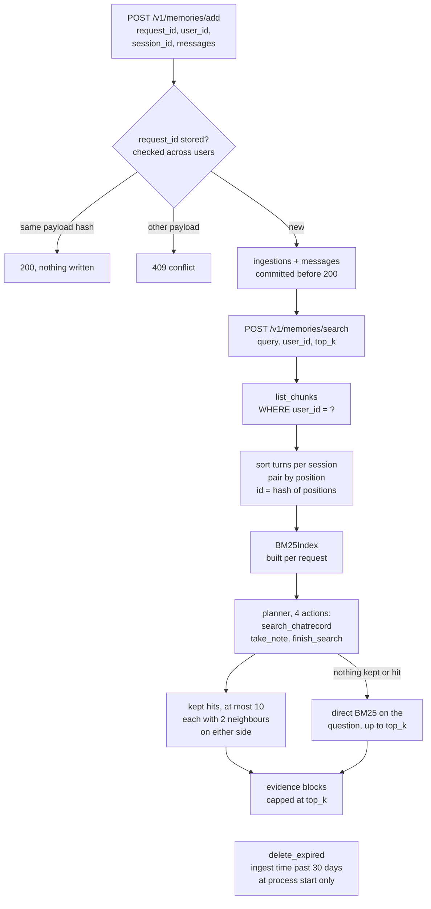

## 1. Executive Summary

ReFind is a FastAPI service that packages a paper's retriever for the Agent
Memory Leaderboard's Add/Search contract. Add stores raw chat messages in
SQLite with no model call. Search rebuilds a BM25 index over one user's turns
and lets GPT-4o-mini spend four actions searching it and keeping hits. The
scope boundary is unusually tight, because every derived structure is built per
request from one `user_id`-filtered read. The memory beneath it is thin: nothing
can be corrected or deleted, the port is unauthenticated, and result ids come
from positional pairing that a late turn reshuffles.

It is a contest submission, and the repository says so in
`docs/SUBMISSION.md` and `docs/METHOD_CARD.md`. The method card lists every
departure from the paper, and the README links a leaderboard placing that this
report does not use as evidence about the mechanism. Two marks:
`scope_enforced`, for the one content query and the per-request index built from
it, and `negative_eval`, for a populated isolation test whose fixture would leak
if the predicate went.

## 2. Mental Model

A memory is one chat message as the caller sent it: role, content and an
optional source timestamp in Unix milliseconds, inside an Add request that
names `request_id`, `user_id` and `session_id` (`app/models.py:8-22`). Nothing
is extracted, summarised or judged. Every stored message is equally true and
equally retrievable until it expires.

The unit the retriever ranks does not exist on disk. At each Search,
`list_chunks` sorts a session's turns by timestamp, then the ordinal parsed
from `request_id`, then insertion order, and pairs them two by two by position
(`app/store.py:233-288`). Each pair gets an id hashed from user, session and
its source positions. So a record's identity and content are functions of what
else has arrived, and an out-of-order Add regroups every later pair in that
session.

The lifecycle has two states. A message is stored from the moment Add returns
200. It is deleted when the process starts and its ingest time is older than
`RETENTION_DAYS` (`app/store.py:291-299`). No state withholds a stored message,
no path corrects one, and a message cannot be removed on request.

Belief is formed downstream. The planner chooses what to keep with
`take_note`, and the leaderboard's own answer model reads what ReFind
returns. The service deliberately has no answer stage.

## 3. Architecture

One FastAPI application, `app.main:app`, built by `create_app`
(`app/main.py:23-116`). It registers `/v1/memories/add`,
`/v1/memories/search` and `/health`, plus `/add` and `/search` as aliases kept
out of the schema. Routes carry no dependency or header check.

`MemoryStore` (`app/store.py:83-306`) owns one SQLite file in WAL mode with
foreign keys on and a 30-second busy timeout per connection. Writes take a
process-local `RLock`. `ReFindRetriever` (`app/retriever.py:71-265`) composes
the store, `BM25Index` (`app/bm25.py:19-132`), a stop-word tokenizer with a
compact stemmer (`app/tokenizer.py`) and `OpenAICompatibleLLM`
(`app/llm.py:16-73`), a bare `httpx` client for an OpenAI-compatible chat
endpoint. OpenRouter is the default base URL.

Settings come from environment variables only (`app/config.py:32-68`).
`RETRIEVAL_MODE` is `agent` or `bm25`, and `RETENTION_DAYS` is refused outside
1 to 30. The index is rebuilt in memory for every Search; nothing caches it.

### Deployment and ergonomics

The Docker image pins `python:3.11-slim` by digest, installs four `==`-pinned
requirements, runs as a non-root user with one uvicorn worker, and keeps the
database in `/data` (`Dockerfile`). There is no lockfile, so transitive
dependencies float. Storing needs no key. Searching in the declared `agent`
mode needs an LLM key and fails with HTTP 502 without one
(`app/retriever.py:105-108`, `app/main.py:77-81`). The `bm25` mode runs fully
offline. The store is two plain SQLite tables, readable and repairable with the
`sqlite3` shell.

The README states that the container runs without endpoint authentication so
the competition maintainer can call it directly, and the image binds
`0.0.0.0:8000`.

## 4. Essential Implementation Paths

- **Add.** `add_memory` (`app/main.py:58-67`) calls `MemoryStore.add`
  (`app/store.py:131-174`). It hashes the whole canonical payload, looks the
  `request_id` up, returns early on an identical retry and raises
  `ConflictingRequestError` on a different payload, which the route maps to
  409. Otherwise it inserts one `ingestions` row and one `messages` row per
  message in the same transaction.
- **Search entry.** `search_memory` (`app/main.py:69-89`) calls
  `ReFindRetriever.search` (`app/retriever.py:94-111`). That calls
  `list_chunks(user_id)` and builds a `BM25Index` from the result before the
  mode is consulted.
- **Turn reconstruction.** `list_chunks` (`app/store.py:176-289`) selects every
  message joined to its ingestion for one `user_id`, groups by `session_id`,
  sorts each session by one of three keys depending on what every turn
  carries, and pairs positions `[0,1]`, `[2,3]` and so on.
- **Agent loop.** `_agent_search` (`app/retriever.py:130-231`) sends
  `SYSTEM_PROMPT` and the question, parses `Action:` and `Action Input:` by
  regex (`:51-68`), and runs up to `AGENT_MAX_ITERATIONS` actions. A search
  adds its anchors to `excluded_ids`, a note keeps hits from the last search
  by 1-based index, and anything else is answered with a correction.
- **Fallbacks.** With no notes, the last search's hits are kept; with none of
  those either, `_direct_search` runs BM25 on the question and options at
  `top_k` (`app/retriever.py:214-225`, `:113-128`).
- **Ranking.** `BM25Index.search` (`app/bm25.py:65-99`) scores every record,
  fuses with session rank in `_rrf_with_session_ranking` (`:101-124`), then
  skips excluded and out-of-range anchors and expands each survivor with
  `_context` (`:126-132`).
- **Retention.** `delete_expired` (`app/store.py:291-299`), called from
  `MemoryStore._initialize` (`:129`) and the FastAPI lifespan
  (`app/main.py:35-38`).
- **Tests.** `tests/test_api.py`, through `TestClient` and a `ScriptedPlanner`.

## 5. Memory Data Model

Two tables (`app/store.py:103-128`):

- `ingestions`: `sequence` autoincrement key, `request_id` `UNIQUE`,
  `user_id`, `session_id`, `memory_id` `UNIQUE`, `payload_hash`, and
  `created_at` set to the server's UTC clock. An index covers
  `(user_id, sequence)`.
- `messages`: `(ingestion_sequence, message_index)` key, `role`, `content`
  and a nullable `timestamp_ms`, cascading on delete from `ingestions`.

`memory_id` is `mem_` plus 24 hex digits of SHA-256 over user and request id
(`:45-47`). It is written, and selected at `:191`, and no code reads it after
that. The ids Search returns are the pair ids from `_conversation_memory_id`
(`:61-68`), which hash user, session and the list of
`(request_id, message_index)` positions in the pair.

**Scope** is `user_id` on every ingestion, with `session_id` as a grouping key
inside it. `request_id` is unique across the whole table, not per user.

**Time** is two fields. `timestamp_ms` is when the message was said, supplied
by the caller and optional; it drives the planner's date filter and the
rendered `[2024-01-01T00:00:00Z]` prefix. `created_at` is when the row arrived;
it drives retention and is returned as `created_at`. Neither is a validity
interval for a stated fact, and no read asks what the store held at a past
time.

No row carries a status, a confidence, a correction link or a TTL.

## 6. Retrieval Mechanics

**Index.** Each pair's rendered content, timestamps and role labels included,
is lowercased, split on `[^\W_]+`, stripped of stop words and stemmed
(`app/tokenizer.py:118-125`, `app/store.py:26-34`). So `user`, `assistant` and
date fragments such as `2024` are indexed terms. The stemmer is Porter's step 1
only: plurals, `-eed`, `-ed`, `-ing` and final `y` (`app/tokenizer.py:99-115`).
Non-ASCII tokens pass unstemmed.

**Scoring.** BM25 with `k1 = 1.2` and `b = 0.75`, with the `+1` inside the IDF
log so every term scores positive (`app/bm25.py:45-63`). With `SESSION_RRF` on,
each record's rank is fused with its session's rank by summed BM25, at
`k = 60` (`:101-124`). When one `session_id` covers a whole sample, the session
term is a constant and the order is the BM25 order, which a test pins
(`tests/test_api.py:146-174`).

**Filtering after ranking.** Date bounds and the seen-anchor set are applied
while walking the ranked list (`app/bm25.py:89-98`). IDF and session sums are
computed over the user's whole history, out-of-range records included.
`_within_dates` admits every record without a timestamp, and admits everything
when either date fails to parse (`:135-150`). A planner that writes a malformed
date gets an unfiltered search and no error.

**Agent loop.** The planner sees five hits per search, each as a `Result n`
block with its session id and its neighbours, the anchor marked `[MATCH]`
(`app/retriever.py:233-246`). With the declared budget of four actions, the
largest kept set is ten hits, from search, note, search, note. The
leaderboard's recommended `top_k` of 100 is a cap the agent path cannot reach.
When the planner keeps and finds nothing, the direct fallback returns up to
`top_k` hits, so a planner that fails can return more evidence than one that
succeeds.

**Output.** Each kept hit becomes one block of its anchor and up to two
neighbours each side within the session, de-duplicated inside the block and
not across blocks (`app/retriever.py:248-265`). The score is the fused score
divided by `1 + 0.03 * rank`. The order is the order of `take_note`, not
chronology.

**Cost.** Every Search tokenizes the user's whole history before the first
model call. In agent mode it then makes up to four sequential chat
completions, each with a 120-second timeout and three attempts
(`app/llm.py:48-73`). An LLM failure is a 502, not a BM25 answer.

## 7. Write Mechanics

Add is the only write. It is synchronous, deterministic and model-free: the
messages are committed before the 200 (`app/store.py:131-174`). A stored turn
is searchable on the next request, since the index is rebuilt per Search.

Idempotency is by payload hash. An identical replay writes nothing and returns
the same body; a replay with any changed field is refused
(`tests/test_api.py:46-80`). Content is not deduplicated. Two requests carrying
the same sentence are two turns.

Update, merge, consolidation and conflict detection are absent, and no endpoint
deletes anything. Input validation is Pydantic with `extra="forbid"`, a `user`
or `assistant` role and non-empty content (`app/models.py:8-22`). Content is
stored as sent, uninspected.

### Operational cost

Writes do not wait on a model and no background pass exists. The lag before a
memory is retrievable is the Add's own commit. The read side carries the cost:
a full re-tokenization of the user's history per Search, and up to four model
calls. Injection is bounded by `top_k` and, in agent mode, by the ten-hit
ceiling, each hit up to five pairs long.

## 8. Agent Integration

The integration is the contest's HTTP contract. A harness posts Adds as a
conversation is replayed and posts Search with the question; ReFind returns
ordered evidence for the platform's own answer model. It ships no agent
framework adapter, MCP server or session hook.

The agent inside ReFind is the planner. It holds three verbs, all over a
read-only index: `search_chatrecord` with keywords and optional dates,
`take_note` by result number, and `finish_search` (`app/retriever.py:15-35`).
It cannot write, delete or widen scope. A malformed action costs one
iteration and draws a correction message.

Adapting it to another agent would mean replacing the HTTP boundary with
whatever names the user and adding the missing delete.

## 9. Reliability, Safety, and Trust

### The scope boundary is one query wide

`list_chunks` is the only query that reads message content, and it filters
`WHERE i.user_id = ?` (`app/store.py:187-199`). `search` builds the
`BM25Index` from that list inside the request (`app/retriever.py:101-104`).
The planner's `search_chatrecord` calls query that index object
(`:178-186`). Neighbour expansion walks `_session_positions`, which holds
positions inside the same index (`app/bm25.py:31`, `:126-132`). Two users
sharing a `session_id` therefore cannot see each other's neighbours, and the
direct fallback takes the same index (`app/retriever.py:218`). The service
keeps no cache or shared index for a predicate to be missing from.

Two queries lack the predicate, both off the content path. `count_users` is a
`COUNT(DISTINCT user_id)` with no caller (`app/store.py:301-306`). The
idempotency lookup reads `request_id` across all users (`:136-139`), so a
request id another user already holds is a 409 that names the collision. It
returns no content, and it lets one tenant block another's id.

### The scope key is a claim

No route authenticates, and `user_id` is a body field
(`app/models.py:32-38`). Anyone who can reach the port reads any user's turns
by naming the id. That is the contest's stated deployment; for any other one
it means the filter is a correctness boundary, not a security one.

### Retention runs at startup

The README says records past the retention window are deleted automatically.
`delete_expired` runs when `MemoryStore` is constructed and again in the
lifespan hook, so only at process start (`app/store.py:129`,
`app/main.py:35-38`). A container that stays up 40 days holds 40 days of turns
until it restarts. The window is measured on ingest time. The cascade removes
the messages, and the tree issues no `VACUUM` or `secure_delete`.

### Stored text reaches the planner

Turn content enters the planner's prompt as an `Observation:` user message
(`app/retriever.py:190`, `:205-210`). An injected instruction there can steer
which of the user's own hits are kept or end the loop early. It cannot reach
another user or write anything. Returned evidence goes verbatim to the
platform's answer model, which is outside this tree.

### Identity is recomputed on every read

Pair ids hash their source positions, and positions depend on sort order. A
session's first turn arriving after its third regroups every pair, changing
their ids and contents. Pairing reads position, not role
(`app/store.py:264-288`), so a session opening with an assistant turn, or
carrying two user turns in a row, pairs across exchanges. Within the contest's
add-then-search protocol neither bites, because ingestion finishes before
questions start.

### Concurrency

The write lock is per process and the image runs one worker. Under several
workers, two racing Adds of one new `request_id` would meet the `UNIQUE`
constraint, which surfaces as an unhandled `IntegrityError` rather than the
409 or the retry no-op.

### Marks

- **`scope_enforced` — awarded.** One stored key, one predicate, and every
  read the planner, the neighbour walk and the fallback make goes through the
  index built from its result. The limit is the unauthenticated claim above.
- **`negative_eval` — awarded.** See section 10.
- **`tombstone`** — no rejected value is recorded, and no path can reject one.
- **`trust_state`** — no status field; every turn is returned on equal terms.
- **`bitemporal`** — `timestamp_ms` is when a message was said and
  `created_at` when it arrived. Neither says when a stated fact held, and no
  read closes an interval or asks as of a record time.
- **`audit_log`** — Add is insert-only, but the one mutation, the retention
  delete, writes no event.
- **`human_review`** — the HTTP contract is the only surface.

## 10. Tests, Evals, and Benchmarks

`tests/test_api.py` holds eight cases run through FastAPI's `TestClient`, in
`bm25` mode except one that injects a `ScriptedPlanner`. I did not run them.
The hosted CI workflow was deleted on 7 August 2026 in a commit titled
*"remove unavailable hosted CI"*, so the tree runs them on no push.

The cases cover synchronous, idempotent Add with a search hit (`:46-71`), a
409 on a conflicting replay (`:74-80`), user isolation (`:83-102`), the agent
path returning a kept hit without an answer (`:119-132`), schema rejection
(`:135-143`), session RRF inside one session (`:146-174`), timestamp order
beating arrival order (`:177-210`), and the ordinal tie-break with sessions
kept apart (`:213-256`). Retention, the date filter, the fallbacks, an LLM
failure and a late turn's effect on returned ids are untested.

**`negative_eval` is earned by the isolation case.** It writes two Luna turns
for `run:user-0` and `"Secret cat Orion."` for `other:user`, then searches
`cat Luna` for the first user at `top_k=1`. It asserts exactly one result and
that the result lacks `Orion`. The result is populated, so an empty retriever
fails. The fixture can fail the other way too: the other user's turn shares the
default `session_id`, so without the predicate it sorts between the two Luna
turns, pairs with the first, and becomes the top hit. I traced that by reading
`list_chunks`, not by running it. The case runs in `bm25` mode; the agent mode
reads the same `list_chunks` and has no isolation case of its own.

**The paper.** The README cites
[arXiv:2608.12888](https://arxiv.org/abs/2608.12888), *When Your Agent Opens
the Chat App: Agent-Controlled Search over Raw Chat Logs Rivals Structured
Memory*, submitted 13 August 2026 and revised 16 August. The id resolves to that
title. Its main table runs GPT-4o-mini on MemoryAgentBench, and its ablations
and backend comparison run GPT-5-mini on LongMemEval-S and M. The arXiv page
links no code.

The service implements the paper's retrieval stage closely: the three tool
names, BM25 at `k1 = 1.2` and `b = 0.75`, session RRF at `k = 60`, two
neighbours each side, five hits per search and four iterations. It departs in
five places:

- The answer stage is omitted, as the README and method card say.
- The paper's seen-session skip becomes a seen-anchor skip. The method card
  gives the reason, a platform that puts one session id on a whole sample. The
  paper's ablation removes the skip entirely rather than substituting it, so
  the substitute is unmeasured; removal cost 9.3 points on LongMemEval-M.
- The paper's turn is a user utterance with its assistant response; the code
  pairs adjacent positions whatever their roles.
- The paper applies the date range before BM25 scoring; the code filters after
  scoring and fusion.
- The paper says Porter stemming; the code implements Porter's first step.

`CITATION.cff` and `docs/METHOD_CARD.md` cite a different title, *A
Human-Inspired Search Interface for Conversational Memory*, with an author list
that includes Zhendong Mao and omits two arXiv authors. The manuscript
repository the method card links, `imlrz/wyaoca-paper`, returned 404 from the
GitHub API on 4 November 2026.

**The leaderboard.** The tree commits no result file. The leaderboard page,
read as text on 4 November 2026, says participants provide Add and Search and
the platform runs answering, evaluation and review. The fetched text carried no
ReFind row and named no commit for any entry, so the page ties no score to
this pin. [llm-wiki-cli](../llm-wiki-cli/) commits an adapter for the same
Add/Search contract.

## 11. For Your Own Build

### Steal

- **Build every derived structure inside the request, from the scoped read.**
  When the index, the neighbour map and the fallback all come from one filtered
  list, there is no second read for the predicate to be missing from.
- **Hash the whole payload for idempotency and refuse a mismatch.** A retry is
  free and a reused id with other content fails loudly instead of overwriting.
- **Give the retrieval model only selection verbs.** A planner that can search,
  keep and stop over a read-only index turns prompt injection into a ranking
  problem rather than a write.
- **Fail when the declared mode lacks its model.** A 502 is visible where a
  silent drop to the baseline would contaminate every result.

### Avoid

- **Ids computed from read-time grouping.** An id that changes when an earlier
  record arrives cannot be cited, corrected or deleted later. Store the pairing,
  or key results on source rows.
- **Filters that fail open.** An unparsable date bound should be an error to
  the planner, not an unfiltered search.
- **Retention that runs only at startup.** A stated window needs a scheduled
  sweep, or a predicate on the read.
- **A client-chosen id unique across tenants.** Scope the uniqueness to the
  tenant, or one tenant can probe and block another's ids.

### Fit

ReFind is a benchmark harness for a retrieval method, and a good one to read
for that. It is small, deterministic on the write side and explicit about its
departures from the paper. As memory for a product it is a starting point at
most. It has no authentication, no deletion on request, no correction and no
stable identity for what it returns, and every Search costs a full
re-tokenization of the user's history plus up to four model calls. Take the
loop and the per-request index, and supply the store yourself.

## 12. Open Questions

- Whether the paper's four iterations count every action, `take_note` and
  `finish_search` included, as the service's loop does, or four searches.
- Whether the hosted evaluation ran this commit. Every commit after 7 August
  2026 edits only the README, so the code matches that day's merge.
- How the seen-anchor skip compares with the paper's seen-session skip on
  data where sessions are real.
- How Search latency grows with history, since every request re-tokenizes it.

## Appendix: File Index

- Storage and schema: `app/store.py`
- Contract and routes: `app/models.py`, `app/main.py`
- Retrieval: `app/bm25.py`, `app/tokenizer.py`, `app/retriever.py`
- Model client and settings: `app/llm.py`, `app/config.py`, `.env.example`
- Deployment: `Dockerfile`, `docker-compose.yml`, `pyproject.toml`,
  `requirements.txt`
- Method and submission: `README.md`, `docs/METHOD_CARD.md`,
  `docs/SUBMISSION.md`, `CITATION.cff`
- Tests: `tests/test_api.py`, `scripts/smoke_test.py`

### Recorded searches

Run from the repository root at the pinned commit with `/usr/bin/git grep`.
Each empty result was checked against a control in the same scope.

- **Three SQL reads, one of them on content.**
  `git grep -n -E 'SELECT' -- app` returns `app/store.py:137`, `:190` and
  `:304`.
- **No delete path besides retention.**
  `git grep -n -i -E 'delete|forget|remove' -- app` returns `delete_expired`,
  its two callers and the `ON DELETE CASCADE` clause only.
- **No authentication on the routes.**
  `git grep -n -i -E 'auth|Depends|Header|Security|api_key' -- app/main.py`
  returns nothing at exit 1; `git grep -c -E 'add_api_route' -- app/main.py`
  returns 4.
- **No validity time.**
  `git grep -n -i -E 'valid_?(from|to|until)|as_of|expires?_?at|supersed' -- app`
  returns nothing at exit 1; `git grep -c -i -E 'timestamp' -- app/store.py`
  returns 22.
- **No status field.**
  `git grep -n -i -E 'status|verified|candidate|rejected|confidence' -- app`
  returns HTTP status codes, the health literal and a parser loop variable.
- **No vacuum or secure delete.**
  `git grep -n -i -E 'vacuum|secure_delete' -- .` returns nothing at exit 1;
  `git grep -c -E 'PRAGMA' -- app/store.py` returns 3.
- **No embedding arm.**
  `git grep -n -i -E 'embedding|vector|cosine|faiss' -- app` returns nothing at
  exit 1; `git grep -c -i -E 'bm25' -- app/retriever.py` returns 5.
- **No cached index.**
  `git grep -n -i -E 'cache|lru' -- app` returns nothing at exit 1;
  `git grep -n -E 'BM25Index\(' -- app` returns the one construction, at
  `app/retriever.py:104`.
- **No scheduled work.**
  `git grep -n -i -E 'schedule|interval|asyncio|thread|repeat|cron' -- app`
  returns the write lock's `threading` import and `RLock` only.
- **`memory_id` is never read back.**
  `git grep -n -E 'memory_id"\]' -- app` returns nothing at exit 1, against
  `git grep -n -E 'memory_id' -- app`, which returns the schema, the insert and
  the select at `app/store.py:191`.
- **`count_users` has no caller.**
  `git grep -n -E 'count_users' -- .` returns its definition only.
- **Pairing does not read the role.**
  `git grep -n -E 'role' -- app/store.py` returns the content renderer, the
  schema, the insert, the select and the row copy at `:224`, none inside the
  pairing loop at `:264-288`.
- **The paper.**
  `git grep -n -i -E 'arxiv|bibtex|@misc|doi' -- .` returns the README badge,
  link and BibTeX block.

## History

**2026-11-04** — [`a80175ca0eeb52a938d7cab7a602bc780de8a577`](https://github.com/imlrz/ReFind/commit/a80175ca0eeb52a938d7cab7a602bc780de8a577). First reading, from a shallow clone at the head of `main`; commit and author counts from the GitHub API. Screened first: no auto-run, build-time or cooldown surface, and one floating surface, `pyproject.toml` with no lockfile. MIT, no rider. Nothing installed, built or run. Two marks: `scope_enforced`, for the one user-filtered content query every derived structure is built from, and `negative_eval`, for a populated isolation case whose fixture would leak without the predicate ([section 9](#9-reliability-safety-and-trust), [section 10](#10-tests-evals-and-benchmarks)).
