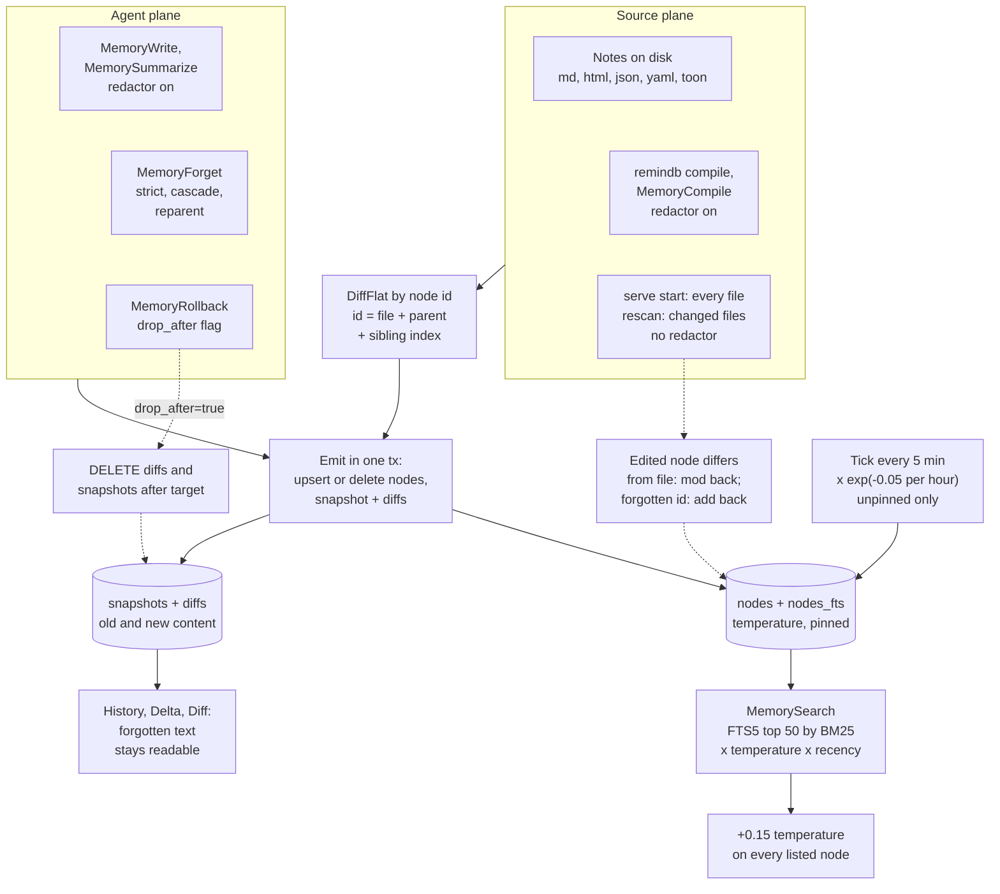

## 1. Executive Summary

remindb is a single Go binary that compiles a directory of notes (Markdown,
HTML, JSON, YAML, TOON) into a tree of typed nodes in one SQLite file and
serves it to coding agents over MCP with FTS5 search, budgeted fetch and a
wiki-link graph. What is notable is the snapshot log: every compile, write,
summary, forget and rollback is one snapshot whose diffs keep the old and new
content and the old metadata, so an agent resyncs with a delta and any snapshot
restores exactly. What is weak is that the notes on disk are the
truth and the agent's edits are not. Each `serve` start recompiles every file,
so a summary, a write or a forget on a file-derived node is undone at the next
session, and that recompile runs without the secret scrubber the documentation
says it uses.

Memory has two planes. The **compile plane** is the source directory: the
parser turns each file into nodes whose id is a hash of file, parent and sibling
position, and the compiler diffs the parse against the stored nodes of that
file. The **flat plane** is the agent's tools: `MemoryWrite` stores one unparsed
text node, `MemorySummarize` replaces one node's content, `MemoryForget` deletes
by id. Both planes go through one emitter.

The bundled `memorize` skill tells the agent to write structured memory as a
file under the source root, and warns that a `MemoryWrite` on a file-sourced
node is overwritten by the next compile
(`skills/memorize/references/write-paths.md:57`). It gives no such warning for
summarize or forget. The server's cold-node notice asks for summaries of
whatever has cooled, and most of that is file-derived.

Ranking multiplies the FTS5 score by a temperature weight and a recency factor.
Temperature is a score with no epistemic meaning: it rises on read, decays on a
five-minute tick, and drives the cold-node notice.

One mark is earned: `negative_eval`, for three populated cases on the node
store. Section 9 gives the reason for each of the six withheld, of which
`audit_log` is the nearest miss.

## 2. Mental Model

A memory is **a node of a compiled note, or a flat text node the agent wrote**.
Nothing distinguishes a belief from a candidate. A node is served from the
moment its snapshot commits and stops being served only when it is deleted.

How a node comes to exist and how it ends:

- **Compiled.** A file under the source root is parsed and transformed. Its
  nodes get ids from `IdentifyNode(source, parent, siblingIndex)`
  (`internal/contentid/contentid.go:28`), so editing a paragraph keeps its id
  and inserting one above it shifts the ids after it. `DiffFlat` compares each
  parsed node with the stored node of the same id by content hash and emits
  `add`, `mod` or `rem` (`pkg/diff/engine.go:14-64`).
- **Written.** `MemoryWrite` without an anchor creates a root `text` node in the
  pseudo-file `mcp:write` whose id is a hash of the payload, so the same text
  written twice is one node. With an anchor it replaces that node's content
  (`pkg/mcp/tools/write.go:33-75`).
- **Summarized.** `MemorySummarize` replaces a node's content and label and sets
  its temperature to 0.5 (`pkg/mcp/tools/summarize.go:42-63`).
- **Forgotten.** `MemoryForget` deletes a node, refusing one with children
  unless the mode is `cascade` or `reparent` (`pkg/mcp/tools/forget.go:76-121`).
- **Rolled back.** `MemoryRollback` reverse-applies diffs from HEAD to a target
  snapshot and writes the result as one new snapshot
  (`pkg/mcp/tools/rollback.go:38-116`).

For a file-derived node the compile plane has the last word. The next compile of
its file finds the stored content differs from the parse and emits a `mod` back
to the file's text, or finds the id missing and emits an `add`. The rescan loop
compiles every file on its first scan after each `serve` start, because its
table of modification times starts empty (`pkg/mcp/rescan/rescan.go:136`,
`:146-151`, `:273-277`). `TestRescanLoop_RunCatchesStaleEditsAtStartup`
asserts that startup reconcile (`pkg/mcp/rescan/rescan_test.go:612-649`). So
the agent's verbs are durable for `mcp:write` nodes and last until the next
session for the rest.

## 3. Architecture

One process, `remindb serve`, over one SQLite file opened through the pure-Go
`modernc.org/sqlite` driver in WAL mode with a five-second busy timeout and a
single connection (`pkg/store/db.go:37-51`). Writers inside the process are
serialised by `Store.OpMu`, a Go mutex (`pkg/store/db.go:22`). Nothing
coordinates two processes beyond SQLite's own locking.

`serve` speaks MCP over stdio by default, one process per client, or streamable
HTTP on `127.0.0.1:7474`. A non-loopback bind is refused unless
`REMINDB_AUTH_TOKEN` is set or `--insecure-public` is passed, and the token is
compared in constant time (`pkg/mcp/http.go:38-53`, `:95-129`). With a source
root, `serve` also runs the initial compile of an empty store, the rescan loop,
the temperature tracker and a session ledger in one errgroup
(`cmd/remindb/serve.go:158-205`).

There is no model call anywhere in the binary. Summaries are written by the
agent, token counts are `len/4` (`internal/tokens/tokens.go`), and there are no
embeddings.

### Deployment and ergonomics

Install is a release binary (`install.sh`, `install.ps1`) or `go build`.
Nothing else has to run, no API key is needed, and it works offline. The plugin
manifests for Claude Code, Codex and Gemini CLI start `remindb serve` with
`REMINDB_DB` and `REMINDB_SOURCE` from the environment
(`plugins/claude-code/.mcp.json`). The store is readable with `sqlite3` and
`remindb inspect`, and `remindb doctor --fix` takes a timestamped backup before
it repairs FTS drift, orphans, dangling diffs and the HEAD cursor
(`cmd/remindb/doctor.go:32`, `:67-82`). Because the notes on disk are the
source, the cheapest repair is to delete the database and recompile, at the
cost of the agent's flat-plane nodes and the history.

## 4. Essential Implementation Paths

- **Schema.** `migrations/0001_init.sql` (nodes, snapshots, diffs, cursors,
  `nodes_fts` and its three triggers), `0003_relations.sql` (relations, pending
  relations, the trigger that demotes incoming edges of a deleted node),
  `0004_node_pin.sql`, `0005_diff_metadata.sql`.
- **Compile.** `pkg/compiler/compiler.go`: `Compile` `:150-288`, the
  transform `:236`, previous state `:621-641`, diff `:254`, the emit and
  relations transaction `:259-282`, `CompileDir` `:304-417`;
  `pkg/transformer/transformer.go:14-49` (whitespace, scrub, hash, label,
  tokens, ids); `pkg/diff/engine.go:14-64`.
- **Emit.** `pkg/emitter/emitter.go`: `Emit` and `EmitTx`, each returning
  early on no deltas `:45-65`, node upserts and deletes `:93-100`, snapshot
  `:104-111`, diffs with old metadata `:113-131`, cursor `:133`; the node
  upsert in `pkg/store/queries.go:95-110`.
- **Agent writes.** `pkg/mcp/tools/write.go:22-83`, `summarize.go:21-71`,
  `forget.go:23-121`, `rollback.go:22-126`, the shared single-node emit in
  `deps.go:112-132`.
- **Rescan.** `pkg/mcp/rescan/rescan.go`: `Run` `:146-171`, `scan`
  `:215-351`, the compile options `:324-331`, deleted-file purge `:353-409`;
  the initial compile in `pkg/mcp/initial.go:15-41`.
- **Search and fetch.** `pkg/store/search.go:24-113`; `pkg/query/engine.go`:
  `Fetch` `:40-73`, `Search` `:118-136`; `pkg/query/rank.go:46-62`;
  `pkg/query/budget.go`; `pkg/temperature/decay.go:20-28`.
- **Temperature.** `pkg/temperature/tracker.go:114-143`, `cold.go:12-53`,
  `config.go:23-36`; boost on read in `pkg/mcp/tools/deps.go:96-109`; decay
  and cold selection in `pkg/store/queries.go:351-356`.
- **History.** `pkg/store/snapshot.go`: restore `:288-326`, prune `:378-397`;
  `pkg/mcp/tools/history.go:20-63`; delta and diff in
  `pkg/query/engine.go:143-179`.
- **MCP surface.** Tool registration `pkg/mcp/server.go:329-418`; the cold
  notice `:260-327`; resources under `pkg/mcp/resources/`.

## 5. Memory Data Model

A `nodes` row carries `id` (11 base62 characters), `parent_id` with
`ON DELETE CASCADE`, `source_file`, `node_type`, `depth`, `label`, `content`,
`format` (`plain` or `toon`), `token_count`, `content_hash`, `temperature`,
`access_count`, `last_accessed_at`, `created_at`, `updated_at` and `pinned`
(`migrations/0001_init.sql:1-17`, `0004_node_pin.sql:1`). There is no scope
column, no status and no validity time.

A `snapshots` row is an id, an opaque `cursor_hash`, a parent snapshot, a
message such as `write:<id>`, `forget:cascade:<id>` or `rescan`, a
`compile_root` and a time. A `diffs` row is snapshot, node, `op` (`add`, `mod`,
`rem`), old and new hash, and old and new content. Since migration 0005 it also
holds the old parent, source, type, depth, label, format and token count, which
is what lets a rollback undo a reparent or a rename
(`migrations/0005_diff_metadata.sql`). Neither table records which session or
client made the change.

`relations` hold directed weighted edges with an origin of `parsed` (from a
`[[Label; w=2.5]]` in a compiled file) or `manual` (`MemoryRelate`). An edge
whose target is not yet compiled waits in `pending_relations`, and a trigger
moves a deleted node's incoming edges back there, keyed on its label and file
(`migrations/0003_relations.sql:30-38`). Relations and pins are outside the
snapshot log by design.

Temporal fields are record times only. `created_at` and `updated_at` default to
`unixepoch()`, and `updated_at` moves on every temperature change as well as on
content changes (`pkg/store/queries.go:337-366`).

## 6. Retrieval Mechanics

Retrieval is tool-mediated; nothing is injected into a prompt. The agent orients
with `MemoryTree`, searches, then fetches.

`MemorySearch` rewrites a plain query into quoted terms joined by `OR`, passes
through a query that contains an FTS5 operator, and retries with every term
quoted if FTS5 rejects the syntax (`pkg/store/search.go:56-113`). It takes the
top 50 rows by BM25 (`pkg/query/engine.go:38`, `pkg/store/queries.go:185-191`)
and re-scores each as `-rank × (0.3 + 0.7 × temperature) × recency`. Recency is
`1 / (1 + hours since last access / 24)`, and 1.0 for a node never accessed
(`pkg/query/rank.go:46-62`, `pkg/temperature/decay.go:20-28`). A budget keeps
nodes in score order whose content would fit and skips the rest
(`pkg/query/budget.go`). The response lists type, label, id, file, score,
temperature and token count per node, not content
(`pkg/query/format.go:27-39`), and every listed node gets the 0.15 access boost
(`pkg/mcp/tools/search.go:26`).

The recency factor penalises a node for having been read. At the defaults, take
two nodes at 0.5, one read once and the other never. A day of server uptime
later the read node has temperature about 0.20 and recency 0.5, a weight of
about 0.22. The unread one has temperature 0.15 and recency 1.0, a weight of
about 0.41. With equal BM25 the unread node ranks first. The README says *"Hot
nodes rank higher in search"* (`README.md:42`); the formula is stated in
`docs/search.md:19`, and the inversion follows from it.

`MemoryFetch` returns an anchor with its ancestors, children and siblings to a
depth, ranks that context by the same score, fills the budget and puts the
anchor last (`pkg/query/engine.go:40-73`). `MemoryRelated` walks relations up
to five hops in either direction above a minimum weight, ordered by summed path
weight and then temperature (`pkg/store/queries.go:304-332`). Search, fetch and
batch fetch have no budget unless the workspace configures one
(`pkg/mcp/tools/search.go:18`, `fetch.go:19`); `MemoryRelated` defaults to
1,000 tokens.

The read paths select by FTS match, by id or by tree position, and by nothing
else.

## 7. Write Mechanics

**Compile.** The compiler parses files in parallel and transforms them. It loads
the previous nodes for those files, or for a directory compile the nodes whose
latest diff was written under that compile root, and diffs. Then, in one
transaction, it upserts and deletes nodes, writes a snapshot and its diffs,
advances HEAD and resolves relations (`pkg/compiler/compiler.go:150-288`,
`:621-641`). A compile or a write that changes nothing writes no snapshot
(`pkg/emitter/emitter.go:45-65`).

**The redactor is not on every compile.** `Transform` scrubs content before
hashing with whatever redactor it is given, and a nil redactor returns its input
unchanged (`pkg/transformer/transformer.go:25-28`,
`internal/redaction/redact.go:49-52`). The CLI compile and the `MemoryCompile`
tool pass one (`cmd/remindb/compile.go:85`, `pkg/mcp/tools/compile.go:42`). The
initial compile of an empty store calls `CompileDir` with a logger only
(`pkg/mcp/initial.go:29`), and the rescan loop builds its options without one
(`pkg/mcp/rescan/rescan.go:324-331`, `cmd/remindb/serve.go:190-195`).

So a file holding an AWS key compiled by `remindb compile` is stored with the
marker. The first scan of the next `serve` recompiles it unscrubbed, sees a
different hash and stores the key, with the scrubbed text as the diff's old
content. `docs/configuration.md:93` says the scrubber is *"applied on ingest by
both `compile` and `serve`"*.

**Agent writes** take `OpMu`, scrub the payload, compute the delta against the
stored node and emit one snapshot (`pkg/mcp/tools/deps.go:112-132`). They block
the call for one SQLite transaction and are searchable when it commits, since
triggers keep the FTS index.

**Forget** builds one `rem` delta per removed node and, for `reparent`, a `mod`
per moved child whose hash does not change, then emits them
(`pkg/mcp/tools/forget.go:76-121`). The removed text stays in the diffs.

**Rollback** computes the state at the target by reverse-applying diffs and
writes the difference as one snapshot. With `drop_after` it then deletes every
diff and snapshot after the target except the new one
(`pkg/mcp/tools/rollback.go:52-111`, `pkg/store/snapshot.go:378-397`). The
`memorize` skill recommends that flag for leaked secrets
(`skills/memorize/references/lifecycle.md:43`). It is the only path that removes
text from the history.

**What reverts a write.** The rescan's first scan compiles every supported file
(section 2). For each node the agent changed in a file-derived subtree, the
parse differs from the stored content and the compiler emits a `mod` back to the
file. For each one it forgot, the id is missing from the previous state and it
emits an `add`. A summarized node keeps the temperature its summary set while
its content returns, because the upsert keeps the stored temperature unless the
compile seeds one (`pkg/store/queries.go:109`). It cools again and is offered
for summary again.

### Operational cost

Writes are synchronous and model-free. A new memory is retrievable when its
transaction commits. The temperature tick updates every unpinned row every five
minutes (`pkg/store/queries.go:351-352`). Each `serve` process runs its own
tracker, so with two sessions on one database every tick is applied twice. With
a source root, each `serve` start re-parses every file under it. Nothing is
injected per turn; a search response is one line per node, and a fetch without
a budget returns the anchor's whole neighbourhood.

## 8. Agent Integration

The MCP server registers 17 tools, `MemoryCompile` only with a source root
(`pkg/mcp/server.go:329-418`), and read-only resources that never boost
temperature. The agent holds every verb, `MemoryRollback` with `drop_after`
included.

The plugins mount the server and add nothing else. The Claude Code, Codex and
Gemini CLI manifests are an MCP entry, and the OpenClaw and OpenCode files are
shims of eleven and eight lines. The Hermes Agent provider spawns `remindb
serve` as a subprocess and proxies `tools/list` and `tools/call`, with no
prefetch or turn sync, so retrieval there is tool-driven too
(`plugins/hermes-agent/memory/remindb/__init__.py:175-301`).

Four skills carry the usage contract: `remember` routes intent, `remind`
covers reads, `memorize` covers writes and lifecycle, and `remindb-setup` writes
`.remindb/` and wires the host. The cold-node notice goes out as an MCP
`notifications/message` at `warning` with up to 50 node ids and a suggested
`MemorySummarize` (`pkg/mcp/server.go:260-327`). Whether it reaches the model
depends on the host.

Each stdio client starts its own `serve`, so on a host that spawns one per
session, every new session recompiles the source root before its first call.

## 9. Reliability, Safety, and Trust

### The source wins, and the agent is told only part of it

The compile plane is authoritative, and that is a coherent design: notes live in
files a person edits, and the database is a compiled view of them. The cost is
that three of the agent's verbs are provisional on file-derived nodes. A
`MemoryForget` returns at the next session start, a `MemorySummarize` reverts,
and a `MemoryWrite` reverts, which the skill does say. The README describes the
summary as compaction *"in place — same anchor, same history, fewer tokens"*
(`README.md:44`).

Every unpinned node decays, and an unread node falls from 0.5 below the 0.1 cold
threshold after about 32 hours of uptime. Most of what the notice asks the agent
to summarize is therefore file-derived and will revert. No test compiles a file
after an agent change to one of its nodes.

### History is kept, and is also the agent's to delete

The diff log is the strongest part of the system. Every content change through
the emitter writes old and new content and old metadata in the same transaction
as the change. Rollback is a forward snapshot, and `MemoryHistory` reads the
trail of a node that no longer exists (`pkg/mcp/tools/history.go:32-35`).

Three things keep it from being an audit record. `drop_after=true` on
`MemoryRollback`, an agent tool, hard-deletes diffs and snapshots
(`pkg/store/queries.go:170-172`). `doctor --fix` deletes dangling diffs and the
HEAD cursor (`:398-401`). And a snapshot names no actor or session. Pins,
relations and temperature change outside the log.

### Forget is not erasure

A forgotten node's content stays in `diffs.old_content`, readable through
`MemoryHistory`, `MemoryDelta` and `MemoryDiff`, and restorable by rollback.
The only removal is `drop_after`, which deletes every change after the target,
not the one node. The rescan and initial compile store secrets that the CLI
compile scrubbed (section 7).

### Concurrency

`OpMu` serialises tools, rescan and decay within one process. Two processes on
one file, which is the stdio default for two sessions, each run a rescan, a
tracker and the startup recompile against the same rows, with SQLite's busy
timeout as the only coordination.

### Transport

Stdio has no network surface. Loopback HTTP has no authentication by default,
and `pkg/mcp/http.go` passes no options to the SDK's streamable handler and adds
no `Origin` or `Host` check of its own (`:51`). Off loopback the server refuses
to start without a token or the explicit opt-out. `MemoryCompile` rejects paths
outside the source root after resolving symlinks
(`pkg/mcp/tools/compile.go:63-96`).

### Marks

- **`negative_eval` — earned.** Three committed cases require particular
  material absent from a populated read: a scrubbed key from a search that must
  return the node, a rolled-away value from a search beside a hit for the
  restored one, and a forgotten leaf from a tree that must keep its parent
  (`pkg/mcp/tools/tools_test.go:443-481`, `:2422-2445`,
  `mcp_integration_test.go:1715-1745`). Each runs against the real SQLite store
  in memory. The cascade case's search assertion would pass on an empty store
  by itself.
- **`audit_log` — withheld**, on the append-only clause, because the agent can
  delete the log through `MemoryRollback`. With that flag off the tool surface,
  the diffs would carry the mark with the missing actor as its caveat.
- **`tombstone` — withheld.** Forget is keyed on a node id, and the next compile
  of the file re-adds the id. An `mcp:write` node written again with the same
  text gets the same id back.
- **`trust_state` — withheld.** Temperature is a float used for ranking and for
  the cold notice, and `pinned` exempts a node from decay. Neither withholds a
  node from any read.
- **`scope_enforced` — withheld.** No scope column exists; the boundary is the
  database file.
- **`bitemporal` — withheld.** Record times only.
- **`human_review` — withheld.** Every verb is an agent tool and nothing waits.

## 10. Tests, Evals, and Benchmarks

I ran none of the tests; the counts are from reading. CI runs gofmt,
golangci-lint, `go mod tidy` drift, `make build` and `go test -race ./...`
(`.github/workflows/ci.yml`). Fuzz targets cover the parser, compiler,
transformer, redaction, path matching, query rewriting and temperature.

The memory tests are in three files: 94 functions in
`pkg/mcp/tools/tools_test.go`, 27 in `mcp_integration_test.go` driving the MCP
server through an in-process client, and 55 in `pkg/store/store_test.go`. They
cover each forget mode, rollback chains and reparent reversal, FTS staying in
step with rollback, delta truncation, diff consolidation and redaction on write
and summarize. `pkg/compiler/compiler_atomicity_test.go` makes the relations
step fail inside the compile transaction and requires no snapshot to survive.
`TestRescanLoop_RunCatchesStaleEditsAtStartup` asserts the startup recompile.

Not tested: a forget, summary or write on a file-derived node followed by a
compile of its file; the rescan or initial compile with a secret in the file;
two processes on one database; and the ranking inversion above. The Hermes
script is a smoke test of provider discovery and config, not of memory.

The README's token savings, 43.9% to 99.8% across six corpora, are committed
only as drawings, in `assets/bench.svg` and
`assets/excalidraw/benchmarks.excalidraw`. The largest corpus, an Obsidian vault
of about 450 files, is not in the tree. `internal/bench/scenarios.go` measures
tokens: the naive side is a directory listing plus every file's content at four
characters a token, against remindb's tree, search, fetch and delta output. It
does not score whether the answer was in what was returned. There is no paper
reference in the tree.

## 11. For Your Own Build

### Steal

- **One snapshot per call, with old content and old metadata in the diff.**
  Delta resync, per-node history, rollback of a rename or reparent and forensic
  diffs all come from one table, written inside the transaction that made the
  change.
- **A structural id for compiled content.** Hashing file, parent and sibling
  index keeps an anchor through an edit, which is what lets the compiler emit a
  `mod` instead of a delete and an add.
- **Search that returns anchors, and a fetch that spends the budget.** A list of
  labels and token counts is cheap to read and lets the agent choose what to
  pay for.
- **Pending edges keyed on label and file.** A link to a node not yet compiled,
  or just deleted, waits and resolves on the next compile instead of being
  dropped.
- **Fail closed on a public bind.** The server refuses a non-loopback address
  with no token unless an ugly flag says otherwise.

### Avoid

- **Two writable planes where one silently wins.** If a compiled view is
  authoritative, refuse agent edits to compiled nodes, write them back to the
  source, or keep them as an overlay the compiler reads.
- **A scrubber passed as an option.** A nil default made the redactor optional
  on the two paths that run unattended.
- **A history-delete flag on the agent's tool.** Erasure belongs to the person
  who owns the store.
- **A recency term that is 1.0 for never.** A node nobody read should not
  outrank one read a day earlier.
- **A decay tick per process** on a shared file.

### Fit

This suits a single developer whose notes already live in Markdown and who wants
an agent to read them cheaply: one binary, no service, no key, and the notes
stay the editable truth. It suits that reader best if the agent's tools are
treated as read-mostly and anything worth remembering goes in a file. It does
not suit anyone who wants the agent's own conclusions, corrections or deletions
to persist against the files it read them from. Nor does it suit anyone who
needs a secret kept out of the database once it is in a note, or a team sharing
one database, which has no scope and recompiles everything at each session's
start.

## 12. Open Questions

- Does the go-sdk v1.8.0 streamable HTTP handler check `Origin` or `Host` by
  default? `pkg/mcp/http.go` passes no options and adds no check.
- Do Claude Code, Codex and Gemini CLI show an MCP `notifications/message` at
  `warning` to the model, or only in a log? The summarize loop depends on it.
- Is the startup recompile meant to override agent summaries and forgets? The
  skill warns about `MemoryWrite` only.
- What were the vault benchmark's raw numbers and corpus? Only the rendered
  percentages are committed.

## Appendix: File Index

| Path | Role |
| --- | --- |
| `migrations/0001_init.sql` to `0005_diff_metadata.sql` | Nodes, FTS5 and triggers, snapshots, diffs, cursors, relations, pins, diff metadata |
| `pkg/compiler/compiler.go` | Compile of files and directories, previous state, the emit and relations transaction |
| `pkg/transformer/transformer.go` | Whitespace, scrub, hash, label, token estimate, structural ids |
| `internal/contentid/contentid.go` | `IdentifyNode` and `IdentifyPayload` |
| `internal/redaction/redact.go` | The secret scrubber and its nil no-op |
| `pkg/diff/engine.go` | `DiffFlat` |
| `pkg/emitter/emitter.go` | One snapshot, its diffs and its node changes per call |
| `pkg/store/queries.go` | Every SQL statement, including decay, prune and the doctor fixes |
| `pkg/store/snapshot.go` | Restore by reverse diffs, prune |
| `pkg/store/search.go` | FTS5 query rewrite and retry |
| `pkg/query/engine.go`, `rank.go`, `budget.go`, `format.go` | Search, fetch, delta, diff; scoring; budget fill; output |
| `pkg/temperature/` | Defaults, boost, decay tick, cold selection |
| `pkg/mcp/rescan/rescan.go` | Rescan loop, startup recompile, deleted-file purge |
| `pkg/mcp/initial.go` | Initial compile of an empty store |
| `pkg/mcp/server.go`, `http.go` | Tool registration, cold notice, HTTP transport and bearer auth |
| `pkg/mcp/tools/` | The 17 tools |
| `cmd/remindb/serve.go` | Process wiring |
| `plugins/hermes-agent/memory/remindb/__init__.py` | Hermes memory provider |
| `skills/memorize/references/write-paths.md`, `lifecycle.md` | The agent's write and lifecycle contract |
| `pkg/mcp/tools/tools_test.go`, `mcp_integration_test.go`, `pkg/mcp/rescan/rescan_test.go` | Tool, MCP and rescan tests |
| `internal/bench/scenarios.go` | Token-savings scenarios and the naive baseline |

### Recorded searches

Run from the repository root at the pinned commit with `/usr/bin/git grep`.

- **Two delete statements on the log, beside the node writes.**
  `git grep -n -E 'DELETE FROM|UPDATE (diffs|snapshots|nodes|cursors|relations)' -- '*.go' ':!*_test.go'`
  returns node deletes, reparent and temperature updates, pending-relation
  deletes, `qDeleteDiffsAfter` and `qDeleteSnapshotsAfter` at
  `pkg/store/queries.go:170` and `:172`, and the doctor fixes at `:398-401`.
- **The redactor reaches two of the four compile paths.**
  `git grep -n 'WithRedactor' -- '*.go' ':!*_test.go'` returns
  `cmd/remindb/compile.go:85`, `cmd/remindb/serve.go:137` (the server, for
  agent writes), the two option definitions and `pkg/mcp/tools/compile.go:42`;
  `git grep -n -i 'redact' -- pkg/mcp/rescan pkg/mcp/initial.go` returns
  nothing.
- **No test redacts on rescan or initial compile.**
  `git grep -n -i -E 'redact|scrub|AKIA' -- pkg/mcp/rescan cmd/remindb/serve_test.go pkg/mcp/initial_test.go integration_test.go`
  returns only `applyRedactionOverrides` cases in `cmd/remindb/serve_test.go`;
  `git grep -c -i 'AKIA' -- pkg/mcp/tools/tools_test.go` returns 6.
- **No test combines an agent edit with a recompile.**
  `git grep -n -E 'HandleForget|MemoryForget|HandleSummarize|MemorySummarize' -- pkg/mcp/rescan pkg/compiler integration_test.go`
  returns nothing; `git grep -n 'compiler.CompileDir' -- pkg/mcp/rescan/rescan_test.go`
  matches.
- **No scope key.**
  `git grep -n -i -E 'user_id|tenant|namespace|agent_id|project_id|workspace_id|owner' -- '*.go' '*.sql' ':!*_test.go'`
  returns only the `namespace` parameter of `IdentifyPayload` in
  `internal/contentid/contentid.go:35-37`; `git grep -c source_file -- '*.sql'`
  matches three migrations.
- **No status column.**
  `git grep -n -i -E 'status|verified|confidence|trust' -- migrations` returns
  nothing.
- **No tombstone or validity time.**
  `git grep -n -i -E 'tombstone|blocklist|denylist|suppress|rejected' -- '*.go' '*.sql' ':!*_test.go'`
  returns two comments in `pkg/mcp/tools/compile.go` about a rejected path;
  `git grep -n -i -E 'valid_from|valid_to|valid_at|valid_until|effective_' -- '*.go' '*.sql'`
  returns nothing.
- **No review verb.**
  `git grep -n -i -E 'approve|approval|review' -- '*.go' ':!*_test.go'` returns
  only `textPreview` in `internal/mcptest/mcptest.go`.
- **No embeddings or model call.**
  `git grep -n -i -E 'embedding|vector|cosine' -- '*.go'` returns nothing;
  `git grep -n -i -E 'openai|anthropic|ollama|chat/completions' -- '*.go'`
  returns only redaction patterns and their tests.
- **Three tools boost through results, and one directly.**
  `git grep -n 'boostResultNodes' -- '*.go' ':!*_test.go'` returns
  `fetch.go:31`, `fetch_batch.go:35` and `search.go:26`;
  `git grep -n 'RecordAccess' -- '*.go' ':!*_test.go'` adds `related.go:71`.
- **No paper reference.**
  `git grep -n -i -E 'arxiv|bibtex|doi\.org|CITATION' -- .` returns nothing.

## History

**2026-11-27** — [`af0e0a84e58a5830f892727176ace73fa9516928`](https://github.com/radimsem/remindb/commit/af0e0a84e58a5830f892727176ace73fa9516928). First reading, read only, from a full clone at the head of `main`, the commit triage selected. Screened first: four auto-run surfaces (`.claude-plugin/`, `.githooks/`, `plugins/claude-code/.claude-plugin/plugin.json`, `plugins/claude-code/.mcp.json`), `go.mod` and `go.sum` inside the seven-day cooldown, build-time execution in the `Makefile`, no unpinned surface; `CLAUDE.md` and the `.claude/` agents, rules and skills read as data. Nothing was installed, built or run, and the 759 Go test functions were not run. One mark, `negative_eval` ([section 9](#9-reliability-safety-and-trust)); `audit_log` withheld because `MemoryRollback` can delete the diff log.
