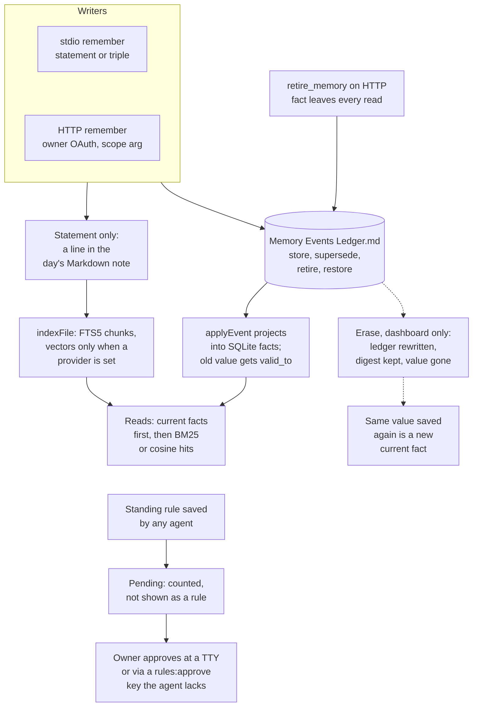

## 1. Executive Summary

Renor Engine is memory for coding agents over MCP. An agent saves a decision,
a fact or a correction, and the next session recalls it. Memory is a folder of
Markdown: dated notes for plain statements, and one Markdown ledger of events
for structured facts. SQLite holds a search index derived from both. What is
notable is that the ledger, not the database, is the record. Every fact
change is appended there first and the facts tables are replayed from it, so
deleting the index loses nothing. What is weak is correction: retiring a fact
takes it out of every read, and nothing stops the same value being saved
again as a new current fact.

The README's self-hosted path is `npx -y renor-engine mcp`, a stdio server
over a folder in `~/.renor`. With no embedding provider, search is BM25 over
FTS5 with a stemmed retry, plus a lane of current facts matched by their
words. The same repository holds an owner-only HTTP MCP server with OAuth,
which is the per-workspace engine behind the hosted service at renor.cloud.
That server adds scopes, retirement and opt-in rule approval. The hosted
gateway and dashboard are not in this tree, and one verb, permanent erase,
is reachable only through them.

The tree is an export of a private repository: most commits are titled
*Refresh from source main*. The benchmark table in the README was produced with
hosted Vertex embeddings and Claude Opus 5.5 as the reader, on questions the
defaults were tuned on, and no per-question output is committed.

**Licence.** `NOTICE` says files imported from obsidian-semantic-memory *"stay
under that project's ISC license"*, and no file in `src/` carries an ISC or
SPDX header, so a reader cannot tell from a file which licence covers it. The
boundary is recoverable only from `docs/upstream/source-manifest.json`, which
lists 27 `src/` paths at import time, including `src/memory/lifecycle.ts` and
`src/mcp/server.ts`, both rewritten since. That manifest names
`patrickpassosb/obsidian-semantic-memory` as its origin, while `UPSTREAM.md` and
`NOTICE` name `sterben-enec/obsidian-semantic-memory`. Releases up to 1.0.0
were AGPL-3.0-only. Apache-2.0 applies from 1.1.0 on.

Three marks are earned: `scope_enforced` on the fact and note scopes of the
HTTP server, `audit_log` on the ledger, and `negative_eval` on retirement
across every read. Section 9 gives the reasons for the four withheld.

## 2. Mental Model

There are two kinds of memory, and they have different lifecycles.

- **A note** is text. `remember` with only a `statement` appends a timestamped
  line to the day's file under `Memory/Daily/` (`src/memory/writer.ts:148`),
  or under `Memory/Scopes/<slug>/Daily/` when the HTTP server is given a
  scope. A person can also drop any Markdown file in the folder. A note is
  believed from the moment it is indexed and stops being served only when it
  is retired, moved or edited away. A later note can name it in `replaces`,
  and a read then lists the correction first and marks the older hit.
- **A fact** is a subject, a predicate and a value in a scope. `remember` with
  all three appends a `store` or `supersede` event to
  `System/Memory Events Ledger.md` and then projects it into SQLite
  (`src/memory/lifecycle.ts:1826-1827`). One value per subject, predicate
  and scope is current; a new value closes the old one by setting its
  `valid_to`, and the old one stays answerable through `include_history` and
  `as_of` (`src/memory/lifecycle.ts:2223-2277`).

A fact stops being believed in three ways. Supersession closes it and keeps
it as history. Retirement appends a `retire` event and moves the row from
`facts` to `retired_facts`, out of every read, and `restore` brings it back
with its dates (`src/memory/lifecycle.ts:2005-2101`). Erasure replaces the
fact's ledger event and its retire and restore events with one event that
holds only the original event's SHA-256 digest and the ids it had closed
(`src/memory/lifecycle.ts:1907-1912`). None of the three is keyed on the
value, so saving the same statement again creates a new current fact.

## 3. Architecture

One Node.js package, `renor-engine`, needing Node 22.16 or later for its
built-in `node:sqlite` (`src/db/sqlite.ts:2-22`). `sqlite-vec` loads as an
optional prebuilt dependency. The CLI in `src/cli.ts` offers `index`,
`search`, `watch`, `serve`, `rebuild`, `mcp`, `status`, `backup`, `doctor`,
`connect` and `telemetry`.

There are three servers over the same index and folder:

- **`renor-engine mcp`**, stdio, the README's self-hosted path
  (`src/mcp/server.ts`). It lists the hosted tool names and keeps an older
  set (`search`, `keyword`, `facts`, `note`, `remember_fact`) callable.
- **`npm run mvp`**, an HTTP MCP server bound to `127.0.0.1` with OAuth for one
  owner (`src/mvp/server.ts`, `src/mvp/auth.ts`). It registers twenty-seven
  tools by literal name, and a handoff tool behind a flag, among them `retire_memory`, `restore_memory`, imports, a memory map
  and multi-agent requests. The Docker image runs this one.
- **`renor-engine serve`**, a token-guarded REST API (`src/api/server.ts`).

The HTTP server is also the per-tenant engine of the hosted product. Routes
under `/internal/` answer only loopback calls carrying a gateway secret, and
comments name the gateway's own files under `apps/gateway/`, which this tree
does not contain.

The repository's size is not a bundled engine. The largest tracked files are
`src/indexer/o200k.json`, a 1.4 MB packed token vocabulary for budgeting
replies, and a README GIF; storage is Node's SQLite and `sqlite-vec` from npm.

### Deployment and ergonomics

The stdio path needs nothing but `npx`, and fetches the newest release from
npm at every start unless a version is pinned. The folder is plain Markdown,
so a person can read, edit, back up or version it. `renor-engine doctor`
checks the folder, the index, and whether the ledger's event count matches
what the index applied. Anonymous telemetry to PostHog is on by default with
a first-run notice; `DO_NOT_TRACK=1` turns it off. Most behaviour sits behind
environment variables, and `docs/ENVIRONMENT-VARIABLES-REFERENCE.md` lists
them at 107 KB, many as research levers off by default.

## 4. Essential Implementation Paths

- **Ledger and facts.** `src/memory/lifecycle.ts`: design note `:27-57`,
  `appendLedgerEvent` `:462-475`, `applyEvent` `:1142`, `moveFactOut`
  `:1356`, `remember` `:1607`, `rememberCritical` `:1733`,
  `eraseRetiredFact` `:1860`, `retireFact` `:2005`, `restoreFact` `:2039`,
  `scopeFilterFor` `:2123`, `factsFor` `:2223`.
- **Stdio tools.** `src/mcp/server.ts`: hosted names `:110-180`, `search`
  `:184`, `keyword` `:246`, `remember_fact` `:287`, `note` `:310`;
  `src/mcp/hostedSurface.ts` for the listed set.
- **HTTP tools.** `src/mvp/tools/index.ts` registers them;
  `remember.ts`, `getContext.ts`, `retrieveMemory.ts`, `retireMemory.ts`,
  `deleteRetiredMemory.ts`; context assembly in
  `src/mvp/agentMemory.ts:1667` (`buildAgentContext`).
- **Retrieval.** `src/retrieval/orchestrator.ts:856` (`retrieveContext`),
  `src/retrieval/keyword.ts`, `src/retrieval/semantic.ts`,
  `src/retrieval/factsFirst.ts`.
- **Scope.** `src/mvp/scope.ts`, `src/mvp/readScope.ts`,
  `src/mvp/layeredScope.ts`.
- **Standing rules.** `src/mvp/pinnedRules.ts`, `src/mvp/ruleApprovals.ts`,
  `claude-code-plugin/hooks/standing-rules/`.
- **Indexing.** `src/indexer/pipeline.ts`; schema in `src/db/migrations.ts`.

## 5. Memory Data Model

The `facts` table started with subject entity, predicate, value, source path,
a confidence, `valid_from`, `valid_to` and `updated_at`
(`src/db/migrations.ts:45-57`); later migrations add `event_id`, `scope`,
`author` and the statement's words. Lifecycle facts hang off a reserved
source path, `_mcp_`, so re-indexing a note cannot delete them. The design note says
a partial unique index keeps one current value per subject and predicate
(`src/memory/lifecycle.ts:41-45`).

A ledger event is a Markdown block, `## mem_<id> · <time>`, followed by
`- key: value` lines. Field values may not contain control characters, so a
value cannot forge a second event, and the statement is encoded to carry
newlines safely. Replay deduplicates byte-identical events by digest and
fails on a reused id with a different payload.

Beside `facts` sit `retired_facts` (the same columns plus who retired it and
when), `erased_facts` (event id, original digest, erase time, closed ids),
`fact_writers` (who wrote each value and whose value it displaced), and
`standing_rule_approvals` (a rule key, the event and the approval time).
Notes become `notes` and `chunks` rows with an FTS5 table over chunk text and
an optional `vec0` table of embeddings. Frontmatter keys `owner`, `status`,
`updated` and `tags` become note-derived facts, and wikilinks become
`relations`.

`valid_from` is the time of the write in every path. The projection binds the
event's own time (`src/memory/lifecycle.ts:1302-1304`), and note-derived
facts bind `now` (`src/indexer/pipeline.ts:487-508`). No tool accepts a time
at which a fact became true.

## 6. Retrieval Mechanics

The stdio `search` runs `retrieveContext` and merges up to three current
facts by score (`src/mcp/server.ts:184-230`). With no embedding provider,
which is the self-hosted default, the semantic lane is replaced by BM25 over
FTS5 with the query's content words joined by OR, and a stemmed retry when
the exact words miss (`src/retrieval/orchestrator.ts:882-900`). With a
provider, it is cosine over `sqlite-vec`.

`rankWindow` then adjusts scores: a penalty for speaker stubs, a content
boost, priority paths, an entity match, a recency bonus decaying over 30
days, one hop of graph expansion over wikilink relations at a fixed 0.3, and
a fact-aware pass that demotes chunks carrying a superseded value and lifts
the current one, inverted when the question asks about the past. The page is
selected by score and, by default, laid out newest first, which the tool
descriptions warn about.

`get_context` on the HTTP server runs the semantic and keyword lanes, the
facts lane and the optional layers, then fits the reply to an o200k token
budget, 8,000 by default in deep-search mode
(`src/mvp/agentMemory.ts:1667-1800`). Retired facts are absent from every
lane because the row has left `facts`. Superseded values appear only with
`include_history`.

## 7. Write Mechanics

A save blocks the agent until it is durable and searchable. `remember_fact`
checks the input, runs the secret guard, decides `store`, `supersede` or
`nochange` against the current value, appends the event, applies it to
SQLite and re-indexes the ledger file before replying
(`src/mcp/server.ts:287-297`). A note save appends the line and re-indexes
that day's file. There is no lag: a value is retrievable when the call
returns. With an embedding provider, the re-index includes the embedding
call.

Four guards stand before the ledger:

- **Writer serialisation.** One promise chain per process orders decide,
  append and project (`src/memory/lifecycle.ts:1600-1604`).
- **Clock monotonicity.** A write whose time is older than the value it would
  close is refused before the append, so a clock step cannot leave a
  self-rejecting event in the ledger.
- **Stale expectations.** A caller can require the current value to be a
  given event, and every event it copied to still be live
  (`src/memory/lifecycle.ts:1762-1771`).
- **Secrets.** On by default; a write whose subject, predicate and value read
  as a credential is refused.

Model-driven writes are opt-in. End-of-turn capture runs through the hosted
gateway's loopback route. The consolidation pass, `RENOR_CONSOLIDATE`, asks a
model whether a newer fact replaces an older one under another name and
writes only supersedes (`src/memory/dreamer/dreamer.ts:14-41`). Indexing can
run an LLM fact extractor over notes. No background pass rewrites the store;
`rebuild` regenerates the index from the folder, and an erase rewrites the
ledger file.

### Operational cost

A self-hosted install runs no model and no second process. The README puts
the package at 1.8 MB and about 143 MB of memory with 1,000 saved memories.
The ledger is read whole for the repeat check above 256 KB, and the code says
so (`src/memory/lifecycle.ts:1623`).

## 8. Agent Integration

The stdio server lists `get_context`, `search_text`, `retrieve_memory` and
`remember` by default, and `whats_new` with `RENOR_MCP_TOOLS=all`. With
`RENOR_CONNECTION_NAME` set, a process takes a lease on that name and gains
the multi-agent tools (`ask_agent`, `list_requests`, `answer_request`,
`close_request`); the name is the writer of every save it makes, and the
`source` argument is ignored.

`renor-engine connect` and the README ship a five-line rule for the agent's
instructions file telling it to recall before deciding and save decisions
with their reasons. The Claude Code plugin adds opt-in hooks: per-prompt
recall, recall before merges and deploys, the approved standing rules at
session start and after compaction, and a save of user-flagged lines before
the agent stops.

## 9. Reliability, Safety, and Trust

### Correction does not stay corrected

Retire, restore and erase all name an event. `rememberCritical` looks at the
current value of the stream and at retired values only to close them; it
never compares the incoming value with a retired or erased one, and neither
does any extraction or consolidation path. A user who asks to forget a
value, and an agent that later hears it again from a retained transcript,
produce a new current fact with a new id. The erase event's
`original_digest` is a digest of the whole event, so it cannot be matched
against a new event either.

### Scope is an argument

On the HTTP server, `scope` is optional on every read and write tool. A read
without it sees every scope (`src/memory/lifecycle.ts:2123-2125`), and the
`x-renor-scope` header a client can send is used for ordering and for
observations, not as a filter (`src/mvp/agentMemory.ts:1696`, `:1800`). The
model chooses the scope string. `RENOR_LAYERED_SCOPE`, off by default, tags
each save with where it was made and hides another project's items from a
read that names no scope. The stdio server writes every fact as global and
documents its `get_context` scope as ignored
(`src/mcp/hostedSurface.ts:47`).

### Deletion stops at the dashboard

`delete_retired_memory` refuses any call without the dashboard header, which
counts only when a gateway secret is configured (`src/mvp/tools/shared.ts:365-367`).
A self-hosted install without the hosted gateway therefore has no tool to
erase a retired fact. Its text stays in the ledger until someone edits the
file by hand.

### Marks

- **`scope_enforced` — earned.** A scope is stored on every event and fact
  and applied as a SQL predicate on the fact reads, and notes are partitioned
  by directory. It applies only when the model passes a scope.
- **`audit_log` — earned.** The ledger is an append-only Markdown record of
  every fact mutation, written before the projection, with writer, time and
  the event it closed. Notes are not in it, and erase rewrites it.
- **`negative_eval` — earned.** A populated test requires a retired value to
  be absent from every read while the value it replaced is still returned as
  history.
- **`tombstone` — withheld.** Retirement and erasure are keyed on the event,
  and the same value saved again is stored.
- **`trust_state` — withheld.** No memory carries a status that a read
  excludes on. `untrusted` is derived from the source name and labels a hit;
  the writer-conflict line labels a value; retirement removes a row and is a
  soft delete.
- **`bitemporal` — withheld.** `valid_from` and `valid_to` are the times the
  value was written and replaced, and `as_of` asks what the store held then.
- **`human_review` — withheld.** A standing rule an agent saves is pending
  until the owner approves its exact event at an interactive terminal
  (`approve.mjs` refuses without a TTY) or through a `rules:approve` key
  minted on a loopback route, and no agent tool approves. But what waits is
  only the rule's standing as an instruction: its content is served as an
  ordinary current fact by `retrieve_memory`, search and `get_context` before
  any approval. The gate is off by default behind three switches
  (`RENOR_STANDING_RULES_HOOK`, `RENOR_PINNED_RULES`, `RENOR_RULE_APPROVALS`),
  and its tests are not in the public tree.

## 10. Tests, Evals, and Benchmarks

I ran none of the suites. The counts are from reading.

The tree has 340 vitest files with 3,774 `it` or `test` calls, and CI runs
them with a type check and a RenorBench smoke on hash embeddings. Suites that
boot the HTTP server skip on Windows only
(`tests/helpers/httpServerPlatform.ts`).

`tests/mvp/retire-fact-recall.test.ts:72-117` is the case behind
`negative_eval`. It saves Postgres 14, supersedes it with QuokkaDB, requires
eight value reads to contain QuokkaDB, retires it, requires all nine to lose it
while `retrieve_memory` with history still returns Postgres 14, and requires
`restore_memory` to bring back answers equal to the first reads. No test
saves a retired value again.

`tests/memory/scope.test.ts:50-77` requires one value per scope for the same
subject and predicate, and asserts that an unscoped read returns at least
two.

No test in the tree imports the standing-rules hooks or exercises
`/rules/approvals`, `loadPinnedRules` or `updateRuleApprovals`.
`tests/helpers/untyped-modules.d.ts:38-45` declares the hook modules as
*"imported by their tests"*, including `standing-rules-gate.mjs`, which is
not in the tree, so those tests stayed in the private repository.

`fixtures/eval/` holds RenorBench v0, v1, v2 and a documents suite, and
`scripts/eval/` holds runners for LongMemEval, LongMemEval-V2, LoCoMo and
BEAM. The README's scores are published at renor.cloud/research: 492
correct on LongMemEval-S's 500 questions judged by gpt-4o-2024-08-06, 1,489
of 1,540 on LoCoMo categories 1 to 4 judged by gpt-4o-mini, and BEAM nugget
scores judged by DeepSeek V4.1 Flash. Each was run once, on 27 and 28 October
2026, with Claude Opus 5.5 at xhigh effort as the reader and Vertex embeddings.
The page says the scores are not held out, that the defaults were developed
on the same LongMemEval-S questions, and that its score of record from the
nightly run of 19 October 2026 is 60.4% with gpt-4o-mini as the reader. No
per-question output is committed or linked, so no headline recomputes from
an artifact, and none measures the self-hosted keyword-only path.

There is no paper for the engine. The `arxiv` references in the tree cite
A-Mem and LongMemEval-V2 for research levers and a data loader.

## 11. For Your Own Build

### Steal

- **Make the log the record.** Append the event, then project it; replay the
  projection at startup; count the events against what the index applied in
  a health check. Deleting the database is then a non-event.
- **Refuse before the append.** Every check that could reject a write runs
  before the ledger is touched, including a dry-run projection for restore,
  so a refused write leaves the canonical bytes identical.
- **Make an approval tool impossible rather than guarded.** The approval CLI
  refuses without a terminal, the server route needs a key no MCP credential
  carries, and no agent tool approves anything.
- **Test retirement against every read at once.** One fixture, nine read
  paths, the positive control before and the history after.

### Avoid

- **Forgetting by id.** A retire or erase keyed on the event cannot refuse
  the same value arriving under a new event, which is the case forgetting
  exists for.
- **An optional scope that defaults to everything.** If a project boundary
  matters, derive it from the connection, not from an argument the model may
  omit.
- **A destructive verb only a closed component can reach.** A self-hosted
  owner of this engine has no erase.
- **Benchmarking a configuration users do not run.** The published scores use
  embeddings and a reader the self-hosted default does not have.

### Fit

This suits one developer or a small team whose agents need to remember
project decisions across sessions and tools, who want the memory in a folder
they can read and back up, and who accept keyword recall or will configure an
embedding provider. The ledger design is the reason to read the code even if
nothing else is borrowed.

It does not suit a deployment where forgetting must hold, where projects
must be isolated without trusting the model to name them, or where every
behaviour should be reproducible from the public tree: the gateway, the
dashboard and some tests are not in this tree, and dozens of switches change replies.

## 12. Open Questions

- Does the hosted gateway set `scope` from the connection, or pass the
  model's argument through? The engine filters only on what it is given.
- Which files are still under ISC? The manifest records hashes at import, and
  no file says.
- Is a self-hosted owner meant to erase by editing the ledger? Nothing in the
  public tree reaches `eraseRetiredFact` without the dashboard header.

## Appendix: File Index

| Path | Role |
| --- | --- |
| `src/memory/lifecycle.ts` | The ledger: events, projection, replay, remember, retire, restore, erase, fact reads |
| `src/mcp/server.ts` | Stdio MCP server and its tools |
| `src/mcp/hostedSurface.ts` | The tool list the stdio server publishes |
| `src/mvp/server.ts` | HTTP MCP server, OAuth, gateway and rule-approval routes |
| `src/mvp/tools/` | HTTP tool handlers, one file each |
| `src/mvp/agentMemory.ts` | `get_context` assembly and budgeting |
| `src/mvp/scope.ts`, `src/mvp/readScope.ts` | Scope normalisation and read filtering |
| `src/mvp/pinnedRules.ts`, `src/mvp/ruleApprovals.ts` | Pinned standing rules and server-side approvals |
| `claude-code-plugin/hooks/standing-rules/` | Session-start rules block, approvals file, terminal approval |
| `src/retrieval/orchestrator.ts` | Lanes, ranking window, graph expansion, temporal boosts |
| `src/indexer/pipeline.ts` | Note parsing, chunking, FTS and vectors, note-derived facts |
| `src/memory/dreamer/` | Opt-in consolidation by model judgement |
| `src/db/migrations.ts` | Schema |
| `tests/mvp/retire-fact-recall.test.ts` | Retirement across every read |
| `tests/memory/scope.test.ts` | Scope isolation of facts |

### Recorded searches

Run from the repository root at the pinned commit with `/usr/bin/git grep`.

- **The stdio server has no retire or erase tool.**
  `git grep -n -i -E 'retire|erase' -- src/mcp` returns one comment,
  `src/mcp/server.ts:316`; the same pattern over `src/mvp/tools` matches 14
  lines in `deleteRetiredMemory.ts`.
- **No write path consults retired or erased values.**
  `git grep -n -E 'retired_facts|erased_facts' -- src/mvp/tools/remember.ts src/extraction src/memory/dreamer src/importing`
  returns nothing; the pattern matches 35 lines of `src/memory/lifecycle.ts`.
- **Every fact insert binds write time.**
  `git grep -n -E 'INSERT (OR [A-Z]+ )?INTO facts' -- src` returns
  `src/indexer/pipeline.ts:488`, `:1078` and `src/memory/lifecycle.ts:1302`,
  `:1413`; the first three bind `now` or the event time and the last copies a
  retired row's own `valid_from`.
- **No agent tool approves.**
  `git grep -n -i -E "registerTool\('[a-z_]*approv" -- src` returns nothing;
  `git grep -n "registerTool('retire_memory'" -- src` returns
  `src/mvp/tools/retireMemory.ts:11`.
- **No committed test reaches rule approval.**
  `git grep -n -E 'standing-rules/|ruleApprovals|loadPinnedRules|rules/approvals' -- tests`
  returns only `tests/helpers/untyped-modules.d.ts:39-45`;
  `git ls-files | grep -c 'standing-rules-gate'` returns 0.
- **No file names its licence.**
  `git grep -n -w -E 'ISC|SPDX-License-Identifier' -- 'src/*.ts' 'src/*.cjs'`
  returns nothing; `git grep -n -w 'ISC' -- NOTICE` matches `:10` and `:16`.
- **The gateway is not in the tree.** `git ls-files | grep -c '^apps/'`
  returns 0; `git grep -n 'apps/gateway' -- src` returns three comments.
- **No benchmark output is committed.**
  `git grep -n -E '492/500|1,489' -- . ':!package-lock.json'` returns
  `README.md:106` and `:108` only.
- **No paper of its own.**
  `git grep -n -i -E 'arxiv|bibtex|doi\.org|CITATION' -- . ':!package-lock.json'`
  returns citations of A-Mem in `src/extraction/` and of LongMemEval-V2 in
  `scripts/eval/longmemeval-v2/`.

## History

**2026-11-24** — [`54f512793f486c6b2a78f6e95773dc8af9217722`](https://github.com/renorai/renor-engine/commit/54f512793f486c6b2a78f6e95773dc8af9217722). First reading, from a full clone at the head of `main`; triage had selected `2ac3149c71a2`, and the pin is the head, 48 files under `src/` later. Screened first: no auto-run surface, `package.json` and `package-lock.json` inside the seven-day cooldown, no build-time execution, one unpinned manifest with a lockfile present, no submodules. Docs, plugin hooks and skills were read as data. Nothing was installed, built or run, and the test counts were not run. Three marks: `scope_enforced`, `audit_log` and `negative_eval` ([section 9](#9-reliability-safety-and-trust)). A retired or erased value saved again is current again, the scope is the model's argument, and erase is reachable only through the hosted dashboard.
