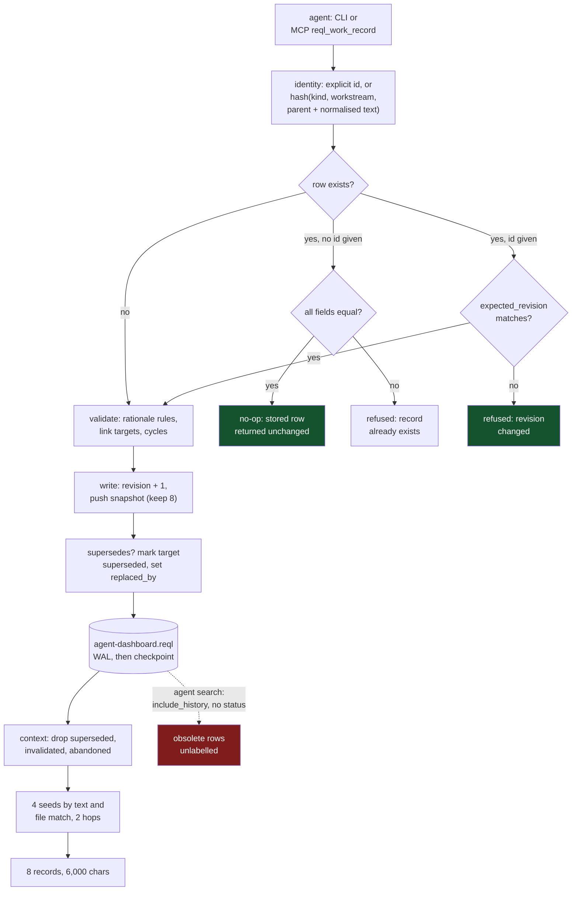

## 1. Executive Summary

REQL is a local Python tool for coding agents with two halves on one storage
engine. The first compiles a repository into a property graph and answers
bounded lexical-and-graph queries about code. The second, the Agent Workspace,
is the memory: a shared file of revisioned work records, which are decisions,
tasks, failures, constraints and checkpoints, plus a private store per agent.
There are no model calls and no embeddings.

It carries `trust_state` and `negative_eval`, both on the shared work store.

**Licence.** The tree disagrees with itself. `LICENSE` is the Apache License
2.0 text, ending in the unfilled appendix line
`Copyright [yyyy] [name of copyright owner]` (`LICENSE:189`). `README.md:158-160`
says MIT and points at that file, and `pyproject.toml:11-12` declares
`license = "MIT"` with `license-files = ["LICENSE"]`. A built wheel would carry
MIT metadata beside an Apache-2.0 file that names no copyright holder. There is
no NOTICE file and no rider.

**Identity is the dedup rule.** Without an explicit id, a record's id is a hash
of its kind, workstream, parent and its text with case folded and whitespace
collapsed (`src/memory/services/coordination.py:140-141`). Recording the same
text again lands on the same row: with every field equal it returns the stored
row unchanged, and with a difference it raises
`Record already exists … update with its revision` (`:200-209`). No similarity
threshold is involved, and reconciliation is forced through `id + revision`.

**Updates check the revision the caller read.** An update by id carries
`expected_revision`; a mismatch raises and writes nothing (`:158-159`). The
check runs inside one writable open and one transaction, under a cross-process
writer file (`:144`). Two processes racing one revision produce one update and
one conflict, and a committed test asserts it.

**An obsolete record is hidden and its id still resolves.** A supersession
marks the old row `superseded` and sets `replaced_by` in the same transaction
(`:216-228`). Default context drops obsolete records (`:331-334`), and asking
for the old id returns the current replacement (`:443-452`). Work that depended
on the old record is not rewired; it reports `needs_review` and cannot be
completed (`:192-199`, `:296-299`).

The limits are at the edges. Through MCP every returned string is HTML-escaped
and cut at 2,000 characters, while the write tool requires the content back.
`agent search` returns obsolete records without their status and opens every
agent's private store. And a checkpoint is not fsynced before the write-ahead
log is deleted.

## 2. Mental Model

One mutable row owns each outcome. The module docstring states the trade: it
keeps bounded revisions *"without an append-only log"* (`coordination.py:3-4`).

## 3. Architecture

One engine, `BlockGraphStore`, backs three kinds of file under `.reql/`:

| File | Holds |
| --- | --- |
| `memory.reql` | The compiled code graph |
| `agent-dashboard.reql` | Shared `work_record` nodes, the agent roster, public messages |
| `agent.reql`, `agents/<id>.reql` | One agent's sessions and private notes |

A store is a superblock followed by 64 KiB blocks of length-prefixed records.
Each commit appends checksummed frames to `<store>.wal` and fsyncs
(`src/memory/storage/adapters/block_store.py:1531-1545`). A checkpoint rewrites
the whole file to `<store>.tmp`, replaces the store and unlinks the log
(`:1939-1946`). A writable open takes `<store>.lock` and waits for reader slots
to drain; a lock whose process is dead on the same host is removed.

The code graph is outside this report's subject and has one property worth
carrying. A source excerpt is returned only when the file on disk hashes to
both the compiled artifact and the latest committed revision; otherwise the row
comes back marked `stale` or `unavailable` with no text
(`src/memory/services/retrieval/context/source.py:98-132`).

Work records and the code graph share no stored link. A record names source
only by repository-relative path strings, and `query_context` passes the file
paths of its working set to the work store as anchors at read time
(`src/memory/services/query_context.py:65-75`).

### Deployment and ergonomics

`pip install reql`, then `reql install <host>` writes instructions and, for
Claude Code and Gemini, a pre-tool hook that prints a fixed instruction block
when a store exists in the working directory (`src/agents/install.py:792-852`).
The hook injects prose, not memory content.

The distribution installs a top-level package named `mcp`
(`pyproject.toml:85-95`), the import name the MCP Python SDK also uses.

## 4. Essential Implementation Paths

| Path | Location |
| --- | --- |
| Kinds, statuses, obsolete set, caps | `src/memory/services/coordination.py:22-29` |
| Content-derived identity | `coordination.py:140-141` |
| Revision check | `coordination.py:158-159` |
| No-op and already-exists branches | `coordination.py:200-209` |
| History push and attribution | `coordination.py:210-215` |
| Atomic supersession | `coordination.py:216-228` |
| Derived execution state | `coordination.py:289-308` |
| Context retrieval | `coordination.py:310-440` |
| Forward resolution of obsolete ids | `coordination.py:443-452` |
| Pruning | `coordination.py:489-509` |
| Per-agent views | `src/memory/agent/workspace.py:486-488`, `:550`, `:578`, `:604` |
| Search across every agent's store | `workspace.py:714-738` |
| Session finish and checkpoint | `workspace.py:836-887` |
| MCP read-only tool set | `src/mcp/tools.py:84-101` |
| MCP output sanitising | `src/memory/security.py:26-35`, `src/mcp/tools.py:959-966` |

## 5. Memory Data Model

A work record is a node of type `work_record` whose state is in its properties.

- **`kind`**: one of nine, fixed at creation (`coordination.py:22`, `:156-157`).
- **`content`**: 1 to 4,000 characters; `rationale` and `next_action` likewise.
- **`status`**: `active`, `open`, `in_progress`, `blocked`, `done`, `resolved`,
  `superseded`, `invalidated`, `abandoned` (`:23`).
- **`files`**: up to 64 paths relative to the repository root, validated as strings and
  never opened (`:37-51`).
- **Relations**: `parent`, `depends_on`, `contradicts`, `supersedes`,
  `summarizes`, up to 32 ids each, cycle-checked (`:26`, `:235-259`).
- **`revision`** and **`history`**: an integer and the last eight prior
  payloads (`:28`, `:210-213`).
- **Attribution**: the latest writer's `agent_id` and `session_id`, and the
  first writer's `origin_agent_id` (`:213-215`).

Three fields are computed on every read and never stored: `execution_state`,
`waiting_on` and `conflicts` (`:289-308`). There is no second copy of a plan to
drift.

A rejected approach is kind `failure` with a required rationale. `agent reject`
is a thin wrapper and the views relabel it (`workspace.py:291-300`, `:499-506`).
Its status is `active`, like any other non-task record.

There is one timestamp axis: `created_at`, and an `updated_at` that overwrites.
`bitemporal` is withheld.

## 6. Retrieval Mechanics

`CoordinationStore.context` loads every work record and proceeds in four steps
(`coordination.py:310-440`).

1. **Filter.** Keep the anchor id if one was given, the workstream if one was
   given, and drop obsolete statuses unless `include_history`.
2. **Score.** IDF-weighted token overlap over content, rationale, next action,
   workstream and files; a path-prefix match against the query's files; small
   boosts for kind, importance, day-granularity recency and unfinished work.
3. **Expand.** The top four seeds expand two hops along the relations, with at
   most 40 records admitted in the first hop and 80 overall. Each relation
   target passes through `_current_replacement`.
4. **Return.** The top eight by default, forty at most, with scores, reasons,
   counts of what was omitted and a hash over the selection.

Text rendering is capped at 6,000 characters, 2,400 when attached to a code
query. A truncated row is marked and points at the JSON form, and the renderer
refuses to cut an identifier (`:645-660`).

Work records carry no staleness signal. The code graph withholds an excerpt
whose file changed; a decision about the same file is returned unchanged after
the file is rewritten or deleted.

**`scope_enforced` is withheld.** The project boundary is the directory, a
separate file per project. Inside a project, `agent_id` is an equality filter
on the per-agent task list, export and one search
(`workspace.py:486-488`, `:550`, `:578`, `:604`). The context read that feeds
the agent is shared across agents by design, the id is the latest writer and
moves when a task is re-claimed, and through MCP it is an unverified string.
No committed test asserts an agent boundary.

## 7. Write Mechanics

Every writer ends in `CoordinationStore.put` (`coordination.py:87-232`): the
CLI's `agent record`, `agent batch`, `agent task`, `agent reject` and
`agent finish`, and the MCP tool `reql_work_record`.

Validation is by rule. A decision, a failure and any new supersession need a
rationale; so does a move to a blocked or obsolete status and the reopening of
terminal work (`:172-177`). A task cannot be completed while its derived state
is `blocked` or `needs_review` (`:192-199`). A supersession target that already
has a replacement is refused (`:188-189`).

A batch of up to 40 entries commits each entry in its own transaction. A
failure part-way returns the committed ids and revisions with the failing
index (`workspace.py:401-466`).

`reql-mcp --read-only` filters the tool list to nine read tools and the
dispatcher refuses any other name (`src/mcp/tools.py:84-94`,
`src/mcp/server.py:96`, `:240-241`).

### Forgetting

- **History** is capped at eight snapshots per record.
- **Pruning** keeps every non-terminal record, every record another references,
  and the newest 200 unreferenced terminal records; the rest are removed and
  the file compacted (`coordination.py:489-509`). Its one product caller is
  session finish (`workspace.py:879`).
- **A supersession pair is never pruned**: each side references the other.
- **Private stores** are unlinked when the agent finishes or is terminated.

### Operational cost

No model call and no service. Every context and overview read loads all work
records, so cost grows with the store; referenced records accumulate without a
bound.

## 8. Agent Integration

Through the CLI the agent id comes from a flag, an environment variable, the
host's thread id or the roster, and the session from the agent's private store
(`workspace.py:1156-1174`). Through MCP, `agent_id` and `session_id` are
required strings the caller supplies; no private store or session is created
(`src/mcp/tools.py:130-139`).

**`human_review` is withheld.** Create, supersede, invalidate, reopen and
complete are all one call on the tool the producing agent holds. There is no
pending state and no second actor. The MCP write tools' descriptions ask for
client-side approval, which is a request to the host.

## 9. Reliability, Safety, and Trust

### MCP returns altered text and the write tool needs it back

Every string in an MCP result is HTML-escaped and cut at 2,000 characters
(`src/memory/security.py:26-35`, `src/mcp/tools.py:959-966`). A record's
content may be 4,000, and `reql_work_record` lists `content` as required
(`tools.py:610`); a supplied content replaces the stored text.

A client that updates a record by id and sends back the content it read stores
the escaped, truncated form. Re-derived in a separate script from the lifted
function: `a && b` reads back as `a &amp;&amp; b`, a second round trip escapes
the ampersands again, and a 4,000-character content returns as 2,000. Because
identity is derived from the text, a create-style retry with read-back text
makes a second record instead of the no-op.

### Search bypasses the status filter and the private boundary

`search_dashboards`, behind the CLI's `agent search`, calls `context` with
`include_history=True` and emits each work row as timestamp, agent, content and
rationale, with no status (`workspace.py:735-737`). A superseded decision and
its replacement are indistinguishable there.

The same function opens every registered agent's private store and returns
matching notes and sessions (`:714-734`). `agent note --agent ID` writes into
another agent's private store (`:306-318`), and `agent terminate ID` closes
another agent's sessions and deletes its file (`:664-697`). Private means a
separate path.

Two agent ids can share one private file. The file stem replaces every
character outside letters, digits, `-` and `_` with `_` (`:1195-1198`), so
`agent:alias/worker` and `agent:alias_worker` collide. A committed test asserts
the collision and that cleanup skips the store while either identity is active
(`tests/test_agent_lifecycle.py:167-175`); the collision itself is not refused.

### Re-recording a rejected text

`tombstone` is withheld, and the near-miss is real. Re-recording the identical
text of a decision that was set to `invalidated` lands on the same row and
returns it unchanged, status still `invalidated`; the same text with a new
rationale raises. The caller's only signal in the first case is the status
column of a success-shaped receipt.

It fails the definition four ways. The row is pruned once 200 newer unreferenced
terminal rows exist. The key is the exact normalised string, so a rewording
creates a new active record. An explicit `--key`, a different kind or a
different workstream changes the id. And nothing consults failure or obsolete
records when another record is written.

### Read-only queries write a journal nothing reads

`MemoryQuery.store_trace` defaults to true (`src/memory/domain/models.py:154`),
so a retrieval appends the query text and ranked node ids to
`<store>.usage.jsonl` without checking read-only mode
(`src/memory/services/retrieval/engine.py:227-239`, `block_store.py:3254-3272`).
The overlay loaded from that file is reachable only through `usage_for_node`,
which has no caller. The journal is a growing record of every query string,
pruned only by compile retention.

### Durability

The checkpoint file is written with plain writes and renamed over the store,
and the log is then unlinked (`block_store.py:1939-1946`). The only `fsync`
under `src/` is on log append (`:1545`). A power loss after the unlink can lose
the checkpoint's contents and the log that would rebuild them. Pruning and
lifecycle cleanup take this path on the shared work store.

### A session checkpoint drops evidence silently

Session finish keeps the first 64 evidence paths in alphabetical order and the
first 32 summarised records (`workspace.py:848-849`), and the receipt does not
say how many were cut. `summarizes` is what protects a completed record from
pruning, so a long session's 33rd terminal record is not protected by its
checkpoint.

### Why five marks are withheld

`tombstone`, `scope_enforced` and `human_review` are covered above.
`bitemporal`: one overwriting timestamp. `audit_log`: the design declines one,
history is eight snapshots on a mutable row that pruning deletes, the log is
unlinked at every checkpoint, and `BlockGraphStore.log_operation` has no caller.

## 10. Tests, Evals, and Benchmarks

228 `unittest` functions in 25 files, 6,341 lines, run by
`.github/workflows/ci.yml` on push and pull request. Sixty-five are on the work
store and the agent lifecycle. I ran none of them.

**The suite asserts what a corrected value must not do.**
`test_C_plan_replacement_preserves_cause_and_flags_obsolete_work` records a
decision, supersedes it, and asserts the old id is absent from default context,
present with `include_history`, and that the dependent task reports
`needs_review` and refuses completion
(`tests/test_coordination_workflows.py:97-117`). Two cases in
`tests/test_work_context_recovery.py:42-67` do the same for a two-step
replacement chain, by task anchor and by obsolete id. `negative_eval` is earned
on those.

Other cases worth naming: the duplicate write compares the store's bytes before
and after (`tests/test_coordination_workflows.py:188-208`), parallel writers
(`:210-227`), and the history cap and pruning with the terminal limit patched
to 2 (`:248-264`).

Not covered: a record written `invalidated` or `abandoned`, an agent boundary on
the per-agent views, the re-assertion no-op on an obsolete record, and an MCP
round trip of text that contains anything escapable. The suite's own MCP update
test echoes content with nothing to escape (`:309-312`).

No paper, DOI or memory benchmark is cited. `tests/benchmark_performance.py` is
a local timing harness.

## 11. For Your Own Build

### Steal

**Derive a record's id from its normalised text.** An identical repeat becomes
a no-op and a changed repeat an error naming the existing id. It needs no
similarity threshold and no model.

**Require the revision the caller read, inside the writer lock.** One
comparison turns a lost update into an explicit conflict.

**Resolve an obsolete id forward and leave dependents unrewired.** The old id
answers with its replacement, and work built on the old assumption is flagged
and blocked from completion until someone looks.

**Project execution state on read.** Blocked, ready and needs-review are
computed from current links, so no stored copy can disagree.

**Show an excerpt only while the file still hashes to what was compiled.**

### Avoid

**Do not sanitise output that the same client must send back.** Escape at
render time in the host, or accept an update that omits unchanged text.

**Do not let one read path skip the status filter without labelling its rows.**

**Do not call a store private when a sibling command reads all of them.**

**Do not delete a log before the file that replaces it is durable.**

**Do not derive a file name from an id with a lossy map.**

### Fit

It fits several coding agents working one repository on one machine, where the
problem is a plan that changes under work already started. It does not fit
where records must be attributable to a verified actor, where history must
outlive eight revisions, or where an MCP-only client edits long records.

## 12. Open Questions

- **Which licence is intended?** The file says Apache-2.0 and the metadata says
  MIT.
- **Is `invalidated` meant to be written by anything?** The store accepts it
  and hides it; no command sets it without a caller's status string and no test
  writes it.
- **What was the usage journal for?** Its reader has no caller, and the ranking
  code reads a different field.
- **Should `agent search` label status?** The sibling `AgentWorkspace.search`
  keeps it in the payload (`workspace.py:549-551`).

## Appendix: File Index

| File | Role |
| --- | --- |
| `src/memory/services/coordination.py` | The work store: identity, revisions, supersession, context, pruning |
| `src/memory/agent/workspace.py` | Agents, sessions, private stores, views, finish |
| `src/memory/storage/adapters/block_store.py` | The block engine, log, locks, usage journal |
| `src/mcp/tools.py`, `src/mcp/server.py` | MCP tools, read-only mode, output sanitising |
| `src/memory/security.py` | Path confinement and `sanitize_agent_text` |
| `src/memory/services/query_context.py` | Code query that attaches work context by file path |
| `src/memory/services/retrieval/context/source.py` | Hash-verified source excerpts |
| `tests/test_coordination_workflows.py`, `tests/test_work_context_recovery.py` | The work-store cases |
| `tests/test_agent_lifecycle.py` | Private-store lifecycle and the alias case |
| `docs/COORDINATION.md`, `docs/STORAGE.md` | The project's own description |

### Recorded searches

Run with `/usr/bin/git` in a full clone at the pinned commit.

- `git ls-files -z 'src/*.py' | xargs -0 cat | wc -l` — 42,209 lines in 166 files.
- `git grep -c -E '^[[:space:]]*def test_' -- tests`, summed — 228 in 25 files.
- `git grep -n fsync -- src` — `block_store.py:1545` only.
- `git grep -n -E 'usage_for_node|log_operation' -- .` — two definitions and two protocol stubs; no caller.
- `git grep -n -E 'invalidated|abandoned' -- src tests` — the three constants, three reads in `coordination.py`, one line of skill prose and one copied predicate in a test; no assignment.
- `git grep -n -E '\.prune\(' -- src tests` — `workspace.py:879` and one test.
- `git grep -n -i -E 'valid_from|valid_to|valid_at|valid_until|event_time|observed_at|as_of' -- src` — nothing.
- `git grep -n -i -E 'arxiv|doi\.org|bibtex|CITATION' -- README.md docs CONTRIBUTING.md` — nothing.
- `git ls-files | grep -i -E '(^|/)(licen[sc]e|copying|notice)'` — `LICENSE` only.

## History

**2026-11-16** — [`90e1acd0fbf505982123715fdb5a8d8ad0989d28`](https://github.com/sh1zen/reql/commit/90e1acd0fbf505982123715fdb5a8d8ad0989d28) — first reading. Screened first: `pyproject.toml` changed inside the seven-day cooldown and declares unpinned dependencies. Nothing installed or run; the identity, MCP round-trip and file-stem findings were re-derived in a separate script.
