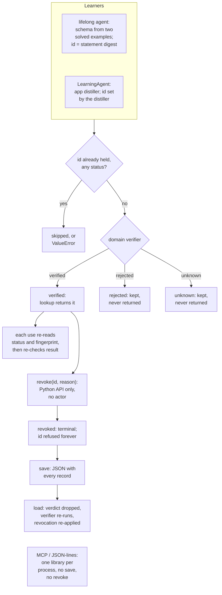

## 1. Executive Summary

ResiMind is a neuro-symbolic agent framework in dependency-free Python. A model,
a rule or a symbolic tool proposes a step, and a domain verifier decides what
becomes a fact. Its memory is a library of rules learned from solved tasks,
mostly bounded polynomial identities. A rule enters only when a registered
verifier accepts it, and is re-verified whenever the library is loaded.

What is notable is how little the library trusts its own file. Admission
discards everything a candidate says about itself, and loading discards the
stored verdict and asks the current verifier again. Every application of a
retrieved rule re-reads its status and re-checks the result. On the lifelong
learning path a rule's id is a digest of its statement, so a revoked rule cannot
be learned back.

What is weak is where the durable memory is reachable. The MCP server and the
JSON-lines tools keep one library per process, lost on restart, with no save and
no revoke. Persistence and revocation exist only on the Python API, and
revocation records a reason but no actor. Rule retrieval is a structural match
over polynomial expressions, so the memory is narrow by construction.

**Licence.** MIT, in `LICENSE`, which `pyproject.toml` names as its licence file
and `CITATION.cff` and `CONTRIBUTING.md` repeat. The one carve-out is the
evaluation material: `THIRD_PARTY_NOTICES.md` states that the ChinaTravel query,
gold-constraint and sandbox data under `docs/evidence/chinatravel-*` and
`experiments/chinatravel*` is CC BY 4.0 and *"is not relicensed by that MIT
notice"*. A copy that redistributes those files must keep the upstream
attribution. The core library and the memory modules carry no such condition.

## 2. Mental Model

A memory is a **`KnowledgeCandidate`**: an id, a domain, a kind, a JSON
statement, explicit assumptions, derivation steps, a source task id and evidence
references (`src/resimind/knowledge.py:88-118`). The module treats it as an
*"untrusted claim"*. Admission hands a detached copy to the verifier registered
for its domain and records the verdict, which is `verified`, `rejected` or
`unknown` (`knowledge.py:222-252`). A candidate without a source task id, with no
verifier for its domain, or whose verifier raises or mutates its input is
`unknown`. Rejected and unknown records are kept and never returned.

A belief stops in one way: **`revoke(id, reason)`**, which sets `revoked` on any
record and is terminal (`knowledge.py:332-341`). There is no edit, no
supersession and no delete. `conflicts()` finds verified records with the same
domain, kind and assumptions and a different statement, and nothing in the tree
calls it (`knowledge.py:279-295`).

Saving keeps every record, verdict and revocation reason. Loading validates the
shape of the stored verdict and then discards it: each candidate is admitted
afresh under the verifiers the caller passes, and a revoked one is revoked again
(`knowledge.py:409-422`). So a status other than `revoked` lives as long as the
process, and a change of verifier can turn a rejected rule into a verified one.

Two learners write into the library. `LifelongMathAgent` anti-unifies pairs of
solved examples into schemas and keys each on a digest of its statement. The
generic `LearningAgent` takes candidates from an application's distiller after
a solved task (`src/resimind/learning.py:53-80`). Two other stores carry the
memory name and do not outlive a process. `RouteMemory` is reviewed action
routes, an *"in-memory reference implementation"* (`src/resimind/memory.py:7`).
`TheoremMemory` holds Lean lemmas, saved by the caller (see section 5).

## 3. Architecture

The core is a library with no runtime dependencies (`pyproject.toml:19`). The
memory modules are `knowledge.py`, `learning.py`, `memory.py`,
`domains/lifelong_math.py`, `domains/schema_learning.py` and
`domains/rule_index.py`. Optional extras add the MCP SDK and SymPy; Lean 4.29.0
is an external toolchain for the formal path.

Three entry points reach memory. The Python API exposes `KnowledgeLibrary`,
`LearningAgent` and `LifelongMathAgent` with `save` and `load`. `resimind api`
runs a JSON-lines loop over stdin and stdout, and `resimind mcp` runs an MCP
stdio server (`src/resimind/cli.py:78-100`). Both wrap one `ToolSession`, which
builds a fresh `LifelongMathAgent` and tags every response
`"memory_scope": "process"` (`src/resimind/tool_api.py:36`, `:41`, `:58-62`).
The MCP instructions say learning changes *"process-local memory, lost on
restart"* (`src/resimind/integrations/mcp.py:19-21`). The registry entry in
`server.json` installs a release-asset bundle whose entry point is the same
server (`distribution/mcpb/server.py:1-5`).

### Deployment and ergonomics

Nothing has to run. A library is a Python object; persisting it is one JSON
file written by temp file, `fsync` and `os.replace` (`knowledge.py:343-373`). The
lifelong agent writes `rules.json` and a `learning.json` that records the rules
file's digest, so a mixed generation fails to load (`lifelong_math.py:174-226`).
The store is human-readable. Hand repair needs care, since a fingerprint check
refuses an edited candidate and the verifier re-judges an edited statement
(`knowledge.py:413-415`). No API key is needed to store anything. The JSON store
is documented as unauthenticated and unsafe for concurrent writers
(`knowledge.py:7-8`).

## 4. Essential Implementation Paths

- **Learn a schema.** `LifelongMathAgent.solve(learn=True)` runs recall, compact
  expansion and search in policy order. On success `_learn` stores the solved
  example and pairs it with up to 31 earlier ones
  (`src/resimind/domains/lifelong_math.py:121-155`). `discover_schemas`
  anti-unifies each pair, checks the resulting identity, and names it
  `abstract:` plus 24 hex characters of a digest over `lhs`, `rhs` and
  `variables` (`src/resimind/domains/schema_learning.py:65-86`).
- **Admit.** `_learn` calls `library.get(candidate.id)` and skips any id already
  present, with the comment *"Includes terminally revoked identities."*
  (`lifelong_math.py:147-152`). It then stops at 256 records, revoked ones
  counted (`:49`, `:151`).
- **Distil after a task.** `LearningAgent.run` looks up verified records,
  builds an agent, runs the task, and on a solved run admits up to 16 distilled
  candidates bound to the task's id and domain (`src/resimind/learning.py:53-80`).
  The polynomial distiller names its candidate from a digest of the task id,
  input and output (`src/resimind/domains/polynomial_learning.py:549-564`).
- **Retrieve.** `lookup` filters on `status == "verified"`, domain, optional
  kind and an assumption subset (`knowledge.py:264-277`). `RuleIndex` buckets
  verified unconditional identities by AST shape and matches them against every
  subexpression of the query, with a per-expression cache
  (`src/resimind/domains/rule_index.py:30-67`).
- **Apply.** `apply_schema` re-reads the record and refuses it unless it is
  verified with the same fingerprint, then substitutes and re-verifies the whole
  identity (`schema_learning.py:90-107`). The search loop repeats the status
  check at `rule_revalidation` (`src/resimind/domains/search_learning.py:285-289`).
- **Revoke.** `KnowledgeLibrary.revoke` (`knowledge.py:332-341`). Its callers in
  the tree are `load` and tests; no CLI, JSON-lines or MCP path reaches it.
- **Persist.** `save`, `load`, `freeze` (`knowledge.py:343-423`,
  `lifelong_math.py:157-226`).

## 5. Memory Data Model

`KnowledgeRecord` is a candidate, a `Verification(status, reason, verifier_id)`,
a status and a SHA-256 fingerprint over the canonical candidate payload. Its
constructor refuses a status that is neither the verdict nor `revoked`, and a
fingerprint that does not match (`knowledge.py:141-161`). The fingerprint covers
provenance as well as the statement, so the same claim from another task is a
different fingerprint.

There is no scope key. `domain` selects a verifier and `assumptions` are the
claim's conditions, matched as exact strings that the caller asserts
(`knowledge.py:202-209`). Ownership is by instance: each `ToolSession` holds its
own library, a partition by process. There are no time fields in
`knowledge.py`.

`TheoremMemory` is a tuple of at most 32 Lean lemmas, each admitted only after
the backend compiles it (`src/resimind/integrations/formal.py:523-548`). Since
the commit of 15 October 2026 each carries `LemmaMetadata`: source task,
evidence references, applicability tags, `created_at`, `expires_at` and a
verifier id (`formal.py:131-177`). Both timestamps are supplied by the caller,
default to empty, and nothing stamps either one. `active_lemmas` drops expired
lemmas and those whose tags the query lacks, and `solve` reads only
`active_lemmas()` (`formal.py:550-566`, `:713`). `save` is a plain `write_text`
(`formal.py:609-611`), not the atomic replace the knowledge library uses.

`RouteMemory` is a dict of immutable routes with `pending`, `approved` and
`revoked` statuses and an appended audit list, all in process memory
(`src/resimind/memory.py:98-222`).

## 6. Retrieval Mechanics

Retrieval is application-driven and structural. A query names a domain and the
assumptions it can vouch for, and receives verified records in insertion order
with no score (`knowledge.py:264-277`). The lifelong agent's recall route asks
`RuleIndex` for rules whose left side matches a subexpression of the input. It
spends at most four search actions and no model call
(`lifelong_math.py:101-107`).

Without the index, `run_search_learning` takes the first 16 verified records
and drops conditional ones (`search_learning.py:128-129`), so a library past 16
rules is truncated by age on that path. On the model-proposer path the verified
identities are listed in the prompt as *"Available verified identities"*
(`polynomial_learning.py:841-844`). They are candidates the model may cite, and
the state-bound verifier checks each citation.

The failure modes are under-recall and stale caches, and both are handled. A
rule that does not match syntactically is not found. The `RuleIndex` cache can
return a rule revoked after indexing, which `apply_schema` then refuses
(`tests/test_compact_lifelong.py:150-156`).

## 7. Write Mechanics

Writes are synchronous and explicit. Learning happens inside `solve` only when
the caller passes `learn=True`, and a frozen agent raises
(`lifelong_math.py:69`). Admission is one verifier call per candidate and the
rule is retrievable on return. Nothing runs in the background.

The writers are deterministic. Schema discovery anti-unifies two checked
rewrites and admits only an identity that checks universally in the bounded
polynomial ring (`schema_learning.py:1-8`, `:74-77`). The distiller path takes
the committed derivation of a solved task; a model can be the proposer of that
derivation, and each step faces the task verifier before it is committed.

Deduplication is by id. On the schema path the id is the statement digest, so a
re-derived schema is a no-op whatever its status. On the distiller path the id
includes the task id, and `admit` raises on a duplicate, which
`LearningAgent.run` records as a learning error (`learning.py:77-79`).

### Operational cost

The agent never waits on a model to write memory; admission is local
computation. Load re-runs the verifier over every stored candidate, capped at
256 records and a 16 MiB rules file on the lifelong agent
(`lifelong_math.py:198`, `:212`). `save` rewrites the whole file. Nothing is
injected into a prompt by default; only the model-proposer path lists the
verified identities, unbounded beyond the library size.

## 8. Agent Integration

The MCP server and JSON-lines loop register five tools: `verify_identity`,
`expand_polynomial`, `learn_polynomial`, `recall_polynomial` and `list_rules`
(`tool_api.py:15-21`). Only `learn_polynomial` writes, and it is annotated as
the one non-read-only tool (`mcp.py:23-26`). An agent can teach the server a
schema and recall it within one process. It cannot save, load, revoke or name
a library.

`skills/verify-and-repair-algebra/SKILL.md` and `examples/agent_probe.py` give
an agent a nine-call integration probe (reject, repair, learn, recall, and an
unsupported-scope control) over the same tools. LangGraph, OpenAI and DeepSeek
integrations wrap the verification loop and do not touch the library's
persistence. Adapting the library to another domain means writing a
`KnowledgeVerifier`, which the protocol keeps to one method
(`knowledge.py:135-138`).

## 9. Reliability, Safety, and Trust

### What admission trusts

Only the verifier. Evidence references, source task ids and serialized flags are
documented as *"not proofs"* (`knowledge.py:3-4`), and the code bears it out. A
candidate the verifier mutates is `unknown`, and a tampered verdict in the file
is replaced by a fresh one (`tests/test_knowledge.py:212-223`). An edited
candidate fails its fingerprint. A recomputed fingerprint over a false
statement loads as `rejected` (`tests/test_knowledge.py:225-247`). The design
moves all trust onto the verifier: an unsound verifier admits false rules, and
re-verification on load repeats its answer.

### What revocation stops

On the schema path it stops the value. The id is derived from the statement,
`_learn` skips any id already held, and the revoked record is saved and
re-applied on load. On the distiller path it stops the record: a later task
that derives the same identity mints a new id and is admitted. Three limits
apply even on the schema path:

- **Freeze drops it.** `freeze()` rebuilds the library from `lookup('algebra')`,
  which returns verified records only, so a frozen snapshot carries no revoked
  or rejected record (`lifelong_math.py:157-166`). A frozen agent cannot learn,
  so nothing re-asserts within it.
- **The key is syntactic.** The digest is over the anti-unified text, so an
  equivalent schema written with different operand order is a different id.
- **No actor.** `revoke` takes a reason string and no principal, and no
  agent-facing tool reaches it.

### Marks

- **`trust_state`** — awarded on the record status. `rejected`, `unknown` and
  `revoked` are kept and excluded by `lookup`, and every application re-reads
  the record and refuses one that is no longer `verified`. A verdict other than
  `revoked` is recomputed at load rather than carried; within a process the
  status is stored on every record and moved only by admission and revocation.
- **`tombstone`** — awarded on the schema path's statement-digest id, consulted
  by `_learn` before admission and durable through `save` and `load`. The
  distiller path and frozen snapshots are outside it.
- **`negative_eval`** — awarded; see section 10.
- **`scope_enforced`** — withheld. `domain`, `kind` and `assumptions` filter
  lookup, and none is a user, project, agent or tenant key. The per-process
  `ToolSession` is a physical partition.
- **`human_review`** — withheld. Admission is the verifier's decision with no
  waiting state for a person. `RouteMemory` has `pending` until
  `review(reviewer=...)`, and the reviewer is a string the caller supplies,
  which its docstring says *"does not authenticate people"*, in a queue that
  lives in process memory (`memory.py:7-9`, `:135-144`).
- **`audit_log`** — withheld. `RouteMemory._audit` appends a row per add,
  review and revoke, in process memory with no writer to disk
  (`memory.py:203-222`). The knowledge library keeps a revocation reason per
  record and `audit()` returns counts (`knowledge.py:297-309`); neither is an
  event record.
- **`bitemporal`** — withheld. The knowledge library has no time field.
  `LemmaMetadata` carries one caller-supplied window; no record time is
  stamped.

### Other risks

- **The agent-facing memory never persists.** Everything an MCP client teaches
  the server is gone at restart, which the server says. A reader adopting the
  MCP server is adopting a scratchpad.
- **`TheoremMemory.save` is not atomic** and the lemma file has no fingerprint;
  the backend re-compiles every lemma on load, so a damaged file fails rather
  than misleads (`formal.py:609-663`).

## 10. Tests, Evals, and Benchmarks

The suite under `tests/` has 869 pytest functions in 57 files. CI installs the
package and runs `python -m pytest -q` on Python 3.10 to 3.13, and a second job
runs the MCP tests over real stdio on 3.11 and 3.13
(`.github/workflows/tests.yml:10-41`). The Lean-backed formal tests skip when
no toolchain is found (`tests/test_formal.py:18-23`). I ran none of it.

`negative_eval` rests on `tests/test_knowledge.py:49-57`. It admits a verified,
a rejected and an unknown candidate into one library and asserts `lookup`
returns exactly the verified record. Deleting the status predicate would return
all three, so the case can fail. The conditions case at `:96-104` returns the
conditional record for a matching query and nothing for another domain, kind
or condition string. The revocation tests at `:177-196` and
`tests/test_compact_lifelong.py:189-193` assert an empty lookup over a library
holding only the revoked record, which an empty retriever would also pass.
No test re-learns a revoked schema through `LifelongMathAgent`, so the
tombstone's write-path half is untested. The formal expiry case asserts
`active_lemmas(...) == ()` over a one-lemma memory
(`tests/test_formal.py:88-110`).

The knowledge-growth result is committed as
`docs/evidence/knowledge-growth-v1/summary.json`. I recomputed it with
`python3 -I` from that file. The fixed and growing arms both solve 10 of 10
transfer tasks with 84 and 24 proposals, the growing arm makes 8 committed
cross-task rule applications, and discovery costs 13 proposals. That matches
the README's *"71.4% fewer transfer proposals"*. The tasks are handmade and
the proposer is a deterministic grammar, which the file's own `limitations`
list says. No paper is associated with the project; `CITATION.cff` cites the
software.

## 11. For Your Own Build

### Steal

- **Re-judge on load.** Store the verdict for inspection and discard it when
  reading the file back; a changed verifier then re-decides the whole store,
  and a forged approval in the file buys nothing.
- **Derive the id from the claim.** An id that is a digest of the canonical
  statement turns id-level deduplication into a value-level refusal for free,
  provided the writer checks the id before admitting.
- **Re-read status at the point of use.** A cached retrieval result is a
  pointer; check the current record and fingerprint before applying it.
- **Bind snapshot files by digest.** A metadata file naming the digest of the
  rules file makes a half-written generation fail to load.

### Avoid

- **A provenance field in the id.** Folding the task id into a learned rule's
  id makes every re-derivation a new record and every revocation local to one
  task.
- **A snapshot built from the read path.** Building a frozen copy from
  `lookup` leaves out exactly the records that say what must not come back.
- **An agent surface on a scratch store.** Exposing learning to an agent over a
  store it cannot persist or correct teaches it a memory that disappears.

### Fit

This fits a builder whose memory is checkable claims — identities, proofs,
plans against hard constraints — and who can write a sound verifier for them.
The library is small enough to read in an afternoon and has no dependencies.
It does not fit conversational memory: there is no text retrieval, no scope, no
user model, and a claim nobody can verify lands as `unknown` and is never
recalled. Walk away if you want an MCP server that remembers across sessions,
since this one does not.

## 12. Open Questions

- Whether a save or revoke surface is planned for the JSON-lines and MCP
  sessions, given the README's emphasis on persistent verified memory.
- Whether `freeze` is meant to drop revoked records, given that the lifelong
  learner relies on them to refuse a re-derivation.
- What the MiniF2F and LeanDojo runs the README lists as pending show for
  `TheoremMemory` with expiry in use.

## Appendix: File Index

- Knowledge store: `src/resimind/knowledge.py`
- Learning: `src/resimind/learning.py`, `src/resimind/domains/lifelong_math.py`,
  `src/resimind/domains/schema_learning.py`,
  `src/resimind/domains/polynomial_learning.py`
- Retrieval and application: `src/resimind/domains/rule_index.py`,
  `src/resimind/domains/search_learning.py`
- Routes: `src/resimind/memory.py`, `src/resimind/agent.py`
- Formal memory: `src/resimind/integrations/formal.py`
- Agent surfaces: `src/resimind/tool_api.py`, `src/resimind/integrations/mcp.py`,
  `src/resimind/cli.py`, `distribution/mcpb/server.py`, `server.json`
- Tests: `tests/test_knowledge.py`, `tests/test_compact_lifelong.py`,
  `tests/test_formal.py`, `tests/test_search_learning.py`,
  `tests/test_polynomial_learning.py`, `tests/test_memory.py`
- Evidence: `docs/evidence/knowledge-growth-v1/summary.json`

### Recorded searches

Run from the repository root at the pinned commit with `/usr/bin/git grep`.

- **Route memory has no persistence.**
  `git grep -n -E 'json|open\(|write_text|Path' -- src/resimind/memory.py`
  returns nothing; the same pattern counts 16 lines in
  `src/resimind/knowledge.py`.
- **No agent surface revokes.**
  `git grep -n 'revoke' -- src/resimind/tool_api.py src/resimind/integrations/mcp.py src/resimind/cli.py distribution/mcpb/server.py`
  returns nothing; `git grep -c 'revoke' -- src/resimind/knowledge.py` counts 13.
- **No agent surface saves or loads.**
  `git grep -n -E '\.save\(|\.load\(' -- src/resimind/tool_api.py src/resimind/integrations/mcp.py`
  returns nothing; the same pattern matches `src/resimind/domains/lifelong_math.py:177`
  and `:215`.
- **`conflicts()` has no caller.**
  `git grep -n 'conflicts(' -- src benchmarks examples experiments tools`
  matches only its definition at `src/resimind/knowledge.py:279`.
- **The knowledge library has no time field.**
  `git grep -n -w -E 'time|datetime|created_at|updated_at|timestamp' -- src/resimind/knowledge.py`
  returns nothing; the same pattern counts 25 lines in
  `src/resimind/integrations/formal.py`.
- **Nothing stamps a lemma's record time.**
  `git grep -n -E 'created_at=|now\(' -- src/resimind/integrations/formal.py src/resimind/knowledge.py`
  matches the expiry check's clock at `formal.py:176` and the loader's
  pass-through at `formal.py:659`.
- **No scope key.**
  `git grep -n -i -E 'user_id|tenant|project_id|agent_id|namespace|session_id' -- src`
  returns nothing; `git grep -c 'domain' -- src/resimind/knowledge.py` counts 16.
- **No test re-learns a revoked schema.**
  `git grep -n -E 'revoke\(|learn=True' -- tests/test_compact_lifelong.py tests/test_tool_api.py tests/test_mcp.py`
  matches learning at `test_compact_lifelong.py:87` and `:103` and revocations
  at `:105`, `:154` and `:192`, none followed by a learning call.
- **The model integrations do not persist memory.**
  `git grep -n -E 'save|load\(|KnowledgeLibrary' -- src/resimind/integrations/langgraph.py src/resimind/integrations/openai.py src/resimind/integrations/deepseek.py`
  returns nothing; the same pattern matches `src/resimind/domains/lifelong_math.py`.
- **No paper.** `git grep -n -i -E 'arxiv|bibtex|@article|@misc' -- README.md CITATION.cff`
  returns nothing; the same pattern counts 10 lines in
  `docs/public-systems-comparison.zh-CN.md`, which cites other projects' papers.

## History

**2026-11-20** — [`4055d9c8a065b687c4b13b04f3094d6c14545db4`](https://github.com/1105216375-alt/resimind/commit/4055d9c8a065b687c4b13b04f3094d6c14545db4) — first reading, from a full clone of `main` at release v0.16.0, scoped to the knowledge library, the learning loops, rule retrieval and application, route memory, the formal lemma memory, the JSON-lines and MCP surfaces, their tests and the knowledge-growth evidence; the planning, bridge and ChinaTravel experiments were not read. Screened first: one auto-run surface, `server.json`, an MCP manifest declaring a start command that acts only if a harness installs it; one unpinned surface, `pyproject.toml` with no lockfile beside it; `AGENTS.md`, an agent-instruction file read as data. MIT, no rider. Nothing installed, built or run. Three marks: `tombstone`, `trust_state`, `negative_eval`.
