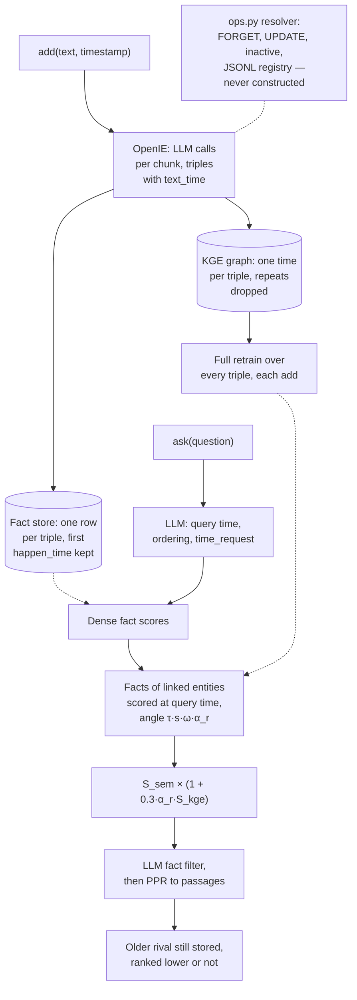

## 1. Executive Summary

RoMem is the code for *Time is Not a Label*, an EMNLP 2026 paper from Tencent: a
temporal memory library built on a fork of [HippoRAG](../hipporag/) that adds a
temporal knowledge-graph embedding to fact ranking. What it does differently is
refuse to resolve contradictions. Both "Obama was president" and "Biden became
president" stay stored, and at query time each triple is rotated by an angle
proportional to the query's timestamp and to a learned per-relation speed, so
the one whose phase matches the asked time outranks the other. The weak part is
the release: the package does not import at the pinned commit because the module
holding the bundled gate checkpoints was never committed, and the library
wrapper never refreshes its retrieval index after the first query.

The mechanism the paper names *geometric shadowing* is in the tree and matches
the paper. `RoMemChronoRModel` computes θ = τ·s·ω, multiplies it by
α_r = σ(MLP(φ(r))) from the relation's text embedding, and rotates head and tail
by it before a ChronoR-style product (`romem/kge/model/romem_chronor.py:76-135`).
The fusion in retrieval is multiplicative, `base * (1 + beta * boost)` with
`boost = S_kge * α_r`, so a fact that is semantically off-topic cannot be lifted
by being at the right time (`romem/RoMem.py:1156-1192`). That is the idea worth
taking: an evolving relation and a static one get different time behaviour from
one learned function of the relation's text, with no per-relation rule.

What surrounds it is research code. Every `add` retrains the embedding over the
whole graph. Retrieval makes up to three LLM calls per query. The repeat-event
case the README demonstrates collapses, since the knowledge graph keeps one
timestamp per distinct triple and drops later ones. The most informative file is
one nothing calls: `romem/ingestion/ops.py` holds a Mem0-style ADD, UPDATE,
FORGET resolver with an `inactive` status, an uncalled value-keyed filter for re-extraction
and an append-only JSONL registry. That is the destructive resolution the paper
argues against, written in full and never constructed.

**Licence.** The repository grants nothing: there is no `LICENSE` file, the
README names no licence, and no manifest declares one, so the code is all rights
reserved and reading it is not permission to run, modify or redistribute it.
The tree is HippoRAG-derived by its own docstrings (`romem/RoMem.py:362`, `:709`),
and HippoRAG's MIT notice, which that licence asks to be kept, appears nowhere in
it. The vendored DE-SimplE baseline, with 19 trained checkpoints, is under
*Attribution-NonCommercial-ShareAlike 4.0*
(`baselines/tkge/de-simple-master/LICENSE:1`), a non-commercial term the README
does not mention.

## 2. Mental Model

A memory is **a triple with a time it was said to happen**. The triple extractor
asks the model for `head`, `relation`, `tail`, `text_time` and `observed_time`
per fact, with `text_time` normalised to `YYYY-MM-DD` or empty
(`romem/prompts/templates/triple_extraction.py:4-21`). The code stores it as a
`TimedTriple` whose `happen_time` is the text time and whose `system_time` is
the observation time (`romem/utils/misc_utils.py:35-38`,
`romem/ingestion/openie_openai.py:145-165`).

A triple becomes a belief by being extracted, and it never stops being one.
There is no status, no supersession and no validity end. The design's claim is
that none is needed: a later contradicting triple is added beside the earlier
one, and the temporal embedding decides at each query which of them is in phase
with the asked time. The paper says this in as many words — memory is
append-only and contradictions co-exist.

Three things can change what a stored triple means later:

- **Its embedding moves.** Each `add` retrains the KGE over every triple it
  holds (`romem/kge/encoder.py:945-960`, `:1008-1016`), so a fact's score at a
  given time depends on everything added since.
- **The query time.** It comes from the caller's `time=` argument, or from an
  LLM call that returns a date, an earliest or latest ordering and whether the
  question asks for a time (`romem/RoMem.py:778-796`, `:917-1016`). With no
  time in the query the facts are scored at the wall clock.
- **Deletion of its document.** `RoMem.delete` removes the chunk, then every
  triple and entity no remaining chunk supports (`romem/RoMem.py:613-699`).

The weak point of the state machine is identity. The fact store keys a row on
the triple's text and skips a row it already holds, so a triple re-observed at a
new date keeps the first `happen_time` (`romem/ingestion/embedding_store.py:67-97`,
`romem/RoMem.py:435-441`). The KGE graph does the same: `add_timed_triples`
skips any `(h, r, t)` already in `_fact_set` (`romem/kge/knowledge_graph.py:90-94`).
"Obama consulted Xi Jinping" in 2013, 2014 and 2015, the README's own reranker
example, trains as one quadruple dated 2013-06-08.



## 3. Architecture

A Python library with no service. `romem/__init__.py` exports `RoMem`, the
pipeline class; `RoMemLLM`, a three-method wrapper; `RoMemReranker`, the KGE
alone; and `pretrain_gate` (`romem/__init__.py:1-6`). Retrieval structure is
HippoRAG 2's: an OpenIE knowledge graph of entity and passage nodes, fact,
passage and synonymy edges in igraph, dense fact retrieval, an LLM recognition
filter and Personalized PageRank (`romem/RoMem.py:1528-1682`, `:2603-2646`).
RoMem's additions are the `romem/kge` package, the time-aware extraction prompt,
the query-time extraction and the tunnel that fuses the two scores.

Persistence is a directory. `RoMem.__init__` makes
`<save_dir>/<llm>_<embedding>/` and opens three `EmbeddingStore`s, each one
parquet file, an igraph pickle and an OpenIE results JSON
(`romem/RoMem.py:112-170`, `romem/ingestion/builder.py:23-59`,
`romem/ingestion/embedding_store.py:40-42`). Every LLM response is cached in
SQLite under `save_dir/llm_cache` (`romem/llm/openai_gpt.py:145-162`). The KGE
is not part of what `RoMemLLM` saves. On the first retrieve after a restart,
`prepare_retrieval_objects` feeds every stored fact back into it and retrains
(`romem/RoMem.py:2066-2093`). Only the MultiTQ runner saves and reloads a KGE
checkpoint (`benchmarks/runners/multitq/romem_backend.py:156-173`).

The speed gate is pretrained on ICEWS05-15 transitions
(`romem/pretraining/build_gate_pretrain_data.py`,
`romem/pretraining/pretrain_alpha_r.py:120`) and loaded once into the KGE before
its first training run (`romem/kge/encoder.py:1088-1114`). `RoMemLLM` and
`RoMemReranker` find a bundled checkpoint through `get_gate_path`, imported from
`.checkpoints` (`romem/romem_llm.py:23`, `romem/romem_reranker.py:37`). That
module is not in the tree and never was. `git log --all -- romem/checkpoints`
returns nothing, `.gitignore` excludes only `.DS_Store` and `*.pyc`, and
`romem/__init__.py` imports both wrappers. By Python's import rules every import
of the package or a submodule therefore stops with `ModuleNotFoundError`, the
benchmark backends' `from romem import RoMem` included
(`benchmarks/runners/locomo/romem_backend.py:91`). That is inferred from the
source; nothing was run.

The README's layout names four more things the tree lacks: `scripts/`, which
every reproduction command calls; `dataset/`; `romem/pretrain_gate.py`; and
`baselines/HippoRAG`, `mem0` and `graphiti`. The baselines exist only as
benchmark adapters under `benchmarks/runners/`, with three TKGE baselines
vendored under `baselines/tkge/`. Committed `.pyc` files reference sources that
are absent, among them `tempusmem_backend`, `temporal_rot_distmult` and the
`icews`, `findkg` and `temporalwiki` loaders.

### Deployment and ergonomics

`pip install -r requirements-romem.txt`, an OpenAI key or a vLLM endpoint for
extraction, query-time extraction and the LLM filter, and an embedding model. A
GPU is used for KGE training when present (`romem/kge/encoder.py:1017`). Nothing
can be stored without the LLM, since extraction is the write. The store is
parquet, a pickle and JSON, inspectable with pandas, but `graph.pickle` and the
KGE checkpoints are loaded with `igraph.Graph.Read_Pickle` and `torch.load`
without `weights_only` (`romem/ingestion/graph_manager.py:17`,
`romem/kge/encoder.py:286`, `:337`). A `save_dir` from someone else is code.

## 4. Essential Implementation Paths

**Write.** `RoMemLLM.add` (`romem/romem_llm.py:150-171`) → `RoMem.index`
(`romem/RoMem.py:360`). Chunk records get `observed_time`, the caller's timestamp
or now (`:381-384`). `OpenIE.batch_openie` runs NER and triple extraction per new
chunk (`:390-392`); the triples go to `tkge_retriever.update` (`:400-415`), then
entities and facts are embedded with `happen_time`, `observed_time` and
`chunk_ids` in the row metadata (`:429-460`). Fact edges, passage edges and
synonymy edges are added and the graph is pickled (`:462-474`). `metadata`
on `add` is accepted and dropped. `index_triples` is the structured path, used by
the MultiTQ runner, that skips OpenIE (`romem/RoMem.py:476-599`).

**KGE update.** `TKGERetriever.update` → `TKGEEncoder.update_facts`
(`romem/kge/retriever.py:38-49`, `romem/kge/encoder.py:945-960`) →
`KnowledgeGraph.add_timed_triples`, which keeps a triple's first time
(`romem/kge/knowledge_graph.py:79-104`) → `_train` over all triples
(`romem/kge/encoder.py:1008`) for `tkge_steps_per_update` epochs, 200 by default
(`romem/utils/config_utils.py:206-209`).

**Retrieve.** `RoMemLLM.retrieve` → `RoMem.retrieve` (`romem/RoMem.py:701`). It
builds the in-memory arrays once (`:743-744`), takes the query time from the
override or the LLM (`:778-796`), scores facts densely (`get_fact_scores`,
`:2178`), runs the tunnel (`:813-820`), then `rerank_facts` (`:828-836`,
`:2427-2601`), then PPR over the graph or dense passage retrieval when no fact
survives (`:881-895`). `RoMemLLM` returns the passages under the key `"fact"`
(`romem/romem_llm.py:198-205`).

**Tunnel.** `_apply_tkge_tunnel` (`romem/RoMem.py:1018-1391`): link the query to
five entities by embedding (`:1044-1050`), collect their facts and cap them at
200 (`:1051-1058`), score at the query time or, for a when-question with an
ordering or with competing dates, at each fact's own `happen_time`
(`:1060-1132`), min-max normalise, weight by α_r and fuse (`:1151-1192`).

**Delete.** `RoMem.delete` (`romem/RoMem.py:613-699`). Not exposed on `RoMemLLM`
or `RoMemReranker`, and no benchmark runner calls it.

**Unwired.** `MemoryOpsManager` (`romem/ingestion/ops.py:33-497`) and
`Neo4jWriter` (`romem/ingestion/neo4j_writer.py`) are exported from
`romem/ingestion/__init__.py:9-26` and constructed nowhere.
`GraphBuilder.delete_facts`, the one path that would remove a triple from the
KGE, has no caller (`romem/ingestion/builder.py:103-108`).

## 5. Memory Data Model

Three parquet tables share one shape: `hash_id`, `content`, `embedding`,
`embed_text` and a JSON `meta` (`romem/ingestion/embedding_store.py:107-133`).
The id is an MD5 of the content with a `chunk-`, `entity-` or `fact-` prefix. A
fact's `content` is the Python repr of a list of three strings, and every reader
turns it back into a tuple with `eval` (`romem/RoMem.py:2044`, `:2075`, `:2544`).

| Store | Content | Metadata |
| --- | --- | --- |
| chunk | passage text | `observed_time` |
| entity | normalised phrase | `last_seen_time`, set once |
| fact | `str([h, r, t])` | `happen_time`, `observed_time`, `chunk_ids` |

Two time fields sit on each fact, and they are not two clocks in the
[bi-temporal](../../patterns/bi-temporal-fact-validity/) sense. `happen_time`
is a point, the date the text mentions, with no end. `observed_time` is the
caller's timestamp when one is passed, so in the README's own example it holds
the date of the event, and the ingestion wall clock is then kept nowhere.
`RoMemLLM.add` documents its `timestamp` as *"for when this information was
valid or observed"* (`romem/romem_llm.py:163-164`).

The KGE's own model is `KnowledgeGraph`: entity and relation id maps, `facts`,
`fact_times` and `fact_has_happen`, one entry per distinct triple
(`romem/kge/knowledge_graph.py:40-47`). It has no scope, no actor and no
provenance beyond the fact's chunk ids. There is no scoping field anywhere in
`romem/`; isolation is a separate `save_dir`.

## 6. Retrieval Mechanics

Retrieval is HippoRAG 2 with a temporal multiplier in front of the recognition
step. The dense fact score is min-max normalised and multiplied by
`1 + tkge_weight * α_r * S_kge`, where `tkge_weight` is 0.3
(`romem/RoMem.py:1187-1192`, `romem/utils/config_utils.py:182-185`). Only facts
attached to the five linked entities get a KGE score; every other fact keeps its
semantic score unchanged. A fact with no `happen_time` still gets a KGE score,
because the KGE was trained on it at time zero
(`romem/kge/time_utils.py:406-408`).

Which time a candidate is scored at depends on the question
(`romem/RoMem.py:1060-1132`). An explicit or extracted date scores all
candidates at that date. A *when* question with no date scores each fact at its
own `happen_time` if the question asks for the earliest or latest, or if one
`(head, relation)` pair has two distinct dates among the candidates. Otherwise
the wall clock is used. For ordering questions `rerank_facts` then sorts the
filtered facts by `happen_time` (`:2563-2589`).

The candidate cap takes the first 200 indices of a Python `set` of fact
indices, not the 200 best (`romem/RoMem.py:1057`). The α_r weighting is in a
`try` whose `except` falls back to uniform weights without a log line
(`:1158-1172`). `rerank_facts` catches every exception and returns no facts,
which sends the query to dense passage retrieval (`:2599-2601`, `:881-883`).
Each of these degrades the temporal signal silently rather than failing.

A query costs up to three LLM calls: the time extraction in `retrieve`, a
second one in `rerank_facts` when the first found no date and the question does
not ask for a time (`romem/RoMem.py:2457-2458`), and the DSPy recognition filter
(`romem/rerank.py:111-121`). Responses are cached on the exact messages, and the
time-extraction prompt carries today's date, so the cache holds for a day. For
temporal queries the passage-node weight in PPR drops from 0.05 to 0.0
(`romem/RoMem.py:885-887`, `romem/utils/config_utils.py:79-86`).

`rerank_facts` also accepts `observed_time_cutoffs` and `observed_time_bounds`
and drops facts observed outside them (`romem/RoMem.py:2469-2539`). No caller in
the tree passes either.

**Stale index.** `prepare_retrieval_objects` sets `ready_to_retrieve = True`
(`romem/RoMem.py:2142`), and only `delete` sets it back (`:699`); `index` and
`index_triples` never do. The fact keys, fact embeddings, passage keys and fact
tuples are the arrays built on the first retrieve. A fact added after that is in
the parquet store and the KGE, and is absent from every later retrieval in the
same process. The README's add-add-ask example works; add-ask-add-ask returns
stale results until restart.

## 7. Write Mechanics

Writes are synchronous and expensive. An `add` blocks on NER and triple
extraction for each new chunk, three embedding batches, synonymy-edge KNN over
all entities, and a KGE retrain over every triple for 200 epochs
(`romem/RoMem.py:390-474`, `romem/kge/encoder.py:959-960`). A retrievable fact
costs a retrain of the whole embedding. No background pass exists: nothing
consolidates, decays or summarises.

Deduplication is by exact text at three levels: the chunk store, the fact store
and the KGE graph, each skipping a key it holds. Extraction drops a triple whose
head or tail is the time expression and runs a triple validity filter
(`romem/ingestion/openie_openai.py:159-161`, `:178-184`, `romem/utils/llm_utils.py:203`). Nothing else filters
input. If the model's reply fails `json.loads`, the triple parser falls back to
a regex match passed to `eval` (`romem/ingestion/openie_openai.py:107-116`).
The pattern admits a `triples` list with no `]` inside it, so a passage that can
steer the extractor's output to a Python call reaches `eval` on that fallback.

Correction is deletion of the source document. `RoMem.delete` removes the
chunk, rewrites the OpenIE JSON without it, deletes the facts and entities no
other chunk supports and removes their graph vertices
(`romem/RoMem.py:636-697`). It does not touch the KGE. The deleted triple stays
in `KnowledgeGraph.facts` and keeps shaping every later training run; it cannot
be returned, because candidates come from the fact store. The remover that would
reach it, `KnowledgeGraph.remove_triples`, would empty the graph if anything
called it: it adds every remaining key to `_fact_set` and then re-adds them
through `add_timed_triples`, which skips keys already in `_fact_set`
(`romem/kge/knowledge_graph.py:111-127`).

**The resolver that is not there.** `MemoryOpsManager.resolve_new_facts` asks
the model to choose ADD, UPDATE, FORGET, MERGE or KEEP_BOTH for a new triple
against up to twelve facts sharing an entity, with the instruction that
observed time *"must not be used to judge factual validity"*
(`romem/ingestion/ops.py:160-196`, `:238-288`). UPDATE marks the targets
`inactive`. FORGET of the new fact marks the triple's own hash id `inactive`
(`:443-466`, `:468-497`). A method, `filter_inactive_timed_triples`, would drop
any later extraction of a triple so marked (`:141-158`). Nothing calls it, not
even `resolve_new_facts`, which puts a re-extracted triple to the model again
and on ADD rewrites its status to `active` (`:429-441`). Every change is
appended to `memory_registry.jsonl` (`:74-83`). The class is exported and
instantiated nowhere.

## 8. Agent Integration

None beyond a Python call. There is no MCP server, HTTP route, CLI or tool
schema in RoMem's own code. `RoMemLLM.ask` retrieves five passages, writes them
into a fixed prompt and calls the answer model through the OpenAI client,
returning an error string rather than raising on failure
(`romem/romem_llm.py:207-250`). `RoMemReranker` is the more portable surface: fit
a KGE on `(h, r, t, date)` tuples, `score` candidates at a time, `rerank` by the
same multiplicative fusion, `get_alpha` for a relation
(`romem/romem_reranker.py:139-250`). It needs the same missing checkpoint
module to import.

## 9. Reliability, Safety, and Trust

### What the shadowing buys and what it costs

The design keeps the history a destructive resolver throws away, and it never
asks a model to decide which of two facts is true. A question about 2019 and a
question about now read the same store. The cost is that correctness is a
ranking property. Nothing can say "this is false". An extraction error stays
retrievable for as long as its document exists, and whether an old fact is
shadowed depends on a KGE retrained on everything at every write. A relation the
gate scores near zero, *born in* in the paper's framing, does not rotate, so two
contradicting static facts are separated by semantics alone.

### Silent degradation

Three fallbacks remove the temporal signal without saying so: the α_r `except`,
the `rerank_facts` catch-all and the candidate cap taken from set order (section
6). A query-time extraction failure returns no time and scores at the wall clock
(`romem/RoMem.py:1015-1016`). None of these is logged at warning level except
the rerank error.

### Stored code

`eval` on stored fact content at three read sites, `eval` on a regex match of
model output at two extraction sites (`romem/ingestion/openie_openai.py:39`,
`:114`), and pickle loads of the graph and KGE checkpoints. The fact content is
written as a list repr by the code itself, so the store sites need a tampered
file; the extraction sites need only a steered model reply.

### Marks

No mark is awarded. The near-misses are the content of this section.

- **`tombstone`: declared and unwired, twice.** FORGET of a new fact writes
  `inactive` under the triple's hash, and `filter_inactive_timed_triples` would
  refuse that triple on later extraction (`romem/ingestion/ops.py:141-158`,
  `:443-466`). That is the shape of a value-keyed rejection. The filter has no
  caller, and `MemoryOpsManager` has no constructor call anywhere in the tree,
  so no path a user or agent reaches produces or reads the state.
- **`trust_state`: declared and unwired.** The registry's `active` and
  `inactive` status is read by `active_fact_ids` and the same filter, neither
  called; the resolver reads it only to print it into its prompt (`:205`,
  `:248`).
- **`audit_log`: declared and unwired.** `memory_registry.jsonl` is append-only
  and records each decision with its action, rationale and time, from the same
  class.
- **`bitemporal`: withheld.** Two times per fact, but `happen_time` is a point
  read only for ranking, `observed_time` is the caller's value whenever one is
  given, so record time is not kept apart, and the one filter on either axis,
  the observed-time bounds in `rerank_facts`, has no caller. The validity the
  design relies on is learned into the embedding, not stored.
- **`scope_enforced`: no.** No scope key on any record; one `save_dir` per
  instance is a physical partition.
- **`human_review`, `negative_eval`: no.** Nothing waits for a person, and the
  tree has no tests.

## 10. Tests, Evals, and Benchmarks

There is no test suite. A search for test files and `def test_` outside the
vendored baselines finds nothing, and the only workflow deploys `docs/` to
GitHub Pages (`.github/workflows/pages.yml`).

The evaluation is committed as output, not as a runnable harness. 57
`results.jsonl` files, 56 with a `details.jsonl` beside them, under
`benchmarks/reports/` hold per-question rows and summary rows for MultiTQ,
LoCoMo, DMR-MSC, FinTMMBench and LongMemEval, for RoMem and six adapters. The
runners and evaluators that wrote them are committed. The `scripts/*.sh` the
README runs them through, the datasets and the gate checkpoints are not, so no
result can be reproduced from the tree.

The paper is [arXiv:2604.11544](https://arxiv.org/abs/2604.11544), submitted
13 April 2026 and revised 25 August 2026. Its arXiv title, *Time is Not a Label:
Continuous Phase Rotation for Temporal Knowledge Graphs and Agentic Memory*,
differs in the subtitle from the README's, and arXiv lists five authors where
the README's commented-out BibTeX lists two. The equation for the angle and
the gate in the code match the paper's.

I recomputed every summary row from its per-question rows with a script reading
the JSONL as data, and each matched. Against the paper's v2 tables:

| Table cell | Paper | Committed run |
| --- | --- | --- |
| MultiTQ, RoMem, GPT-5-mini: MRR, Acc@10 | 0.337, 0.392 | `multitq_romem/20260303161815`: 0.3371, 0.392 |
| MultiTQ, RoMem, LLaMA-3.1-70B: MRR | 0.316 | `multitq_romem_server/20260309091913`: 0.3164 (the earlier run: 0.3042) |
| MultiTQ, "Zep", GPT-5-mini: MRR | 0.192 | `multitq_graphiti/20260305142510`: 0.1922 |
| DMR-MSC, "Zep", GPT-5-mini: MRR | 0.170 | `dmr_msc_graphiti`: 0.1699 (`dmr_msc_zep`: 0.2603) |
| LoCoMo, RoMem, GPT-5-mini: four-category recall | 0.857 | `locomo_romem`: 0.8571 |
| LoCoMo, RoMem, LLaMA-3.1-70B: temporal recall | 0.759 | `locomo_romem_server`: 0.7674 |
| FinTMMBench, RoMem, GPT-5-mini: MRR | 0.728 | the later of two runs: 0.7278 (the earlier: 0.6987) |

Three findings follow. The tables recompute from the committed files, with one
cell off: the LLaMA LoCoMo temporal recall is 0.7674 in the file and 0.759 in
the paper. Where a system has several runs, the paper reports the latest. For
RoMem that is also the best, in all three cases. And the column the paper calls
Zep is the Graphiti adapter throughout. In DMR-MSC, where a Zep Cloud run is
also committed, it scored higher than the reported column. Graphiti is
[Zep](../zep/)'s open engine, so the label is defensible and the table does not
say it. The Graphiti adapters' per-question LoCoMo recall is identical under the
two model configurations, which is why the paper's two Zep rows are identical.

The paper's MultiTQ "2-3x" holds for answer accuracy, 0.392 against 0.102 to
0.128, and for MRR only against LiCoMem, 0.337 against 0.149; against
[HippoRAG](../hipporag/) it is 0.337 against 0.203. The ablation that carries the
argument — 0.1044 MRR without the semantic gate, 0.0452 with discrete time — has
no committed run, and the ICEWS05-15 72.6 MRR has no committed result file;
`benchmarks/runners/tkge/romem_tkg_benchmark.py` is the harness. The README's
gate values for *Consult*, *Make a visit* and *Make statement* depend on the
missing checkpoint.

## 11. For Your Own Build

### Steal

- **A per-relation time speed from the relation's text.** `speed_mlp` maps a
  relation embedding to α in (0, 1) and scales the rotation angle by it
  (`romem/kge/model/romem_chronor.py:76-101`). Unseen relations get a speed
  without a rule table, and the same α weights the boost at retrieval.
- **Multiplicative temporal fusion.** `base * (1 + β·α·S_kge)` cannot lift an
  off-topic fact by its date (`romem/RoMem.py:1187-1192`). An additive fusion
  can.
- **Choose the scoring time from the question shape.** An asked date, a when
  question with an ordering, a when question with competing dates, or now
  (`romem/RoMem.py:1060-1132`). The case split is the reusable part even
  without a KGE.

### Avoid

- **A retrieval cache that the write path does not invalidate**
  (`romem/RoMem.py:2142`, `:699`).
- **One timestamp per distinct triple** in a store meant for recurring events
  (`romem/kge/knowledge_graph.py:90-94`).
- **A full retrain on every write.** It makes write latency grow with the store.
- **`eval` on model output and on stored content**, and pickle for a store a
  user might share.

### Fit

Study this to decide whether temporal ranking can replace temporal resolution
in your store. Do not deploy it: the release does not import, has no licence and
no tests, and every write costs a training run. The design suits a corpus of
dated events queried with explicit times, which is MultiTQ's shape. It suits
agent memory less, because the facts an agent most needs to retire — a
preference changed, a mistaken extraction — have no time in the text and no way
to be marked wrong. A team that wants the idea should take `RoMemReranker`'s
fusion into a store that also keeps a status, and keep the shadowing for the
cases the status cannot decide.

## 12. Open Questions

- Whether `romem/checkpoints` and `scripts/` exist in an unpublished tree, and
  whether the committed results came from code identical to the pin.
- What a `tempusmem` result directory and the orphaned `.pyc` files record:
  `locomo_tempusmem` is dated 6 February 2026, before every RoMem run.
- Why the Graphiti adapter returns identical LoCoMo recall per question under
  GPT-5-mini with OpenAI embeddings and LLaMA-3.1-70B with BGE-M3.
- Whether `MemoryOpsManager` was an ablation arm, an earlier design or a planned
  mode; the paper's text that was read does not mention it.
- How the shadowing behaves for static relations the gate scores near zero when
  two contradicting values are both stored.

## Appendix: File Index

| Path | What it holds |
| --- | --- |
| `romem/RoMem.py` | The pipeline: `index`, `index_triples`, `delete`, `retrieve`, `_apply_tkge_tunnel`, `rerank_facts`, `prepare_retrieval_objects` |
| `romem/romem_llm.py` | `RoMemLLM` add, retrieve, ask; imports the missing `.checkpoints` |
| `romem/romem_reranker.py` | `RoMemReranker` fit, score, rerank, get_alpha |
| `romem/kge/model/romem_chronor.py` | Rotation angle, speed gate, ChronoR scoring |
| `romem/kge/model/romem_distmult.py` | DistMult backbone and `_rotate` |
| `romem/kge/encoder.py` | KGE training, gate checkpoint loading, staged gate schedule |
| `romem/kge/knowledge_graph.py` | One time per triple; `remove_triples` |
| `romem/kge/retriever.py` | `TKGERetriever.update` and `score` |
| `romem/ingestion/openie_openai.py` | NER and timed triple extraction, `eval` fallback |
| `romem/ingestion/embedding_store.py` | Parquet stores keyed on content hash |
| `romem/ingestion/ops.py` | Unwired ADD, UPDATE, FORGET resolver and registry |
| `romem/prompts/templates/triple_extraction.py` | Extraction prompt with `text_time` |
| `romem/pretraining/` | Gate pretraining data mining and training |
| `romem/utils/config_utils.py` | `BaseConfig` defaults |
| `benchmarks/runners/*/romem_backend.py` | Benchmark adapters for RoMem |
| `benchmarks/reports/` | Committed per-question and summary results |
| `baselines/tkge/` | ChronoR, RotatE and DE-SimplE, each with its own licence |

### Recorded searches

Every absence claim above rests on one of these, run at the tree root with
`git -C <clone>`; a positive control is listed first where the pattern could
fail silently.

```sh
git log --all --oneline -- romem/checkpoints scripts dataset        # empty
git ls-files | grep -i -E 'checkpoints?/|get_gate_path'               # empty
git grep -n -E 'get_gate_path|checkpoints' -- '*.py'                  # only the two imports and docstrings
git ls-files | grep -i -E '(^|/)(licen[sc]e|copying|notice|third.party)'   # three files, all under baselines/tkge/
git grep -n -i -E 'licen[sc]e|copyright' -- README.md docs/index.html 'romem/*.py' 'benchmarks/*.py' 'eval/*.py'   # empty
git grep -n -i -c -E 'happen_time' -- romem                           # control: 43 in RoMem.py
git grep -n -i -E 'supersed|invalidat|contradict|tombstone|retract|status' -- romem   # only ops.py and unrelated status strings
git grep -n -E 'MemoryOpsManager|active_fact_ids|filter_inactive_timed_triples|resolve_new_facts|memory_registry'   # ops.py and the __init__ export only
git grep -n -E 'Neo4jWriter|neo4j_writer'                             # __init__ export only
git grep -n -E 'delete_facts|delete_chunks_by_texts|use_tkge_facts|fact_encoder='   # builder.py only
git grep -n -E 'remove_facts|remove_triples' -- '*.py'                # builder.py, encoder.py, knowledge_graph.py
git grep -n -E '\.delete\(' -- '*.py'                                 # RoMem.py stores, builder.py, the Zep adapter
git grep -n 'ready_to_retrieve' -- romem                              # set True at 2142, False at 238 and 699
git grep -n -E 'observed_time_bounds|observed_time_cutoffs'           # RoMem.py only, no caller
git grep -n -E 'load_tkge_checkpoint|save_tkge_checkpoint|load_full_checkpoint|save_full_checkpoint' -- '*.py'   # MultiTQ runner and the reranker only
git grep -n -i -E 'user_id|tenant|namespace|agent_id|session_id' -- romem   # only the EmbeddingStore namespace prefix
git grep -n -i -E 'audit|event_log|append_only' -- romem              # empty
git ls-files | grep -i -E '(^|/)(tests?|test_[^/]*\.py|[^/]*_test\.py|conftest\.py)'   # data files under baselines/ only
git grep -n -l -E 'import pytest|import unittest|def test_' -- '*.py' # one vendored baseline file
git grep -n -E '(^|[^a-z_.])eval\(' -- romem                          # six sites
git grep -n -E 'torch\.load|pickle\.load|Read_Pickle' -- romem        # three sites
git grep -n -i -E 'discrete|force_time_gate_one' -- romem benchmarks eval   # no discrete-time variant
```

The result recomputation read each `benchmarks/reports/*/*/*/results.jsonl` as
JSON with `python3 -I` from a script outside the clone, averaged the
per-question metrics and compared them with the summary rows.

## History

**2026-11-26** — [`7f3a96a816f14a38d1c3512b926e88f5ab9ae40c`](https://github.com/Tencent/RoMem/commit/7f3a96a816f14a38d1c3512b926e88f5ab9ae40c). First reading, read only, from a full clone at the head of `main`, the commit triage selected. Screened first: no auto-run surface, nothing inside the seven-day cooldown, no build-time execution, four unpinned requirements files, two of them under the vendored `baselines/tkge/`. No licence in the tree; the three vendored baselines carry their own. Nothing was installed, built or run, and there are no tests to count. The paper's arXiv id was checked against its title and its v2 tables were compared with the committed result files, which were recomputed from their per-question rows. No marks; three are declared and unwired in `romem/ingestion/ops.py` ([section 9](#9-reliability-safety-and-trust)).
