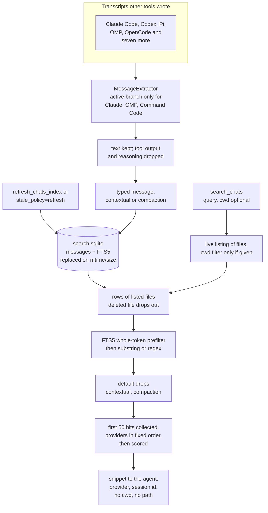

## 1. Executive Summary

UniSessions is a Python SDK and CLI that converts coding-agent session files
between twelve tools, exports them as training traces, and serves an MCP
server that searches every session on the machine for the agent. What is
notable is that recall follows each tool's own resume logic: a branch the user
rewound away from in Claude Code, OMP or Command Code is not indexed, and
injected instruction blocks are typed and kept out of default results. What is
weak is the ranking, which scores the first fifty matches collected in a fixed
provider order rather than the best fifty.

The README states the memory goal in the maintainer's words: an agent told
that a bug was fixed in another session should *"go check and learn from it"*.
The mechanism is a derived SQLite FTS5 index over the transcripts Claude Code,
Codex, Pi, OpenCode and eight other tools already write. Nothing is extracted
and no model is called. A message is a recall unit as written.

Conversion is the larger part of the code. It moves a whole session into
another tool's store so that tool can resume it, which carries a conversation
across agents as a transcript rather than as recall. Trace export writes the
same sessions out as HuggingFace, OpenAI fine-tuning or ShareGPT records; it is
outside memory and is not covered further.

The store holds no correction of its own. A message stops being recalled when
its file is deleted, when the source tool's rewind moves it off the active
branch and the session is re-indexed, or when its type is `contextual` or
`compaction`. Nothing can mark a recalled message as wrong.

One mark is earned: `negative_eval`, on two populated tests that keep an
abandoned branch and an injected AGENTS.md block out of search. Section 9 gives
the reason for each of the six withheld.

## 2. Mental Model

A memory here is **a past message, believed in the sense of being returned,
from the moment its session is indexed**. There is no candidate stage and no
verified stage. The agent decides what a snippet is worth.

Four things decide whether a message is in the recallable set:

- **Which branch it sits on.** For Claude Code the active branch is the leaf
  named by the last `last-prompt` record, walked back through `parentUuid`
  (`session_sdk/converters.py:611-653`). OMP follows its own
  `resolveSessionLeafId` (`:407`), and Command Code walks back from the last
  entry (`:529-544`). A rewound exchange stays in the file and leaves the
  index at the next re-index.
- **Its type.** `contextual` covers text the harness injected under the user
  role: AGENTS.md blocks, `<environment_context>`, hook prompts and the rest
  of 25 markers matched in the first 120 characters (`:150-181`), plus format
  flags such as Claude's `isMeta` and OMP's `synthetic`. `compaction` covers
  summaries. Both are excluded from a default search.
- **Whether its file is still listed.** A search reads only rows whose path is
  in the live listing of the providers asked (`session_sdk/search.py:1242-1252`,
  `:709`).
- **Whether the index has caught up.** The default `stale_policy` is `skip`, so
  a session changed since its last indexing serves its old rows, and a new one
  serves nothing, until a refresh.

The one user act that changes belief inside a session is OMP's `/clear`, which
turns every earlier message `contextual` (`converters.py:356-357`).

## 3. Architecture

Three layers in one package. `session_sdk/stores.py` reads and writes each
tool's native store: JSONL files for most, SQLite databases for OpenCode,
grok-cli, Freebuff and T3 Code, and AES-GCM encrypted trajectory files for
Windsurf, decrypted with a key constant in the source (`stores.py:1251`).
`session_sdk/converters.py` extracts a common message list and builds records
for each target. `session_sdk/search.py` holds the recall index and engine.
`unisessions/cli.py` and `unisessions/mcp_server.py` sit on top.

The index is one SQLite file. Its path is `UNISESSIONS_SEARCH_INDEX`, or
`unisessions/search.sqlite` under `LOCALAPPDATA`, `XDG_CACHE_HOME` or
`~/.cache` (`unisessions/mcp_server.py:19-25`). It opens in WAL mode with
`synchronous=NORMAL` (`search.py:513-515`).

The MCP server builds a new engine, twelve store objects and a database
connection on every tool call (`mcp_server.py:28-44`, called at `:56`, `:77`,
`:94`, `:166`, `:229`). Section 6 covers what that costs.

Default store locations come from a class named `WindowsDefaults`, which
resolves under the home directory and reads environment overrides for some
tools (`session_sdk/paths.py:38-60`).

### Deployment and ergonomics

`pip install unisessions` with the `mcp` extra, then register
`unisessions-mcp` with the agent. Nothing else runs: no daemon, no model, no
API key. The index is an ordinary SQLite file that can be deleted and rebuilt
from the transcripts with one refresh call. Dependencies are ranges in
`pyproject.toml` with no lockfile. `cryptography` is a core dependency for the
Windsurf path; `orjson` and `google-re2` are optional speedups.

## 4. Essential Implementation Paths

- **Index schema and maintenance.** `session_sdk/search.py`: schema v2 and the
  v1 drop `:505-571`; `ensure` `:142-184`; `_needs_index` `:605-617`;
  `_index_prepared`, delete-then-insert per session, `:635-666`;
  `prune_deleted` `:595-603`, called only from `refresh_index` `:997`.
- **Message extraction.** `session_sdk/converters.py`: contextual markers
  `:150-181`; `from_omp` `:327-366`; `_omp_active_branch` `:407`;
  `_commandcode_branch` `:529-544`; `_claude_branch` `:611-653`;
  `from_session` dispatch `:1269-1286`.
- **Search.** `search.py`: `SessionSearchIndex.search` `:290-418`;
  `search_sessions` `:420-501`; `_rows` and `_rows_batch` `:668-744`;
  `build_fts_query` `:756-768`; `_regex_fts_query` `:773-787`;
  `_relevance_score` `:866-905`; `SessionSearchEngine.search` `:1042-1164`;
  `_scoped_summaries` `:1242-1252`; `_cwd_matches` `:1261-1271`; `_matcher`
  `:1296-1358`.
- **MCP surface.** `unisessions/mcp_server.py:47-254`.
- **SDK escape hatch.** `raw_search_rows`, `search.py:236-288`, `:1010-1040`.
- **Conversion write.** The `--write` and `--on-conflict` options,
  `unisessions/cli.py:711`, `:809`; per-store `write` methods in
  `session_sdk/stores.py`.

## 5. Memory Data Model

`sessions` holds one row per transcript file: `path` as primary key,
provider, session id, cwd, timestamp, `mtime_ns`, `size` and
`message_count` (`search.py:532-541`).

`messages` holds one row per extracted message: path, provider, session id,
cwd, timestamp, `message_index`, role, `message_type` and text
(`:542-553`). It is indexed on path and on provider with timestamp.
`messages_fts` is an external-content FTS5 table over `text` with the
`unicode61` tokenizer, kept in step by insert and delete triggers
(`:556-567`).

The text is `TextMessage.text` only. Thinking and tool calls exist on the
model (`session_sdk/models.py:33-45`) and are not written to the index
(`search.py:639-652`).

Scope keys on the record are the cwd and the provider. There is no user,
agent or tenant key, which fits a single-user machine.

Time is one field: the message timestamp, or the session's when the message
has none (`:645`). It is when the source tool recorded the message.

There is no correction chain, no supersession field and no TTL. Identity is
the file path; a session is replaced whole when its file changes.

## 6. Retrieval Mechanics

Retrieval is tool-mediated. The agent calls `search_chats` for messages or
`search_sessions` for sessions ranked by match count.

**The prefilter is whole-token.** Literal mode turns the query into an FTS5
phrase, with variants for apostrophes and split contractions
(`search.py:756-768`, `:790-840`). The Python matcher afterwards is a
substring find (`:1332-1356`). FTS5 with `unicode61` does not match a token
prefix, so a query for `auth` never reaches the matcher for a message saying
`authentication` (section 10 records the scratch check).

**A regex is prefiltered by the words in its source.** `_regex_fts_query`
takes every run of two or more letters from the pattern text and ORs them as
FTS5 terms (`:773-787`). An escape or a character class glued to a word
changes the term: `\bauth\b` yields `bauth`, and `[Ee]rror` yields `ee` and
`rror`. Neither matches a stored token, so the search returns nothing for text
the regex would match. A regex with no qualifying run falls back to the 2,000
newest rows per batch (`:316`, `:739`).

**Hits are collected, then scored.** `SessionSearchIndex.search` walks rows in
FTS5 rank order, applies the matcher, the exclusions and the per-session cap,
and stops when it holds `max_results` (`:339-386`). Only then does it sort by
its own score (`:388`). The engine searches providers in the order the stores
were registered, Codex, Pi, OpenCode, Claude Code and on, and stops at
`max_results` across them (`:926-948`, `:1125-1126`). With the default of 50
and five per session, ten matching Codex sessions fill the response and Claude
Code is never searched. The tool docstring describes the result as *"ranked by
relevance score"* (`unisessions/mcp_server.py:136-138`).

The score is match density times ten plus a position term, less 0.15 for a
compaction and up to 0.5 for the share of code blocks, multiplied by up to five
for keywords close together (`search.py:866-905`). Identical text is
collapsed on its first 500 characters, with a `duplicate_count` and the
earliest timestamp (`:351-359`). A second dedup runs across providers on the
snippet (`:1128-1138`).

**Batches rank separately.** Path lists are split into batches of 900 for the
SQL `IN` clause, and each batch carries its own `LIMIT` and its own rank order
(`:681-694`, `:740-743`). For a provider with more than 900 sessions the first
batch's rows come first in the concatenated list, and collection stops before
later batches are reached.

**What the agent gets.** A `search_chats` hit carries rank, score, provider,
session id, timestamp, role, type, a snippet of 300 characters each side,
duplicate count and match positions (`:57-70`). It does not carry the cwd or
the file path, which the result object holds. `search_sessions` does return
the cwd (`:82-90`).

**Cost per call.** Each MCP call builds fresh stores, so the per-file listing
memo (`session_sdk/stores.py:33-56`) and the five-second listing cache
(`search.py:1239-1247`) start empty every time. The comment on the second
reads *"long-lived engines (the MCP server) must see new sessions"*; the
server's engine lives for one call. Every search therefore lists and reads the
header of every session file of every provider asked. `docs/mcp-server.md:181`
quotes 35 to 40 ms for a cached search; that figure was not reproduced.

## 7. Write Mechanics

Recall has no write path of its own. The agent's transcript is the write, and
UniSessions indexes it on request.

A session is re-indexed when its file's `(mtime_ns, size)` differs from the
stored pair (`search.py:605-617`). Its rows are deleted and reinserted inside
the batch's transaction (`:162-182`, `:635-666`). A T3 Code thread has a
virtual path under its database file, so every thread of that database is
re-indexed when the database changes (`:579-593`).

Indexing happens in two places: `refresh_chats_index`, which also prunes rows
of vanished files, and a search with `stale_policy="refresh"`. The default is
`skip`. `max_refresh_sessions` and `max_refresh_bytes` make a refresh refuse
rather than run long (`:155-158`). A session that fails to parse is recorded
in `failures`, an in-memory list, and skipped (`:135-136`, `:165-169`).

### Operational cost

A refresh parses every changed session and blocks the calling tool until it
finishes. Under the default policy a new message is retrievable after the next
refresh call and not before; nothing schedules one. No pass rewrites the
whole index except the v1-to-v2 migration, which drops the old tables and
rebuilds on the next refresh (`:519-529`). Injection is bounded by
`max_results` and `context_chars`, defaulting to 50 snippets of up to about
600 characters each; it arrives as a tool result, after any cached prompt
prefix.

### Conversion

Conversion writes a session into another tool's native store when `--write` is
given, with `--on-conflict` choosing skip, overwrite, fork under a new id, or
update (`unisessions/cli.py:711`). The receiving tool then resumes the session
with its history in context. That is cross-agent continuation of a whole
transcript, with no selection and no index.

## 8. Agent Integration

Five MCP tools (`unisessions/mcp_server.py:47-254`). The `search_chats`
docstring tells the agent the workflow: check `index_status`, call
`refresh_chats_index` if stale, then search with `skip`. A model that skips the
first two steps on a fresh install searches an empty index and gets an empty
result, which the docstring warns about (`:146`).

The agent controls every narrowing argument: provider, cwd and match mode,
session ids, roles, message types, time window, exclusion keywords and the
regex. Nothing is injected automatically. There are no hooks and no
session-start context.

The SDK exposes the same engine, plus `raw_search_rows`, which returns index
rows with full text and no live-listing predicate (`search.py:236-288`).
`docs/search.md:136` states that it skips *"live-source pruning"*.

Adapting the server to another agent costs nothing: it reads files that
already exist and speaks MCP.

## 9. Reliability, Safety, and Trust

### Recall reaches every project on the machine

The cwd filter applies only when the model passes one, and its default is
none (`search.py:1261-1271`). A search from one project therefore returns
snippets from every other project's sessions, in every tool. The `search_chats`
hit omits the cwd, so the agent cannot tell from the result where a snippet
came from.

### Secrets are indexed and returned

The index stores message text as extracted. No redaction runs on the indexing
path or the read path. A credential pasted into any session in any tool is
searchable by every agent connected to the server.

### Deletion is immediate for search and late for the file

Deleting a transcript removes it from `search_chats` and `search_sessions` at
the next call, because both read only listed paths. The text stays in
`search.sqlite` until `refresh_chats_index` prunes it (`:595-603`, `:997`),
and `raw_search_rows` returns it until then.

### Stale reads under the default policy

`skip` serves the rows indexed at the last refresh. A Claude Code session the
user rewound after that refresh still returns the abandoned branch until the
next refresh.

### Transport

HTTP, SSE and streamable HTTP transports are available, bound to `127.0.0.1`
by default and to whatever `--host` names otherwise, with no authentication in
`unisessions/` (`mcp_server.py:264-296`). With a non-loopback bind, every
transcript on the machine is readable by anyone who reaches the port.

### Uncertainty

Nothing represents it. A message from a session that ended in a dead end is
returned with the same standing as one that fixed the bug. The compaction
penalty of 0.15 is the only term in the score that concerns where a text came
from.

### Marks

- **`negative_eval` — earned.** Two tests on the search path keep particular
  material out of a populated index: the OMP abandoned branch against a hit on
  the active branch of the same session, and the AGENTS.md block against its
  own reappearance under `include_contextual=True`.
- **`scope_enforced` — withheld.** The cwd is stored on every session and
  message and applied when supplied. Omitting it is the default and searches
  every project, and the value is a model argument.
- **`trust_state` — withheld.** `message_type` filters reads, but it records
  what kind of text a message is, assigned at extraction from markers and
  format flags. It is not a judgement that a message is true or false, and
  nothing changes it afterwards except OMP's `/clear` at the next re-index.
- **`tombstone` — withheld.** No value is recorded as rejected. A deleted or
  rewound message is gone from the index, and nothing stops the same text
  being recalled from another session.
- **`bitemporal` — withheld.** The only time is the source's message
  timestamp.
- **`audit_log` — withheld.** No record of index changes is kept; the parse
  failures list lives for one engine.
- **`human_review` — withheld.** No surface shows or approves recalled
  content.

## 10. Tests, Evals, and Benchmarks

I ran none of the suites. Counts are from reading: 169 `unittest` methods in
11 files. Most cover conversion fidelity per provider. Fourteen touch the
search path: six in `tests/test_search_index_v2.py`, six in `SearchTests` in
`tests/test_conversion.py`, and one each in `tests/test_omp.py` and
`tests/test_t3.py`.

The search tests worth trusting:

- `test_search_indexes_the_active_branch` (`tests/test_omp.py:662-675`) runs
  over the `rich_session` fixture, whose docstring names *"an abandoned branch
  that must not be read"* (`:92-116`). It requires the active branch's
  `changelog` to return the session and `abandoned` to return nothing.
- `test_search_supports_regex_keywords_roles_and_contextual_exclusion`
  (`tests/test_conversion.py:629-701`) requires the user-role filter to return
  exactly one of two matching messages, and an AGENTS.md block to be absent by
  default and present with `include_contextual=True`.
- `test_reindexing_a_grown_session_replaces_its_rows` asserts the message and
  FTS row counts after a session grows, which pins the delete-then-insert
  (`tests/test_search_index_v2.py:36-49`).
- `test_vanished_files_do_not_break_status_and_deleted_sessions_are_pruned`
  asserts zero message rows after a deleted transcript is refreshed
  (`:61-73`). It checks the table, not a search.

One assertion cannot fail. The `exclude_keywords` case searches for `test`
while excluding `billing`, over a fixture in which both messages containing
`test` also contain `billing`, then asserts with `all(...)` that no snippet
contains `billing` (`tests/test_conversion.py:703-704`). The result is empty by
construction, and the assertion holds for any implementation.

Nothing tests the cwd filter on `search_chats`, a search across providers, the
order in which hits are collected, a regex containing an escape, a substring
query, or a rewind after the last refresh under `skip`.

I ran two scratch scripts of my own, not the project's code, to check the
prefilter claims in section 6. The token pattern from `_regex_fts_query`
turned `\bauth\b` into `bauth` and `[Ee]rror` into `Ee` and `rror`. An FTS5
table with the `unicode61` tokenizer, holding *"the auth error happened"* and
*"fixed the authentication bug"*, matched 0 rows for `"bauth"`, for
`"ee" OR "rror"` and for `"auth"` against the second text, and 1 row each for
`"auth"`, `"error"` and `"authentication"` where the whole token was present.

The tests run only in `.github/workflows/publish.yml`, triggered by a tag push
(`:3-5`, `:59-60`). No workflow runs them on a push to `main` or a pull
request. The README badge reads 163 passing.

There is no retrieval evaluation, no benchmark and no paper.

## 11. For Your Own Build

### Steal

- **Index the transcripts the agent already writes.** The corpus is full on
  day one, the index can be thrown away, and there is no capture path to fail.
- **Follow the tool's own resume logic when reading a transcript.** The branch
  the tool would resume is the branch the user kept; walking it at index time
  turns every rewind into a correction.
- **Type injected text at extraction and exclude it by default.** An AGENTS.md
  block under the user role is not something the user said; a flag to bring it
  back keeps the forensic case open.
- **Limit reads to files that still exist.** A predicate on the live listing
  makes deletion take effect for search without waiting for a prune.
- **Refuse a refresh above a stated size.** `max_refresh_sessions` and
  `max_refresh_bytes` turn an unbounded parse into an error the caller sees.

### Avoid

- **Stopping collection before scoring.** A `break` at the result limit before
  the sort makes the relevance order a property of the iteration order.
- **Prefiltering a regex by the words in its source.** Escapes and classes
  become literal terms; parse the pattern or skip the prefilter.
- **A token index under a substring matcher.** The matcher promises what the
  prefilter has already ruled out.
- **Dropping the scope from the result.** A cross-project hit the agent cannot
  attribute is worse than a miss.
- **A per-call engine under a cache written for a long-lived one.**

### Fit

This suits one developer who moves between several coding agents on one
machine and wants an agent to search its own history when asked. The cost is
a pip install and a refresh call, and nothing is lost if the index is deleted.

It does not suit anyone who needs recall to arrive without being asked, to
stay inside one project, or to keep credentials out of a model's context. The
first needs hooks this project does not have; the second and third need a
default scope and a redaction pass on the indexing path.
[deja-vu](../../systems/deja-vu/) and [brain-mcp](../../systems/brain-mcp/)
build the same shape with hooks and with redaction respectively.

## 12. Open Questions

- Does Pi write rewound branches into the same session file? `from_pi` reads
  every record in file order with no branch walk (`converters.py:282`), while
  the test fixture writes `parentId` links and OMP, which descends from Pi, is
  documented as a tree.
- How often does a Codex-heavy user see Claude Code results at all under the
  default `max_results`? The ordering follows from the code and was not run.
- Is the per-call engine in the MCP server deliberate, given the cache
  comments in `search.py` and `stores.py`?

## Appendix: File Index

| Path | Role |
| --- | --- |
| `session_sdk/search.py` | Index schema, refresh, prune, search, scoring, cwd filter |
| `unisessions/mcp_server.py` | The five MCP tools and the transport options |
| `session_sdk/converters.py` | `MessageExtractor`, branch walks, contextual markers, conversion builders |
| `session_sdk/stores.py` | Per-tool readers and writers, listing memo, Windsurf decryption |
| `session_sdk/models.py` | `SessionSummary`, `TextMessage`, `NativeSession` |
| `session_sdk/paths.py` | Default store locations |
| `unisessions/cli.py` | Conversion, bulk export, trace export, conflict policy |
| `tests/test_search_index_v2.py` | Re-index, new sessions, prune, schema move |
| `tests/test_conversion.py` | `SearchTests` at `:611-852` |
| `tests/test_omp.py` | The abandoned-branch search test |
| `.github/workflows/publish.yml` | The only workflow that runs the tests |

### Recorded searches

Run from the repository root at the pinned commit with `git grep`.

- **No redaction on indexing or search.**
  `git grep -n -i -E 'redact|scrub|mask_|sanitiz' -- session_sdk unisessions`
  returns only `sanitize_claude_cwd` in `session_sdk/paths.py:246-249` and its
  callers in `stores.py`, which turn a cwd into a directory name.
- **No authentication on the MCP server.**
  `git grep -n -i -E 'auth|bearer|verifier' -- unisessions` returns nothing;
  `git grep -n -i 'host' -- unisessions/mcp_server.py` matches `:272` and
  `:293`.
- **No hooks or automatic injection.**
  `git grep -n -i -E 'SessionStart|UserPromptSubmit|hooks?\.json|settings\.json' -- . ':!tests'`
  returns nothing; `git grep -n -i 'hook' -- session_sdk` matches the
  contextual marker `<hook_prompt` and format fields.
- **One caller of prune.** `git grep -n 'prune_deleted' -- .` returns the
  definition at `session_sdk/search.py:595` and `refresh_index` at `:997`.
- **`raw_search_rows` has no product caller.**
  `git grep -n 'raw_search_rows' -- . ':!docs'` returns the two definitions,
  a README example and one test.
- **No search in the CLI.** `git grep -n -i -E 'search|index' -- unisessions/cli.py`
  returns nothing; `git grep -n 'add_parser("list")' -- unisessions/cli.py`
  matches `:288`.
- **No embedding or vector arm.**
  `git grep -n -i -E 'embedding|vector|faiss|bm25' -- session_sdk unisessions`
  returns nothing; `git grep -n -i 'fts5' -- session_sdk` matches
  `search.py:507` and `:556`.
- **No delete or forget tool.**
  `git grep -n -i -E 'def (forget|delete|remove)' -- unisessions session_sdk/search.py`
  returns nothing; `git grep -c '@mcp.tool' -- unisessions/mcp_server.py`
  returns 5.
- **No paper reference.**
  `git grep -n -i -E 'arxiv|bibtex|doi\.org|CITATION' -- .` returns nothing;
  `git grep -n -i 'license' -- pyproject.toml` matches.
- **Tests run only on tags.**
  `git grep -n -E '^on:|tags:|Run tests' -- .github/workflows/publish.yml`
  returns `:3`, `:5` and `:59`; `docs.yml` triggers on changes under `docs/`
  and runs no tests.

## History

**2026-11-24** — [`14e7e55f4c9254ef5eff2dfa0392bc266c8e4d77`](https://github.com/vibheksoni/session-export/commit/14e7e55f4c9254ef5eff2dfa0392bc266c8e4d77). First reading, from a full clone at the head of `main`, the commit triage selected. Screened first: no auto-run surface, nothing inside the seven-day cooldown, no build-time execution, three unpinned surfaces (`pyproject.toml` with no lockfile, `requirements.txt`, `requirements-mcp.txt`); no submodules. Docs read as data. Nothing was installed, built or run, and the 169 test methods were not run; two scratch scripts of my own checked FTS5 token matching. One mark: `negative_eval` ([section 9](#9-reliability-safety-and-trust)). Hits are collected in a fixed provider order before scoring, and recall crosses projects with no redaction.
