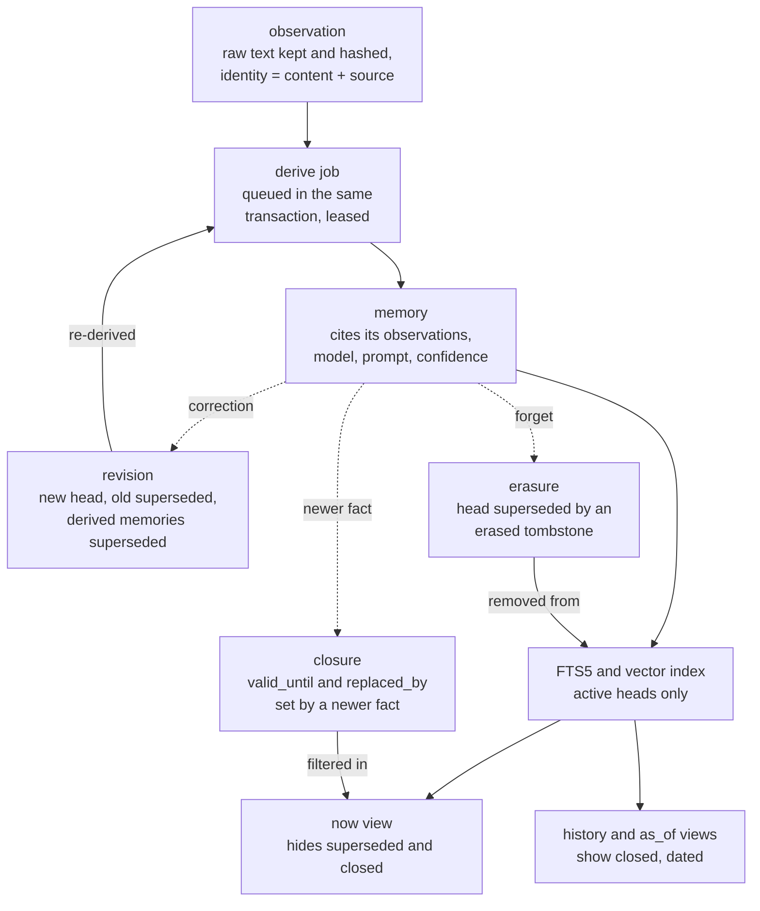

## 1. Executive Summary

Severian is **a local memory engine for agents**. Every message is stored as an
append-only, hashed observation. Severian derives short memories from it, each
citing the observation it came from, and hands the answering model a cited
context block within a character budget. It runs on SQLite by default or on
PostgreSQL with pgvector, makes no network call unless a collection opts into a
cloud deriver, and serves Hermes Agent, MCP clients, an HTTP API, a Python SDK and
a CLI from one engine. It is MIT licensed.

What is notable is the correction model:

- **Nothing is deleted.** The SQLite backend imports no `delete`, and neither
  backend issues a `DELETE` against the canonical table.
- **Every correction keeps history.** A revised observation supersedes its old
  head, the memories derived from that head are superseded, and graph relations
  lose it as a source. The revision is queued for derivation in the same
  transaction, so a corrected fact replaces the old one instead of vanishing.
- **Erasure is a tombstone.** An erased memory is superseded by an `:erased`
  record, which is never itself an active head.
- **A newer fact closes an older one.** With truth resolution on, the older memory
  gets `valid_until` and `replaced_by_id`, leaves the `now` view, and stays
  available to `history` and `as_of` reads.

Four marks are earned: `scope_enforced`, `audit_log`, `bitemporal` and
`negative_eval`.

What is weak:

- **Erasure hides; it does not remove.** `erase_observation` updates only the
  original's `superseded_by_id`, so the erased text stays in the canonical store
  and in every export.
- **On stdio MCP the model chooses the scope.** The shipped entry point binds no
  principal, so every tool call names its own tenant, profile, collection, agent
  and session.
- **The self-maintenance the README advertises is unwired.** Consolidation,
  curation and retention run only as `dream` jobs, and nothing in the product
  enqueues one; the tests and benchmark scripts do.

## 2. Mental Model

A memory is **a cited derivation from immutable evidence**. The observation is
what was said; a memory is one reading of it, carrying the model id, the prompt
version and the source ids that produced it. A belief is whatever active memory
heads the scope holds, and it can be traced to the observation that caused it.

### How a thing becomes a belief

`ingest_observation` normalises the text, hashes the raw bytes and the content,
and writes the observation and a `derive` job in one transaction. Identity is the
content digest plus the source's `uri`, `source_id` or `idempotency_key` when one
exists, so the same evidence ingested twice is one observation
(`src/severian/infrastructure/sqlite.py:342-361`). A worker leases the job and
runs the derivation gateway under the collection's policy, with cloud derivation
off unless the policy allows it. The default gateway copies the observation into
one `fact` memory at confidence 0.5. A Qwen model or the opt-in
`SEVERIAN_USER_FACTS` pass extracts short facts per turn. Entity extraction
upserts entities and typed relations with the observation as their lineage.
Projection then upserts active heads into the FTS5 and vector indexes.

### How a belief stops being one

Five ways, none of which deletes a row:

- *Revision* (`revise_observation`, `revise_memory`) writes a new head, points the
  old one at it, supersedes memories derived from the old observation, and
  retracts relations that lose their last source (`src/severian/application/service.py:276-300`).
- *Rollback* restores a historical revision as the active head.
- *Erasure* writes an `[erased]` memory whose own `superseded_by_id` is the
  reserved `:erased`, then supersedes the original by it. Erasing an observation
  erases every active memory derived from it (`service.py:304-418`).
- *Closure* (`SEVERIAN_TRUTH_RESOLUTION`) sets `valid_until` on an older memory when
  a newer one replaces it. Rules decide, and a model is consulted for user facts.
  The close is conditional on the memory still being open and unsuperseded
  (`src/severian/application/truthresolution.py:426-480`).
- *Consolidation* supersedes near-duplicates in favour of the newest. It is
  reachable only as a `dream` job (§3).

## 3. Architecture

A hexagonal Python package. `domain/` holds the models. `application/` holds the
services: ingestion, derivation, retrieval, truth resolution, event time, user
facts, anticipation, dreaming, the worker and the projection coordinator.
`infrastructure/` holds the SQLite and PostgreSQL repositories, the FTS5 index,
the vector indexes, the embedding backends, the snapshot exporter, the rebuild
tool and the integrity audit. Adapters for Hermes, MCP, HTTP, SDK and CLI sit on
top of one composition root, `build_bundle`.

**The canonical store is one table of typed JSON.** `records` has an id, a
`record_type`, the five scope columns, a content hash, an identity key, a status,
lease columns and the payload. A partial unique index on
`(record_type, scope…, identity_key)` makes ingestion idempotent per scope
(`sqlite.py:52-80`). Observations, memories, entities, relations, jobs, outbox
events, audit events and task notes are all rows of it.

**The indexes are projections, and they can be rebuilt.** Each write appends an
outbox event in its own transaction; the projection coordinator claims events
with a lease and converges each touched id to its current canonical state. An
active head is upserted; anything superseded, erased or missing is removed from
the index (`src/severian/application/projections.py:95-140`).
`severian rebuild-vectors` rebuilds an index side by side.
`severian audit` opens the store, the FTS index and the vector index read-only. It
reports missing or orphaned index rows, memories citing gone sources, stuck or
dead-lettered jobs, and broken replacement chains, and repairs only what it can
fix without deleting (`src/severian/infrastructure/audit.py:1-17`).

**Dreaming is a job kind with no producer.** `ConsolidationService`,
`CurationService` and `RetentionPolicyService` run when the worker drains a job of
kind `dream` with a `mode` (`src/severian/application/worker.py:448-463`). Every
`enqueue_job` call in `src/` and `scripts/` queues `derive` work or the extra
kinds a saved turn adds. The only `dream` jobs in the tree are written by tests,
and the scale lanes call the services directly. The README's *"Looks after
itself"* describes code that a deployment does not run.

### Deployment and ergonomics

`pip install severian` or the Hermes plugin; SQLite files under the Hermes data
root by default. The canonical store and its WAL siblings are created mode 0600.
PostgreSQL needs a DSN and the pgvector extension. Embeddings default to a
deterministic hash; Qwen3-Embedding-0.6B runs locally or in a shared sidecar.
An optional Rust module accelerates scoring. Behaviour is chosen by roughly twenty
`SEVERIAN_*` environment switches. The README marks five as recommended, and the
published benchmark ran with user facts, date stamps, truth resolution, the
re-ranker and conflict notes on.

## 4. Essential Implementation Paths

**Ingest** — `IngestionService` → `SQLiteRepository.add_observation_and_enqueue`
(`src/severian/infrastructure/sqlite.py:364-444`).

**Derive** — `Worker` (`src/severian/application/worker.py`) →
`DerivationService.derive_observation` (`src/severian/application/derivation.py:145`)
→ `add_memories_batch` / `publish_derivation` (`sqlite.py:712-944`) → truth
resolution, event time and anticipation when switched on.

**Search** — `MemoryService.search` (`src/severian/application/service.py:520-654`)
→ `HybridRetrieval.search` (`src/severian/application/retrieval.py:154-312`) →
`_apply_closures` / `_truth_view` (`service.py:656-727`) → `assemble_context`
(`:780`).

**Correction** — `revise_observation`, `erase_memory`, `erase_observation`,
`rollback_memory` (`service.py:276-460`); `revise_observation`,
`supersede_memory`, `revise_memory`, `rollback_memory`, `close_memory`
(`sqlite.py:598-1392`).

**Truth resolution** — `TruthResolver.resolve`, `_forward`, `_backward`
(`src/severian/application/truthresolution.py:395-480`).

**Maintenance** — `ConsolidationService.consolidate`, `CurationService.curate`,
`RetentionPolicyService` (`src/severian/application/dreaming.py`).

**Adapters** — `src/severian/integrations/hermes.py`, `src/severian/mcp/server.py`
and `__main__.py`, `src/severian/api/app.py`, `src/severian/cli/app.py`.

## 5. Memory Data Model

An `Observation` carries the five-part `Scope`, the normalised `content` and its
hash, the immutable `raw_content` and `raw_hash`, a `source` dictionary,
attachment references with SHA-256 digests, and `revision_of_id` /
`superseded_by_id` (`src/severian/domain/models.py:114-150`).

A `Memory` carries its scope, `kind`, `content`, `source_observation_ids`
(required, at least one), `model_id`, `prompt_version`, `confidence`, the
revision pair, `occurred_at` and `occurred_until`, `cues` and a `trigger` for
instructions-for-later, `valid_until` and `replaced_by_id`, and a `usage_count`
(`models.py:169-200`). `add_memory` rejects a source observation from another
scope and dedups on `(kind, content, sources, model_id, prompt_version)`.

A `Relation` carries subject, predicate, object, `valid_from`, `valid_to`, its
source lineage and `retracted_at`. Three predicates — `works_at`, `located_in`,
`based_in` — are single-valued, so a newer value ends the older relation
(`models.py:21`, `:255-330`). Its `valid_to` is the wall clock when the newer
relation arrives (`sqlite.py:1236-1262`), and the one producer of relations,
`EntityExtractionService` (`src/severian/application/extraction.py:247`), passes
no validity. So relation validity is record time.

**`TruthState` is computed, not stored.** `current`, `historical`, `transition`
and `concurrent` (`models.py:24-35`) are assigned to a ranked pool at read time,
from the closure fields or from a text rule comparing results. No record carries a
truth state, and no field holds candidate, verified or rejected.

**Time is three things, kept apart.** `created_at` is when Severian saved the
record. Message time, read from the source's `timestamp` or a similar key, is
when the user said it, and `as_of` filters on it. `occurred_at` and
`occurred_until` are when the thing happened, found by rules over the text. For
an imported history the first two differ by years, which is the case the
benchmark harness ingests.

## 6. Retrieval Mechanics

`HybridRetrieval.search` runs FTS5 BM25 and the vector index, each filtered on all
five scope columns, plus an optional cue index. It fuses them by weighted
reciprocal rank, with a floor that drops vector-only hits below
`min_vector_score`, since a hash embedding always yields some positive score. It
then adds session neighbours and graph links. With a query window it boosts
memories whose event period overlaps (`src/severian/application/retrieval.py:154-375`).
The service over-fetches, re-ranks with a cross-encoder when one is configured,
demotes results that carry nothing, and applies the view:

- **`now`** drops memories closed by a newer fact, unless the close came after
  `as_of`, and drops results the text rule judges replaced.
- **`history`** keeps them, dated and labelled `historical`, with their
  predecessors listed.
- **`changes`** keeps only memories that replaced something.

A question that asks about the past switches `now` to `history` on its own
(`service.py:619-622`).

`assemble_context` builds the cited block under a character budget. Hermes ships
8,000 characters; the benchmark write-up measures 16,000 as worth about 5 points
on BEAM and LongMemEval. Conflict notes, on by default, add a line naming up to two
disagreements among the returned memories. Only the user's own first-person
statements count, and a denial is compared clause by clause
(`src/severian/application/conflicts.py:1-12`).

**Shared search widens one dimension.** `search_shared` runs one exact-scope
search for the caller's agent and for each agent the caller lists, then merges.
The source states where the rule lives: *"the visibility rule lives at the call
site, not in the store"* (`retrieval.py:457-519`). Over MCP the call site is the
model, which supplies `agent_ids`.

Failure modes:

- **Meta-memories compete with facts.** Consolidation writes a `consolidated`
  memory per merged group, and curation writes a `curation_review` memory at
  confidence 1.0. Both are active heads, projected like any other, and no read
  filters on `kind`. Since nothing enqueues dreaming, this only happens where a
  caller runs it.
- **Event time only ranks.** A question about last March boosts memories dated
  then and still returns the rest.

## 7. Write Mechanics

Ingest blocks only for the canonical write: the observation, its derive job, an
outbox event and an audit row in one transaction. Derivation is asynchronous. A
memory is searchable after the worker drains its job and projects it, or
immediately when `search(..., derive=True)` derives pending observations inline,
which the benchmark adapter uses. Jobs are leased, retried with backoff, and
dead-lettered after their attempts; stale outbox claims are reaped back to
pending.

**An exact repeat of corrected or erased evidence is absorbed.** The ingest
identity is the content digest, plus a source identity when the source carries
one. A verbatim re-ingest without a source id therefore matches the original
observation even after it has been revised or erased. `add_observation_and_enqueue`
then returns that superseded observation and its finished job, and nothing is
derived (`sqlite.py:374-412`). A user who repeats a sentence after deleting it does
not get it back. A changed word, or a source that carries a fresh message id,
makes a new observation and a new memory, as `erase_memory`'s docstring says:
*"erasure does not poison future ingestion"*. This is idempotency, not a rejection
record, and it is the near-miss for `tombstone`.

Truth resolution runs after each derivation. A newer user fact can close an older
one by rule or by the configured model; a newer memory saved first can be closed
backwards by rules only. Each closure is recorded on the memory itself and in an
in-memory `Closure` list.

### Operational cost

Default derivation makes no model call. User facts add one local-model call per
turn in the background. The benchmark ran `gpt-4.1-mini` for that step. Search
costs two index queries, one canonical read per candidate, and a re-rank when one
is configured. Consolidation is pairwise over a scope's active memories, bounded
by an LSH pre-filter.

## 8. Agent Integration

**Hermes** is the primary host. The plugin is a memory provider with search,
ingest, correct, forget, shared-search and task-note tools, and a prefetch that
injects the context block before each turn. Scope comes from the plugin's
configuration.

**MCP** exposes seven tools over stdio: ingest, search, get, correct, forget,
task progress, shared search. Every call carries the full five-part scope as
arguments (`src/severian/mcp/server.py:60-86`). `_resolve_mcp_scope` would pin
tenant and profile to a bound principal, but `python -m severian.mcp` constructs
the server without one, so the scope is whatever the model sends.

**HTTP** optionally resolves an API key to a principal and pins tenant and profile
from it, rejecting a request that names others with 403 (`src/severian/api/app.py:57-72`).
Without a resolver it runs in loopback development mode.

Task notes are working state per task key, replaced in place with history kept,
and never derived, projected or searched.

## 9. Reliability, Safety, and Trust

### Scope

The boundary is in the storage layer. `_scope_predicates` applies all five
dimensions to every canonical read, `_require_scope` refuses a blank one before
any query, `_require_collection` refuses a collection owned by another tenant, and
both indexes filter on all five columns. A cross-scope `get_observation` or
`get_memory` raises `NotFoundError`, and `assemble_context` and `context_block`
fail closed on a hit from another scope.

The limit is who picks the scope. With an authenticated principal, tenant and
profile are fixed and collection, agent and session are the client's choice, so
the per-agent and per-session boundaries are parameters, not identities. Without a
principal, the stdio MCP default, the model chooses all five.

### Erasure

`erase_observation` writes a tombstone observation, `[erased]`, as a revision of
the original and supersedes the original by it. It erases each active memory
derived from it, retracts relations, and rebuilds the projection. The original
row keeps `content` and `raw_content`: `revise_observation` updates only
`superseded_by_id` on it (`sqlite.py:598-648`). So "forget" removes the value from
search, context and the indexes, as `test_erased_observation_leaves_no_trace_in_search`
asserts, and leaves the text in the SQLite file, in a PostgreSQL row and in a
`severian export` snapshot. The docstrings say history keeps the record *"for
audit"*. A deployment that has to honour a deletion request needs a purge the
tree does not provide.

### Audit

Each create, revision and rollback inserts an outbox event and an `audit` record
in the write's own transaction, and the consolidation pass appends a
`dreaming.merge` record per superseded duplicate. Nothing updates or deletes an
audit row. The log names the action and the target id with empty metadata. The
values are recoverable from the revision chain, which is append-only in the same
sense. Five paths change a payload without an audit row:

- `supersede_memory`;
- `close_memory`;
- `supersede_memories_for_source`;
- `retract_relations_for_source`;
- relation ending.

So an erasure shows in the log only as the tombstone's `memory.create`.
`CurationService`'s marker memory says *"review proposals in audit"*, but it writes
none, and the worker discards the report it returns (`worker.py:453`).

### Marks

`scope_enforced`, `audit_log`, `bitemporal` and `negative_eval` are earned; the
frontmatter records carry the evidence and the limits.

- `tombstone` is withheld. The `:erased` record is a deletion marker keyed on a
  memory id, and the docstring rules out suppression. The verbatim-repeat
  absorption in §7 is keyed on evidence identity and records no rejection.
- `trust_state` is withheld. Truth states are computed per read, supersession and
  closure are revision and time, and contradictions become a note.
- `human_review` is withheld. Curation *"proposes, policy/approval disposes"*,
  and no approval surface exists in `src/` or `web/src`.

## 10. Tests, Evals, and Benchmarks

1,203 test functions in 125 files: unit, application, contract tests run against
both backends, adversarial repository cases, snapshot integrity, interface parity,
auth, the CLI and the benchmark harness itself. CI runs ruff, `mypy --strict`,
pip-audit and pytest, then validates the benchmark manifest. The negative cases
behind the mark are in §9 and the frontmatter.

**The OmniMemEval figures recompute from committed aggregates.**
`docs/benchmarks/omnimemeval/results-2026-10.json` holds per-category scores and
counts for the run. The category-weighted means give 87.33 on LoCoMo against the
stated 87.34, 90.60 on LongMemEval and 71.62 on BEAM 100K. The file names the
harness commit, the Severian commit (`4467853`, 35 commits before this pin, with
799 lines of `src/` changed since), the answer model `gpt-4.1-mini` and the judge
`gpt-4o-mini`, and says each value was copied from run outputs under
`~/data/benchmarks/h2h-p1`. Those per-question files are not committed, so the
paired bootstrap ranges cannot be recomputed from the tree.

The write-up is candid about its own limits:

- the Severian row is a self-run, not a board entry;
- it is one run, with the repeat dropped and the change disclosed;
- Severian hands the answering model more text than the systems it is compared
  with: 5,662 tokens per question on LoCoMo against LCM-X's 1,660.

It also reports re-running LCM-X through the same pipeline within 0.65 of its
published scores. No paper is cited.

I read the tests and the evidence files and ran nothing. The screen found no
auto-run surface and nothing inside the dependency cooldown, and two build-time
execution paths, `native/build.rs` and `tests/conftest.py`, which a reading does
not need to trigger.

## 11. For Your Own Build

### Steal

**Queue derivation in the same transaction as the evidence.** An observation that
exists without its derive job, or a job pointing at nothing, is the crash residue
this rules out, and the revision path does the same so a correction cannot
vanish between two writes.

**Converge projections to canonical state, not to event order.** Deciding each
touched id by its current head — upsert if active, remove otherwise — means a late
create event for a since-corrected memory cannot re-index a stale fact.

**Close instead of overwrite, and date the close by the statement.** Recording
`valid_until` from the newer message's own time keeps `as_of` reads honest for
imported histories, where save time is meaningless.

**Make blank scope a storage error.** Refusing a blank dimension before the query
runs, and failing a cross-scope context hit closed, puts the boundary where a
new call site cannot forget it.

**Audit the store read-only.** An integrity check that cannot write a byte, plus
a repair that only re-queues and re-indexes, is safe to run against production.

### Avoid

**Don't call it erasure if the text stays.** Superseding a record removes it
from reads; a deletion request needs the content gone from the row and the
export, with the tombstone keeping only the fact that something was removed.

**Don't let the client choose the security dimensions.** An MCP entry point that
binds no principal hands the model the tenant id; bind it at launch.

**Don't advertise maintenance nothing schedules.** A job kind with a consumer and
no producer is a feature only in the README.

**Don't index your own bookkeeping.** A summary memory listing merged ids, or a
review marker at confidence 1.0, spends the context budget the facts need.

### Fit

This suits **a developer or a small team running agents locally who need memory
that can be corrected and traced**. Every answer cites the turn it came from, a
wrong fact can be revised or rolled back without losing history, and the scope
model separates users and agents at the storage layer. The Hermes path is the
most complete, and PostgreSQL is there when SQLite is not enough.

It suits less well anyone who must delete on request, since erasure keeps the
text, or who exposes the MCP server to a model across tenants without wrapping it
in a principal. A deployment that wants the self-maintenance has to schedule the
dream jobs itself.

## 12. Open Questions

- **Is a purge planned?** Erasure keeps raw text by design; whether a hard-delete
  mode for privacy requests is intended is not stated.
- **Which commit should the benchmark be read against?** The published run is at
  `4467853`, and the 35 commits since touch derivation, retrieval and the Hermes
  adapter.
- **Is dreaming meant to be scheduled by the host?** The services are complete and
  tested; neither the Hermes plugin nor the CLI enqueues them.

## Appendix: File Index

**Domain** — `src/severian/domain/models.py`, `text.py`, `errors.py`.

**Services** — `src/severian/application/service.py`, `retrieval.py`,
`derivation.py`, `extraction.py`, `truthresolution.py`, `eventtime.py`,
`userfacts.py`, `conflicts.py`, `fillbudget.py`, `projections.py`, `worker.py`,
`dreaming.py`, `anticipation.py`, `graph.py`.

**Storage** — `src/severian/infrastructure/sqlite.py`, `postgresql.py`, `fts.py`,
`vector.py`, `pgvector_index.py`, `snapshot.py`, `rebuild.py`, `audit.py`.

**Adapters** — `src/severian/integrations/hermes.py`, `src/severian/mcp/server.py`,
`src/severian/mcp/__main__.py`, `src/severian/api/app.py`,
`src/severian/auth/`, `src/severian/cli/app.py`, `plugins/hermes/severian/`.

**Tests** — `tests/benchmarks/test_retrieval_fixes.py`,
`tests/application/test_correction_integrity.py`, `test_service.py`,
`test_tier3_memory.py`, `test_dreaming.py`, `tests/contract/`.

**Benchmarks** — `docs/benchmarks/omnimemeval-2026-10.md`,
`docs/benchmarks/omnimemeval/results-2026-10.json`, `docs/release-gates.md`.

### Recorded searches

Run from the repository root at the pinned commit with `/usr/bin/git grep`.

- **No row deletes.** `git grep -n -E 'delete\(|DELETE' -- src/severian/infrastructure/postgresql.py`
  returns nothing, and the SQLite backend's `sqlalchemy` import at `sqlite.py:13`
  names no `delete`.
- **No update selects an audit row.** Every `update(records)` in
  `src/severian/infrastructure/sqlite.py` filters on an id, an
  `observation`/`memory`/`job`/`outbox` record type or a status, and none on
  `record_type == "audit"`.
- **Nothing in the product enqueues dreaming.** `git grep -n -E 'enqueue_job\(' -- src scripts plugins`
  returns the port, both backends' definitions, the extra-kinds loops at
  `sqlite.py:392` and `postgresql.py:522`, and a derive job in
  `scripts/run_derive_worker_profile.py:152`;
  `git grep -n '"dream"' -- tests` returns the five test enqueues.
- **No read filters on kind for meta-memories.**
  `git grep -n -E 'curation_review|consolidated' -- src` returns only
  `dreaming.py`.
- **No approval surface.**
  `git grep -n -i -E 'approve|approval|pending_review|review_queue|needs_review' -- src web/src`
  returns the dreaming docstring and the CLI's approved-path policy.
- **The stdio MCP server binds no principal.**
  `git grep -n -E 'SeverianMCPServer\(|principal=' -- src` returns only
  `src/severian/mcp/__main__.py:42`, with no `principal` argument.
- **Relations get no validity from their producer.**
  `git grep -n -E 'add_relation\(' -- src` returns the one caller at
  `extraction.py:247`, which passes subject, predicate and object only.
- **Event time and truth resolution are off by default.**
  `git grep -n -E 'SEVERIAN_EVENT_TIME|SEVERIAN_TRUTH_RESOLUTION' -- src` returns
  the switch readers and comments marking both off by default.
- **No paper.** `git grep -n -i -E 'arxiv|bibtex|@article|doi\.org' -- README.md docs`
  returns nothing.

## History

**2026-11-09** — [`bdb14b04ffa014148d4665f239688ca0856561da`](https://github.com/Sahil-SS9/Severian/commit/bdb14b04ffa014148d4665f239688ca0856561da). First reading, from a full clone of `main`. Screened first: no auto-run surface, nothing inside the seven-day cooldown, two build-time execution paths (`native/build.rs`, `tests/conftest.py`) and two floating manifests beside lockfiles. I installed and ran nothing; the suite was read, not run, and the OmniMemEval aggregates were recomputed from the committed JSON. Four marks: `scope_enforced`, `audit_log`, `bitemporal` and `negative_eval` (§9).
